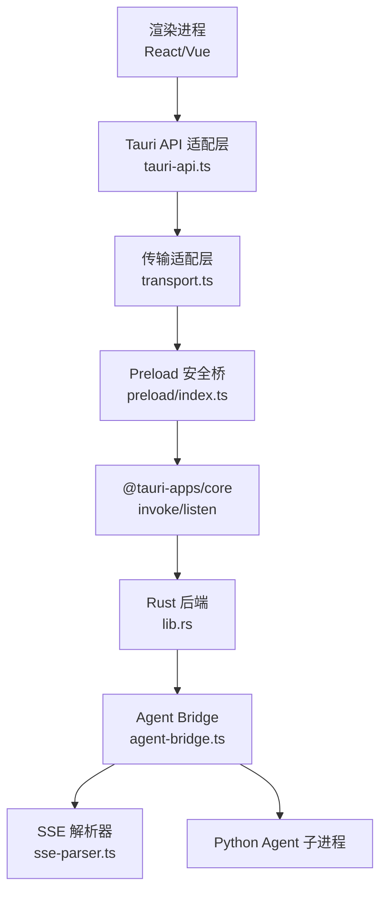
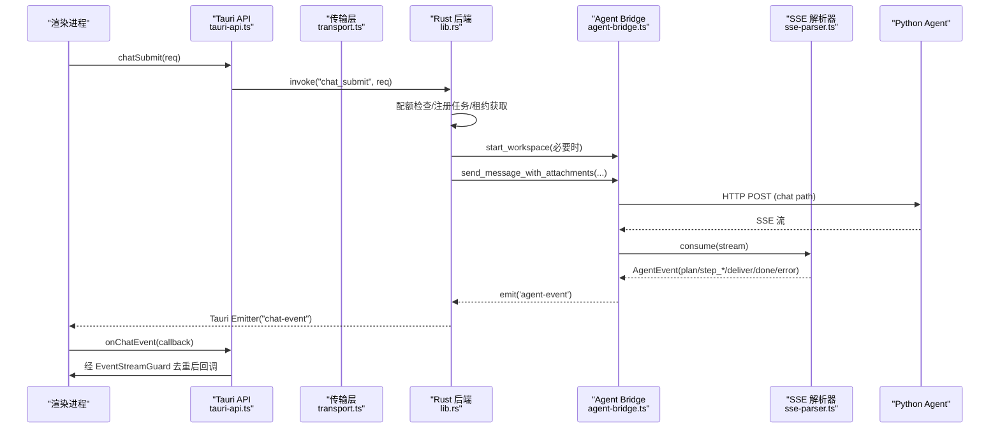
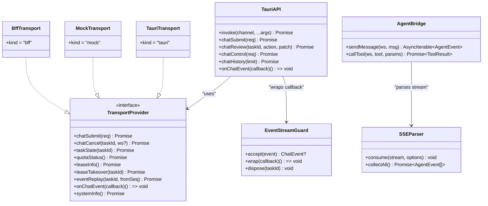
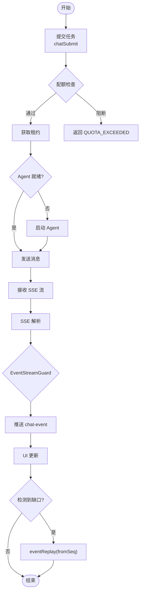

# IPC 通信机制

<cite>
**本文引用的文件**
- [src/preload/index.ts](file://tongtian-tauri/src/preload/index.ts)
- [src/renderer/lib/tauri-api.ts](file://tongtian-tauri/src/renderer/lib/tauri-api.ts)
- [src/renderer/lib/transport.ts](file://tongtian-tauri/src/renderer/lib/transport.ts)
- [src/renderer/lib/event-stream-guard.ts](file://tongtian-tauri/src/renderer/lib/event-stream-guard.ts)
- [src/main/bridge/agent-bridge.ts](file://tongtian-tauri/src/main/bridge/agent-bridge.ts)
- [src/main/bridge/sse-parser.ts](file://tongtian-tauri/src/main/bridge/sse-parser.ts)
- [src/shared/types.ts](file://tongtian-tauri/src/shared/types.ts)
- [src/shared/contracts.ts](file://tongtian-tauri/src/shared/contracts.ts)
- [src-tauri/src/lib.rs](file://tongtian-tauri/src-tauri/src/lib.rs)
</cite>

## 目录
1. [简介](#简介)
2. [项目结构](#项目结构)
3. [核心组件](#核心组件)
4. [架构总览](#架构总览)
5. [详细组件分析](#详细组件分析)
6. [依赖关系分析](#依赖关系分析)
7. [性能考虑](#性能考虑)
8. [故障排查指南](#故障排查指南)
9. [结论](#结论)
10. [附录](#附录)

## 简介
本文件面向通天办公在 Tauri 框架下的前后端 IPC 通信机制，重点说明：
- Preload 安全隔离与白名单通道
- Tauri API 封装（命令调用、事件订阅）
- SSE（Server-Sent Events）解析与实时数据更新保障
- 断线重连与事件重放策略
- 异步操作与超时控制
- 安全与性能优化建议

## 项目结构
本项目采用“渲染进程 → Preload → Tauri/Rust 后端”的三层通信模型，并通过传输适配层屏蔽底层差异（本地 Tauri、Mock、未来云端 BFF）。

图表来源
- [src/renderer/lib/tauri-api.ts:39-170](file://tongtian-tauri/src/renderer/lib/tauri-api.ts#L39-L170)
- [src/renderer/lib/transport.ts:90-143](file://tongtian-tauri/src/renderer/lib/transport.ts#L90-L143)
- [src/preload/index.ts:129-182](file://tongtian-tauri/src/preload/index.ts#L129-L182)
- [src-tauri/src/lib.rs:794-873](file://tongtian-tauri/src-tauri/src/lib.rs#L794-L873)
- [src/main/bridge/agent-bridge.ts:304-346](file://tongtian-tauri/src/main/bridge/agent-bridge.ts#L304-L346)
- [src/main/bridge/sse-parser.ts:40-85](file://tongtian-tauri/src/main/bridge/sse-parser.ts#L40-L85)

章节来源
- [src/preload/index.ts:1-183](file://tongtian-tauri/src/preload/index.ts#L1-L183)
- [src/renderer/lib/tauri-api.ts:1-186](file://tongtian-tauri/src/renderer/lib/tauri-api.ts#L1-L186)
- [src/renderer/lib/transport.ts:1-234](file://tongtian-tauri/src/renderer/lib/transport.ts#L1-L234)
- [src-tauri/src/lib.rs:1-873](file://tongtian-tauri/src-tauri/src/lib.rs#L1-L873)

## 核心组件
- Preload 安全桥：通过 contextBridge 暴露最小化 API，严格白名单校验通道。
- Tauri API 适配层：统一 invoke 映射到 Rust command，统一 onChatEvent 订阅 chat-event 事件流，并集成事件守卫去重与缺口检测。
- 传输适配层：抽象 TransportProvider，当前实现为 TauriTransport（基于 window.tongtianAPI），预留 Mock/BFF 实现以支持未来云端切换。
- Agent Bridge：管理 Python Agent 子进程生命周期，发起 HTTP/SSE 请求，解析事件并转发。
- SSE 解析器：按标准 SSE 格式解析 event/data，支持多行 data、错误与结束回调。
- Rust 后端：注册 tauri::command，处理任务提交、审阅、控制、历史、配额、租约、事件重放等，并通过 Tauri Emitter 推送事件。

章节来源
- [src/preload/index.ts:9-182](file://tongtian-tauri/src/preload/index.ts#L9-L182)
- [src/renderer/lib/tauri-api.ts:15-170](file://tongtian-tauri/src/renderer/lib/tauri-api.ts#L15-L170)
- [src/renderer/lib/transport.ts:34-143](file://tongtian-tauri/src/renderer/lib/transport.ts#L34-L143)
- [src/main/bridge/agent-bridge.ts:94-346](file://tongtian-tauri/src-main/bridge/agent-bridge.ts#L94-L346)
- [src/main/bridge/sse-parser.ts:40-239](file://tongtian-tauri/src/main/bridge/sse-parser.ts#L40-L239)
- [src-tauri/src/lib.rs:127-599](file://tongtian-tauri/src-tauri/src/lib.rs#L127-L599)

## 架构总览
下图展示一次聊天提交流程：前端调用 Tauri API → Rust command → 配额检查/租约获取 → 启动/复用 Agent 实例 → 发送消息至 Python Agent → SSE 事件回推 → 前端事件守卫消费。

图表来源
- [src/renderer/lib/tauri-api.ts:91-115](file://tongtian-tauri/src/renderer/lib/tauri-api.ts#L91-L115)
- [src-tauri/src/lib.rs:127-237](file://tongtian-tauri/src-tauri/src/lib.rs#L127-L237)
- [src/main/bridge/agent-bridge.ts:304-346](file://tongtian-tauri/src/main/bridge/agent-bridge.ts#L304-L346)
- [src/main/bridge/sse-parser.ts:50-85](file://tongtian-tauri/src/main/bridge/sse-parser.ts#L50-L85)

## 详细组件分析

### Preload 安全隔离机制
- 使用 contextBridge.exposeInMainWorld 暴露 tongtianAPI，仅允许白名单通道：
  - invoke 通道：如 chat:submit、model:list、file:browse 等
  - send 通道：如 chat:control、system:info、system:health
  - on 通道：如 chat:event
- 所有通道均经过 validateChannel 校验，非法通道直接抛错，避免任意 IPC 滥用。
- 提供便捷方法 chatSubmit/chatReview/chatControl/onChatEvent，简化调用。

章节来源
- [src/preload/index.ts:9-182](file://tongtian-tauri/src/preload/index.ts#L9-L182)
- [src/shared/contracts.ts:480-584](file://tongtian-tauri/src/shared/contracts.ts#L480-L584)

### Tauri API 封装与事件监听
- tauri-api.ts 将通用 invoke 映射到具体 Rust command（如 system_info、chat_history、file_list 等），并提供 chatSubmit/chatReview/chatControl/chatHistory 等高层方法。
- onChatEvent 订阅 Tauri 事件 'chat-event'，并通过 EventStreamGuard 包装回调，实现 seq 去重、缺口检测与 status_change 幂等。
- 未实现方法通过 createProxiedAPI 返回空数组兜底，保证 UI 稳定。

章节来源
- [src/renderer/lib/tauri-api.ts:39-170](file://tongtian-tauri/src/renderer/lib/tauri-api.ts#L39-L170)
- [src/renderer/lib/event-stream-guard.ts:24-96](file://tongtian-tauri/src/renderer/lib/event-stream-guard.ts#L24-L96)

### 传输适配层（TransportProvider）
- 定义统一接口 TransportProvider，包含 chatSubmit、chatCancel、taskState、quotaStatus、leaseInfo、leaseTakeover、eventReplay、onChatEvent、systemInfo。
- TauriTransport 通过 window.tongtianAPI 调用实际能力；MockTransport 用于开发阶段模拟；BffTransport 为未来云端占位（抛出 NOT_IMPLEMENTED）。
- getTransport() 根据运行环境自动选择实现，setTransport() 支持测试注入。

章节来源
- [src/renderer/lib/transport.ts:34-234](file://tongtian-tauri/src/renderer/lib/transport.ts#L34-L234)

### SSE 解析与实时数据更新
- SSEParser 消费 Node IncomingMessage 流，按 '\n\n' 分割事件，解析 event/data 行，支持多行 data 累积。
- 将原始事件类型映射为内部 AgentEvent 类型（plan/step_start/step_progress/step_done/step_failed/deliver/done/error）。
- 提供 AsyncIterable 接口与 collectAll 方法，便于非流式场景收集全部事件。

章节来源
- [src/main/bridge/sse-parser.ts:40-239](file://tongtian-tauri/src/main/bridge/sse-parser.ts#L40-L239)

### 事件流守卫（seq 去重与缺口检测）
- EventStreamGuard 维护 per-task 游标 lastSeq，丢弃重复事件（seq ≤ lastSeq），检测缺口（seq > lastSeq + 1）并触发 onGap 回调。
- 对 status_change 事件进行幂等处理，同状态覆盖仅保留首次。
- 支持 dispose/clear 清理内存。

章节来源
- [src/renderer/lib/event-stream-guard.ts:24-96](file://tongtian-tauri/src/renderer/lib/event-stream-guard.ts#L24-L96)

### Rust 后端命令与事件推送
- lib.rs 注册大量 tauri::command，包括系统信息、Agent 管理、任务提交/审阅/控制/历史、配额/租约/事件重放、模型管理、设置持久化、文件能力等。
- 任务提交流程：配额检查 → 注册表受理 → 租约获取 → 启动/复用 Agent → 后台执行计划生成 → 状态变更事件推送。
- 事件通过 Tauri Emitter 推送 'chat-event'，前端通过 listen 订阅。

章节来源
- [src-tauri/src/lib.rs:51-599](file://tongtian-tauri/src-tauri/src/lib.rs#L51-L599)

### Agent Bridge 与子进程管理
- AgentBridge 负责 Python Agent 子进程的启动、健康检查、停止、工具调用与 SSE 流消费。
- 每个 workspace 独立端口与工作目录，启动时写入配置，等待健康检查通过后标记 ready。
- sendMessage 发起 HTTP 流，使用 SSEParser 解析事件并转发给上层。

章节来源
- [src/main/bridge/agent-bridge.ts:94-346](file://tongtian-tauri/src/main/bridge/agent-bridge.ts#L94-L346)

## 依赖关系分析

图表来源
- [src/renderer/lib/tauri-api.ts:39-170](file://tongtian-tauri/src/renderer/lib/tauri-api.ts#L39-L170)
- [src/renderer/lib/transport.ts:90-198](file://tongtian-tauri/src/renderer/lib/transport.ts#L90-L198)
- [src/renderer/lib/event-stream-guard.ts:24-96](file://tongtian-tauri/src/renderer/lib/event-stream-guard.ts#L24-L96)
- [src/main/bridge/sse-parser.ts:40-239](file://tongtian-tauri/src/main/bridge/sse-parser.ts#L40-L239)
- [src/main/bridge/agent-bridge.ts:304-394](file://tongtian-tauri/src/main/bridge/agent-bridge.ts#L304-L394)

章节来源
- [src/renderer/lib/tauri-api.ts:1-186](file://tongtian-tauri/src/renderer/lib/tauri-api.ts#L1-L186)
- [src/renderer/lib/transport.ts:1-234](file://tongtian-tauri/src/renderer/lib/transport.ts#L1-L234)
- [src/main/bridge/agent-bridge.ts:1-573](file://tongtian-tauri/src/main/bridge/agent-bridge.ts#L1-L573)
- [src/main/bridge/sse-parser.ts:1-240](file://tongtian-tauri/src/main/bridge/sse-parser.ts#L1-L240)

## 性能考虑
- 事件流高效消费：SSEParser 使用缓冲与队列，避免阻塞主线程；AsyncIterable 支持按需消费。
- 事件去重与幂等：EventStreamGuard 减少重复渲染与状态抖动，提升 UI 稳定性。
- 资源隔离：每个 workspace 独立端口与工作目录，避免相互干扰。
- 健康检查与超时：AgentBridge 定期健康检查，失败计数阈值后标记不可用，防止雪崩。
- 数据库回退：Rust 后端存储初始化失败时回退临时目录，保证应用可用性。

[本节为通用性能讨论，不直接分析具体文件]

## 故障排查指南
- 通道白名单错误：若出现 “IPC channel is not allowed”，检查 preload 中 ALLOWED_*_CHANNELS 是否包含目标通道。
- SSE 解析失败：查看 sse-parser 日志，确认 event/data 格式是否符合规范；多行 data 需正确拼接。
- 事件缺口：EventStreamGuard 触发 onGap 时，可调用 eventReplay(fromSeq) 补齐缺失事件。
- Agent 启动失败：检查 Python 与 Agent 安装情况，确认端口分配与健康检查是否通过。
- 配额阻断：当收到 QUOTA_EXCEEDED 错误码时，暂停新任务提交，等待配额恢复或调整策略。

章节来源
- [src/preload/index.ts:97-101](file://tongtian-tauri/src/preload/index.ts#L97-L101)
- [src/main/bridge/sse-parser.ts:164-188](file://tongtian-tauri/src/main/bridge/sse-parser.ts#L164-L188)
- [src/renderer/lib/event-stream-guard.ts:62-65](file://tongtian-tauri/src/renderer/lib/event-stream-guard.ts#L62-L65)
- [src/main/bridge/agent-bridge.ts:108-126](file://tongtian-tauri/src/main/bridge/agent-bridge.ts#L108-L126)
- [src-tauri/src/lib.rs:142-145](file://tongtian-tauri/src-tauri/src/lib.rs#L142-L145)

## 结论
本项目在 Tauri 下构建了安全、可扩展的 IPC 通信机制：
- Preload 白名单确保最小权限暴露
- Tauri API 与传输层解耦，便于未来云端切换
- SSE 解析与事件守卫保障实时性与一致性
- Rust 后端集中管理任务状态、配额与租约，提供可靠的事件源
- 通过健康检查、超时与重放机制提升鲁棒性

[本节为总结性内容，不直接分析具体文件]

## 附录

### 通信流程图（含断线重连与重放）

图表来源
- [src/renderer/lib/tauri-api.ts:145-165](file://tongtian-tauri/src/renderer/lib/tauri-api.ts#L145-L165)
- [src-tauri/src/lib.rs:127-237](file://tongtian-tauri/src-tauri/src/lib.rs#L127-L237)
- [src/main/bridge/sse-parser.ts:50-85](file://tongtian-tauri/src/main/bridge/sse-parser.ts#L50-L85)
- [src/renderer/lib/event-stream-guard.ts:62-65](file://tongtian-tauri/src/renderer/lib/event-stream-guard.ts#L62-L65)

### 调试方法
- 启用 DevTools：开发模式下自动打开，便于查看网络与事件。
- 日志定位：关注 bridge:sse、bridge、store 等日志标签。
- 事件回放：使用 eventReplay(taskId, fromSeq) 拉取历史事件，验证连续性。
- 传输切换：通过 setTransport 注入 MockTransport 或 BffTransport 进行联调。

章节来源
- [src/renderer/lib/transport.ts:204-234](file://tongtian-tauri/src/renderer/lib/transport.ts#L204-L234)
- [src/main/bridge/sse-parser.ts:164-188](file://tongtian-tauri/src/main/bridge/sse-parser.ts#L164-L188)
- [src-tauri/src/lib.rs:794-873](file://tongtian-tauri/src-tauri/src/lib.rs#L794-L873)

### 安全考虑
- 最小权限原则：Preload 仅暴露必要通道与方法。
- 输入校验：所有 RPC 参数在后端进行校验与限制。
- 沙箱与合规：支持沙箱策略与合规开关，阻断高危操作。
- 数据分级：附件上传前进行敏感度检测，必要时阻断外发。

章节来源
- [src/preload/index.ts:9-101](file://tongtian-tauri/src/preload/index.ts#L9-L101)
- [src/shared/types.ts:329-346](file://tongtian-tauri/src/shared/types.ts#L329-L346)
- [src/shared/contracts.ts:64-109](file://tongtian-tauri/src/shared/contracts.ts#L64-L109)

### 异步操作与超时控制
- AgentBridge 健康检查间隔与最大失败次数，避免长时间不可用。
- Tool 调用设置超时与重试策略（当前无重试）。
- Rust 后端任务状态机支持取消与回滚，配合租约释放保证一致性。

章节来源
- [src/main/bridge/agent-bridge.ts:46-51](file://tongtian-tauri/src/main/bridge/agent-bridge.ts#L46-L51)
- [src/main/bridge/agent-bridge.ts:351-394](file://tongtian-tauri/src/main/bridge/agent-bridge.ts#L351-L394)
- [src-tauri/src/lib.rs:485-526](file://tongtian-tauri/src-tauri/src/lib.rs#L485-L526)