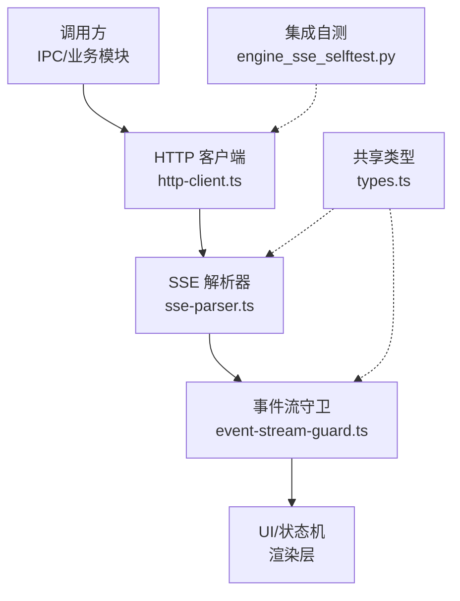
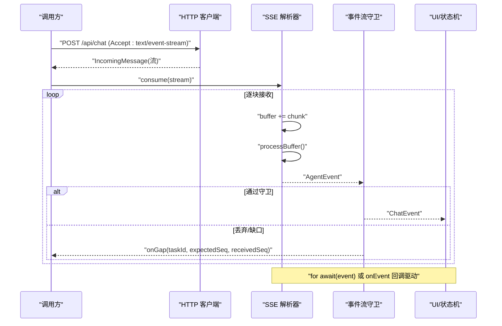
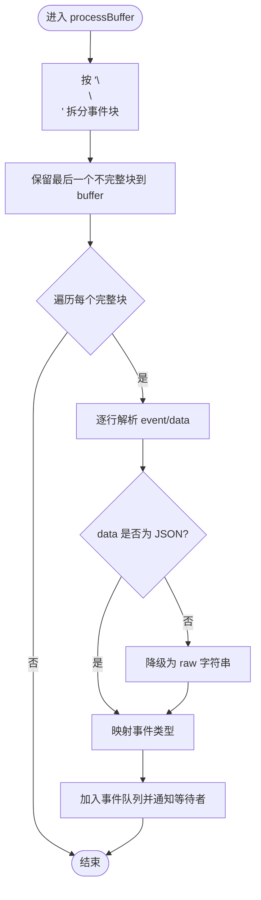
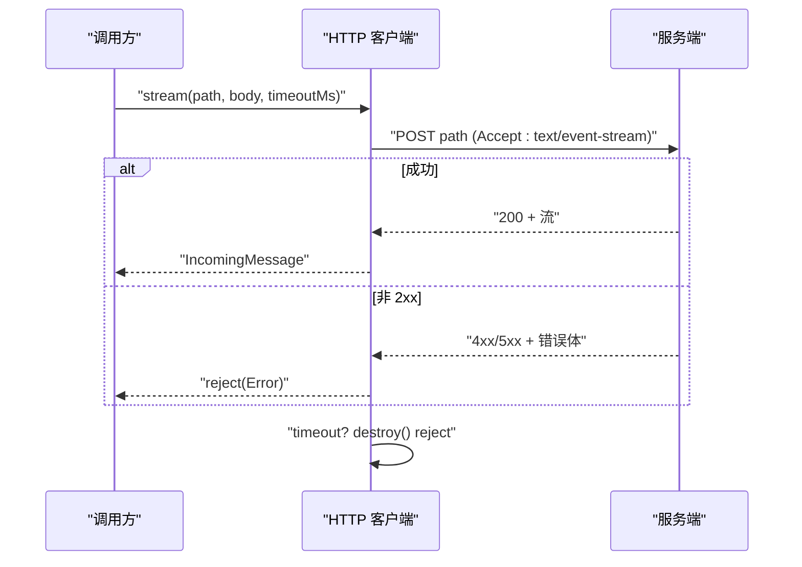
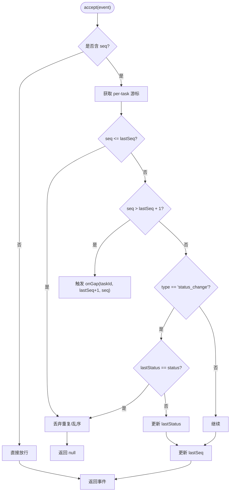
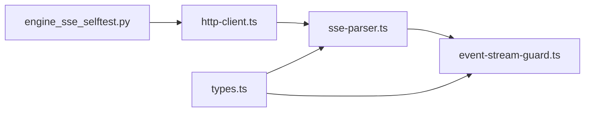

# SSE 实时通信

<cite>
**本文引用的文件**
- [sse-parser.ts](file://tongtian-tauri/src/main/bridge/sse-parser.ts)
- [http-client.ts](file://tongtian-tauri/src/main/bridge/http-client.ts)
- [event-stream-guard.ts](file://tongtian-tauri/src/renderer/lib/event-stream-guard.ts)
- [types.ts](file://tongtian-tauri/src/shared/types.ts)
- [engine_sse_selftest.py](file://tongtian-tauri/tests/integration/engine_sse_selftest.py)
- [event-guard.test.ts](file://tongtian-tauri/tests/unit/bridge/event-guard.test.ts)
</cite>

## 目录
1. [简介](#简介)
2. [项目结构](#项目结构)
3. [核心组件](#核心组件)
4. [架构总览](#架构总览)
5. [详细组件分析](#详细组件分析)
6. [依赖关系分析](#依赖关系分析)
7. [性能考虑](#性能考虑)
8. [故障排查指南](#故障排查指南)
9. [结论](#结论)
10. [附录](#附录)

## 简介
本文件面向通天办公项目的 SSE（Server-Sent Events）实时通信能力，聚焦以下目标：
- 连接建立、数据流解析与错误恢复机制
- sse-parser.ts 的事件流解析逻辑：事件类型识别、数据格式处理、异常捕获
- 连接状态管理、自动重连策略、超时控制与内存泄漏防护
- SSE 协议实现细节：事件格式定义、心跳机制、数据压缩选项
- 性能监控与故障排查指南

## 项目结构
SSE 相关代码主要分布在主进程桥接层与渲染层：
- 主进程桥接层负责发起 HTTP 请求、建立 SSE 流、解析事件并向上层暴露迭代器或回调
- 渲染层提供事件流守卫，保障事件单调性、去重与幂等消费
- 共享类型定义统一了事件契约与任务状态
- 集成测试验证 SSE 协议行为（seq、id、replay、取消等）

图表来源
- [http-client.ts:138-186](file://tongtian-tauri/src/main/bridge/http-client.ts#L138-L186)
- [sse-parser.ts:40-85](file://tongtian-tauri/src/main/bridge/sse-parser.ts#L40-L85)
- [event-stream-guard.ts:24-91](file://tongtian-tauri/src/renderer/lib/event-stream-guard.ts#L24-L91)
- [types.ts:286-303](file://tongtian-tauri/src/shared/types.ts#L286-L303)
- [engine_sse_selftest.py:62-163](file://tongtian-tauri/tests/integration/engine_sse_selftest.py#L62-L163)

章节来源
- [http-client.ts:138-186](file://tongtian-tauri/src/main/bridge/http-client.ts#L138-L186)
- [sse-parser.ts:40-85](file://tongtian-tauri/src/main/bridge/sse-parser.ts#L40-L85)
- [event-stream-guard.ts:24-91](file://tongtian-tauri/src/renderer/lib/event-stream-guard.ts#L24-L91)
- [types.ts:286-303](file://tongtian-tauri/src/shared/types.ts#L286-L303)
- [engine_sse_selftest.py:62-163](file://tongtian-tauri/tests/integration/engine_sse_selftest.py#L62-L163)

## 核心组件
- HTTP 客户端（http-client.ts）
  - 提供带超时与重试的普通 HTTP 请求
  - 提供流式 POST 接口，返回 Node IncomingMessage，供 SSE 解析器消费
  - 对非 2xx 响应进行错误体收集并拒绝 Promise
- SSE 解析器（sse-parser.ts）
  - 将 IncomingMessage 按行缓冲，按“\n\n”分块解析事件
  - 支持 event/data/id/retry 字段，忽略注释行
  - 将原始事件映射为内部 AgentEvent 类型，支持 JSON data 解析与降级为 raw
  - 暴露 AsyncIterable 与 collectAll，便于上层以 for-await 消费
- 事件流守卫（event-stream-guard.ts）
  - 基于 seq 维护 per-task 游标，丢弃重复与乱序事件
  - 检测 seq 缺口并触发 onGap 回调，用于回放补齐
  - status_change 同状态幂等去重
  - 提供 wrap 包装回调与 dispose/clear 清理游标，防止内存泄漏
- 共享类型（types.ts）
  - 定义 ChatEvent 联合类型，包含 plan/step_* /deliver/done/error/status_change/quota_warning/heartbeat 等
  - 定义 TaskStatus、StepType 等枚举，统一状态语义

章节来源
- [http-client.ts:59-186](file://tongtian-tauri/src/main/bridge/http-client.ts#L59-L186)
- [sse-parser.ts:10-23](file://tongtian-tauri/src/main/bridge/sse-parser.ts#L10-L23)
- [sse-parser.ts:128-228](file://tongtian-tauri/src/main/bridge/sse-parser.ts#L128-L228)
- [event-stream-guard.ts:10-96](file://tongtian-tauri/src/renderer/lib/event-stream-guard.ts#L10-L96)
- [types.ts:286-303](file://tongtian-tauri/src/shared/types.ts#L286-L303)

## 架构总览
SSE 端到端流程如下：
- 调用方通过 HTTP 客户端发起流式 POST，设置 Accept: text/event-stream
- 服务端返回持续流，客户端使用 SSE 解析器逐块解析事件
- 事件经事件流守卫过滤后，交由 UI/状态机消费
- 集成测试覆盖 seq 单调性、id 行、replay、取消、Last-Event-ID 等协议要点

图表来源
- [http-client.ts:138-186](file://tongtian-tauri/src/main/bridge/http-client.ts#L138-L186)
- [sse-parser.ts:50-85](file://tongtian-tauri/src/main/bridge/sse-parser.ts#L50-L85)
- [sse-parser.ts:128-188](file://tongtian-tauri/src/main/bridge/sse-parser.ts#L128-L188)
- [event-stream-guard.ts:46-91](file://tongtian-tauri/src/renderer/lib/event-stream-guard.ts#L46-L91)

## 详细组件分析

### SSE 解析器（sse-parser.ts）
- 事件流解析逻辑
  - 按“\n\n”切分事件块，保留不完整块在 buffer
  - 逐行识别 event:/data: 字段，累积多行 data
  - 忽略 id:/retry: 与注释行（以 : 开头）
- 事件类型识别
  - 优先从 event: 行映射到内部类型
  - 若缺失 event 行，尝试从 data.type 推断
  - 未知类型将被忽略并记录调试日志
- 数据格式处理
  - 尝试 JSON.parse(data)，失败时降级为 { raw: eventData }
  - 记录解析失败的上下文（事件类型、数据前缀、错误信息）
- 异常捕获与流生命周期
  - error/close/end 事件统一标记 closed，触发 onEnd/onError
  - flushWaiter 确保 for-await 消费者能正确结束
- 复杂度与性能
  - 每次 data 事件追加到 buffer，按“\n\n”分割；时间复杂度 O(n)
  - 事件队列 + waitResolve 避免阻塞，适合高吞吐场景

图表来源
- [sse-parser.ts:128-188](file://tongtian-tauri/src/main/bridge/sse-parser.ts#L128-L188)
- [sse-parser.ts:190-228](file://tongtian-tauri/src/main/bridge/sse-parser.ts#L190-L228)

章节来源
- [sse-parser.ts:40-85](file://tongtian-tauri/src/main/bridge/sse-parser.ts#L40-L85)
- [sse-parser.ts:128-228](file://tongtian-tauri/src/main/bridge/sse-parser.ts#L128-L228)

### HTTP 客户端（http-client.ts）
- 超时控制
  - 默认超时 30s，可配置；流式请求也支持 timeout 参数
  - 超时时销毁请求并拒绝 Promise
- 重试策略
  - 指数退避重试（baseDelay * 2^attempt），仅网络/超时错误重试，不重试 4xx
- 流式接口
  - stream() 返回 IncomingMessage，由调用方负责重连与错误处理
  - 非 2xx 响应读取错误体并拒绝

图表来源
- [http-client.ts:138-186](file://tongtian-tauri/src/main/bridge/http-client.ts#L138-L186)
- [http-client.ts:190-241](file://tongtian-tauri/src/main/bridge/http-client.ts#L190-L241)

章节来源
- [http-client.ts:59-186](file://tongtian-tauri/src/main/bridge/http-client.ts#L59-L186)
- [http-client.ts:190-241](file://tongtian-tauri/src/main/bridge/http-client.ts#L190-L241)

### 事件流守卫（event-stream-guard.ts）
- 去重与单调性
  - 维护 per-task 的 lastSeq，丢弃 seq ≤ lastSeq 的事件
- 缺口检测
  - 当 seq > lastSeq + 1 时触发 onGap，可用于回放补齐
- 幂等性
  - status_change 同状态仅保留首次
- 资源清理
  - dispose(taskId) 删除游标，clear() 清空所有，防止内存泄漏

图表来源
- [event-stream-guard.ts:46-91](file://tongtian-tauri/src/renderer/lib/event-stream-guard.ts#L46-L91)

章节来源
- [event-stream-guard.ts:10-96](file://tongtian-tauri/src/renderer/lib/event-stream-guard.ts#L10-L96)
- [event-guard.test.ts:12-84](file://tongtian-tauri/tests/unit/bridge/event-guard.test.ts#L12-L84)

### 共享类型（types.ts）
- ChatEvent 联合类型定义了 SSE 事件契约，包括：
  - plan/step_start/step_progress/step_done/step_failed/deliver/done/error
  - status_change/quota_warning/heartbeat
- 这些类型贯穿解析器与守卫，保证前后端一致性

章节来源
- [types.ts:286-303](file://tongtian-tauri/src/shared/types.ts#L286-L303)

## 依赖关系分析
- http-client.ts 依赖 Logger，提供超时与重试
- sse-parser.ts 依赖 Logger，解析 IncomingMessage 并产出 AgentEvent
- event-stream-guard.ts 依赖 shared types，消费 ChatEvent
- 集成测试验证服务端 SSE 行为（seq、id、replay、取消、Last-Event-ID）

图表来源
- [http-client.ts:138-186](file://tongtian-tauri/src/main/bridge/http-client.ts#L138-L186)
- [sse-parser.ts:40-85](file://tongtian-tauri/src/main/bridge/sse-parser.ts#L40-L85)
- [event-stream-guard.ts:24-91](file://tongtian-tauri/src/renderer/lib/event-stream-guard.ts#L24-L91)
- [types.ts:286-303](file://tongtian-tauri/src/shared/types.ts#L286-L303)
- [engine_sse_selftest.py:62-163](file://tongtian-tauri/tests/integration/engine_sse_selftest.py#L62-L163)

章节来源
- [http-client.ts:138-186](file://tongtian-tauri/src/main/bridge/http-client.ts#L138-L186)
- [sse-parser.ts:40-85](file://tongtian-tauri/src/main/bridge/sse-parser.ts#L40-L85)
- [event-stream-guard.ts:24-91](file://tongtian-tauri/src/renderer/lib/event-stream-guard.ts#L24-L91)
- [types.ts:286-303](file://tongtian-tauri/src/shared/types.ts#L286-L303)
- [engine_sse_selftest.py:62-163](file://tongtian-tauri/tests/integration/engine_sse_selftest.py#L62-L163)

## 性能考虑
- 解析器缓冲与队列
  - 使用 buffer 累积未完整事件，减少频繁解析开销
  - 事件队列 + waitResolve 避免阻塞消费者，提升吞吐
- 超时与重试
  - 默认 30s 超时，指数退避重试，降低瞬时抖动影响
- 内存管理
  - 事件流守卫提供 dispose/clear，及时释放 per-task 游标
  - 解析器在 end/close 时清理等待者与状态
- 建议优化
  - 对超大 data 字段考虑分片或压缩传输（需服务端配合）
  - 在高并发场景下限制单任务事件速率，避免 UI 卡顿

[本节为通用指导，无需特定文件引用]

## 故障排查指南
- 连接建立失败
  - 检查 HTTP 客户端返回码与错误体；非 2xx 会拒绝并携带错误信息
  - 确认 Accept: text/event-stream 已设置
- 流中断与重连
  - 监听 error/close/end，触发 onEnd 后由调用方决定重连
  - 使用 Last-Event-ID 与服务端 replay 接口恢复断点（见集成测试）
- 事件丢失与乱序
  - 通过事件流守卫检测 seq 缺口，触发 onGap 回调进行回放补齐
  - 重复事件会被丢弃，确保幂等消费
- 解析异常
  - JSON 解析失败将降级为 raw，记录警告日志以便定位
  - 未知事件类型将被忽略并记录调试日志
- 超时与资源泄露
  - 流式请求超时将销毁请求并拒绝；确保调用方正确处理
  - 任务终态后调用 dispose(taskId) 清理游标

章节来源
- [http-client.ts:138-186](file://tongtian-tauri/src/main/bridge/http-client.ts#L138-L186)
- [sse-parser.ts:164-188](file://tongtian-tauri/src/main/bridge/sse-parser.ts#L164-L188)
- [event-stream-guard.ts:46-91](file://tongtian-tauri/src/renderer/lib/event-stream-guard.ts#L46-L91)
- [engine_sse_selftest.py:77-100](file://tongtian-tauri/tests/integration/engine_sse_selftest.py#L77-L100)

## 结论
本项目实现了稳定可靠的 SSE 实时通信：
- 解析器准确识别事件类型、处理数据格式并捕获异常
- HTTP 客户端提供超时与重试，保障连接健壮性
- 事件流守卫确保事件单调、幂等与缺口补齐，防止重复渲染与数据不一致
- 共享类型统一契约，集成测试验证协议行为
建议在后续演进中补充心跳与压缩选项，进一步提升长连接稳定性与带宽效率。

[本节为总结，无需特定文件引用]

## 附录

### SSE 协议实现细节
- 事件格式
  - 标准字段：event、data、id、retry；注释行以 : 开头
  - 事件分隔：空行（\n\n）
- 心跳机制
  - 类型 heartbeat 存在于 ChatEvent 联合类型中，可用于保活与延迟检测
- 数据压缩
  - 当前实现未内置压缩；可在传输层启用 gzip/deflate（需服务端支持）
- 重放与断点续传
  - 集成测试验证 id 行格式 {task_id}:{seq} 与 replay 接口
  - 客户端可通过 Last-Event-ID 与 from_seq 恢复断点

章节来源
- [types.ts:286-303](file://tongtian-tauri/src/shared/types.ts#L286-L303)
- [engine_sse_selftest.py:65-100](file://tongtian-tauri/tests/integration/engine_sse_selftest.py#L65-L100)