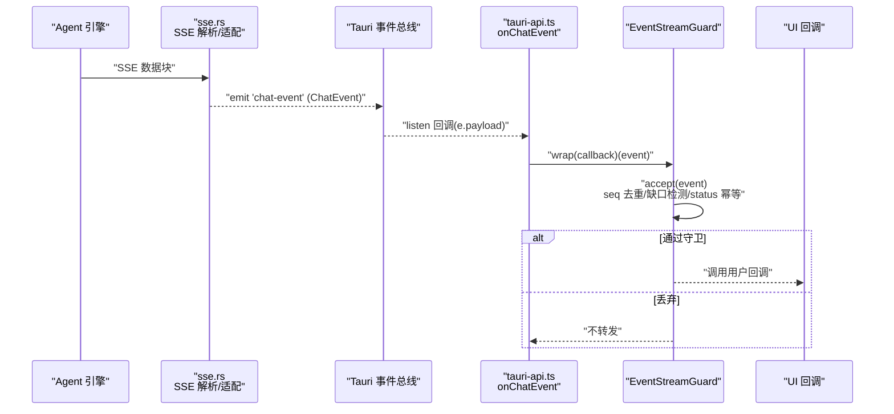
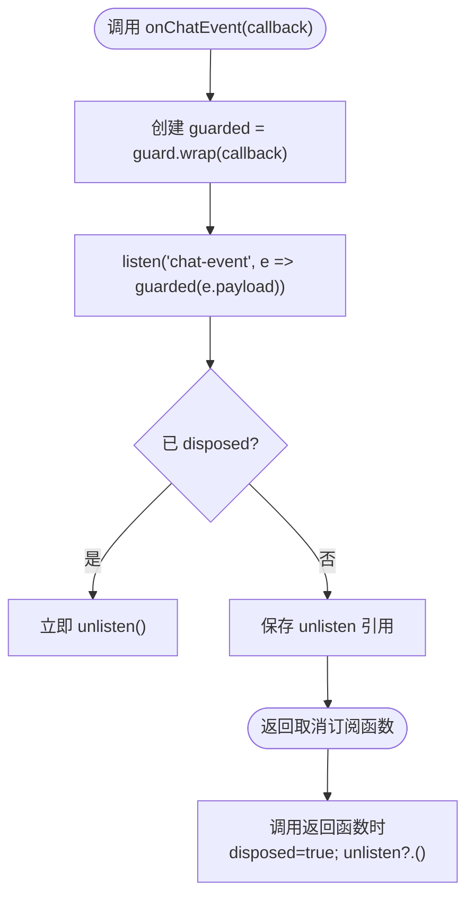
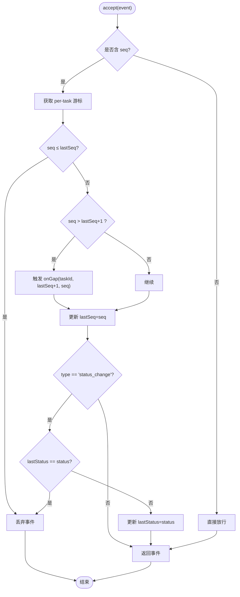
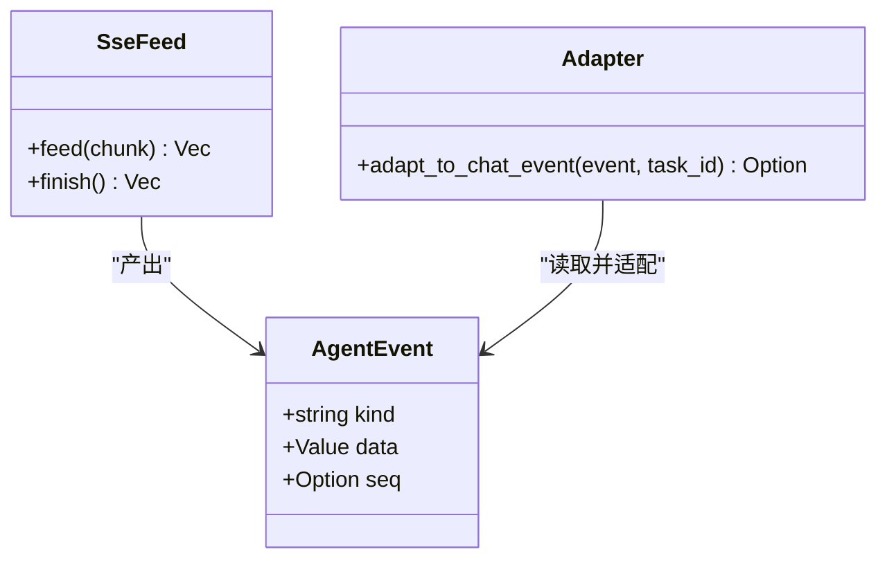
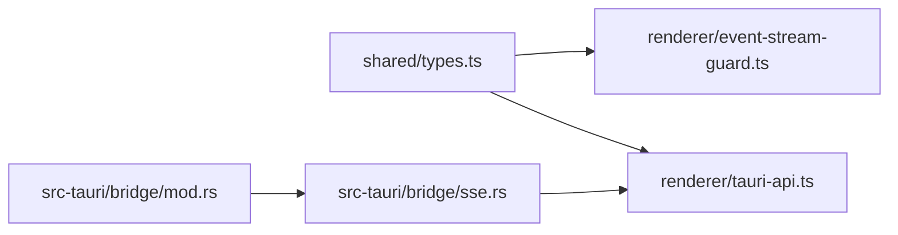

# 事件处理机制

<cite>
**本文引用的文件**
- [event-stream-guard.ts](file://tongtian-tauri/src/renderer/lib/event-stream-guard.ts)
- [tauri-api.ts](file://tongtian-tauri/src/renderer/lib/tauri-api.ts)
- [types.ts](file://tongtian-tauri/src/shared/types.ts)
- [sse.rs](file://tongtian-tauri/src-tauri/src/bridge/sse.rs)
- [mod.rs](file://tongtian-tauri/src-tauri/src/bridge/mod.rs)
</cite>

## 目录
1. [简介](#简介)
2. [项目结构](#项目结构)
3. [核心组件](#核心组件)
4. [架构总览](#架构总览)
5. [详细组件分析](#详细组件分析)
6. [依赖关系分析](#依赖关系分析)
7. [性能考虑](#性能考虑)
8. [故障排查指南](#故障排查指南)
9. [结论](#结论)
10. [附录](#附录)

## 简介
本文件面向通天办公项目的“事件处理机制”，聚焦 Tauri listen API 的使用方式与事件流处理架构，重点说明 onChatEvent 方法的实现原理、事件监听器的注册与取消订阅、EventStreamGuard 的 seq 去重与缺口检测能力，以及断线重连、消息丢失检测、重复事件过滤等关键特性。同时解释 ChatEvent 数据结构、事件类型定义与回调函数设计模式，并给出性能优化建议与调试方法。

## 项目结构
事件处理链路贯穿渲染进程（TypeScript）与 Tauri/Rust 后端：
- 渲染进程通过 tauriAPI.onChatEvent 订阅 chat-event 事件流，并使用 EventStreamGuard 进行 seq 去重与状态幂等处理。
- Rust 侧解析 SSE 流，提取 id 行中的单调序号 seq，并将 Agent 事件适配为前端可消费的 ChatEvent 结构，注入 taskId 与 seq。
- 共享类型 types.ts 定义了 ChatEvent 联合类型及任务状态枚举，保证前后端契约一致。

```mermaid
graph TB
subgraph "渲染进程"
UI["UI 层"]
API["tauri-api.ts<br/>onChatEvent()"]
Guard["EventStreamGuard<br/>seq 去重/缺口检测"]
end
subgraph "Tauri/Rust"
SSE["sse.rs<br/>SSE 解析/适配"]
Bridge["bridge/mod.rs<br/>模块入口"]
end
UI --> API
API --> Guard
Guard --> |消费事件| UI
API --> |listen('chat-event')| SSE
SSE --> |emit 'chat-event'| API
```

图表来源
- [tauri-api.ts:145-165](file://tongtian-tauri/src/renderer/lib/tauri-api.ts#L145-L165)
- [event-stream-guard.ts:24-96](file://tongtian-tauri/src/renderer/lib/event-stream-guard.ts#L24-L96)
- [sse.rs:171-292](file://tongtian-tauri/src-tauri/src/bridge/sse.rs#L171-L292)
- [mod.rs:1-7](file://tongtian-tauri/src-tauri/src/bridge/mod.rs#L1-L7)

章节来源
- [tauri-api.ts:1-186](file://tongtian-tauri/src/renderer/lib/tauri-api.ts#L1-L186)
- [event-stream-guard.ts:1-97](file://tongtian-tauri/src/renderer/lib/event-stream-guard.ts#L1-L97)
- [sse.rs:1-517](file://tongtian-tauri/src-tauri/src/bridge/sse.rs#L1-L517)
- [mod.rs:1-7](file://tongtian-tauri/src-tauri/src/bridge/mod.rs#L1-L7)

## 核心组件
- onChatEvent（渲染进程）：基于 Tauri 的 listen API 订阅 chat-event 事件流，返回取消订阅函数；内部使用 EventStreamGuard 包装回调，确保事件按 seq 单调消费。
- EventStreamGuard（渲染进程）：维护 per-task 游标 lastSeq 与 lastStatus，实现：
  - 重复事件丢弃（seq ≤ lastSeq）
  - 缺口检测（seq > lastSeq + 1），触发 onGap 回调用于提示或触发 replay
  - status_change 幂等（同状态覆盖）
  - wrap/dispose/clear 生命周期管理
- SSE 解析与适配（Rust）：解析 QwenPaw SSE 格式，支持多行 data、id 行 seq 提取、未知类型忽略；将 AgentEvent 适配为 ChatEvent，并注入 seq/taskId。
- 共享类型（Types）：定义 ChatEvent 联合类型、任务状态枚举、步骤/计划/审计等类型，保障前后端契约一致性。

章节来源
- [tauri-api.ts:145-165](file://tongtian-tauri/src/renderer/lib/tauri-api.ts#L145-L165)
- [event-stream-guard.ts:24-96](file://tongtian-tauri/src/renderer/lib/event-stream-guard.ts#L24-L96)
- [sse.rs:171-292](file://tongtian-tauri/src-tauri/src/bridge/sse.rs#L171-L292)
- [types.ts:286-303](file://tongtian-tauri/src/shared/types.ts#L286-L303)

## 架构总览
下图展示从 Rust SSE 解析到前端消费的事件流时序，包括 seq 注入、守卫过滤与回调执行。



图表来源
- [sse.rs:171-292](file://tongtian-tauri/src-tauri/src/bridge/sse.rs#L171-L292)
- [tauri-api.ts:145-165](file://tongtian-tauri/src/renderer/lib/tauri-api.ts#L145-L165)
- [event-stream-guard.ts:46-85](file://tongtian-tauri/src/renderer/lib/event-stream-guard.ts#L46-L85)

## 详细组件分析

### onChatEvent 方法与事件流订阅
- 订阅通道：使用 Tauri 的 listen API 订阅 'chat-event' 事件。
- 守卫包装：通过 EventStreamGuard.wrap 对原始回调进行包装，仅放行通过 accept 校验的事件。
- 取消订阅：返回一个清理函数，在组件卸载或不再需要时调用，避免内存泄漏。
- 全局守卫实例：在模块级创建 EventStreamGuard 实例，集中管理所有聊天事件的 seq 去重与缺口检测。



图表来源
- [tauri-api.ts:145-165](file://tongtian-tauri/src/renderer/lib/tauri-api.ts#L145-L165)

章节来源
- [tauri-api.ts:145-165](file://tongtian-tauri/src/renderer/lib/tauri-api.ts#L145-L165)

### EventStreamGuard 的 seq 去重与缺口检测
- 每任务游标：以 taskId 为键维护 lastSeq 与 lastStatus，默认 taskId 为 '__global__'。
- 无 seq 兼容：若事件未携带 seq，直接放行，保持与旧引擎/Mock 的契约兼容。
- 重复事件丢弃：当 seq ≤ lastSeq 时丢弃，防止重放导致的重复渲染。
- 缺口检测：当 seq > lastSeq + 1 且 lastSeq > 0 时，触发 onGap(taskId, expected, received)，便于上层记录或触发 eventReplay。
- status_change 幂等：相同状态多次推送仅保留首次，避免 UI 抖动。
- 生命周期：提供 dispose(taskId) 与 clear() 清理游标，防止内存泄漏。



图表来源
- [event-stream-guard.ts:46-85](file://tongtian-tauri/src/renderer/lib/event-stream-guard.ts#L46-L85)

章节来源
- [event-stream-guard.ts:24-96](file://tongtian-tauri/src/renderer/lib/event-stream-guard.ts#L24-L96)

### SSE 解析与 ChatEvent 适配（Rust 侧）
- SSE 格式：支持 event/data/id 三行结构，多行 data 累积，空行分隔事件。
- seq 双通道提取：优先从 id 行末尾数字提取 seq，否则回退到 data.seq；可通过 feature 开关控制。
- 事件白名单：仅已知事件类型被接受，未知类型忽略。
- 适配逻辑：将 AgentEvent 映射为 ChatEvent，统一注入 seq 与 taskId，并对 snake_case 字段做兼容转换。
- 新增事件：支持 status_change、quota_warning 等三层架构演进事件。



图表来源
- [sse.rs:23-32](file://tongtian-tauri/src-tauri/src/bridge/sse.rs#L23-L32)
- [sse.rs:48-86](file://tongtian-tauri/src-tauri/src/bridge/sse.rs#L48-L86)
- [sse.rs:171-292](file://tongtian-tauri/src-tauri/src/bridge/sse.rs#L171-L292)

章节来源
- [sse.rs:1-517](file://tongtian-tauri/src-tauri/src/bridge/sse.rs#L1-L517)

### ChatEvent 数据结构与事件类型
- ChatEvent 联合类型包含 plan、step_start、step_progress、step_done、step_failed、deliver、done、error 等基础事件，以及 status_change、quota_warning、heartbeat 等演进事件。
- 每个事件可选携带 seq 与 taskId，便于前端按任务维度进行去重与排序。
- 任务状态 TaskStatus 扩展了 queued、budget_paused、retry_pending、cancelled、archived 等状态，配合 status_change 事件驱动 UI 更新。

章节来源
- [types.ts:286-303](file://tongtian-tauri/src/shared/types.ts#L286-L303)
- [types.ts:3-25](file://tongtian-tauri/src/shared/types.ts#L3-L25)

## 依赖关系分析
- 渲染进程依赖：
  - tauri-api.ts 依赖 EventStreamGuard 与 shared types。
  - EventStreamGuard 依赖 shared types 中的 ChatEvent。
- Rust 后端依赖：
  - sse.rs 负责解析与适配，输出 JSON Value，供上层桥接。
  - bridge/mod.rs 作为模块入口，组织 agent、event_store、python_env、sse 子模块。



图表来源
- [tauri-api.ts:1-186](file://tongtian-tauri/src/renderer/lib/tauri-api.ts#L1-L186)
- [event-stream-guard.ts:1-97](file://tongtian-tauri/src/renderer/lib/event-stream-guard.ts#L1-L97)
- [sse.rs:1-517](file://tongtian-tauri/src-tauri/src/bridge/sse.rs#L1-L517)
- [mod.rs:1-7](file://tongtian-tauri/src-tauri/src/bridge/mod.rs#L1-L7)

章节来源
- [tauri-api.ts:1-186](file://tongtian-tauri/src/renderer/lib/tauri-api.ts#L1-L186)
- [event-stream-guard.ts:1-97](file://tongtian-tauri/src/renderer/lib/event-stream-guard.ts#L1-L97)
- [sse.rs:1-517](file://tongtian-tauri/src-tauri/src/bridge/sse.rs#L1-L517)
- [mod.rs:1-7](file://tongtian-tauri/src-tauri/src/bridge/mod.rs#L1-L7)

## 性能考虑
- 事件过滤前置：在渲染进程侧通过 EventStreamGuard 尽早丢弃重复与无效事件，减少 UI 重绘与状态同步开销。
- 任务级游标隔离：per-task 游标降低锁竞争与冲突概率，提升并发处理能力。
- 幂等处理：status_change 同状态覆盖避免冗余渲染。
- 资源释放：及时调用 onChatEvent 返回的取消订阅函数，并在任务终态后 dispose(taskId) 清理游标，防止内存泄漏。
- 网络与解析：Rust 侧增量式 SSE 解析器避免大对象拷贝，JSON 解析失败回退 raw，提高鲁棒性。

[本节为通用性能建议，不直接分析具体文件]

## 故障排查指南
- 事件丢失检测：
  - 观察 EventStreamGuard 的 onGap 回调日志，确认 expected 与 received 的差距，必要时触发 eventReplay 补齐缺失事件。
  - 检查 Rust 侧 SSE 解析是否正确提取 id 行 seq，并确保 feature 开关与上游引擎一致。
- 重复事件问题：
  - 确认 EventStreamGuard 的 accept 逻辑是否生效，检查 lastSeq 更新路径。
  - 验证上游是否重复发送相同 seq 的事件。
- 状态抖动：
  - 检查 status_change 事件是否携带相同 status，确认幂等逻辑是否工作。
- 订阅未释放：
  - 确保组件卸载时调用 onChatEvent 返回的取消订阅函数，避免监听器残留。
- 调试建议：
  - 在 onGap 中打印 taskId、expected、received 以便定位缺口位置。
  - 在 SSE 解析层增加日志，确认 id 行与 data.seq 的一致性。

章节来源
- [tauri-api.ts:16-22](file://tongtian-tauri/src/renderer/lib/tauri-api.ts#L16-L22)
- [event-stream-guard.ts:62-75](file://tongtian-tauri/src/renderer/lib/event-stream-guard.ts#L62-L75)
- [sse.rs:125-141](file://tongtian-tauri/src-tauri/src/bridge/sse.rs#L125-L141)

## 结论
本事件处理机制通过 Tauri listen API 与 Rust SSE 解析协同，实现了可靠的事件流传输与消费。EventStreamGuard 提供了 seq 去重、缺口检测与状态幂等能力，保障 UI 的一致性与性能。结合共享类型契约与模块化设计，系统具备良好的可扩展性与可维护性。建议在后续迭代中持续完善重放策略、监控告警与测试用例，进一步提升稳定性与可观测性。

[本节为总结性内容，不直接分析具体文件]

## 附录
- 关键流程参考：
  - onChatEvent 订阅与取消订阅：[tauri-api.ts:145-165](file://tongtian-tauri/src/renderer/lib/tauri-api.ts#L145-L165)
  - EventStreamGuard 核心逻辑：[event-stream-guard.ts:46-85](file://tongtian-tauri/src/renderer/lib/event-stream-guard.ts#L46-L85)
  - SSE 解析与适配：[sse.rs:171-292](file://tongtian-tauri/src-tauri/src/bridge/sse.rs#L171-L292)
  - ChatEvent 类型定义：[types.ts:286-303](file://tongtian-tauri/src/shared/types.ts#L286-L303)

[本节为索引信息，不直接分析具体文件]