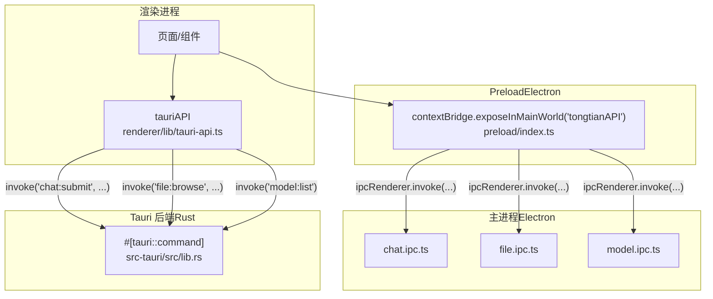
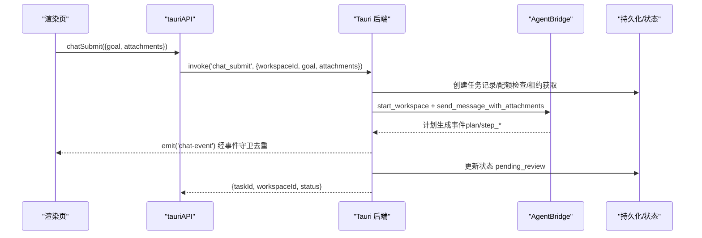
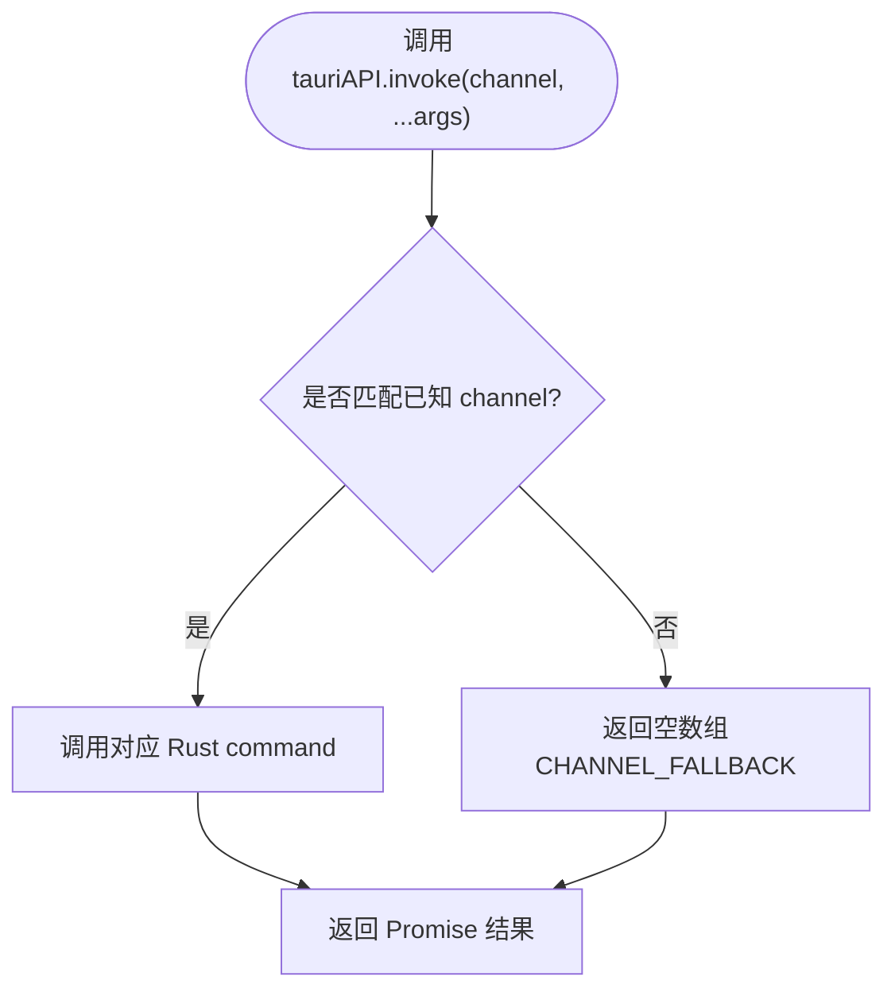
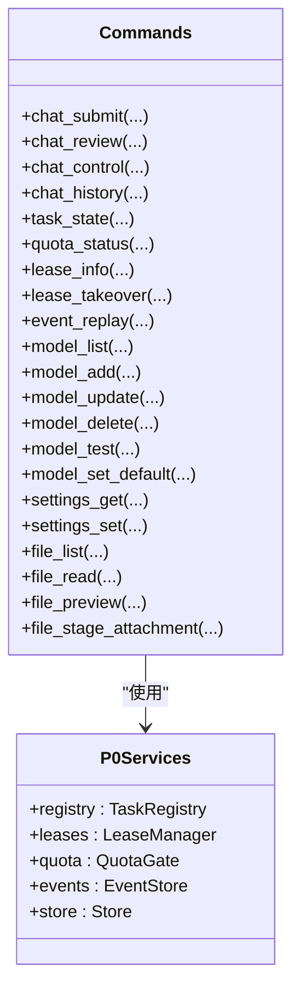
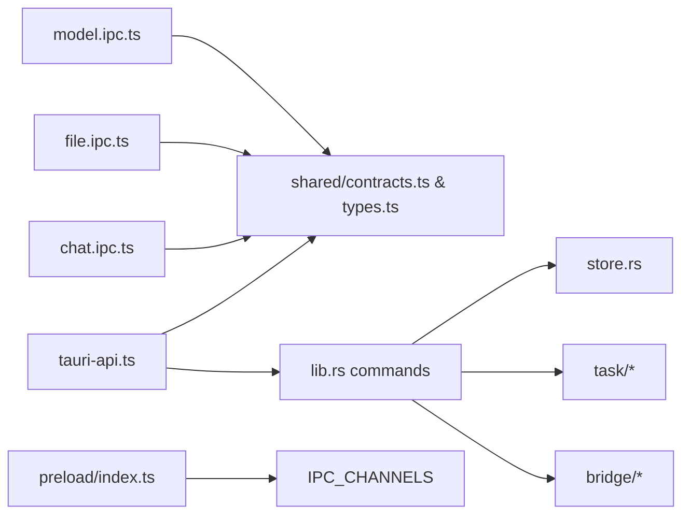

# 命令调用机制

<cite>
**本文引用的文件**
- [tauri-api.ts](file://tongtian-tauri/src/renderer/lib/tauri-api.ts)
- [index.ts（preload）](file://tongtian-tauri/src/preload/index.ts)
- [contracts.ts](file://tongtian-tauri/src/shared/contracts.ts)
- [types.ts](file://tongtian-tauri/src/shared/types.ts)
- [chat.ipc.ts](file://tongtian-tauri/src/main/ipc/chat.ipc.ts)
- [file.ipc.ts](file://tongtian-tauri/src/main/ipc/file.ipc.ts)
- [model.ipc.ts](file://tongtian-tauri/src/main/ipc/model.ipc.ts)
- [lib.rs（Tauri 后端入口）](file://tongtian-tauri/src-tauri/src/lib.rs)
- [Cargo.toml](file://tongtian-tauri/src-tauri/Cargo.toml)
</cite>

## 目录
1. [简介](#简介)
2. [项目结构与调用链路总览](#项目结构与调用链路总览)
3. [核心组件与职责](#核心组件与职责)
4. [架构总览](#架构总览)
5. [详细组件分析](#详细组件分析)
6. [依赖关系分析](#依赖关系分析)
7. [性能与异步特性](#性能与异步特性)
8. [故障排查指南](#故障排查指南)
9. [结论](#结论)
10. [附录：命令参考与最佳实践](#附录命令参考与最佳实践)

## 简介
本文件面向通天办公项目的“命令调用机制”，聚焦 Tauri invoke 方法的封装实现，包括 tauriAPI.invoke 的参数映射、通道路由、错误处理，以及 chat_submit、chat_review、chat_control、file_list、model_list 等关键业务命令的调用方式、参数格式与返回值结构。文档同时说明异步处理机制、Promise 封装、未实现命令的兜底策略，并提供调用示例与最佳实践，帮助前端在参数验证和类型转换方面保持一致性与健壮性。

## 项目结构与调用链路总览
- 渲染层通过 tauriAPI 暴露统一 API，内部基于 @tauri-apps/api/core 的 invoke 调用 Rust 命令；同时提供 onChatEvent 订阅事件流。
- Preload 层（Electron 场景）通过 contextBridge 暴露 tongtianAPI，对 IPC 通道进行白名单校验并转发到主进程。
- Main 层按模块注册 IPC 处理器（chat、file、model），使用 Zod 做入参校验，调用引擎或服务后返回结构化结果或抛出带错误码的错误对象。
- Tauri 后端（Rust）通过 #[tauri::command] 暴露系统级命令，并在启动时集中注册到 invoke_handler。

**图表来源**
- [tauri-api.ts:39-84](file://tongtian-tauri/src/renderer/lib/tauri-api.ts#L39-L84)
- [index.ts（preload）:129-178](file://tongtian-tauri/src/preload/index.ts#L129-L178)
- [chat.ipc.ts:122-189](file://tongtian-tauri/src/main/ipc/chat.ipc.ts#L122-L189)
- [file.ipc.ts:100-247](file://tongtian-tauri/src/main/ipc/file.ipc.ts#L100-L247)
- [model.ipc.ts:105-219](file://tongtian-tauri/src/main/ipc/model.ipc.ts#L105-L219)
- [lib.rs:794-821](file://tongtian-tauri/src-tauri/src/lib.rs#L794-L821)

**章节来源**
- [tauri-api.ts:39-84](file://tongtian-tauri/src/renderer/lib/tauri-api.ts#L39-L84)
- [index.ts（preload）:129-178](file://tongtian-tauri/src/preload/index.ts#L129-L178)
- [lib.rs:794-821](file://tongtian-tauri/src-tauri/src/lib.rs#L794-L821)

## 核心组件与职责
- tauriAPI（渲染层适配层）
  - 统一封装 invoke 调用，将高层 channel（如 'chat:history'、'file:browse'）映射到底层 Rust command（如 'chat_history'、'file_list'）。
  - 提供 chatSubmit、chatReview、chatControl、chatHistory、onChatEvent 等便捷方法，返回 Promise 并附带强类型约束。
  - 未实现 channel 的兜底策略：返回空数组，保证 UI 不崩溃。
- Preload tongtianAPI（Electron 安全桥）
  - 维护 ALLOWED_INVOKE_CHANNELS/SEND/事件通道白名单，拦截非法通道。
  - 提供 invoke/send/on/removeListener 等方法，委托 ipcRenderer 完成跨进程通信。
- Main IPC 处理器（chat/file/model）
  - 使用 Zod 严格校验请求体，失败时抛出包含 ErrorCode 的结构化错误。
  - 调用引擎或服务，记录日志，返回统一响应或错误。
- Tauri 后端命令（Rust）
  - 通过 #[tauri::command] 暴露 chat_submit、chat_review、chat_control、chat_history、task_state、quota_status、lease_info、lease_takeover、event_replay、model_*、settings_*、file_* 等命令。
  - 在应用启动时集中注册到 invoke_handler，供渲染层通过 @tauri-apps/api/core/invoke 调用。

**章节来源**
- [tauri-api.ts:39-185](file://tongtian-tauri/src/renderer/lib/tauri-api.ts#L39-L185)
- [index.ts（preload）:11-82, 95-178:11-82](file://tongtian-tauri/src/preload/index.ts#L11-L82)
- [chat.ipc.ts:17-83, 122-189:17-83](file://tongtian-tauri/src/main/ipc/chat.ipc.ts#L17-L83)
- [file.ipc.ts:15-57, 100-247:15-57](file://tongtian-tauri/src/main/ipc/file.ipc.ts#L15-L57)
- [model.ipc.ts:18-101, 105-219:18-101](file://tongtian-tauri/src/main/ipc/model.ipc.ts#L18-L101)
- [lib.rs:127-744, 794-821:127-744](file://tongtian-tauri/src-tauri/src/lib.rs#L127-L744)

## 架构总览
下图展示了从渲染层发起一次 chat 提交到 Rust 后端处理的完整调用链，包括异步任务执行与事件推送。

**图表来源**
- [tauri-api.ts:91-98](file://tongtian-tauri/src/renderer/lib/tauri-api.ts#L91-L98)
- [lib.rs:127-237](file://tongtian-tauri/src-tauri/src/lib.rs#L127-L237)
- [chat.ipc.ts:127-136](file://tongtian-tauri/src/main/ipc/chat.ipc.ts#L127-L136)

**章节来源**
- [lib.rs:127-237](file://tongtian-tauri/src-tauri/src/lib.rs#L127-L237)
- [tauri-api.ts:91-98](file://tongtian-tauri/src/renderer/lib/tauri-api.ts#L91-L98)

## 详细组件分析

### tauriAPI 封装与路由
- 通用 invoke 路由
  - 将高层 channel 映射为底层 Rust command，例如：
    - 'system:info' → 'system_info'
    - 'system:health' → 'agent_status'
    - 'chat:history' → 'chat_history'
    - 'file:browse' → 'file_list'
    - 'model:list' → 'model_list'
  - 未实现的 channel 走 CHANNEL_FALLBACK 返回空数组，确保 UI 稳定。
- 便捷方法
  - chatSubmit：封装 ChatSubmitReq，默认 workspaceId 为空字符串（后端会回退为 default）。
  - chatReview：传入 taskId、action（approve/reject/modify）、可选 patch。
  - chatControl：传入 ChatControlReq（taskId、action、stepId）。
  - onChatEvent：监听 chat-event，并通过 EventStreamGuard 做 seq 去重与缺口检测。
- 兜底代理
  - createProxiedAPI：对未实现的方法返回空数组，避免调用方崩溃。

**图表来源**
- [tauri-api.ts:29-84](file://tongtian-tauri/src/renderer/lib/tauri-api.ts#L29-L84)

**章节来源**
- [tauri-api.ts:29-84](file://tongtian-tauri/src/renderer/lib/tauri-api.ts#L29-L84)
- [tauri-api.ts:172-185](file://tongtian-tauri/src/renderer/lib/tauri-api.ts#L172-L185)

### Preload 安全桥（Electron）
- 白名单校验
  - 仅允许预定义的 IPC_CHANNELS 列表中的通道被 invoke/send/on。
  - 非法通道直接抛错，防止任意 IPC 滥用。
- 便捷方法
  - chatSubmit/chatReview/chatControl/onChatEvent 直接委托 ipcRenderer。
- 暴露 API
  - 通过 contextBridge.exposeInMainWorld('tongtianAPI', ...) 暴露给渲染进程。

**章节来源**
- [index.ts（preload）:11-82, 95-178:11-82](file://tongtian-tauri/src/preload/index.ts#L11-L82)

### Main IPC 处理器（Zod 校验与错误处理）
- chat.ipc.ts
  - 使用 Zod 校验 chatSubmit/chatReview/chatControl/chatHistory 输入。
  - safeHandler 捕获异常，若为结构化 AppError 则原样抛出，否则包装为 INTERNAL_ERROR。
  - 事件转发：订阅引擎事件并推送到渲染端。
- file.ipc.ts
  - 路径白名单校验，防止路径遍历攻击。
  - 文件浏览/读取/预览/转换，统一错误日志与返回。
- model.ipc.ts
  - 模型增删改查、测试、用量统计，均经过 Zod 校验与安全处理。

**章节来源**
- [chat.ipc.ts:17-83, 122-189:17-83](file://tongtian-tauri/src/main/ipc/chat.ipc.ts#L17-L83)
- [file.ipc.ts:59-57, 100-247:59-57](file://tongtian-tauri/src/main/ipc/file.ipc.ts#L59-L57)
- [model.ipc.ts:18-101, 105-219:18-101](file://tongtian-tauri/src/main/ipc/model.ipc.ts#L18-L101)

### Tauri 后端命令（Rust）
- 命令注册
  - 在 run() 中通过 tauri::generate_handler! 集中注册所有命令。
- 关键命令
  - chat_submit：配额检查→任务注册→租约获取→后台执行计划→状态推进至 pending_review。
  - chat_review：根据 action 推进状态（approve→executing；reject→done(REJECTED)；modify→重新 plan）。
  - chat_control：pause/resume/rollback_to，状态机转移并释放租约。
  - chat_history/task_state/quota_status/lease_info/lease_takeover/event_replay：查询与重放能力。
  - model_*：模型配置 CRUD、健康检查、默认设置。
  - settings_get/set：KV 设置持久化。
  - file_*：工作区文件列表、读取、预览、附件暂存。

**图表来源**
- [lib.rs:35-42](file://tongtian-tauri/src-tauri/src/lib.rs#L35-L42)
- [lib.rs:127-744](file://tongtian-tauri/src-tauri/src/lib.rs#L127-L744)

**章节来源**
- [lib.rs:127-744](file://tongtian-tauri/src-tauri/src/lib.rs#L127-L744)
- [lib.rs:794-821](file://tongtian-tauri/src-tauri/src/lib.rs#L794-L821)

## 依赖关系分析
- 渲染层依赖
  - @tauri-apps/api/core/invoke 与 @tauri-apps/api/event/listen。
  - shared 类型定义（ChatSubmitReq、ChatControlReq、ChatEvent 等）。
- Preload 依赖
  - Electron 的 contextBridge/ipcRenderer。
  - shared/contracts 中的 IPC_CHANNELS 常量。
- Main 层依赖
  - zod 用于入参校验。
  - 各模块服务（engine/hub/observer/file convert）。
- Tauri 后端依赖
  - tauri v2、rusqlite、tokio、reqwest 等。
  - 自定义模块：bridge、file、model、store、task。

**图表来源**
- [tauri-api.ts:9-13](file://tongtian-tauri/src/renderer/lib/tauri-api.ts#L9-L13)
- [contracts.ts:480-584](file://tongtian-tauri/src/shared/contracts.ts#L480-L584)
- [types.ts:1-346](file://tongtian-tauri/src/shared/types.ts#L1-L346)
- [lib.rs:17-33](file://tongtian-tauri/src-tauri/src/lib.rs#L17-L33)

**章节来源**
- [contracts.ts:480-584](file://tongtian-tauri/src/shared/contracts.ts#L480-L584)
- [types.ts:1-346](file://tongtian-tauri/src/shared/types.ts#L1-L346)
- [lib.rs:17-33](file://tongtian-tauri/src-tauri/src/lib.rs#L17-L33)

## 性能与异步特性
- 异步执行
  - chat_submit 在 Rust 侧使用 async_runtime::spawn 后台执行计划生成与审阅流程，避免阻塞主线程。
  - 事件通过 app.emit('chat-event') 推送，前端通过 listen 接收，并由 EventStreamGuard 做 seq 去重与缺口检测。
- 配额与租约
  - chat_submit 前进行配额检查，达到 100% 阻断新提交。
  - 租约机制防止抢占，执行阶段签发租约，完成后释放；超时回收触发状态回退与事件上报。
- 前端优化
  - onChatEvent 返回取消函数，便于组件卸载时清理监听。
  - 未实现命令返回空数组，降低 UI 初始化时的失败风险。

[本节为通用性能讨论，无需具体文件引用]

## 故障排查指南
- 常见错误类型
  - VALIDATION_ERROR：Zod 校验失败，检查字段类型与必填项。
  - INTERNAL_ERROR：主进程处理异常，查看日志定位。
  - 业务错误码：如 QUOTA_EXCEEDED、TASK_NOT_FOUND、BRIDGE_ERROR 等。
- 排查步骤
  - 确认 channel 是否在白名单内（preload）。
  - 检查入参是否符合 Zod schema（main 层）。
  - 查看 Rust 命令返回的错误信息（lib.rs 中 Err 消息）。
  - 关注事件流中的 error/status_change 事件，结合 seq 与 taskId 定位问题。
- 日志位置
  - main 层 Logger 输出（ipc:chat、ipc:model、ipc/file）。
  - Rust 侧 eprintln! 与 emit 的事件内容。

**章节来源**
- [chat.ipc.ts:47-83](file://tongtian-tauri/src/main/ipc/chat.ipc.ts#L47-L83)
- [model.ipc.ts:67-101](file://tongtian-tauri/src/main/ipc/model.ipc.ts#L67-L101)
- [file.ipc.ts:44-57](file://tongtian-tauri/src/main/ipc/file.ipc.ts#L44-L57)
- [lib.rs:142-237](file://tongtian-tauri/src-tauri/src/lib.rs#L142-L237)

## 结论
通天办公的命令调用机制以 tauriAPI 为核心，向上提供简洁一致的 Promise API，向下通过 Tauri/Rust 命令实现稳定的后端能力。通过 Zod 校验、结构化错误码、事件流与租约/配额机制，实现了高可用、可观测、可扩展的任务执行体系。未实现命令的兜底策略保障了渐进式开发过程中的稳定性。建议在前端调用时严格遵循类型契约，做好参数校验与错误处理，充分利用事件流进行实时反馈。

[本节为总结性内容，无需具体文件引用]

## 附录：命令参考与最佳实践

### 命令调用总览
- chat_submit
  - 参数：{ workspaceId?, goal, attachments? }
  - 返回：{ taskId, workspaceId, status }
  - 行为：配额检查→任务注册→租约获取→后台执行计划→pending_review
- chat_review
  - 参数：{ taskId, action: 'approve'|'reject'|'modify', patch? }
  - 返回：{ ok, status }
  - 行为：根据 action 推进状态机
- chat_control
  - 参数：{ taskId, action: 'pause'|'resume'|'rollback_to', stepId? }
  - 返回：{ ok, status }
  - 行为：暂停/继续/回滚，状态机转移
- chat_history
  - 参数：{ limit? }
  - 返回：TaskSummary[]
- task_state
  - 参数：{ taskId }
  - 返回：任务 14 态元数据
- quota_status
  - 参数：无
  - 返回：QuotaSnapshot
- lease_info / lease_takeover / event_replay
  - 参数：见各自定义
  - 返回：租约视图/接管响应/事件重放列表
- model_list / model_add / model_update / model_delete / model_test / model_set_default
  - 参数：见各自 schema
  - 返回：模型配置/测试结果/操作结果
- settings_get / settings_set
  - 参数：key/value
  - 返回：设置快照/操作结果
- file_list / file_read / file_preview / file_stage_attachment
  - 参数：路径与工作区标识
  - 返回：文件列表/内容/预览/附件元数据

**章节来源**
- [tauri-api.ts:41-185](file://tongtian-tauri/src/renderer/lib/tauri-api.ts#L41-L185)
- [contracts.ts:121-158, 169-182, 278-351, 480-584:121-158](file://tongtian-tauri/src/shared/contracts.ts#L121-L158)
- [types.ts:258-315](file://tongtian-tauri/src/shared/types.ts#L258-L315)
- [lib.rs:127-744](file://tongtian-tauri/src-tauri/src/lib.rs#L127-L744)

### 调用示例与最佳实践
- 提交聊天任务
  - 使用 tauriAPI.chatSubmit({ goal, attachments })，等待返回 taskId，然后监听 chat-event 获取进度。
  - 注意 attachments 需先通过 fileStageAttachment 暂存，再随提交携带。
- 审阅计划
  - 收到 plan 事件后，调用 chatReview(taskId, 'approve'|'reject'|'modify', patch)。
  - modify 时需携带合理的 patch 数组，确保步骤修改合法。
- 控制任务
  - 在执行中调用 chatControl(taskId, 'pause'|'resume'|'rollback_to', stepId?)。
  - rollback_to 必须指定 stepId，且任务处于 paused 状态。
- 文件操作
  - file:browse 列出目录，file:read 读取文本，file:preview 批量预览。
  - 路径需通过 isPathAllowed 校验，避免路径遍历。
- 模型管理
  - model:list 获取模型列表，model:test 进行连通性测试。
  - 新增/更新模型时，确保 baseUrl、apiKey、modelName 符合 schema。
- 错误处理
  - 捕获 VALIDATION_ERROR 提示用户修正参数。
  - 捕获 INTERNAL_ERROR 记录日志并降级 UI。
  - 关注 quota_warning 事件，必要时降级或排队。
- 未实现命令兜底
  - 使用 createProxiedAPI 包裹 API，未实现方法返回空数组，避免 UI 崩溃。

**章节来源**
- [tauri-api.ts:91-185](file://tongtian-tauri/src/renderer/lib/tauri-api.ts#L91-L185)
- [file.ipc.ts:59-57, 100-247:59-57](file://tongtian-tauri/src/main/ipc/file.ipc.ts#L59-L57)
- [model.ipc.ts:18-101, 105-219:18-101](file://tongtian-tauri/src/main/ipc/model.ipc.ts#L18-L101)
- [contracts.ts:15-117](file://tongtian-tauri/src/shared/contracts.ts#L15-L117)