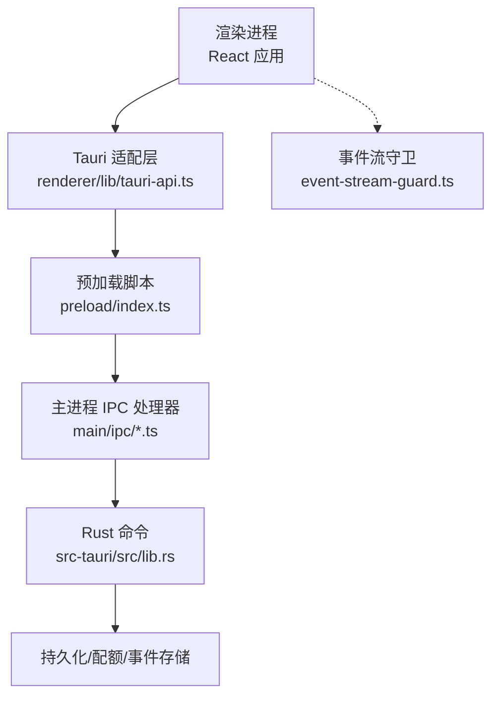
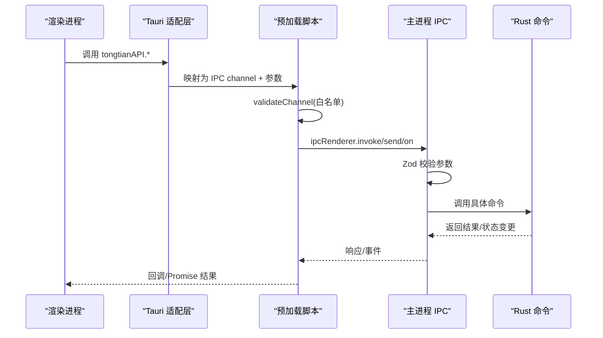
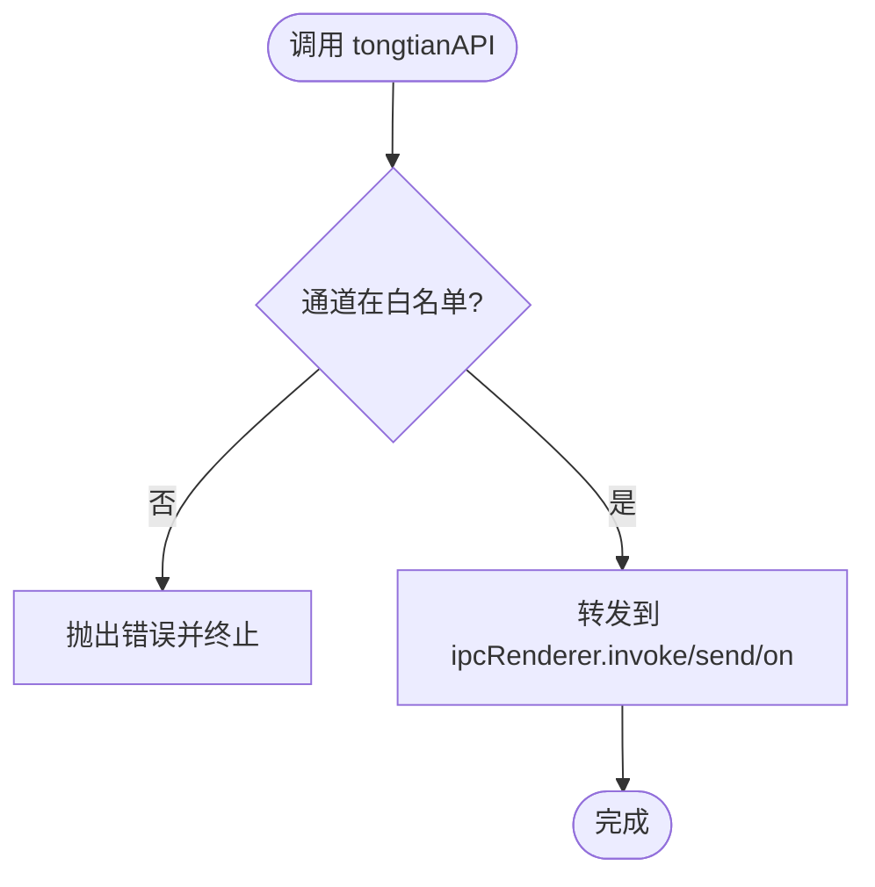
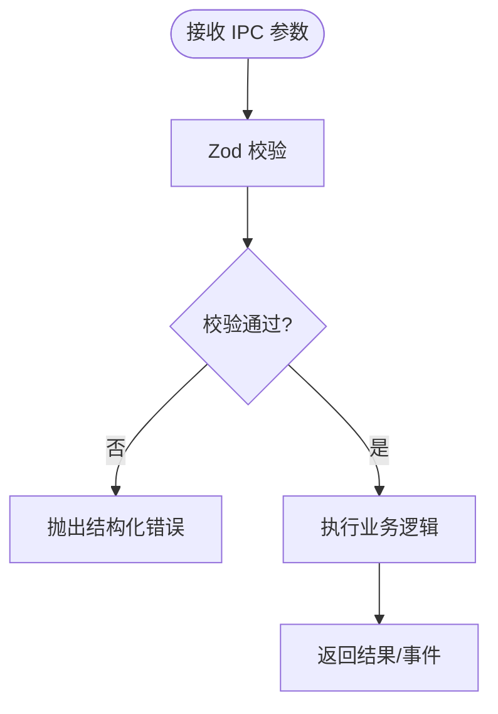
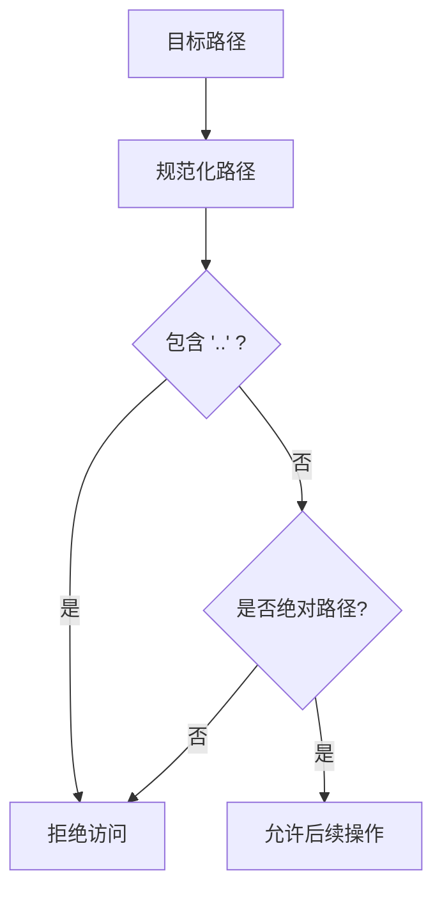
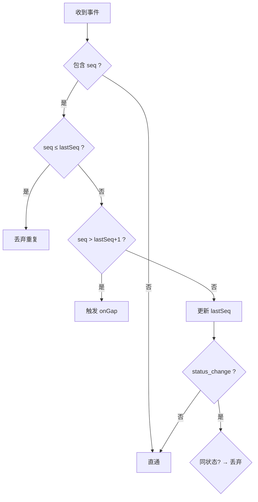
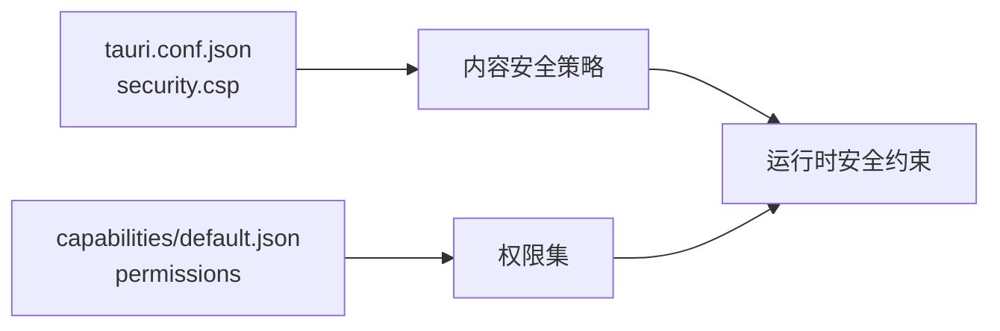
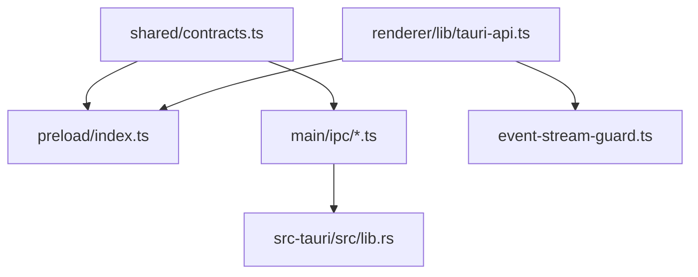

# 安全隔离机制

<cite>
**本文引用的文件**
- [src/preload/index.ts](file://tongtian-tauri/src/preload/index.ts)
- [src/preload/types.d.ts](file://tongtian-tauri/src/preload/types.d.ts)
- [src/preload/index.d.ts](file://tongtian-tauri/src/preload/index.d.ts)
- [src/shared/contracts.ts](file://tongtian-tauri/src/shared/contracts.ts)
- [src/main/ipc/chat.ipc.ts](file://tongtian-tauri/src/main/ipc/chat.ipc.ts)
- [src/main/ipc/file.ipc.ts](file://tongtian-tauri/src/main/ipc/file.ipc.ts)
- [src/renderer/lib/tauri-api.ts](file://tongtian-tauri/src/renderer/lib/tauri-api.ts)
- [src/renderer/lib/event-stream-guard.ts](file://tongtian-tauri/src/renderer/lib/event-stream-guard.ts)
- [src-tauri/tauri.conf.json](file://tongtian-tauri/src-tauri/tauri.conf.json)
- [src-tauri/capabilities/default.json](file://tongtian-tauri/src-tauri/capabilities/default.json)
- [src-tauri/src/lib.rs](file://tongtian-tauri/src-tauri/src/lib.rs)
</cite>

## 目录
1. [简介](#简介)
2. [项目结构](#项目结构)
3. [核心组件](#核心组件)
4. [架构总览](#架构总览)
5. [详细组件分析](#详细组件分析)
6. [依赖关系分析](#依赖关系分析)
7. [性能与安全权衡](#性能与安全权衡)
8. [故障排查指南](#故障排查指南)
9. [结论](#结论)
10. [附录：最佳实践与漏洞防护清单](#附录：最佳实践与漏洞防护清单)

## 简介
本文件面向通天办公项目的安全隔离机制，重点阐述 Tauri 环境下前端与后端（Rust）之间的安全边界、上下文隔离、权限控制与 API 暴露策略。文档围绕 preload 脚本如何以最小权限原则向渲染进程暴露能力，结合白名单、参数校验与访问控制，确保跨进程通信的安全性与可审计性；同时给出 CSP 配置建议、XSS 与原型链污染防护、敏感信息泄露防护等实践方案。

## 项目结构
本项目在 Tauri 中采用“渲染进程—预加载脚本—主进程/Rust 命令”的分层架构。关键路径如下：
- 渲染进程通过统一的 tauriAPI 调用 Rust 命令或监听事件
- 预加载脚本通过 contextBridge 暴露受限的 tongtianAPI，仅允许白名单通道
- 主进程使用 Zod 对入参进行严格校验，并执行受控的业务逻辑
- Rust 侧提供命令实现，配合配额、租约、事件存储等安全与可靠性设施

**图示来源**
- [src/renderer/lib/tauri-api.ts:1-186](file://tongtian-tauri/src/renderer/lib/tauri-api.ts#L1-L186)
- [src/preload/index.ts:1-183](file://tongtian-tauri/src/preload/index.ts#L1-L183)
- [src/main/ipc/chat.ipc.ts:1-190](file://tongtian-tauri/src/main/ipc/chat.ipc.ts#L1-L190)
- [src-tauri/src/lib.rs:1-800](file://tongtian-tauri/src-tauri/src/lib.rs#L1-L800)

**章节来源**
- [src/renderer/lib/tauri-api.ts:1-186](file://tongtian-tauri/src/renderer/lib/tauri-api.ts#L1-L186)
- [src/preload/index.ts:1-183](file://tongtian-tauri/src/preload/index.ts#L1-L183)
- [src/main/ipc/chat.ipc.ts:1-190](file://tongtian-tauri/src/main/ipc/chat.ipc.ts#L1-L190)
- [src-tauri/src/lib.rs:1-800](file://tongtian-tauri/src-tauri/src/lib.rs#L1-L800)

## 核心组件
- 预加载脚本（contextBridge 白名单）：集中定义允许的 invoke/send/on 通道，统一校验后转发到主进程
- 类型契约（shared contracts）：前后端共享的 IPC 通道名、请求/响应类型、错误码
- 主进程 IPC 处理器：基于 Zod 的强类型校验、安全包装器、事件转发
- Rust 命令层：业务编排、配额闸门、租约管理、事件重放、设置与文件能力
- 渲染进程适配层：将 tongtianAPI 映射到 Tauri 的 invoke/listen，并提供事件流守卫

**章节来源**
- [src/preload/index.ts:9-183](file://tongtian-tauri/src/preload/index.ts#L9-L183)
- [src/shared/contracts.ts:478-587](file://tongtian-tauri/src/shared/contracts.ts#L478-L587)
- [src/main/ipc/chat.ipc.ts:17-83](file://tongtian-tauri/src/main/ipc/chat.ipc.ts#L17-L83)
- [src-tauri/src/lib.rs:125-800](file://tongtian-tauri/src-tauri/src/lib.rs#L125-L800)
- [src/renderer/lib/tauri-api.ts:1-186](file://tongtian-tauri/src/renderer/lib/tauri-api.ts#L1-L186)

## 架构总览
下图展示从渲染进程到 Rust 命令的完整调用链，以及事件回推路径。所有通道均经过白名单校验与参数校验，确保最小权限与输入可信。

**图示来源**
- [src/preload/index.ts:95-183](file://tongtian-tauri/src/preload/index.ts#L95-L183)
- [src/main/ipc/chat.ipc.ts:17-83](file://tongtian-tauri/src/main/ipc/chat.ipc.ts#L17-L83)
- [src-tauri/src/lib.rs:125-800](file://tongtian-tauri/src-tauri/src/lib.rs#L125-L800)

## 详细组件分析

### 预加载脚本的安全模型（contextBridge 白名单）
- 白名单机制：集中维护 ALLOWED_INVOKE_CHANNELS、ALLOWED_SEND_CHANNELS、ALLOWED_EVENT_CHANNELS，任何不在集合中的通道将被拒绝
- 统一校验：validateChannel 对所有 invoke/send/on/removeListener/removeAllListeners 入口进行通道合法性检查
- 便捷方法封装：chatSubmit/chatReview/chatControl/onChatEvent 等方法限定参数范围，减少前端误用风险
- 最小暴露：仅暴露 tongtianAPI，不直接暴露 ipcRenderer，避免绕过白名单

**图示来源**
- [src/preload/index.ts:9-183](file://tongtian-tauri/src/preload/index.ts#L9-L183)

**章节来源**
- [src/preload/index.ts:9-183](file://tongtian-tauri/src/preload/index.ts#L9-L183)
- [src/preload/types.d.ts:1-57](file://tongtian-tauri/src/preload/types.d.ts#L1-L57)
- [src/preload/index.d.ts:1-152](file://tongtian-tauri/src/preload/index.d.ts#L1-L152)

### 主进程 IPC 处理器的参数校验与错误处理
- 强类型校验：使用 Zod 对 chat 相关请求进行字段级校验（如 goal 长度、枚举值限制、可选字段）
- 安全包装器：safeHandler 捕获异常并转换为结构化 AppError，避免堆栈与内部细节泄露
- 事件转发：将引擎事件经 IPC 推送至渲染进程，并在窗口关闭时清理监听器，防止资源泄漏

**图示来源**
- [src/main/ipc/chat.ipc.ts:17-83](file://tongtian-tauri/src/main/ipc/chat.ipc.ts#L17-L83)

**章节来源**
- [src/main/ipc/chat.ipc.ts:17-190](file://tongtian-tauri/src/main/ipc/chat.ipc.ts#L17-L190)

### 文件操作的安全边界
- 路径白名单：isPathAllowed 禁止路径穿越（..），并要求绝对路径，降低任意文件读取风险
- MIME 类型检测：预览时对文本与二进制文件分别处理，避免将二进制内容当作文本渲染
- 转换限制：inputFormat/outputFormat 使用枚举约束，防止非法格式注入

**图示来源**
- [src/main/ipc/file.ipc.ts:59-76](file://tongtian-tauri/src/main/ipc/file.ipc.ts#L59-L76)

**章节来源**
- [src/main/ipc/file.ipc.ts:59-250](file://tongtian-tauri/src/main/ipc/file.ipc.ts#L59-L250)

### 渲染进程的事件流守卫（防重复与缺口检测）
- seq 去重：按任务维度维护 lastSeq，丢弃重复事件，保障幂等
- 缺口检测：当收到 seq 大于 lastSeq+1 时触发 onGap 回调，便于上层触发 eventReplay 补齐
- status_change 幂等：同状态覆盖仅保留首次，避免 UI 抖动

**图示来源**
- [src/renderer/lib/event-stream-guard.ts:20-97](file://tongtian-tauri/src/renderer/lib/event-stream-guard.ts#L20-L97)

**章节来源**
- [src/renderer/lib/event-stream-guard.ts:1-97](file://tongtian-tauri/src/renderer/lib/event-stream-guard.ts#L1-L97)

### Tauri 权限与 CSP 配置
- 能力集：默认启用 core:default、opener:default、dialog:default，限制插件能力面
- CSP：当前配置为 null，生产环境应显式设置严格的 CSP，限制脚本来源、内联脚本、不安全源等

**图示来源**
- [src-tauri/tauri.conf.json:24-26](file://tongtian-tauri/src-tauri/tauri.conf.json#L24-L26)
- [src-tauri/capabilities/default.json:1-8](file://tongtian-tauri/src-tauri/capabilities/default.json#L1-L8)

**章节来源**
- [src-tauri/tauri.conf.json:1-40](file://tongtian-tauri/src-tauri/tauri.conf.json#L1-L40)
- [src-tauri/capabilities/default.json:1-8](file://tongtian-tauri/src-tauri/capabilities/default.json#L1-L8)

## 依赖关系分析
- 预加载脚本依赖 shared/contracts 定义的通道常量，保证前后端一致
- 主进程 IPC 处理器依赖 shared/contracts 的类型与错误码，确保契约稳定
- Rust 命令层提供实际能力，并通过事件与状态变更驱动前端
- 渲染进程适配层屏蔽 Tauri 差异，提供统一接口与事件守卫

**图示来源**
- [src/shared/contracts.ts:478-587](file://tongtian-tauri/src/shared/contracts.ts#L478-L587)
- [src/preload/index.ts:1-183](file://tongtian-tauri/src/preload/index.ts#L1-L183)
- [src/main/ipc/chat.ipc.ts:1-190](file://tongtian-tauri/src/main/ipc/chat.ipc.ts#L1-L190)
- [src-tauri/src/lib.rs:1-800](file://tongtian-tauri/src-tauri/src/lib.rs#L1-L800)
- [src/renderer/lib/tauri-api.ts:1-186](file://tongtian-tauri/src/renderer/lib/tauri-api.ts#L1-L186)
- [src/renderer/lib/event-stream-guard.ts:1-97](file://tongtian-tauri/src/renderer/lib/event-stream-guard.ts#L1-L97)

**章节来源**
- [src/shared/contracts.ts:478-587](file://tongtian-tauri/src/shared/contracts.ts#L478-L587)
- [src/preload/index.ts:1-183](file://tongtian-tauri/src/preload/index.ts#L1-L183)
- [src/main/ipc/chat.ipc.ts:1-190](file://tongtian-tauri/src/main/ipc/chat.ipc.ts#L1-L190)
- [src-tauri/src/lib.rs:1-800](file://tongtian-tauri/src-tauri/src/lib.rs#L1-L800)
- [src/renderer/lib/tauri-api.ts:1-186](file://tongtian-tauri/src/renderer/lib/tauri-api.ts#L1-L186)
- [src/renderer/lib/event-stream-guard.ts:1-97](file://tongtian-tauri/src/renderer/lib/event-stream-guard.ts#L1-L97)

## 性能与安全权衡
- 预加载白名单：增加一层校验开销，但显著降低攻击面
- 主进程 Zod 校验：带来少量 CPU 开销，换取更强的输入可信度
- 事件流守卫：内存占用与 CPU 开销可控，避免重复渲染与状态抖动
- Rust 配额与租约：在提交阶段进行配额检查，避免资源滥用；租约机制防止抢占，提升并发安全性

[本节为通用指导，无需特定文件引用]

## 故障排查指南
- 通道不被允许：检查 preload 白名单是否包含对应通道，确认 shared/contracts 通道常量一致
- 参数校验失败：查看主进程日志与错误码，定位字段缺失或越界问题
- 事件丢失或重复：检查事件流守卫的 seq 与 lastStatus，必要时触发 eventReplay 补齐
- 文件访问被拒：确认路径是否包含 .. 或非绝对路径，检查工作区根目录策略

**章节来源**
- [src/preload/index.ts:95-183](file://tongtian-tauri/src/preload/index.ts#L95-L183)
- [src/main/ipc/chat.ipc.ts:47-83](file://tongtian-tauri/src/main/ipc/chat.ipc.ts#L47-L83)
- [src/main/ipc/file.ipc.ts:59-76](file://tongtian-tauri/src/main/ipc/file.ipc.ts#L59-L76)
- [src/renderer/lib/event-stream-guard.ts:42-97](file://tongtian-tauri/src/renderer/lib/event-stream-guard.ts#L42-L97)

## 结论
通天办公通过“预加载白名单 + 主进程强类型校验 + Rust 命令层能力管控”的多层安全模型，实现了渲染进程与后端之间的安全隔离。该设计有效限制了跨进程通信的攻击面，结合事件流守卫与配额/租约机制，提升了系统的健壮性与安全性。生产环境应进一步收紧 CSP，完善权限最小化策略，并持续进行安全测试与审计。

[本节为总结性内容，无需特定文件引用]

## 附录：最佳实践与漏洞防护清单
- 上下文隔离
  - 仅通过 contextBridge 暴露必要 API，避免直接暴露 ipcRenderer
  - 使用白名单严格限制通道，新增能力需评审并加入集合
- 权限控制
  - 能力集最小化，按需启用 opener/dialog 等插件
  - 生产环境设置严格 CSP，禁用内联脚本与不安全源
- API 暴露策略
  - 统一封装便捷方法，限定参数类型与取值范围
  - 主进程使用 Zod 进行强类型校验，返回结构化错误
- 跨进程通信安全
  - 事件流守卫保障幂等与连续性，支持重放补齐
  - 文件操作限制路径穿越与非法格式，区分文本与二进制
- XSS 防护
  - 避免将用户输入直接插入 DOM，使用安全的渲染方式
  - 严格 CSP 与内容过滤，阻止恶意脚本执行
- 原型链污染防护
  - 避免对对象原型进行修改，使用不可变数据结构
  - 对动态键名进行白名单校验，防止意外属性注入
- 敏感信息泄露防护
  - 不在日志中输出密钥、令牌等敏感数据
  - 使用 Vault/加密存储保存敏感配置，限制访问范围

[本节为通用指导，无需特定文件引用]