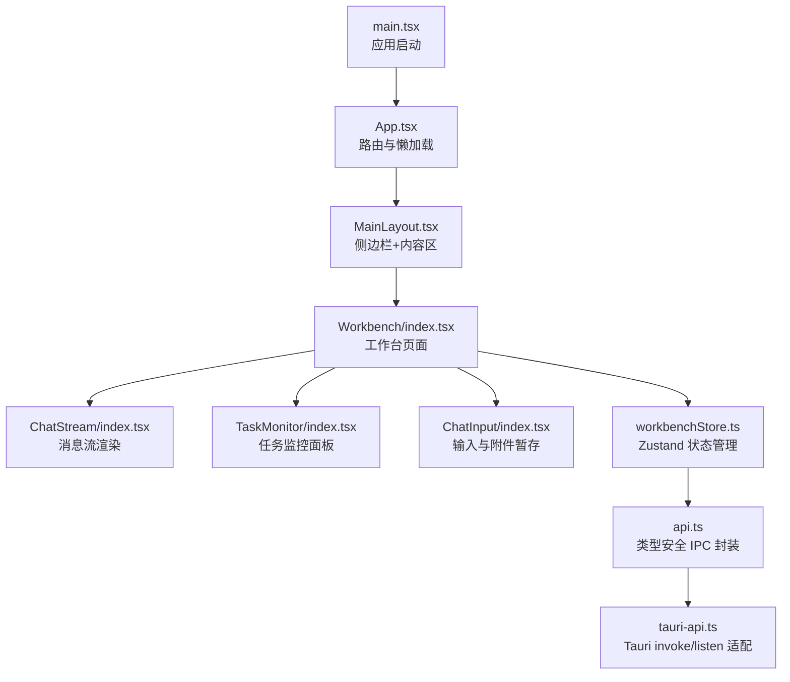
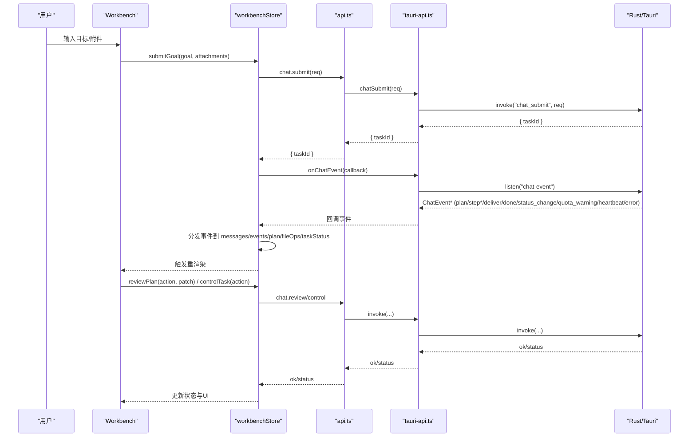
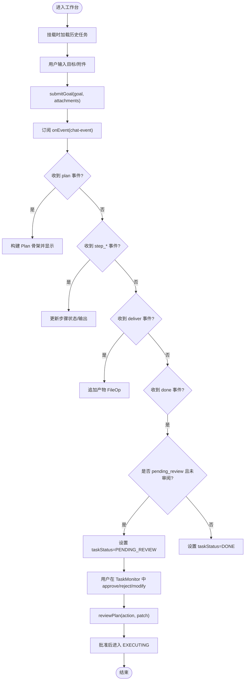
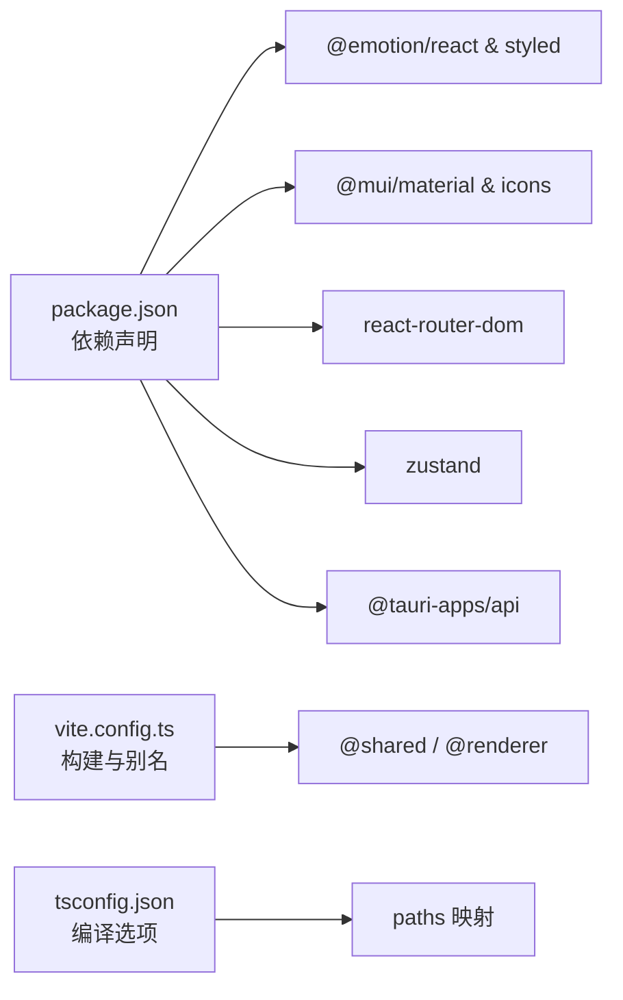

# 前端架构

<cite>
**本文引用的文件**   
- [main.tsx](file://tongtian-tauri/src/renderer/main.tsx)
- [App.tsx](file://tongtian-tauri/src/renderer/App.tsx)
- [Workbench/index.tsx](file://tongtian-tauri/src/renderer/pages/Workbench/index.tsx)
- [ChatStream/index.tsx](file://tongtian-tauri/src/renderer/components/ChatStream/index.tsx)
- [TaskMonitor/index.tsx](file://tongtian-tauri/src/renderer/components/TaskMonitor/index.tsx)
- [ChatInput/index.tsx](file://tongtian-tauri/src/renderer/components/ChatInput/index.tsx)
- [MainLayout.tsx](file://tongtian-tauri/src/renderer/components/Layout/MainLayout.tsx)
- [workbenchStore.ts](file://tongtian-tauri/src/renderer/store/workbenchStore.ts)
- [api.ts](file://tongtian-tauri/src/renderer/lib/api.ts)
- [tauri-api.ts](file://tongtian-tauri/src/renderer/lib/tauri-api.ts)
- [types.ts](file://tongtian-tauri/src/shared/types.ts)
- [package.json](file://tongtian-tauri/package.json)
- [vite.config.ts](file://tongtian-tauri/vite.config.ts)
- [tsconfig.json](file://tongtian-tauri/tsconfig.json)
</cite>

## 目录
1. [简介](#简介)
2. [项目结构](#项目结构)
3. [核心组件](#核心组件)
4. [架构总览](#架构总览)
5. [详细组件分析](#详细组件分析)
6. [依赖关系分析](#依赖关系分析)
7. [性能与响应式考虑](#性能与响应式考虑)
8. [故障排查指南](#故障排查指南)
9. [结论](#结论)

## 简介
本文件为通天办公（Tauri + React 18 + TypeScript）的前端架构文档，聚焦以下方面：
- 组件层次结构与页面组织
- 基于 Zustand 的状态管理方案
- 路由配置与懒加载策略
- Workbench 工作台的两阶段协议交互、任务状态监控、聊天流处理
- 组件间通信机制与事件驱动的数据更新模式
- 前后端 IPC 调用封装（Tauri invoke/listen）
- 响应式设计考量与性能优化策略

## 项目结构
前端工程位于 tongtian-tauri/src/renderer，采用 Vite + React 18 + MUI + Tailwind 的组合。根入口 main.tsx 注入主题与全局样式，App.tsx 使用 HashRouter 进行路由，并通过 Suspense + lazy 实现页面级懒加载。Workbench 作为默认首页，包含聊天区与右侧任务监控面板。

**图示来源** 
- [main.tsx:1-25](file://tongtian-tauri/src/renderer/main.tsx#L1-L25)
- [App.tsx:10-79](file://tongtian-tauri/src/renderer/App.tsx#L10-L79)
- [MainLayout.tsx:13-57](file://tongtian-tauri/src/renderer/components/Layout/MainLayout.tsx#L13-L57)
- [Workbench/index.tsx:237-443](file://tongtian-tauri/src/renderer/pages/Workbench/index.tsx#L237-L443)
- [ChatStream/index.tsx:37-358](file://tongtian-tauri/src/renderer/components/ChatStream/index.tsx#L37-L358)
- [TaskMonitor/index.tsx:107-265](file://tongtian-tauri/src/renderer/components/TaskMonitor/index.tsx#L107-L265)
- [ChatInput/index.tsx:58-407](file://tongtian-tauri/src/renderer/components/ChatInput/index.tsx#L58-L407)
- [workbenchStore.ts:118-409](file://tongtian-tauri/src/renderer/store/workbenchStore.ts#L118-L409)
- [api.ts:198-207](file://tongtian-tauri/src/renderer/lib/api.ts#L198-L207)
- [tauri-api.ts:39-170](file://tongtian-tauri/src/renderer/lib/tauri-api.ts#L39-L170)

**章节来源**
- [main.tsx:1-25](file://tongtian-tauri/src/renderer/main.tsx#L1-L25)
- [App.tsx:10-79](file://tongtian-tauri/src/renderer/App.tsx#L10-L79)
- [vite.config.ts:1-25](file://tongtian-tauri/vite.config.ts#L1-L25)
- [tsconfig.json:1-29](file://tongtian-tauri/tsconfig.json#L1-L29)

## 核心组件
- 应用入口与主题：main.tsx 初始化 React 根节点并注入 MUI 主题与全局样式。
- 路由与页面：App.tsx 使用 HashRouter，集中注册页面路由，并对各页面进行懒加载。
- 布局：MainLayout.tsx 提供侧边栏与全高内容区，Workbench 页面内自行组织三栏布局。
- 工作台：Workbench/index.tsx 整合聊天流、输入框与任务监控，承载两阶段协议交互。
- 聊天流：ChatStream/index.tsx 渲染用户/AI/工具消息与实时事件（步骤开始/进度/完成/失败/交付）。
- 任务监控：TaskMonitor/index.tsx 展示计划步骤、产物、工作目录、技能与 MCP 连接器占位。
- 输入与附件：ChatInput/index.tsx 支持多行输入、模式选择、附件暂存与发送。
- 状态管理：workbenchStore.ts 通过 Zustand 统一管理消息、事件、计划、文件操作、任务状态与控制动作。
- IPC 封装：api.ts 对 window.tongtianAPI 进行类型化封装；tauri-api.ts 将 Tauri invoke/listen 暴露为统一接口。

**章节来源**
- [main.tsx:16-24](file://tongtian-tauri/src/renderer/main.tsx#L16-L24)
- [App.tsx:17-31](file://tongtian-tauri/src/renderer/App.tsx#L17-L31)
- [MainLayout.tsx:29-56](file://tongtian-tauri/src/renderer/components/Layout/MainLayout.tsx#L29-L56)
- [Workbench/index.tsx:237-443](file://tongtian-tauri/src/renderer/pages/Workbench/index.tsx#L237-L443)
- [ChatStream/index.tsx:37-358](file://tongtian-tauri/src/renderer/components/ChatStream/index.tsx#L37-L358)
- [TaskMonitor/index.tsx:107-265](file://tongtian-tauri/src/renderer/components/TaskMonitor/index.tsx#L107-L265)
- [ChatInput/index.tsx:58-407](file://tongtian-tauri/src/renderer/components/ChatInput/index.tsx#L58-L407)
- [workbenchStore.ts:118-409](file://tongtian-tauri/src/renderer/store/workbenchStore.ts#L118-L409)
- [api.ts:198-207](file://tongtian-tauri/src/renderer/lib/api.ts#L198-L207)
- [tauri-api.ts:39-170](file://tongtian-tauri/src/renderer/lib/tauri-api.ts#L39-L170)

## 架构总览
前端以“组件 → Store → API → Tauri”的分层组织，配合事件驱动的 ChatEvent 流实现 UI 的增量更新。Workbench 页面是核心业务入口，负责发起任务、订阅事件、审阅计划、控制任务以及展示结果。

**图示来源** 
- [Workbench/index.tsx:278-295](file://tongtian-tauri/src/renderer/pages/Workbench/index.tsx#L278-L295)
- [workbenchStore.ts:139-295](file://tongtian-tauri/src/renderer/store/workbenchStore.ts#L139-L295)
- [api.ts:33-69](file://tongtian-tauri/src/renderer/lib/api.ts#L33-L69)
- [tauri-api.ts:91-170](file://tongtian-tauri/src/renderer/lib/tauri-api.ts#L91-L170)

## 详细组件分析

### Workbench 工作台
- 职责：聚合聊天区与任务监控，承载两阶段协议（提交→计划→待审阅→执行→完成），维护任务状态徽标与头部控制按钮。
- 关键流程：
  - 提交目标：追加用户消息，调用 api.chat.submit，订阅 onEvent，根据事件类型更新 plan、fileOps、taskStatus 等。
  - 计划审阅：approve/reject/modify 通过 api.chat.review 通知后端，批准后进入执行态。
  - 任务控制：pause/resume/rollback_to 通过 api.chat.control 下发。
  - 取消任务：三层架构演进 P0 新增 cancelTask，调用 p0.cancel。
  - 历史加载：loadHistory 拉取 tasks 列表用于侧边栏。
- 状态来源：useWorkbenchStore 通过 useShallow 订阅必要字段，避免不必要重渲染。

**图示来源** 
- [Workbench/index.tsx:278-327](file://tongtian-tauri/src/renderer/pages/Workbench/index.tsx#L278-L327)
- [workbenchStore.ts:139-295](file://tongtian-tauri/src/renderer/store/workbenchStore.ts#L139-L295)
- [workbenchStore.ts:299-327](file://tongtian-tauri/src/renderer/store/workbenchStore.ts#L299-L327)
- [workbenchStore.ts:331-348](file://tongtian-tauri/src/renderer/store/workbenchStore.ts#L331-L348)
- [workbenchStore.ts:352-369](file://tongtian-tauri/src/renderer/store/workbenchStore.ts#L352-L369)

**章节来源**
- [Workbench/index.tsx:237-443](file://tongtian-tauri/src/renderer/pages/Workbench/index.tsx#L237-L443)
- [workbenchStore.ts:118-409](file://tongtian-tauri/src/renderer/store/workbenchStore.ts#L118-L409)

### 聊天流 ChatStream
- 职责：渲染用户/AI/工具消息与实时事件，自动滚动到底部，支持 Markdown 与附件标签。
- 事件渲染：step_start/step_progress/step_done/step_failed/deliver 分别以进度条、代码块、成功/失败卡片、交付物卡片呈现。
- 性能：仅按消息与事件数组顺序渲染，避免重复计算；展开态由内部状态管理。

**章节来源**
- [ChatStream/index.tsx:37-358](file://tongtian-tauri/src/renderer/components/ChatStream/index.tsx#L37-L358)

### 任务监控 TaskMonitor
- 职责：展示计划步骤（含审阅按钮）、产物列表、工作目录、技能与 MCP 连接器（占位计数）。
- 交互：在 pending_review 状态下显示批准/拒绝按钮，调用父组件传入的 onReview。

**章节来源**
- [TaskMonitor/index.tsx:107-265](file://tongtian-tauri/src/renderer/components/TaskMonitor/index.tsx#L107-L265)

### 输入与附件 ChatInput
- 职责：多行文本输入、模式选择、附件暂存与发送。
- 附件暂存：在 Tauri 环境调用 fileStageAttachment 获取 stagedPath 与元数据；Mock 环境注入示例附件。
- 发送逻辑：校验长度与 loading/staging 状态，逐个暂存附件，成功后调用 onSend。

**章节来源**
- [ChatInput/index.tsx:58-407](file://tongtian-tauri/src/renderer/components/ChatInput/index.tsx#L58-L407)

### 布局 MainLayout
- 职责：侧边栏常驻（桌面端），窄屏使用抽屉；Workbench 路径下无外层 padding，其他页面保留内边距。

**章节来源**
- [MainLayout.tsx:13-57](file://tongtian-tauri/src/renderer/components/Layout/MainLayout.tsx#L13-L57)

### 路由 App
- 职责：HashRouter 路由注册，Suspense + lazy 懒加载页面，旧路由兼容重定向。

**章节来源**
- [App.tsx:10-79](file://tongtian-tauri/src/renderer/App.tsx#L10-L79)

## 依赖关系分析
- 运行时依赖：React 18、MUI、react-router-dom、zustand、@tauri-apps/api 等。
- 构建配置：Vite 插件 react，别名 @shared/@renderer，开发端口 7173。
- TypeScript：ES2022 target，strict 模式，paths 映射共享类型。

**图示来源** 
- [package.json:15-29](file://tongtian-tauri/package.json#L15-L29)
- [vite.config.ts:1-25](file://tongtian-tauri/vite.config.ts#L1-L25)
- [tsconfig.json:1-29](file://tongtian-tauri/tsconfig.json#L1-L29)

**章节来源**
- [package.json:1-45](file://tongtian-tauri/package.json#L1-L45)
- [vite.config.ts:1-25](file://tongtian-tauri/vite.config.ts#L1-L25)
- [tsconfig.json:1-29](file://tongtian-tauri/tsconfig.json#L1-L29)

## 性能与响应式考虑
- 组件懒加载：页面级 lazy + Suspense 降低首屏体积。
- 状态订阅优化：workbenchStore 使用 useShallow 精确订阅所需字段，减少无关重渲染。
- 事件流守卫：tauri-api.ts 中的 EventStreamGuard 对 chat-event 进行 seq 去重与缺口检测，避免重复渲染与丢失。
- 渲染优化：ChatStream 自动滚动与条件渲染，避免长列表抖动。
- 响应式布局：MainLayout 使用 useMediaQuery 区分移动端与桌面端，Workbench 在全屏模式下自适应宽度。
- 构建优化：Vite sourcemap 开启便于调试，按需引入 MUI 图标与组件。

[本节为通用指导，不直接分析具体文件]

## 故障排查指南
- 事件流异常：检查 tauri-api.ts 的 onChatEvent 订阅与 EventStreamGuard 的 gap 告警日志。
- 任务状态不一致：核对 workbenchStore.ts 的事件分发分支（plan/step*/deliver/done/status_change/quota_warning/error）。
- 附件暂存失败：查看 ChatInput/index.tsx 的暂存错误提示与重试逻辑。
- IPC 未实现：api.ts 的 callIfAvailable 会降级返回空值并在开发环境打印警告，确认 Rust 命令是否已实现。
- 路由跳转问题：确认 App.tsx 的路径与导航是否正确，注意旧路由的重定向规则。

**章节来源**
- [tauri-api.ts:146-170](file://tongtian-tauri/src/renderer/lib/tauri-api.ts#L146-L170)
- [workbenchStore.ts:174-295](file://tongtian-tauri/src/renderer/store/workbenchStore.ts#L174-L295)
- [ChatInput/index.tsx:125-161](file://tongtian-tauri/src/renderer/components/ChatInput/index.tsx#L125-L161)
- [api.ts:159-196](file://tongtian-tauri/src/renderer/lib/api.ts#L159-L196)
- [App.tsx:55-72](file://tongtian-tauri/src/renderer/App.tsx#L55-L72)

## 结论
本前端架构以清晰的组件分层、事件驱动的 ChatEvent 流与类型安全的 IPC 封装为核心，结合 Zustand 的细粒度状态订阅与 Vite 的懒加载策略，实现了高性能、可维护的工作台体验。Workbench 的两阶段协议与任务监控能力为用户提供了可控、可视的 AI 任务执行过程。后续可在技能市场、MCP 连接器与配额预警等方面持续完善。