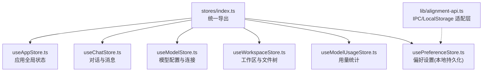
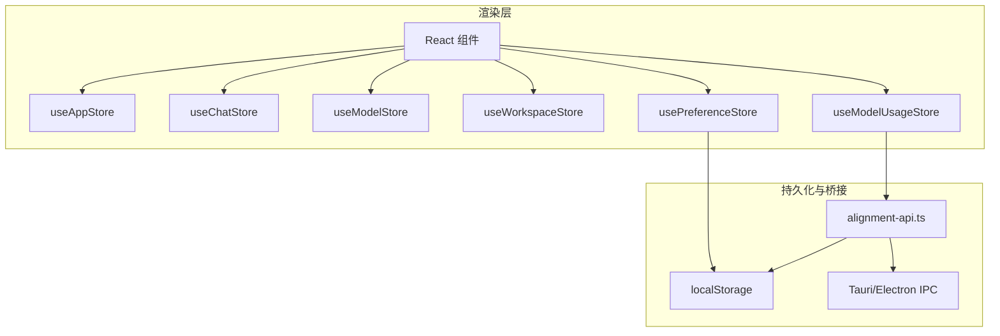
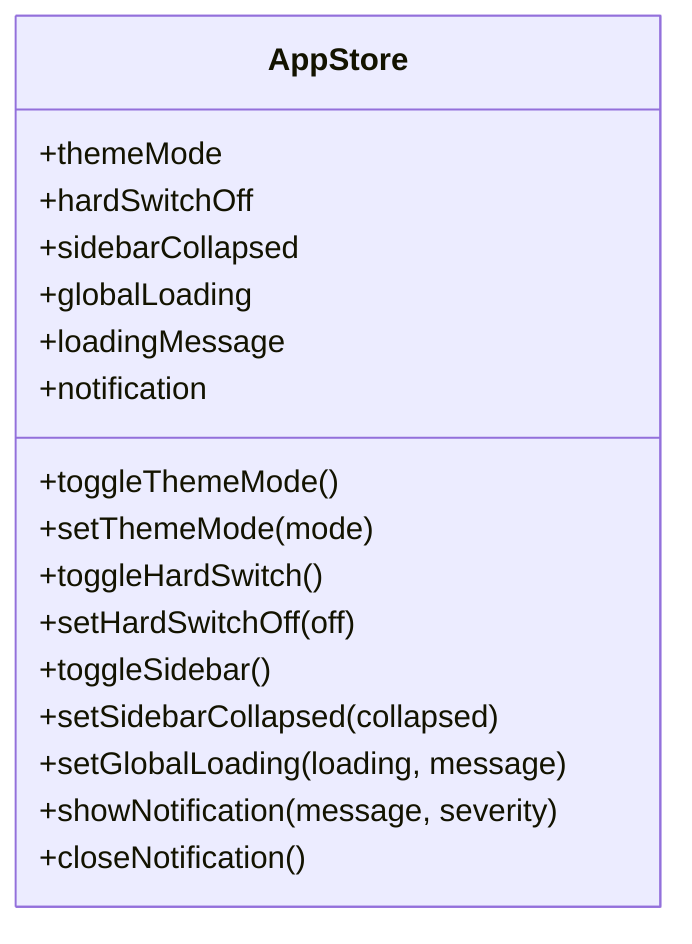
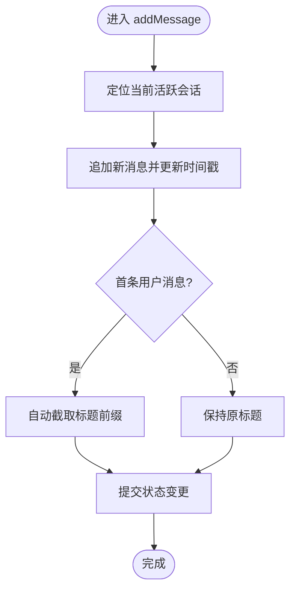
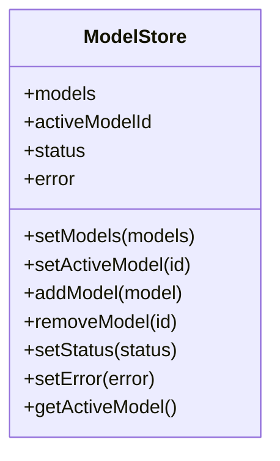
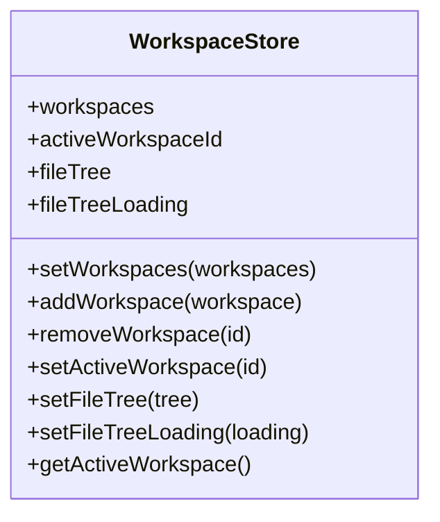
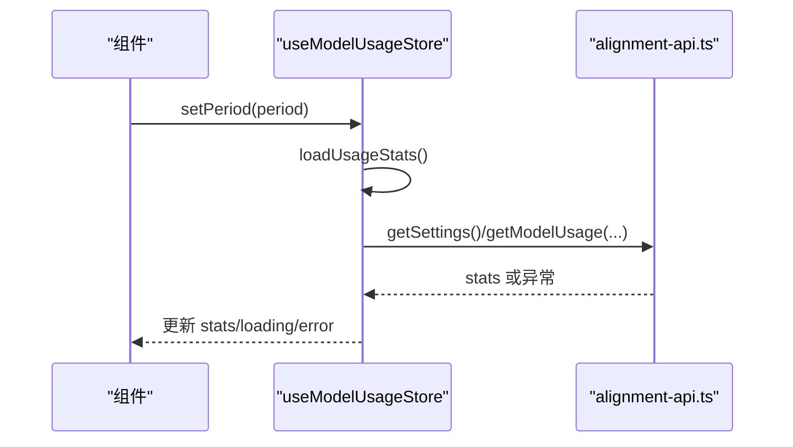
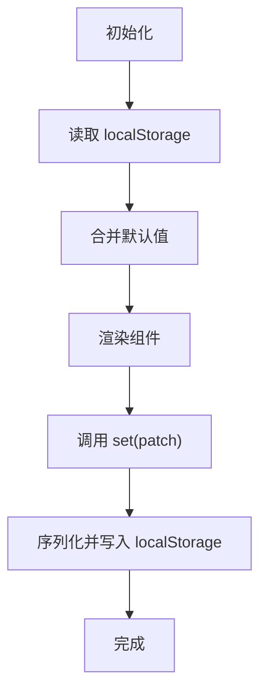
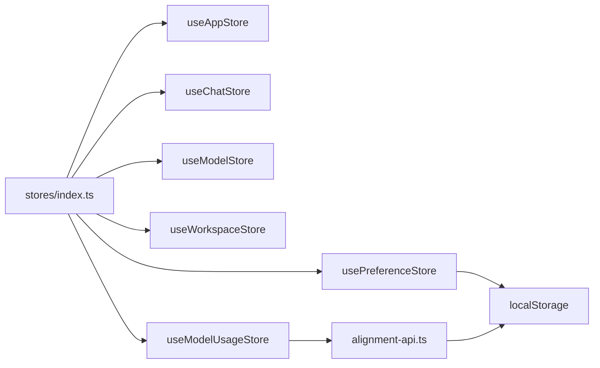
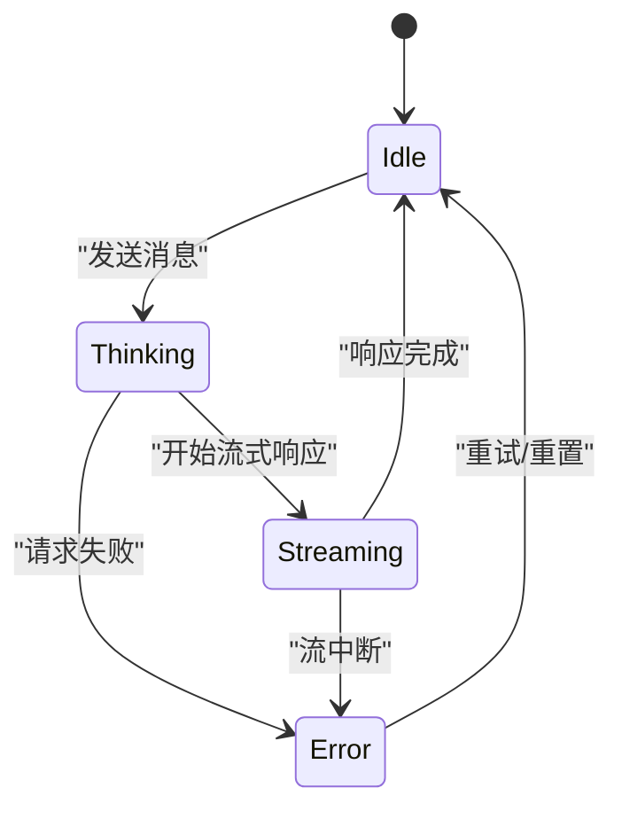

# 状态管理方案

<cite>
**本文引用的文件**
- [index.ts](file://tongtian-tauri/src/renderer/stores/index.ts)
- [useAppStore.ts](file://tongtian-tauri/src/renderer/stores/useAppStore.ts)
- [useChatStore.ts](file://tongtian-tauri/src/renderer/stores/useChatStore.ts)
- [useModelStore.ts](file://tongtian-tauri/src/renderer/stores/useModelStore.ts)
- [useWorkspaceStore.ts](file://tongtian-tauri/src/renderer/stores/useWorkspaceStore.ts)
- [useModelUsageStore.ts](file://tongtian-tauri/src/renderer/stores/useModelUsageStore.ts)
- [usePreferenceStore.ts](file://tongtian-tauri/src/renderer/stores/usePreferenceStore.ts)
- [alignment-api.ts](file://tongtian-tauri/src/renderer/lib/alignment-api.ts)
</cite>

## 目录
1. [简介](#简介)
2. [项目结构](#项目结构)
3. [核心组件](#核心组件)
4. [架构总览](#架构总览)
5. [详细组件分析](#详细组件分析)
6. [依赖关系分析](#依赖关系分析)
7. [性能考量](#性能考量)
8. [故障排查指南](#故障排查指南)
9. [结论](#结论)
10. [附录](#附录)

## 简介
本方案为通天办公项目的状态管理设计文档，基于 Zustand 构建前端全局状态体系。重点覆盖：
- 全局状态的组织结构与职责划分（应用、对话、模型、工作区、用量、偏好）
- 状态持久化策略（localStorage 与 IPC 桥接）
- 状态同步机制（跨组件订阅、异步更新、错误处理）
- 最佳实践、性能优化技巧与跨组件共享方案
- 状态流转图与调试方法
- 异步操作与错误状态处理
- 状态迁移策略与版本兼容性考虑

## 项目结构
渲染层 stores 采用“按领域拆分”的模块化组织方式，统一通过 index.ts 导出，便于按需引入与集中管理。

图表来源
- [index.ts:1-17](file://tongtian-tauri/src/renderer/stores/index.ts#L1-L17)
- [useAppStore.ts:1-110](file://tongtian-tauri/src/renderer/stores/useAppStore.ts#L1-L110)
- [useChatStore.ts:1-164](file://tongtian-tauri/src/renderer/stores/useChatStore.ts#L1-L164)
- [useModelStore.ts:1-106](file://tongtian-tauri/src/renderer/stores/useModelStore.ts#L1-L106)
- [useWorkspaceStore.ts:1-110](file://tongtian-tauri/src/renderer/stores/useWorkspaceStore.ts#L1-L110)
- [useModelUsageStore.ts:1-152](file://tongtian-tauri/src/renderer/stores/useModelUsageStore.ts#L1-L152)
- [usePreferenceStore.ts:1-57](file://tongtian-tauri/src/renderer/stores/usePreferenceStore.ts#L1-L57)
- [alignment-api.ts:1-307](file://tongtian-tauri/src/renderer/lib/alignment-api.ts#L1-L307)

章节来源
- [index.ts:1-17](file://tongtian-tauri/src/renderer/stores/index.ts#L1-L17)

## 核心组件
- useAppStore：主题模式、硬开关、侧边栏折叠、全局加载与通知等应用级 UI 状态
- useChatStore：会话列表、当前活跃会话、消息收发与流式更新、对话状态机（空闲/思考/流式/错误）
- useModelStore：可用模型列表、当前选中模型、连接状态、增删改查与查询辅助
- useWorkspaceStore：工作区列表、当前活跃工作区、文件树与加载状态
- useModelUsageStore：Token 用量统计、限额管理、周期切换与数据加载
- usePreferenceStore：用户偏好设置，持久化到 localStorage

章节来源
- [useAppStore.ts:1-110](file://tongtian-tauri/src/renderer/stores/useAppStore.ts#L1-L110)
- [useChatStore.ts:1-164](file://tongtian-tauri/src/renderer/stores/useChatStore.ts#L1-L164)
- [useModelStore.ts:1-106](file://tongtian-tauri/src/renderer/stores/useModelStore.ts#L1-L106)
- [useWorkspaceStore.ts:1-110](file://tongtian-tauri/src/renderer/stores/useWorkspaceStore.ts#L1-L110)
- [useModelUsageStore.ts:1-152](file://tongtian-tauri/src/renderer/stores/useModelUsageStore.ts#L1-L152)
- [usePreferenceStore.ts:1-57](file://tongtian-tauri/src/renderer/stores/usePreferenceStore.ts#L1-L57)

## 架构总览
Zustand 提供轻量、无样板的状态容器；各 store 以模块形式存在，组件通过对应 hook 订阅所需切片，避免不必要的重渲染。持久化由 preference store 直接写入 localStorage，其他业务状态可通过 alignment-api.ts 在 Electron 环境下走 IPC，开发环境回退到 localStorage。

图表来源
- [useAppStore.ts:1-110](file://tongtian-tauri/src/renderer/stores/useAppStore.ts#L1-L110)
- [useChatStore.ts:1-164](file://tongtian-tauri/src/renderer/stores/useChatStore.ts#L1-L164)
- [useModelStore.ts:1-106](file://tongtian-tauri/src/renderer/stores/useModelStore.ts#L1-L106)
- [useWorkspaceStore.ts:1-110](file://tongtian-tauri/src/renderer/stores/useWorkspaceStore.ts#L1-L110)
- [useModelUsageStore.ts:1-152](file://tongtian-tauri/src/renderer/stores/useModelUsageStore.ts#L1-L152)
- [usePreferenceStore.ts:1-57](file://tongtian-tauri/src/renderer/stores/usePreferenceStore.ts#L1-L57)
- [alignment-api.ts:1-307](file://tongtian-tauri/src/renderer/lib/alignment-api.ts#L1-L307)

## 详细组件分析

### useAppStore（应用全局状态）
- 职责：主题模式、合规硬开关、侧边栏折叠、全局加载与通知
- 数据结构：themeMode、hardSwitchOff、sidebarCollapsed、globalLoading、loadingMessage、notification
- 关键行为：切换主题、切换硬开关、控制侧边栏、设置全局加载、显示/关闭通知
- 错误处理：通知 severity 支持 success/error/warning/info
- 性能：纯对象更新，无副作用，适合高频 UI 切换

图表来源
- [useAppStore.ts:1-110](file://tongtian-tauri/src/renderer/stores/useAppStore.ts#L1-L110)

章节来源
- [useAppStore.ts:1-110](file://tongtian-tauri/src/renderer/stores/useAppStore.ts#L1-L110)

### useChatStore（对话与消息）
- 职责：会话 CRUD、消息发送/接收、流式更新、对话状态机
- 数据结构：conversations、activeConversationId、status、error
- 关键行为：创建会话、切换活跃会话、删除会话、添加消息、流式更新消息、清空消息、设置状态与错误
- 错误处理：setError 同时修正 status 为 error/idle
- 性能：仅对当前活跃会话进行映射更新，避免全量重绘

图表来源
- [useChatStore.ts:1-164](file://tongtian-tauri/src/renderer/stores/useChatStore.ts#L1-L164)

章节来源
- [useChatStore.ts:1-164](file://tongtian-tauri/src/renderer/stores/useChatStore.ts#L1-L164)

### useModelStore（模型配置与连接）
- 职责：维护可用模型列表、当前选中模型、连接状态与错误信息
- 数据结构：models、activeModelId、status、error
- 关键行为：设置模型列表、切换活跃模型、添加/移除模型、设置状态与错误、获取当前活跃模型
- 错误处理：setError 将 status 置为 error，否则恢复 disconnected

图表来源
- [useModelStore.ts:1-106](file://tongtian-tauri/src/renderer/stores/useModelStore.ts#L1-L106)

章节来源
- [useModelStore.ts:1-106](file://tongtian-tauri/src/renderer/stores/useModelStore.ts#L1-L106)

### useWorkspaceStore（工作区与文件树）
- 职责：工作区列表、当前活跃工作区、文件树与加载状态
- 数据结构：workspaces、activeWorkspaceId、fileTree、fileTreeLoading
- 关键行为：设置工作区列表、新增/删除工作区、切换活跃工作区、设置文件树与加载状态、获取当前工作区
- 错误处理：切换工作区时清空文件树，避免脏数据

图表来源
- [useWorkspaceStore.ts:1-110](file://tongtian-tauri/src/renderer/stores/useWorkspaceStore.ts#L1-L110)

章节来源
- [useWorkspaceStore.ts:1-110](file://tongtian-tauri/src/renderer/stores/useWorkspaceStore.ts#L1-L110)

### useModelUsageStore（用量统计）
- 职责：Token 使用统计、限额管理、周期切换与数据加载
- 数据结构：period、stats、loading、error
- 关键行为：切换周期（触发重新加载）、设置统计、更新单个模型用量、设置限额、加载数据（含模拟数据）
- 错误处理：加载失败记录 error，finally 确保 loading 复位

图表来源
- [useModelUsageStore.ts:1-152](file://tongtian-tauri/src/renderer/stores/useModelUsageStore.ts#L1-L152)
- [alignment-api.ts:1-307](file://tongtian-tauri/src/renderer/lib/alignment-api.ts#L1-L307)

章节来源
- [useModelUsageStore.ts:1-152](file://tongtian-tauri/src/renderer/stores/useModelUsageStore.ts#L1-L152)

### usePreferenceStore（偏好设置）
- 职责：用户偏好设置，持久化到 localStorage
- 数据结构：theme、frostedGlass、chatFontSize、chatWidth、previewMode、promptSuggestions
- 关键行为：批量 set，内部合并默认值并写回 localStorage
- 错误处理：读写异常忽略，保证 UI 可用性

图表来源
- [usePreferenceStore.ts:1-57](file://tongtian-tauri/src/renderer/stores/usePreferenceStore.ts#L1-L57)

章节来源
- [usePreferenceStore.ts:1-57](file://tongtian-tauri/src/renderer/stores/usePreferenceStore.ts#L1-L57)

## 依赖关系分析
- 统一入口：stores/index.ts 集中导出所有 store，组件按需引入
- 持久化桥接：alignment-api.ts 在 Electron 下走 IPC，浏览器开发模式回退到 localStorage
- 解耦原则：store 之间不互相依赖，通过组件组合实现跨域协作

图表来源
- [index.ts:1-17](file://tongtian-tauri/src/renderer/stores/index.ts#L1-L17)
- [alignment-api.ts:1-307](file://tongtian-tauri/src/renderer/lib/alignment-api.ts#L1-L307)

章节来源
- [index.ts:1-17](file://tongtian-tauri/src/renderer/stores/index.ts#L1-L17)
- [alignment-api.ts:1-307](file://tongtian-tauri/src/renderer/lib/alignment-api.ts#L1-L307)

## 性能考量
- 细粒度订阅：组件只订阅所需字段，减少不必要重渲染
- 不可变更新：使用 map/filter/spread 生成新对象，避免原地修改
- 局部更新：如 chat store 仅对当前会话进行映射更新
- 异步节流：用量统计等长耗时操作通过 loading/error 状态控制 UI
- 持久化隔离：偏好设置独立存储，避免影响主流程性能

[本节为通用指导，无需引用具体文件]

## 故障排查指南
- 常见问题
  - 用量数据未刷新：检查 period 切换是否触发 loadUsageStats，确认 API 返回或模拟数据
  - 偏好设置未生效：检查 localStorage 读写是否被拦截或权限限制
  - 对话状态卡住：检查 setStatus/setError 是否正确成对出现
- 调试建议
  - 在浏览器控制台查看 localStorage 键 tt:* 的内容
  - 在 Electron 环境下通过 IPC 通道验证数据一致性
  - 使用 store 暴露的 getter（如 getActiveModel/getActiveWorkspace）快速校验当前状态

章节来源
- [useModelUsageStore.ts:102-152](file://tongtian-tauri/src/renderer/stores/useModelUsageStore.ts#L102-L152)
- [usePreferenceStore.ts:32-57](file://tongtian-tauri/src/renderer/stores/usePreferenceStore.ts#L32-L57)
- [alignment-api.ts:31-57](file://tongtian-tauri/src/renderer/lib/alignment-api.ts#L31-L57)

## 结论
本方案以 Zustand 为核心，围绕应用、对话、模型、工作区、用量与偏好六大领域构建清晰的状态边界。通过统一的导出入口与可插拔的持久化桥接，既保证了开发体验，又兼顾了生产环境的稳定性。配合细粒度订阅与不可变更新，可在复杂交互场景下维持良好的性能表现。

[本节为总结性内容，无需引用具体文件]

## 附录

### 状态更新最佳实践
- 单一职责：每个 store 只负责一个领域的数据与行为
- 原子更新：一次 set 包含相关字段的最小变更集合
- 错误归一：setError 与状态机联动，确保 UI 一致
- 异步封装：loadUsageStats 等异步逻辑集中在 store 内，对外暴露 Promise 接口

章节来源
- [useChatStore.ts:114-164](file://tongtian-tauri/src/renderer/stores/useChatStore.ts#L114-L164)
- [useModelUsageStore.ts:102-152](file://tongtian-tauri/src/renderer/stores/useModelUsageStore.ts#L102-L152)

### 性能优化技巧
- 选择器订阅：组件仅订阅必要字段（例如 activeConversationId、status）
- 惰性加载：文件树按需加载，避免一次性拉取大量节点
- 防抖节流：输入框与搜索等高频事件结合 store 更新做节流
- 内存清理：切换工作区时清空旧文件树，防止内存泄漏

章节来源
- [useWorkspaceStore.ts:93-103](file://tongtian-tauri/src/renderer/stores/useWorkspaceStore.ts#L93-L103)

### 跨组件状态共享方案
- 通过 stores/index.ts 统一导出，组件按需引入
- 跨域协作：组件内组合多个 store，避免 store 间直接耦合
- 事件驱动：必要时通过自定义事件总线（未来扩展）协调跨 store 行为

章节来源
- [index.ts:1-17](file://tongtian-tauri/src/renderer/stores/index.ts#L1-L17)

### 状态流转图（示例：对话状态）

图表来源
- [useChatStore.ts:39-69](file://tongtian-tauri/src/renderer/stores/useChatStore.ts#L39-L69)

### 异步操作与错误状态处理
- 统一 loading/error 模式：如用量统计的 loadUsageStats
- 错误信息规范化：setError 携带可读消息，UI 层展示 Snackbar
- 降级策略：Electron 下走 IPC，浏览器下回退 localStorage

章节来源
- [useModelUsageStore.ts:102-152](file://tongtian-tauri/src/renderer/stores/useModelUsageStore.ts#L102-L152)
- [alignment-api.ts:1-307](file://tongtian-tauri/src/renderer/lib/alignment-api.ts#L1-L307)

### 状态迁移策略与版本兼容性
- 默认值兜底：偏好设置加载失败时使用 defaults
- 渐进增强：新功能先以 localStorage 模拟，再逐步接入 IPC
- 向后兼容：新增字段不影响旧版本解析，读取时合并默认值

章节来源
- [usePreferenceStore.ts:23-40](file://tongtian-tauri/src/renderer/stores/usePreferenceStore.ts#L23-L40)
- [alignment-api.ts:61-87](file://tongtian-tauri/src/renderer/lib/alignment-api.ts#L61-L87)