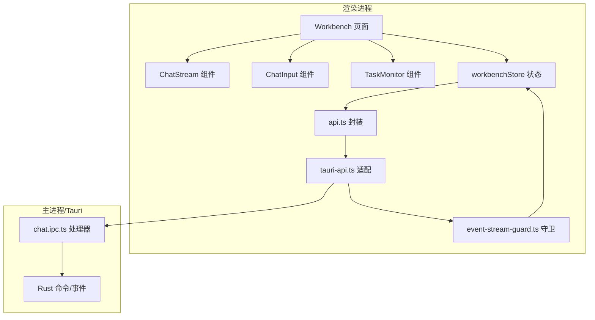
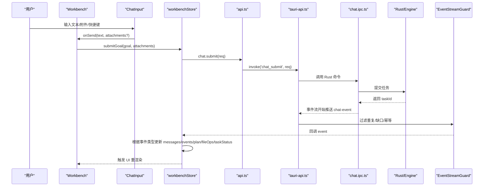
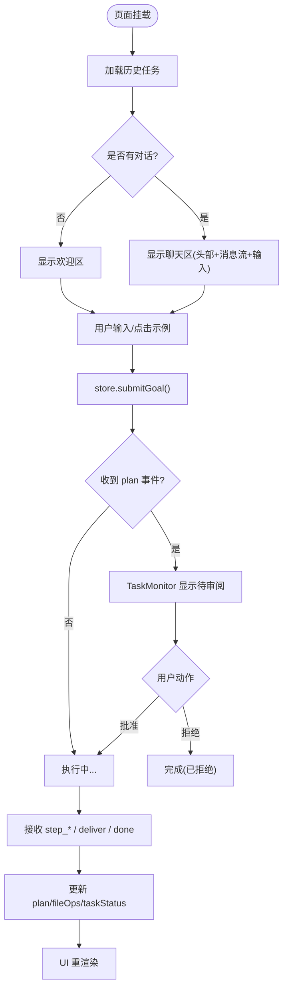
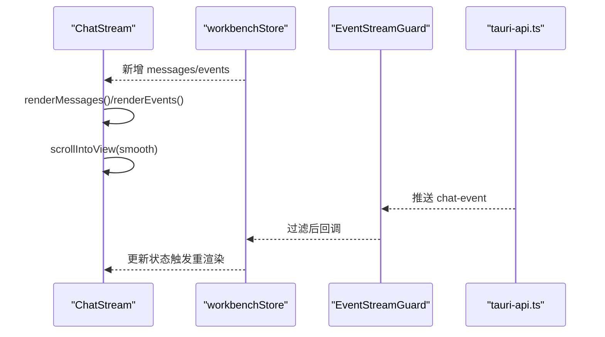
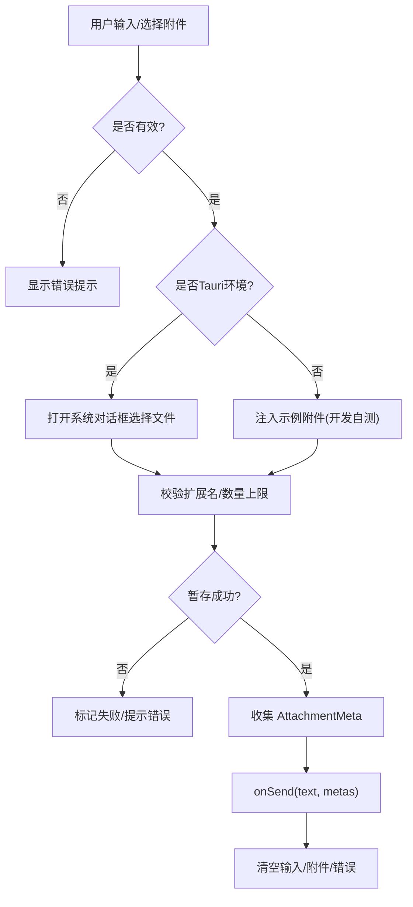
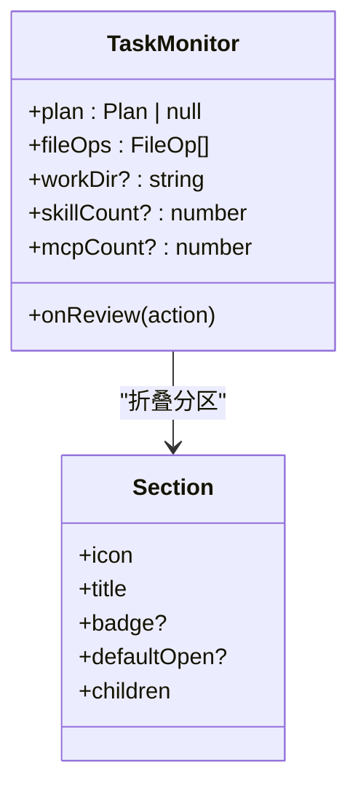
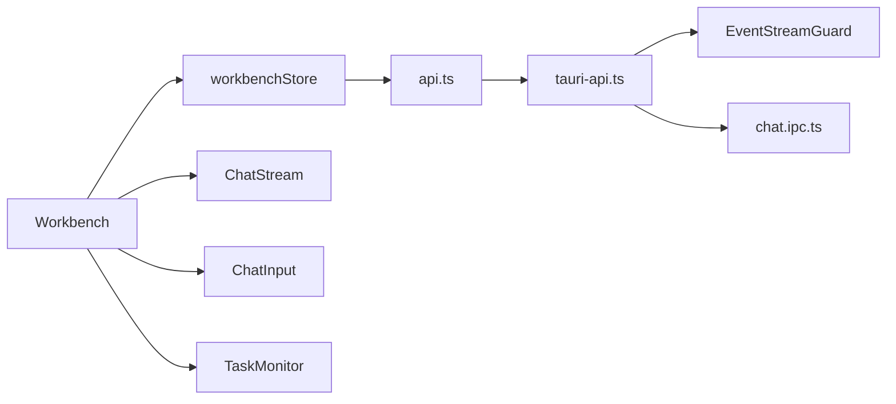

# 工作台组件

<cite>
**本文引用的文件**   
- [Workbench/index.tsx](file://tongtian-tauri/src/renderer/pages/Workbench/index.tsx)
- [ChatStream/index.tsx](file://tongtian-tauri/src/renderer/components/ChatStream/index.tsx)
- [ChatInput/index.tsx](file://tongtian-tauri/src/renderer/components/ChatInput/index.tsx)
- [TaskMonitor/index.tsx](file://tongtian-tauri/src/renderer/components/TaskMonitor/index.tsx)
- [workbenchStore.ts](file://tongtian-tauri/src/renderer/store/workbenchStore.ts)
- [types.ts](file://tongtian-tauri/src/shared/types.ts)
- [api.ts](file://tongtian-tauri/src/renderer/lib/api.ts)
- [tauri-api.ts](file://tongtian-tauri/src/renderer/lib/tauri-api.ts)
- [event-stream-guard.ts](file://tongtian-tauri/src/renderer/lib/event-stream-guard.ts)
- [chat.ipc.ts](file://tongtian-tauri/src/main/ipc/chat.ipc.ts)
- [error-messages.ts](file://tongtian-tauri/src/shared/error-messages.ts)
</cite>

## 目录
1. [简介](#简介)
2. [项目结构](#项目结构)
3. [核心组件](#核心组件)
4. [架构总览](#架构总览)
5. [详细组件分析](#详细组件分析)
6. [依赖关系分析](#依赖关系分析)
7. [性能与优化](#性能与优化)
8. [故障排查指南](#故障排查指南)
9. [结论](#结论)
10. [附录：IPC 协议与错误处理](#附录ipc-协议与错误处理)

## 简介
本文件面向“通天办公”项目的“工作台”模块，聚焦三栏布局中的三个关键前端组件：
- ChatStream：聊天流消息渲染、滚动优化、实时更新机制
- ChatInput：多模态输入（文本、附件、语音占位）、快捷键处理、输入校验与暂存
- TaskMonitor：任务监控面板的状态同步、进度展示、错误处理

文档同时说明组件间通信模式、事件驱动数据流、状态管理机制，以及与后端 IPC 的通信协议和错误处理策略。

## 项目结构
工作台页面采用三栏布局：左侧由主布局提供，中间为聊天区（头部 + 消息流 + 输入），右侧为任务监控面板。核心文件组织如下：
- 页面层：Workbench 组合子组件并管理交互入口
- 组件层：ChatStream、ChatInput、TaskMonitor
- 状态层：workbenchStore（Zustand）统一管理与后端交互
- 类型层：shared/types 定义契约（消息、事件、计划、步骤等）
- API 层：renderer/lib/api 封装业务方法；tauri-api 适配 Tauri invoke/listen
- IPC 层：main/ipc/chat 注册命令与事件转发

图表来源
- [Workbench/index.tsx:237-425](file://tongtian-tauri/src/renderer/pages/Workbench/index.tsx#L237-L425)
- [workbenchStore.ts:118-295](file://tongtian-tauri/src/renderer/store/workbenchStore.ts#L118-L295)
- [api.ts:33-69](file://tongtian-tauri/src/renderer/lib/api.ts#L33-L69)
- [tauri-api.ts:90-165](file://tongtian-tauri/src/renderer/lib/tauri-api.ts#L90-L165)
- [chat.ipc.ts:122-189](file://tongtian-tauri/src/main/ipc/chat.ipc.ts#L122-L189)

章节来源
- [Workbench/index.tsx:237-425](file://tongtian-tauri/src/renderer/pages/Workbench/index.tsx#L237-L425)

## 核心组件
- Workbench：负责三栏布局、欢迎态与对话态切换、头部状态徽标与控制按钮、将用户操作派发至 store
- ChatStream：渲染用户/AI/工具消息与实时事件，自动滚动到底部，支持 Markdown 与附件标签
- ChatInput：多模态输入（文本、附件选择与暂存、语音占位）、Enter/Shift+Enter 快捷键、发送前校验与错误提示
- TaskMonitor：折叠分区展示待办计划步骤、产物、工作目录、技能与 MCP 连接器；在 pending_review 时提供批准/拒绝/修改入口

章节来源
- [Workbench/index.tsx:237-425](file://tongtian-tauri/src/renderer/pages/Workbench/index.tsx#L237-L425)
- [ChatStream/index.tsx:31-358](file://tongtian-tauri/src/renderer/components/ChatStream/index.tsx#L31-L358)
- [ChatInput/index.tsx:34-407](file://tongtian-tauri/src/renderer/components/ChatInput/index.tsx#L34-L407)
- [TaskMonitor/index.tsx:22-268](file://tongtian-tauri/src/renderer/components/TaskMonitor/index.tsx#L22-L268)

## 架构总览
工作台采用“组件 → Store → API → Tauri IPC → Rust/Engine → 事件流回推”的事件驱动架构。Store 订阅 chat-event 流，按事件类型分发到消息、计划、文件操作与任务状态等切片，UI 通过 Zustand 响应式更新。

图表来源
- [Workbench/index.tsx:277-295](file://tongtian-tauri/src/renderer/pages/Workbench/index.tsx#L277-L295)
- [workbenchStore.ts:139-295](file://tongtian-tauri/src/renderer/store/workbenchStore.ts#L139-L295)
- [api.ts:33-69](file://tongtian-tauri/src/renderer/lib/api.ts#L33-L69)
- [tauri-api.ts:90-165](file://tongtian-tauri/src/renderer/lib/tauri-api.ts#L90-L165)
- [chat.ipc.ts:93-112](file://tongtian-tauri/src/main/ipc/chat.ipc.ts#L93-L112)

## 详细组件分析

### Workbench 三栏布局与状态协调
- 布局：中间聊天区包含头部（任务标题、状态徽标、时间、控制按钮）、消息流区域、底部输入区；右侧任务监控仅在对话态显示
- 状态：从 workbenchStore 读取 messages、events、plan、fileOps、taskStatus、isLoading、error，并提供 submitGoal、reviewPlan、controlTask、cancelTask、loadHistory、clearError
- 交互：
  - 发送消息：调用 submitGoal，进入两阶段协议（submit → plan → pending_review → 执行 → done）
  - 计划审阅：approve/reject/modify，批准后刷新历史列表
  - 控制任务：暂停/继续/终止，依据当前 taskStatus 控制按钮可见性
- 欢迎态：问候语、快捷指令、推荐案例、技能标签，点击直接触发发送

图表来源
- [Workbench/index.tsx:237-425](file://tongtian-tauri/src/renderer/pages/Workbench/index.tsx#L237-L425)
- [workbenchStore.ts:139-295](file://tongtian-tauri/src/renderer/store/workbenchStore.ts#L139-L295)

章节来源
- [Workbench/index.tsx:237-425](file://tongtian-tauri/src/renderer/pages/Workbench/index.tsx#L237-L425)
- [workbenchStore.ts:139-295](file://tongtian-tauri/src/renderer/store/workbenchStore.ts#L139-L295)

### ChatStream 消息渲染、滚动优化与实时更新
- 消息渲染：
  - 用户消息：右对齐绿色气泡，附带时间戳
  - AI/工具消息：左对齐卡片，头像区分，工具消息附加 toolName 标签
  - 内容支持 Markdown 渲染，附件以 Chip 展示
- 实时事件渲染：
  - step_start：进度条 + 描述
  - step_progress：行内代码风格日志
  - step_done：成功图标 + 输出摘要
  - step_failed：失败图标 + 错误信息
  - deliver：交付物卡片，列出 artifacts
- 滚动优化：使用 ref 指向容器末尾，监听 messages/events 变化后 smooth scrollIntoView，保证新消息到达时自动滚到底部
- 加载中指示：AI 头像 + 三点跳动动画，提升等待感知

图表来源
- [ChatStream/index.tsx:37-46](file://tongtian-tauri/src/renderer/components/ChatStream/index.tsx#L37-L46)
- [ChatStream/index.tsx:48-279](file://tongtian-tauri/src/renderer/components/ChatStream/index.tsx#L48-L279)
- [tauri-api.ts:145-165](file://tongtian-tauri/src/renderer/lib/tauri-api.ts#L145-L165)
- [event-stream-guard.ts:46-85](file://tongtian-tauri/src/renderer/lib/event-stream-guard.ts#L46-L85)

章节来源
- [ChatStream/index.tsx:31-358](file://tongtian-tauri/src/renderer/components/ChatStream/index.tsx#L31-L358)

### ChatInput 多模态输入、快捷键与输入验证
- 多模态输入：
  - 文本输入：支持多行，最大行数限制，焦点态边框高亮
  - 附件上传：Tauri 环境调用系统对话框选择文件，限制扩展名与数量；Mock 环境注入示例附件；暂存成功后随提交上送 AttachmentMeta
  - 语音输入：占位按钮，后续接入语音识别
- 快捷键处理：
  - Enter：发送（阻止默认换行）
  - Shift+Enter：换行（由原生行为处理）
- 输入验证与反馈：
  - 空内容或 loading/staging 时禁用发送
  - 附件暂存失败标记卡片红色并可重试/移除
  - 发送后清空输入、附件与错误提示，恢复焦点

图表来源
- [ChatInput/index.tsx:81-161](file://tongtian-tauri/src/renderer/components/ChatInput/index.tsx#L81-L161)
- [ChatInput/index.tsx:163-177](file://tongtian-tauri/src/renderer/components/ChatInput/index.tsx#L163-L177)

章节来源
- [ChatInput/index.tsx:34-407](file://tongtian-tauri/src/renderer/components/ChatInput/index.tsx#L34-L407)

### TaskMonitor 状态同步、进度展示与错误处理
- 状态同步：
  - 待办：基于 plan.steps 渲染，统计已完成数；pending_review 且未 reviewed 时显示批准/拒绝按钮
  - 产物：基于 fileOps 列表渲染文件名
  - 工作目录：展示当前路径或提示未设置
  - 技能/MCP：占位计数，后续接入 skill_list/mcp_list
- 进度展示：
  - 步骤状态图标映射：pending/running/success/failed/skipped/rolled_back
  - 折叠分区默认展开逻辑：当有数据时自动展开
- 错误处理：
  - 审阅失败捕获错误并设置 error
  - 取消/控制任务失败同样捕获并提示

图表来源
- [TaskMonitor/index.tsx:22-268](file://tongtian-tauri/src/renderer/components/TaskMonitor/index.tsx#L22-L268)

章节来源
- [TaskMonitor/index.tsx:22-268](file://tongtian-tauri/src/renderer/components/TaskMonitor/index.tsx#L22-L268)

## 依赖关系分析
- Workbench 依赖 workbenchStore 提供的状态与 actions
- ChatStream 消费 messages/events，不直接访问 store
- ChatInput 通过 onSend 回调与 Workbench 解耦
- TaskMonitor 消费 plan/fileOps，通过 onReview 回调与 Workbench 解耦
- store 依赖 api.ts 封装的 chat/model/file/system/p0 接口
- api.ts 依赖 tauri-api.ts 的 invoke/listen 能力
- tauri-api.ts 依赖 EventStreamGuard 进行事件去重与缺口检测
- main/ipc/chat 注册命令并将引擎事件转发给渲染进程

图表来源
- [Workbench/index.tsx:237-425](file://tongtian-tauri/src/renderer/pages/Workbench/index.tsx#L237-L425)
- [workbenchStore.ts:118-295](file://tongtian-tauri/src/renderer/store/workbenchStore.ts#L118-L295)
- [api.ts:33-69](file://tongtian-tauri/src/renderer/lib/api.ts#L33-L69)
- [tauri-api.ts:90-165](file://tongtian-tauri/src/renderer/lib/tauri-api.ts#L90-L165)
- [chat.ipc.ts:122-189](file://tongtian-tauri/src/main/ipc/chat.ipc.ts#L122-L189)

章节来源
- [workbenchStore.ts:118-295](file://tongtian-tauri/src/renderer/store/workbenchStore.ts#L118-L295)
- [api.ts:33-69](file://tongtian-tauri/src/renderer/lib/api.ts#L33-L69)
- [tauri-api.ts:90-165](file://tongtian-tauri/src/renderer/lib/tauri-api.ts#L90-L165)
- [chat.ipc.ts:122-189](file://tongtian-tauri/src/main/ipc/chat.ipc.ts#L122-L189)

## 性能与优化
- 滚动优化：ChatStream 使用 ref + smooth scrollIntoView，避免频繁计算滚动位置；仅对 messages/events 变更触发
- 事件去重与幂等：EventStreamGuard 基于 seq 去重、缺口检测与 status_change 幂等，防止重复渲染与状态抖动
- 渲染范围控制：ChatStream 仅渲染非 plan 类型的实时事件，减少无关重绘
- 输入防抖：ChatInput 在 loading/staging 时禁用发送，避免重复提交
- 状态最小化更新：workbenchStore 针对事件类型精确更新对应字段，减少不必要的全量更新

[本节为通用性能建议，不直接分析具体文件]

## 故障排查指南
- 提交失败：检查 api.chat.submit 返回值与 store 中 error；确认 tongtianAPI 可用
- 事件丢失/乱序：查看 EventStreamGuard 的 onGap 日志；必要时调用 eventReplay 补齐
- 附件暂存失败：检查扩展名与大小限制；查看 ChatInput 的错误提示与重试
- 审阅失败：检查 reviewPlan 的 action 与 patch；确认 plan 与 taskId 存在
- 控制任务失败：确认当前 taskStatus 允许该操作；查看 store 的 controlTask 异常

章节来源
- [workbenchStore.ts:289-369](file://tongtian-tauri/src/renderer/store/workbenchStore.ts#L289-L369)
- [ChatInput/index.tsx:125-161](file://tongtian-tauri/src/renderer/components/ChatInput/index.tsx#L125-L161)
- [event-stream-guard.ts:46-85](file://tongtian-tauri/src/renderer/lib/event-stream-guard.ts#L46-L85)

## 结论
工作台通过清晰的三栏布局与组件职责划分，结合事件驱动的 store 与稳健的 IPC 通道，实现了流畅的多模态输入、实时的聊天流渲染与可观测的任务监控。EventStreamGuard 保障了事件流的可靠性，workbenchStore 提供了集中化的状态管理，便于扩展与维护。

[本节为总结性内容，不直接分析具体文件]

## 附录：IPC 协议与错误处理
- 命令与事件
  - chat:submit：提交目标，返回 taskId
  - chat:review：审阅计划（approve/reject/modify）
  - chat:control：控制任务（pause/resume/rollback_to）
  - chat:history：获取历史任务
  - chat-event：流式事件推送（plan/step_start/step_progress/step_done/step_failed/deliver/done/error/status_change/quota_warning/heartbeat）
- 错误处理
  - 主进程侧使用 Zod 校验请求参数，失败返回结构化错误码与消息
  - 渲染侧通过 errorMessageOf 将错误码映射为用户可读文案
  - 未知错误码降级展示，避免白屏

章节来源
- [chat.ipc.ts:17-83](file://tongtian-tauri/src/main/ipc/chat.ipc.ts#L17-L83)
- [chat.ipc.ts:122-189](file://tongtian-tauri/src/main/ipc/chat.ipc.ts#L122-L189)
- [error-messages.ts:8-36](file://tongtian-tauri/src/shared/error-messages.ts#L8-L36)
- [types.ts:270-315](file://tongtian-tauri/src/shared/types.ts#L270-L315)