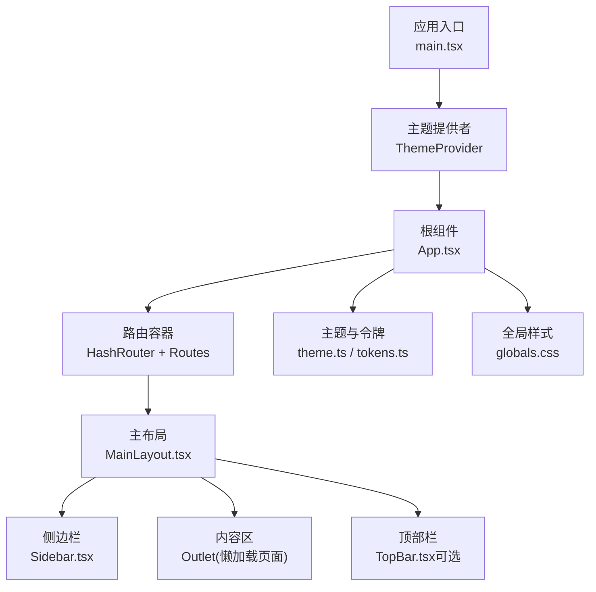
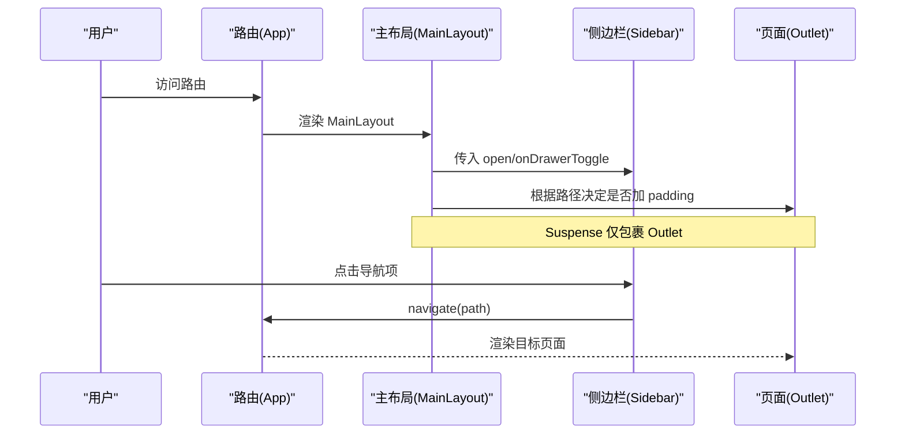
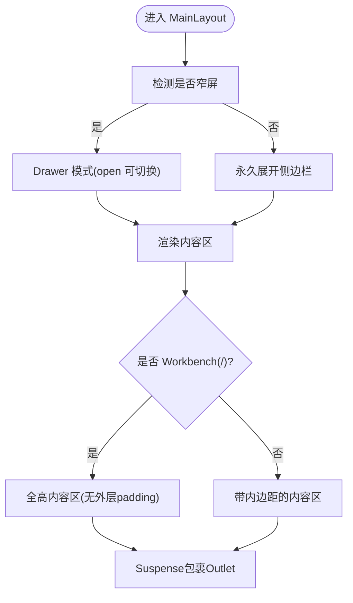
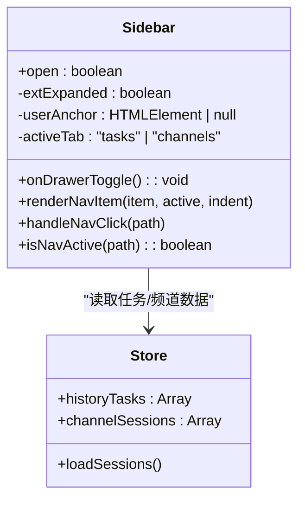
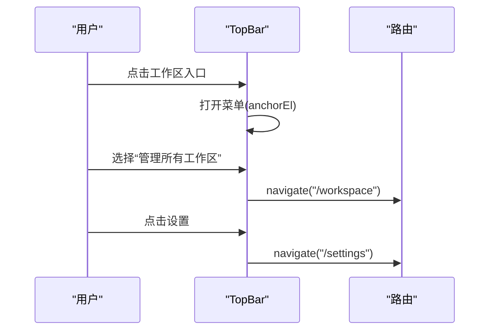
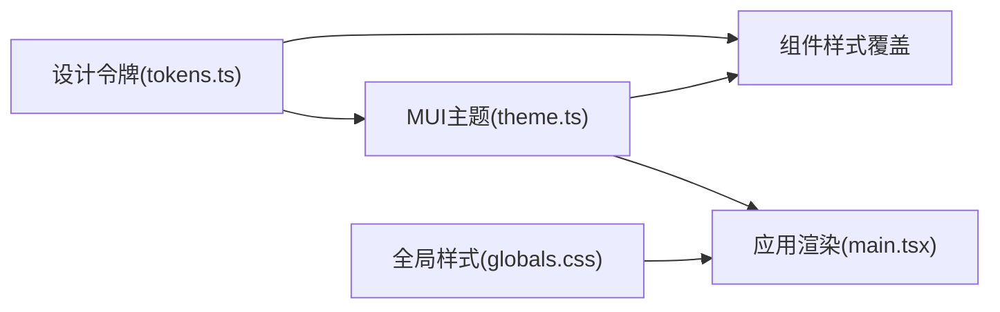
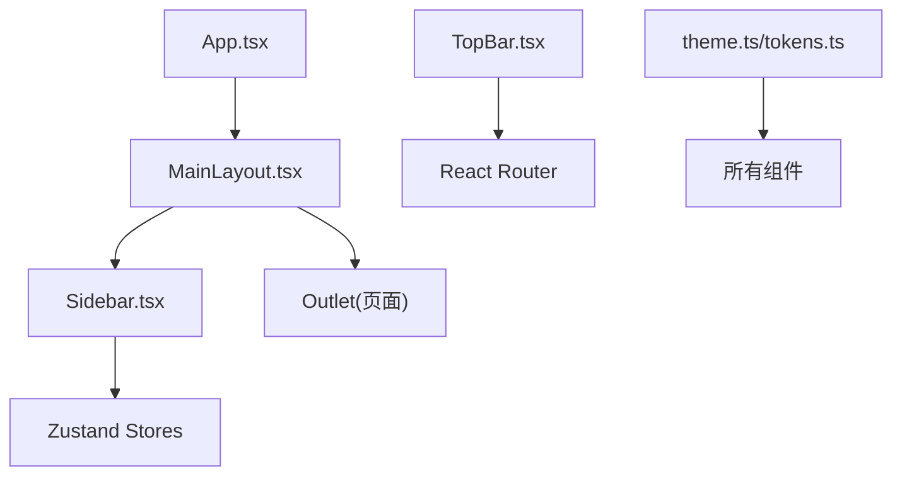

# 布局系统

<cite>
**本文引用的文件**
- [MainLayout.tsx](file://tongtian-tauri/src/renderer/components/Layout/MainLayout.tsx)
- [Sidebar.tsx](file://tongtian-tauri/src/renderer/components/Layout/Sidebar.tsx)
- [TopBar.tsx](file://tongtian-tauri/src/renderer/components/Layout/TopBar.tsx)
- [index.ts](file://tongtian-tauri/src/renderer/components/Layout/index.ts)
- [App.tsx](file://tongtian-tauri/src/renderer/App.tsx)
- [main.tsx](file://tongtian-tauri/src/renderer/main.tsx)
- [tokens.ts](file://tongtian-tauri/src/renderer/theme/tokens.ts)
- [theme.ts](file://tongtian-tauri/src/renderer/theme/theme.ts)
- [globals.css](file://tongtian-tauri/src/renderer/styles/globals.css)
</cite>

## 目录
1. [简介](#简介)
2. [项目结构](#项目结构)
3. [核心组件](#核心组件)
4. [架构总览](#架构总览)
5. [详细组件分析](#详细组件分析)
6. [依赖关系分析](#依赖关系分析)
7. [性能考量](#性能考量)
8. [故障排查指南](#故障排查指南)
9. [结论](#结论)
10. [附录](#附录)

## 简介
本文件为通天办公项目的布局系统文档，聚焦于主布局 MainLayout、侧边栏 Sidebar、顶部栏 TopBar 的职责划分与交互流程。内容涵盖响应式布局策略、侧边栏状态管理、Workbench 特殊布局处理、导航结构与菜单项管理、移动端适配机制、页面头部集成方式、样式系统与主题配置、响应式断点处理，并提供布局架构图与组件交互流程图，说明不同页面类型的布局适配策略。

## 项目结构
布局相关代码集中在 renderer/components/Layout 下，由 App 通过路由挂载到 MainLayout，所有页面在 MainLayout 的内容区渲染。主题与全局样式位于 theme 与 styles 目录。

图表来源
- [main.tsx:1-25](file://tongtian-tauri/src/renderer/main.tsx#L1-L25)
- [App.tsx:1-66](file://tongtian-tauri/src/renderer/App.tsx#L1-L66)
- [MainLayout.tsx:1-74](file://tongtian-tauri/src/renderer/components/Layout/MainLayout.tsx#L1-L74)
- [Sidebar.tsx:1-758](file://tongtian-tauri/src/renderer/components/Layout/Sidebar.tsx#L1-L758)
- [TopBar.tsx:1-195](file://tongtian-tauri/src/renderer/components/Layout/TopBar.tsx#L1-L195)
- [theme.ts:1-336](file://tongtian-tauri/src/renderer/theme/theme.ts#L1-L336)
- [tokens.ts:1-222](file://tongtian-tauri/src/renderer/theme/tokens.ts#L1-L222)
- [globals.css:1-190](file://tongtian-tauri/src/renderer/styles/globals.css#L1-L190)

章节来源
- [App.tsx:1-66](file://tongtian-tauri/src/renderer/App.tsx#L1-L66)
- [main.tsx:1-25](file://tongtian-tauri/src/renderer/main.tsx#L1-L25)

## 核心组件
- MainLayout：负责整体布局骨架、响应式侧边栏开关、Workbench 特殊布局（全高三栏无外层 padding）、Suspense 边界下沉至内容区以避免侧边栏重建。
- Sidebar：导航结构、菜单项管理、任务与频道页签、用户卡片与个人中心菜单、移动端抽屉模式、彩色图标块与选中态。
- TopBar：页面标题、工作区切换入口、运行模式指示、设置入口（可作为页面级头部使用）。
- 主题与样式：MUI Theme 定制、设计令牌（色彩、圆角、阴影、间距、字体、断点、过渡）、全局滚动条与基础样式。

章节来源
- [MainLayout.tsx:1-74](file://tongtian-tauri/src/renderer/components/Layout/MainLayout.tsx#L1-L74)
- [Sidebar.tsx:1-758](file://tongtian-tauri/src/renderer/components/Layout/Sidebar.tsx#L1-L758)
- [TopBar.tsx:1-195](file://tongtian-tauri/src/renderer/components/Layout/TopBar.tsx#L1-L195)
- [theme.ts:1-336](file://tongtian-tauri/src/renderer/theme/theme.ts#L1-L336)
- [tokens.ts:1-222](file://tongtian-tauri/src/renderer/theme/tokens.ts#L1-L222)
- [globals.css:1-190](file://tongtian-tauri/src/renderer/styles/globals.css#L1-L190)

## 架构总览
布局采用“左侧固定侧边栏 + 右侧内容区”的经典桌面端布局，移动端自动切换为抽屉式侧边栏。Workbench 作为首页采用全高布局，其他页面默认带内边距。Suspense 仅包裹 Outlet，避免懒加载导致侧边栏重建。

图表来源
- [App.tsx:38-62](file://tongtian-tauri/src/renderer/App.tsx#L38-L62)
- [MainLayout.tsx:23-71](file://tongtian-tauri/src/renderer/components/Layout/MainLayout.tsx#L23-L71)
- [Sidebar.tsx:116-127](file://tongtian-tauri/src/renderer/components/Layout/Sidebar.tsx#L116-L127)

## 详细组件分析

### MainLayout 主布局组件
- 职责
  - 提供全屏高度布局容器，背景色来自主题。
  - 控制侧边栏展开状态，桌面端常驻展开，窄屏默认收起并支持手动展开。
  - 识别 Workbench 页面（根路径），为其提供全高内容区；其他页面增加左右上下内边距。
  - 将 Suspense 边界仅包裹 Outlet，确保懒加载页面挂起时不卸载侧边栏。
- 响应式策略
  - 使用媒体查询判断是否窄屏，窄屏时使用 Drawer 抽屉模式，非窄屏则永久显示。
  - 通过主题断点进行适配。
- 数据流
  - 通过 useLocation 判断当前路径是否为 Workbench，决定内容区 padding。
  - 通过 useState 维护侧边栏展开状态，并通过回调传递给 Sidebar。

图表来源
- [MainLayout.tsx:23-71](file://tongtian-tauri/src/renderer/components/Layout/MainLayout.tsx#L23-L71)

章节来源
- [MainLayout.tsx:1-74](file://tongtian-tauri/src/renderer/components/Layout/MainLayout.tsx#L1-L74)

### Sidebar 侧边栏组件
- 职责
  - 品牌区与导航区：展示 Logo、新任务按钮、能力管理分组、定时任务、IM 频道等。
  - 任务/频道并排页签：区分软件端发起的任务与 IM 发起的频道会话。
  - 历史任务列表与频道会话列表：从 store 获取并展示。
  - 底部用户卡片与个人中心菜单：包含升级、偏好设置、设置、指南、关于、退出登录等。
- 导航结构与菜单项管理
  - 导航项以结构化数组定义，每项包含 id、label、path、icon、color、disabled 等字段，便于扩展与维护。
  - 支持占位能力：禁用态 + tooltip 提示“即将上线”。
  - 选中态通过 isNavActive 匹配当前路径（含查询参数）。
- 移动端适配机制
  - 窄屏使用 Drawer 抽屉模式，点击导航后自动关闭抽屉。
  - 折叠态（isCollapsed）隐藏文字，仅显示图标，hover 或 Tooltip 显示名称。
- 状态与交互
  - 使用本地状态管理展开/折叠、页签切换、用户菜单锚点。
  - 通过路由变化关闭用户菜单，避免跳转后锚点残留。
  - 通过 zustand store 获取历史任务与 IM 频道会话数据。

图表来源
- [Sidebar.tsx:77-129](file://tongtian-tauri/src/renderer/components/Layout/Sidebar.tsx#L77-L129)
- [Sidebar.tsx:131-223](file://tongtian-tauri/src/renderer/components/Layout/Sidebar.tsx#L131-L223)
- [Sidebar.tsx:476-584](file://tongtian-tauri/src/renderer/components/Layout/Sidebar.tsx#L476-L584)
- [Sidebar.tsx:587-753](file://tongtian-tauri/src/renderer/components/Layout/Sidebar.tsx#L587-L753)

章节来源
- [Sidebar.tsx:1-758](file://tongtian-tauri/src/renderer/components/Layout/Sidebar.tsx#L1-L758)

### TopBar 顶部栏组件
- 功能实现
  - 页面标题跟随路由映射，未匹配时回退到应用名。
  - 工作区切换入口：点击打开菜单，支持跳转到工作区管理页。
  - 运行模式指示：正常模式/合规模式，颜色与文案随状态切换。
  - 设置入口：跳转到设置页。
  - 用户头像：展示用户标识。
- 页面头部集成方式
  - 可在需要页面头部的页面中直接引入并使用，或在布局中按需组合。
  - 与 MainLayout 解耦，便于在不同页面复用。

图表来源
- [TopBar.tsx:31-40](file://tongtian-tauri/src/renderer/components/Layout/TopBar.tsx#L31-L40)
- [TopBar.tsx:65-190](file://tongtian-tauri/src/renderer/components/Layout/TopBar.tsx#L65-L190)

章节来源
- [TopBar.tsx:1-195](file://tongtian-tauri/src/renderer/components/Layout/TopBar.tsx#L1-L195)

### 样式系统与主题配置
- 设计令牌（tokens）
  - 色彩系统：主色（品牌绿）、辅助色（天空蓝）、强调色（暖琥珀）、语义色（成功/警告/错误/信息/中性灰/背景/覆盖层）。
  - 导航多彩配色：每项导航独立色板（bg/main/activeBg），用于图标块与选中态。
  - 圆角、阴影、间距、字体、断点、过渡动画统一抽象，便于全局一致化。
- MUI 主题（theme）
  - 基于 createTheme 创建 light/dark 主题，注入色彩、排版、形状、组件样式覆盖。
  - 组件覆盖包括 Button、IconButton、Card、Paper、TextField、Dialog、Chip、AppBar、Drawer、Tabs、Table、Alert、Tooltip、Menu/MenuItem 等。
  - 提供响应式字体大小封装。
- 全局样式（globals.css）
  - Tailwind 指令导入。
  - 基础字体、背景、滚动条样式。
  - Markdown 内容样式（用于聊天消息等场景）。

图表来源
- [tokens.ts:11-222](file://tongtian-tauri/src/renderer/theme/tokens.ts#L11-L222)
- [theme.ts:19-336](file://tongtian-tauri/src/renderer/theme/theme.ts#L19-L336)
- [globals.css:1-190](file://tongtian-tauri/src/renderer/styles/globals.css#L1-L190)
- [main.tsx:1-25](file://tongtian-tauri/src/renderer/main.tsx#L1-L25)

章节来源
- [tokens.ts:1-222](file://tongtian-tauri/src/renderer/theme/tokens.ts#L1-L222)
- [theme.ts:1-336](file://tongtian-tauri/src/renderer/theme/theme.ts#L1-L336)
- [globals.css:1-190](file://tongtian-tauri/src/renderer/styles/globals.css#L1-L190)
- [main.tsx:1-25](file://tongtian-tauri/src/renderer/main.tsx#L1-L25)

## 依赖关系分析
- 组件耦合
  - MainLayout 依赖 Sidebar 与路由（useLocation/useNavigate），并通过 props 传递展开状态与切换回调。
  - Sidebar 依赖路由与 zustand store（workbenchStore、imChannelStore），用于导航与数据展示。
  - TopBar 依赖路由进行页面跳转与工作区切换。
- 外部依赖
  - MUI 组件与主题系统。
  - React Router（HashRouter/Routes/Route/Outlet）。
  - Zustand（zustand/react/shallow）用于轻量状态管理。
- 潜在循环依赖
  - 布局组件之间无直接相互引用，依赖方向清晰：App -> MainLayout -> Sidebar/Outlet；TopBar 独立可复用。

图表来源
- [App.tsx:14-62](file://tongtian-tauri/src/renderer/App.tsx#L14-L62)
- [MainLayout.tsx:11-15](file://tongtian-tauri/src/renderer/components/Layout/MainLayout.tsx#L11-L15)
- [Sidebar.tsx:12-43](file://tongtian-tauri/src/renderer/components/Layout/Sidebar.tsx#L12-L43)
- [TopBar.tsx:11-27](file://tongtian-tauri/src/renderer/components/Layout/TopBar.tsx#L11-L27)
- [theme.ts:1-336](file://tongtian-tauri/src/renderer/theme/theme.ts#L1-L336)
- [tokens.ts:1-222](file://tongtian-tauri/src/renderer/theme/tokens.ts#L1-L222)

章节来源
- [App.tsx:1-66](file://tongtian-tauri/src/renderer/App.tsx#L1-L66)
- [MainLayout.tsx:1-74](file://tongtian-tauri/src/renderer/components/Layout/MainLayout.tsx#L1-L74)
- [Sidebar.tsx:1-758](file://tongtian-tauri/src/renderer/components/Layout/Sidebar.tsx#L1-L758)
- [TopBar.tsx:1-195](file://tongtian-tauri/src/renderer/components/Layout/TopBar.tsx#L1-L195)
- [theme.ts:1-336](file://tongtian-tauri/src/renderer/theme/theme.ts#L1-L336)
- [tokens.ts:1-222](file://tongtian-tauri/src/renderer/theme/tokens.ts#L1-L222)

## 性能考量
- 懒加载与 Suspense
  - 页面组件通过 lazy 动态导入，Suspense 仅包裹 Outlet，避免侧边栏重建导致的弹窗锚点失效与状态丢失。
- 渲染优化
  - 侧边栏使用局部状态管理展开、页签、用户菜单，减少不必要的重渲染。
  - 列表数据限制展示数量（如历史任务与频道会话最多 20 条），降低 DOM 压力。
- 主题与样式
  - 使用 MUI 主题与组件覆盖，减少重复样式编写，提升一致性。
  - 全局滚动条样式优化视觉体验。

[本节为通用性能建议，无需特定文件引用]

## 故障排查指南
- 侧边栏弹窗锚点失效
  - 现象：懒加载页面挂起时，侧边栏中的菜单或弹窗锚点失效。
  - 原因：Suspense 边界若包裹整个布局会导致侧边栏被卸载重建。
  - 解决：确保 Suspense 仅包裹 Outlet，保持侧边栏稳定挂载。
- 导航选中态不正确
  - 现象：点击导航后高亮状态不更新。
  - 原因：路径匹配未考虑查询参数。
  - 解决：使用 isNavActive 同时匹配 pathname 与 search。
- 移动端抽屉无法关闭
  - 现象：点击导航后抽屉未关闭。
  - 原因：未在 handleNavClick 中调用 onDrawerToggle。
  - 解决：在窄屏模式下点击导航后触发关闭。
- 主题不一致
  - 现象：组件颜色或圆角不符合设计规范。
  - 原因：未使用 MUI 主题或自定义覆盖未生效。
  - 解决：检查 theme.ts 的组件覆盖与 tokens.ts 的令牌使用。

章节来源
- [MainLayout.tsx:16-21](file://tongtian-tauri/src/renderer/components/Layout/MainLayout.tsx#L16-L21)
- [Sidebar.tsx:116-127](file://tongtian-tauri/src/renderer/components/Layout/Sidebar.tsx#L116-L127)
- [theme.ts:100-324](file://tongtian-tauri/src/renderer/theme/theme.ts#L100-L324)

## 结论
通天办公的布局系统以 MainLayout 为核心，结合 Sidebar 与 TopBar 实现了桌面端与移动端的统一体验。通过响应式断点、侧边栏状态管理、Workbench 特殊布局处理以及 Suspense 下沉策略，保证了良好的用户体验与可维护性。主题与样式系统提供了统一的视觉规范与组件风格，便于后续扩展与迭代。

[本节为总结性内容，无需特定文件引用]

## 附录
- 响应式断点参考
  - sm: 640px
  - md: 768px
  - lg: 1024px
  - xl: 1280px
  - 2xl: 1536px
- 导航多彩配色键值
  - blue/purple/pink/orange/green/cyan/teal/amber/slate
- 常用组件样式覆盖
  - Button、IconButton、Card、Paper、TextField、Dialog、Chip、AppBar、Drawer、Tabs、Table、Alert、Tooltip、Menu/MenuItem

章节来源
- [tokens.ts:198-222](file://tongtian-tauri/src/renderer/theme/tokens.ts#L198-L222)
- [tokens.ts:92-112](file://tongtian-tauri/src/renderer/theme/tokens.ts#L92-L112)
- [theme.ts:100-324](file://tongtian-tauri/src/renderer/theme/theme.ts#L100-L324)