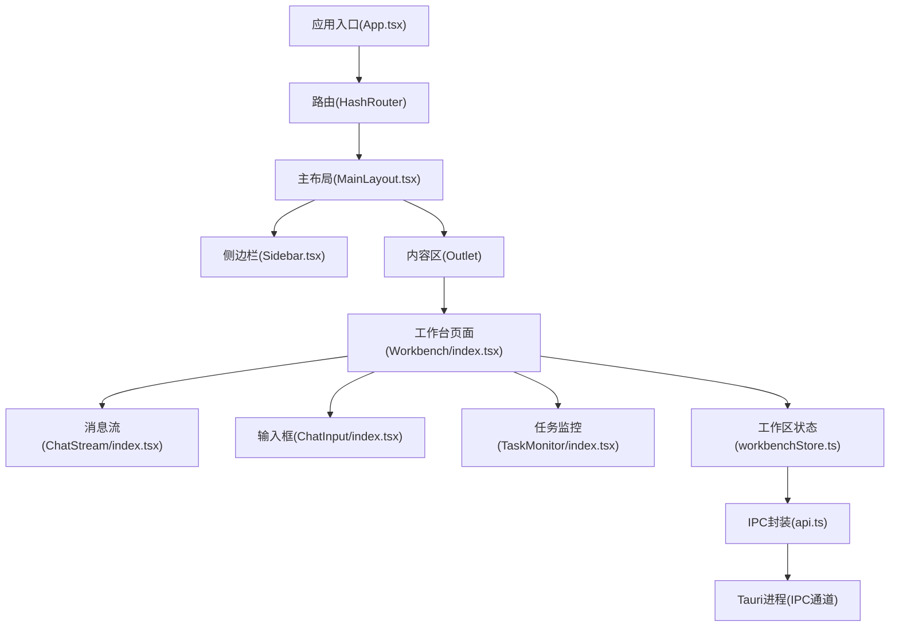
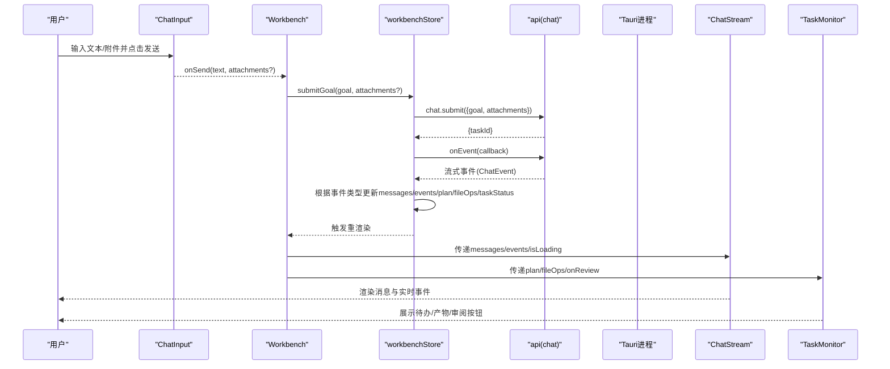
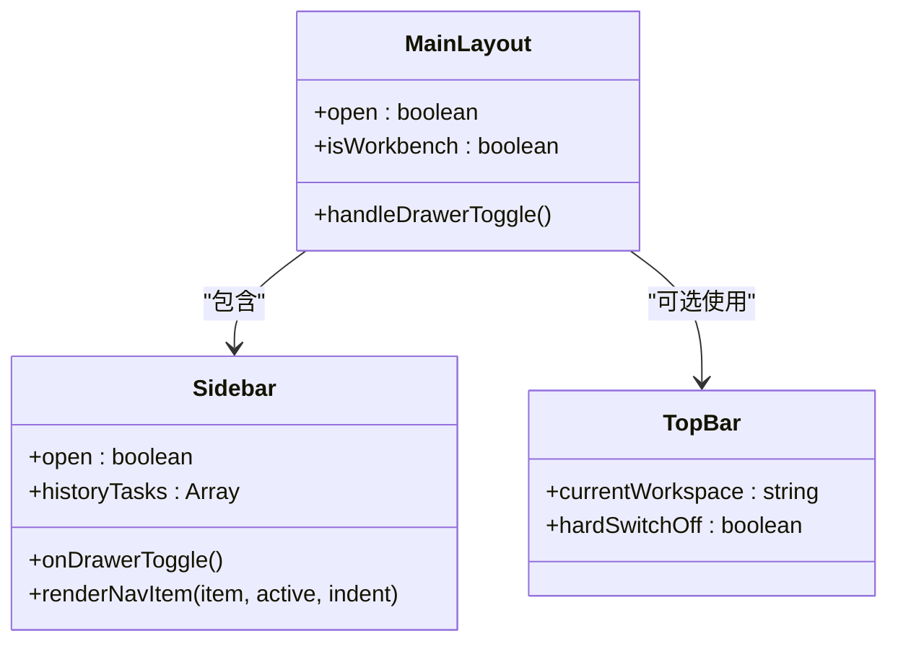
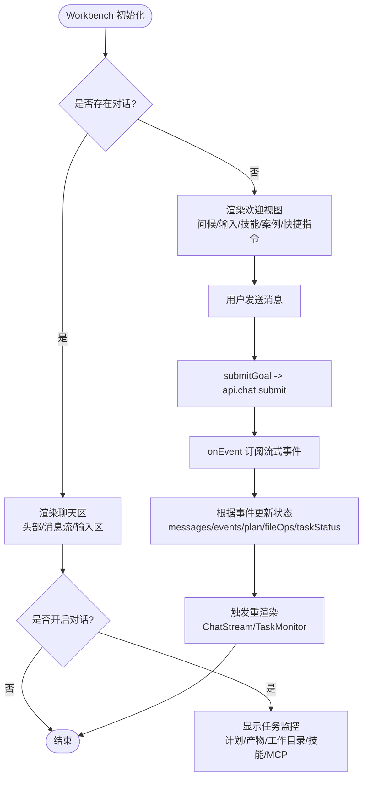
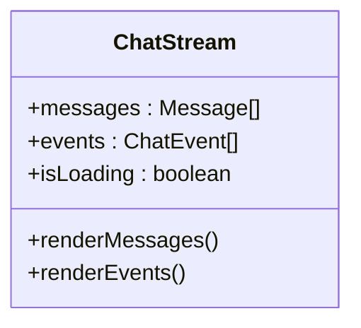
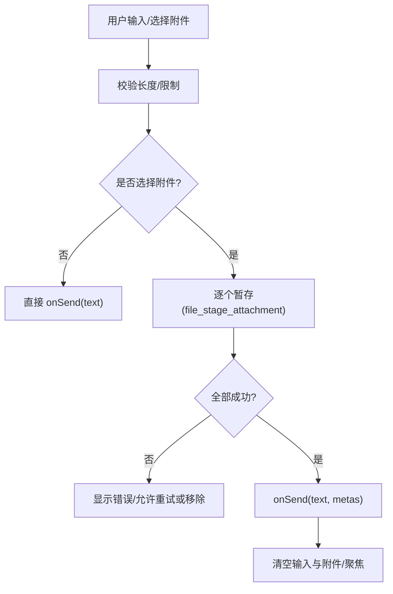
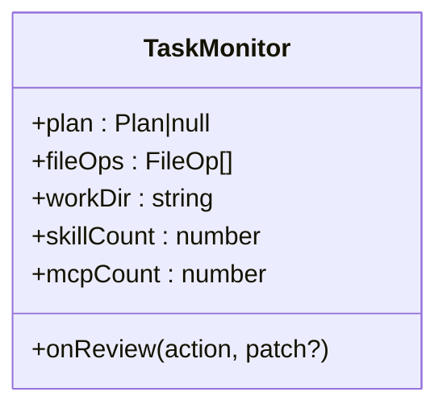
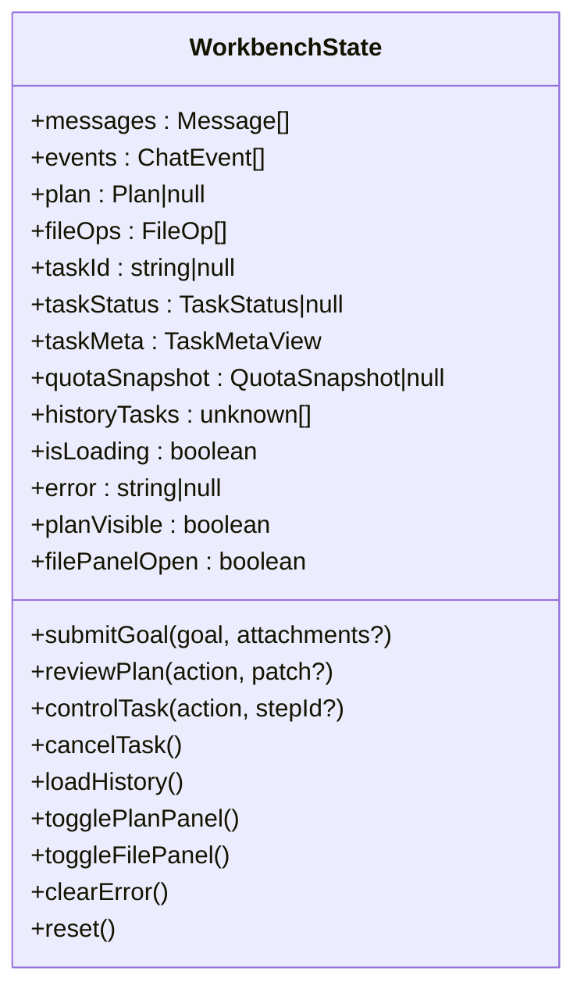
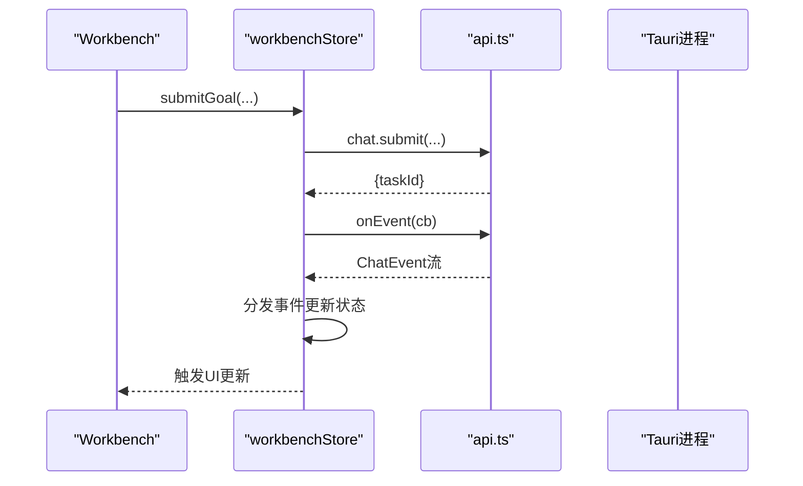
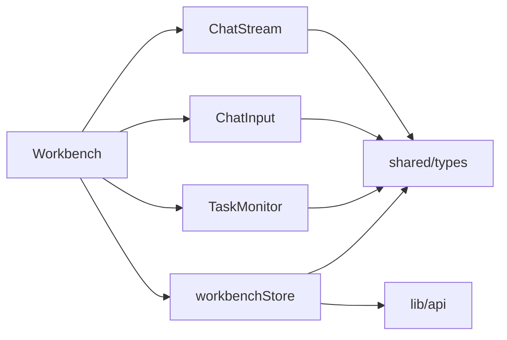

# 组件架构设计

<cite>
**本文引用的文件**   
- [App.tsx](file://tongtian-tauri/src/renderer/App.tsx)
- [MainLayout.tsx](file://tongtian-tauri/src/renderer/components/Layout/MainLayout.tsx)
- [Sidebar.tsx](file://tongtian-tauri/src/renderer/components/Layout/Sidebar.tsx)
- [TopBar.tsx](file://tongtian-tauri/src/renderer/components/Layout/TopBar.tsx)
- [Workbench/index.tsx](file://tongtian-tauri/src/renderer/pages/Workbench/index.tsx)
- [ChatStream/index.tsx](file://tongtian-tauri/src/renderer/components/ChatStream/index.tsx)
- [ChatInput/index.tsx](file://tongtian-tauri/src/renderer/components/ChatInput/index.tsx)
- [TaskMonitor/index.tsx](file://tongtian-tauri/src/renderer/components/TaskMonitor/index.tsx)
- [workbenchStore.ts](file://tongtian-tauri/src/renderer/store/workbenchStore.ts)
- [api.ts](file://tongtian-tauri/src/renderer/lib/api.ts)
- [types.ts](file://tongtian-tauri/src/shared/types.ts)
- [tokens.ts](file://tongtian-tauri/src/renderer/theme/tokens.ts)
</cite>

## 目录
1. [简介](#简介)
2. [项目结构](#项目结构)
3. [核心组件](#核心组件)
4. [架构总览](#架构总览)
5. [详细组件分析](#详细组件分析)
6. [依赖关系分析](#依赖关系分析)
7. [性能与响应式优化](#性能与响应式优化)
8. [故障排查指南](#故障排查指南)
9. [结论](#结论)

## 简介
本文件面向通天办公项目的 React 18 + TypeScript 前端，聚焦组件层次结构与 Workbench 工作台的核心实现。文档重点阐述：
- 布局组件（MainLayout、Sidebar、TopBar）的职责与设计模式
- Workbench 三栏布局中 ChatStream、ChatInput、TaskMonitor 的交互逻辑与状态同步机制
- 组件间通信模式、事件驱动的数据更新流程、以及组件复用策略
- 组件架构图与数据流向图，解释与后端服务（Tauri IPC）的交互方式
- 响应式设计考虑与性能优化策略

## 项目结构
- 应用根入口通过路由将页面挂载到 MainLayout 之下，Workbench 作为默认首页。
- 布局层由 MainLayout 统一承载 Sidebar 与内容区；TopBar 提供页面级顶部信息（非全局常驻）。
- Workbench 页面组织聊天区与任务监控面板，使用 Zustand store 管理状态，并通过 API 封装调用 Tauri IPC。
- 主题与导航配色集中在 tokens.ts，保证 UI 一致性。

图表来源
- [App.tsx:10-76](file://tongtian-tauri/src/renderer/App.tsx#L10-L76)
- [MainLayout.tsx:13-56](file://tongtian-tauri/src/renderer/components/Layout/MainLayout.tsx#L13-L56)
- [Workbench/index.tsx:237-443](file://tongtian-tauri/src/renderer/pages/Workbench/index.tsx#L237-L443)
- [workbenchStore.ts:118-409](file://tongtian-tauri/src/renderer/store/workbenchStore.ts#L118-L409)
- [api.ts:198-207](file://tongtian-tauri/src/renderer/lib/api.ts#L198-L207)

章节来源
- [App.tsx:10-76](file://tongtian-tauri/src/renderer/App.tsx#L10-L76)
- [MainLayout.tsx:13-56](file://tongtian-tauri/src/renderer/components/Layout/MainLayout.tsx#L13-L56)

## 核心组件
- MainLayout：负责整体布局与响应式侧边栏控制，区分 Workbench 全高内容与其余页面的内边距布局。
- Sidebar：导航与历史任务列表，支持折叠、彩色图标块、用户菜单等。
- TopBar：页面级顶部标题与工作区切换入口（非全局常驻）。
- Workbench：三栏布局（聊天区+右侧任务监控），协调消息流、输入、计划审阅与任务控制。
- ChatStream：渲染用户/AI/工具消息与实时事件，自动滚动与加载态指示。
- ChatInput：多行输入、附件暂存、模式选择、发送与错误提示。
- TaskMonitor：展示计划步骤、产物、工作目录、技能与连接器计数，并提供审阅操作。
- workbenchStore：集中管理消息、事件、计划、文件操作、任务状态与历史，订阅事件流并分发更新。
- api：类型安全的 IPC 封装，暴露 chat/model/file/system/p0 等方法。
- types：统一的实体与事件契约（TaskStatus、Plan、Step、Message、ChatEvent 等）。
- tokens：设计令牌（色彩、圆角、阴影、间距、字体、断点、导航色板）。

章节来源
- [MainLayout.tsx:13-56](file://tongtian-tauri/src/renderer/components/Layout/MainLayout.tsx#L13-L56)
- [Sidebar.tsx:77-115](file://tongtian-tauri/src/renderer/components/Layout/Sidebar.tsx#L77-L115)
- [TopBar.tsx:44-60](file://tongtian-tauri/src/renderer/components/Layout/TopBar.tsx#L44-L60)
- [Workbench/index.tsx:237-443](file://tongtian-tauri/src/renderer/pages/Workbench/index.tsx#L237-L443)
- [ChatStream/index.tsx:31-46](file://tongtian-tauri/src/renderer/components/ChatStream/index.tsx#L31-L46)
- [ChatInput/index.tsx:58-176](file://tongtian-tauri/src/renderer/components/ChatInput/index.tsx#L58-L176)
- [TaskMonitor/index.tsx:107-143](file://tongtian-tauri/src/renderer/components/TaskMonitor/index.tsx#L107-L143)
- [workbenchStore.ts:118-409](file://tongtian-tauri/src/renderer/store/workbenchStore.ts#L118-L409)
- [api.ts:198-207](file://tongtian-tauri/src/renderer/lib/api.ts#L198-L207)
- [types.ts:146-304](file://tongtian-tauri/src/shared/types.ts#L146-L304)
- [tokens.ts:92-112](file://tongtian-tauri/src/renderer/theme/tokens.ts#L92-L112)

## 架构总览
- 路由与布局：App.tsx 使用 HashRouter，所有页面在 MainLayout 下渲染；Workbench 为默认页。
- 状态管理：Zustand store 统一管理 Workbench 运行时状态，事件订阅驱动局部更新。
- 事件驱动：提交目标后建立 onEvent 订阅，按事件类型分发到 messages/events/plan/fileOps/taskStatus 等切片。
- IPC 通信：通过 api.ts 封装 window.tongtianAPI，调用 chat/model/file/system/p0 能力。
- 主题与样式：基于 tokens.ts 的设计令牌，确保一致的视觉风格与响应式断点。

图表来源
- [ChatInput/index.tsx:125-161](file://tongtian-tauri/src/renderer/components/ChatInput/index.tsx#L125-L161)
- [Workbench/index.tsx:278-295](file://tongtian-tauri/src/renderer/pages/Workbench/index.tsx#L278-L295)
- [workbenchStore.ts:139-295](file://tongtian-tauri/src/renderer/store/workbenchStore.ts#L139-L295)
- [api.ts:33-69](file://tongtian-tauri/src/renderer/lib/api.ts#L33-L69)

## 详细组件分析

### 布局组件（MainLayout、Sidebar、TopBar）
- MainLayout
  - 职责：统一布局容器，区分 Workbench 全高无 padding 与其他页面带 padding 的内容区；控制侧边栏展开/收起。
  - 响应式：窄屏使用 Drawer 抽屉，桌面端常驻展开。
  - 关键点：isWorkbench 判断决定 Outlet 渲染方式。
- Sidebar
  - 职责：导航项、扩展分组、任务区、历史任务列表、用户卡片与菜单。
  - 交互：点击导航跳转路由，移动端自动关闭抽屉；支持折叠与 Tooltip。
  - 数据源：从 workbenchStore 读取 historyTasks 用于“最近”列表。
- TopBar
  - 职责：页面标题（路由映射）、运行模式指示、工作区切换入口、设置与用户头像。
  - 注意：非全局常驻，仅在需要时由页面使用。

图表来源
- [MainLayout.tsx:13-56](file://tongtian-tauri/src/renderer/components/Layout/MainLayout.tsx#L13-L56)
- [Sidebar.tsx:77-115](file://tongtian-tauri/src/renderer/components/Layout/Sidebar.tsx#L77-L115)
- [TopBar.tsx:44-60](file://tongtian-tauri/src/renderer/components/Layout/TopBar.tsx#L44-L60)

章节来源
- [MainLayout.tsx:13-56](file://tongtian-tauri/src/renderer/components/Layout/MainLayout.tsx#L13-L56)
- [Sidebar.tsx:77-115](file://tongtian-tauri/src/renderer/components/Layout/Sidebar.tsx#L77-L115)
- [TopBar.tsx:44-60](file://tongtian-tauri/src/renderer/components/Layout/TopBar.tsx#L44-L60)

### Workbench 工作台（三栏布局与状态同步）
- 布局：中间聊天区（头部+消息流+输入区），右侧任务监控（仅对话态显示）。
- 状态：通过 useWorkbenchStore 获取 messages/events/plan/fileOps/isLoading/error/taskStatus 等。
- 交互：
  - 发送消息：调用 submitGoal，进入两阶段协议（submit → plan → pending_review → 执行 → done）。
  - 计划审阅：approve/reject/modify，批准后刷新历史并进入执行。
  - 任务控制：pause/resume/cancel，影响 taskStatus 与 loading。
- 欢迎态：无对话时展示问候、输入框、技能标签、推荐案例与快捷指令。

图表来源
- [Workbench/index.tsx:237-443](file://tongtian-tauri/src/renderer/pages/Workbench/index.tsx#L237-L443)
- [workbenchStore.ts:139-295](file://tongtian-tauri/src/renderer/store/workbenchStore.ts#L139-L295)

章节来源
- [Workbench/index.tsx:237-443](file://tongtian-tauri/src/renderer/pages/Workbench/index.tsx#L237-L443)
- [workbenchStore.ts:139-295](file://tongtian-tauri/src/renderer/store/workbenchStore.ts#L139-L295)

### ChatStream（消息流与实时事件）
- 渲染：用户消息右对齐气泡，AI/工具消息左对齐卡片，支持 Markdown 与附件展示。
- 事件：step_start/step_progress/step_done/step_failed/deliver 等实时事件时间线展示。
- 行为：自动滚动到底部，加载中显示思考动画。

图表来源
- [ChatStream/index.tsx:31-46](file://tongtian-tauri/src/renderer/components/ChatStream/index.tsx#L31-L46)
- [ChatStream/index.tsx:161-279](file://tongtian-tauri/src/renderer/components/ChatStream/index.tsx#L161-L279)

章节来源
- [ChatStream/index.tsx:31-46](file://tongtian-tauri/src/renderer/components/ChatStream/index.tsx#L31-L46)
- [ChatStream/index.tsx:161-279](file://tongtian-tauri/src/renderer/components/ChatStream/index.tsx#L161-L279)

### ChatInput（输入与附件暂存）
- 功能：多行输入、Enter 发送、Shift+Enter 换行、模式下拉、语音占位、添加队列占位。
- 附件：Tauri 环境打开系统对话框选择文件，Mock 环境注入示例；逐个暂存并失败标红可重试。
- 发送：校验文本与加载态，暂存成功后调用 onSend，清空输入与附件。

图表来源
- [ChatInput/index.tsx:125-161](file://tongtian-tauri/src/renderer/components/ChatInput/index.tsx#L125-L161)
- [ChatInput/index.tsx:81-119](file://tongtian-tauri/src/renderer/components/ChatInput/index.tsx#L81-L119)

章节来源
- [ChatInput/index.tsx:58-176](file://tongtian-tauri/src/renderer/components/ChatInput/index.tsx#L58-L176)

### TaskMonitor（任务监控面板）
- 分区：待办（计划步骤+审阅操作）、产物、默认工作目录、技能、MCP 连接器。
- 数据：plan.steps 与 fileOps；技能与连接器计数为占位（P1 接入）。
- 审阅：pending_review 且未 reviewed 时显示批准/拒绝按钮，触发 reviewPlan。

图表来源
- [TaskMonitor/index.tsx:107-143](file://tongtian-tauri/src/renderer/components/TaskMonitor/index.tsx#L107-L143)
- [TaskMonitor/index.tsx:184-206](file://tongtian-tauri/src/renderer/components/TaskMonitor/index.tsx#L184-L206)

章节来源
- [TaskMonitor/index.tsx:107-143](file://tongtian-tauri/src/renderer/components/TaskMonitor/index.tsx#L107-L143)

### 状态管理与事件驱动（workbenchStore）
- 状态切片：messages、events、plan、fileOps、taskId、taskStatus、taskMeta、quotaSnapshot、historyTasks、isLoading、error、planVisible、filePanelOpen。
- Actions：submitGoal、reviewPlan、controlTask、cancelTask、loadHistory、togglePlanPanel、toggleFilePanel、clearError、reset。
- 事件分发：onEvent 回调根据 type 更新对应切片（plan/step_done/step_failed/deliver/done/status_change/quota_warning/heartbeat/error）。
- 两阶段协议：plan 事件构建 Plan 骨架，done 表示待审阅或完成；approve 后进入执行态。

图表来源
- [workbenchStore.ts:27-60](file://tongtian-tauri/src/renderer/store/workbenchStore.ts#L27-L60)
- [workbenchStore.ts:118-409](file://tongtian-tauri/src/renderer/store/workbenchStore.ts#L118-L409)

章节来源
- [workbenchStore.ts:118-409](file://tongtian-tauri/src/renderer/store/workbenchStore.ts#L118-L409)

### 与后端服务交互（Tauri IPC）
- 封装层：api.ts 提供 chat/model/file/system/p0 方法，内部调用 window.tongtianAPI.invoke/on。
- Chat 能力：submit、review、control、cancel、history、onEvent。
- P0 能力：取消任务、任务状态、配额快照、租约视图、事件重放（降级处理）。

图表来源
- [api.ts:33-69](file://tongtian-tauri/src/renderer/lib/api.ts#L33-L69)
- [workbenchStore.ts:139-295](file://tongtian-tauri/src/renderer/store/workbenchStore.ts#L139-L295)

章节来源
- [api.ts:33-69](file://tongtian-tauri/src/renderer/lib/api.ts#L33-L69)
- [workbenchStore.ts:139-295](file://tongtian-tauri/src/renderer/store/workbenchStore.ts#L139-L295)

## 依赖关系分析
- 组件耦合：
  - Workbench 依赖 workbenchStore 与三个子组件（ChatStream、ChatInput、TaskMonitor）。
  - ChatStream 依赖 shared/types 中的 Message、ChatEvent、Role、StepType。
  - ChatInput 依赖 AttachmentMeta 与 isTauri 环境检测。
  - TaskMonitor 依赖 Plan、FileOp、StepStatus。
- 外部依赖：
  - MUI 组件库（Box、Typography、Drawer、Menu、Alert 等）。
  - react-router-dom（路由与导航）。
  - zustand（状态管理）。
  - tauri（IPC 调用）。

图表来源
- [Workbench/index.tsx:237-443](file://tongtian-tauri/src/renderer/pages/Workbench/index.tsx#L237-L443)
- [workbenchStore.ts:118-409](file://tongtian-tauri/src/renderer/store/workbenchStore.ts#L118-L409)
- [types.ts:146-304](file://tongtian-tauri/src/shared/types.ts#L146-L304)
- [api.ts:198-207](file://tongtian-tauri/src/renderer/lib/api.ts#L198-L207)

章节来源
- [Workbench/index.tsx:237-443](file://tongtian-tauri/src/renderer/pages/Workbench/index.tsx#L237-L443)
- [workbenchStore.ts:118-409](file://tongtian-tauri/src/renderer/store/workbenchStore.ts#L118-L409)
- [types.ts:146-304](file://tongtian-tauri/src/shared/types.ts#L146-L304)
- [api.ts:198-207](file://tongtian-tauri/src/renderer/lib/api.ts#L198-L207)

## 性能与响应式优化
- 响应式：
  - MainLayout 使用 useMediaQuery 与 theme.breakpoints 适配窄屏抽屉与桌面常驻。
  - tokens.ts 定义断点与尺寸系统，保证一致体验。
- 性能：
  - ChatStream 自动滚动与增量渲染，避免全量重绘。
  - workbenchStore 使用 shallow 订阅减少不必要重渲染。
  - 附件暂存串行化与失败重试，避免阻塞主流程。
  - 懒加载页面组件（App.tsx 中使用 lazy）降低首屏体积。
- 用户体验：
  - 加载中指示与思考动画提升感知速度。
  - 错误提示与可恢复操作（附件失败标红、重试/移除）。

[本节为通用指导，不直接分析具体文件]

## 故障排查指南
- 常见问题定位：
  - 事件未更新：检查 onEvent 订阅是否正确建立与清理（workbenchStore 中 unsubscribeEvent）。
  - 附件暂存失败：查看 ChatInput 的错误提示与重试逻辑，确认 Tauri 文件接口可用。
  - 计划审阅无效：确认 plan.status 与 reviewed 字段，reviewPlan 调用参数正确。
  - 任务控制失效：检查 controlTask action 与 taskId 有效性。
- 日志与调试：
  - 使用浏览器控制台观察 API 调用与事件流。
  - 关注 workbenchStore 的 error 字段与 Snackbar 提示。

章节来源
- [workbenchStore.ts:139-295](file://tongtian-tauri/src/renderer/store/workbenchStore.ts#L139-L295)
- [ChatInput/index.tsx:125-161](file://tongtian-tauri/src/renderer/components/ChatInput/index.tsx#L125-L161)
- [Workbench/index.tsx:428-437](file://tongtian-tauri/src/renderer/pages/Workbench/index.tsx#L428-L437)

## 结论
通天办公前端的组件架构以布局层与工作台为核心，采用 Zustand 集中状态管理与事件驱动更新，结合 Tauri IPC 与类型安全 API 封装，实现了清晰的职责划分与良好的可扩展性。Workbench 通过 ChatStream、ChatInput、TaskMonitor 协同完成两阶段协议与任务监控，配合响应式设计与性能优化策略，提供了流畅的用户体验。未来可在技能市场与 MCP 连接器接入后进一步丰富监控与交互能力。