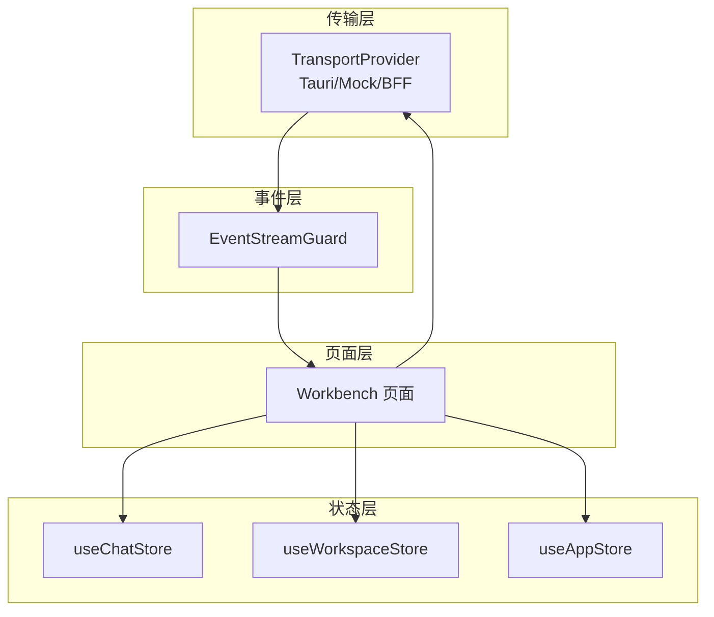
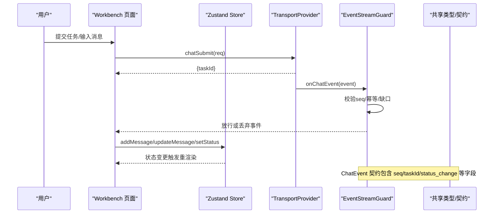
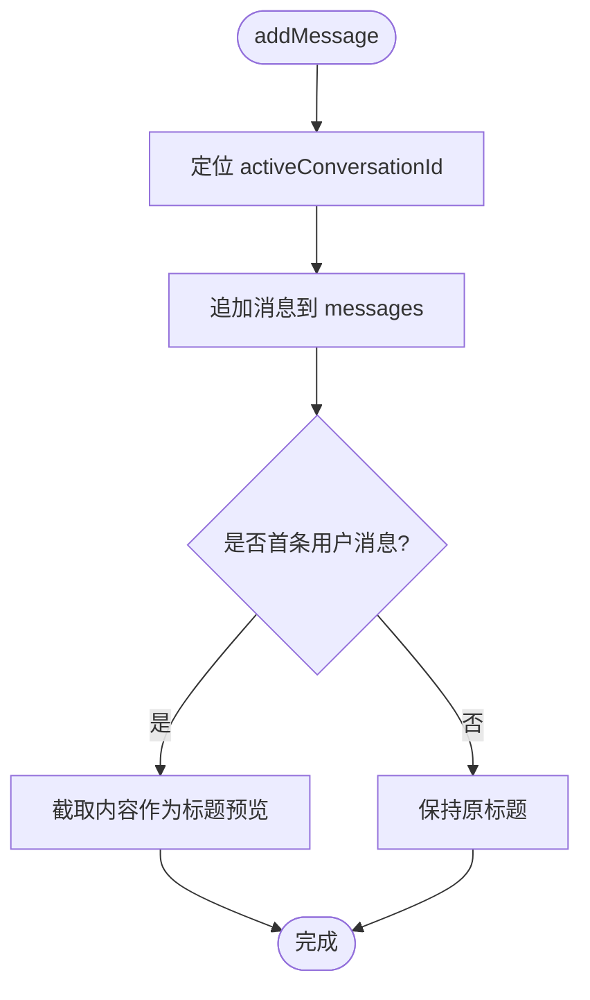
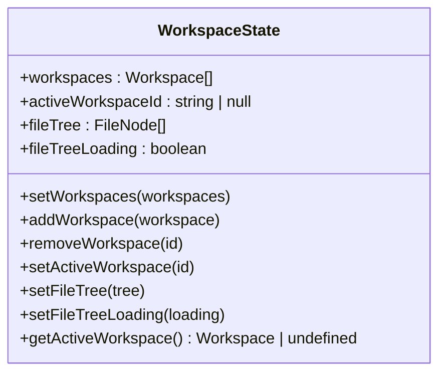
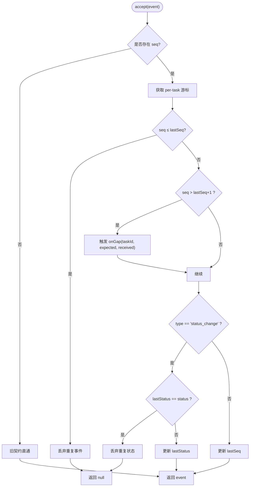
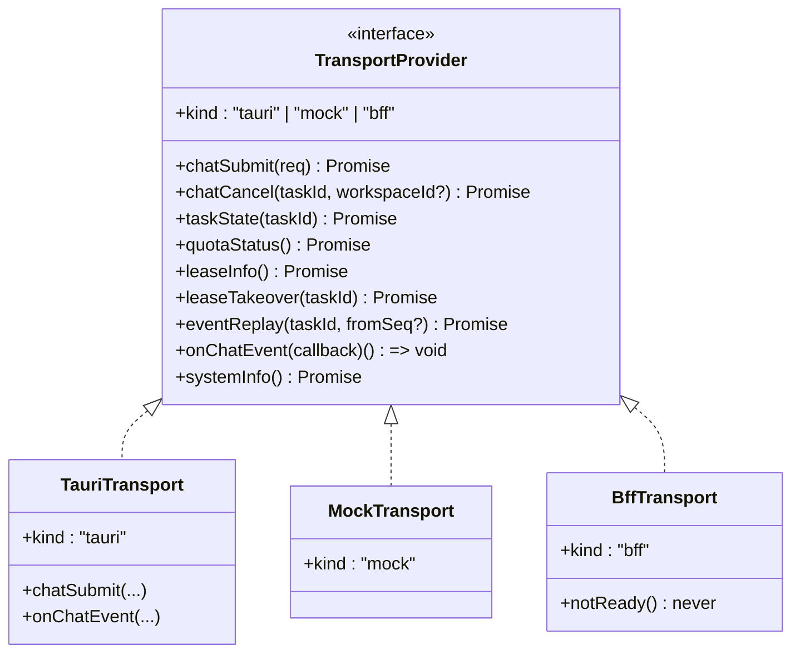
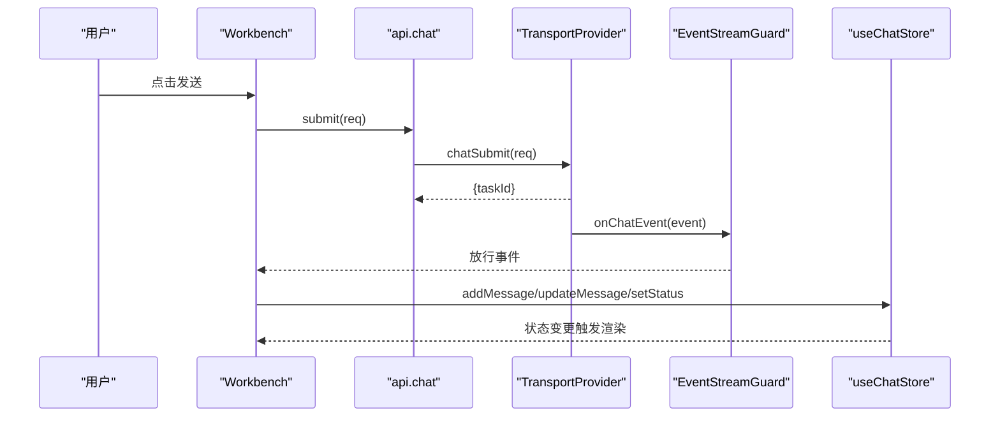
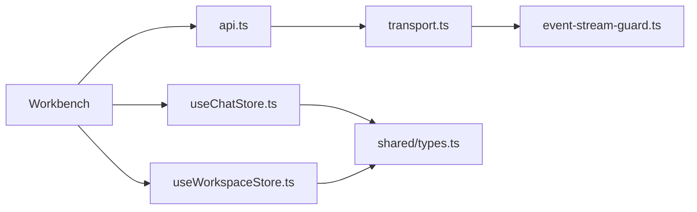

# 组件通信机制

<cite>
**本文引用的文件**
- [useChatStore.ts](file://tongtian-tauri/src/renderer/stores/useChatStore.ts)
- [useWorkspaceStore.ts](file://tongtian-tauri/src/renderer/stores/useWorkspaceStore.ts)
- [useAppStore.ts](file://tongtian-tauri/src/renderer/stores/useAppStore.ts)
- [stores/index.ts](file://tongtian-tauri/src/renderer/stores/index.ts)
- [event-stream-guard.ts](file://tongtian-tauri/src/renderer/lib/event-stream-guard.ts)
- [transport.ts](file://tongtian-tauri/src/renderer/lib/transport.ts)
- [api.ts](file://tongtian-tauri/src/renderer/lib/api.ts)
- [types.ts](file://tongtian-tauri/src/shared/types.ts)
- [Workbench/index.tsx](file://tongtian-tauri/src/renderer/pages/Workbench/index.tsx)
</cite>

## 目录
1. [简介](#简介)
2. [项目结构](#项目结构)
3. [核心组件](#核心组件)
4. [架构总览](#架构总览)
5. [详细组件分析](#详细组件分析)
6. [依赖关系分析](#依赖关系分析)
7. [性能考虑](#性能考虑)
8. [故障排查指南](#故障排查指南)
9. [结论](#结论)
10. [附录](#附录)

## 简介
本文件面向通天办公前端，系统性阐述基于 Zustand 的组件通信与状态管理方案，重点覆盖：
- useChatStore 聊天状态管理（会话、消息、流式更新）
- useWorkspaceStore 工作区状态管理（工作区列表、当前工作区、文件树）
- 事件流守卫机制（seq 单调消费、缺口检测、status_change 幂等）
- 组件间状态同步策略（订阅发布、事件总线模式）
- 数据流向图、性能优化策略、异步操作与错误边界处理
- 最佳实践与常见问题解决方案

## 项目结构
前端采用“多 Store + 传输适配层 + 事件守卫”的分层架构：
- 状态层：Zustand Store（useChatStore、useWorkspaceStore、useAppStore 等），通过统一导出集中暴露
- 传输层：TransportProvider 抽象（Tauri/Mock/BFF），屏蔽底层差异，提供 chatSubmit、onChatEvent、eventReplay 等能力
- 事件层：EventStreamGuard 对 onChatEvent 进行 seq 去重、缺口检测、status_change 幂等过滤
- 页面层：Workbench 等页面通过 store 订阅状态变化，调用 API 触发后端流程并渲染 UI

图表来源
- [useChatStore.ts:1-164](file://tongtian-tauri/src/renderer/stores/useChatStore.ts#L1-L164)
- [useWorkspaceStore.ts:1-110](file://tongtian-tauri/src/renderer/stores/useWorkspaceStore.ts#L1-L110)
- [useAppStore.ts:1-110](file://tongtian-tauri/src/renderer/stores/useAppStore.ts#L1-L110)
- [transport.ts:1-234](file://tongtian-tauri/src/renderer/lib/transport.ts#L1-L234)
- [event-stream-guard.ts:1-97](file://tongtian-tauri/src/renderer/lib/event-stream-guard.ts#L1-L97)
- [Workbench/index.tsx:1-443](file://tongtian-tauri/src/renderer/pages/Workbench/index.tsx#L1-L443)

章节来源
- [stores/index.ts:1-17](file://tongtian-tauri/src/renderer/stores/index.ts#L1-L17)

## 核心组件
- useChatStore：管理会话列表、当前活跃会话、消息收发与流式更新、对话状态与错误
- useWorkspaceStore：管理工作区列表、当前工作区、文件树及加载状态
- EventStreamGuard：保证事件按 seq 单调消费，支持缺口回调与 status_change 幂等
- TransportProvider：统一封装 Tauri/Mock/BFF 三种实现，提供 onChatEvent、chatSubmit、eventReplay 等
- api.ts：类型安全的 IPC API 封装，供组件直接调用

章节来源
- [useChatStore.ts:1-164](file://tongtian-tauri/src/renderer/stores/useChatStore.ts#L1-L164)
- [useWorkspaceStore.ts:1-110](file://tongtian-tauri/src/renderer/stores/useWorkspaceStore.ts#L1-L110)
- [event-stream-guard.ts:1-97](file://tongtian-tauri/src/renderer/lib/event-stream-guard.ts#L1-L97)
- [transport.ts:1-234](file://tongtian-tauri/src/renderer/lib/transport.ts#L1-L234)
- [api.ts:1-207](file://tongtian-tauri/src/renderer/lib/api.ts#L1-L207)

## 架构总览
整体数据流遵循“用户交互 → 传输层 → 事件守卫 → 状态层 → UI 渲染”的单向数据流。事件流在到达状态层前经过守卫过滤，确保一致性；状态变更由 Store 驱动 UI 更新。

图表来源
- [transport.ts:34-53](file://tongtian-tauri/src/renderer/lib/transport.ts#L34-L53)
- [event-stream-guard.ts:20-97](file://tongtian-tauri/src/renderer/lib/event-stream-guard.ts#L20-L97)
- [useChatStore.ts:71-164](file://tongtian-tauri/src/renderer/stores/useChatStore.ts#L71-L164)
- [types.ts:286-303](file://tongtian-tauri/src/shared/types.ts#L286-L303)

## 详细组件分析

### useChatStore 聊天状态管理
- 数据结构
  - Conversation：会话元信息（id、title、modelId、时间戳）
  - Message：消息体（id、role、content、timestamp、streaming、tokenUsage）
  - ChatStatus：idle/thinking/streaming/error
- 关键动作
  - createConversation/addMessage/updateMessage/deleteConversation/clearMessages
  - setStatus/setError
- 设计要点
  - 以 activeConversationId 定位当前会话，避免全量遍历
  - 流式更新使用 updateMessage 增量替换 content，减少重绘
  - 首次用户消息自动设置标题预览

图表来源
- [useChatStore.ts:114-129](file://tongtian-tauri/src/renderer/stores/useChatStore.ts#L114-L129)

章节来源
- [useChatStore.ts:1-164](file://tongtian-tauri/src/renderer/stores/useChatStore.ts#L1-L164)

### useWorkspaceStore 工作区状态管理
- 数据结构
  - Workspace：工作区元信息（id、name、rootPath、描述、时间戳）
  - FileNode：文件树节点（id、name、type、path、children、size、modifiedAt）
- 关键动作
  - setWorkspaces/addWorkspace/removeWorkspace/setActiveWorkspace
  - setFileTree/setFileTreeLoading/getActiveWorkspace
- 设计要点
  - 切换工作区时清空 fileTree，避免脏数据
  - 文件树加载状态独立管理，提升用户体验

图表来源
- [useWorkspaceStore.ts:40-109](file://tongtian-tauri/src/renderer/stores/useWorkspaceStore.ts#L40-L109)

章节来源
- [useWorkspaceStore.ts:1-110](file://tongtian-tauri/src/renderer/stores/useWorkspaceStore.ts#L1-L110)

### 事件流守卫机制（EventStreamGuard）
- 目标
  - 保证事件按 seq 单调消费，防止重复渲染
  - 检测 seq 缺口，触发可选 replay 回调
  - status_change 同状态幂等去重
- 行为
  - accept(event)：返回 null 表示丢弃；否则放行
  - wrap(callback)：包装 onChatEvent，仅放行通过的事件
  - dispose(taskId)/clear()：清理游标，防内存泄漏

图表来源
- [event-stream-guard.ts:20-97](file://tongtian-tauri/src/renderer/lib/event-stream-guard.ts#L20-L97)

章节来源
- [event-stream-guard.ts:1-97](file://tongtian-tauri/src/renderer/lib/event-stream-guard.ts#L1-L97)

### 传输适配层（TransportProvider）
- 抽象接口
  - chatSubmit/chatCancel/taskState/quotaStatus/leaseInfo/leaseTakeover
  - eventReplay/onChatEvent/systemInfo
- 实现
  - TauriTransport：通过 window.tongtianAPI 调用命令/事件
  - MockTransport：开发阶段全真模拟
  - BffTransport：云端 REST+SSE 骨架占位（Phase B 启用）
- 运行环境探测
  - detectTransportKind：根据 __TAURI_INTERNALS__ 或环境变量选择实现
  - getTransport：单例缓存，避免重复创建

图表来源
- [transport.ts:34-53](file://tongtian-tauri/src/renderer/lib/transport.ts#L34-L53)
- [transport.ts:90-198](file://tongtian-tauri/src/renderer/lib/transport.ts#L90-L198)

章节来源
- [transport.ts:1-234](file://tongtian-tauri/src/renderer/lib/transport.ts#L1-L234)

### 页面集成与工作流（Workbench）
- 职责
  - 发起任务提交、审阅计划、控制任务（暂停/继续/取消）
  - 订阅事件流，将事件转换为消息/步骤进度，更新 Store
  - 展示任务状态徽标与控制按钮
- 关键点
  - 使用 useShallow 精确订阅所需状态，减少不必要重渲染
  - 根据 TaskStatus 动态显示控制按钮可见性
  - 错误通过 Snackbar 提示，支持清除

图表来源
- [Workbench/index.tsx:237-443](file://tongtian-tauri/src/renderer/pages/Workbench/index.tsx#L237-L443)
- [api.ts:33-69](file://tongtian-tauri/src/renderer/lib/api.ts#L33-L69)
- [transport.ts:90-143](file://tongtian-tauri/src/renderer/lib/transport.ts#L90-L143)
- [event-stream-guard.ts:20-97](file://tongtian-tauri/src/renderer/lib/event-stream-guard.ts#L20-L97)
- [useChatStore.ts:71-164](file://tongtian-tauri/src/renderer/stores/useChatStore.ts#L71-L164)

章节来源
- [Workbench/index.tsx:1-443](file://tongtian-tauri/src/renderer/pages/Workbench/index.tsx#L1-L443)

## 依赖关系分析
- 组件耦合
  - Workbench 依赖 api.ts 与 transport.ts，间接依赖 EventStreamGuard
  - Store 之间解耦，通过各自 actions 更新自身状态
- 外部依赖
  - shared/types.ts 定义 ChatEvent、TaskStatus 等契约，贯穿前后端
  - MUI 组件用于 UI 展示，不影响状态逻辑
- 潜在循环依赖
  - 无直接循环；Store 不依赖 API，API 不依赖 Store，符合单向数据流

图表来源
- [Workbench/index.tsx:1-443](file://tongtian-tauri/src/renderer/pages/Workbench/index.tsx#L1-L443)
- [api.ts:1-207](file://tongtian-tauri/src/renderer/lib/api.ts#L1-L207)
- [transport.ts:1-234](file://tongtian-tauri/src/renderer/lib/transport.ts#L1-L234)
- [event-stream-guard.ts:1-97](file://tongtian-tauri/src/renderer/lib/event-stream-guard.ts#L1-L97)
- [useChatStore.ts:1-164](file://tongtian-tauri/src/renderer/stores/useChatStore.ts#L1-L164)
- [useWorkspaceStore.ts:1-110](file://tongtian-tauri/src/renderer/stores/useWorkspaceStore.ts#L1-L110)
- [types.ts:1-346](file://tongtian-tauri/src/shared/types.ts#L1-L346)

章节来源
- [types.ts:1-346](file://tongtian-tauri/src/shared/types.ts#L1-L346)

## 性能考虑
- 状态粒度与选择性订阅
  - 使用 useShallow 精确订阅必要字段，减少无关重渲染
- 流式更新优化
  - 使用 updateMessage 增量更新 content，避免重建整条消息数组
- 事件去重与幂等
  - EventStreamGuard 防止重复事件导致的状态抖动
- 文件树懒加载
  - 切换工作区清空 fileTree，按需加载，降低初始渲染压力
- 传输层单例
  - getTransport 缓存实例，避免重复初始化

[本节为通用性能建议，无需特定文件引用]

## 故障排查指南
- 事件丢失或乱序
  - 检查 EventStreamGuard 的 onGap 回调是否触发，必要时调用 eventReplay 补齐
- 状态未更新
  - 确认 Store action 是否正确调用，检查 activeConversationId 是否匹配
- 传输异常
  - 检查 detectTransportKind 是否正确识别环境，window.tongtianAPI 是否注入
- 错误边界
  - 页面级 Snackbar 展示错误，支持关闭；Store 中 setError 统一处理错误状态

章节来源
- [event-stream-guard.ts:20-97](file://tongtian-tauri/src/renderer/lib/event-stream-guard.ts#L20-L97)
- [useChatStore.ts:146-152](file://tongtian-tauri/src/renderer/stores/useChatStore.ts#L146-L152)
- [transport.ts:204-234](file://tongtian-tauri/src/renderer/lib/transport.ts#L204-L234)
- [Workbench/index.tsx:427-437](file://tongtian-tauri/src/renderer/pages/Workbench/index.tsx#L427-L437)

## 结论
本项目通过 Zustand Store 实现细粒度状态管理，结合 TransportProvider 抽象与 EventStreamGuard 保障事件一致性与可靠性，形成清晰的数据流向与可维护的组件通信机制。建议在后续演进中：
- 持续完善 BffTransport 云端接入
- 扩展事件类型与状态机，对齐三层架构演进
- 强化测试覆盖，尤其是事件守卫与传输层

[本节为总结性内容，无需特定文件引用]

## 附录
- 状态结构设计
  - ChatState：conversations、activeConversationId、status、error
  - WorkspaceState：workspaces、activeWorkspaceId、fileTree、fileTreeLoading
  - AppState：themeMode、hardSwitchOff、sidebarCollapsed、globalLoading、notification
- 数据流向图
  - 见“架构总览”中的 sequence diagram
- 最佳实践
  - 单一职责：每个 Store 管理一个领域状态
  - 不可变更新：使用函数式 set(state => newState)
  - 事件契约：严格遵循 shared/types.ts 定义的 ChatEvent
- 常见问题
  - 事件重复：启用 EventStreamGuard 的 seq 去重
  - 状态不同步：确保所有写操作通过 Store action 完成
  - 异步错误：统一通过 setError 与 Snackbar 反馈

[本节为补充说明，无需特定文件引用]