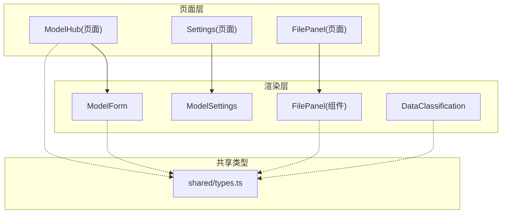
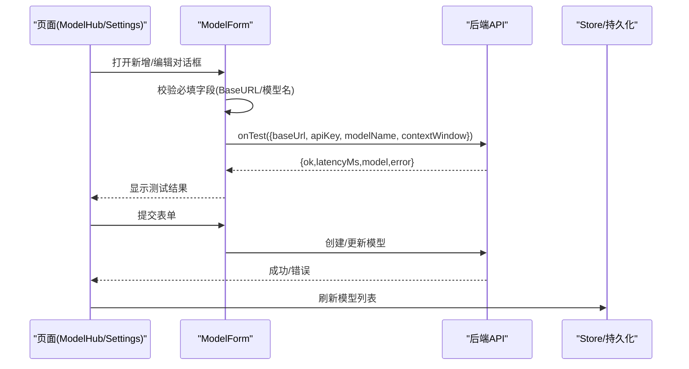
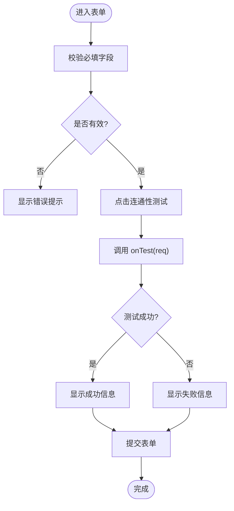
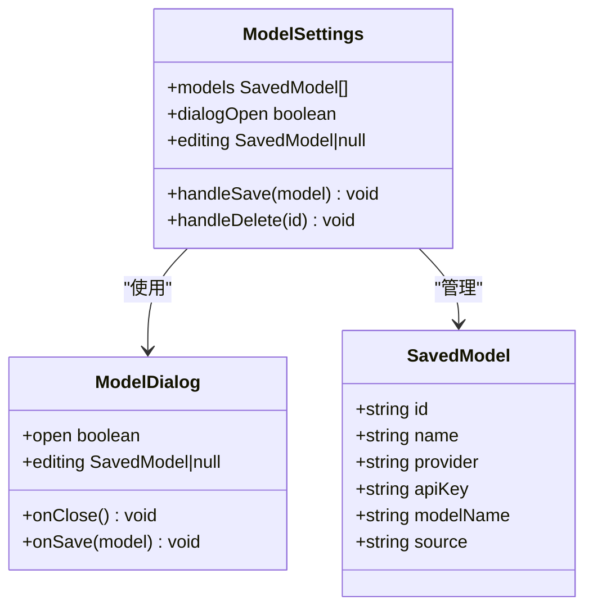
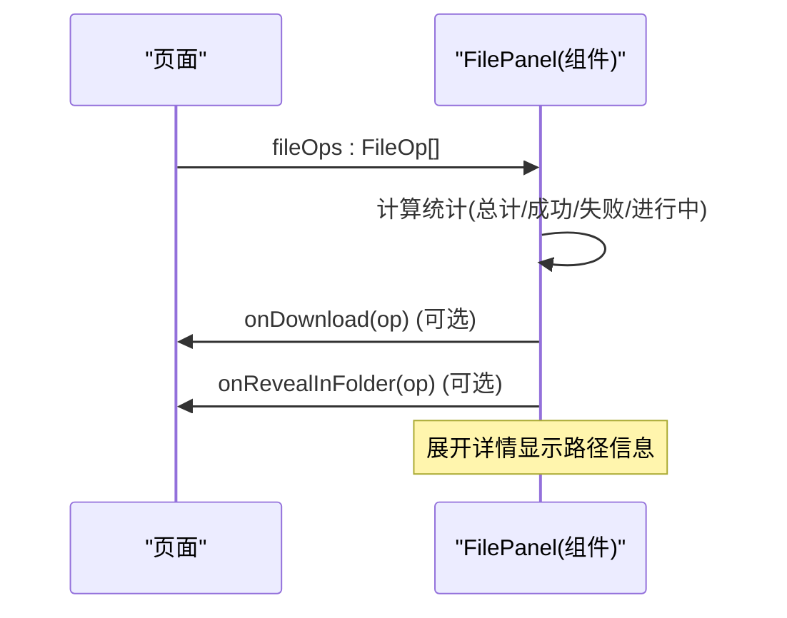
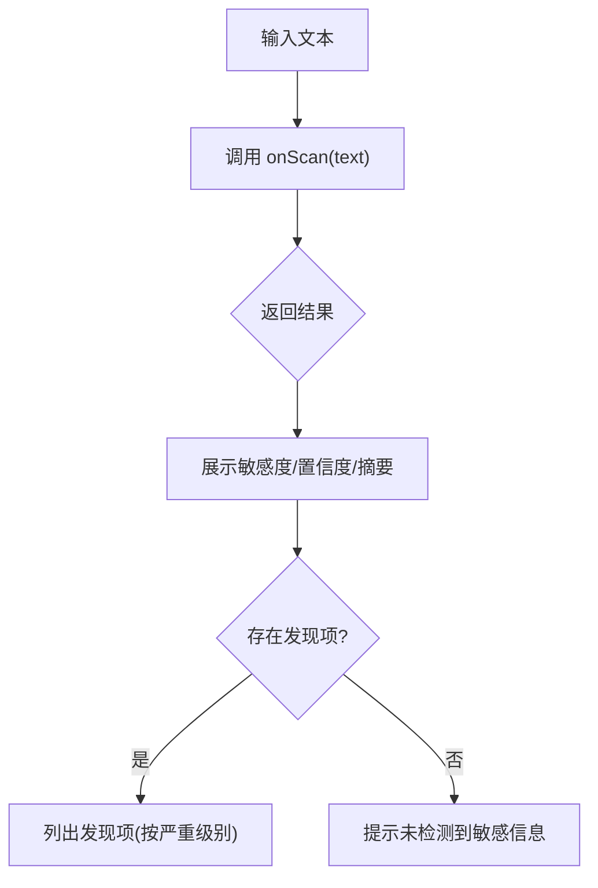
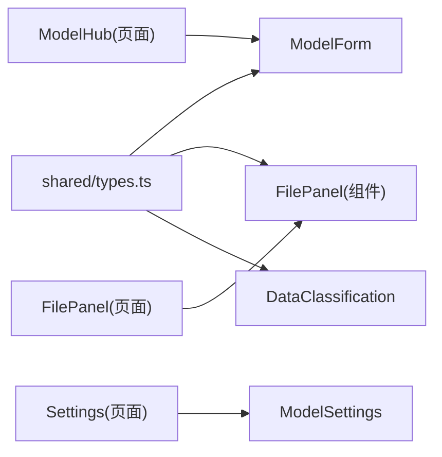

# 通用组件

<cite>
**本文引用的文件**
- [ModelForm/index.tsx](file://tongtian-tauri/src/renderer/components/ModelForm/index.tsx)
- [ModelSettings/index.tsx](file://tongtian-tauri/src/renderer/components/ModelSettings/index.tsx)
- [FilePanel/index.tsx](file://tongtian-tauri/src/renderer/components/FilePanel/index.tsx)
- [DataClassification/index.tsx](file://tongtian-tauri/src/renderer/components/DataClassification/index.tsx)
- [types.ts](file://tongtian-tauri/src/shared/types.ts)
- [ModelHub/index.tsx](file://tongtian-tauri/src/renderer/pages/ModelHub/index.tsx)
- [Settings/index.tsx](file://tongtian-tauri/src/renderer/pages/Settings/index.tsx)
- [pages/FilePanel/index.tsx](file://tongtian-tauri/src/renderer/pages/FilePanel/index.tsx)
</cite>

## 目录
1. [简介](#简介)
2. [项目结构](#项目结构)
3. [核心组件总览](#核心组件总览)
4. [架构总览](#架构总览)
5. [组件详细分析](#组件详细分析)
6. [依赖关系分析](#依赖关系分析)
7. [性能与可维护性建议](#性能与可维护性建议)
8. [故障排查指南](#故障排查指南)
9. [结论](#结论)
10. [附录：接口与事件契约](#附录接口与事件契约)

## 简介
本章节面向通天办公项目的四个通用组件，提供系统化、可复用的文档说明。重点覆盖：
- ModelForm：模型表单的动态字段生成、验证规则、数据绑定机制
- ModelSettings：模型设置组件的配置管理、状态持久化、实时更新
- FilePanel：文件面板的文件操作、预览能力、批量处理展示
- DataClassification：数据分类组件的分类逻辑、标签管理、筛选展示

同时给出组件的可复用设计、属性接口定义、事件回调机制、使用示例与最佳实践，并指导如何扩展和自定义这些组件。

## 项目结构
本项目采用 React + MUI 的前端实现，通用组件位于 renderer/components 下，页面级组合在 pages 中，类型定义集中在 shared/types.ts。四个通用组件分别承担不同职责：
- ModelForm：负责模型配置的输入、校验、测试连通性
- ModelSettings：负责本地模型列表的增删改查与持久化
- FilePanel：负责文件操作记录展示、状态可视化、下载与定位
- DataClassification：负责文本内容的数据敏感度检测与结果呈现

图表来源
- [ModelForm/index.tsx:1-295](file://tongtian-tauri/src/renderer/components/ModelForm/index.tsx#L1-L295)
- [ModelSettings/index.tsx:1-463](file://tongtian-tauri/src/renderer/components/ModelSettings/index.tsx#L1-L463)
- [FilePanel/index.tsx:1-247](file://tongtian-tauri/src/renderer/components/FilePanel/index.tsx#L1-L247)
- [DataClassification/index.tsx:1-267](file://tongtian-tauri/src/renderer/components/DataClassification/index.tsx#L1-L267)
- [types.ts:104-136](file://tongtian-tauri/src/shared/types.ts#L104-L136)
- [ModelHub/index.tsx:1-442](file://tongtian-tauri/src/renderer/pages/ModelHub/index.tsx#L1-L442)
- [Settings/index.tsx:1-800](file://tongtian-tauri/src/renderer/pages/Settings/index.tsx#L1-L800)
- [pages/FilePanel/index.tsx:1-225](file://tongtian-tauri/src/renderer/pages/FilePanel/index.tsx#L1-L225)

章节来源
- [ModelForm/index.tsx:1-295](file://tongtian-tauri/src/renderer/components/ModelForm/index.tsx#L1-L295)
- [ModelSettings/index.tsx:1-463](file://tongtian-tauri/src/renderer/components/ModelSettings/index.tsx#L1-L463)
- [FilePanel/index.tsx:1-247](file://tongtian-tauri/src/renderer/components/FilePanel/index.tsx#L1-L247)
- [DataClassification/index.tsx:1-267](file://tongtian-tauri/src/renderer/components/DataClassification/index.tsx#L1-L267)
- [types.ts:104-136](file://tongtian-tauri/src/shared/types.ts#L104-L136)
- [ModelHub/index.tsx:1-442](file://tongtian-tauri/src/renderer/pages/ModelHub/index.tsx#L1-L442)
- [Settings/index.tsx:1-800](file://tongtian-tauri/src/renderer/pages/Settings/index.tsx#L1-L800)
- [pages/FilePanel/index.tsx:1-225](file://tongtian-tauri/src/renderer/pages/FilePanel/index.tsx#L1-L225)

## 核心组件总览
- ModelForm
  - 动态字段：根据 ModelSource 枚举映射显示不同源类型的下拉选项；支持基础字段（名称、Base URL、API Key、服务端模型名、上下文窗口）与开关项（默认、强制本地）、可选的智能体绑定
  - 验证规则：必填字段校验（名称、Base URL、服务端模型名），连通性测试前对 BaseURL 与模型名进行前置检查
  - 数据绑定：受控表单，通过 useState 管理 formData，提交时调用父组件传入的 onSubmit；测试调用 onTest
  - 事件回调：onSubmit(data)、onTest(req) => Promise<resp>、onCancel()
- ModelSettings
  - 配置管理：维护 SavedModel 列表，支持新增、编辑、删除；弹窗内选择提供方、输入 API Key、选择模型名称
  - 状态持久化：使用 localStorage 存储自定义模型列表，键名为固定常量；加载时回退到种子数据
  - 实时更新：保存后同步更新内存状态与本地存储，列表即时刷新
- FilePanel（组件）
  - 文件操作：接收 FileOp[] 作为 props，按状态分组统计（总计、成功、失败、进行中）
  - 预览能力：根据文件名后缀选择图标；展开详情后可查看源路径、目标路径、备份路径，并提供“在文件夹中显示”入口
  - 批量处理：通过列表聚合展示多条操作，支持下载（成功后）与折叠展开交互
- DataClassification
  - 分类逻辑：输入文本后调用 onScan(text) => Promise<DataScanResult>，返回敏感度、置信度、摘要与发现项
  - 标签管理：敏感度级别映射为不同颜色与标签；发现项按严重等级着色
  - 筛选功能：当前以结果展示为主，可通过 findings 数组过滤高/中/低严重级别条目

章节来源
- [ModelForm/index.tsx:30-95](file://tongtian-tauri/src/renderer/components/ModelForm/index.tsx#L30-L95)
- [ModelSettings/index.tsx:74-90](file://tongtian-tauri/src/renderer/components/ModelSettings/index.tsx#L74-L90)
- [FilePanel/index.tsx:28-117](file://tongtian-tauri/src/renderer/components/FilePanel/index.tsx#L28-L117)
- [DataClassification/index.tsx:22-70](file://tongtian-tauri/src/renderer/components/DataClassification/index.tsx#L22-L70)

## 架构总览
四个组件均遵循“受控组件 + 外部状态管理”的模式：
- 表单类组件（ModelForm、DataClassification）通过 props 暴露回调，将用户输入或检测结果上抛给页面层处理
- 设置类组件（ModelSettings）内部维护本地状态并通过持久化层（localStorage）保持跨会话一致性
- 展示类组件（FilePanel）仅消费外部状态（FileOp[]），不修改外部数据，保证单向数据流

图表来源
- [ModelForm/index.tsx:67-95](file://tongtian-tauri/src/renderer/components/ModelForm/index.tsx#L67-L95)
- [ModelHub/index.tsx:138-171](file://tongtian-tauri/src/renderer/pages/ModelHub/index.tsx#L138-L171)

章节来源
- [ModelForm/index.tsx:67-95](file://tongtian-tauri/src/renderer/components/ModelForm/index.tsx#L67-L95)
- [ModelHub/index.tsx:138-171](file://tongtian-tauri/src/renderer/pages/ModelHub/index.tsx#L138-L171)

## 组件详细分析

### ModelForm 组件分析
- 动态字段生成
  - 通过 ModelSource 枚举映射为下拉选项，支持 OpenAI 兼容、Ollama、预置通义千问/DeepSeek/OpenAI、自定义等
  - 上下文窗口数值输入限制范围，防止越界
- 验证规则
  - 必填校验：名称、Base URL、服务端模型名
  - 测试前校验：Base URL 与模型名非空
- 数据绑定机制
  - 受控表单：formData 由 useState 管理，所有输入通过 onChange 更新
  - 敏感信息处理：API Key 默认隐藏，支持显示/隐藏切换；当值为占位符时，提交时剔除
- 事件回调
  - onSubmit(formData)：提交新增/更新
  - onTest(req) => Promise<ModelTestResp>：执行连通性测试
  - onCancel()：关闭对话框

图表来源
- [ModelForm/index.tsx:67-95](file://tongtian-tauri/src/renderer/components/ModelForm/index.tsx#L67-L95)

章节来源
- [ModelForm/index.tsx:30-295](file://tongtian-tauri/src/renderer/components/ModelForm/index.tsx#L30-L295)

### ModelSettings 组件分析
- 配置管理
  - 维护 SavedModel 列表，支持新增、编辑、删除
  - 弹窗内包含提供方选择、API Key 输入、模型名称选择
- 状态持久化
  - 使用 localStorage 存储自定义模型列表，键名固定
  - 读取失败时回退到种子数据，确保界面可用
- 实时更新
  - 保存时先更新内存状态，再写入本地存储，列表即时刷新
  - 编辑时回填弹窗字段，避免重复输入

图表来源
- [ModelSettings/index.tsx:33-90](file://tongtian-tauri/src/renderer/components/ModelSettings/index.tsx#L33-L90)
- [ModelSettings/index.tsx:127-297](file://tongtian-tauri/src/renderer/components/ModelSettings/index.tsx#L127-L297)
- [ModelSettings/index.tsx:301-463](file://tongtian-tauri/src/renderer/components/ModelSettings/index.tsx#L301-L463)

章节来源
- [ModelSettings/index.tsx:74-90](file://tongtian-tauri/src/renderer/components/ModelSettings/index.tsx#L74-L90)
- [ModelSettings/index.tsx:127-297](file://tongtian-tauri/src/renderer/components/ModelSettings/index.tsx#L127-L297)
- [ModelSettings/index.tsx:301-463](file://tongtian-tauri/src/renderer/components/ModelSettings/index.tsx#L301-L463)

### FilePanel 组件分析
- 文件操作
  - 接收 FileOp[]，按状态分组统计（总计、成功、失败、进行中）
  - 根据 op 类型与 fileName 选择图标，提升可读性
- 预览功能
  - 展开详情可查看源路径、目标路径、备份路径
  - 成功后提供下载按钮；支持“在文件夹中显示”
- 批量处理能力
  - 列表聚合多条操作，支持折叠展开，便于快速浏览与定位问题
  - 通过 Chip 展示状态，直观反馈进度

图表来源
- [FilePanel/index.tsx:28-117](file://tongtian-tauri/src/renderer/components/FilePanel/index.tsx#L28-L117)
- [FilePanel/index.tsx:155-236](file://tongtian-tauri/src/renderer/components/FilePanel/index.tsx#L155-L236)

章节来源
- [FilePanel/index.tsx:28-247](file://tongtian-tauri/src/renderer/components/FilePanel/index.tsx#L28-L247)

### DataClassification 组件分析
- 分类逻辑
  - 输入文本后调用 onScan(text)，返回 DataScanResult（敏感度、置信度、摘要、发现项）
  - 根据敏感度映射颜色与标签，置信度用进度条展示
- 标签管理
  - 发现项按严重级别（高/中/低）着色，便于快速识别风险
- 筛选功能
  - 当前以结果展示为主，可通过 findings 数组过滤高/中/低严重级别条目

图表来源
- [DataClassification/index.tsx:42-70](file://tongtian-tauri/src/renderer/components/DataClassification/index.tsx#L42-L70)
- [DataClassification/index.tsx:158-259](file://tongtian-tauri/src/renderer/components/DataClassification/index.tsx#L158-L259)

章节来源
- [DataClassification/index.tsx:22-267](file://tongtian-tauri/src/renderer/components/DataClassification/index.tsx#L22-L267)

## 依赖关系分析
- 类型依赖
  - ModelForm 依赖 ModelConfig、ModelSource、ModelTestReq、ModelTestResp
  - FilePanel 依赖 FileOp、FileOpType、FileOpStatus
  - DataClassification 依赖 DataSensitivity
- 页面集成
  - ModelHub 页面集成 ModelForm，负责模型列表展示、搜索、新增/编辑/删除、连通性测试
  - Settings 页面集成 ModelSettings，作为“模型与用量”子分区
  - 页面级 FilePanel 负责工作区文件浏览与预览，与组件级 FilePanel 职责互补

图表来源
- [types.ts:104-136](file://tongtian-tauri/src/shared/types.ts#L104-L136)
- [ModelHub/index.tsx:1-442](file://tongtian-tauri/src/renderer/pages/ModelHub/index.tsx#L1-L442)
- [Settings/index.tsx:1-800](file://tongtian-tauri/src/renderer/pages/Settings/index.tsx#L1-L800)
- [pages/FilePanel/index.tsx:1-225](file://tongtian-tauri/src/renderer/pages/FilePanel/index.tsx#L1-L225)

章节来源
- [types.ts:104-136](file://tongtian-tauri/src/shared/types.ts#L104-L136)
- [ModelHub/index.tsx:1-442](file://tongtian-tauri/src/renderer/pages/ModelHub/index.tsx#L1-L442)
- [Settings/index.tsx:1-800](file://tongtian-tauri/src/renderer/pages/Settings/index.tsx#L1-L800)
- [pages/FilePanel/index.tsx:1-225](file://tongtian-tauri/src/renderer/pages/FilePanel/index.tsx#L1-L225)

## 性能与可维护性建议
- 表单性能
  - ModelForm 的受控状态较小，适合当前规模；若字段增多，可考虑使用表单库（如 react-hook-form）减少重渲染
  - 连通性测试应防抖或节流，避免频繁请求
- 持久化性能
  - ModelSettings 使用 localStorage，注意 JSON 序列化开销；大数据量时可分片存储或使用 IndexedDB
- 列表渲染
  - FilePanel 列表较长时可引入虚拟滚动，提升大列表性能
- 可扩展性
  - 通过 props 暴露回调，便于上层页面定制行为；建议为每个组件定义清晰的 TypeScript 接口，增强类型安全
- 错误处理
  - 统一错误提示样式，避免分散的错误处理逻辑；建议在页面层集中捕获并格式化错误消息

[本节为通用建议，不直接分析具体文件]

## 故障排查指南
- ModelForm
  - 连通性测试失败：检查 Base URL 与模型名是否正确；确认网络可达；查看后端返回 error 字段
  - 提交失败：确认必填字段完整；检查 API Key 是否为占位符；查看页面层错误提示
- ModelSettings
  - 列表为空：检查 localStorage 是否被清除；确认种子数据是否正常加载
  - 保存无效：确认 saveModels 函数未被拦截；检查浏览器存储权限
- FilePanel
  - 无法下载：确认操作状态为成功且存在 dstPath；检查 onDownload 回调是否实现
  - 无法显示文件夹：确认 onRevealInFolder 回调是否实现且路径有效
- DataClassification
  - 检测失败：检查 onScan 回调实现；确认输入文本非空；查看错误提示

章节来源
- [ModelForm/index.tsx:72-95](file://tongtian-tauri/src/renderer/components/ModelForm/index.tsx#L72-L95)
- [ModelSettings/index.tsx:74-90](file://tongtian-tauri/src/renderer/components/ModelSettings/index.tsx#L74-L90)
- [FilePanel/index.tsx:192-236](file://tongtian-tauri/src/renderer/components/FilePanel/index.tsx#L192-L236)
- [DataClassification/index.tsx:52-70](file://tongtian-tauri/src/renderer/components/DataClassification/index.tsx#L52-L70)

## 结论
四个通用组件在设计上遵循受控组件与单向数据流原则，具备清晰的属性接口与事件回调机制。ModelForm 与 DataClassification 通过回调将业务逻辑上抛至页面层，ModelSettings 通过本地存储实现状态持久化，FilePanel 专注于操作记录的可视化与交互。整体架构易于扩展与维护，建议在实际使用中结合页面层进行更丰富的业务定制。

[本节为总结性内容，不直接分析具体文件]

## 附录：接口与事件契约
- ModelForm Props
  - initialData?: Partial<ModelConfig>
  - onSubmit: (data: Partial<ModelConfig>) => void
  - onTest: (data: ModelTestReq) => Promise<ModelTestResp>
  - onCancel?: () => void
  - isSubmitting?: boolean
- ModelSettings
  - 内部状态：models: SavedModel[]
  - 事件：handleSave(model), handleDelete(id)
- FilePanel Props
  - fileOps: FileOp[]
  - onDownload?: (fileOp: FileOp) => void
  - onRevealInFolder?: (fileOp: FileOp) => void
- DataClassification Props
  - onScan: (text: string) => Promise<DataScanResult>
  - initialText?: string
  - disabled?: boolean

章节来源
- [ModelForm/index.tsx:30-36](file://tongtian-tauri/src/renderer/components/ModelForm/index.tsx#L30-L36)
- [ModelSettings/index.tsx:33-40](file://tongtian-tauri/src/renderer/components/ModelSettings/index.tsx#L33-L40)
- [FilePanel/index.tsx:28-32](file://tongtian-tauri/src/renderer/components/FilePanel/index.tsx#L28-L32)
- [DataClassification/index.tsx:36-40](file://tongtian-tauri/src/renderer/components/DataClassification/index.tsx#L36-L40)
- [types.ts:201-232](file://tongtian-tauri/src/shared/types.ts#L201-L232)