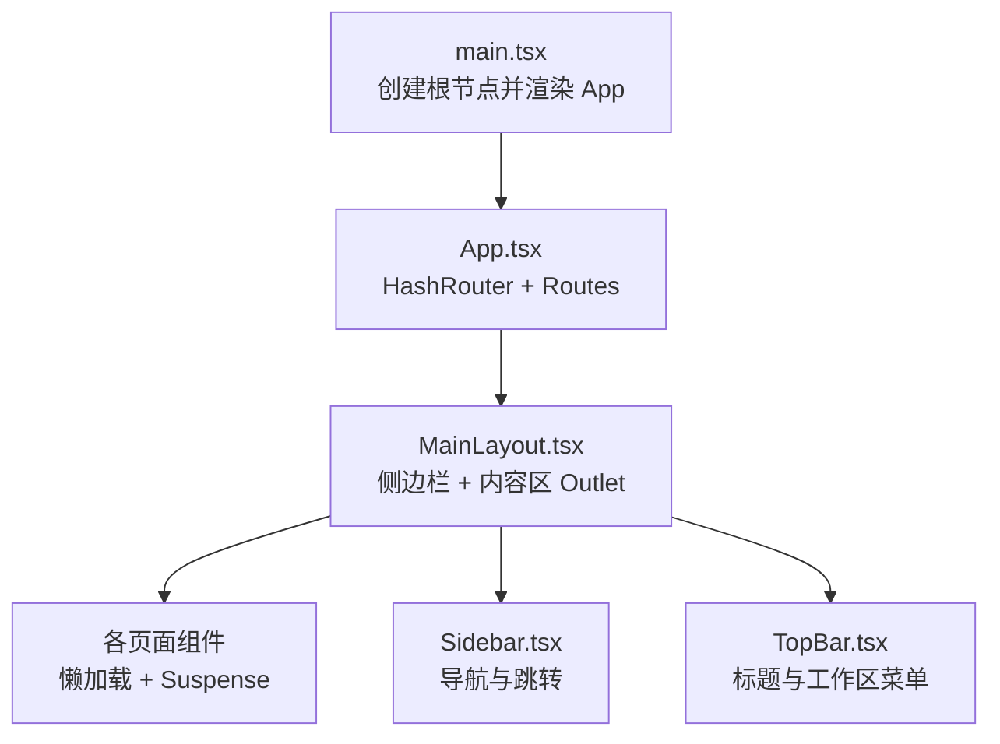
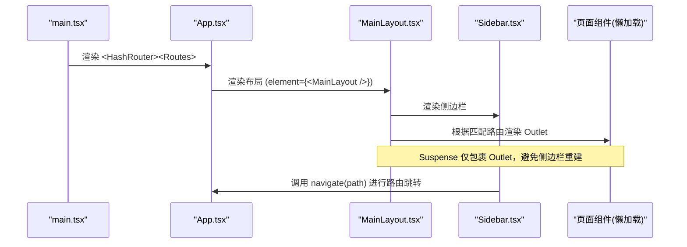
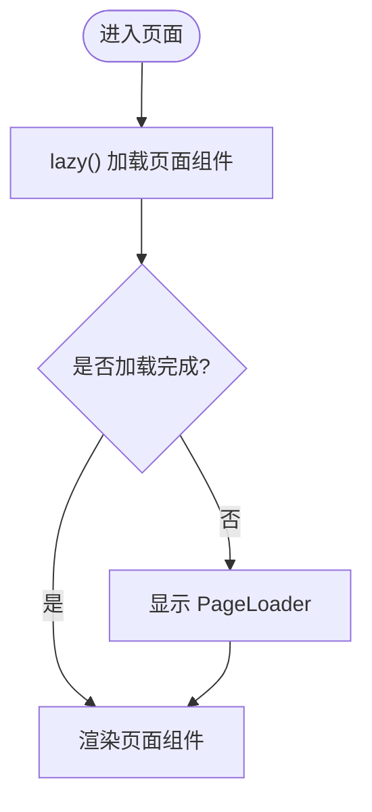
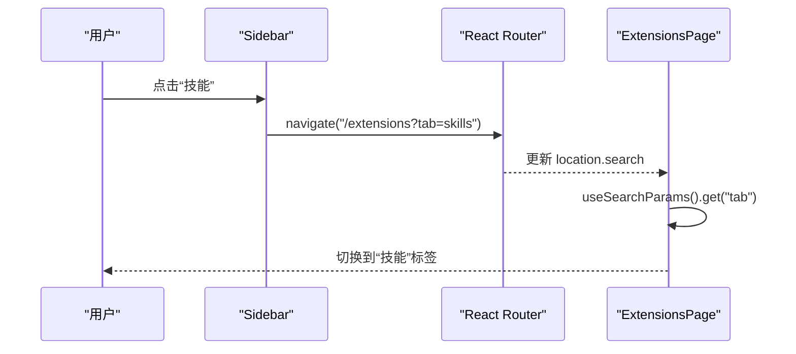
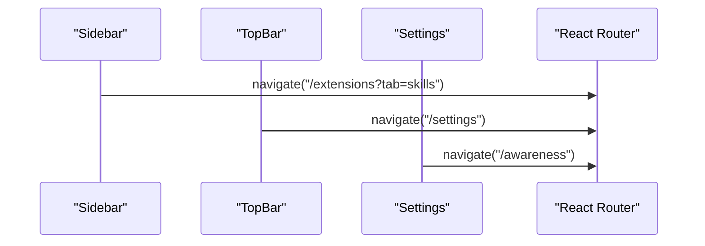
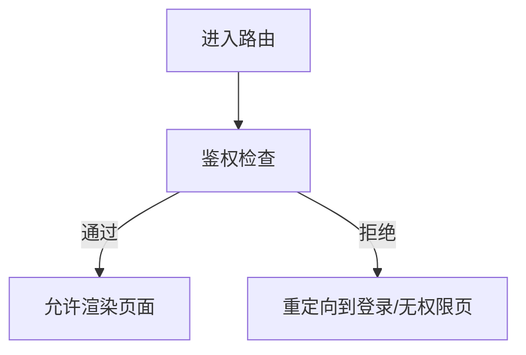
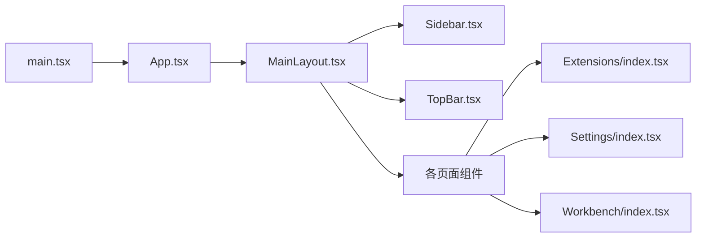

# 路由设计与配置

<cite>
**本文引用的文件**
- [App.tsx](file://tongtian-tauri/src/renderer/App.tsx)
- [main.tsx](file://tongtian-tauri/src/renderer/main.tsx)
- [MainLayout.tsx](file://tongtian-tauri/src/renderer/components/Layout/MainLayout.tsx)
- [Sidebar.tsx](file://tongtian-tauri/src/renderer/components/Layout/Sidebar.tsx)
- [TopBar.tsx](file://tongtian-tauri/src/renderer/components/Layout/TopBar.tsx)
- [Extensions/index.tsx](file://tongtian-tauri/src/renderer/pages/Extensions/index.tsx)
- [Settings/index.tsx](file://tongtian-tauri/src/renderer/pages/Settings/index.tsx)
- [Workbench/index.tsx](file://tongtian-tauri/src/renderer/pages/Workbench/index.tsx)
</cite>

## 目录
1. [简介](#简介)
2. [项目结构](#项目结构)
3. [核心组件](#核心组件)
4. [架构总览](#架构总览)
5. [详细组件分析](#详细组件分析)
6. [依赖关系分析](#依赖关系分析)
7. [性能考虑](#性能考虑)
8. [故障排查指南](#故障排查指南)
9. [结论](#结论)
10. [附录](#附录)

## 简介
本文件面向通天办公前端（Electron + React）的路由设计与配置，基于 React Router v6 的 HashRouter 实现。文档覆盖：
- HashRouter 的配置与使用场景（适配 Electron 桌面端）
- 懒加载路由的实现策略与 Suspense 边界下沉
- 路由守卫与页面级访问控制方案（建议与落地路径）
- 所有页面路由的定义与组织方式（主工作区、模型中心、安全设置、扩展管理等）
- 路由参数传递与查询字符串处理最佳实践
- 路由流程图与权限控制方案
- 路由性能优化与 SEO 考虑

## 项目结构
前端入口渲染应用并包裹主题；根组件内以 HashRouter 定义全局路由，采用 MainLayout 作为布局容器，子路由通过懒加载按需引入，Suspense 仅包裹内容区以避免侧边栏状态丢失。

图表来源
- [main.tsx:16-24](file://tongtian-tauri/src/renderer/main.tsx#L16-L24)
- [App.tsx:38-63](file://tongtian-tauri/src/renderer/App.tsx#L38-L63)
- [MainLayout.tsx:23-70](file://tongtian-tauri/src/renderer/components/Layout/MainLayout.tsx#L23-L70)
- [Sidebar.tsx:85-122](file://tongtian-tauri/src/renderer/components/Layout/Sidebar.tsx#L85-L122)
- [TopBar.tsx:51-60](file://tongtian-tauri/src/renderer/components/Layout/TopBar.tsx#L51-L60)

章节来源
- [main.tsx:1-25](file://tongtian-tauri/src/renderer/main.tsx#L1-L25)
- [App.tsx:1-66](file://tongtian-tauri/src/renderer/App.tsx#L1-L66)

## 核心组件
- 路由容器：HashRouter 提供基于 # 的路由模式，适合 Electron 本地环境，避免跨域与服务器重定向问题。
- 布局容器：MainLayout 统一承载 Sidebar、TopBar 与页面内容区，Suspense 仅包裹 Outlet，确保懒加载时侧边栏稳定。
- 导航组件：Sidebar 负责主要导航项与跳转；TopBar 显示当前页面标题与工作区切换入口。
- 页面组件：各功能页按模块拆分，通过 lazy() 懒加载，配合 Suspense 展示加载态。

章节来源
- [App.tsx:14-63](file://tongtian-tauri/src/renderer/App.tsx#L14-L63)
- [MainLayout.tsx:11-70](file://tongtian-tauri/src/renderer/components/Layout/MainLayout.tsx#L11-L70)
- [Sidebar.tsx:111-122](file://tongtian-tauri/src/renderer/components/Layout/Sidebar.tsx#L111-L122)
- [TopBar.tsx:29-60](file://tongtian-tauri/src/renderer/components/Layout/TopBar.tsx#L29-L60)

## 架构总览
下图展示了从入口到页面渲染的完整流程，以及路由与布局的关系。

图表来源
- [main.tsx:16-24](file://tongtian-tauri/src/renderer/main.tsx#L16-L24)
- [App.tsx:38-63](file://tongtian-tauri/src/renderer/App.tsx#L38-L63)
- [MainLayout.tsx:39-70](file://tongtian-tauri/src/renderer/components/Layout/MainLayout.tsx#L39-L70)
- [Sidebar.tsx:111-122](file://tongtian-tauri/src/renderer/components/Layout/Sidebar.tsx#L111-L122)

## 详细组件分析

### 路由定义与组织
- 根路由：/ 指向工作台（Workbench），作为默认首页。
- 功能路由：
  - /model-hub：模型中心
  - /security：安全合规
  - /extensions：扩展管理（内置工具/技能/连接器）
  - /workspace：工作区面板
  - /files：文件管理
  - /schedule：定时任务
  - /settings：设置（支持 ?s=xxx 深度链接）
  - /hooks：钩子管理
  - /awareness：意识管理
  - /computer-use：计算机使用
  - /im：IM 频道
  - /archive：归档
- 兼容重定向：
  - /skill-market → /extensions?tab=skills
  - /connectors → /extensions?tab=connectors

```mermaid
flowchart TD
R["Routes"] --> W["/ → Workbench"]
R --> MH["/model-hub → ModelHub"]
R --> SEC["/security → SecurityPage"]
R --> EXT["/extensions → ExtensionsPage"]
R --> WS["/workspace → WorkspacePanel"]
R --> FP["/files → FilePanel"]
R --> SCH["/schedule → ScheduleView"]
R --> SET["/settings → Settings"]
R --> HK["/hooks → HooksManager"]
R --> AW["/awareness → AwarenessPage"]
R --> CU["/computer-use → ComputerUsePanel"]
R --> IM["/im → IMChannel"]
R --> AR["/archive → ArchiveView"]
R --> SM["/skill-market → Navigate to /extensions?tab=skills"]
R --> CN["/connectors → Navigate to /extensions?tab=connectors"]
```

图表来源
- [App.tsx:41-59](file://tongtian-tauri/src/renderer/App.tsx#L41-L59)

章节来源
- [App.tsx:18-59](file://tongtian-tauri/src/renderer/App.tsx#L18-L59)

### 懒加载与 Suspense 边界
- 页面组件统一通过 lazy() 动态导入，减少首屏体积。
- Suspense 仅在 MainLayout 的内容区包裹 Outlet，避免懒加载导致侧边栏被卸载重建，从而保持弹窗锚点与页签状态稳定。

图表来源
- [App.tsx:18-34](file://tongtian-tauri/src/renderer/App.tsx#L18-L34)
- [MainLayout.tsx:16-21](file://tongtian-tauri/src/renderer/components/Layout/MainLayout.tsx#L16-L21)
- [MainLayout.tsx:57-67](file://tongtian-tauri/src/renderer/components/Layout/MainLayout.tsx#L57-L67)

章节来源
- [App.tsx:18-34](file://tongtian-tauri/src/renderer/App.tsx#L18-L34)
- [MainLayout.tsx:16-21](file://tongtian-tauri/src/renderer/components/Layout/MainLayout.tsx#L16-L21)
- [MainLayout.tsx:57-67](file://tongtian-tauri/src/renderer/components/Layout/MainLayout.tsx#L57-L67)

### 路由参数与查询字符串
- 查询参数驱动标签页：
  - /extensions?tab=tools|skills|connectors：扩展页通过 useSearchParams 读取 tab，控制三标签切换。
- 设置页深度链接：
  - /settings?s=preferences|models|...：通过 searchParams 定位具体分区。
- 导航激活判断：
  - Sidebar 对带查询参数的路径进行精确匹配，保证高亮正确。

图表来源
- [Sidebar.tsx:111-122](file://tongtian-tauri/src/renderer/components/Layout/Sidebar.tsx#L111-L122)
- [Extensions/index.tsx:68-93](file://tongtian-tauri/src/renderer/pages/Extensions/index.tsx#L68-L93)
- [Settings/index.tsx:685-708](file://tongtian-tauri/src/renderer/pages/Settings/index.tsx#L685-L708)

章节来源
- [Extensions/index.tsx:68-93](file://tongtian-tauri/src/renderer/pages/Extensions/index.tsx#L68-L93)
- [Settings/index.tsx:685-708](file://tongtian-tauri/src/renderer/pages/Settings/index.tsx#L685-L708)
- [Sidebar.tsx:111-122](file://tongtian-tauri/src/renderer/components/Layout/Sidebar.tsx#L111-L122)

### 路由跳转与导航
- 程序化跳转：
  - 侧边栏与 TopBar 使用 useNavigate 进行跳转。
  - 设置页内部跳转到 /awareness 等子路由。
- 兼容重定向：
  - 旧路由 /skill-market、/connectors 重定向至新路由并携带查询参数，保证历史链接可用。

图表来源
- [Sidebar.tsx:111-114](file://tongtian-tauri/src/renderer/components/Layout/Sidebar.tsx#L111-L114)
- [TopBar.tsx:143-152](file://tongtian-tauri/src/renderer/components/Layout/TopBar.tsx#L143-L152)
- [Settings/index.tsx:701-708](file://tongtian-tauri/src/renderer/pages/Settings/index.tsx#L701-L708)
- [App.tsx:47-49](file://tongtian-tauri/src/renderer/App.tsx#L47-L49)

章节来源
- [Sidebar.tsx:111-114](file://tongtian-tauri/src/renderer/components/Layout/Sidebar.tsx#L111-L114)
- [TopBar.tsx:143-152](file://tongtian-tauri/src/renderer/components/Layout/TopBar.tsx#L143-L152)
- [Settings/index.tsx:701-708](file://tongtian-tauri/src/renderer/pages/Settings/index.tsx#L701-L708)
- [App.tsx:47-49](file://tongtian-tauri/src/renderer/App.tsx#L47-L49)

### 路由守卫与权限控制（建议方案）
当前代码未实现集中式路由守卫。建议在以下位置接入权限控制：
- 在 App.tsx 的 Routes 外层包裹一个鉴权组件，根据用户角色/权限决定可访问路由。
- 对敏感路由（如 /security、/settings）增加前置校验，未授权时重定向至登录或无权限页。
- 结合后端权限接口或本地权限状态，实现细粒度访问控制。

[此图为概念性流程图，不直接映射具体源码]

### 页面级访问控制示例（思路）
- 在 App 层定义受保护路由封装，内部判断权限后决定是否渲染目标页面或重定向。
- 将现有路由迁移为受保护形式，便于后续扩展多角色权限体系。

[本节为通用设计建议，不直接引用具体源码]

## 依赖关系分析
- main.tsx 负责初始化 React 根节点并渲染 App。
- App.tsx 提供 HashRouter 与路由表，依赖 MainLayout 与各页面组件。
- MainLayout 组合 Sidebar、TopBar 与 Outlet，管理 Suspense 边界。
- Sidebar 与 TopBar 通过 useNavigate/useLocation 与路由交互。
- 页面组件通过 useSearchParams 读取查询参数，驱动 UI 状态。

图表来源
- [main.tsx:16-24](file://tongtian-tauri/src/renderer/main.tsx#L16-L24)
- [App.tsx:38-63](file://tongtian-tauri/src/renderer/App.tsx#L38-L63)
- [MainLayout.tsx:23-70](file://tongtian-tauri/src/renderer/components/Layout/MainLayout.tsx#L23-L70)
- [Extensions/index.tsx:68-93](file://tongtian-tauri/src/renderer/pages/Extensions/index.tsx#L68-L93)
- [Settings/index.tsx:685-708](file://tongtian-tauri/src/renderer/pages/Settings/index.tsx#L685-L708)
- [Workbench/index.tsx:1-200](file://tongtian-tauri/src/renderer/pages/Workbench/index.tsx#L1-L200)

章节来源
- [main.tsx:1-25](file://tongtian-tauri/src/renderer/main.tsx#L1-L25)
- [App.tsx:14-63](file://tongtian-tauri/src/renderer/App.tsx#L14-L63)
- [MainLayout.tsx:11-70](file://tongtian-tauri/src/renderer/components/Layout/MainLayout.tsx#L11-L70)
- [Extensions/index.tsx:68-93](file://tongtian-tauri/src/renderer/pages/Extensions/index.tsx#L68-L93)
- [Settings/index.tsx:685-708](file://tongtian-tauri/src/renderer/pages/Settings/index.tsx#L685-L708)
- [Workbench/index.tsx:1-200](file://tongtian-tauri/src/renderer/pages/Workbench/index.tsx#L1-L200)

## 性能考虑
- 懒加载：所有页面组件通过 lazy() 按需加载，降低首屏包体。
- Suspense 边界下沉：仅包裹内容区，避免侧边栏重建导致的额外开销与状态丢失。
- 路由重定向：使用 Navigate 进行轻量重定向，减少多余页面渲染。
- 查询参数驱动 UI：避免重复请求与复杂状态同步，提升响应速度。
- 建议：
  - 对大型页面进一步拆分懒加载子模块。
  - 对频繁切换的标签页使用缓存策略（如 keepAlive 思想或状态持久化）。
  - 监控路由切换耗时与内存占用，持续优化。

[本节提供通用指导，不直接分析具体源码]

## 故障排查指南
- 侧边栏高亮异常：
  - 检查 Sidebar 的 isNavActive 逻辑是否正确拼接 pathname 与 search。
- 查询参数未生效：
  - 确认页面是否正确使用 useSearchParams 读取与更新参数。
- 懒加载卡住：
  - 检查 Suspense fallback 是否合理，确认 lazy() 路径正确且资源可加载。
- 重定向无效：
  - 确认 Navigate 的 replace 行为是否符合预期，避免历史记录污染。

章节来源
- [Sidebar.tsx:111-122](file://tongtian-tauri/src/renderer/components/Layout/Sidebar.tsx#L111-L122)
- [Extensions/index.tsx:68-93](file://tongtian-tauri/src/renderer/pages/Extensions/index.tsx#L68-L93)
- [MainLayout.tsx:16-21](file://tongtian-tauri/src/renderer/components/Layout/MainLayout.tsx#L16-L21)
- [App.tsx:47-49](file://tongtian-tauri/src/renderer/App.tsx#L47-L49)

## 结论
本项目采用 React Router v6 的 HashRouter 构建桌面端路由，结合懒加载与 Suspense 边界下沉，实现了稳定的布局与高效的页面切换。通过查询参数驱动 UI，简化了状态管理。未来可在 App 层引入集中式路由守卫，完善页面级权限控制，并结合性能监控持续优化用户体验。

## 附录
- 路由清单（含兼容重定向）
  - / → 工作台
  - /model-hub → 模型中心
  - /security → 安全合规
  - /extensions → 扩展管理（支持 ?tab=tools|skills|connectors）
  - /workspace → 工作区面板
  - /files → 文件管理
  - /schedule → 定时任务
  - /settings → 设置（支持 ?s=xxx 深度链接）
  - /hooks → 钩子管理
  - /awareness → 意识管理
  - /computer-use → 计算机使用
  - /im → IM 频道
  - /archive → 归档
  - /skill-market → 重定向至 /extensions?tab=skills
  - /connectors → 重定向至 /extensions?tab=connectors

章节来源
- [App.tsx:41-59](file://tongtian-tauri/src/renderer/App.tsx#L41-L59)
- [Extensions/index.tsx:68-93](file://tongtian-tauri/src/renderer/pages/Extensions/index.tsx#L68-L93)
- [Settings/index.tsx:685-708](file://tongtian-tauri/src/renderer/pages/Settings/index.tsx#L685-L708)