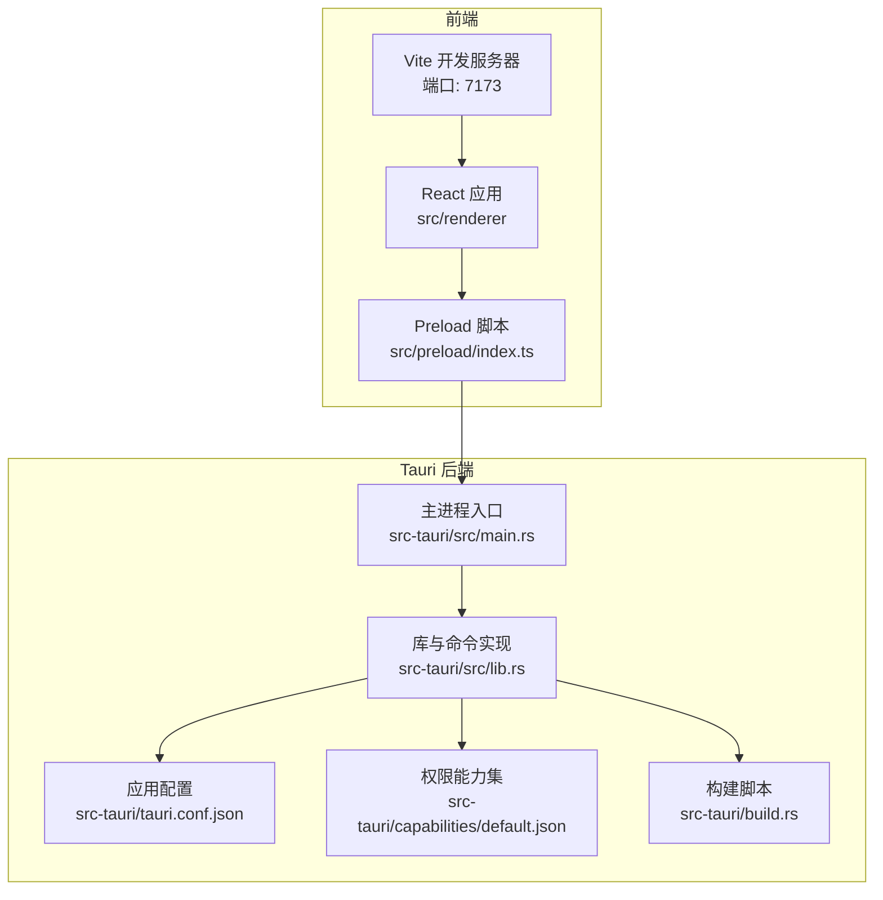
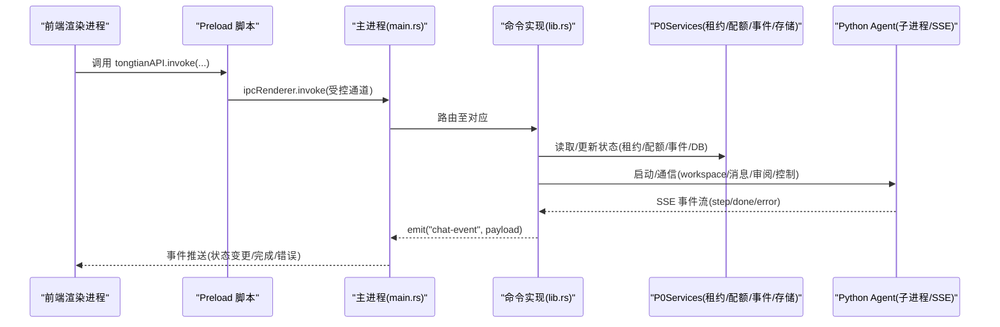
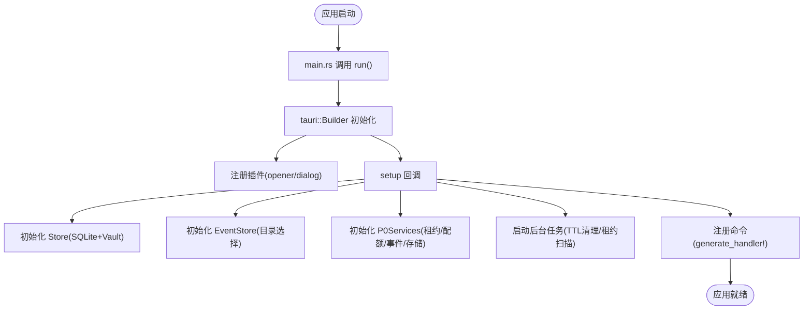
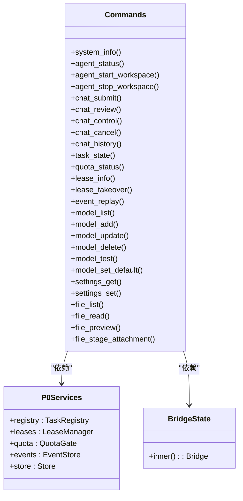
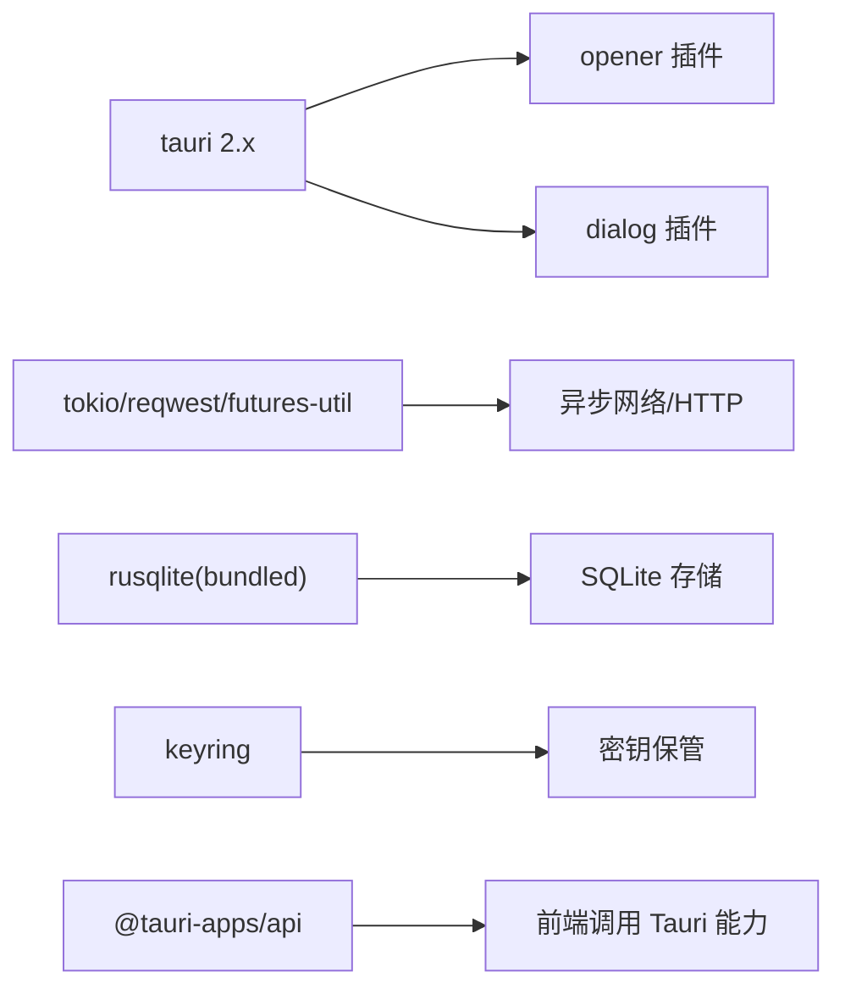

# Tauri 应用结构

<cite>
**本文引用的文件**   
- [tauri.conf.json](file://tongtian-tauri/src-tauri/tauri.conf.json)
- [main.rs](file://tongtian-tauri/src-tauri/src/main.rs)
- [lib.rs](file://tongtian-tauri/src-tauri/src/lib.rs)
- [Cargo.toml](file://tongtian-tauri/src-tauri/Cargo.toml)
- [build.rs](file://tongtian-tauri/src-tauri/build.rs)
- [default.json](file://tongtian-tauri/src-tauri/capabilities/default.json)
- [package.json](file://tongtian-tauri/package.json)
- [vite.config.ts](file://tongtian-tauri/vite.config.ts)
- [index.ts（Preload）](file://tongtian-tauri/src/preload/index.ts)
- [main.tsx（渲染入口）](file://tongtian-tauri/src/renderer/main.tsx)
- [bridge/mod.rs](file://tongtian-tauri/src-tauri/src/bridge/mod.rs)
- [store/mod.rs](file://tongtian-tauri/src-tauri/src/store/mod.rs)
</cite>

## 目录
1. [简介](#简介)
2. [项目结构](#项目结构)
3. [核心组件](#核心组件)
4. [架构总览](#架构总览)
5. [详细组件分析](#详细组件分析)
6. [依赖关系分析](#依赖关系分析)
7. [性能考量](#性能考量)
8. [故障排查指南](#故障排查指南)
9. [结论](#结论)
10. [附录：配置示例与最佳实践](#附录配置示例与最佳实践)

## 简介
本文件为通天办公项目的 Tauri 应用结构文档，面向基于 Rust + Tauri 的桌面应用。内容覆盖主进程初始化流程、插件系统配置、应用生命周期管理；重点解释 tauri.conf.json 的作用与各模块注册机制；说明应用启动顺序、资源加载策略、跨平台兼容性处理；并结合 Tauri 2.x 的新特性（如新的命令注册方式、状态管理模式等）给出完整配置示例与最佳实践。

## 项目结构
本项目采用前后端分离的 Tauri 工程组织：
- 前端（Vite + React）位于 src/renderer，构建产物输出到 dist，由 Tauri 打包进应用。
- 后端（Rust + Tauri）位于 src-tauri，通过 Cargo 管理依赖，使用 tauri.conf.json 描述应用元数据、窗口、安全能力与打包选项。
- Preload 脚本提供安全的 IPC 桥接，限制可调用通道，保障渲染进程与原生能力的隔离。

图表来源
- [tauri.conf.json:1-40](file://tongtian-tauri/src-tauri/tauri.conf.json#L1-L40)
- [main.rs:1-6](file://tongtian-tauri/src-tauri/src/main.rs#L1-L6)
- [lib.rs:746-873](file://tongtian-tauri/src-tauri/src/lib.rs#L746-L873)
- [default.json:1-8](file://tongtian-tauri/src-tauri/capabilities/default.json#L1-L8)
- [build.rs:1-4](file://tongtian-tauri/src-tauri/build.rs#L1-L4)
- [vite.config.ts:1-25](file://tongtian-tauri/vite.config.ts#L1-L25)
- [index.ts（Preload）:1-183](file://tongtian-tauri/src/preload/index.ts#L1-L183)

章节来源
- [tauri.conf.json:1-40](file://tongtian-tauri/src-tauri/tauri.conf.json#L1-L40)
- [package.json:1-45](file://tongtian-tauri/package.json#L1-L45)
- [vite.config.ts:1-25](file://tongtian-tauri/vite.config.ts#L1-L25)

## 核心组件
- 主进程入口 main.rs：最小化入口，直接调用库函数 run() 启动 Tauri 应用。
- 库与命令 lib.rs：集中定义所有 Tauri 命令（system_info、agent_*、chat_*、model_*、settings_*、file_* 等），并在 setup 中完成服务初始化、事件存储、租约扫描循环等。
- 能力与权限 default.json：声明默认权限集（core:default、opener:default、dialog:default），限定窗口与插件能力。
- 构建与依赖 Cargo.toml：声明 Tauri 2.x 依赖、插件、SQLite、密钥保管等。
- 前端与 Preload：Vite 构建前端，Preload 暴露受限 API 给渲染进程，严格白名单校验通道。

章节来源
- [main.rs:1-6](file://tongtian-tauri/src-tauri/src/main.rs#L1-L6)
- [lib.rs:1-873](file://tongtian-tauri/src-tauri/src/lib.rs#L1-L873)
- [default.json:1-8](file://tongtian-tauri/src-tauri/capabilities/default.json#L1-L8)
- [Cargo.toml:1-40](file://tongtian-tauri/src-tauri/Cargo.toml#L1-L40)
- [index.ts（Preload）:1-183](file://tongtian-tauri/src/preload/index.ts#L1-L183)

## 架构总览
Tauri 2.x 架构在本项目中体现为：
- 主进程通过 tauri::Builder 初始化，注册插件、注入全局状态、设置 invoke_handler。
- 命令以 #[tauri::command] 宏注册，统一在 generate_handler! 中批量注册。
- 状态管理通过 .manage() 注入 Arc<P0Services>、BridgeState 等共享状态，供各命令并发访问。
- 事件推送通过 app.emit() 将任务状态变更、错误、完成等事件推送到前端。
- 能力权限通过 capabilities/default.json 声明，配合 Tauri 2.x 的能力系统控制插件与核心 API 的使用范围。

图表来源
- [main.rs:1-6](file://tongtian-tauri/src-tauri/src/main.rs#L1-L6)
- [lib.rs:746-873](file://tongtian-tauri/src-tauri/src/lib.rs#L746-L873)
- [index.ts（Preload）:1-183](file://tongtian-tauri/src/preload/index.ts#L1-L183)

## 详细组件分析

### 应用启动顺序与生命周期
- 启动入口：main.rs 调用 tongtian_tauri_lib::run()。
- 初始化阶段（lib.rs 的 run）：
  - 创建并管理 Store（SQLite + Vault），失败时回退到临时目录保证可用性。
  - 初始化 EventStore（事件持久化目录优先 app data，回退当前目录）。
  - 初始化 P0Services（TaskRegistry、LeaseManager、QuotaGate、EventStore、Store）。
  - 启动后台任务：事件 TTL 清理、租约扫描循环。
  - 注册插件（opener、dialog）与所有命令（generate_handler!）。
- 窗口与前端：
  - tauri.conf.json 定义窗口尺寸、标题、是否可调整大小、居中。
  - build.devUrl 指向 Vite 开发服务器（http://localhost:7173），构建产物路径为 ../dist。

图表来源
- [main.rs:1-6](file://tongtian-tauri/src-tauri/src/main.rs#L1-L6)
- [lib.rs:746-873](file://tongtian-tauri/src-tauri/src/lib.rs#L746-L873)
- [tauri.conf.json:1-40](file://tongtian-tauri/src-tauri/tauri.conf.json#L1-L40)

章节来源
- [lib.rs:746-873](file://tongtian-tauri/src-tauri/src/lib.rs#L746-L873)
- [tauri.conf.json:1-40](file://tongtian-tauri/src-tauri/tauri.conf.json#L1-L40)

### 插件系统与权限能力
- 插件：
  - tauri-plugin-opener：打开外部链接或文件。
  - tauri-plugin-dialog：弹出系统对话框。
- 权限能力：
  - capabilities/default.json 声明 windows 与 permissions，包含 core:default、opener:default、dialog:default。
  - 通过 Tauri 2.x 的能力系统对窗口和插件进行细粒度授权。

章节来源
- [default.json:1-8](file://tongtian-tauri/src-tauri/capabilities/default.json#L1-L8)
- [Cargo.toml:21-34](file://tongtian-tauri/src-tauri/Cargo.toml#L21-L34)

### 命令注册与状态管理
- 命令注册：
  - 使用 #[tauri::command] 宏定义命令，如 system_info、agent_status、chat_submit、chat_review、chat_control、chat_cancel、chat_history、task_state、quota_status、lease_info、lease_takeover、event_replay、model_*、settings_*、file_*。
  - 通过 tauri::generate_handler![...] 批量注册。
- 状态管理：
  - 使用 tauri::State<'_, BridgeState> 与 State<'_, Arc<P0Services>> 注入共享状态。
  - P0Services 聚合任务注册表、租约管理器、配额闸门、事件存储、持久化存储。
  - 事件推送通过 app.emit(EVENT_CHAT, payload) 向渲染进程推送。

图表来源
- [lib.rs:35-873](file://tongtian-tauri/src-tauri/src/lib.rs#L35-L873)

章节来源
- [lib.rs:1-873](file://tongtian-tauri/src-tauri/src/lib.rs#L1-L873)

### 资源加载策略与跨平台兼容
- 资源加载：
  - 开发模式：devUrl 指向本地 Vite 服务器，便于热重载。
  - 构建模式：frontendDist 指定构建产物目录，打包时嵌入静态资源。
- 跨平台兼容：
  - tauri.conf.json 的 bundle.targets 设置为 all，支持多平台打包。
  - 图标资源包含 Windows、macOS、iOS、Android 等多平台图标。
  - 运行目录与事件目录优先使用系统应用数据目录，回退策略保证可用性。

章节来源
- [tauri.conf.json:1-40](file://tongtian-tauri/src-tauri/tauri.conf.json#L1-L40)
- [vite.config.ts:1-25](file://tongtian-tauri/vite.config.ts#L1-L25)

### 前端与 Preload 的安全桥接
- Preload 脚本通过 contextBridge.exposeInMainWorld 暴露 tongtianAPI，严格白名单校验允许调用的通道。
- 提供 invoke、send、on、removeListener、removeAllListeners 等方法，封装 IPC 调用与事件监听。
- 渲染进程通过 tongtianAPI 调用后端命令，避免直接访问底层 IPC。

章节来源
- [index.ts（Preload）:1-183](file://tongtian-tauri/src/preload/index.ts#L1-L183)
- [main.tsx（渲染入口）:1-25](file://tongtian-tauri/src/renderer/main.tsx#L1-L25)

### 存储与密钥管理
- Store 聚合 SQLite 连接与 Vault（keyring 密钥保管箱），提供 with_conn 短临界区访问。
- 运行目录可通过环境变量 TONGTIAN_HOME 覆盖，缺省使用系统应用数据目录。
- 数据库迁移幂等执行，确保多次启动不报错。

章节来源
- [store/mod.rs:1-105](file://tongtian-tauri/src-tauri/src/store/mod.rs#L1-L105)

### 桥接模块（Python Agent）
- bridge/mod.rs 组织 Python Agent 子进程管理与 HTTP/SSE 通信相关模块。
- 通过 agent_status、agent_start_workspace、agent_stop_workspace 等命令协调 Python 侧工作区实例的生命周期。

章节来源
- [bridge/mod.rs:1-7](file://tongtian-tauri/src-tauri/src/bridge/mod.rs#L1-L7)

## 依赖关系分析
- 后端依赖：
  - tauri 2.x 与插件（opener、dialog）。
  - tokio、reqwest、futures-util 用于异步与网络请求。
  - rusqlite（bundled）用于本地 SQLite 存储。
  - keyring 用于密钥保管。
  - uuid、serde、serde_json 用于 ID 生成与序列化。
- 前端依赖：
  - @tauri-apps/api、@tauri-apps/plugin-dialog 用于调用 Tauri 能力。
  - React、Zustand、TailwindCSS 等 UI 与状态管理。

图表来源
- [Cargo.toml:21-34](file://tongtian-tauri/src-tauri/Cargo.toml#L21-L34)
- [package.json:15-43](file://tongtian-tauri/package.json#L15-L43)

章节来源
- [Cargo.toml:1-40](file://tongtian-tauri/src-tauri/Cargo.toml#L1-L40)
- [package.json:1-45](file://tongtian-tauri/package.json#L1-L45)

## 性能考量
- 异步与并发：
  - 使用 tokio 运行时与 async/await 提升 I/O 密集型操作效率。
  - 后台任务（事件 TTL 清理、租约扫描）独立运行，避免阻塞主线程。
- 存储优化：
  - SQLite 使用 bundled 版本减少依赖复杂度。
  - 短临界区访问数据库，降低锁竞争。
- 事件持久化：
  - EventStore 支持批量刷盘与 TTL 清理，平衡性能与可靠性。
- 构建优化：
  - release profile 启用 LTO、strip、opt-level=s，减小二进制体积。

[本节为通用指导，无需特定文件引用]

## 故障排查指南
- 启动失败：
  - 检查 tauri.conf.json 的 devUrl 与 frontendDist 是否正确。
  - 确认 Vite 开发服务器端口（7173）未被占用。
- 命令未生效：
  - 确认 #[tauri::command] 已在 generate_handler! 中注册。
  - 检查 Preload 白名单是否包含对应通道。
- 存储问题：
  - 查看 Store 初始化日志，确认运行目录与数据库文件存在。
  - 检查迁移是否成功执行。
- 事件丢失：
  - 检查 EventStore 目录权限与 TTL 清理逻辑。
  - 确认事件重放接口 event_replay 的参数 from_seq 正确。

章节来源
- [lib.rs:746-873](file://tongtian-tauri/src-tauri/src/lib.rs#L746-L873)
- [store/mod.rs:1-105](file://tongtian-tauri/src-tauri/src/store/mod.rs#L1-L105)
- [index.ts（Preload）:1-183](file://tongtian-tauri/src/preload/index.ts#L1-L183)

## 结论
本项目基于 Tauri 2.x 构建了稳健的桌面应用架构，通过清晰的模块化设计、严格的权限控制与完善的错误处理，实现了前后端高效协作。命令注册、状态管理、事件推送与存储方案均符合现代桌面应用的最佳实践，具备良好的可扩展性与跨平台兼容性。

[本节为总结性内容，无需特定文件引用]

## 附录：配置示例与最佳实践

### tauri.conf.json 关键项说明
- productName、version、identifier：应用标识与版本信息。
- build：
  - beforeDevCommand：开发前命令（npm run dev）。
  - devUrl：开发服务器地址（http://localhost:7173）。
  - beforeBuildCommand：构建前命令（npm run build）。
  - frontendDist：前端构建产物目录（../dist）。
- app.windows：窗口配置（标题、尺寸、最小尺寸、可调整大小、居中）。
- app.security.csp：CSP 策略（示例中为 null）。
- bundle：
  - active：启用打包。
  - targets：目标平台（all）。
  - icon：多平台图标资源。

章节来源
- [tauri.conf.json:1-40](file://tongtian-tauri/src-tauri/tauri.conf.json#L1-L40)

### 命令注册最佳实践
- 使用 #[tauri::command] 宏定义命令，保持签名清晰。
- 通过 tauri::generate_handler! 批量注册，避免遗漏。
- 使用 State 注入共享状态，避免全局变量。

章节来源
- [lib.rs:1-873](file://tongtian-tauri/src-tauri/src/lib.rs#L1-L873)

### 状态管理最佳实践
- 使用 Arc 包装共享状态，确保线程安全。
- 将复杂状态拆分为多个 Service（如 P0Services），提高内聚性。
- 通过 app.emit 推送事件，保持前端与后端状态同步。

章节来源
- [lib.rs:35-873](file://tongtian-tauri/src-tauri/src/lib.rs#L35-L873)

### 资源加载与跨平台最佳实践
- 开发时使用 devUrl 指向本地服务器，便于调试。
- 构建时指定 frontendDist，确保资源正确打包。
- 使用多平台图标与 targets=all，提升跨平台兼容性。

章节来源
- [tauri.conf.json:1-40](file://tongtian-tauri/src-tauri/tauri.conf.json#L1-L40)
- [vite.config.ts:1-25](file://tongtian-tauri/vite.config.ts#L1-L25)

### Preload 安全最佳实践
- 严格白名单校验通道，避免任意 IPC 调用。
- 提供统一的 API 封装，简化前端调用。
- 及时移除事件监听器，防止内存泄漏。

章节来源
- [index.ts（Preload）:1-183](file://tongtian-tauri/src/preload/index.ts#L1-L183)