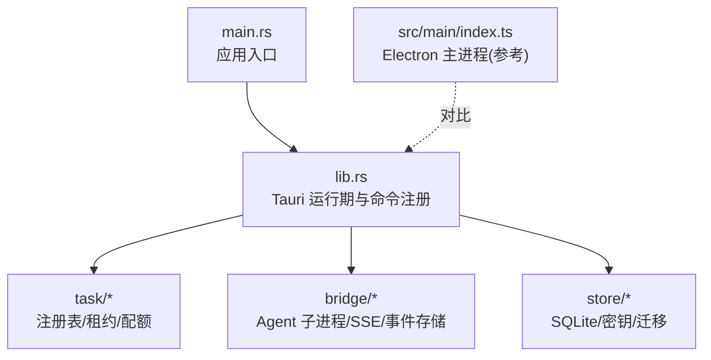
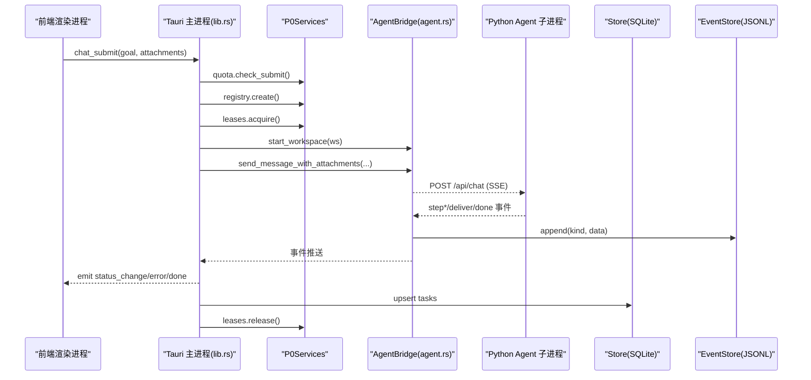
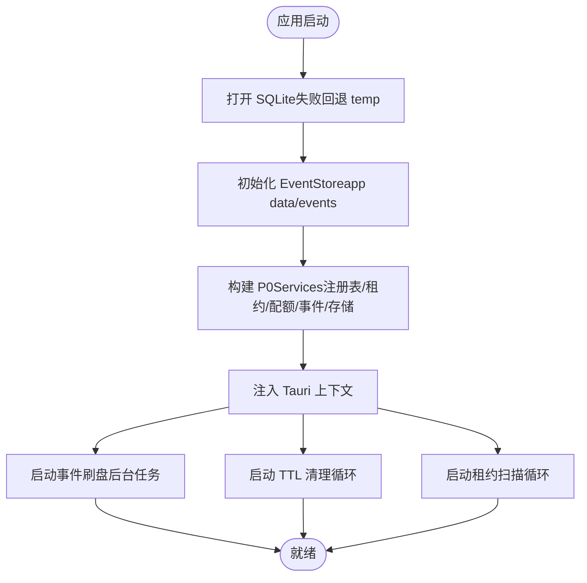
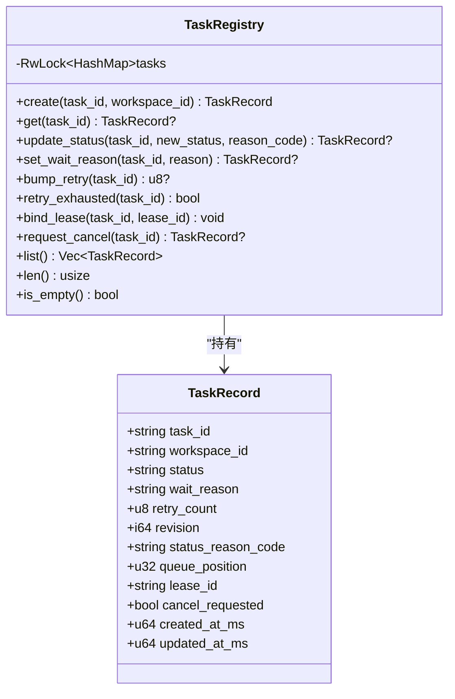
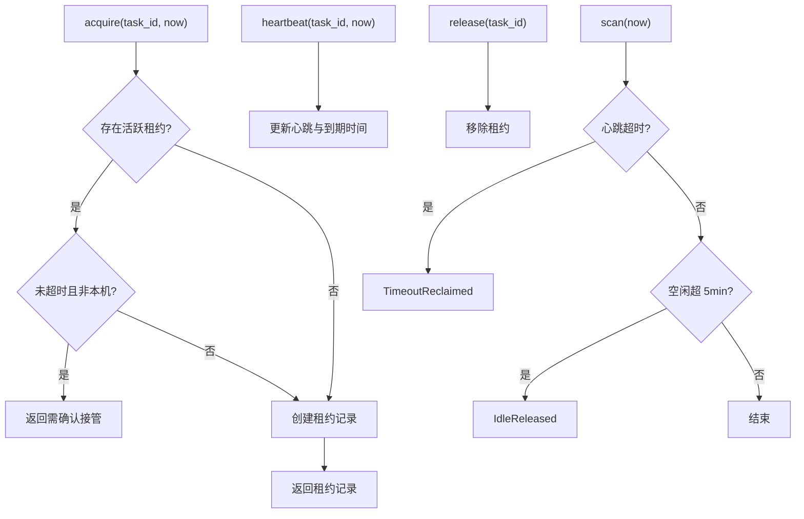
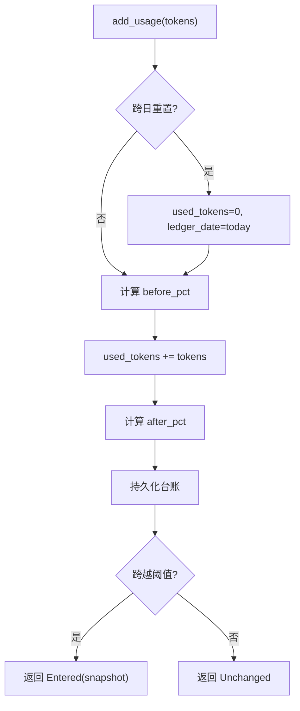
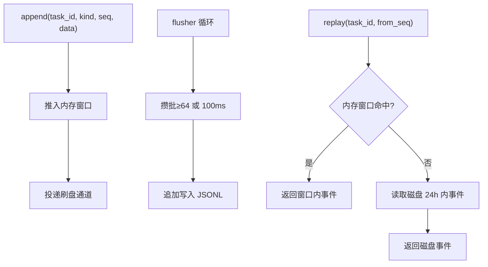
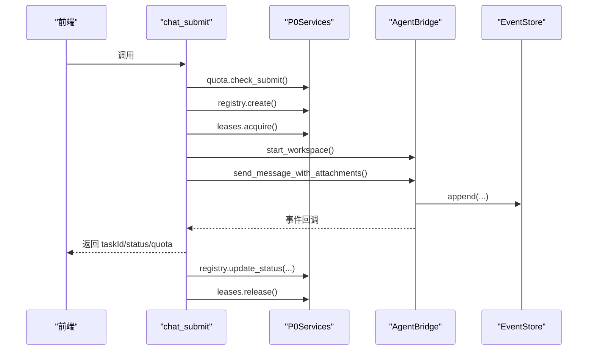
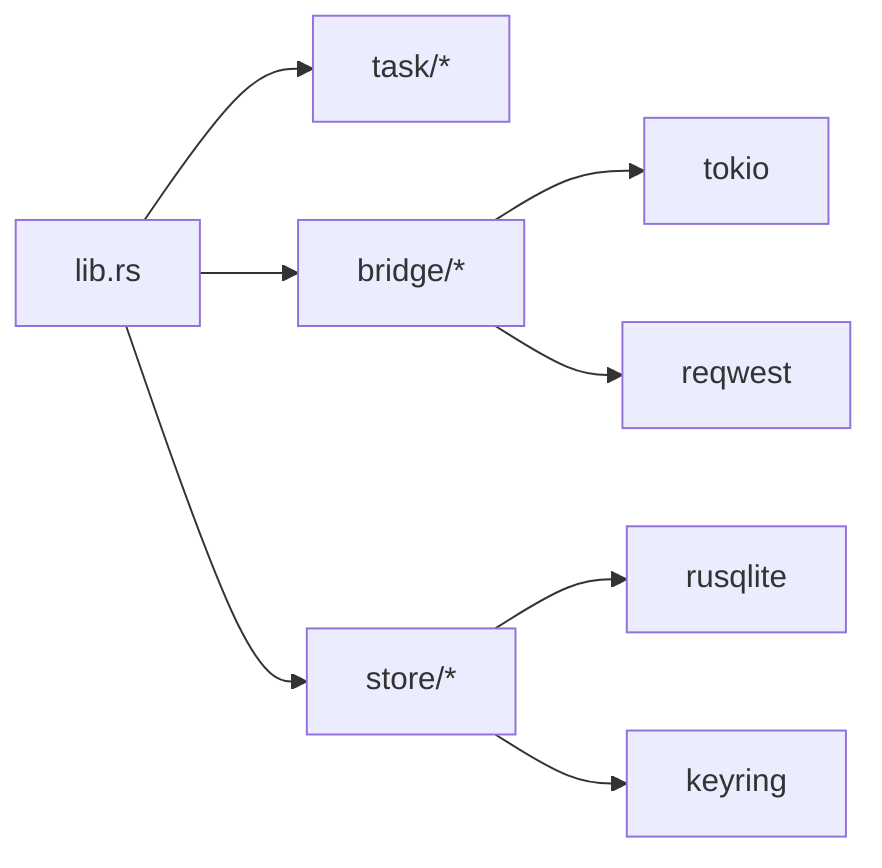

# 后端架构

<cite>
**本文引用的文件**   
- [main.rs](file://tongtian-tauri/src-tauri/src/main.rs)
- [lib.rs](file://tongtian-tauri/src-tauri/src/lib.rs)
- [Cargo.toml](file://tongtian-tauri/src-tauri/Cargo.toml)
- [task/mod.rs](file://tongtian-tauri/src-tauri/src/task/mod.rs)
- [task/registry.rs](file://tongtian-tauri/src-tauri/src/task/registry.rs)
- [task/quota.rs](file://tongtian-tauri/src-tauri/src/task/quota.rs)
- [task/lease.rs](file://tongtian-tauri/src-tauri/src/task/lease.rs)
- [bridge/mod.rs](file://tongtian-tauri/src-tauri/src/bridge/mod.rs)
- [bridge/agent.rs](file://tongtian-tauri/src-tauri/src/bridge/agent.rs)
- [bridge/event_store.rs](file://tongtian-tauri/src-tauri/src/bridge/event_store.rs)
- [store/mod.rs](file://tongtian-tauri/src-tauri/src/store/mod.rs)
</cite>

## 目录
1. [简介](#简介)
2. [项目结构](#项目结构)
3. [核心组件](#核心组件)
4. [架构总览](#架构总览)
5. [详细组件分析](#详细组件分析)
6. [依赖关系分析](#依赖关系分析)
7. [性能与并发](#性能与并发)
8. [故障排查指南](#故障排查指南)
9. [结论](#结论)

## 简介
本文件面向通天办公项目的后端架构，聚焦基于 Rust + Tauri 的实现。文档围绕主进程与渲染进程的分离、Tauri Command 注册机制、服务生命周期管理展开，重点阐述 P0Services 核心服务集合（任务注册表、租约管理器、配额闸门、事件存储、持久化存储）的职责划分与协作方式。同时给出系统启动流程与服务依赖图，并总结异步处理、错误处理、内存与资源清理等关键技术点。

## 项目结构
- 入口与运行时
  - main.rs：Rust 应用入口，调用库函数 run() 启动 Tauri 应用。
  - lib.rs：Tauri 后端核心，定义 P0Services、Command 实现、服务初始化与后台循环。
  - Cargo.toml：依赖与特性开关（如 SSE seq 能力）。
- 业务模块
  - task：任务状态机常量、任务注册表、租约管理、配额闸门。
  - bridge：Python Agent 子进程管理、SSE 通信、事件存储。
  - store：SQLite 持久化、密钥保管箱、迁移。
- 前端交互
  - src/main/index.ts：Electron 主进程（用于对比/兼容），Tauri 版本通过 tauri.conf.json 加载渲染进程。

**图表来源** 
- [main.rs:1-6](file://tongtian-tauri/src-tauri/src/main.rs#L1-L6)
- [lib.rs:747-824](file://tongtian-tauri/src-tauri/src/lib.rs#L747-L824)
- [Cargo.toml:1-40](file://tongtian-tauri/src-tauri/Cargo.toml#L1-L40)

**章节来源**
- [main.rs:1-6](file://tongtian-tauri/src-tauri/src/main.rs#L1-L6)
- [lib.rs:747-824](file://tongtian-tauri/src-tauri/src/lib.rs#L747-L824)
- [Cargo.toml:1-40](file://tongtian-tauri/src-tauri/Cargo.toml#L1-L40)

## 核心组件
- P0Services：聚合核心服务（TaskRegistry、LeaseManager、QuotaGate、EventStore、Store），作为全局共享状态注入 Tauri 上下文。
- TaskRegistry：维护任务记录与状态转移，提供创建、更新、重试计数、取消标记、租约绑定等操作。
- LeaseManager：签发/心跳/释放/接管租约，单 interval 扫描超时与空闲回收。
- QuotaGate：四档阈值（70/85/95/100%）的配额闸门，支持本地台账持久化与云端来源扩展。
- EventStore：事件追加写 JSONL、内存重放窗口、异步批量刷盘、24h TTL 清理。
- Store：SQLite 连接封装、密钥保管箱、迁移执行。

**章节来源**
- [lib.rs:35-42](file://tongtian-tauri/src-tauri/src/lib.rs#L35-L42)
- [task/registry.rs:1-259](file://tongtian-tauri/src-tauri/src/task/registry.rs#L1-L259)
- [task/lease.rs:1-200](file://tongtian-tauri/src-tauri/src/task/lease.rs#L1-L200)
- [task/quota.rs:1-300](file://tongtian-tauri/src-tauri/src/task/quota.rs#L1-L300)
- [bridge/event_store.rs:1-200](file://tongtian-tauri/src-tauri/src/bridge/event_store.rs#L1-L200)
- [store/mod.rs:1-105](file://tongtian-tauri/src-tauri/src/store/mod.rs#L1-L105)

## 架构总览
- 进程模型
  - Rust/Tauri 主进程：承载所有 Command、服务与后台任务。
  - Python Agent 子进程：每个 workspace 独立进程，暴露 HTTP/SSE 接口。
  - 渲染进程：前端 UI，通过 Tauri Command 与主进程交互。
- 控制流
  - 前端调用 Tauri Command → 主进程校验/落库/调度 → 通过 bridge 与 Agent 子进程通信 → 事件经 event_store 持久化并推送至前端。

**图表来源** 
- [lib.rs:127-237](file://tongtian-tauri/src-tauri/src/lib.rs#L127-L237)
- [bridge/agent.rs:119-200](file://tongtian-tauri/src-tauri/src/bridge/agent.rs#L119-L200)
- [bridge/event_store.rs:116-131](file://tongtian-tauri/src-tauri/src/bridge/event_store.rs#L116-L131)
- [store/mod.rs:24-52](file://tongtian-tauri/src-tauri/src/store/mod.rs#L24-L52)

## 详细组件分析

### P0Services 与服务生命周期
- 初始化顺序
  - 打开 SQLite（失败回退 temp），构造 EventStore（优先 app data 目录），组装 P0Services 并 manage 到 Tauri 上下文。
  - 启动事件刷盘后台任务与 TTL 清理循环；启动租约扫描循环。
- 生命周期要点
  - 事件刷盘：后台任务按批次或时间阈值 flush，退出前兜底刷新。
  - 租约扫描：单 interval 驱动，超时回收触发 executing→queued 并广播 LEASE_LOST。
  - 存储回退：DB 初始化失败时自动回退临时目录，保证可用性。

**图表来源** 
- [lib.rs:747-793](file://tongtian-tauri/src-tauri/src/lib.rs#L747-L793)
- [bridge/event_store.rs:162-198](file://tongtian-tauri/src-tauri/src/bridge/event_store.rs#L162-L198)
- [lib.rs:834-873](file://tongtian-tauri/src-tauri/src/lib.rs#L834-L873)

**章节来源**
- [lib.rs:747-824](file://tongtian-tauri/src-tauri/src/lib.rs#L747-L824)
- [bridge/event_store.rs:162-198](file://tongtian-tauri/src-tauri/src/bridge/event_store.rs#L162-L198)
- [lib.rs:834-873](file://tongtian-tauri/src-tauri/src/lib.rs#L834-L873)

### 任务注册表（TaskRegistry）
- 职责
  - 任务创建进入 queued；状态更新带 revision 单调递增；wait_reason 在离开 executing 时清空；重试计数上限；取消请求幂等；绑定租约。
- 并发与一致性
  - RwLock 保护 HashMap；update_status 由调用方负责状态转移合法性（权威表在前端契约中镜像）。
- 复杂度
  - 操作均为 O(1) 哈希访问；list/len/is_empty 为 O(n)。

**图表来源** 
- [task/registry.rs:12-183](file://tongtian-tauri/src-tauri/src/task/registry.rs#L12-L183)

**章节来源**
- [task/registry.rs:1-259](file://tongtian-tauri/src-tauri/src/task/registry.rs#L1-L259)

### 租约管理器（LeaseManager）
- 职责
  - 签发/心跳/释放/接管；禁止抢占；单 interval 扫描超时回收与空闲释放。
- 关键参数
  - 心跳间隔 10s、租约有效期 30s、超时回收 60s、空闲释放 5min、扫描间隔 10s。
- 并发与性能
  - Mutex 保护 HashMap；scan 为 O(n)，桌面级任务规模可忽略。

**图表来源** 
- [task/lease.rs:83-184](file://tongtian-tauri/src-tauri/src/task/lease.rs#L83-L184)

**章节来源**
- [task/lease.rs:1-200](file://tongtian-tauri/src-tauri/src/task/lease.rs#L1-L200)

### 配额闸门（QuotaGate）
- 职责
  - 四档阈值评估（70/85/95/100%），新提交阻断（100%）、排队（≥95%）、降级（≥85%）、通知（≥70%）。
  - 累计用量并输出档位跃迁事件（去抖），跨日重置，本地 JSON 台账持久化。
- 扩展性
  - RemoteQuotaSource trait 预留云端来源接入。

**图表来源** 
- [task/quota.rs:158-220](file://tongtian-tauri/src-tauri/src/task/quota.rs#L158-L220)

**章节来源**
- [task/quota.rs:1-300](file://tongtian-tauri/src-tauri/src/task/quota.rs#L1-L300)

### 事件存储（EventStore）
- 职责
  - 追加写内存窗口（双上限：条数+时间），异步批量刷盘 JSONL，24h TTL 清理，断线重放。
- 性能策略
  - 批量大小 64 条或 100ms 超时即 flush；通道满不阻塞事件流；单任务文件上限 10MB 滚动。

**图表来源** 
- [bridge/event_store.rs:116-160](file://tongtian-tauri/src-tauri/src/bridge/event_store.rs#L116-L160)
- [bridge/event_store.rs:162-198](file://tongtian-tauri/src-tauri/src/bridge/event_store.rs#L162-L198)

**章节来源**
- [bridge/event_store.rs:1-200](file://tongtian-tauri/src-tauri/src/bridge/event_store.rs#L1-L200)

### Tauri Command 实现模式与异步处理
- 模式
  - 使用 #[tauri::command] 宏声明命令；通过 State<'_, Arc<P0Services>> 获取共享服务；AppHandle 用于事件推送。
  - 长耗时逻辑通过 tauri::async_runtime::spawn 后台执行，避免阻塞命令响应。
- 错误处理
  - 统一返回 Result<Value, String>，错误码语义明确（如 QUOTA_EXCEEDED、TASK_ALREADY_RUNNING、BRIDGE_ERROR）。
  - 状态变更通过 app.emit 推送 status_change/error/done 事件，确保前端一致视图。

**图表来源** 
- [lib.rs:127-237](file://tongtian-tauri/src-tauri/src/lib.rs#L127-L237)

**章节来源**
- [lib.rs:127-237](file://tongtian-tauri/src-tauri/src/lib.rs#L127-L237)

### 存储与密钥（Store）
- 职责
  - SQLite 连接封装、迁移执行、密钥保管箱（API Key 不落库）。
- 设计要点
  - with_conn 短临界区持锁；TONGTIAN_HOME 环境变量覆盖运行目录；首次打开执行迁移，二次打开幂等。

**章节来源**
- [store/mod.rs:1-105](file://tongtian-tauri/src-tauri/src/store/mod.rs#L1-L105)

## 依赖关系分析
- 模块耦合
  - lib.rs 依赖 task/*、bridge/*、store/*；P0Services 聚合各服务。
  - bridge/agent.rs 依赖 reqwest/tokio/futures-util 进行 HTTP/SSE 通信。
  - task/* 内部低耦合，仅通过状态常量与数据结构交互。
- 外部依赖
  - tauri、rusqlite、keyring、tokio、reqwest、futures-util。

**图表来源** 
- [Cargo.toml:21-33](file://tongtian-tauri/src-tauri/Cargo.toml#L21-L33)
- [lib.rs:17-33](file://tongtian-tauri/src-tauri/src/lib.rs#L17-L33)

**章节来源**
- [Cargo.toml:1-40](file://tongtian-tauri/src-tauri/Cargo.toml#L1-L40)
- [lib.rs:17-33](file://tongtian-tauri/src-tauri/src/lib.rs#L17-L33)

## 性能与并发
- 并发模型
  - tokio 异步运行时；命令后台 spawn 执行；事件刷盘独立任务；租约扫描单 interval。
- 内存管理
  - EventStore 内存窗口双上限防膨胀；JSONL 文件容量上限滚动；配额台账本地持久化。
- I/O 优化
  - 异步批量刷盘（64 条或 100ms）；HTTP client 复用；SQLite 短临界区。
- 资源清理
  - 应用退出前 flusher 兜底刷盘；租约释放；子进程 stdout/stderr 泵出日志。

[本节为通用指导，无需特定文件引用]

## 故障排查指南
- 常见问题定位
  - 配额阻断：检查 quota_status 快照与 add_usage 累计；确认 100% 档阻断行为。
  - 租约丢失：观察 lease_info 与 LEASE_LOST 事件；确认心跳与超时回收阈值。
  - 事件缺失：event_replay 从 from_seq 补齐；检查内存窗口与磁盘 24h TTL。
  - 存储异常：查看 Store 初始化回退日志；确认 TONGTIAN_HOME 路径权限。
- 错误码参考
  - QUOTA_EXCEEDED、TASK_ALREADY_RUNNING、BRIDGE_ERROR、LEASE_LOST、VALIDATION_ERROR。

**章节来源**
- [task/quota.rs:191-220](file://tongtian-tauri/src-tauri/src/task/quota.rs#L191-L220)
- [task/lease.rs:160-184](file://tongtian-tauri/src-tauri/src/task/lease.rs#L160-L184)
- [bridge/event_store.rs:133-160](file://tongtian-tauri/src-tauri/src/bridge/event_store.rs#L133-L160)
- [store/mod.rs:24-52](file://tongtian-tauri/src-tauri/src/store/mod.rs#L24-L52)

## 结论
本项目以 Rust + Tauri 为核心，采用清晰的三层架构演进思路：通过 P0Services 聚合任务注册表、租约管理、配额闸门、事件存储与持久化存储，形成稳定可靠的后端基座。Command 层以异步后台任务与事件驱动实现高吞吐与低延迟；EventStore 与 Store 保障数据一致性与可恢复性；LeaseManager 与 QuotaGate 提供强一致的资源控制与预算治理。整体设计兼顾性能、可观测性与可扩展性，适合桌面端 AI 工作助手场景。