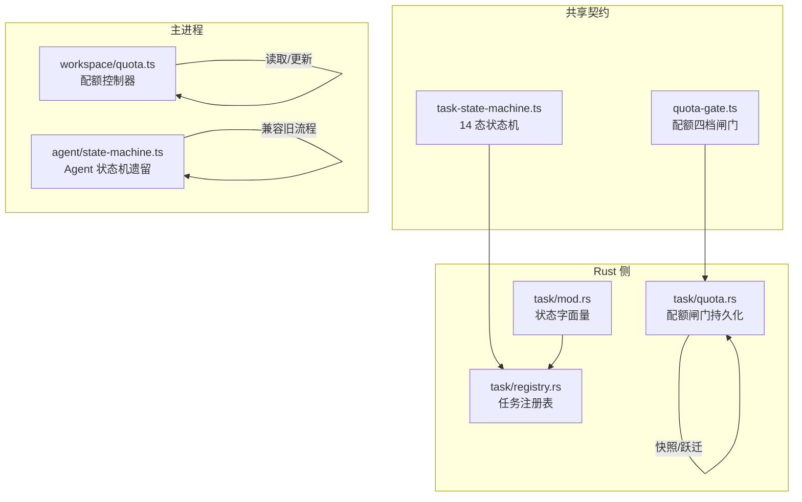
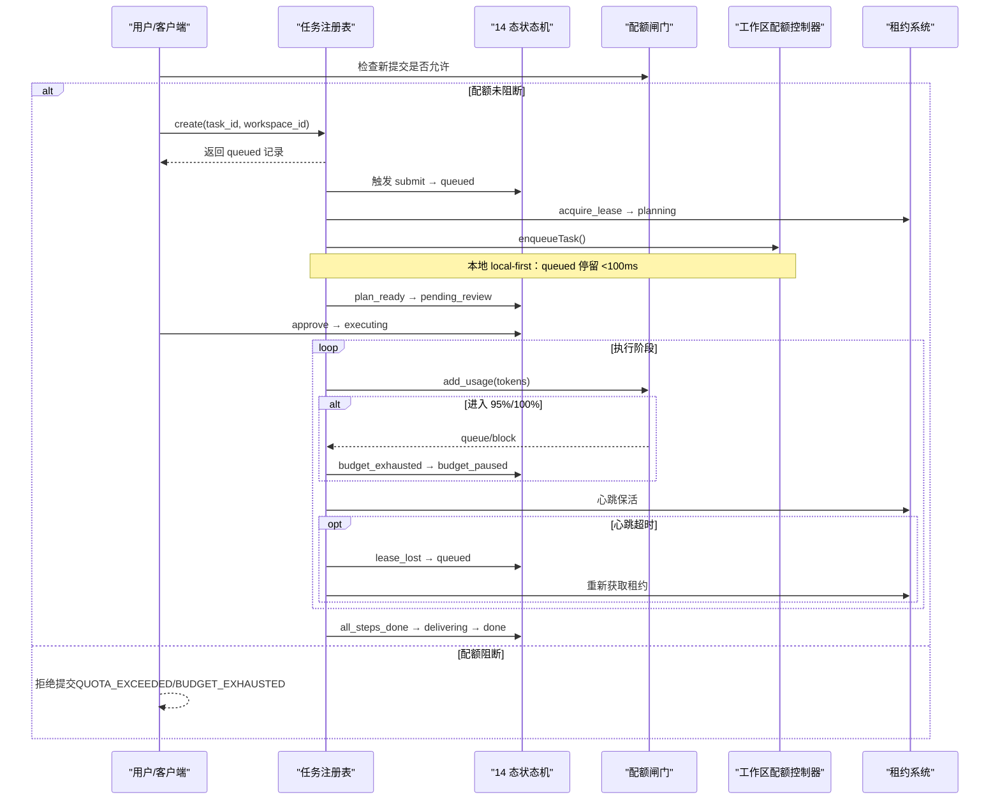
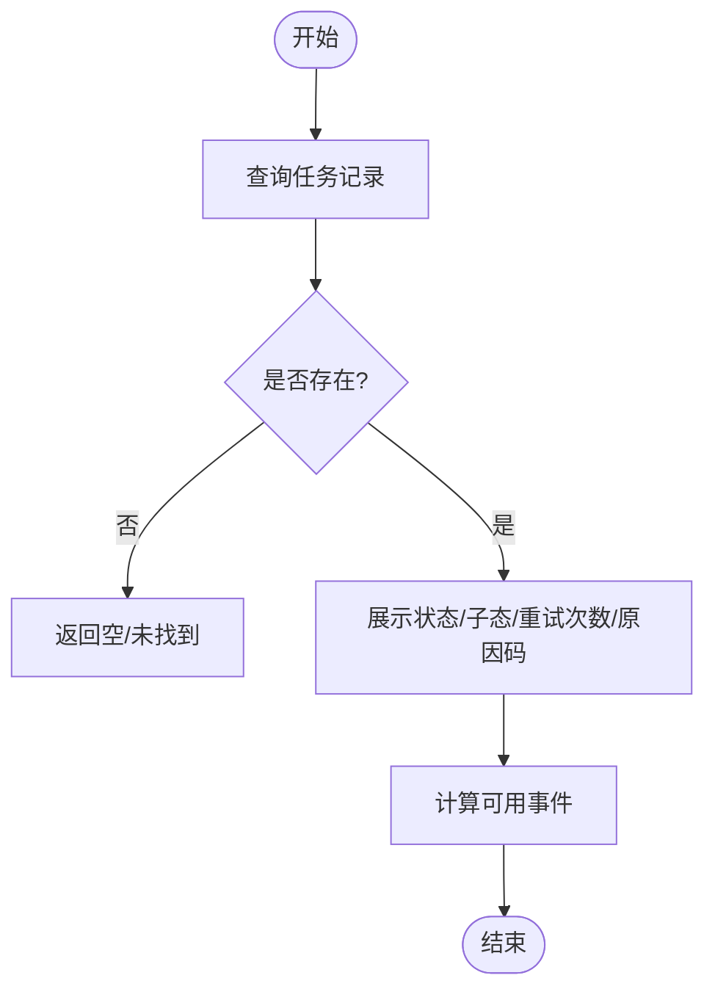
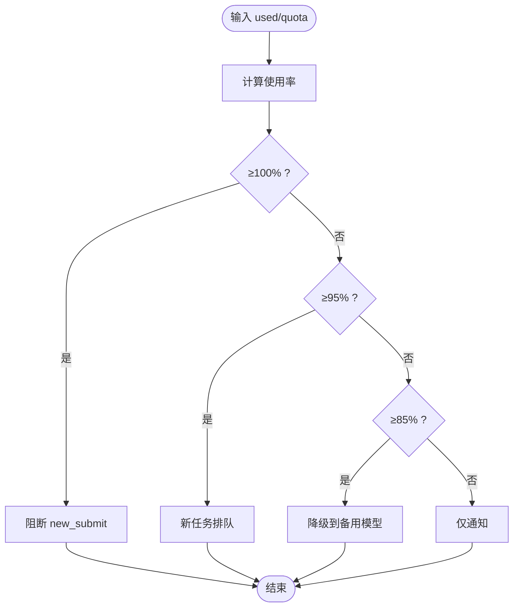
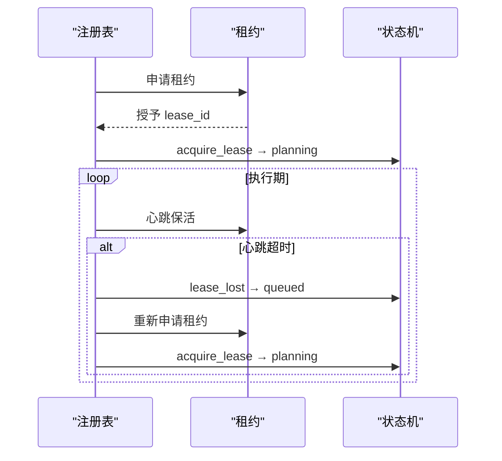
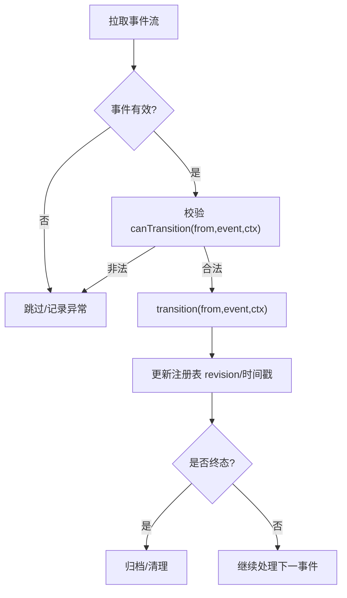
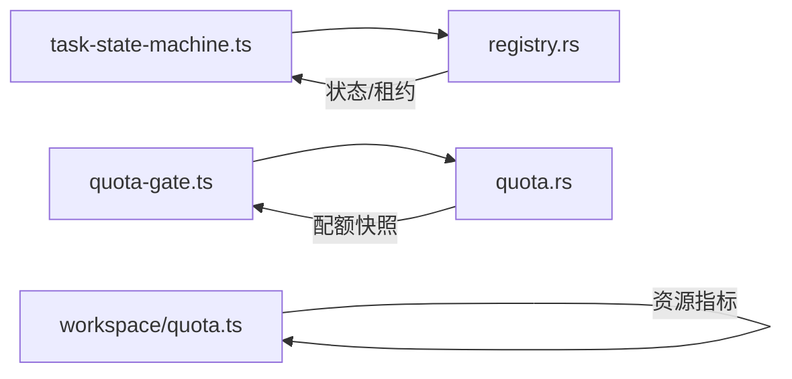

# 任务管理命令

<cite>
**本文引用的文件**
- [task-state-machine.ts](file://tongtian-tauri/src/shared/task-state-machine.ts)
- [state-machine.ts](file://tongtian-tauri/src/main/agent/state-machine.ts)
- [quota-gate.ts](file://tongtian-tauri/src/shared/quota-gate.ts)
- [quota.rs](file://tongtian-tauri/src-tauri/src/task/quota.rs)
- [registry.rs](file://tongtian-tauri/src-tauri/src/task/registry.rs)
- [mod.rs](file://tongtian-tauri/src-tauri/src/task/mod.rs)
- [quota.ts](file://tongtian-tauri/src/main/workspace/quota.ts)
</cite>

## 目录
1. [简介](#简介)
2. [项目结构](#项目结构)
3. [核心组件](#核心组件)
4. [架构总览](#架构总览)
5. [详细组件分析](#详细组件分析)
6. [依赖关系分析](#依赖关系分析)
7. [性能考虑](#性能考虑)
8. [故障诊断指南](#故障诊断指南)
9. [结论](#结论)
10. [附录：API 使用示例与监控方案](#附录api-使用示例与监控方案)

## 简介
本文件面向通天办公项目的“任务管理命令”，围绕以下能力进行系统化说明：
- 任务状态查询（task_state）：基于 14 态状态机，覆盖创建、排队、规划、审阅、执行、交付、归档等全生命周期。
- 配额监控（quota_status）：四档预警闸门（70/85/95/100%），动作链为降级→排队→阻断，并联动错误码。
- 租约管理（lease_info / lease_takeover）：执行期租约绑定、心跳超时恢复、抢占保护与回滚续跑。
- 事件重放（event_replay）：以状态转移表与注册表记录为依据的幂等回放，支持从断点恢复。
同时涵盖性能监控、资源调度、故障诊断与可观测性建议，并提供 API 使用示例与监控方案。

## 项目结构
本项目在 Tauri 工程内采用“共享契约 + 多端镜像”的方式组织任务管理能力：
- 共享层（TypeScript）：定义 14 态状态机、配额闸门纯函数、类型契约，供渲染层与 Rust 侧共同消费。
- 主进程（TypeScript）：工作区维度的配额控制器，负责步骤并发、队列深度、内存使用等本地资源管控。
- Rust 侧（src-tauri）：实现配额台账持久化、任务注册表、状态字面量对齐，提供可靠的本地治理能力。



图表来源
- [task-state-machine.ts:1-223](file://tongtian-tauri/src/shared/task-state-machine.ts#L1-L223)
- [quota-gate.ts:1-81](file://tongtian-tauri/src/shared/quota-gate.ts#L1-L81)
- [quota.ts:1-265](file://tongtian-tauri/src/main/workspace/quota.ts#L1-L265)
- [state-machine.ts:1-161](file://tongtian-tauri/src/main/agent/state-machine.ts#L1-L161)
- [mod.rs:1-24](file://tongtian-tauri/src-tauri/src/task/mod.rs#L1-L24)
- [registry.rs:1-259](file://tongtian-tauri/src-tauri/src/task/registry.rs#L1-L259)
- [quota.rs:1-300](file://tongtian-tauri/src-tauri/src/task/quota.rs#L1-L300)

章节来源
- [task-state-machine.ts:1-223](file://tongtian-tauri/src/shared/task-state-machine.ts#L1-L223)
- [quota-gate.ts:1-81](file://tongtian-tauri/src/shared/quota-gate.ts#L1-L81)
- [quota.ts:1-265](file://tongtian-tauri/src/main/workspace/quota.ts#L1-L265)
- [state-machine.ts:1-161](file://tongtian-tauri/src/main/agent/state-machine.ts#L1-L161)
- [mod.rs:1-24](file://tongtian-tauri/src-tauri/src/task/mod.rs#L1-L24)
- [registry.rs:1-259](file://tongtian-tauri/src-tauri/src/task/registry.rs#L1-L259)
- [quota.rs:1-300](file://tongtian-tauri/src-tauri/src/task/quota.rs#L1-L300)

## 核心组件
- 14 态任务状态机：集中定义 35 条合法转移、终态集合、重试上限、wait_reason 子态、可用事件查询等，保证前端、后端与测试共用同一份规则。
- 配额四档闸门：纯函数计算使用率，判定当前档位与动作；Rust 侧镜像实现并持久化台账，跨日重置。
- 任务注册表：维护任务记录（含 wait_reason、retry_count、revision、status_reason_code、lease_id 等），提供创建、状态更新、重试计数、租约绑定、取消请求等原子操作。
- 工作区配额控制器：按工作区维度跟踪步骤并发、模型调用并发、队列深度与内存使用，输出告警与准入判断。

章节来源
- [task-state-machine.ts:1-223](file://tongtian-tauri/src/shared/task-state-machine.ts#L1-L223)
- [quota-gate.ts:1-81](file://tongtian-tauri/src/shared/quota-gate.ts#L1-L81)
- [registry.rs:1-259](file://tongtian-tauri/src-tauri/src/task/registry.rs#L1-L259)
- [quota.ts:1-265](file://tongtian-tauri/src/main/workspace/quota.ts#L1-L265)

## 架构总览
下图展示任务从提交到归档的关键路径，以及配额闸门与租约管理的介入点。



图表来源
- [task-state-machine.ts:63-133](file://tongtian-tauri/src/shared/task-state-machine.ts#L63-L133)
- [quota-gate.ts:37-54](file://tongtian-tauri/src/shared/quota-gate.ts#L37-L54)
- [quota.rs:158-206](file://tongtian-tauri/src-tauri/src/task/quota.rs#L158-L206)
- [registry.rs:68-154](file://tongtian-tauri/src-tauri/src/task/registry.rs#L68-L154)
- [quota.ts:154-173](file://tongtian-tauri/src/main/workspace/quota.ts#L154-L173)

## 详细组件分析

### 任务状态查询（task_state）
- 能力要点
  - 查询任务当前状态、wait_reason、retry_count、status_reason_code、lease_id、revision、时间戳等。
  - 基于 14 态状态机的 canTransition/availableEvents 校验与推导 UI 可操作项。
  - 通过注册表的 list/get/update_status/set_wait_reason/bump_retry 等方法完成查询与变更。
- 关键流程
  - 创建任务：create → queued（本地快速出队）。
  - 获取租约：acquire_lease → planning。
  - 计划就绪：plan_ready → pending_review。
  - 审批执行：approve → executing；失败或预算耗尽走 retry_pending/budget_paused。
  - 交付完成：deliver_done → done；最终 archive → archived。
- 典型查询场景
  - 列表视图：list → 过滤终态（CANCELLED/ARCHIVED）或活跃任务。
  - 详情视图：get → 结合 availableEvents 渲染按钮。
  - 等待原因：set_wait_reason 用于 executing 子态标注（如 rate_limited/circuit_break/quota_wait）。



图表来源
- [registry.rs:92-173](file://tongtian-tauri/src-tauri/src/task/registry.rs#L92-L173)
- [task-state-machine.ts:165-222](file://tongtian-tauri/src/shared/task-state-machine.ts#L165-L222)

章节来源
- [registry.rs:68-173](file://tongtian-tauri/src-tauri/src/task/registry.rs#L68-L173)
- [task-state-machine.ts:165-222](file://tongtian-tauri/src/shared/task-state-machine.ts#L165-L222)

### 配额监控（quota_status）
- 能力要点
  - 四档阈值：70%（通知）、85%（降级）、95%（排队）、100%（阻断）。
  - 动作链语义：降级→排队→阻断；100% 时新提交返回 QUOTA_EXCEEDED，运行中任务转 budget_paused。
  - 本地台账持久化：JSON 存储 used_tokens/quota_tokens/ledger_date，跨日重置。
  - 工作区维度：步骤并发、模型调用并发、队列深度、内存使用告警。
- 关键接口
  - evaluateQuota/usagePercent：计算使用率与档位。
  - shouldQueue/shouldBlock：决策新任务排队/阻断。
  - QuotaGate.add_usage：累计用量并返回档位跃迁事件（去抖）。
  - QuotaController.getStatus：聚合 limits/usage/warnings。
- 错误码联动
  - 新提交阻断：QUOTA_EXCEEDED。
  - 运行中转 budget_paused：BUDGET_EXHAUSTED（云端 BFF 侧按组织预算）。



图表来源
- [quota-gate.ts:24-54](file://tongtian-tauri/src/shared/quota-gate.ts#L24-L54)
- [quota.rs:87-117](file://tongtian-tauri/src-tauri/src/task/quota.rs#L87-L117)
- [quota.rs:191-206](file://tongtian-tauri/src-tauri/src/task/quota.rs#L191-L206)

章节来源
- [quota-gate.ts:1-81](file://tongtian-tauri/src/shared/quota-gate.ts#L1-L81)
- [quota.rs:1-300](file://tongtian-tauri/src-tauri/src/task/quota.rs#L1-L300)
- [quota.ts:1-265](file://tongtian-tauri/src/main/workspace/quota.ts#L1-L265)

### 租约管理与抢占保护（lease_info / lease_takeover）
- 能力要点
  - 绑定租约：queued→planning 时 bind_lease，记录 lease_id。
  - 心跳保活：executing 期间需定期保活；心跳超时触发 lease_lost → queued，并从最后成功 Step 恢复。
  - 抢占保护：避免重复执行，确保同一时刻仅一个执行者持有租约。
  - 回滚续跑：paused→rolled_back→continue_from_rollback 从目标 Step 续跑。
- 关键流程
  - 获取租约：acquire_lease → planning。
  - 执行保活：心跳正常则维持 executing；异常则回到 queued 并重新获取租约。
  - 预算耗尽：budget_exhausted → budget_paused；预算恢复后继续执行。
  - 手动重试：failed→queued（累计 retry_count，不重置）。



图表来源
- [registry.rs:147-154](file://tongtian-tauri/src-tauri/src/task/registry.rs#L147-L154)
- [task-state-machine.ts:63-133](file://tongtian-tauri/src/shared/task-state-machine.ts#L63-L133)

章节来源
- [registry.rs:147-154](file://tongtian-tauri/src-tauri/src/task/registry.rs#L147-L154)
- [task-state-machine.ts:63-133](file://tongtian-tauri/src/shared/task-state-machine.ts#L63-L133)

### 事件重放机制（event_replay）
- 能力要点
  - 以注册表中的 revision 单调递增作为版本控制，配合 status_reason_code、wait_reason、created_at_ms/updated_at_ms 等字段，支撑幂等回放。
  - 通过状态转移表（TRANSITIONS）与 canTransition/transition 校验，确保回放过程严格遵循 14 态规则。
  - 支持从任意断点恢复：例如 lease_lost 后回到 queued，再重新规划与执行。
- 回放策略
  - 拉取历史事件 → 按时间顺序重放 → 每次应用前校验合法性 → 写入新状态与 revision。
  - 对 retryable_error 的重试次数进行累计，超过上限直接失败。



图表来源
- [task-state-machine.ts:165-201](file://tongtian-tauri/src/shared/task-state-machine.ts#L165-L201)
- [registry.rs:100-119](file://tongtian-tauri/src-tauri/src/task/registry.rs#L100-L119)

章节来源
- [task-state-machine.ts:165-201](file://tongtian-tauri/src/shared/task-state-machine.ts#L165-L201)
- [registry.rs:100-119](file://tongtian-tauri/src-tauri/src/task/registry.rs#L100-L119)

### 14 态状态机与 35 条转移
- 状态集合：IDLE、QUEUED、PLANNING、PENDING_REVIEW、EXECUTING、PAUSED、BUDGET_PAUSED、RETRY_PENDING、DELIVERING、DONE、FAILED、ROLLED_BACK、CANCELLED、ARCHIVED。
- 转移特征
  - 重试上限：MAX_RETRY_COUNT=3，超过则路由到 FAILED。
  - 子态表达：executing.wait_reason 用于限流等待等场景，避免状态爆炸。
  - 终态：CANCELLED、ARCHIVED（DONE 仅保留 archive 边）。
  - 可用事件：availableEvents 用于 UI 动态渲染。

```mermaid
classDiagram
class TaskStateMachine {
+canTransition(from,event,ctx) bool
+transition(from,event,ctx) TaskStatus
+applyWaitReason(status,reason) {status,waitReason}
+isTerminal(status) bool
+availableEvents(from) TransitionEvent[]
}
class TaskRecord {
+task_id string
+workspace_id string
+status string
+wait_reason? string
+retry_count u8
+revision i64
+status_reason_code? string
+queue_position u32
+lease_id? string
+cancel_requested bool
+created_at_ms u64
+updated_at_ms u64
}
TaskStateMachine --> TaskRecord : "驱动状态变更"
```

图表来源
- [task-state-machine.ts:16-222](file://tongtian-tauri/src/shared/task-state-machine.ts#L16-L222)
- [registry.rs:12-39](file://tongtian-tauri/src-tauri/src/task/registry.rs#L12-L39)

章节来源
- [task-state-machine.ts:16-222](file://tongtian-tauri/src/shared/task-state-machine.ts#L16-L222)
- [registry.rs:12-39](file://tongtian-tauri/src-tauri/src/task/registry.rs#L12-L39)

## 依赖关系分析
- 耦合与内聚
  - 状态机与注册表解耦：状态机只定义规则，注册表负责数据与版本。
  - 配额闸门与业务逻辑解耦：纯函数评估，Rust 侧持久化，便于单元测试与多端镜像。
  - 工作区配额控制器独立于任务状态机，专注资源维度（步骤/模型/队列/内存）。
- 外部依赖
  - 无重型外部库：状态机与配额闸门均为轻量实现；Rust 侧使用 serde 序列化持久化。
- 循环依赖
  - 未发现循环导入：TS 共享层被两端引用，但彼此不反向依赖。



图表来源
- [task-state-machine.ts:1-223](file://tongtian-tauri/src/shared/task-state-machine.ts#L1-L223)
- [registry.rs:1-259](file://tongtian-tauri/src-tauri/src/task/registry.rs#L1-L259)
- [quota-gate.ts:1-81](file://tongtian-tauri/src/shared/quota-gate.ts#L1-L81)
- [quota.rs:1-300](file://tongtian-tauri/src-tauri/src/task/quota.rs#L1-L300)
- [quota.ts:1-265](file://tongtian-tauri/src/main/workspace/quota.ts#L1-L265)

章节来源
- [task-state-machine.ts:1-223](file://tongtian-tauri/src/shared/task-state-machine.ts#L1-L223)
- [registry.rs:1-259](file://tongtian-tauri/src-tauri/src/task/registry.rs#L1-L259)
- [quota-gate.ts:1-81](file://tongtian-tauri/src/shared/quota-gate.ts#L1-L81)
- [quota.rs:1-300](file://tongtian-tauri/src-tauri/src/task/quota.rs#L1-L300)
- [quota.ts:1-265](file://tongtian-tauri/src/main/workspace/quota.ts#L1-L265)

## 性能考虑
- 本地优先退化：queued 停留目标 <100ms，减少网络往返，提升首响应速度。
- 配额闸门去抖：档位跃迁仅在跨越阈值时触发，避免事件风暴。
- 重试退避：retry_pending 走本地退避，降低瞬时压力。
- 内存告警：当 memoryUsedMb/maxMemoryMb ≥ 80% 时记录警告，≥100% 记录错误。
- 并发控制：限制 activeSteps、activeModelCalls、queueDepth，防止雪崩。

[本节为通用指导，无需特定文件来源]

## 故障诊断指南
- 常见错误码
  - QUEUE_TIMEOUT：排队超时（queued→failed）。
  - LEASE_LOST：租约丢失（executing→queued）。
  - REJECTED：审阅拒绝（pending_review→done）。
  - USER_CANCELLED：用户取消（→cancelled）。
  - BUDGET_EXHAUSTED/QUOTA_EXCEEDED：预算耗尽/配额超限（运行中 vs 新提交）。
- 诊断步骤
  - 查看任务状态与 wait_reason，定位执行期瓶颈（rate_limited/circuit_break/quota_wait）。
  - 检查 quota_status 的四档与 warnings，确认是否触发降级/排队/阻断。
  - 核对 revision 与 updated_at_ms，验证事件回放一致性。
  - 关注租约 lease_id 与心跳情况，排查 lease_lost 根因。
- 日志与观测
  - 配额模块日志包含 usage、limit、ratio 等信息，便于定位高水位。
  - 状态机非法转移会抛出 IllegalTransitionError，应捕获并上报。

章节来源
- [registry.rs:100-173](file://tongtian-tauri/src-tauri/src/task/registry.rs#L100-L173)
- [quota.ts:177-236](file://tongtian-tauri/src/main/workspace/quota.ts#L177-L236)
- [task-state-machine.ts:147-155](file://tongtian-tauri/src/shared/task-state-machine.ts#L147-L155)

## 结论
本任务管理体系以“共享契约 + 多端镜像”为核心，通过 14 态状态机、配额四档闸门、租约管理与事件重放，实现了高可靠、可观测、易扩展的任务治理能力。建议在后续演进中：
- 将工作区配额控制器与配额闸门进一步打通，形成统一资源治理视图。
- 增强事件重放的审计与回溯能力，完善问题定位链路。
- 持续优化本地优先退化策略，提升用户体验与系统吞吐。

[本节为总结性内容，无需特定文件来源]

## 附录：API 使用示例与监控方案

### 任务管理 API 示例（概念性）
- 查询任务状态（task_state）
  - 输入：task_id
  - 行为：读取注册表记录，返回状态、子态、重试次数、原因码、租约 ID、版本号与时间戳。
  - 参考路径：[registry.rs:92-173](file://tongtian-tauri/src-tauri/src/task/registry.rs#L92-L173)
- 提交任务并入队
  - 输入：task_id, workspace_id
  - 行为：create → queued；配额闸门检查；若允许则入队并快速出队至 planning。
  - 参考路径：[registry.rs:68-90](file://tongtian-tauri/src-tauri/src/task/registry.rs#L68-L90), [quota.rs:191-206](file://tongtian-tauri/src-tauri/src/task/quota.rs#L191-L206)
- 获取配额状态（quota_status）
  - 输入：workspace_id
  - 行为：聚合 limits/usage/warnings，返回是否可接受新步骤/新任务。
  - 参考路径：[quota.ts:206-236](file://tongtian-tauri/src/main/workspace/quota.ts#L206-L236)
- 租约信息（lease_info）
  - 输入：task_id
  - 行为：返回当前任务的 lease_id 与关联状态。
  - 参考路径：[registry.rs:147-154](file://tongtian-tauri/src-tauri/src/task/registry.rs#L147-L154)
- 租约抢占（lease_takeover）
  - 输入：task_id
  - 行为：心跳超时后重新申请租约，从最后成功 Step 恢复执行。
  - 参考路径：[task-state-machine.ts:99-100](file://tongtian-tauri/src/shared/task-state-machine.ts#L99-L100)
- 事件重放（event_replay）
  - 输入：task_id, from_revision
  - 行为：按时间顺序重放事件，校验转移合法性，更新状态与 revision。
  - 参考路径：[task-state-machine.ts:165-201](file://tongtian-tauri/src/shared/task-state-machine.ts#L165-L201), [registry.rs:100-119](file://tongtian-tauri/src-tauri/src/task/registry.rs#L100-L119)

### 监控方案
- 指标采集
  - 配额：usedTokens/quotaTokens、tier、action、updated_at。
  - 资源：activeSteps、activeModelCalls、queueDepth、memoryUsedMb。
  - 任务：状态分布、重试次数、wait_reason 分布、lease 心跳成功率。
- 告警策略
  - 配额 85% 触发降级提醒；95% 触发排队；100% 阻断新提交。
  - 内存使用 ≥80% 记录警告；≥100% 记录错误。
  - 心跳失败率上升时触发租约异常告警。
- 可视化
  - 仪表盘：配额水位、任务状态流转图、资源使用趋势。
  - 审计：状态转移历史、事件回放轨迹、错误码统计。

[本节为通用指导，无需特定文件来源]