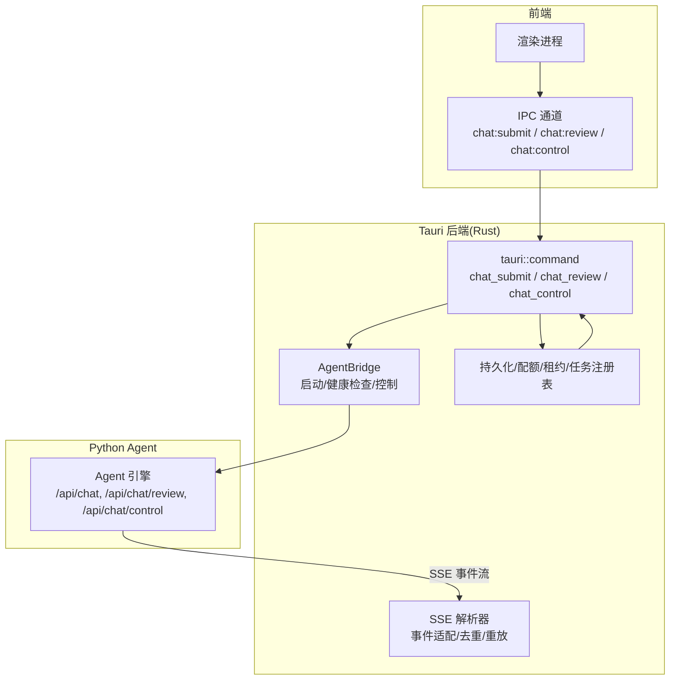
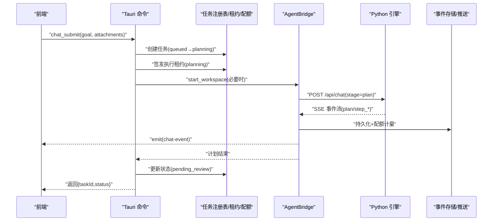
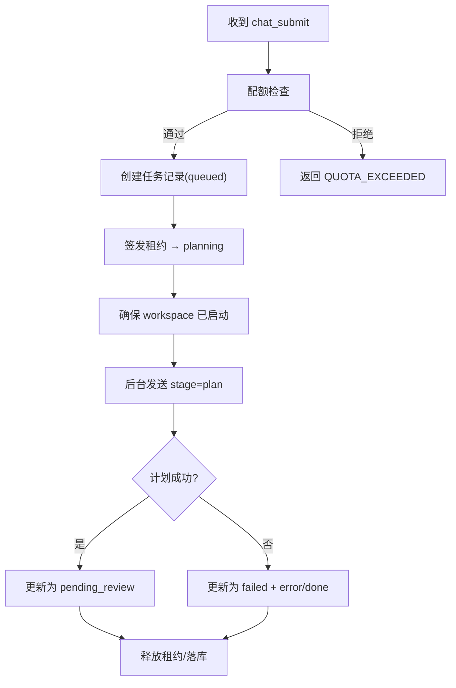
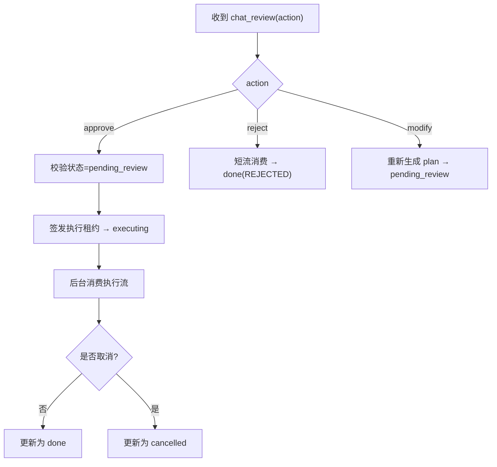
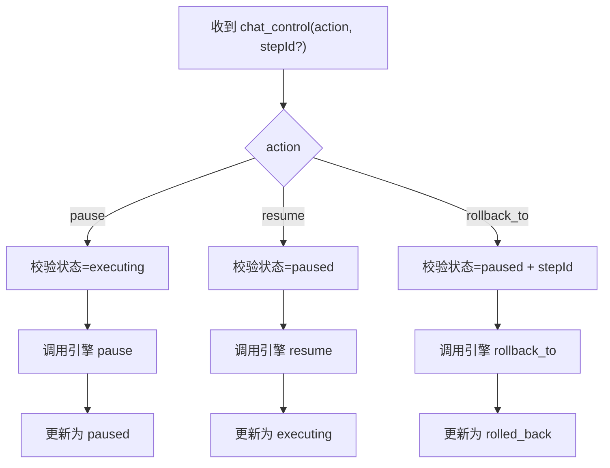
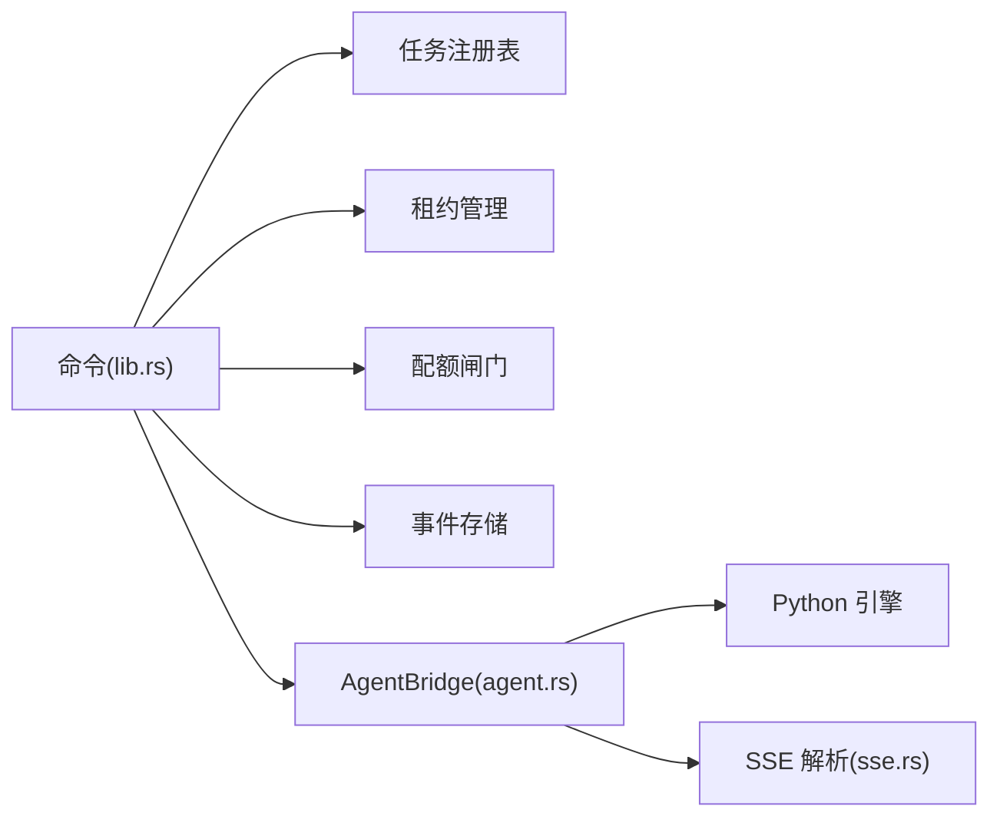

# 命令系统

<cite>
**本文引用的文件**
- [lib.rs](file://tongtian-tauri/src-tauri/src/lib.rs)
- [agent.rs](file://tongtian-tauri/src-tauri/src/bridge/agent.rs)
- [sse.rs](file://tongtian-tauri/src-tauri/src/bridge/sse.rs)
- [mod.rs](file://tongtian-tauri/src-tauri/src/bridge/mod.rs)
- [Cargo.toml](file://tongtian-tauri/src-tauri/Cargo.toml)
- [chat.ipc.ts](file://tongtian-tauri/src/main/ipc/chat.ipc.ts)
- [contracts.ts](file://tongtian-tauri/src/shared/contracts.ts)
- [types.ts](file://tongtian-tauri/src/shared/types.ts)
- [main.rs](file://tongtian-tauri/src-tauri/src/main.rs)
</cite>

## 目录
1. [简介](#简介)
2. [项目结构](#项目结构)
3. [核心组件](#核心组件)
4. [架构总览](#架构总览)
5. [详细组件分析](#详细组件分析)
6. [依赖关系分析](#依赖关系分析)
7. [性能考量](#性能考量)
8. [故障排查指南](#故障排查指南)
9. [结论](#结论)
10. [附录](#附录)

## 简介
本文件面向通天办公项目的 Tauri 命令系统，聚焦前后端 IPC 通信、参数校验、错误处理与事件推送模式；重点解析 chat_submit、chat_review、chat_control 等核心命令的业务逻辑与状态转换。同时覆盖命令注册流程、异步处理机制、版本管理与向后兼容策略、性能优化技巧，以及自定义命令开发与调试方法。

## 项目结构
Tauri 后端以 Rust 实现命令与桥接层，通过 tauri::command 暴露给前端；Python Agent 子进程通过 HTTP/SSE 提供流式事件；前端 TypeScript 侧定义契约与 IPC 通道名，并通过 Electron/Tauri 的 IPC 调用后端命令。



图表来源
- [lib.rs:127-237](file://tongtian-tauri/src-tauri/src/lib.rs#L127-L237)
- [agent.rs:118-262](file://tongtian-tauri/src-tauri/src/bridge/agent.rs#L118-L262)
- [sse.rs:48-144](file://tongtian-tauri/src-tauri/src/bridge/sse.rs#L48-L144)
- [contracts.ts:480-584](file://tongtian-tauri/src/shared/contracts.ts#L480-L584)

章节来源
- [lib.rs:1-800](file://tongtian-tauri/src-tauri/src/lib.rs#L1-L800)
- [Cargo.toml:1-40](file://tongtian-tauri/src-tauri/Cargo.toml#L1-L40)
- [contracts.ts:480-584](file://tongtian-tauri/src/shared/contracts.ts#L480-L584)

## 核心组件
- 命令入口与注册：lib.rs 中集中声明并注册所有 tauri::command（如 chat_submit、chat_review、chat_control、task_state、quota_status、event_replay 等），并在应用启动时通过 invoke_handler 绑定。
- 桥接层：agent.rs 负责 Python Agent 子进程生命周期管理、端口分配、健康检查、SSE 流消费、事件转发、取消与控制指令转发。
- SSE 解析与适配：sse.rs 实现增量解析、id 行 seq 提取、事件类型白名单、将 AgentEvent 适配为前端 ChatEvent。
- 存储与治理：任务注册表、租约管理、配额闸门、事件存储（含 TTL 清理）在 lib.rs 初始化并注入到命令中。
- 前端契约：contracts.ts 定义 IPC 通道名、请求/响应类型、错误码枚举；types.ts 定义任务状态机与元数据。

章节来源
- [lib.rs:746-800](file://tongtian-tauri/src-tauri/src/lib.rs#L746-L800)
- [agent.rs:1-800](file://tongtian-tauri/src-tauri/src/bridge/agent.rs#L1-L800)
- [sse.rs:1-517](file://tongtian-tauri/src-tauri/src/bridge/sse.rs#L1-L517)
- [contracts.ts:1-587](file://tongtian-tauri/src/shared/contracts.ts#L1-L587)
- [types.ts:1-346](file://tongtian-tauri/src/shared/types.ts#L1-L346)

## 架构总览
命令从前端发起，经 IPC 路由至后端命令处理器；命令完成参数校验后进入业务编排（配额、租约、状态机），再调用 AgentBridge 与 Python 引擎交互；引擎通过 SSE 返回事件，Rust 侧进行解析、去重、重放补齐、配额计量与持久化，最终通过 tauri event 推送到前端。



图表来源
- [lib.rs:127-237](file://tongtian-tauri/src-tauri/src/lib.rs#L127-L237)
- [agent.rs:684-724](file://tongtian-tauri/src-tauri/src/bridge/agent.rs#L684-L724)
- [sse.rs:171-292](file://tongtian-tauri/src-tauri/src/bridge/sse.rs#L171-L292)

## 详细组件分析

### chat_submit：提交任务（两阶段协议）
- 职责：受理新任务，进入排队/计划阶段；完成后进入待审阅（pending_review）。
- 关键步骤：
  - 参数校验与默认 workspace 选择。
  - 配额闸门拦截（QUOTA_EXCEEDED）。
  - 任务注册表创建记录，入队并立即出队（本地 local-first）。
  - 签发租约，转入 planning。
  - 确保 Agent 实例运行，后台发送 stage=plan 的请求。
  - 计划结束后根据是否取消决定 pending_review 或 cancelled。
  - 释放租约，落库同步。
- 状态转换：创建→queued→planning→pending_review（或 cancelled）。
- 事件：status_change、error、done。



图表来源
- [lib.rs:127-237](file://tongtian-tauri/src-tauri/src/lib.rs#L127-L237)

章节来源
- [lib.rs:127-237](file://tongtian-tauri/src-tauri/src/lib.rs#L127-L237)

### chat_review：审阅计划（approve/reject/modify）
- 职责：对 pending_review 的计划进行批准、拒绝或修改。
- 关键步骤：
  - 校验当前状态必须为 pending_review。
  - approve：重新签发执行租约，转入 executing，后台消费执行流（step_*/deliver/done）。
  - reject：短流消费后标记 done(REJECTED)。
  - modify：携带 patch 重新生成 plan，保持 pending_review。
- 状态转换：pending_review→executing/done(REJECTED)/pending_review。
- 事件：status_change、error、done。



图表来源
- [lib.rs:239-390](file://tongtian-tauri/src-tauri/src/lib.rs#L239-L390)

章节来源
- [lib.rs:239-390](file://tongtian-tauri/src-tauri/src/lib.rs#L239-L390)

### chat_control：任务控制（pause/resume/rollback_to）
- 职责：在执行中暂停、继续或回滚到指定步骤。
- 关键步骤：
  - 校验当前状态与动作合法性。
  - 转发控制指令到引擎（HTTP POST /api/chat/control）。
  - 更新状态：executing→paused、paused→executing、paused→rolled_back。
  - 释放租约（回滚场景）。
- 状态转换：executing↔paused、paused→rolled_back。
- 事件：status_change。



图表来源
- [lib.rs:392-483](file://tongtian-tauri/src-tauri/src/lib.rs#L392-L483)

章节来源
- [lib.rs:392-483](file://tongtian-tauri/src-tauri/src/lib.rs#L392-L483)

### 事件推送与 SSE 解析
- 事件管道：AgentBridge 使用有界通道与独立 emit 任务，批量 drain 降低调度开销，避免阻塞 SSE 解析热路径。
- 断线补齐：检测 seq gap 后拉取 /api/events/replay，补齐丢失事件。
- 去重与排序：SeqGuard 维护 last seq，丢弃重复/乱序旧事件。
- 适配层：将 AgentEvent 映射为 ChatEvent，统一注入 seq/taskId，兼容 snake_case 字段。

```mermaid
sequenceDiagram
participant BR as "AgentBridge"
participant PAR as "SseFeed"
participant AD as "适配层"
participant EM as "emit 任务"
participant FE as "前端"
BR->>PAR : "feed(chunk)"
PAR-->>BR : "AgentEvent[]"
BR->>AD : "adapt_to_chat_event()"
AD-->>EM : "ChatEvent"
EM-->>FE : "emit(chat-event)"
```

图表来源
- [agent.rs:500-604](file://tongtian-tauri/src-tauri/src/bridge/agent.rs#L500-L604)
- [sse.rs:48-144](file://tongtian-tauri/src-tauri/src/bridge/sse.rs#L48-L144)
- [sse.rs:171-292](file://tongtian-tauri/src-tauri/src/bridge/sse.rs#L171-L292)

章节来源
- [agent.rs:500-604](file://tongtian-tauri/src-tauri/src/bridge/agent.rs#L500-L604)
- [sse.rs:48-144](file://tongtian-tauri/src-tauri/src/bridge/sse.rs#L48-L144)
- [sse.rs:171-292](file://tongtian-tauri/src-tauri/src/bridge/sse.rs#L171-L292)

### 参数验证与错误处理
- 前端校验：使用 Zod 对 chat:submit/chat:review/chat:control 等请求进行强校验，失败抛出结构化错误（VALIDATION_ERROR）。
- 后端校验：命令内部对 action、状态机约束进行严格校验，非法操作返回 VALIDATION_ERROR。
- 错误分类：统一 ErrorCode 枚举，涵盖模型、文件、任务、配置、工作区、技能、MCP、沙箱、合规、桥接、通用等错误；命令层将异常转换为带 code/message 的结构化错误。
- 事件错误：当引擎侧出错，通过 error 事件与 status_change 通知前端，并输出 done 终止流。

章节来源
- [chat.ipc.ts:17-83](file://tongtian-tauri/src/main/ipc/chat.ipc.ts#L17-L83)
- [contracts.ts:15-109](file://tongtian-tauri/src/shared/contracts.ts#L15-L109)
- [lib.rs:239-390](file://tongtian-tauri/src-tauri/src/lib.rs#L239-L390)

### 命令注册流程与异步处理
- 命令注册：应用启动时在 setup 中 manage P0Services，并通过 generate_handler! 注册所有命令。
- 异步处理：命令内使用 tauri::async_runtime::spawn 后台执行长耗时流程（计划/执行流），避免阻塞主线程；事件通过 app.emit 推送。
- 资源管理：租约扫描循环、事件 TTL 清理、日志泵等后台任务在启动时统一拉起。

章节来源
- [lib.rs:746-800](file://tongtian-tauri/src-tauri/src/lib.rs#L746-L800)
- [lib.rs:171-229](file://tongtian-tauri/src-tauri/src/lib.rs#L171-L229)

### 版本管理与向后兼容性
- Feature 开关：Cargo feature tt-enable-seq 控制是否启用 seq/id 行解析；关闭时回退旧引擎语义（seq 恒为 None），保证契约兼容。
- 事件兼容：适配层支持 snake_case 字段与驼峰字段并存；未知事件类型被忽略；data 解析失败回退 raw。
- 增量扩展：新增状态/事件（如 budget_paused、status_change、quota_warning）以可选字段形式追加，老调用方零感知。

章节来源
- [Cargo.toml:12-16](file://tongtian-tauri/src-tauri/Cargo.toml#L12-L16)
- [sse.rs:125-144](file://tongtian-tauri/src-tauri/src/bridge/sse.rs#L125-L144)
- [sse.rs:156-169](file://tongtian-tauri/src-tauri/src/bridge/sse.rs#L156-L169)
- [types.ts:3-25](file://tongtian-tauri/src/shared/types.ts#L3-L25)

### 性能优化技巧
- 背压与批处理：emit 通道容量限制 + 批量 drain，减少频繁 emit 的调度开销。
- 共享 HTTP 客户端：OnceLock 持有全局 reqwest::Client，避免重复创建连接。
- 健康检查与巡检：轮询间隔与失败阈值控制，快速失败与恢复。
- 事件重放窗口：服务端 10min 窗口 + 客户端 30s 轮询预算，平衡可靠性与开销。
- 构建优化：release profile 开启 LTO、strip、opt-level=s，减小体积提升性能。

章节来源
- [agent.rs:40-45](file://tongtian-tauri/src-tauri/src/bridge/agent.rs#L40-L45)
- [agent.rs:500-515](file://tongtian-tauri/src-tauri/src/bridge/agent.rs#L500-L515)
- [agent.rs:306-356](file://tongtian-tauri/src-tauri/src/bridge/agent.rs#L306-L356)
- [Cargo.toml:35-40](file://tongtian-tauri/src-tauri/Cargo.toml#L35-L40)

### 自定义命令开发指南
- 新增命令步骤：
  - 在 lib.rs 中定义 #[tauri::command] 函数，实现参数校验、业务编排与结果返回。
  - 在 invoke_handler! 中注册命令名。
  - 在 contracts.ts 中补充 IPC_CHANNELS 与请求/响应类型。
  - 在前端 IPC 模块中注册 handler，调用后端命令。
- 最佳实践：
  - 使用 Zod 做前端强校验，后端再做状态机与权限校验。
  - 长耗时逻辑放入后台任务，通过事件推送进度。
  - 错误统一使用 ErrorCode，便于前端分类处理。
  - 对新增字段采用可选字段，保持向后兼容。

章节来源
- [lib.rs:746-800](file://tongtian-tauri/src-tauri/src/lib.rs#L746-L800)
- [contracts.ts:480-584](file://tongtian-tauri/src/shared/contracts.ts#L480-L584)
- [chat.ipc.ts:122-189](file://tongtian-tauri/src/main/ipc/chat.ipc.ts#L122-L189)

### 调试方法
- 日志采集：AgentBridge 会泵出 Python 子进程的 stdout/stderr，便于定位引擎问题。
- 事件回放：通过 event_replay 命令获取 24h 内事件，配合 seq 进行断点分析。
- 健康检查：观察 agent-status 事件与实例状态，确认 workspace 是否 Ready/Busy/Error。
- 模拟模式：设置 TT_AGENT_MOCK=1 启动 Mock Agent，无需 LLM 依赖即可验证流程。

章节来源
- [agent.rs:196-204](file://tongtian-tauri/src-tauri/src/bridge/agent.rs#L196-L204)
- [lib.rs:590-599](file://tongtian-tauri/src-tauri/src/lib.rs#L590-L599)
- [agent.rs:144-180](file://tongtian-tauri/src-tauri/src/bridge/agent.rs#L144-L180)

## 依赖关系分析
- 命令层依赖：P0Services（TaskRegistry、LeaseManager、QuotaGate、EventStore、Store）。
- 桥接层依赖：Python 环境探测、子进程管理、HTTP/SSE 通信。
- 事件层依赖：SSE 解析器、适配器、事件存储。
- 前端依赖：contracts.ts 中的类型与通道名，确保前后端契约一致。



图表来源
- [lib.rs:35-42](file://tongtian-tauri/src-tauri/src/lib.rs#L35-L42)
- [agent.rs:70-86](file://tongtian-tauri/src-tauri/src/bridge/agent.rs#L70-L86)
- [sse.rs:23-52](file://tongtian-tauri/src-tauri/src/bridge/sse.rs#L23-L52)

章节来源
- [lib.rs:35-42](file://tongtian-tauri/src-tauri/src/lib.rs#L35-L42)
- [agent.rs:70-86](file://tongtian-tauri/src-tauri/src/bridge/agent.rs#L70-L86)
- [sse.rs:23-52](file://tongtian-tauri/src-tauri/src/bridge/sse.rs#L23-L52)

## 性能考量
- 事件推送背压：通过有界通道与批量 drain 降低 CPU 占用与内存峰值。
- 连接复用：共享 HTTP 客户端减少握手开销。
- 健康检查节流：合理设置轮询间隔与失败阈值，避免过度探测。
- 构建优化：release profile 开启 LTO、strip、opt-level=s，提升运行时性能与减小体积。

[本节为通用指导，不直接分析具体文件]

## 故障排查指南
- 常见问题定位：
  - 配额超限：检查 quota_status 与 quota_warning 事件，确认档位与阻断动作。
  - 租约冲突：TASK_ALREADY_RUNNING 表示其他端持有活跃租约，需先释放或接管。
  - 引擎不可用：workspace 未启动或健康检查失败，查看 agent-status 与日志泵输出。
  - 事件丢失：使用 event_replay 从 from_seq 开始补齐，结合 SeqGuard 去重。
- 调试建议：
  - 启用 TT_AGENT_MOCK=1 快速验证流程。
  - 关注 status_change 与 error 事件，结合任务状态机判断当前阶段。
  - 通过 task_state 查询任务完整元数据（waitReason、retryCount、leaseHolder 等）。

章节来源
- [lib.rs:557-599](file://tongtian-tauri/src-tauri/src/lib.rs#L557-L599)
- [agent.rs:543-565](file://tongtian-tauri/src-tauri/src/bridge/agent.rs#L543-L565)
- [contracts.ts:15-109](file://tongtian-tauri/src/shared/contracts.ts#L15-L109)

## 结论
本命令系统以 Tauri 命令为核心，结合 AgentBridge 与 SSE 事件流，实现了高可靠的任务提交、审阅与控制闭环。通过严格的参数校验、统一的错误码体系、可插拔的版本特性开关与完善的性能优化策略，系统在可扩展性与稳定性方面具备良好基础。后续可按“自定义命令开发指南”持续扩展能力，并保持前后端契约一致性。

[本节为总结性内容，不直接分析具体文件]

## 附录
- 核心命令清单：
  - chat_submit：提交任务（两阶段计划）
  - chat_review：审阅计划（approve/reject/modify）
  - chat_control：任务控制（pause/resume/rollback_to）
  - chat_cancel：取消任务
  - task_state：查询任务 14 态状态
  - quota_status：配额快照
  - lease_info/lease_takeover：租约视图与接管
  - event_replay：事件重放
  - model_*：模型五件套
  - settings_get/set：设置持久化
  - file_*：文件能力与附件暂存

章节来源
- [lib.rs:528-744](file://tongtian-tauri/src-tauri/src/lib.rs#L528-L744)
- [contracts.ts:480-584](file://tongtian-tauri/src/shared/contracts.ts#L480-L584)