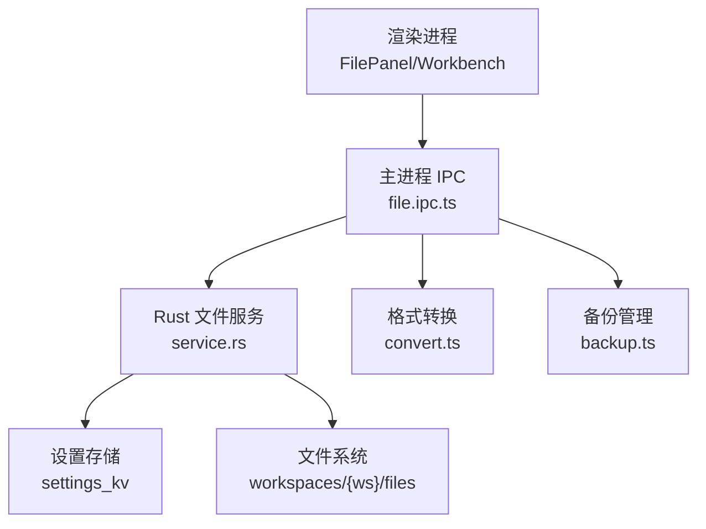
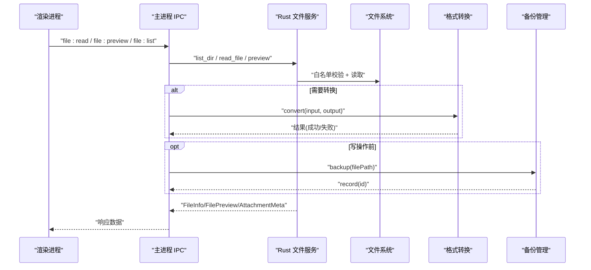
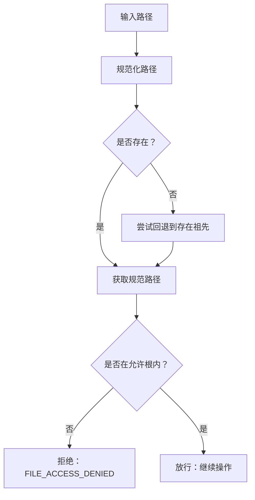
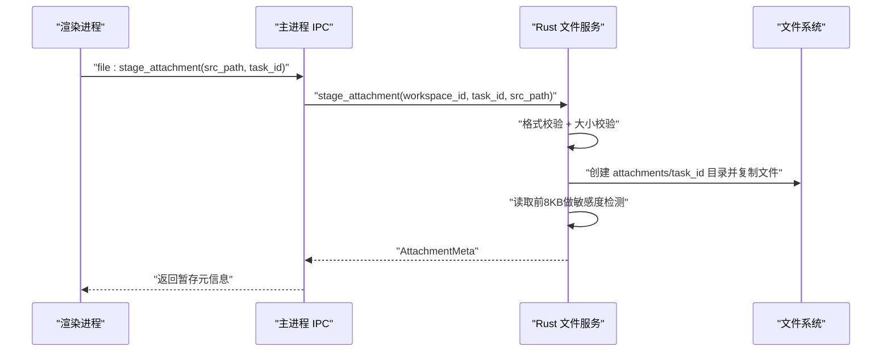
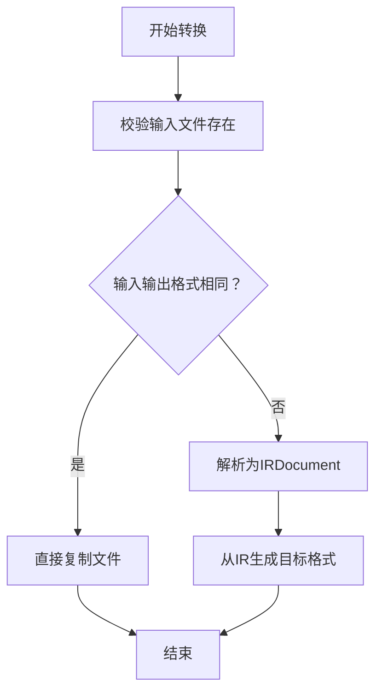
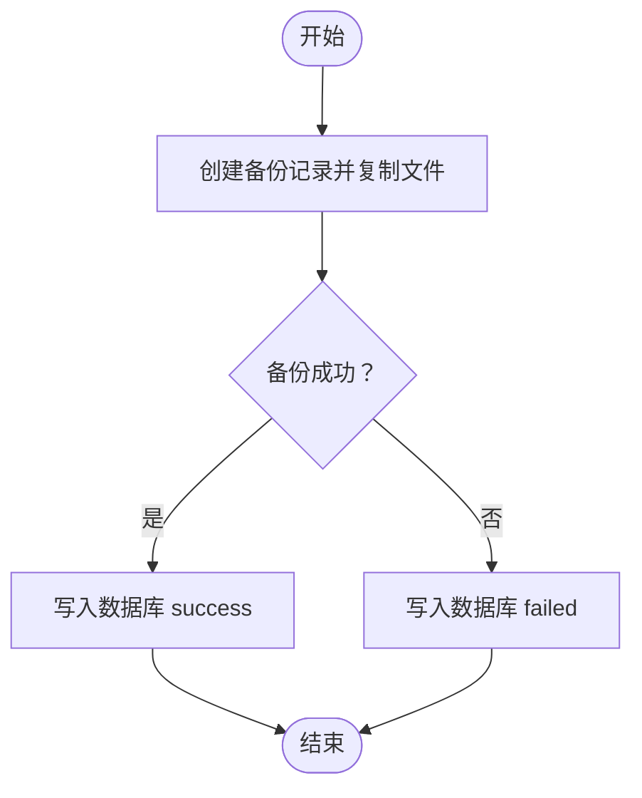
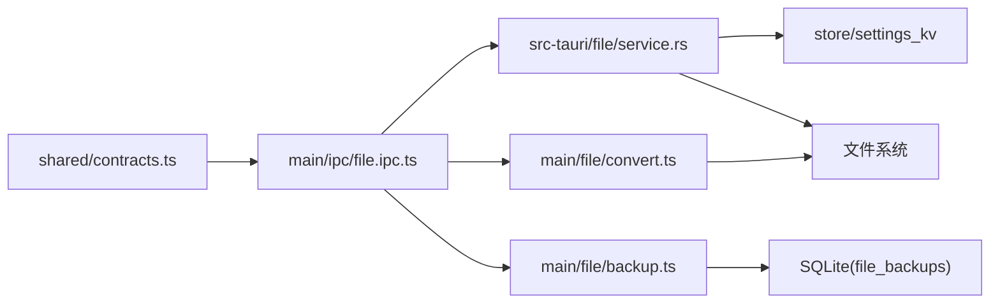

# 文件命令

<cite>
**本文引用的文件**
- [file.ipc.ts](file://tongtian-tauri/src/main/ipc/file.ipc.ts)
- [service.rs](file://tongtian-tauri/src-tauri/src/file/service.rs)
- [convert.ts](file://tongtian-tauri/src/main/file/convert.ts)
- [backup.ts](file://tongtian-tauri/src/main/file/backup.ts)
- [contracts.ts](file://tongtian-tauri/src/shared/contracts.ts)
- [manager.ts](file://tongtian-tauri/src/main/workspace/manager.ts)
</cite>

## 目录
1. [简介](#简介)
2. [项目结构](#项目结构)
3. [核心组件](#核心组件)
4. [架构总览](#架构总览)
5. [详细组件分析](#详细组件分析)
6. [依赖关系分析](#依赖关系分析)
7. [性能与并发](#性能与并发)
8. [故障排查指南](#故障排查指南)
9. [结论](#结论)
10. [附录：示例与安全最佳实践](#附录示例与安全最佳实践)

## 简介
本文件命令文档聚焦通天办公项目的文件操作能力，覆盖以下命令的实现与使用：
- file_list（列出工作区文件）
- file_read（读取文本文件）
- file_preview（批量预览文件）
- file_stage_attachment（附件暂存）

重点说明：
- 工作区文件隔离：通过白名单根目录限制访问范围。
- 路径安全验证：规范化路径并校验是否位于允许根内。
- 附件暂存机制：将上传文件复制到任务级暂存目录，并进行格式与大小校验、敏感度抽样检测。
- 文件格式支持、预览生成、备份恢复功能。
- 权限控制、大小限制、并发访问处理。
- 提供文件操作示例与安全最佳实践。

## 项目结构
本项目在 Electron/Tauri 混合架构中实现文件能力：
- 前端 IPC 层（Electron）：定义通道、参数校验、调用后端服务。
- Rust 文件服务：实现工作区隔离、路径白名单、预览与附件暂存等核心逻辑。
- 转换与备份：提供格式转换管道与安全备份/回滚机制。
- 共享契约：统一错误码、IPC 通道名与数据结构。

图表来源
- [file.ipc.ts:100-246](file://tongtian-tauri/src/main/ipc/file.ipc.ts#L100-L246)
- [service.rs:136-345](file://tongtian-tauri/src-tauri/src/file/service.rs#L136-L345)
- [convert.ts:93-153](file://tongtian-tauri/src/main/file/convert.ts#L93-L153)
- [backup.ts:86-182](file://tongtian-tauri/src/main/file/backup.ts#L86-L182)
- [contracts.ts:480-504](file://tongtian-tauri/src/shared/contracts.ts#L480-L504)

章节来源
- [file.ipc.ts:1-250](file://tongtian-tauri/src/main/ipc/file.ipc.ts#L1-L250)
- [service.rs:1-478](file://tongtian-tauri/src-tauri/src/file/service.rs#L1-L478)
- [convert.ts:1-496](file://tongtian-tauri/src/main/file/convert.ts#L1-L496)
- [backup.ts:1-336](file://tongtian-tauri/src/main/file/backup.ts#L1-L336)
- [contracts.ts:1-587](file://tongtian-tauri/src/shared/contracts.ts#L1-L587)

## 核心组件
- 文件 IPC 处理器（Electron）
  - 注册 file:browse、file:read、file:preview、file:convert 等通道。
  - 参数校验（Zod）、路径白名单校验、MIME 类型识别、日志记录。
- Rust 文件服务
  - 工作区隔离：以 workspaces/{ws}/files 为默认根，支持 settings_kv 扩展白名单。
  - 路径消毒：规范化后校验是否在允许根内。
  - 能力函数：list_dir、read_file、preview、stage_attachment。
  - 大小限制：读取上限 2MB；附件上限 50MB。
- 格式转换管道
  - IR（中间表示）驱动的多格式转换：txt/md/csv/xlsx/docx/pdf。
  - 当前 txt/md/csv 解析与生成已落地；xlsx/docx/pdf 部分能力待接入第三方库。
- 备份与回滚
  - 基于 SHA256 的备份记录，持久化到 SQLite。
  - 定时清理过期备份（24小时）。
  - 支持按任务/步骤维度查询与回滚。

章节来源
- [file.ipc.ts:15-235](file://tongtian-tauri/src/main/ipc/file.ipc.ts#L15-L235)
- [service.rs:54-345](file://tongtian-tauri/src-tauri/src/file/service.rs#L54-L345)
- [convert.ts:76-153](file://tongtian-tauri/src/main/file/convert.ts#L76-L153)
- [backup.ts:39-182](file://tongtian-tauri/src/main/file/backup.ts#L39-L182)

## 架构总览
文件命令从渲染进程发起 IPC 请求，经主进程 IPC 处理器进行参数校验与路径安全检查，再调用 Rust 文件服务执行具体操作。对于需要转换的场景，走 convert.ts 的 IR 管道；对关键写操作可结合 backup.ts 进行备份与回滚。

图表来源
- [file.ipc.ts:100-246](file://tongtian-tauri/src/main/ipc/file.ipc.ts#L100-L246)
- [service.rs:136-345](file://tongtian-tauri/src-tauri/src/file/service.rs#L136-L345)
- [convert.ts:93-153](file://tongtian-tauri/src/main/file/convert.ts#L93-L153)
- [backup.ts:86-182](file://tongtian-tauri/src/main/file/backup.ts#L86-L182)

## 详细组件分析

### 工作区文件隔离与路径安全
- 默认根目录：workspaces/{workspace_id}/files。
- 可扩展白名单：通过 settings_kv 键 sandbox.file_allowlist.{workspace_id} 注入额外允许根。
- 路径校验流程：
  - 规范化路径（不存在时回退到存在的祖先拼接）。
  - 校验是否在任一允许根下，否则返回 FILE_ACCESS_DENIED。
- 列表与读取均受此约束，确保 Agent 仅能访问工作区文件。

图表来源
- [service.rs:84-132](file://tongtian-tauri/src-tauri/src/file/service.rs#L84-L132)

章节来源
- [service.rs:54-132](file://tongtian-tauri/src-tauri/src/file/service.rs#L54-L132)

### file_list（列出目录）
- 入口：Rust list_dir_in/list_dir；Electron 侧 file:browse。
- 行为：
  - 白名单校验通过后读取目录项。
  - 返回目录优先、名称排序的文件信息（名称、路径、是否目录、大小、修改时间）。
- 错误：
  - 目录不存在：FILE_NOT_FOUND。
  - 越界访问：FILE_ACCESS_DENIED。

章节来源
- [service.rs:136-171](file://tongtian-tauri/src-tauri/src/file/service.rs#L136-L171)
- [file.ipc.ts:105-134](file://tongtian-tauri/src/main/ipc/file.ipc.ts#L105-L134)
- [contracts.ts:323-329](file://tongtian-tauri/src/shared/contracts.ts#L323-L329)

### file_read（读取文本文件）
- 入口：Rust read_file_in/read_file；Electron 侧 file:read。
- 行为：
  - 白名单校验通过后读取文本内容。
  - 单文件大小上限 2MB，超出返回 FILE_TOO_LARGE。
- 错误：
  - 文件不存在：FILE_NOT_FOUND。
  - 二进制或编码错误：FILE_READ_FAILED。

章节来源
- [service.rs:173-197](file://tongtian-tauri/src-tauri/src/file/service.rs#L173-L197)
- [file.ipc.ts:136-154](file://tongtian-tauri/src/main/ipc/file.ipc.ts#L136-L154)
- [contracts.ts:24-30](file://tongtian-tauri/src/shared/contracts.ts#L24-L30)

### file_preview（批量预览）
- 入口：Rust preview_in/preview；Electron 侧 file:preview。
- 行为：
  - 对 text/plain、text/markdown、text/csv、application/json 直接读取内容。
  - 对 docx/xlsx/pdf 等二进制格式，返回 supported=false 与提示（当前未实现转换预览）。
  - 每个文件独立处理，单个失败不影响其他。
- 输出字段：path、content、mime_type、supported、note（可选）。

章节来源
- [service.rs:199-256](file://tongtian-tauri/src-tauri/src/file/service.rs#L199-L256)
- [file.ipc.ts:156-205](file://tongtian-tauri/src/main/ipc/file.ipc.ts#L156-L205)
- [contracts.ts:331-335](file://tongtian-tauri/src/shared/contracts.ts#L331-L335)

### file_stage_attachment（附件暂存）
- 入口：Rust stage_attachment_in/stage_attachment。
- 行为：
  - 校验源文件存在性、格式白名单（txt/md/csv/json/docx/xlsx/pdf）。
  - 大小上限 50MB。
  - 复制到 {home}/workspaces/{ws}/files/attachments/{task_id}/。
  - 读取前 8KB 文本进行敏感度关键词检测，标记 sensitivity（public/internal/confidential）。
- 输出：AttachmentMeta（文件名、暂存路径、大小、MIME、敏感度）。

图表来源
- [service.rs:270-345](file://tongtian-tauri/src-tauri/src/file/service.rs#L270-L345)

章节来源
- [service.rs:270-345](file://tongtian-tauri/src-tauri/src/file/service.rs#L270-L345)

### 格式转换与预览生成
- 转换管道：
  - 输入 → IRDocument → 输出。
  - 已实现：txt/md/csv 的解析与生成。
  - 待实现：xlsx/docx/pdf 的解析与生成（抛出依赖缺失错误）。
- 预览生成：
  - 文本类直接读取内容。
  - 二进制类返回不支持提示，避免静默失败。

图表来源
- [convert.ts:93-153](file://tongtian-tauri/src/main/file/convert.ts#L93-L153)

章节来源
- [convert.ts:76-153](file://tongtian-tauri/src/main/file/convert.ts#L76-L153)
- [convert.ts:155-323](file://tongtian-tauri/src/main/file/convert.ts#L155-L323)

### 备份与恢复
- 备份：
  - 计算 SHA256，复制文件到 .tongtian-backups/{taskId}/{stepId}/。
  - 记录状态 pending/success/failed，持久化到 SQLite。
- 恢复：
  - 根据备份 ID 恢复文件或删除多余文件（若原文件不存在）。
  - 更新状态为 rolled_back。
- 清理：
  - 定时任务每小时清理超过 24 小时的备份文件与记录。

图表来源
- [backup.ts:86-142](file://tongtian-tauri/src/main/file/backup.ts#L86-L142)
- [backup.ts:232-280](file://tongtian-tauri/src/main/file/backup.ts#L232-L280)

章节来源
- [backup.ts:39-182](file://tongtian-tauri/src/main/file/backup.ts#L39-L182)
- [backup.ts:227-280](file://tongtian-tauri/src/main/file/backup.ts#L227-L280)

## 依赖关系分析
- IPC 层依赖共享契约（错误码、通道名、类型）。
- Rust 服务依赖设置存储（settings_kv）与工作区目录布局。
- 转换模块依赖文件系统与日志。
- 备份模块依赖数据库与文件系统。

图表来源
- [contracts.ts:480-504](file://tongtian-tauri/src/shared/contracts.ts#L480-L504)
- [file.ipc.ts:100-246](file://tongtian-tauri/src/main/ipc/file.ipc.ts#L100-L246)
- [service.rs:54-345](file://tongtian-tauri/src-tauri/src/file/service.rs#L54-L345)
- [convert.ts:93-153](file://tongtian-tauri/src/main/file/convert.ts#L93-L153)
- [backup.ts:86-182](file://tongtian-tauri/src/main/file/backup.ts#L86-L182)

章节来源
- [contracts.ts:1-587](file://tongtian-tauri/src/shared/contracts.ts#L1-L587)
- [file.ipc.ts:1-250](file://tongtian-tauri/src/main/ipc/file.ipc.ts#L1-L250)
- [service.rs:1-478](file://tongtian-tauri/src-tauri/src/file/service.rs#L1-L478)
- [convert.ts:1-496](file://tongtian-tauri/src/main/file/convert.ts#L1-L496)
- [backup.ts:1-336](file://tongtian-tauri/src/main/file/backup.ts#L1-L336)

## 性能与并发
- 读取与预览：
  - 文本预览采用顺序处理，逐个文件读取；大文件需考虑内存占用（2MB 读取上限）。
  - 二进制预览不加载内容，仅返回元信息，降低开销。
- 转换：
  - 同格式短路复制，减少 I/O。
  - IR 解析与生成均为同步 I/O，建议在高并发场景下增加队列或限流。
- 备份：
  - 定时清理避免磁盘膨胀。
  - 写入数据库与文件拷贝可能阻塞，建议在后台任务中执行。
- 并发访问：
  - Rust 侧文件操作为系统调用，注意跨平台锁与权限。
  - Electron 侧 IPC 处理器为单线程事件循环，避免长时间阻塞。

[本节为通用指导，不直接分析具体文件]

## 故障排查指南
- 常见错误码：
  - FILE_NOT_FOUND：文件或目录不存在。
  - FILE_ACCESS_DENIED：路径不在工作区白名单内。
  - FILE_TOO_LARGE：读取超过 2MB 或附件超过 50MB。
  - FILE_CONVERSION_FAILED：格式转换未实现或失败。
  - FILE_BACKUP_FAILED：备份/恢复失败。
- 定位步骤：
  - 检查路径是否规范化且在允许根内。
  - 确认 MIME 类型与格式白名单匹配。
  - 查看日志中的 module 与 error.message。
  - 对转换失败，确认是否缺少依赖（如 SheetJS、mammoth、pdf-parse）。
- 调试建议：
  - 使用临时 home 构造测试环境，避免进程级环境变量竞争。
  - 对附件暂存，检查 attachments/task_id 目录是否创建成功。

章节来源
- [contracts.ts:24-30](file://tongtian-tauri/src/shared/contracts.ts#L24-L30)
- [service.rs:136-197](file://tongtian-tauri/src-tauri/src/file/service.rs#L136-L197)
- [service.rs:270-345](file://tongtian-tauri/src-tauri/src/file/service.rs#L270-L345)
- [convert.ts:283-297](file://tongtian-tauri/src/main/file/convert.ts#L283-L297)
- [backup.ts:147-182](file://tongtian-tauri/src/main/file/backup.ts#L147-L182)

## 结论
本项目实现了稳健的文件命令体系，围绕工作区隔离、路径安全、附件暂存与备份恢复构建完整闭环。当前文本类预览与转换能力已落地，二进制格式转换待后续接入第三方库。建议在生产环境中启用严格的白名单策略、大小限制与审计日志，并结合备份机制保障数据安全。

[本节为总结性内容，不直接分析具体文件]

## 附录：示例与安全最佳实践

### 典型调用流程
- 列出工作区文件：
  - 调用 file:browse，传入 dirPath。
  - 返回 FileInfo 列表，按目录优先、名称排序。
- 读取文本文件：
  - 调用 file:read，传入 filePath。
  - 返回 content；若超 2MB 则报错。
- 批量预览：
  - 调用 file:preview，传入 filePaths。
  - 文本类返回 content；二进制类返回 supported=false 与 note。
- 附件暂存：
  - 调用 stage_attachment，传入 workspace_id、task_id、src_path。
  - 返回 AttachmentMeta，包含敏感级别与暂存路径。

章节来源
- [file.ipc.ts:105-205](file://tongtian-tauri/src/main/ipc/file.ipc.ts#L105-L205)
- [service.rs:136-345](file://tongtian-tauri/src-tauri/src/file/service.rs#L136-L345)

### 安全最佳实践
- 始终使用工作区根目录作为默认访问边界，并通过 settings_kv 精确配置白名单。
- 对所有用户输入的路径进行规范化与白名单校验，防止路径穿越。
- 对读取与附件设置严格大小限制，避免资源耗尽。
- 对二进制格式预览明确标注不支持，避免静默失败导致误用。
- 对关键写操作先备份后执行，必要时支持回滚。
- 对附件进行格式白名单与敏感度检测，阻断恶意或高敏文件。
- 记录操作日志，便于审计与问题定位。

[本节为通用指导，不直接分析具体文件]