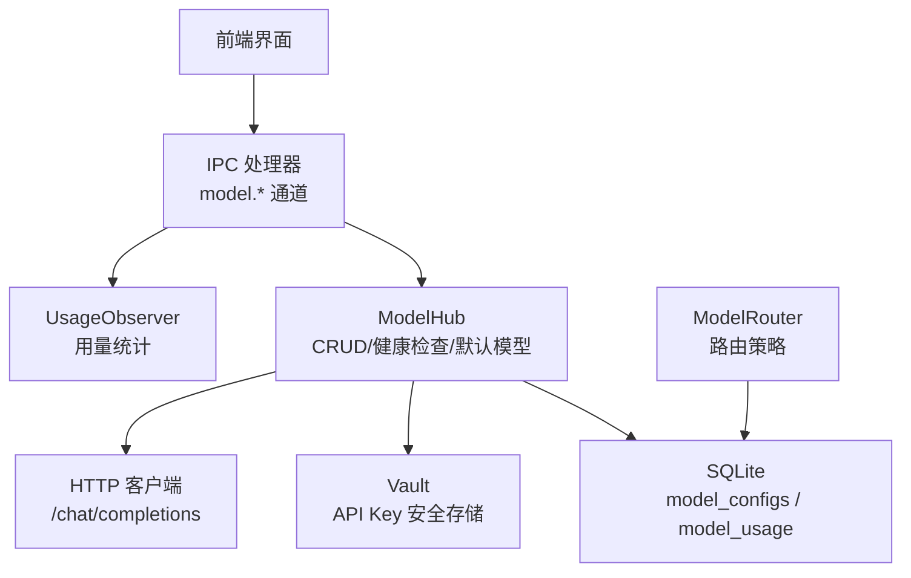
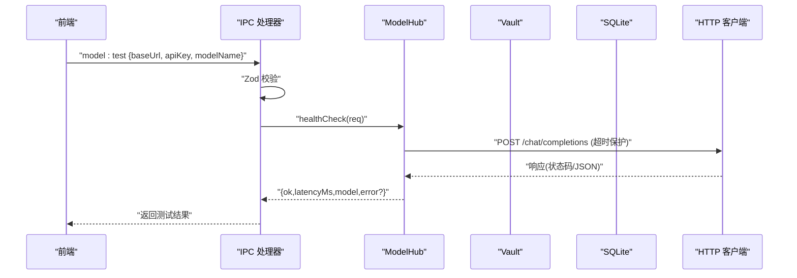
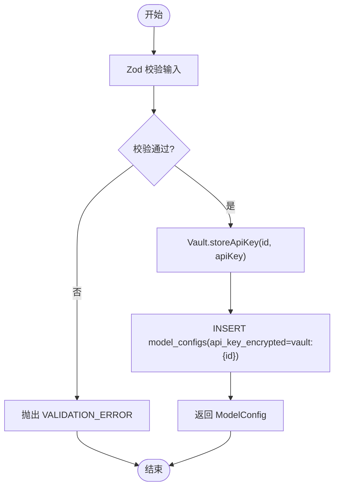
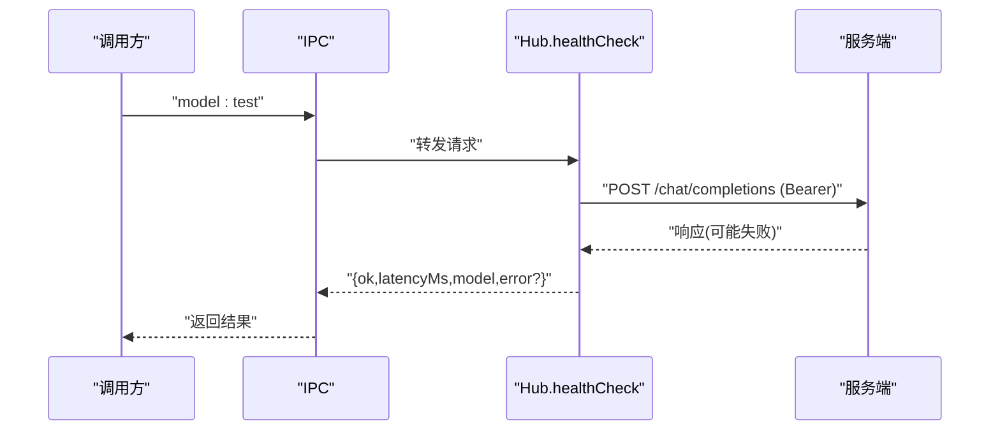
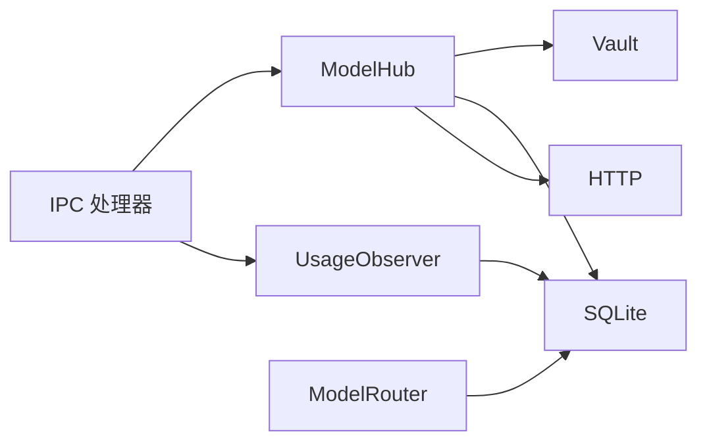

# 模型命令

<cite>
**本文引用的文件**
- [model.ipc.ts](file://tongtian-tauri/src/main/ipc/model.ipc.ts)
- [hub.ts](file://tongtian-tauri/src/main/model/hub.ts)
- [router.ts](file://tongtian-tauri/src/main/model/router.ts)
- [observer.ts](file://tongtian-tauri/src/main/model/observer.ts)
- [vault.ts](file://tongtian-tauri/src/main/store/vault.ts)
- [types.ts](file://tongtian-tauri/src/shared/types.ts)
- [contracts.ts](file://tongtian-tauri/src/shared/contracts.ts)
- [error-messages.ts](file://tongtian-tauri/src/shared/error-messages.ts)
- [db.rs](file://tongtian-tauri/src-tauri/src/store/db.rs)
</cite>

## 目录
1. [简介](#简介)
2. [项目结构](#项目结构)
3. [核心组件](#核心组件)
4. [架构总览](#架构总览)
5. [详细组件分析](#详细组件分析)
6. [依赖分析](#依赖分析)
7. [性能考虑](#性能考虑)
8. [故障排查指南](#故障排查指南)
9. [结论](#结论)
10. [附录：配置示例与最佳实践](#附录：配置示例与最佳实践)

## 简介
本文件面向“通天办公”项目的模型管理命令，覆盖 model_list、model_add、model_update、model_delete、model_test、model_set_default 等能力。重点说明 Model Hub 五件套（增删改查+健康检查）的实现、配置校验、密钥管理、连通性测试、默认模型设置与配置持久化机制；并给出错误处理、数据验证与安全注意事项，以及常见问题的排查方法。

## 项目结构
围绕模型命令的关键路径如下：
- IPC 层：接收前端请求，进行 Zod 参数校验，调用 Hub/Observer
- Hub 层：模型配置的 CRUD、默认模型设置、连通性测试
- Router 层：按敏感度、Agent 绑定、全局默认进行路由决策（与命令使用场景联动）
- Vault 层：系统级密钥存储（keytar 或内存 Mock），提供 API Key 的加密持久化
- Observer 层：记录每次调用的用量与延迟，支持按日/周/月统计
- 共享契约：统一类型与错误码定义
- 数据库：SQLite（WAL 模式，外键开启）用于配置与用量持久化

图表来源
- [model.ipc.ts:105-196](file://tongtian-tauri/src/main/ipc/model.ipc.ts#L105-L196)
- [hub.ts:85-367](file://tongtian-tauri/src/main/model/hub.ts#L85-L367)
- [observer.ts:77-258](file://tongtian-tauri/src/main/model/observer.ts#L77-L258)
- [vault.ts:60-124](file://tongtian-tauri/src/main/store/vault.ts#L60-L124)
- [db.rs:16-24](file://tongtian-tauri/src-tauri/src/store/db.rs#L16-L24)

章节来源
- [model.ipc.ts:105-196](file://tongtian-tauri/src/main/ipc/model.ipc.ts#L105-L196)
- [hub.ts:85-367](file://tongtian-tauri/src/main/model/hub.ts#L85-L367)
- [observer.ts:77-258](file://tongtian-tauri/src/main/model/observer.ts#L77-L258)
- [vault.ts:60-124](file://tongtian-tauri/src/main/store/vault.ts#L60-L124)
- [db.rs:16-24](file://tongtian-tauri/src-tauri/src/store/db.rs#L16-L24)

## 核心组件
- IPC 处理器：集中注册 model:* 通道，使用 Zod 严格校验输入，统一错误包装与日志
- ModelHub：单例，负责模型配置的增删改查、默认模型切换、连通性测试（发送最小请求到 /chat/completions）
- Vault：封装 keytar（或 Mock），实现 API Key 的安全存取与进程内缓存
- UsageObserver：记录每次模型调用的 token 用量、延迟、成功与否，并提供聚合统计
- ModelRouter：根据内容敏感度、Agent 绑定、全局默认选择具体模型（为上层调用提供路由依据）
- 共享契约：统一类型与错误码，确保前后端一致

章节来源
- [model.ipc.ts:18-101](file://tongtian-tauri/src/main/ipc/model.ipc.ts#L18-L101)
- [hub.ts:85-367](file://tongtian-tauri/src/main/model/hub.ts#L85-L367)
- [vault.ts:60-124](file://tongtian-tauri/src/main/store/vault.ts#L60-L124)
- [observer.ts:77-258](file://tongtian-tauri/src/main/model/observer.ts#L77-L258)
- [router.ts:92-310](file://tongtian-tauri/src/main/model/router.ts#L92-L310)
- [contracts.ts:15-109](file://tongtian-tauri/src/shared/contracts.ts#L15-L109)

## 架构总览
下图展示从前端到后端的完整调用链，包括参数校验、Hub 操作、Vault 密钥读取、网络健康检查与统计记录。

图表来源
- [model.ipc.ts:157-171](file://tongtian-tauri/src/main/ipc/model.ipc.ts#L157-L171)
- [hub.ts:282-358](file://tongtian-tauri/src/main/model/hub.ts#L282-L358)

章节来源
- [model.ipc.ts:157-171](file://tongtian-tauri/src/main/ipc/model.ipc.ts#L157-L171)
- [hub.ts:282-358](file://tongtian-tauri/src/main/model/hub.ts#L282-L358)

## 详细组件分析

### 模型列表（model_list）
- 入口：IPC 通道 model:list
- 行为：通过 Hub.list() 查询所有模型配置，按创建时间倒序返回
- 数据源：SQLite 表 model_configs
- 输出：ModelConfig 数组（包含 id、name、source、baseUrl、apiKeyEncrypted、modelName、contextWindow、isDefault、agentBinding、forceLocal、createdAt 等）

章节来源
- [model.ipc.ts:108-116](file://tongtian-tauri/src/main/ipc/model.ipc.ts#L108-L116)
- [hub.ts:106-113](file://tongtian-tauri/src/main/model/hub.ts#L106-L113)
- [types.ts:201-215](file://tongtian-tauri/src/shared/types.ts#L201-L215)

### 新增模型（model_add）
- 入口：IPC 通道 model:create
- 校验：Zod 校验 name/source/baseUrl/apiKey/modelName/contextWindow/agentBinding/forceLocal
- 行为：
  - 将明文 API Key 写入 Vault（服务名固定，账户名为模型 ID）
  - 在 model_configs 中插入记录，api_key_encrypted 字段保存引用标记 vault:{id}
  - 返回新建的 ModelConfig
- 安全：API Key 不直接落库，仅存引用；实际密钥由 Vault 管理

图表来源
- [model.ipc.ts:118-129](file://tongtian-tauri/src/main/ipc/model.ipc.ts#L118-L129)
- [hub.ts:125-161](file://tongtian-tauri/src/main/model/hub.ts#L125-L161)
- [vault.ts:75-81](file://tongtian-tauri/src/main/store/vault.ts#L75-L81)

章节来源
- [model.ipc.ts:118-129](file://tongtian-tauri/src/main/ipc/model.ipc.ts#L118-L129)
- [hub.ts:125-161](file://tongtian-tauri/src/main/model/hub.ts#L125-L161)
- [vault.ts:75-81](file://tongtian-tauri/src/main/store/vault.ts#L75-L81)

### 更新模型（model_update）
- 入口：IPC 通道 model:update
- 校验：Zod 校验 id 及可选字段
- 行为：
  - 若提供新 apiKey，则重新写入 Vault
  - 动态构建 UPDATE 语句，仅更新非空字段
  - 返回更新后的 ModelConfig
- 注意：未提供的字段保持不变

章节来源
- [model.ipc.ts:131-142](file://tongtian-tauri/src/main/ipc/model.ipc.ts#L131-L142)
- [hub.ts:163-218](file://tongtian-tauri/src/main/model/hub.ts#L163-L218)

### 删除模型（model_delete）
- 入口：IPC 通道 model:delete
- 校验：Zod 校验 id
- 行为：
  - 从 Vault 删除对应 API Key
  - 从 model_configs 删除记录
  - 返回 { ok: true }
- 异常：不存在时抛出 MODEL_NOT_FOUND

章节来源
- [model.ipc.ts:144-155](file://tongtian-tauri/src/main/ipc/model.ipc.ts#L144-L155)
- [hub.ts:220-241](file://tongtian-tauri/src/main/model/hub.ts#L220-L241)

### 连通性测试（model_test）
- 入口：IPC 通道 model:test
- 校验：Zod 校验 baseUrl/apiKey/modelName/contextWindow
- 行为：
  - 向 baseUrl/chat/completions 发送最小请求（带 Authorization Bearer）
  - 设置超时保护，测量延迟
  - 解析响应体中的可用模型列表（如有）
  - 返回 { ok, latencyMs, model, error?, availableModels? }
- 失败：HTTP 非 2xx 或网络异常均返回 ok=false 并附带错误信息

图表来源
- [model.ipc.ts:157-171](file://tongtian-tauri/src/main/ipc/model.ipc.ts#L157-L171)
- [hub.ts:282-358](file://tongtian-tauri/src/main/model/hub.ts#L282-L358)

章节来源
- [model.ipc.ts:157-171](file://tongtian-tauri/src/main/ipc/model.ipc.ts#L157-L171)
- [hub.ts:282-358](file://tongtian-tauri/src/main/model/hub.ts#L282-L358)

### 设置默认模型（model_set_default）
- 入口：IPC 通道 model:setDefault
- 校验：Zod 校验 id
- 行为：
  - 将所有模型的 is_default 置 0
  - 将目标模型 is_default 置 1
  - 返回该模型配置
- 用途：作为全局默认模型供路由层优先选择

章节来源
- [model.ipc.ts:173-184](file://tongtian-tauri/src/main/ipc/model.ipc.ts#L173-L184)
- [hub.ts:243-266](file://tongtian-tauri/src/main/model/hub.ts#L243-L266)

### 用量统计（model:usage）
- 入口：IPC 通道 model:usage
- 行为：按 day/week/month 聚合 model_usage 表，返回各模型的 token 用量、调用次数、平均延迟、估算成本等
- 用途：用于用量看板与成本控制

章节来源
- [model.ipc.ts:186-196](file://tongtian-tauri/src/main/ipc/model.ipc.ts#L186-L196)
- [observer.ts:135-172](file://tongtian-tauri/src/main/model/observer.ts#L135-L172)

### 路由策略（ModelRouter）
- 优先级：
  1) 敏感数据强制本地模型（force_local 或 Ollama）
  2) 显式覆盖（modelOverride）
  3) Agent 绑定模型（含回退）
  4) 全局默认模型
  5) 首条可用模型
- 当无可用模型时抛出 ALL_MODELS_UNAVAILABLE

章节来源
- [router.ts:126-247](file://tongtian-tauri/src/main/model/router.ts#L126-L247)

## 依赖分析
- IPC 层依赖：Zod 校验、IPC_CHANNELS、ErrorCode、Hub、Observer
- Hub 依赖：Database、Vault、Logger、HTTP fetch
- Vault 依赖：keytar（或 Mock）、进程内缓存
- Observer 依赖：Database、Logger
- Router 依赖：Database、Logger、DataSensitivity/ModelSource

图表来源
- [model.ipc.ts:105-196](file://tongtian-tauri/src/main/ipc/model.ipc.ts#L105-L196)
- [hub.ts:85-367](file://tongtian-tauri/src/main/model/hub.ts#L85-L367)
- [observer.ts:77-258](file://tongtian-tauri/src/main/model/observer.ts#L77-L258)
- [vault.ts:60-124](file://tongtian-tauri/src/main/store/vault.ts#L60-L124)
- [router.ts:92-310](file://tongtian-tauri/src/main/model/router.ts#L92-L310)

章节来源
- [model.ipc.ts:105-196](file://tongtian-tauri/src/main/ipc/model.ipc.ts#L105-L196)
- [hub.ts:85-367](file://tongtian-tauri/src/main/model/hub.ts#L85-L367)
- [observer.ts:77-258](file://tongtian-tauri/src/main/model/observer.ts#L77-L258)
- [vault.ts:60-124](file://tongtian-tauri/src/main/store/vault.ts#L60-L124)
- [router.ts:92-310](file://tongtian-tauri/src/main/model/router.ts#L92-L310)

## 性能考虑
- 健康检查超时：默认 10 秒，避免阻塞 IPC 调用
- 最小请求：仅发送必要字段，降低网络开销
- 数据库 WAL 模式：提升并发读写性能
- 用量统计聚合：按天/周/月聚合，减少重复计算
- 密钥缓存：进程内缓存 API Key，减少系统密钥库访问

[本节为通用性能建议，无需特定文件引用]

## 故障排查指南
- 参数校验失败
  - 现象：返回 VALIDATION_ERROR
  - 排查：检查 name/baseUrl/apiKey/modelName 等必填项与格式
  - 参考：Zod 校验与错误包装逻辑
- 连接失败
  - 现象：model:test 返回 ok=false 且包含 HTTP 状态或网络错误
  - 排查：确认 baseUrl 可访问、端口正确、防火墙放行；检查 Authorization 头
- 认证失败
  - 现象：HTTP 401/403
  - 排查：核对 apiKey 是否正确；确认服务是否要求自定义头部
- 上下文窗口溢出
  - 现象：上游返回上下文超限错误
  - 排查：调整 contextWindow 或缩短消息长度
- 无可用模型
  - 现象：路由层抛出 ALL_MODELS_UNAVAILABLE
  - 排查：确认至少存在一个模型配置；必要时设置默认模型
- 密钥问题
  - 现象：无法读取 API Key
  - 排查：检查 Vault 是否可用（keytar 或 Mock）；确认服务名与账户名匹配

章节来源
- [model.ipc.ts:67-101](file://tongtian-tauri/src/main/ipc/model.ipc.ts#L67-L101)
- [hub.ts:282-358](file://tongtian-tauri/src/main/model/hub.ts#L282-L358)
- [router.ts:306-310](file://tongtian-tauri/src/main/model/router.ts#L306-L310)
- [error-messages.ts:8-36](file://tongtian-tauri/src/shared/error-messages.ts#L8-L36)
- [contracts.ts:15-109](file://tongtian-tauri/src/shared/contracts.ts#L15-L109)

## 结论
本项目通过 IPC + Hub + Vault + Observer 的分层设计，实现了模型配置的完整生命周期管理与安全的密钥存储；同时提供连通性测试与默认模型设置，配合路由策略保障不同敏感度数据的处理路径。统一的校验与错误码体系提升了可维护性与用户体验。

[本节为总结性内容，无需特定文件引用]

## 附录：配置示例与最佳实践
- 新增模型字段说明
  - name：显示名称
  - source：openai_compat/ollama/preset_qwen/preset_deepseek/preset_openai
  - baseUrl：OpenAI 兼容接口地址
  - apiKey：平台 API Key（自动存入 Vault）
  - modelName：要调用的模型名称
  - contextWindow：上下文窗口大小（整数，正数）
  - agentBinding：与 Agent/工作区绑定的标识
  - forceLocal：强制本地模型（用于敏感数据）
- 默认模型设置
  - 通过 model_set_default 指定全局默认模型，便于路由层快速选择
- 健康检查建议
  - 首次添加模型后执行 model_test，确认连通性与可用模型列表
- 安全建议
  - 不要在前端明文传递长期有效的密钥；尽量使用后端托管的密钥
  - 对敏感数据启用 forceLocal 或绑定本地模型
- 持久化机制
  - 模型配置与用量分别持久化于 SQLite（WAL 模式）
  - 密钥由 Vault 管理，进程退出时清理内存缓存

章节来源
- [types.ts:201-232](file://tongtian-tauri/src/shared/types.ts#L201-L232)
- [hub.ts:125-161](file://tongtian-tauri/src/main/model/hub.ts#L125-L161)
- [vault.ts:75-124](file://tongtian-tauri/src/main/store/vault.ts#L75-L124)
- [db.rs:16-24](file://tongtian-tauri/src-tauri/src/store/db.rs#L16-L24)