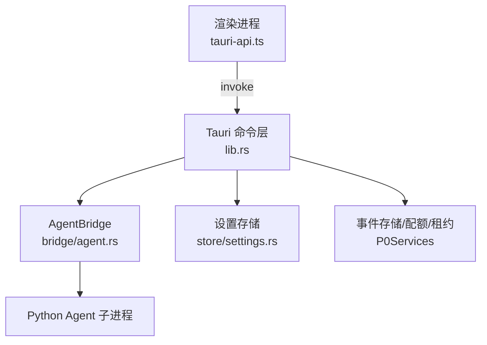
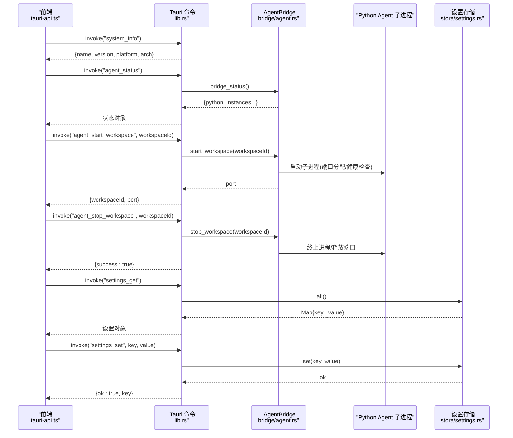
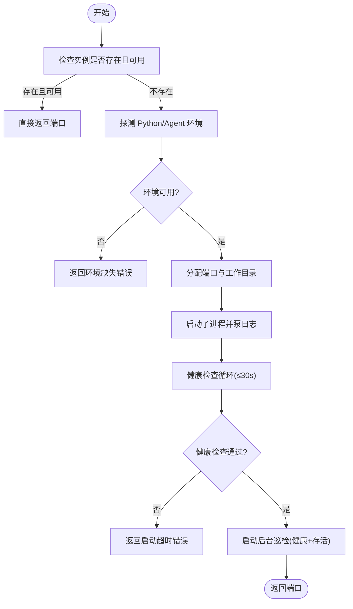
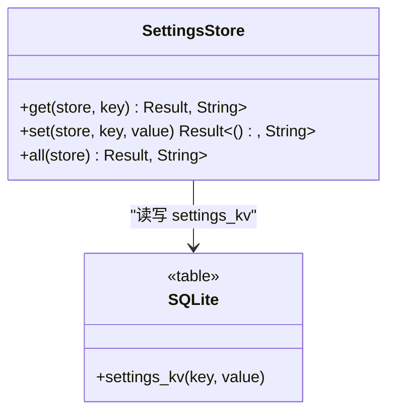
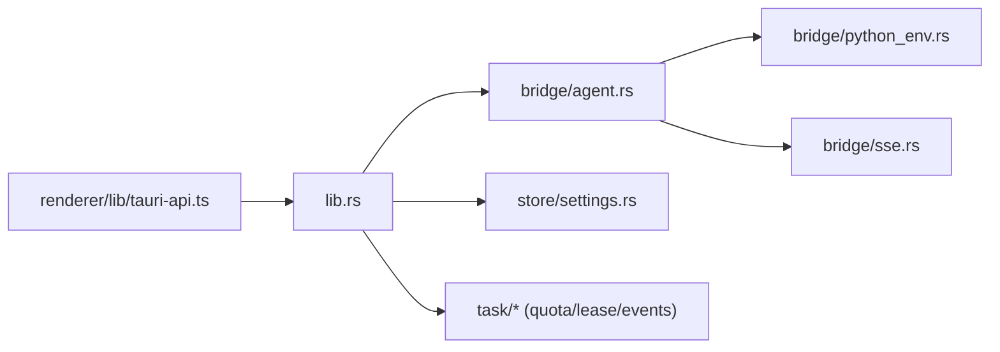

# 系统命令

<cite>
**本文引用的文件**   
- [lib.rs](file://tongtian-tauri/src-tauri/src/lib.rs)
- [agent.rs](file://tongtian-tauri/src-tauri/src/bridge/agent.rs)
- [settings.rs](file://tongtian-tauri/src-tauri/src/store/settings.rs)
- [tauri-api.ts](file://tongtian-tauri/src/renderer/lib/tauri-api.ts)
</cite>

## 目录
1. [简介](#简介)
2. [项目结构](#项目结构)
3. [核心组件](#核心组件)
4. [架构总览](#架构总览)
5. [详细组件分析](#详细组件分析)
6. [依赖关系分析](#依赖关系分析)
7. [性能考虑](#性能考虑)
8. [故障排查指南](#故障排查指南)
9. [结论](#结论)
10. [附录](#附录)

## 简介
本文件为通天办公项目的“系统命令”文档，聚焦以下系统管理命令：system_info、agent_status、agent_start_workspace、agent_stop_workspace、settings_get、settings_set。内容涵盖：
- Agent 引擎生命周期管理（启动、健康检查、停止、端口分配）
- 工作区实例控制（按 workspace_id 独立进程与端口隔离）
- 系统信息查询（版本、平台、架构等）
- 设置持久化（settings_kv 键值存储）
- 环境变量管理与探测（Python、Agent 引擎选择）
- 系统监控与健康巡检（事件流、状态广播）
- 进程管理、资源清理与错误恢复机制
- 系统配置示例与运维指南

## 项目结构
- Tauri 后端入口与命令注册位于 Rust 模块中，统一通过 tauri::command 暴露给前端调用。
- 前端通过 tauri-api.ts 将 UI 调用映射到具体 command/channel。
- AgentBridge 负责 Python Agent 子进程的启动、健康检查、SSE 事件转发与生命周期巡检。
- settings 持久化基于 SQLite 的 settings_kv 表，提供 get/set/all 能力。

**图表来源** 
- [lib.rs:794-821](file://tongtian-tauri/src-tauri/src/lib.rs#L794-L821)
- [agent.rs:119-262](file://tongtian-tauri/src-tauri/src/bridge/agent.rs#L119-L262)
- [settings.rs:1-48](file://tongtian-tauri/src-tauri/src/store/settings.rs#L1-L48)
- [tauri-api.ts:41-84](file://tongtian-tauri/src/renderer/lib/tauri-api.ts#L41-L84)

**章节来源**
- [lib.rs:1-22](file://tongtian-tauri/src-tauri/src/lib.rs#L1-L22)
- [tauri-api.ts:1-27](file://tongtian-tauri/src/renderer/lib/tauri-api.ts#L1-L27)

## 核心组件
- system_info：返回应用名称、版本、平台与架构信息。
- agent_status：查询桥接状态（Python 探测结果 + 各 workspace 实例状态）。
- agent_start_workspace：为指定 workspace 启动 Agent 子进程，分配端口并等待健康就绪。
- agent_stop_workspace：停止指定 workspace 的 Agent 子进程并释放资源。
- settings_get：读取全部设置项（settings_kv），返回键值对。
- settings_set：写入单个设置项（覆盖式写入）。

**章节来源**
- [lib.rs:52-59](file://tongtian-tauri/src-tauri/src/lib.rs#L52-L59)
- [lib.rs:63-87](file://tongtian-tauri/src-tauri/src/lib.rs#L63-L87)
- [lib.rs:665-678](file://tongtian-tauri/src-tauri/src/lib.rs#L665-L678)
- [settings.rs:6-48](file://tongtian-tauri/src-tauri/src/store/settings.rs#L6-L48)

## 架构总览
系统命令由前端 tauri-api.ts 调用 Tauri 命令，Rust 侧 lib.rs 注册命令并实现业务逻辑。Agent 相关命令通过 bridge/agent.rs 管理 Python 子进程生命周期，使用 HTTP/SSE 与引擎通信；设置命令通过 store/settings.rs 读写 SQLite。

**图表来源** 
- [lib.rs:52-87](file://tongtian-tauri/src-tauri/src/lib.rs#L52-L87)
- [lib.rs:665-678](file://tongtian-tauri/src-tauri/src/lib.rs#L665-L678)
- [agent.rs:119-262](file://tongtian-tauri/src-tauri/src/bridge/agent.rs#L119-L262)
- [settings.rs:20-48](file://tongtian-tauri/src-tauri/src/store/settings.rs#L20-L48)
- [tauri-api.ts:41-84](file://tongtian-tauri/src/renderer/lib/tauri-api.ts#L41-L84)

## 详细组件分析

### system_info
- 功能：返回应用名、版本、平台、架构。
- 数据来源：Cargo 包信息与系统常量。
- 适用场景：诊断环境、版本核对、兼容性检查。

**章节来源**
- [lib.rs:52-59](file://tongtian-tauri/src-tauri/src/lib.rs#L52-L59)

### agent_status
- 功能：查询 Python 探测结果与各 workspace 实例状态。
- 数据源：bridge/agent.rs 中的实例集合与状态枚举。
- 输出字段：包含 python 信息、instances（port/pid/status/health_fail_count）。

**章节来源**
- [lib.rs:63-65](file://tongtian-tauri/src-tauri/src/lib.rs#L63-L65)
- [agent.rs:53-86](file://tongtian-tauri/src-tauri/src/bridge/agent.rs#L53-L86)

### agent_start_workspace
- 功能：为指定 workspace 启动 Agent 子进程，分配端口（18000-19000），等待健康检查就绪。
- 关键流程：
  - 检测 Python 与 Agent 安装（支持 Mock/agentscope/qwenpaw 三种模式）。
  - 分配端口与工作目录，构造启动命令。
  - 启动子进程，泵出 stdout/stderr 日志。
  - 轮询 /health 直至就绪或超时（最长 30s）。
  - 后台巡检：健康检查与进程存活检测，失败计数达阈值标记 Error。
- 返回值：分配的端口号。

**图表来源** 
- [agent.rs:119-262](file://tongtian-tauri/src-tauri/src/bridge/agent.rs#L119-L262)

**章节来源**
- [lib.rs:69-76](file://tongtian-tauri/src-tauri/src/lib.rs#L69-L76)
- [agent.rs:119-262](file://tongtian-tauri/src-tauri/src/bridge/agent.rs#L119-L262)

### agent_stop_workspace
- 功能：停止指定 workspace 的 Agent 子进程，释放端口并广播状态变更。
- 关键点：若实例不存在则返回错误；跨平台进程终止命令（Windows taskkill / Unix kill -9）。

**章节来源**
- [lib.rs:80-87](file://tongtian-tauri/src-tauri/src/lib.rs#L80-L87)
- [agent.rs:360-398](file://tongtian-tauri/src-tauri/src/bridge/agent.rs#L360-L398)

### settings_get / settings_set
- 功能：settings_get 读取全部设置项（Map），settings_set 写入单个设置项（覆盖式）。
- 存储层：SQLite 表 settings_kv，支持 INSERT ... ON CONFLICT UPDATE。
- 事务与连接：通过 Store.with_conn 执行 SQL，错误以字符串形式返回。

**图表来源** 
- [settings.rs:6-48](file://tongtian-tauri/src-tauri/src/store/settings.rs#L6-L48)

**章节来源**
- [lib.rs:665-678](file://tongtian-tauri/src-tauri/src/lib.rs#L665-L678)
- [settings.rs:20-48](file://tongtian-tauri/src-tauri/src/store/settings.rs#L20-L48)

### 前端适配层（tauri-api.ts）
- 将 UI 调用映射到 Tauri command：
  - systemInfo → system_info
  - systemHealth → agent_status
  - settings:get → settings_get
  - settings:set → settings_set
- 未实现 channel 返回空数组兜底，保证 UI 不崩溃。

**章节来源**
- [tauri-api.ts:41-84](file://tongtian-tauri/src/renderer/lib/tauri-api.ts#L41-L84)
- [tauri-api.ts:168-170](file://tongtian-tauri/src/renderer/lib/tauri-api.ts#L168-L170)

## 依赖关系分析
- lib.rs 作为命令入口，依赖 bridge/agent.rs（进程与 SSE）、store/settings.rs（设置持久化）、task/*（配额/租约/事件存储）。
- agent.rs 依赖 python_env.rs（环境探测与命令构造）、sse.rs（SSE 解析与适配）。
- 前端 tauri-api.ts 依赖 @tauri-apps/api/core 的 invoke 与 listen。

**图表来源** 
- [lib.rs:17-31](file://tongtian-tauri/src-tauri/src/lib.rs#L17-L31)
- [agent.rs:1-21](file://tongtian-tauri/src-tauri/src/bridge/agent.rs#L1-L21)
- [tauri-api.ts:9-13](file://tongtian-tauri/src/renderer/lib/tauri-api.ts#L9-L13)

**章节来源**
- [lib.rs:17-31](file://tongtian-tauri/src-tauri/src/lib.rs#L17-L31)
- [agent.rs:1-21](file://tongtian-tauri/src-tauri/src/bridge/agent.rs#L1-L21)
- [tauri-api.ts:9-13](file://tongtian-tauri/src/renderer/lib/tauri-api.ts#L9-L13)

## 性能考虑
- 端口分配范围 18000-19000，避免冲突；健康检查轮询间隔 500ms，最大等待 30s。
- 后台巡检每 10s 一次，连续失败 3 次标记 Error，减少频繁状态切换。
- SSE 事件处理采用有界通道（容量 1024）与批量 drain，降低背压与调度开销。
- 事件重放与 gap 修复仅在检测到序列不连续时触发，避免无谓请求。
- settings 写入使用 UPSERT，避免重复插入开销。

[本节为通用指导，无需特定文件引用]

## 故障排查指南
- 启动失败常见原因：
  - Python 未安装或版本不符（需 3.10+）。
  - Agent 引擎未安装（qwenpaw 模式需 pip install qwenpaw）。
  - 端口占用（18000-19000 范围内无可用端口）。
  - 健康检查超时（30s 内 /health 未返回成功）。
- 运行期异常：
  - 进程退出：巡检发现 pid 不存在，标记 Stopped。
  - 健康检查失败：连续失败计数达到阈值，标记 Error。
  - 网络错误：SSE 断线后进入补齐循环，从引擎重放端点拉取丢失事件。
- 设置问题：
  - settings_set 覆盖写入，确保 key 唯一性。
  - settings_get 返回空 Map 表示无设置项。

**章节来源**
- [agent.rs:142-180](file://tongtian-tauri/src-tauri/src/bridge/agent.rs#L142-L180)
- [agent.rs:220-262](file://tongtian-tauri/src-tauri/src/bridge/agent.rs#L220-L262)
- [agent.rs:306-356](file://tongtian-tauri/src-tauri/src/bridge/agent.rs#L306-L356)
- [agent.rs:360-398](file://tongtian-tauri/src-tauri/src/bridge/agent.rs#L360-L398)
- [settings.rs:20-48](file://tongtian-tauri/src-tauri/src/store/settings.rs#L20-L48)

## 结论
本系统命令集提供了完整的 Agent 生命周期管理、工作区实例控制与系统信息查询能力，并通过 settings_kv 实现设置持久化。结合健康巡检、事件重放与配额/租约机制，系统在稳定性与可观测性方面具备良好基础。建议在生产环境中关注端口占用、Python/Agent 环境准备与健康检查策略调优。

[本节为总结性内容，无需特定文件引用]

## 附录

### 系统配置示例（settings_kv）
- theme=dark
- lang=zh
- engine=agentscope
- mock_agent=0

说明：
- 通过 settings_set 写入键值对，重启后仍有效。
- 通过 settings_get 获取全部设置项，用于初始化 UI 或校验环境。

**章节来源**
- [settings.rs:20-48](file://tongtian-tauri/src-tauri/src/store/settings.rs#L20-L48)

### 环境变量与引擎选择
- TT_AGENT_MOCK=1：启用 Mock Agent（纯模拟事件，无 LLM 依赖）。
- TT_ENGINE=qwenpaw：使用 qwenpaw 引擎（需已安装）。
- 默认 TT_ENGINE=agentscope：使用自研 AgentScope 引擎（读项目根 .env 模型配置）。

**章节来源**
- [agent.rs:148-180](file://tongtian-tauri/src-tauri/src/bridge/agent.rs#L148-L180)

### 运维指南
- 启动前检查：
  - 确认 Python 3.10+ 已安装并可执行。
  - 如使用 qwenpaw，确保已通过 pip 安装。
  - 检查 18000-19000 端口未被占用。
- 运行期监控：
  - 定期调用 agent_status 查看实例状态与健康计数。
  - 关注事件流与状态变更，及时处理错误与超时。
- 资源清理：
  - 使用 agent_stop_workspace 停止实例并释放端口。
  - 巡检自动回收僵尸进程与无效端口。

**章节来源**
- [agent.rs:119-262](file://tongtian-tauri/src-tauri/src/bridge/agent.rs#L119-L262)
- [agent.rs:306-356](file://tongtian-tauri/src-tauri/src/bridge/agent.rs#L306-L356)
- [lib.rs:794-821](file://tongtian-tauri/src-tauri/src/lib.rs#L794-L821)