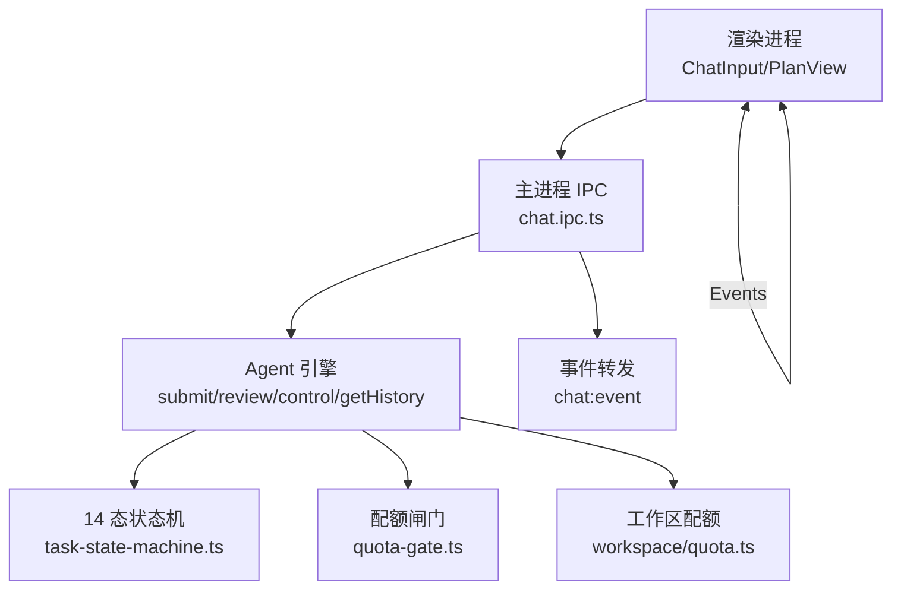
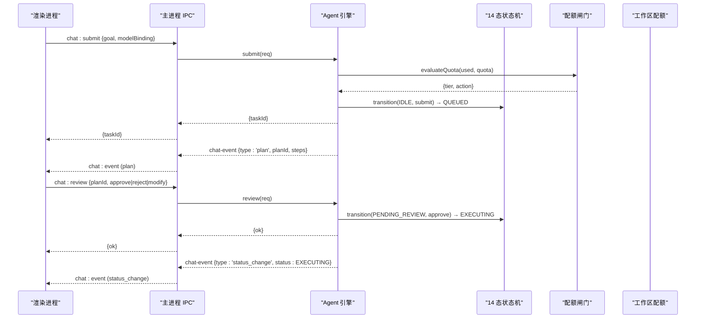
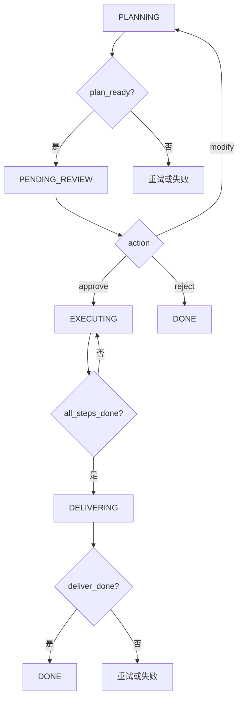
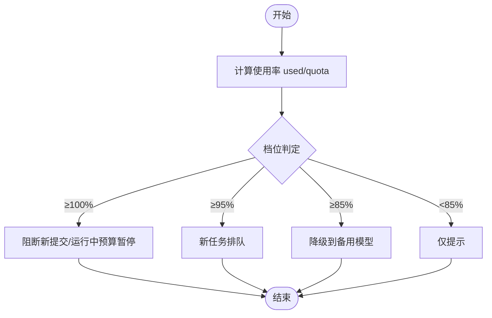
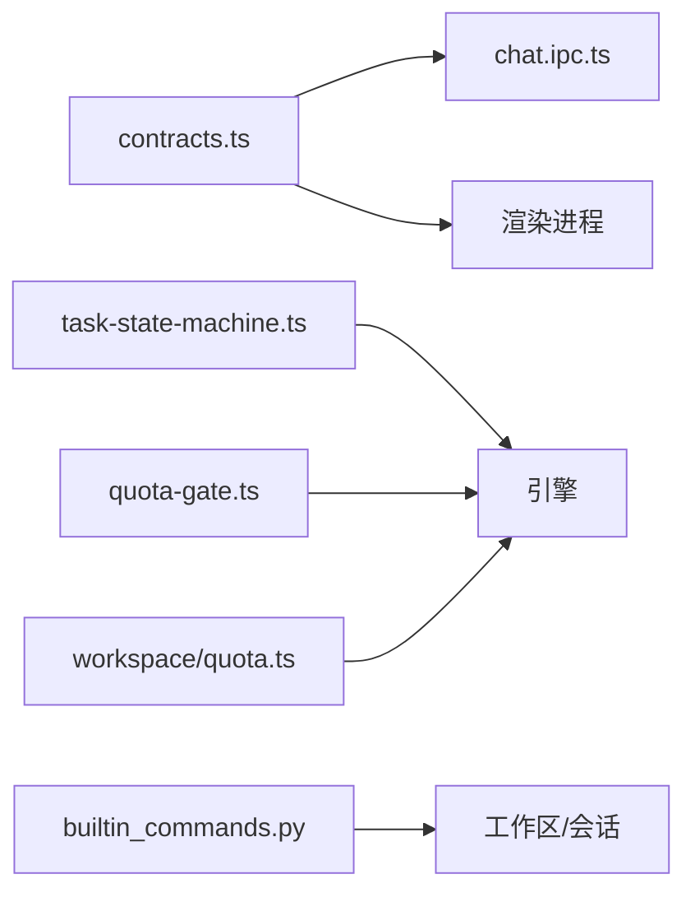

# 聊天命令

<cite>
**本文引用的文件**
- [chat.ipc.ts](file://tongtian-tauri/src/main/ipc/chat.ipc.ts)
- [task-state-machine.ts](file://tongtian-tauri/src/shared/task-state-machine.ts)
- [state-machine.ts](file://tongtian-tauri/src/main/agent/state-machine.ts)
- [contracts.ts](file://tongtian-tauri/src/shared/contracts.ts)
- [quota-gate.ts](file://tongtian-tauri/src/shared/quota-gate.ts)
- [quota.ts](file://tongtian-tauri/src/main/workspace/quota.ts)
- [builtin_commands.py](file://tongtian-tauri/src/agent/runtime/builtin_commands.py)
</cite>

## 目录
1. [简介](#简介)
2. [项目结构](#项目结构)
3. [核心组件](#核心组件)
4. [架构总览](#架构总览)
5. [详细组件分析](#详细组件分析)
6. [依赖关系分析](#依赖关系分析)
7. [性能考量](#性能考量)
8. [故障排查指南](#故障排查指南)
9. [结论](#结论)
10. [附录：命令调用示例与调试方法](#附录命令调用示例与调试方法)

## 简介
本文件面向通天办公项目的“聊天命令”能力，围绕 chat_submit、chat_review、chat_control、chat_cancel、chat_history 等核心命令，系统说明其实现机制、两阶段协议（计划生成→审阅执行）的状态转换逻辑（含 14 种任务状态流转规则）、参数校验、错误处理策略、异步执行模式，以及配额检查、租约管理、事件推送等关键流程。文档同时提供命令调用示例与调试方法，帮助开发者快速定位问题并优化使用体验。

## 项目结构
聊天命令的入口位于主进程的 IPC 层，负责参数校验、转发到引擎执行、事件流转发与清理；共享契约定义统一的数据结构与错误码；前端通过 IPC 通道发起请求并订阅事件。任务状态机在共享模块中定义 14 态转移表，供渲染端、测试与 Rust 侧共用；工作区配额控制器提供本地资源配额能力；内置命令适配器将 Python 侧的控制命令暴露为 Slash 命令。



图表来源
- [chat.ipc.ts:122-189](file://tongtian-tauri/src/main/ipc/chat.ipc.ts#L122-L189)
- [task-state-machine.ts:63-133](file://tongtian-tauri/src/shared/task-state-machine.ts#L63-L133)
- [quota-gate.ts:37-54](file://tongtian-tauri/src/shared/quota-gate.ts#L37-L54)
- [quota.ts:45-100](file://tongtian-tauri/src/main/workspace/quota.ts#L45-L100)

章节来源
- [chat.ipc.ts:122-189](file://tongtian-tauri/src/main/ipc/chat.ipc.ts#L122-L189)
- [contracts.ts:480-584](file://tongtian-tauri/src/shared/contracts.ts#L480-L584)

## 核心组件
- IPC 聊天处理器：完成 Zod 参数校验、安全包装、事件转发与生命周期清理。
- 14 态任务状态机：集中定义 35 条合法转移，支持重试耗尽、等待原因子态、终态判定等。
- 配额闸门与工作区配额：四档阈值评估与本地资源配额控制。
- 内置命令适配：将控制类命令以 Slash 命令形式注册，便于对话内交互。
- 契约与错误码：统一的请求/响应类型、事件结构、错误码枚举与 IPC 通道名。

章节来源
- [chat.ipc.ts:17-83](file://tongtian-tauri/src/main/ipc/chat.ipc.ts#L17-L83)
- [task-state-machine.ts:16-55](file://tongtian-tauri/src/shared/task-state-machine.ts#L16-L55)
- [quota-gate.ts:9-18](file://tongtian-tauri/src/shared/quota-gate.ts#L9-L18)
- [quota.ts:9-41](file://tongtian-tauri/src/main/workspace/quota.ts#L9-L41)
- [contracts.ts:15-109](file://tongtian-tauri/src/shared/contracts.ts#L15-L109)

## 架构总览
聊天命令采用“主进程 IPC + 引擎 + 共享状态机 + 配额闸门”的分层架构。渲染进程通过 IPC 通道提交任务、审阅计划、控制执行、查询历史；主进程进行参数校验后调用引擎；引擎驱动状态机推进任务生命周期，并通过事件通道向前端推送实时进度、状态变更与配额预警。



图表来源
- [chat.ipc.ts:127-174](file://tongtian-tauri/src/main/ipc/chat.ipc.ts#L127-L174)
- [task-state-machine.ts:63-133](file://tongtian-tauri/src/shared/task-state-machine.ts#L63-L133)
- [quota-gate.ts:37-54](file://tongtian-tauri/src/shared/quota-gate.ts#L37-L54)

## 详细组件分析

### 命令参数验证与错误处理
- 参数校验：使用 Zod Schema 对 chat_submit、chat_review、chat_control、chat_history 的请求体进行强类型校验，失败时返回结构化 VALIDATION_ERROR。
- 安全包装：safeHandler 捕获异常并转换为包含 ErrorCode 的结构化错误，避免未处理异常泄露。
- 事件转发：startEventForwarding 订阅引擎的 chat-event 事件并转发至渲染进程，窗口关闭时自动注销监听与处理器。

章节来源
- [chat.ipc.ts:17-83](file://tongtian-tauri/src/main/ipc/chat.ipc.ts#L17-L83)
- [chat.ipc.ts:85-112](file://tongtian-tauri/src/main/ipc/chat.ipc.ts#L85-L112)
- [chat.ipc.ts:122-189](file://tongtian-tauri/src/main/ipc/chat.ipc.ts#L122-L189)
- [contracts.ts:15-109](file://tongtian-tauri/src/shared/contracts.ts#L15-L109)

### 两阶段协议（计划生成→审阅执行）
- 计划生成阶段：引擎生成 Plan 后发出 plan 事件，任务状态从 PLANNING 转入 PENDING_REVIEW。
- 审阅执行阶段：用户通过 chat_review 选择 approve/reject/modify；approve 进入 EXECUTING，reject 标记 DONE（拒绝），modify 回到 PLANNING 重新规划。
- 状态机约束：所有转移由 14 态状态机严格校验，非法转移抛出 IllegalTransitionError。



图表来源
- [task-state-machine.ts:63-133](file://tongtian-tauri/src/shared/task-state-machine.ts#L63-L133)

章节来源
- [task-state-machine.ts:63-133](file://tongtian-tauri/src/shared/task-state-machine.ts#L63-L133)

### 14 种任务状态与流转规则
- 状态集合：IDLE、QUEUED、PLANNING、PENDING_REVIEW、EXECUTING、PAUSED、ROLLED_BACK、BUDGET_PAUSED、RETRY_PENDING、DELIVERING、DONE、FAILED、CANCELLED、ARCHIVED。
- 关键转移：
  - 创建→入队：submit（IDLE→QUEUED）
  - 获取租约：acquire_lease（QUEUED→PLANNING）
  - 计划就绪：plan_ready（PLANNING→PENDING_REVIEW）
  - 审阅通过：approve（PENDING_REVIEW→EXECUTING）
  - 审阅拒绝：reject（PENDING_REVIEW→DONE）
  - 修改计划：modify（PENDING_REVIEW→PLANNING）
  - 步骤完成：all_steps_done（EXECUTING→DELIVERING）
  - 暂停/恢复：pause/resume（EXECUTING⇄PAUSED）
  - 回滚/续跑：rollback_to/continue_from_rollback（PAUSED→ROLLED_BACK→EXECUTING）
  - 预算耗尽/恢复：budget_exhausted/budget_restored（EXECUTING→BUDGET_PAUSED→EXECUTING）
  - 重试：retryable_error/backoff_done（EXECUTING→RETRY_PENDING→EXECUTING）
  - 租约丢失：lease_lost（EXECUTING→QUEUED）
  - 归档：archive（DONE/FAILED→ARCHIVED）
- 重试耗尽：当 retryCount≥MAX_RETRY_COUNT 时，retryable_error 直接路由到 FAILED。

```mermaid
classDiagram
class TaskStatus {
<<enum>>
IDLE
QUEUED
PLANNING
PENDING_REVIEW
EXECUTING
PAUSED
ROLLED_BACK
BUDGET_PAUSED
RETRY_PENDING
DELIVERING
DONE
FAILED
CANCELLED
ARCHIVED
}
class TransitionEvent {
<<enum>>
submit
acquire_lease
cancel
queue_timeout
plan_ready
retryable_error
fatal_error
approve
reject
modify
review_ttl
all_steps_done
pause
budget_exhausted
lease_lost
resume
rollback_to
continue_from_rollback
replan
budget_restored
budget_ttl
backoff_done
retry_exhausted
deliver_done
manual_retry
archive
}
class TaskStateMachine {
+canTransition(from, event, ctx) bool
+transition(from, event, ctx) TaskStatus
+applyWaitReason(status, reason) {status, waitReason}
+isTerminal(status) bool
+availableEvents(from) TransitionEvent[]
}
TaskStateMachine --> TaskStatus : "操作"
TaskStateMachine --> TransitionEvent : "触发"
```

图表来源
- [task-state-machine.ts:16-55](file://tongtian-tauri/src/shared/task-state-machine.ts#L16-L55)
- [task-state-machine.ts:63-133](file://tongtian-tauri/src/shared/task-state-machine.ts#L63-L133)
- [task-state-machine.ts:147-223](file://tongtian-tauri/src/shared/task-state-machine.ts#L147-L223)

章节来源
- [task-state-machine.ts:63-133](file://tongtian-tauri/src/shared/task-state-machine.ts#L63-L133)
- [task-state-machine.ts:147-223](file://tongtian-tauri/src/shared/task-state-machine.ts#L147-L223)

### 配额检查与配额闸门
- 四档阈值：70%（notify）、85%（degrade）、95%（queue）、100%（block）。
- 动作链：提示→降级→排队→阻断；100% 档对新提交返回 QUOTA_EXCEEDED，运行中任务映射为 BUDGET_EXHAUSTED。
- 工作区配额：限制并发步骤、内存、模型调用、队列深度；提供 acquire/release、enqueue/dequeue、updateMemoryUsage、getStatus 等方法。



图表来源
- [quota-gate.ts:9-18](file://tongtian-tauri/src/shared/quota-gate.ts#L9-L18)
- [quota-gate.ts:37-54](file://tongtian-tauri/src/shared/quota-gate.ts#L37-L54)
- [quota.ts:45-100](file://tongtian-tauri/src/main/workspace/quota.ts#L45-L100)

章节来源
- [quota-gate.ts:37-54](file://tongtian-tauri/src/shared/quota-gate.ts#L37-L54)
- [quota.ts:86-100](file://tongtian-tauri/src/main/workspace/quota.ts#L86-L100)

### 租约管理与心跳
- 租约信息：包含 taskId、leaseId、holder、heartbeatAt、leaseUntil、idle 字段。
- 心跳与超时：心跳间隔 10s，租约 30s，超时回收 60s；租约丢失触发 EXECUTING→QUEUED 恢复。
- 接管：禁止抢占，显式接管需对端确认。

章节来源
- [contracts.ts:288-309](file://tongtian-tauri/src/shared/contracts.ts#L288-L309)
- [task-state-machine.ts:96-99](file://tongtian-tauri/src/shared/task-state-machine.ts#L96-L99)

### 事件推送与异步执行
- 事件类型：plan、step_start、step_progress、step_done、step_failed、deliver、done、error、status_change、quota_warning、heartbeat。
- 事件转发：主进程订阅引擎事件并转发到渲染进程；窗口关闭时清理监听与处理器。
- 异步模式：submit/review/control 均为异步调用，结果通过 Promise 返回；事件通过 IPC 通道持续推送。

章节来源
- [chat.ipc.ts:85-112](file://tongtian-tauri/src/main/ipc/chat.ipc.ts#L85-L112)
- [chat.ipc.ts:122-189](file://tongtian-tauri/src/main/ipc/chat.ipc.ts#L122-L189)
- [contracts.ts:141-158](file://tongtian-tauri/src/shared/contracts.ts#L141-L158)

### 内置命令与控制命令
- 控制命令：通过 _make_control_adapter 将 ControlContext 与解析后的参数传递给具体 handler，错误被捕获并返回友好消息。
- 会话命令：compact/new/clear/history/plan 等通过 CommandHandler 加载/保存 AgentState，支持滚动上下文持久化。
- 技能回退：/skill_name 解析并注入 SKILL.md 内容，交由 Agent 执行。

章节来源
- [builtin_commands.py:164-260](file://tongtian-tauri/src/agent/runtime/builtin_commands.py#L164-L260)
- [builtin_commands.py:398-509](file://tongtian-tauri/src/agent/runtime/builtin_commands.py#L398-L509)
- [builtin_commands.py:517-648](file://tongtian-tauri/src/agent/runtime/builtin_commands.py#L517-L648)

## 依赖关系分析
- IPC 层依赖共享契约（类型与错误码）、引擎接口、日志器。
- 状态机独立于主进程实现，供渲染端、测试与 Rust 侧复用。
- 配额闸门与工作区配额相互补充：前者用于组织级预算/配额决策，后者用于本地资源限流。
- 内置命令适配器依赖工作区、会话存储与命令处理器。



图表来源
- [contracts.ts:480-584](file://tongtian-tauri/src/shared/contracts.ts#L480-L584)
- [task-state-machine.ts:63-133](file://tongtian-tauri/src/shared/task-state-machine.ts#L63-L133)
- [quota-gate.ts:37-54](file://tongtian-tauri/src/shared/quota-gate.ts#L37-L54)
- [quota.ts:45-100](file://tongtian-tauri/src/main/workspace/quota.ts#L45-L100)
- [builtin_commands.py:164-260](file://tongtian-tauri/src/agent/runtime/builtin_commands.py#L164-L260)

章节来源
- [chat.ipc.ts:122-189](file://tongtian-tauri/src/main/ipc/chat.ipc.ts#L122-L189)
- [task-state-machine.ts:63-133](file://tongtian-tauri/src/shared/task-state-machine.ts#L63-L133)
- [quota-gate.ts:37-54](file://tongtian-tauri/src/shared/quota-gate.ts#L37-L54)
- [quota.ts:45-100](file://tongtian-tauri/src/main/workspace/quota.ts#L45-L100)
- [builtin_commands.py:164-260](file://tongtian-tauri/src/agent/runtime/builtin_commands.py#L164-L260)

## 性能考量
- 本地优先队列：queued 停留目标 <100ms，减少阻塞感。
- 配额闸门四档：在高负载下自动降级/排队/阻断，保护系统稳定性。
- 事件批量转发：避免频繁 IPC 开销，窗口关闭时及时释放监听。
- 状态机纯函数：无副作用，便于缓存与并行判定。

[本节为通用指导，不直接分析具体文件]

## 故障排查指南
- 参数校验失败：检查 Zod Schema 字段是否满足最小长度、类型要求；查看 VALIDATION_ERROR 详情。
- 状态转移非法：确认当前状态与事件匹配；若 retryable_error 且重试次数已达上限，应走 failed 路径。
- 配额阻断：检查配额快照 tier/action；100% 档将阻断新提交或暂停运行中任务。
- 租约丢失：关注 lease_lost 事件，任务会回到 QUEUED 并从最后成功 Step 恢复。
- 事件未到达：确认主进程已注册事件转发，窗口未关闭；检查 IPC_CHANNELS 是否正确。

章节来源
- [chat.ipc.ts:47-83](file://tongtian-tauri/src/main/ipc/chat.ipc.ts#L47-L83)
- [task-state-machine.ts:147-201](file://tongtian-tauri/src/shared/task-state-machine.ts#L147-L201)
- [quota-gate.ts:57-80](file://tongtian-tauri/src/shared/quota-gate.ts#L57-L80)
- [contracts.ts:141-158](file://tongtian-tauri/src/shared/contracts.ts#L141-L158)

## 结论
聊天命令通过严格的参数校验、清晰的两阶段协议与 14 态状态机，实现了可审计、可控制、可恢复的任务执行流程。配额闸门与工作区配额共同保障系统在高压下的稳定性。事件推送与租约管理提升了用户体验与鲁棒性。建议在生产环境中结合日志与监控，持续优化阈值与超时配置。

[本节为总结，不直接分析具体文件]

## 附录：命令调用示例与调试方法
- chat_submit
  - 输入：{ goal, modelBinding?, attachments? }
  - 行为：校验通过后提交任务，返回 taskId；引擎生成 Plan 后推送 plan 事件。
  - 调试：观察 chat:event 中的 plan 事件；检查状态机是否从 IDLE→QUEUED→PLANNING→PENDING_REVIEW。
- chat_review
  - 输入：{ planId, action: 'approve'|'reject'|'modify', patch? }
  - 行为：approve 进入 EXECUTING；reject 标记 DONE；modify 回到 PLANNING。
  - 调试：确认状态机转移合法；检查 step 事件流是否正常。
- chat_control
  - 输入：{ taskId, action: 'pause'|'resume'|'rollback_to', stepId? }
  - 行为：暂停/恢复执行；回滚到指定 Step 后继续或重新规划。
  - 调试：关注 status_change 事件；检查 paused/rolled_back 状态。
- chat_cancel
  - 输入：{ taskId }
  - 行为：取消任务，状态转入 CANCELLED。
  - 调试：确认 cancel 事件可用；检查终态判定。
- chat_history
  - 输入：{ limit? }
  - 行为：返回最近任务摘要列表。
  - 调试：核对 TaskSummary 字段；检查 limit 范围。

调试要点
- 启用日志：查看主进程日志输出，定位 IPC 校验与引擎调用错误。
- 订阅事件：监听 chat:event，记录 plan/step/status_change/quota_warning 等事件。
- 状态机断言：使用 availableEvents 与 canTransition 验证操作合法性。
- 配额监控：定期获取 QuotaSnapshot，观察 tier/action 变化。

章节来源
- [chat.ipc.ts:122-189](file://tongtian-tauri/src/main/ipc/chat.ipc.ts#L122-L189)
- [contracts.ts:121-158](file://tongtian-tauri/src/shared/contracts.ts#L121-L158)
- [task-state-machine.ts:219-223](file://tongtian-tauri/src/shared/task-state-machine.ts#L219-L223)
- [quota-gate.ts:37-54](file://tongtian-tauri/src/shared/quota-gate.ts#L37-L54)