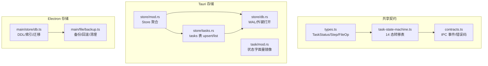
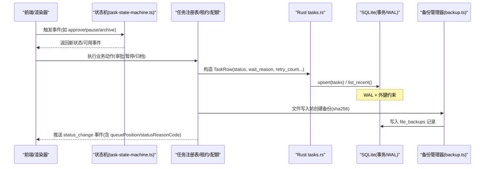
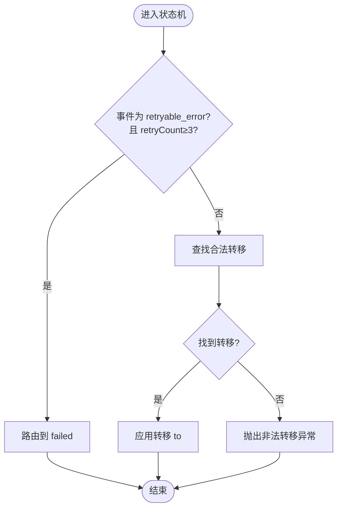
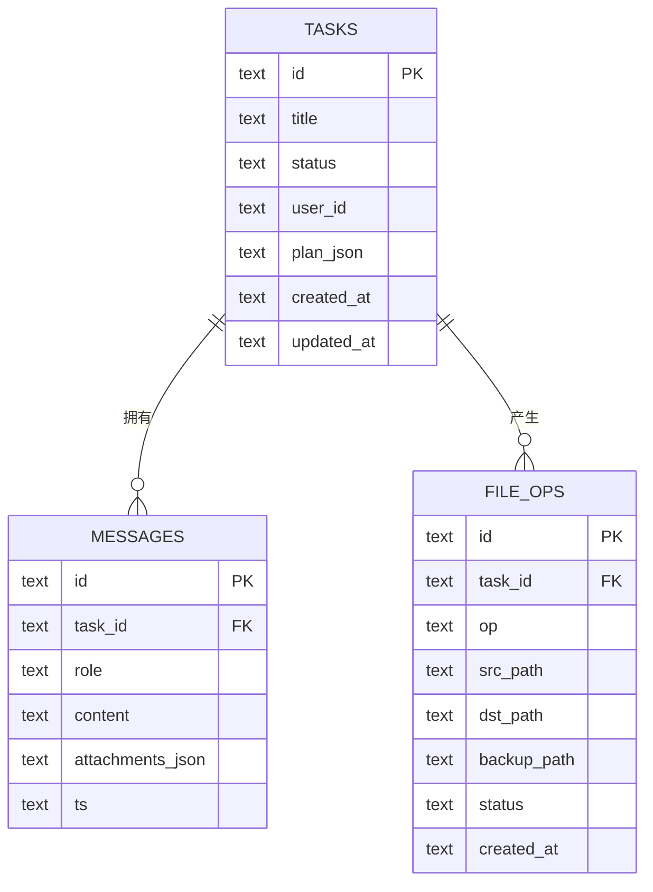
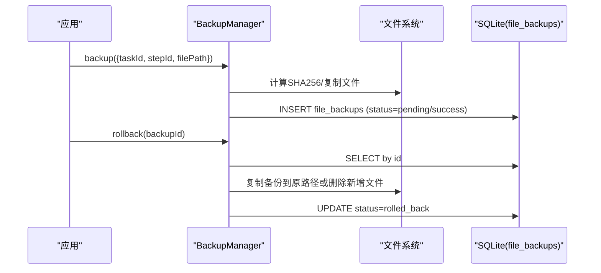
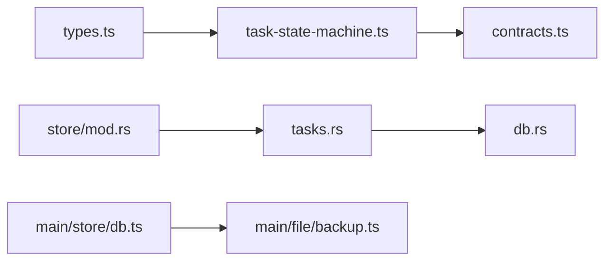

# 任务存储

<cite>
**本文引用的文件**
- [task-state-machine.ts](file://tongtian-tauri/src/shared/task-state-machine.ts)
- [types.ts](file://tongtian-tauri/src/shared/types.ts)
- [contracts.ts](file://tongtian-tauri/src/shared/contracts.ts)
- [tasks.rs](file://tongtian-tauri/src-tauri/src/store/tasks.rs)
- [db.rs](file://tongtian-tauri/src-tauri/src/store/db.rs)
- [mod.rs（store）](file://tongtian-tauri/src-tauri/src/store/mod.rs)
- [db.ts（Electron DB）](file://tongtian-tauri/src/main/store/db.ts)
- [backup.ts](file://tongtian-tauri/src/main/file/backup.ts)
- [mod.rs（task）](file://tongtian-tauri/src-tauri/src/task/mod.rs)
</cite>

## 目录
1. [简介](#简介)
2. [项目结构](#项目结构)
3. [核心组件](#核心组件)
4. [架构总览](#架构总览)
5. [详细组件分析](#详细组件分析)
6. [依赖关系分析](#依赖关系分析)
7. [性能考虑](#性能考虑)
8. [故障排查指南](#故障排查指南)
9. [结论](#结论)
10. [附录](#附录)

## 简介
本文件面向通天办公项目的“任务存储”能力，聚焦任务数据的持久化方案与数据一致性保障。内容覆盖：
- 14 态任务状态机及其与持久化的映射
- 计划步骤的序列化存储与执行历史
- 文件操作记录的追踪与备份恢复
- 任务的增删改查、批量处理与数据同步机制
- 备份恢复、增量更新与冲突解决策略
- 查询优化、索引设计与缓存策略

## 项目结构
本项目在 Tauri 侧使用 SQLite（rusqlite）进行本地持久化，在 Electron 侧提供兼容的数据库抽象与迁移能力；前端共享类型与状态机定义保证前后端契约一致。关键路径如下：
- 共享层：14 态状态机、类型与 IPC 契约
- Tauri 存储层：Store 聚合、tasks 表 upsert/list、settings kv、DB 连接管理
- Electron 存储层：schema 定义、索引、迁移、备份与回滚
- 任务运行层：注册表、租约、配额闸门（与状态机协同）

图示来源
- [types.ts:4-25](file://tongtian-tauri/src/shared/types.ts#L4-L25)
- [task-state-machine.ts:16-133](file://tongtian-tauri/src/shared/task-state-machine.ts#L16-L133)
- [contracts.ts:278-321](file://tongtian-tauri/src/shared/contracts.ts#L278-L321)
- [mod.rs（store）:18-52](file://tongtian-tauri/src-tauri/src/store/mod.rs#L18-L52)
- [tasks.rs:12-59](file://tongtian-tauri/src-tauri/src/store/tasks.rs#L12-L59)
- [db.rs:16-25](file://tongtian-tauri/src-tauri/src/store/db.rs#L16-L25)
- [db.ts（Electron DB）:68-280](file://tongtian-tauri/src/main/store/db.ts#L68-L280)
- [backup.ts:39-142](file://tongtian-tauri/src/main/file/backup.ts#L39-L142)

章节来源
- [mod.rs（store）:1-52](file://tongtian-tauri/src-tauri/src/store/mod.rs#L1-L52)
- [db.rs:1-25](file://tongtian-tauri/src-tauri/src/store/db.rs#L1-L25)
- [db.ts（Electron DB）:68-280](file://tongtian-tauri/src/main/store/db.ts#L68-L280)

## 核心组件
- 14 态任务状态机：集中维护 35 条合法转移、终态集合、wait_reason 子态、重试上限等规则，供渲染器、测试与 Rust 侧契约共用。
- 任务持久化（Rust）：tasks 表 upsert 与按更新时间倒序列表，包含 14 态 meta 字段（status/wait_reason/retry_count/status_reason_code/queue_position）。
- 数据库连接（Rust/Electron）：WAL 模式、外键开启、版本化迁移与索引创建。
- 文件备份与回滚（Electron）：基于 SHA256 指纹的备份记录、定时清理、按任务/步骤维度查询。
- 任务运行元信息：状态字面量镜像、租约与配额闸门（与状态机协同）。

章节来源
- [task-state-machine.ts:16-133](file://tongtian-tauri/src/shared/task-state-machine.ts#L16-L133)
- [tasks.rs:12-95](file://tongtian-tauri/src-tauri/src/store/tasks.rs#L12-L95)
- [db.rs:16-25](file://tongtian-tauri/src-tauri/src/store/db.rs#L16-L25)
- [db.ts（Electron DB）:68-280](file://tongtian-tauri/src/main/store/db.ts#L68-L280)
- [backup.ts:39-142](file://tongtian-tauri/src/main/file/backup.ts#L39-L142)
- [mod.rs（task）:7-23](file://tongtian-tauri/src-tauri/src/task/mod.rs#L7-L23)

## 架构总览
下图展示从状态变更到持久化落库、再到文件备份与审计的全链路。

图示来源
- [task-state-machine.ts:160-201](file://tongtian-tauri/src/shared/task-state-machine.ts#L160-L201)
- [tasks.rs:27-95](file://tongtian-tauri/src-tauri/src/store/tasks.rs#L27-L95)
- [db.rs:16-25](file://tongtian-tauri/src-tauri/src/store/db.rs#L16-L25)
- [backup.ts:86-142](file://tongtian-tauri/src/main/file/backup.ts#L86-L142)
- [contracts.ts:146-158](file://tongtian-tauri/src/shared/contracts.ts#L146-L158)

## 详细组件分析

### 14 态任务状态机与数据映射
- 状态集：idle、queued、planning、pending_review、executing、paused、budget_paused、retry_pending、delivering、done、failed、rolled_back、cancelled、archived。
- 转移规则：35 条合法转移，含条件分支（如 retryable_error 且 retryCount≥3 时路由至 failed）。
- 子态：executing.wait_reason 用于限流/熔断/配额等待等场景，避免状态爆炸。
- 终态：cancelled、archived（done 仅保留 archive 边）。
- 持久化映射：Rust 侧 TaskRow 包含 status、wait_reason、retry_count、status_reason_code、queue_position、updated_at_ms，确保 14 态与元数据完整落库。

图示来源
- [task-state-machine.ts:165-201](file://tongtian-tauri/src/shared/task-state-machine.ts#L165-L201)
- [types.ts:4-25](file://tongtian-tauri/src/shared/types.ts#L4-L25)

章节来源
- [task-state-machine.ts:16-133](file://tongtian-tauri/src/shared/task-state-machine.ts#L16-L133)
- [types.ts:4-25](file://tongtian-tauri/src/shared/types.ts#L4-L25)
- [tasks.rs:12-25](file://tongtian-tauri/src-tauri/src/store/tasks.rs#L12-L25)

### 计划步骤与执行历史的序列化存储
- 计划与步骤：Plan/Step 通过 JSON 文本字段持久化（Electron schema 中 plan_json），步骤状态与中间进度可序列化。
- 消息记录：messages 表以 task_id 关联，role/content/attachments/ts 结构化存储，便于回放与审计。
- 文件操作：file_ops 表记录读/写/转换/整理等操作的路径、状态与时间戳，支持按任务维度回溯。
- 索引优化：对 messages、file_ops、audit_logs 等高频查询列建立索引，提升列表与筛选性能。

图示来源
- [db.ts（Electron DB）:73-101](file://tongtian-tauri/src/main/store/db.ts#L73-L101)
- [db.ts（Electron DB）:263-280](file://tongtian-tauri/src/main/store/db.ts#L263-L280)

章节来源
- [db.ts（Electron DB）:73-101](file://tongtian-tauri/src/main/store/db.ts#L73-L101)
- [db.ts（Electron DB）:263-280](file://tongtian-tauri/src/main/store/db.ts#L263-L280)

### 文件操作记录的追踪与备份恢复
- 备份记录：file_backups 表记录 taskId、stepId、filePath、sha256、backupPath、status、created_at。
- 备份流程：写入前计算 sha256，复制文件至 .tongtian-backups 目录，写入记录并标记 success/failed。
- 回滚流程：根据 backupId 读取记录，若存在则复制回原路径；若原始不存在则删除新增文件；更新状态为 rolled_back。
- 清理策略：定时清理超过 24 小时的备份文件与记录，释放磁盘空间。

图示来源
- [backup.ts:86-142](file://tongtian-tauri/src/main/file/backup.ts#L86-L142)
- [backup.ts:147-182](file://tongtian-tauri/src/main/file/backup.ts#L147-L182)
- [backup.ts:232-280](file://tongtian-tauri/src/main/file/backup.ts#L232-L280)
- [db.ts（Electron DB）:103-112](file://tongtian-tauri/src/main/store/db.ts#L103-L112)

章节来源
- [backup.ts:86-182](file://tongtian-tauri/src/main/file/backup.ts#L86-L182)
- [backup.ts:232-280](file://tongtian-tauri/src/main/file/backup.ts#L232-L280)
- [db.ts（Electron DB）:103-112](file://tongtian-tauri/src/main/store/db.ts#L103-L112)

### 任务数据的增删改查与批量处理
- 新增/更新（upsert）：按 task_id 主键插入或更新，title 空串不覆盖，其他字段按 excluded 值更新，updated_at_ms 刷新。
- 查询（list_recent）：按 updated_at_ms 倒序，支持 limit 限制返回数量，适合聊天历史列表。
- 批量处理建议：结合 Store.with_conn 短临界区，将多次 upsert 合并为单次事务提交，减少锁竞争与 IO 次数。
- 删除/归档：通过状态机转入 archived/cancelled，并在 Electron 侧维护 archived_tasks 表记录归档时间与工作区归属。

章节来源
- [tasks.rs:27-95](file://tongtian-tauri/src-tauri/src/store/tasks.rs#L27-L95)
- [db.ts（Electron DB）:250-254](file://tongtian-tauri/src/main/store/db.ts#L250-L254)
- [mod.rs（store）:43-52](file://tongtian-tauri/src-tauri/src/store/mod.rs#L43-L52)

### 数据同步机制与冲突解决
- 乐观锁：TaskMeta.revision 字段用于跨端写裁决，本地默认单调递增；云端接入时可作为版本号参与冲突检测。
- 同步冲突：当 client_rev 与云端不一致时，返回 SYNC_CONFLICT 错误码，由上层决定合并策略（以服务端为准或用户选择）。
- 事件重放：通过 status_change 事件携带 status、waitReason、statusReasonCode、queuePosition，客户端可据此重建本地视图。

章节来源
- [types.ts:47-61](file://tongtian-tauri/src/shared/types.ts#L47-L61)
- [contracts.ts:90-109](file://tongtian-tauri/src/shared/contracts.ts#L90-L109)
- [contracts.ts:146-158](file://tongtian-tauri/src/shared/contracts.ts#L146-L158)

### 任务查询优化、索引设计与缓存策略
- 索引设计：
  - messages(task_id)、file_ops(task_id)：加速按任务维度的消息与文件操作检索。
  - audit_logs(timestamp/event/task_id/model_id)：支撑审计日志的时间范围与事件类型筛选。
  - workspaces(status)、skills(enabled/source)、mcp_servers(status)、model_usage(model_id, created_at)：提升配置与用量统计查询效率。
  - archived_tasks(workspace_id)：归档列表按工作区过滤。
- 查询优化：
  - list_recent 使用 ORDER BY updated_at_ms DESC 并配合 limit，避免全表扫描。
  - 大结果集分页：建议在业务层增加 offset/limit 或游标式分页。
- 缓存策略：
  - 短期缓存：对频繁读取的任务摘要（TaskSummary）可在内存中按 taskId 缓存，设置 TTL 与失效策略（状态变更时清除）。
  - 只读缓存：对模型配置、技能列表等低频变更数据采用本地缓存，变更时主动失效。

章节来源
- [db.ts（Electron DB）:263-280](file://tongtian-tauri/src/main/store/db.ts#L263-L280)
- [tasks.rs:61-95](file://tongtian-tauri/src-tauri/src/store/tasks.rs#L61-L95)

## 依赖关系分析
- 状态机依赖 shared/types.ts 中的 TaskStatus、WaitReason，确保前后端状态字面量一致。
- Rust tasks.rs 依赖 store/db.rs 提供的 WAL 与外键连接，并通过 Store 聚合访问 vault（密钥保管）。
- Electron db.ts 提供 DDL、索引与迁移，backup.ts 依赖该数据库实例进行备份记录读写。
- contracts.ts 统一 IPC 事件与错误码，贯穿前端与后端交互。

图示来源
- [types.ts:4-25](file://tongtian-tauri/src/shared/types.ts#L4-L25)
- [task-state-machine.ts:16-133](file://tongtian-tauri/src/shared/task-state-machine.ts#L16-L133)
- [contracts.ts:146-158](file://tongtian-tauri/src/shared/contracts.ts#L146-L158)
- [tasks.rs:12-95](file://tongtian-tauri/src-tauri/src/store/tasks.rs#L12-L95)
- [db.rs:16-25](file://tongtian-tauri/src-tauri/src/store/db.rs#L16-L25)
- [mod.rs（store）:18-52](file://tongtian-tauri/src-tauri/src/store/mod.rs#L18-L52)
- [db.ts（Electron DB）:68-280](file://tongtian-tauri/src/main/store/db.ts#L68-L280)
- [backup.ts:39-142](file://tongtian-tauri/src/main/file/backup.ts#L39-L142)

## 性能考虑
- 使用 WAL 模式提升并发读性能，避免写阻塞读。
- 合理索引减少全表扫描，优先对高频查询列建索引。
- 列表查询使用 LIMIT 控制返回规模，避免一次性加载大量数据。
- 备份清理定时任务防止磁盘占用增长。
- 状态机纯函数实现，无外部依赖，降低运行时开销。

## 故障排查指南
- 非法状态转移：当尝试不在 35 条合法转移内的事件时，会抛出非法转移异常，需检查当前状态与事件组合。
- 备份失败：检查文件是否存在、权限是否足够；查看 file_backups 记录状态是否为 failed。
- 数据库连接失败：确认 WAL 与外键 pragma 设置成功；检查运行目录权限与磁盘空间。
- 同步冲突：收到 SYNC_CONFLICT 错误码时，比较 revision 并协商合并策略。

章节来源
- [task-state-machine.ts:147-155](file://tongtian-tauri/src/shared/task-state-machine.ts#L147-L155)
- [backup.ts:132-142](file://tongtian-tauri/src/main/file/backup.ts#L132-L142)
- [db.rs:16-25](file://tongtian-tauri/src-tauri/src/store/db.rs#L16-L25)
- [contracts.ts:90-109](file://tongtian-tauri/src/shared/contracts.ts#L90-L109)

## 结论
本方案通过 14 态状态机与 SQLite 持久化相结合，实现了任务状态的强一致性与可追溯性；借助文件备份与审计日志，保障了文件操作的可靠性与合规性；通过索引与 WAL 优化了查询与并发性能；并以乐观锁与事件重放机制支撑多端同步与冲突解决。后续可在此基础上扩展云端同步、更细粒度的权限控制与更丰富的审计指标。

## 附录
- 术语说明：
  - 14 态：idle、queued、planning、pending_review、executing、paused、budget_paused、retry_pending、delivering、done、failed、rolled_back、cancelled、archived
  - wait_reason：executing 子态原因（rate_limited、circuit_break、quota_wait、budget_wait、lease_wait、user_pause、pending_review_ttl）
  - 乐观锁 revision：跨端写裁决版本号
- 相关 IPC 通道：
  - chat:submit/chat:review/chat:control/chat:history/chat:event
  - settings:get/settings:set
  - task:archive/task:unarchive/task:archiveList/task:archiveClear
  - lease:info/lease:takeover/quota:status/event:replay