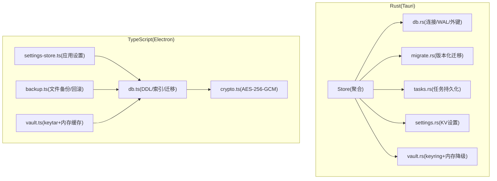
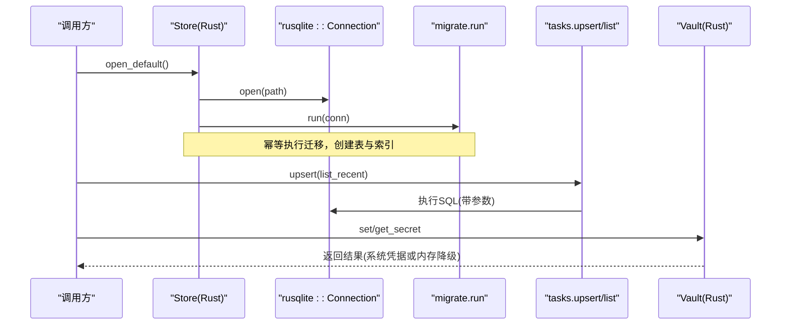
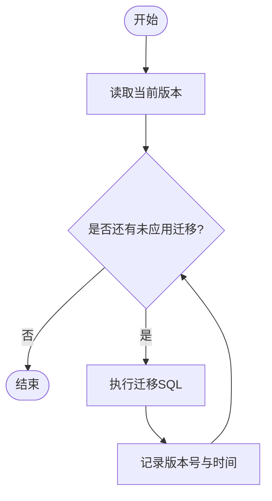
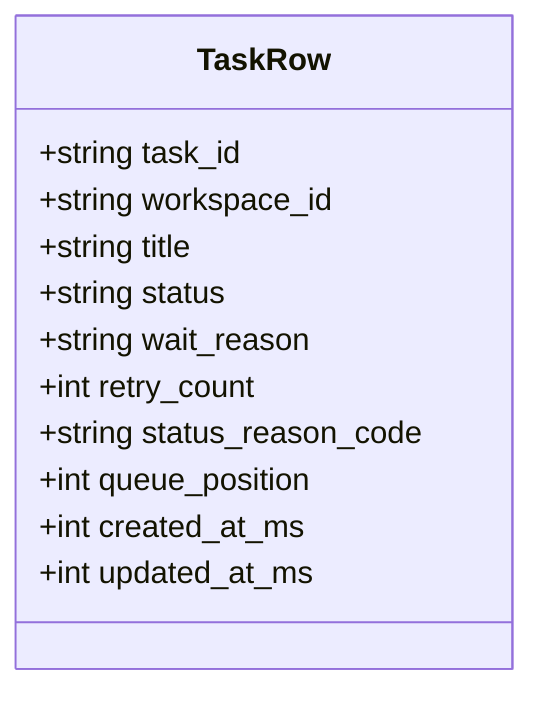
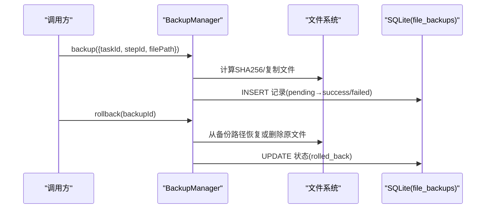
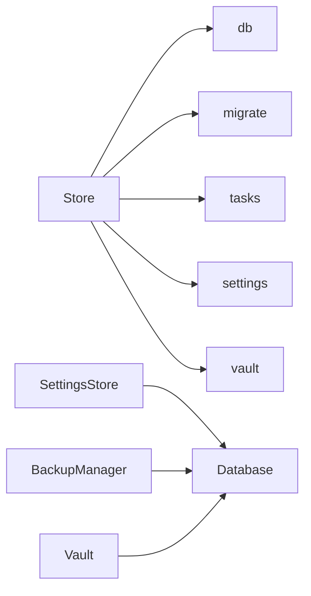

# 存储层

<cite>
**本文引用的文件**
- [store/mod.rs](file://tongtian-tauri/src-tauri/src/store/mod.rs)
- [store/db.rs](file://tongtian-tauri/src-tauri/src/store/db.rs)
- [store/migrate.rs](file://tongtian-tauri/src-tauri/src/store/migrate.rs)
- [store/tasks.rs](file://tongtian-tauri/src-tauri/src/store/tasks.rs)
- [store/settings.rs](file://tongtian-tauri/src-tauri/src/store/settings.rs)
- [store/vault.rs](file://tongtian-tauri/src-tauri/src/store/vault.rs)
- [main/store/db.ts](file://tongtian-tauri/src/main/store/db.ts)
- [main/store/settings-store.ts](file://tongtian-tauri/src/main/store/settings-store.ts)
- [main/store/vault.ts](file://tongtian-tauri/src/main/store/vault.ts)
- [main/file/backup.ts](file://tongtian-tauri/src/main/file/backup.ts)
- [main/util/crypto.ts](file://tongtian-tauri/src/main/util/crypto.ts)
</cite>

## 目录
1. [简介](#简介)
2. [项目结构](#项目结构)
3. [核心组件](#核心组件)
4. [架构总览](#架构总览)
5. [详细组件分析](#详细组件分析)
6. [依赖关系分析](#依赖关系分析)
7. [性能与并发](#性能与并发)
8. [备份与恢复](#备份与恢复)
9. [安全与权限](#安全与权限)
10. [数据库操作最佳实践](#数据库操作最佳实践)
11. [故障排查](#故障排查)
12. [结论](#结论)

## 简介
本文件为通天办公项目的“存储层”技术文档，聚焦基于 SQLite 的数据持久化方案。内容涵盖：
- 数据库 Schema 设计（Rust Tauri 侧与 Electron 主进程侧）
- 事务管理与迁移策略
- 索引优化与查询路径
- 任务数据、设置数据、密钥存储的实现细节
- Vault 安全存储、数据加密与权限控制
- 备份与恢复机制
- 并发访问控制与性能调优指南

## 项目结构
存储层由两部分组成：
- Rust 侧（Tauri 后端）：使用 rusqlite 管理本地 SQLite 数据库，负责 tasks、settings_kv、model_configs 等核心表以及版本化迁移和 Vault（系统凭据管理器）。
- TypeScript 侧（Electron 主进程）：使用 better-sqlite3 维护更丰富的业务表（消息、审计、工作区、技能、MCP、计划任务、用量等），并提供应用设置持久化、文件备份恢复、AES 加密工具。

图表来源
- [store/mod.rs:18-51](file://tongtian-tauri/src-tauri/src/store/mod.rs#L18-L51)
- [store/db.rs:16-25](file://tongtian-tauri/src-tauri/src/store/db.rs#L16-L25)
- [store/migrate.rs:43-73](file://tongtian-tauri/src-tauri/src/store/migrate.rs#L43-L73)
- [store/tasks.rs:27-95](file://tongtian-tauri/src-tauri/src/store/tasks.rs#L27-L95)
- [store/settings.rs:5-48](file://tongtian-tauri/src-tauri/src/store/settings.rs#L5-L48)
- [store/vault.rs:9-85](file://tongtian-tauri/src-tauri/src/store/vault.rs#L9-L85)
- [main/store/db.ts:66-328](file://tongtian-tauri/src/main/store/db.ts#L66-L328)
- [main/store/settings-store.ts:43-133](file://tongtian-tauri/src/main/store/settings-store.ts#L43-L133)
- [main/store/vault.ts:60-137](file://tongtian-tauri/src/main/store/vault.ts#L60-L137)
- [main/file/backup.ts:39-333](file://tongtian-tauri/src/main/file/backup.ts#L39-L333)
- [main/util/crypto.ts:29-104](file://tongtian-tauri/src/main/util/crypto.ts#L29-L104)

章节来源
- [store/mod.rs:1-51](file://tongtian-tauri/src-tauri/src/store/mod.rs#L1-L51)
- [main/store/db.ts:66-328](file://tongtian-tauri/src/main/store/db.ts#L66-L328)

## 核心组件
- Store（Rust）：聚合 DB 连接与 Vault，提供 with_conn 临界区访问，启动时执行迁移。
- db（Rust）：解析运行目录，打开 SQLite 并启用 WAL 和外键约束。
- migrate（Rust）：通过 schema_version 表驱动幂等迁移，创建 model_configs、tasks、settings_kv 及索引。
- tasks（Rust）：任务 upsert、按更新时间倒序列出最近任务。
- settings（Rust）：KV 设置读写与全量读取。
- vault（Rust）：优先使用系统 keyring，不可用时内存降级；API Key 不落库。
- Database（TS）：better-sqlite3 单例，定义完整 DDL/索引，WAL 模式，外键开启，版本化迁移。
- SettingsStore（TS）：应用设置 JSON 持久化，内存缓存，启动时恢复系统行为（开机自启、保持唤醒）。
- Vault（TS）：keytar 系统凭据存储 + 内存缓存，支持 mock。
- BackupManager（TS）：文件级备份与回滚，SHA256 校验，定时清理过期备份。
- Crypto（TS）：AES-256-GCM 加解密，scrypt 派生密钥。

章节来源
- [store/mod.rs:18-51](file://tongtian-tauri/src-tauri/src/store/mod.rs#L18-L51)
- [store/db.rs:16-25](file://tongtian-tauri/src-tauri/src/store/db.rs#L16-L25)
- [store/migrate.rs:4-73](file://tongtian-tauri/src-tauri/src/store/migrate.rs#L4-L73)
- [store/tasks.rs:27-95](file://tongtian-tauri/src-tauri/src/store/tasks.rs#L27-L95)
- [store/settings.rs:5-48](file://tongtian-tauri/src-tauri/src/store/settings.rs#L5-L48)
- [store/vault.rs:9-85](file://tongtian-tauri/src-tauri/src/store/vault.rs#L9-L85)
- [main/store/db.ts:66-328](file://tongtian-tauri/src/main/store/db.ts#L66-L328)
- [main/store/settings-store.ts:43-133](file://tongtian-tauri/src/main/store/settings-store.ts#L43-L133)
- [main/store/vault.ts:60-137](file://tongtian-tauri/src/main/store/vault.ts#L60-L137)
- [main/file/backup.ts:39-333](file://tongtian-tauri/src/main/file/backup.ts#L39-L333)
- [main/util/crypto.ts:29-104](file://tongtian-tauri/src/main/util/crypto.ts#L29-L104)

## 架构总览
- 数据平面：SQLite 作为唯一持久化介质（Rust 与 TS 各自维护独立数据库文件）。
- 控制平面：Store 聚合连接与 Vault；Database 单例封装 DDL/索引/迁移；SettingsStore 管理应用设置与系统行为。
- 安全平面：Rust 侧 Vault 使用 keyring，TS 侧 Vault 使用 keytar；敏感字段不落库或仅存引用标记；可选 AES-256-GCM 加密。
- 运维平面：版本化迁移保证 Schema 演进；文件备份与回滚保障数据安全；WAL 提升并发读性能。

图表来源
- [store/mod.rs:24-51](file://tongtian-tauri/src-tauri/src/store/mod.rs#L24-L51)
- [store/db.rs:16-25](file://tongtian-tauri/src-tauri/src/store/db.rs#L16-L25)
- [store/migrate.rs:43-73](file://tongtian-tauri/src-tauri/src/store/migrate.rs#L43-L73)
- [store/tasks.rs:27-95](file://tongtian-tauri/src-tauri/src/store/tasks.rs#L27-L95)
- [store/vault.rs:38-85](file://tongtian-tauri/src-tauri/src/store/vault.rs#L38-L85)

## 详细组件分析

### 数据库连接与运行目录（Rust）
- 运行目录：优先使用环境变量覆盖，否则回退到桥接模块提供的 base_dir。
- 连接配置：WAL 日志模式、外键约束开启，提高并发读与一致性。
- 错误处理：打开失败与 pragma 失败均包装为统一错误前缀，便于定位。

章节来源
- [store/db.rs:5-25](file://tongtian-tauri/src-tauri/src/store/db.rs#L5-L25)

### 版本化迁移（Rust）
- 迁移脚本以数组声明，按顺序编号，通过 schema_version 记录已应用版本。
- 幂等性：重复执行不会重复插入版本，也不会重复建表。
- 当前包含：model_configs、tasks（含索引）、settings_kv。

图表来源
- [store/migrate.rs:43-73](file://tongtian-tauri/src-tauri/src/store/migrate.rs#L43-L73)

章节来源
- [store/migrate.rs:4-73](file://tongtian-tauri/src-tauri/src/store/migrate.rs#L4-L73)

### 任务数据（Rust）
- 数据结构：TaskRow 对齐前端 TaskSummary + meta，包含状态、重试次数、队列位置、时间戳等。
- 写入：upsert 使用 ON CONFLICT 更新关键字段，避免重复插入。
- 查询：list_recent 按 updated_at_ms 倒序，支持 limit 限制返回条数。
- 索引：idx_tasks_updated 加速排序查询。

图表来源
- [store/tasks.rs:9-25](file://tongtian-tauri/src-tauri/src/store/tasks.rs#L9-L25)

章节来源
- [store/tasks.rs:27-95](file://tongtian-tauri/src-tauri/src/store/tasks.rs#L27-L95)
- [store/migrate.rs:22-39](file://tongtian-tauri/src-tauri/src/store/migrate.rs#L22-L39)

### 设置数据（Rust）
- KV 模型：settings_kv 表，key 为主键，value 为字符串。
- 接口：get/set/all，支持覆盖写入与全量读取。
- 适用场景：轻量配置项，如主题、语言等。

章节来源
- [store/settings.rs:5-48](file://tongtian-tauri/src-tauri/src/store/settings.rs#L5-L48)
- [store/migrate.rs:36-39](file://tongtian-tauri/src-tauri/src/store/migrate.rs#L36-L39)

### 密钥存储（Rust Vault）
- 原则：API Key 永不落库，DB 仅保存 has_api_key 引用标记。
- 实现：优先使用系统 keyring；若不可用（如 headless CI），自动降级到进程内内存 HashMap。
- 生命周期：进程退出即清除内存降级数据。

章节来源
- [store/vault.rs:1-85](file://tongtian-tauri/src-tauri/src/store/vault.rs#L1-L85)
- [store/migrate.rs:7-20](file://tongtian-tauri/src-tauri/src/store/migrate.rs#L7-L20)

### 数据库与迁移（TypeScript）
- 单例 Database：初始化时创建 data 目录，打开 better-sqlite3，启用 WAL 与外键。
- DDL：包含 tasks、messages、file_ops、file_backups、model_configs、audit_logs、workspaces、skills、mcp_servers、sandbox_policies、schedule_tasks、model_usage、app_settings、awareness_profiles、memory_entries、connector_states、archived_tasks、hook_configs 等。
- 索引：针对常用查询列建立索引，如 messages(task_id)、audit_logs(timestamp/event/task_id/model_id) 等。
- 迁移：schema_version 控制版本，v1→v2 新增表与索引，幂等执行。

章节来源
- [main/store/db.ts:66-328](file://tongtian-tauri/src/main/store/db.ts#L66-L328)

### 应用设置（TypeScript）
- SettingsStore：内存缓存 + SQLite app_settings(JSON) 持久化。
- 系统行为：根据设置切换开机自启动、保持唤醒（powerSaveBlocker）。
- 容错：加载失败回退默认值，持久化失败记录日志。

章节来源
- [main/store/settings-store.ts:43-133](file://tongtian-tauri/src/main/store/settings-store.ts#L43-L133)

### 密钥存储（TypeScript Vault）
- 使用 keytar 系统凭据存储 API Key，支持 MOCK_VAULT=true 走内存 mock。
- 内存缓存：减少频繁系统调用开销，进程退出时清理。
- 能力：增删改查、批量清理。

章节来源
- [main/store/vault.ts:60-137](file://tongtian-tauri/src/main/store/vault.ts#L60-L137)

### 备份与恢复（TypeScript）
- BackupManager：对文件进行备份与回滚，记录 SHA256 指纹，状态机 pending/success/failed/rolled_back。
- 存储：备份文件位于 userData/.tongtian-backups/<taskId>/<stepId>，元数据写入 file_backups 表。
- 清理：定时清理超过保留期的备份（默认 24 小时）。

图表来源
- [main/file/backup.ts:86-182](file://tongtian-tauri/src/main/file/backup.ts#L86-L182)
- [main/file/backup.ts:293-319](file://tongtian-tauri/src/main/file/backup.ts#L293-L319)

章节来源
- [main/file/backup.ts:39-333](file://tongtian-tauri/src/main/file/backup.ts#L39-L333)

### 数据加密（TypeScript）
- 算法：AES-256-GCM，随机 IV 与 Salt，scrypt 派生密钥。
- 输出：EncryptedPayload（encrypted/iv/salt/tag Base64）。
- 用途：可对敏感数据进行本地加密存储（例如扩展字段或导出包）。

章节来源
- [main/util/crypto.ts:29-104](file://tongtian-tauri/src/main/util/crypto.ts#L29-L104)

## 依赖关系分析
- Rust Store 依赖 db、migrate、tasks、settings、vault；对外暴露 with_conn 与 vault 访问。
- TS Database 被 SettingsStore、BackupManager、Vault 共同使用。
- 跨端职责分离：Rust 侧重核心闭环（任务、设置、密钥引用），TS 侧重丰富业务表与系统交互。

图表来源
- [store/mod.rs:18-51](file://tongtian-tauri/src-tauri/src/store/mod.rs#L18-L51)
- [main/store/settings-store.ts:43-133](file://tongtian-tauri/src/main/store/settings-store.ts#L43-L133)
- [main/file/backup.ts:39-333](file://tongtian-tauri/src/main/file/backup.ts#L39-L333)
- [main/store/vault.ts:60-137](file://tongtian-tauri/src/main/store/vault.ts#L60-L137)

章节来源
- [store/mod.rs:18-51](file://tongtian-tauri/src-tauri/src/store/mod.rs#L18-L51)
- [main/store/db.ts:284-359](file://tongtian-tauri/src/main/store/db.ts#L284-L359)

## 性能与并发
- WAL 模式：两端均启用 WAL，提升并发读性能与稳定性。
- 索引优化：
  - Rust：tasks.updated_at_ms 降序索引，加速历史列表。
  - TS：messages、audit_logs、workspaces、skills、mcp_servers、sandbox_policies、model_usage、schedule_tasks、memory_entries、archived_tasks 等关键列建立索引。
- 查询限制：list_recent 支持 limit，避免大结果集。
- 建议：
  - 批量写入时使用事务包裹多条 SQL（在 TS 中可通过 execBatch 或在 Rust 中使用 rusqlite 事务）。
  - 避免 SELECT *，只选择必要列。
  - 对高频过滤条件添加合适索引（如 workspace_id、status、timestamp）。
  - 监控慢查询，必要时拆分复杂查询。

章节来源
- [store/db.rs:16-25](file://tongtian-tauri/src-tauri/src/store/db.rs#L16-L25)
- [store/migrate.rs:34-34](file://tongtian-tauri/src-tauri/src/store/migrate.rs#L34-L34)
- [main/store/db.ts:263-280](file://tongtian-tauri/src/main/store/db.ts#L263-L280)
- [store/tasks.rs:61-95](file://tongtian-tauri/src-tauri/src/store/tasks.rs#L61-L95)

## 备份与恢复
- 文件级备份：BackupManager 在操作前备份目标文件，记录 SHA256，支持回滚。
- 元数据持久化：file_backups 表记录备份轨迹，便于审计与清理。
- 清理策略：定时清理超过保留期的备份，释放磁盘空间。
- 建议：
  - 在执行破坏性操作前强制触发备份。
  - 对重要数据增加多步骤备份点，便于细粒度回滚。
  - 定期验证备份完整性（比对 SHA256）。

章节来源
- [main/file/backup.ts:86-182](file://tongtian-tauri/src/main/file/backup.ts#L86-L182)
- [main/file/backup.ts:232-280](file://tongtian-tauri/src/main/file/backup.ts#L232-L280)

## 安全与权限
- 密钥存储：
  - Rust：keyring 优先，内存降级；DB 仅存 has_api_key 标记。
  - TS：keytar 系统凭据 + 内存缓存；支持 mock。
- 数据加密：AES-256-GCM + scrypt 派生密钥，适用于敏感数据的本地加密存储。
- 权限控制：
  - 外键约束开启，确保引用完整性。
  - 审计日志表（audit_logs）记录关键事件，便于追踪。
  - 沙箱策略表（sandbox_policies）限制执行级别与资源上限。
- 建议：
  - 禁止将明文密钥写入任何持久化存储。
  - 对导出或共享的敏感数据先加密再传输。
  - 结合审计日志与权限策略，最小化访问范围。

章节来源
- [store/vault.rs:1-85](file://tongtian-tauri/src-tauri/src/store/vault.rs#L1-L85)
- [main/store/vault.ts:60-137](file://tongtian-tauri/src/main/store/vault.ts#L60-L137)
- [main/util/crypto.ts:29-104](file://tongtian-tauri/src/main/util/crypto.ts#L29-L104)
- [main/store/db.ts:128-189](file://tongtian-tauri/src/main/store/db.ts#L128-L189)

## 数据库操作最佳实践
- 事务使用：
  - 批量写入/更新应包裹在事务中，减少 I/O 与锁竞争。
  - 长事务需谨慎，避免阻塞其他读写。
- 参数化查询：
  - 所有用户输入必须通过参数绑定，防止注入。
- 索引设计：
  - 为高频过滤/排序列建立索引（如 updated_at_ms、task_id、timestamp）。
  - 避免过度索引影响写入性能。
- 查询优化：
  - 使用 LIMIT 限制结果集大小。
  - 避免 N+1 查询，尽量 JOIN 或分批获取。
- 错误处理：
  - 统一错误前缀与日志，便于定位问题。
  - 对关键路径增加重试与降级策略（如 Vault 内存降级）。
- 迁移策略：
  - 使用 schema_version 驱动幂等迁移。
  - 新增表/索引使用 IF NOT EXISTS，确保可重入。

章节来源
- [store/migrate.rs:43-73](file://tongtian-tauri/src-tauri/src/store/migrate.rs#L43-L73)
- [store/tasks.rs:27-95](file://tongtian-tauri/src-tauri/src/store/tasks.rs#L27-L95)
- [store/settings.rs:5-48](file://tongtian-tauri/src-tauri/src/store/settings.rs#L5-L48)
- [main/store/db.ts:301-328](file://tongtian-tauri/src/main/store/db.ts#L301-L328)

## 故障排查
- 数据库无法打开：
  - 检查运行目录是否存在与权限（Rust 会创建目录）。
  - 确认 WAL 与外键 pragma 成功。
- 迁移失败：
  - 查看 schema_version 当前版本与迁移脚本顺序。
  - 检查 SQL 语法与依赖表是否存在。
- 任务列表为空或顺序异常：
  - 确认 idx_tasks_updated 索引存在。
  - 检查 updated_at_ms 是否正确更新。
- 设置读取不到：
  - 检查 app_settings 表中对应 key 是否存在。
  - 确认 SettingsStore 缓存是否被正确初始化。
- 密钥读取失败：
  - Rust：keyring 不可用时会降级内存，注意进程内数据不持久。
  - TS：keytar 不可用或环境受限，可启用 MOCK_VAULT。
- 备份失败：
  - 检查文件路径与权限。
  - 查看 file_backups 状态与日志。

章节来源
- [store/db.rs:16-25](file://tongtian-tauri/src-tauri/src/store/db.rs#L16-L25)
- [store/migrate.rs:43-73](file://tongtian-tauri/src-tauri/src/store/migrate.rs#L43-L73)
- [store/tasks.rs:61-95](file://tongtian-tauri/src-tauri/src/store/tasks.rs#L61-L95)
- [main/store/settings-store.ts:55-92](file://tongtian-tauri/src/main/store/settings-store.ts#L55-L92)
- [store/vault.rs:38-85](file://tongtian-tauri/src-tauri/src/store/vault.rs#L38-L85)
- [main/store/vault.ts:78-117](file://tongtian-tauri/src/main/store/vault.ts#L78-L117)
- [main/file/backup.ts:147-182](file://tongtian-tauri/src/main/file/backup.ts#L147-L182)

## 结论
本项目存储层采用双端 SQLite 方案：Rust 侧聚焦核心闭环（任务、设置、密钥引用）与系统凭据集成；TS 侧提供更丰富的业务表、应用设置、文件备份与加密能力。通过 WAL、索引、版本化迁移与 Vault 机制，实现了高可用、可扩展与安全可控的本地数据持久化。建议在后续迭代中持续完善事务边界、索引设计与审计追踪，并结合备份策略保障数据安全。