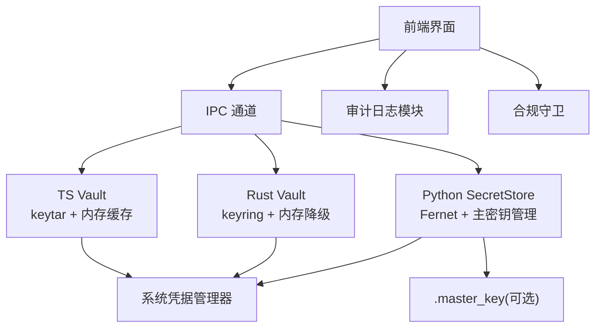
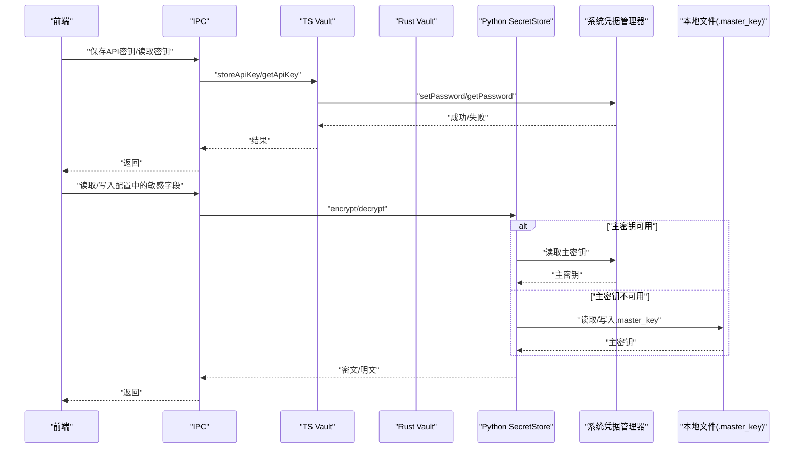
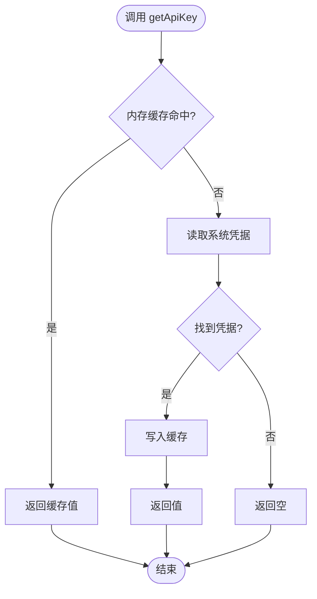
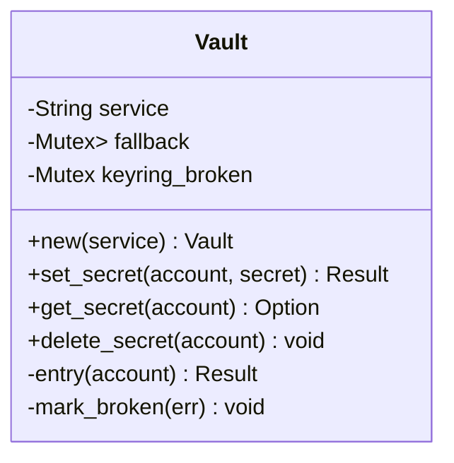
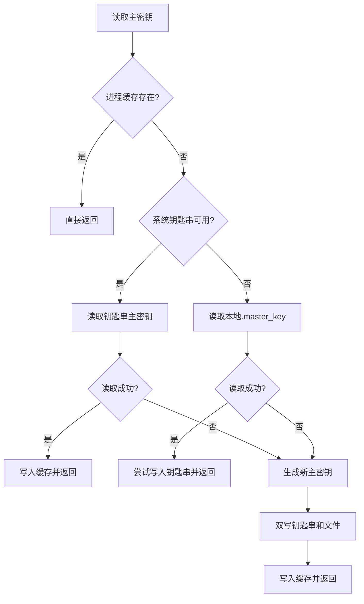
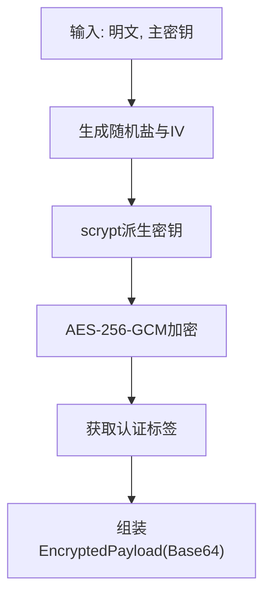
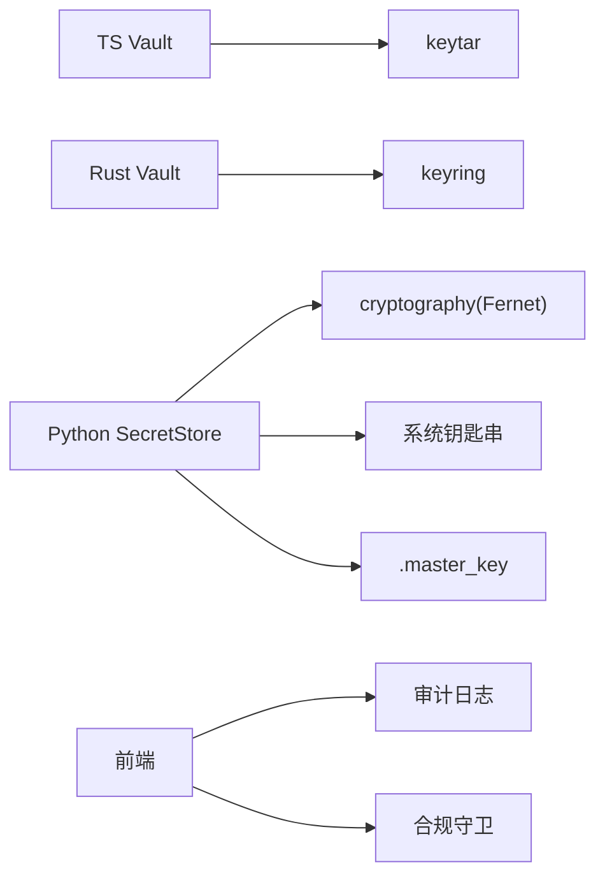

# 密钥管理

<cite>
**本文引用的文件**
- [vault.ts](file://tongtian-tauri/src/main/store/vault.ts)
- [vault.rs](file://tongtian-tauri/src-tauri/src/store/vault.rs)
- [crypto.ts](file://tongtian-tauri/src/main/util/crypto.ts)
- [secret_store.py](file://tongtian-tauri/src/agent/security/secret_store.py)
- [settings-store.ts](file://tongtian-tauri/src/main/store/settings-store.ts)
- [audit-logging/spec.md](file://docs/changes/qwenpaw-integration/specs/audit-logging/spec.md)
- [compliance/spec.md](file://docs/changes/qwenpaw-integration/specs/compliance/spec.md)
</cite>

## 目录
1. [简介](#简介)
2. [项目结构](#项目结构)
3. [核心组件](#核心组件)
4. [架构总览](#架构总览)
5. [详细组件分析](#详细组件分析)
6. [依赖关系分析](#依赖关系分析)
7. [性能考虑](#性能考虑)
8. [故障排查指南](#故障排查指南)
9. [结论](#结论)
10. [附录](#附录)

## 简介
本文件为通天办公项目的“密钥管理”专项文档，聚焦安全存储实现与合规能力。内容覆盖：
- 敏感数据的加密存储、密钥轮换、访问权限控制
- Vault 的设计模式、加密算法选择、密钥派生机制
- API 密钥、模型配置、用户凭据的安全存储方案
- 密钥导入导出、批量管理、审计日志记录
- 安全最佳实践、漏洞防护、合规性要求
- 与操作系统安全特性的集成方式（系统钥匙串/凭据管理器）

## 项目结构
本项目在 Tauri 主进程侧提供跨语言的安全存储能力：
- TypeScript 层通过 keytar 调用系统凭据管理器，并维护内存缓存
- Rust 层通过 keyring 调用系统凭据管理器，并提供内存降级
- Python Agent 侧提供 Fernet 加密的持久化秘密存储，支持主密钥从系统钥匙串或本地文件获取
- 前端与后端通过 IPC 通道暴露能力，配合审计与合规策略

图表来源
- [vault.ts:1-137](file://tongtian-tauri/src/main/store/vault.ts#L1-L137)
- [vault.rs:1-119](file://tongtian-tauri/src-tauri/src/store/vault.rs#L1-L119)
- [secret_store.py:1-467](file://tongtian-tauri/src/agent/security/secret_store.py#L1-L467)
- [audit-logging/spec.md:1-89](file://docs/changes/qwenpaw-integration/specs/audit-logging/spec.md#L1-L89)
- [compliance/spec.md:1-131](file://docs/changes/qwenpaw-integration/specs/compliance/spec.md#L1-L131)

章节来源
- [vault.ts:1-137](file://tongtian-tauri/src/main/store/vault.ts#L1-L137)
- [vault.rs:1-119](file://tongtian-tauri/src-tauri/src/store/vault.rs#L1-L119)
- [secret_store.py:1-467](file://tongtian-tauri/src/agent/security/secret_store.py#L1-L467)
- [audit-logging/spec.md:1-89](file://docs/changes/qwenpaw-integration/specs/audit-logging/spec.md#L1-L89)
- [compliance/spec.md:1-131](file://docs/changes/qwenpaw-integration/specs/compliance/spec.md#L1-L131)

## 核心组件
- TS Vault：封装 keytar 访问系统凭据管理器，提供 API Key 的增删改查与内存缓存；支持 MOCK_VAULT 环境变量切换至内存模拟存储
- Rust Vault：封装 keyring 访问系统凭据管理器，不可用时自动降级到进程内 HashMap；提供 set/get/delete 接口
- Python SecretStore：使用 Fernet（AES-128-CBC + HMAC-SHA256）对敏感字段进行透明加解密；主密钥优先从系统钥匙串读取，否则回退到本地 .master_key 文件
- 加密工具 crypto.ts：提供 AES-256-GCM 加解密与基于 scrypt 的密钥派生，用于需要可移植密文的场景
- 设置持久化 settings-store.ts：应用设置落库与系统行为落地（如开机自启、保持唤醒），与安全策略联动

章节来源
- [vault.ts:1-137](file://tongtian-tauri/src/main/store/vault.ts#L1-L137)
- [vault.rs:1-119](file://tongtian-tauri/src-tauri/src/store/vault.rs#L1-L119)
- [secret_store.py:1-467](file://tongtian-tauri/src/agent/security/secret_store.py#L1-L467)
- [crypto.ts:1-105](file://tongtian-tauri/src/main/util/crypto.ts#L1-L105)
- [settings-store.ts:1-136](file://tongtian-tauri/src/main/store/settings-store.ts#L1-L136)

## 架构总览
下图展示密钥在系统中的流转路径：前端发起请求，经 IPC 路由到 TS/Rust Vault，最终写入系统凭据管理器；Agent 侧通过 SecretStore 对磁盘上的敏感字段进行透明加解密，主密钥来自系统钥匙串或本地文件。

图表来源
- [vault.ts:1-137](file://tongtian-tauri/src/main/store/vault.ts#L1-L137)
- [vault.rs:1-119](file://tongtian-tauri/src-tauri/src/store/vault.rs#L1-L119)
- [secret_store.py:1-467](file://tongtian-tauri/src/agent/security/secret_store.py#L1-L467)

## 详细组件分析

### TS Vault（keytar + 内存缓存）
- 设计要点
  - 单例模式：全局唯一实例，避免重复初始化
  - 服务名隔离：统一 SERVICE_NAME 作为凭据命名空间
  - 内存缓存：提高读取性能，进程退出时清理
  - 降级策略：MOCK_VAULT=true 时使用内存模拟存储，便于测试
- 关键操作
  - storeApiKey(id, key)：写入系统凭据并更新缓存
  - getApiKey(id)：先查缓存，再读系统凭据
  - deleteApiKey(id)：删除系统凭据并清缓存
  - clearAll()：遍历并删除所有凭据，清空缓存
  - 进程退出信号处理：SIGINT/SIGTERM/exit 时清理内存缓存

图表来源
- [vault.ts:58-124](file://tongtian-tauri/src/main/store/vault.ts#L58-L124)

章节来源
- [vault.ts:1-137](file://tongtian-tauri/src/main/store/vault.ts#L1-L137)

### Rust Vault（keyring + 内存降级）
- 设计要点
  - 优先使用 keyring 访问系统凭据管理器
  - 当 keyring 不可用时，自动降级到进程内 HashMap，并在首次失败时输出告警
  - 线程安全：使用 Mutex 保护共享状态
- 关键操作
  - set_secret(account, secret)：写入系统凭据或内存降级
  - get_secret(account)：优先读系统凭据，失败则读内存
  - delete_secret(account)：删除系统凭据或内存条目

图表来源
- [vault.rs:9-85](file://tongtian-tauri/src-tauri/src/store/vault.rs#L9-L85)

章节来源
- [vault.rs:1-119](file://tongtian-tauri/src-tauri/src/store/vault.rs#L1-L119)

### Python SecretStore（Fernet 透明加密 + 主密钥管理）
- 设计要点
  - 透明加解密：敏感字段以 ENC: 前缀标识，读写时自动加解密
  - 主密钥来源优先级：进程缓存 → 系统钥匙串 → 本地 .master_key 文件 → 生成新密钥并双写
  - 超时保护：对 keyring 调用采用线程+超时，避免在无桌面环境的 Linux 上阻塞
  - 兼容迁移：支持旧版 CoPaw 钥匙串项向后兼容
- 关键操作
  - encrypt/decrypt：对字符串进行 Fernet 加解密
  - _get_master_key：获取/生成/缓存主密钥
  - reload_master_key_from_disk：恢复备份后刷新缓存并同步钥匙串
  - encrypt_dict_fields/decrypt_dict_fields：对字典中指定敏感字段批量加解密

图表来源
- [secret_store.py:287-321](file://tongtian-tauri/src/agent/security/secret_store.py#L287-L321)
- [secret_store.py:346-374](file://tongtian-tauri/src/agent/security/secret_store.py#L346-L374)
- [secret_store.py:382-423](file://tongtian-tauri/src/agent/security/secret_store.py#L382-L423)

章节来源
- [secret_store.py:1-467](file://tongtian-tauri/src/agent/security/secret_store.py#L1-L467)

### 加密工具 crypto.ts（AES-256-GCM + scrypt 密钥派生）
- 设计要点
  - 算法：AES-256-GCM（提供机密性与完整性校验）
  - 密钥派生：scrypt（N=16384, r=8, p=1）将口令与随机盐派生出 256 位密钥
  - 参数：IV=16字节，Salt=32字节，Tag=16字节
  - 输出：EncryptedPayload（encrypted/iv/salt/tag 均为 Base64）
- 适用场景
  - 需要可移植密文（例如跨进程/跨平台传输）的场景
  - 与系统凭据管理器结合：凭据管理器仅存口令或主密钥，密文由上层生成与验证

图表来源
- [crypto.ts:18-43](file://tongtian-tauri/src/main/util/crypto.ts#L18-L43)
- [crypto.ts:55-75](file://tongtian-tauri/src/main/util/crypto.ts#L55-L75)
- [crypto.ts:87-104](file://tongtian-tauri/src/main/util/crypto.ts#L87-L104)

章节来源
- [crypto.ts:1-105](file://tongtian-tauri/src/main/util/crypto.ts#L1-L105)

### 设置与系统行为（settings-store.ts）
- 作用：应用设置的持久化与系统行为落地（开机自启动、保持唤醒）
- 与安全联动：可通过设置项启用/禁用安全相关功能（如 secureEnv），并与合规策略配合

章节来源
- [settings-store.ts:1-136](file://tongtian-tauri/src/main/store/settings-store.ts#L1-L136)

## 依赖关系分析
- TS Vault 依赖 keytar（系统凭据管理器），并通过环境变量 MOCK_VAULT 切换至内存模拟
- Rust Vault 依赖 keyring（系统凭据管理器），不可用时降级到内存
- Python SecretStore 依赖 cryptography 的 Fernet，主密钥来源于系统钥匙串或本地文件
- 审计与合规模块通过 IPC 暴露查询与导出能力，与密钥管理协同工作

图表来源
- [vault.ts:1-137](file://tongtian-tauri/src/main/store/vault.ts#L1-L137)
- [vault.rs:1-119](file://tongtian-tauri/src-tauri/src/store/vault.rs#L1-L119)
- [secret_store.py:1-467](file://tongtian-tauri/src/agent/security/secret_store.py#L1-L467)
- [audit-logging/spec.md:1-89](file://docs/changes/qwenpaw-integration/specs/audit-logging/spec.md#L1-L89)
- [compliance/spec.md:1-131](file://docs/changes/qwenpaw-integration/specs/compliance/spec.md#L1-L131)

章节来源
- [vault.ts:1-137](file://tongtian-tauri/src/main/store/vault.ts#L1-L137)
- [vault.rs:1-119](file://tongtian-tauri/src-tauri/src/store/vault.rs#L1-L119)
- [secret_store.py:1-467](file://tongtian-tauri/src/agent/security/secret_store.py#L1-L467)
- [audit-logging/spec.md:1-89](file://docs/changes/qwenpaw-integration/specs/audit-logging/spec.md#L1-L89)
- [compliance/spec.md:1-131](file://docs/changes/qwenpaw-integration/specs/compliance/spec.md#L1-L131)

## 性能考虑
- 内存缓存：TS Vault 在读路径引入内存缓存，减少系统凭据管理器调用次数
- 超时保护：Python SecretStore 对 keyring 调用设置超时，避免在无桌面环境阻塞
- 降级策略：Rust Vault 在 keyring 不可用时自动降级到内存，保证可用性
- 批量化：SecretStore 提供字典字段批量加解密，降低多次 IO 开销

[本节为通用性能建议，不直接分析具体文件]

## 故障排查指南
- 无法访问系统凭据管理器
  - 现象：TS/Rust 层读取失败或降级到内存
  - 排查：检查环境变量（如 MOCK_VAULT）、桌面环境是否可用、keyring/keytar 驱动是否正常
- 主密钥丢失或损坏
  - 现象：Python 层解密失败或提示主密钥变更
  - 处理：调用 reload_master_key_from_disk 刷新缓存并同步钥匙串；必要时重新生成主密钥并双写
- 审计日志缺失或脱敏异常
  - 现象：审计事件未记录或敏感信息未脱敏
  - 排查：确认审计模块已接入 IPC 通道，检查事件类型与脱敏规则
- 合规阻断
  - 现象：外部模型调用被拒绝
  - 排查：检查硬开关状态、白名单配置、数据分级检测结果

章节来源
- [secret_store.py:382-423](file://tongtian-tauri/src/agent/security/secret_store.py#L382-L423)
- [audit-logging/spec.md:54-89](file://docs/changes/qwenpaw-integration/specs/audit-logging/spec.md#L54-L89)
- [compliance/spec.md:42-77](file://docs/changes/qwenpaw-integration/specs/compliance/spec.md#L42-L77)

## 结论
通天办公的密钥管理采用“系统凭据管理器优先 + 内存降级”的多层架构，结合 Fernet 与 AES-256-GCM 的加密能力，实现了 API 密钥、模型配置与用户凭据的安全存储。通过审计与合规模块，满足企业级可追溯与合规要求。建议在部署中：
- 始终优先使用系统凭据管理器存储主密钥与敏感数据
- 定期轮换主密钥并同步钥匙串与本地文件
- 开启全量审计与合规策略，确保敏感操作可追踪、可审计
- 在 CI/容器环境中合理配置环境变量以避免阻塞

[本节为总结性内容，不直接分析具体文件]

## 附录

### 安全最佳实践
- 使用系统凭据管理器存储主密钥与敏感数据，避免明文落盘
- 对可移植密文使用 AES-256-GCM 并附带认证标签，防止篡改
- 使用 scrypt 等强哈希函数进行密钥派生，合理设置成本参数
- 对敏感字段采用透明加解密，读写时自动处理，降低业务侵入
- 启用全量审计与合规策略，记录模型调用、配置变更与数据流向

[本节为通用安全建议，不直接分析具体文件]

### 合规性要求
- 数据分级检测：根据敏感度限制数据外发目标
- 出域白名单：仅允许受信任模型接收敏感数据
- 硬开关：一键禁用外部 API 调用，保障数据安全
- 合规告知：首次外发数据需用户确认
- 审计日志：记录模型调用、token 用量、配置变更等事件，支持查询与导出

章节来源
- [compliance/spec.md:18-77](file://docs/changes/qwenpaw-integration/specs/compliance/spec.md#L18-L77)
- [audit-logging/spec.md:18-89](file://docs/changes/qwenpaw-integration/specs/audit-logging/spec.md#L18-L89)

### 与操作系统安全特性集成
- Windows/macOS/Linux：通过 keytar/keyring 访问系统凭据管理器（Windows Credential Manager、macOS Keychain、Linux Secret Service）
- 无桌面环境：通过环境变量跳过 keyring 访问，避免阻塞；必要时回退到本地文件存储
- 权限控制：利用系统凭据管理器的服务/账户命名空间隔离不同应用数据

章节来源
- [vault.ts:1-137](file://tongtian-tauri/src/main/store/vault.ts#L1-L137)
- [vault.rs:1-119](file://tongtian-tauri/src-tauri/src/store/vault.rs#L1-L119)
- [secret_store.py:93-131](file://tongtian-tauri/src/agent/security/secret_store.py#L93-L131)