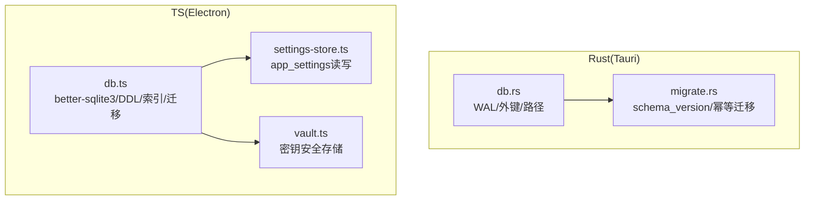
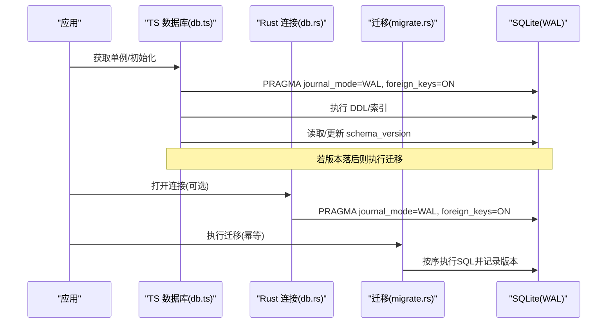
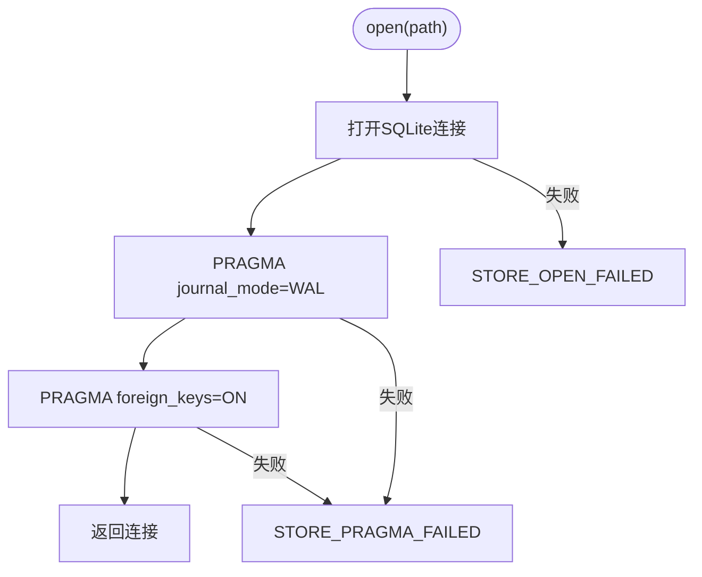
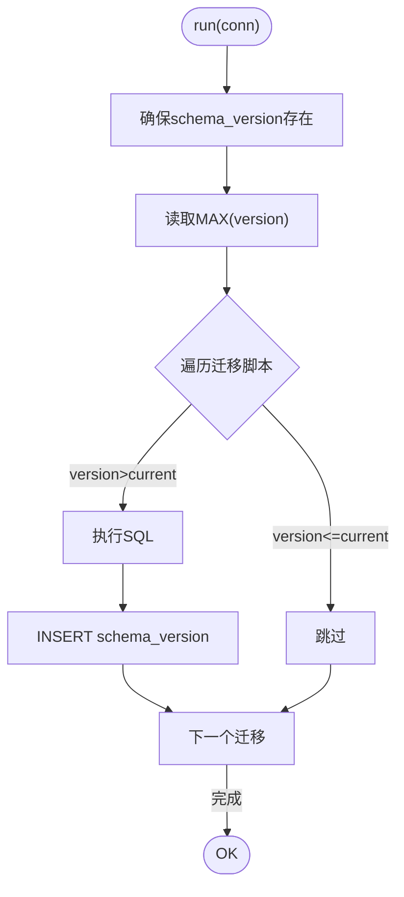
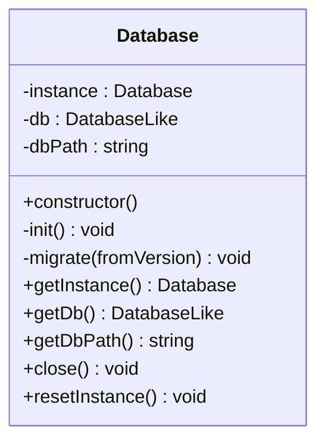
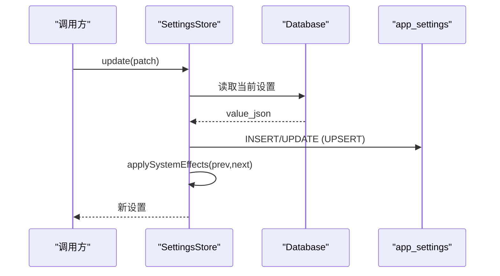
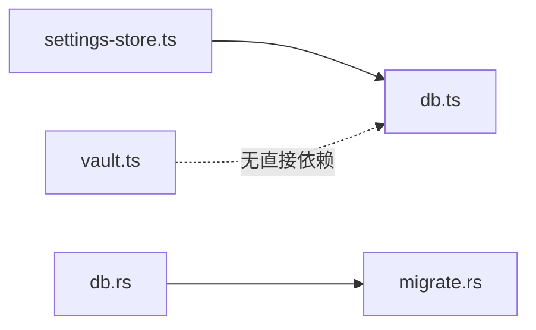

# 数据库设计

<cite>
**本文引用的文件**
- [db.rs](file://tongtian-tauri/src-tauri/src/store/db.rs)
- [migrate.rs](file://tongtian-tauri/src-tauri/src/store/migrate.rs)
- [db.ts](file://tongtian-tauri/src/main/store/db.ts)
- [settings-store.ts](file://tongtian-tauri/src/main/store/settings-store.ts)
- [vault.ts](file://tongtian-tauri/src/main/store/vault.ts)
</cite>

## 目录
1. [简介](#简介)
2. [项目结构](#项目结构)
3. [核心组件](#核心组件)
4. [架构总览](#架构总览)
5. [详细组件分析](#详细组件分析)
6. [依赖关系分析](#依赖关系分析)
7. [性能考虑](#性能考虑)
8. [故障排查指南](#故障排查指南)
9. [结论](#结论)
10. [附录](#附录)

## 简介
本设计文档围绕通天办公项目的本地 SQLite 数据库展开，覆盖表结构设计、字段定义、索引策略与外键约束；重点说明 WAL 模式配置、事务管理、并发访问控制；并给出数据库初始化流程、版本迁移机制、数据完整性保证、性能优化建议、查询最佳实践、故障恢复策略以及连接管理与错误处理方案。项目同时包含 Rust（Tauri）与 TypeScript（Electron）两套实现：Rust 侧通过 rusqlite 提供轻量连接与迁移能力；TypeScript 侧通过 better-sqlite3 提供单例数据库实例与完整 DDL/索引/迁移逻辑。

## 项目结构
- Rust 侧（Tauri）
  - 连接与运行目录解析：[db.rs](file://tongtian-tauri/src-tauri/src/store/db.rs)
  - 版本化迁移（schema_version 驱动）：[migrate.rs](file://tongtian-tauri/src-tauri/src/store/migrate.rs)
- TypeScript 侧（Electron）
  - 数据库单例、DDL、索引、迁移：[db.ts](file://tongtian-tauri/src/main/store/db.ts)
  - 应用设置持久化（app_settings 表）：[settings-store.ts](file://tongtian-tauri/src/main/store/settings-store.ts)
  - 密钥存储（keytar + mock）：[vault.ts](file://tongtian-tauri/src/main/store/vault.ts)

**图表来源**
- [db.rs:1-25](file://tongtian-tauri/src-tauri/src/store/db.rs#L1-L25)
- [migrate.rs:1-73](file://tongtian-tauri/src-tauri/src/store/migrate.rs#L1-L73)
- [db.ts:284-328](file://tongtian-tauri/src/main/store/db.ts#L284-L328)
- [settings-store.ts:55-92](file://tongtian-tauri/src/main/store/settings-store.ts#L55-L92)
- [vault.ts:60-124](file://tongtian-tauri/src-main/store/vault.ts#L60-L124)

**章节来源**
- [db.rs:1-25](file://tongtian-tauri/src-tauri/src/store/db.rs#L1-L25)
- [migrate.rs:1-73](file://tongtian-tauri/src-tauri/src/store/migrate.rs#L1-L73)
- [db.ts:284-328](file://tongtian-tauri/src/main/store/db.ts#L284-L328)
- [settings-store.ts:55-92](file://tongtian-tauri/src/main/store/settings-store.ts#L55-L92)
- [vault.ts:60-124](file://tongtian-tauri/src/main/store/vault.ts#L60-L124)

## 核心组件
- 连接管理
  - Rust：打开 SQLite 连接并启用 WAL 与外键约束，支持基于环境变量的运行目录解析。
  - TS：使用 better-sqlite3 创建单例连接，自动创建数据目录，开启 WAL 与外键。
- 迁移系统
  - Rust：基于 schema_version 表的幂等迁移，按顺序执行 SQL 脚本并记录版本。
  - TS：内置 DDL/索引，维护 schema_version 并进行增量迁移。
- 数据模型
  - 任务、消息、文件操作、备份、模型配置、审计日志、工作区、技能、MCP 服务器、沙箱策略、定时任务、模型用量、应用设置、感知档案、记忆条目、连接器状态、归档任务、钩子配置等。
- 设置与密钥
  - 设置通过 app_settings 表持久化，并在内存中缓存；密钥通过 keytar 或 mock 存储，进程内缓存提升读取性能。

**章节来源**
- [db.rs:16-25](file://tongtian-tauri/src-tauri/src/store/db.rs#L16-L25)
- [migrate.rs:43-73](file://tongtian-tauri/src-tauri/src/store/migrate.rs#L43-L73)
- [db.ts:68-280](file://tongtian-tauri/src/main/store/db.ts#L68-L280)
- [settings-store.ts:55-92](file://tongtian-tauri/src/main/store/settings-store.ts#L55-L92)
- [vault.ts:60-124](file://tongtian-tauri/src/main/store/vault.ts#L60-L124)

## 架构总览
下图展示了两种实现的总体交互：Rust 侧重在 Tauri 环境中提供最小化的连接与迁移能力；TS 侧重在 Electron 主进程中提供完整的数据库生命周期管理（DDL/索引/迁移/设置/密钥）。

**图表来源**
- [db.ts:294-328](file://tongtian-tauri/src/main/store/db.ts#L294-L328)
- [db.rs:16-25](file://tongtian-tauri/src-tauri/src/store/db.rs#L16-L25)
- [migrate.rs:43-73](file://tongtian-tauri/src-tauri/src/store/migrate.rs#L43-L73)

## 详细组件分析

### 连接与运行目录（Rust）
- 运行目录解析优先使用环境变量，否则回退到 bridge 提供的 base_dir。
- 打开连接后强制设置 WAL 与外键开启，统一一致性策略。
- 错误信息以明确前缀返回，便于上层捕获与定位。

**图表来源**
- [db.rs:16-25](file://tongtian-tauri/src-tauri/src/store/db.rs#L16-L25)

**章节来源**
- [db.rs:5-25](file://tongtian-tauri/src-tauri/src/store/db.rs#L5-L25)

### 版本化迁移（Rust）
- 使用 schema_version 表记录已应用的最大版本号。
- 迁移脚本数组按声明顺序即版本号，幂等执行（IF NOT EXISTS），未应用的脚本依次执行并写入版本。
- 测试覆盖创建表、幂等性、增量跳过已应用版本。

**图表来源**
- [migrate.rs:43-73](file://tongtian-tauri/src-tauri/src/store/migrate.rs#L43-L73)

**章节来源**
- [migrate.rs:1-73](file://tongtian-tauri/src-tauri/src/store/migrate.rs#L1-L73)

### 数据库单例与DDL/索引/迁移（TypeScript）
- 单例 Database 类负责：
  - 数据目录创建与数据库文件路径确定
  - 开启 WAL 与外键
  - 执行 DDL 与索引
  - 维护 schema_version 并执行增量迁移
- 表与索引覆盖任务、消息、文件操作与备份、模型配置、审计日志、工作区、技能、MCP 服务器、沙箱策略、定时任务、模型用量、应用设置、感知档案、记忆条目、连接器状态、归档任务、钩子配置等。

**图表来源**
- [db.ts:284-359](file://tongtian-tauri/src/main/store/db.ts#L284-L359)

**章节来源**
- [db.ts:46-328](file://tongtian-tauri/src/main/store/db.ts#L46-L328)

### 应用设置与密钥存储
- 设置存储
  - 通过 app_settings 表以 JSON 形式持久化，内存缓存减少重复 IO。
  - 更新时合并默认值与已有值，落库并触发系统级行为（开机自启、保持唤醒）。
- 密钥存储
  - 使用 keytar 或内存 mock，进程内缓存提升读取性能。
  - 提供增删查全量清理接口，并在进程退出时清理内存缓存。

**图表来源**
- [settings-store.ts:55-92](file://tongtian-tauri/src/main/store/settings-store.ts#L55-L92)

**章节来源**
- [settings-store.ts:55-92](file://tongtian-tauri/src/main/store/settings-store.ts#L55-L92)
- [vault.ts:60-124](file://tongtian-tauri/src/main/store/vault.ts#L60-L124)

## 依赖关系分析
- 模块耦合
  - settings-store.ts 依赖 db.ts 的 Database 单例进行设置读写。
  - vault.ts 独立于数据库，专注密钥存取，避免敏感信息进入数据库。
  - Rust 的 migrate.rs 与 db.rs 解耦，前者专注迁移，后者专注连接与运行时参数。
- 外部依赖
  - Rust：rusqlite
  - TS：better-sqlite3、keytar（可降级为 mock）

**图表来源**
- [settings-store.ts:55-92](file://tongtian-tauri/src/main/store/settings-store.ts#L55-L92)
- [db.ts:284-328](file://tongtian-tauri/src/main/store/db.ts#L284-L328)
- [db.rs:16-25](file://tongtian-tauri/src-tauri/src/store/db.rs#L16-L25)
- [migrate.rs:43-73](file://tongtian-tauri/src-tauri/src/store/migrate.rs#L43-L73)

**章节来源**
- [settings-store.ts:55-92](file://tongtian-tauri/src/main/store/settings-store.ts#L55-L92)
- [db.ts:284-328](file://tongtian-tauri/src/main/store/db.ts#L284-L328)
- [db.rs:16-25](file://tongtian-tauri/src-tauri/src/store/db.rs#L16-L25)
- [migrate.rs:43-73](file://tongtian-tauri/src-tauri/src/store/migrate.rs#L43-L73)

## 性能考虑
- WAL 模式
  - 两端均启用 WAL，提高并发读性能与崩溃恢复速度。
- 索引策略
  - 针对高频查询列建立索引，如 messages.task_id、audit_logs.timestamp/event/model_id、workspaces.status、skills.source/enabled、mcp_servers.status、model_usage.model_id/created_at、schedule_tasks.enabled、memory_entries.source、archived_tasks.workspace_id 等。
- 事务与批处理
  - 迁移与批量写入建议使用事务包裹，减少磁盘同步次数。
- 连接与锁
  - better-sqlite3 为同步阻塞式，适合主线程串行化写；大量并发写场景需拆分任务或使用队列。
- 查询最佳实践
  - 使用预编译语句与参数绑定，避免字符串拼接。
  - 只选择必要列，避免 SELECT *。
  - 对大结果集分页查询，限制返回行数。
  - 利用 EXPLAIN QUERY PLAN 分析执行计划，必要时补充索引。

[本节为通用指导，不直接分析具体文件]

## 故障排查指南
- 常见错误码与定位
  - STORE_OPEN_FAILED：数据库文件无法打开（权限/路径不存在）。
  - STORE_PRAGMA_FAILED：WAL 或外键设置失败（SQLite 版本/兼容性）。
  - STORE_MIGRATE_FAILED / STORE_MIGRATE_V*_FAILED / STORE_MIGRATE_RECORD_FAILED：迁移脚本执行或版本记录失败。
- 检查清单
  - 确认数据目录存在且可写。
  - 确认 SQLite 版本支持 WAL。
  - 检查 schema_version 与实际表结构是否一致。
  - 查看最近一次迁移是否成功记录。
- 恢复策略
  - 若迁移失败，回滚事务并修复脚本后重试。
  - 若 WAL 损坏，关闭应用后删除 .wal/.shm 让 SQLite 重建。
  - 定期备份 data.db，保留历史快照以便回滚。

**章节来源**
- [db.rs:16-25](file://tongtian-tauri/src-tauri/src/store/db.rs#L16-L25)
- [migrate.rs:43-73](file://tongtian-tauri/src-tauri/src/store/migrate.rs#L43-L73)

## 结论
本项目采用双栈 SQLite 实现：Rust 侧提供简洁的连接与迁移能力，TS 侧提供完整的数据库生命周期管理。通过统一的 WAL 与外键策略、幂等的版本化迁移、完善的索引设计与错误码体系，确保了数据一致性、可维护性与可观测性。结合事务、批处理与查询优化，可在桌面端场景中稳定高效地支撑业务需求。

## 附录

### 表结构与索引总览（摘要）
- tasks：任务主表，含状态、重试计数、时间戳等；索引：updated_at 降序（Rust）、task_id（TS）。
- messages：会话消息，关联 tasks；索引：task_id。
- file_ops/file_backups：文件操作与备份记录，关联 tasks。
- model_configs：模型配置，含来源、基础 URL、模型名、上下文窗口、默认标记、绑定等。
- audit_logs：审计日志，按时间、事件、任务、模型维度建索引。
- workspaces/skills/mcp_servers/sandbox_policies：工作区、技能、MCP 服务与安全策略。
- schedule_tasks：定时任务，按 enabled 建索引。
- model_usage：模型用量统计，按 model_id 与 created_at 建索引。
- app_settings：应用设置，JSON 存储，UPSERT 更新。
- awareness_profiles/memory_entries/connector_states/archived_tasks/hook_configs：扩展能力相关表。

**章节来源**
- [migrate.rs:6-40](file://tongtian-tauri/src-tauri/src/store/migrate.rs#L6-L40)
- [db.ts:68-280](file://tongtian-tauri/src/main/store/db.ts#L68-L280)

### 事务与并发访问控制
- 事务
  - 迁移过程应置于事务中，确保原子性；批量写入建议显式 BEGIN/COMMIT。
- 并发
  - WAL 模式下读并发良好，写仍受限于 SQLite 的数据库级写锁；避免长时间持有写锁。
  - 将耗时写操作拆分为小批次，降低锁竞争。
- 外键
  - 两端均开启外键约束，保证引用完整性；删除任务时级联删除消息与文件操作。

**章节来源**
- [db.rs:16-25](file://tongtian-tauri/src-tauri/src/store/db.rs#L16-L25)
- [db.ts:301-308](file://tongtian-tauri/src/main/store/db.ts#L301-L308)

### 连接管理与错误处理方案
- 连接管理
  - Rust：open(path) 统一封装 WAL/外键设置与错误转换。
  - TS：Database 单例集中管理连接生命周期，提供 close/reset 方法。
- 错误处理
  - 统一错误前缀（STORE_*），便于日志聚合与告警。
  - 关键路径（迁移、设置写入、密钥存取）增加 try/catch 与日志记录。

**章节来源**
- [db.rs:16-25](file://tongtian-tauri/src-tauri/src/store/db.rs#L16-L25)
- [db.ts:284-359](file://tongtian-tauri/src/main/store/db.ts#L284-L359)
- [settings-store.ts:55-92](file://tongtian-tauri/src/main/store/settings-store.ts#L55-L92)
- [vault.ts:60-124](file://tongtian-tauri/src/main/store/vault.ts#L60-L124)