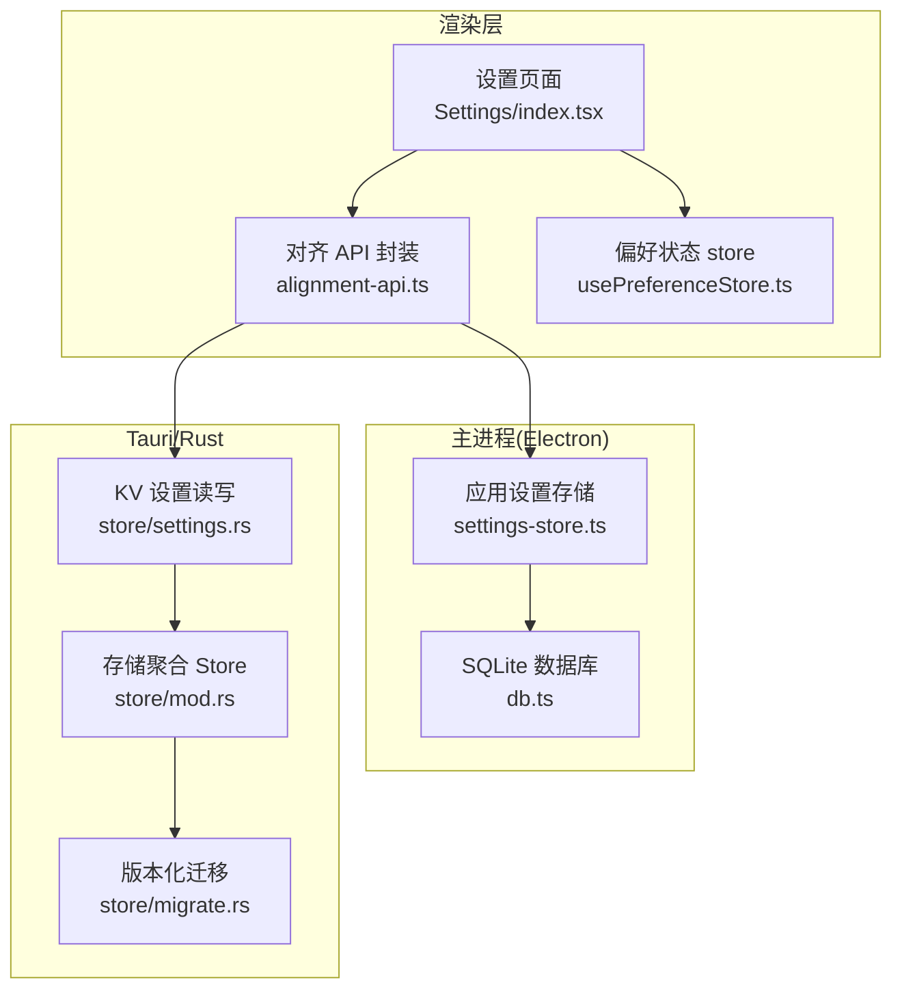
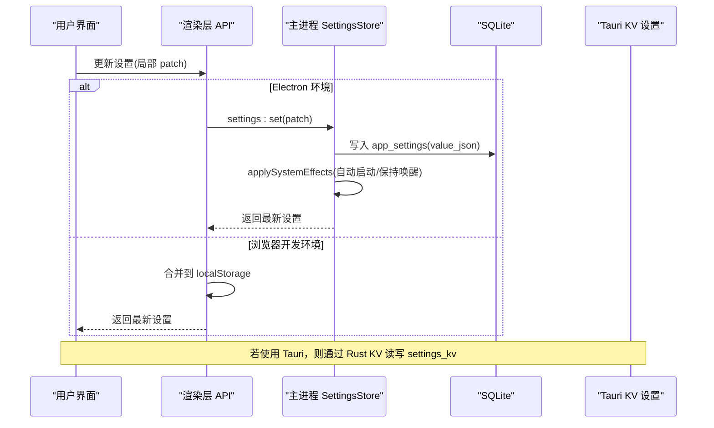
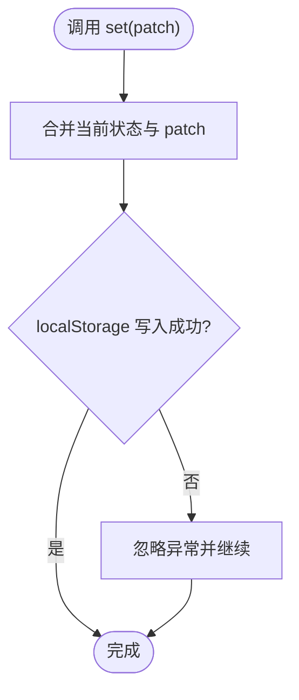
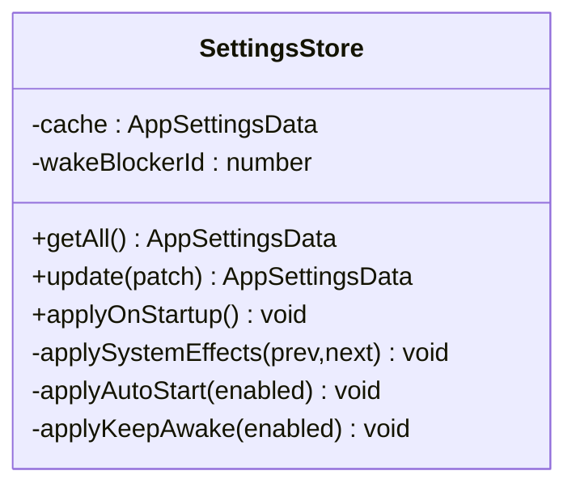
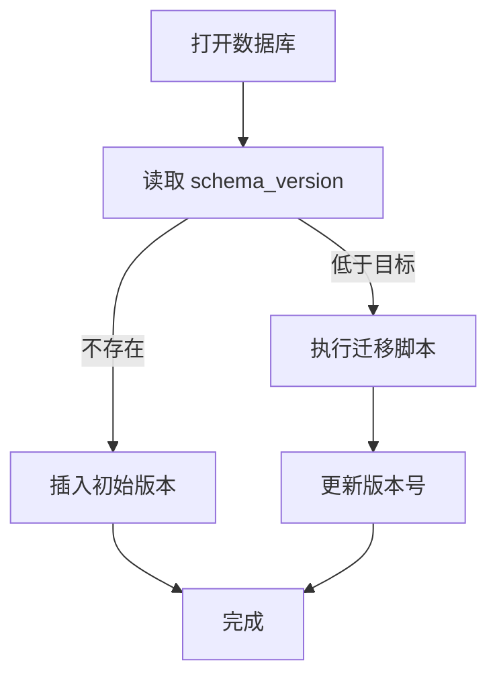
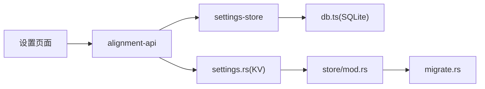

# 设置存储

<cite>
**本文引用的文件**
- [src/renderer/stores/usePreferenceStore.ts](file://tongtian-tauri/src/renderer/stores/usePreferenceStore.ts)
- [src/main/store/settings-store.ts](file://tongtian-tauri/src/main/store/settings-store.ts)
- [src/main/store/db.ts](file://tongtian-tauri/src/main/store/db.ts)
- [src/shared/contracts.ts](file://tongtian-tauri/src/shared/contracts.ts)
- [src/renderer/lib/alignment-api.ts](file://tongtian-tauri/src/renderer/lib/alignment-api.ts)
- [src/renderer/pages/Settings/index.tsx](file://tongtian-tauri/src/renderer/pages/Settings/index.tsx)
- [src-tauri/src/store/mod.rs](file://tongtian-tauri/src-tauri/src/store/mod.rs)
- [src-tauri/src/store/migrate.rs](file://tongtian-tauri/src-tauri/src-tauri/src/store/migrate.rs)
- [src-tauri/src/store/settings.rs](file://tongtian-tauri/src-tauri/src/store/settings.rs)
</cite>

## 目录
1. [简介](#简介)
2. [项目结构](#项目结构)
3. [核心组件](#核心组件)
4. [架构总览](#架构总览)
5. [详细组件分析](#详细组件分析)
6. [依赖关系分析](#依赖关系分析)
7. [性能考虑](#性能考虑)
8. [故障排查指南](#故障排查指南)
9. [结论](#结论)
10. [附录](#附录)

## 简介
本文件为通天办公项目的“设置存储”设计文档，聚焦用户偏好与系统设置的持久化方案。内容涵盖：
- 配置文件的格式设计与默认值管理
- 配置验证机制、错误提示与用户体验优化
- 设置项的分类组织、热重载支持、配置迁移策略
- 前端状态同步、后端配置加载、冲突处理逻辑
- 设置导入导出、模板管理、环境特定配置（开发/生产）

## 项目结构
本项目在渲染层、主进程与 Tauri/Rust 侧分别实现了设置读取、写入与系统行为落地能力，并通过共享契约类型统一数据结构。

图表来源
- [src/renderer/pages/Settings/index.tsx:160-171](file://tongtian-tauri/src/renderer/pages/Settings/index.tsx#L160-L171)
- [src/renderer/lib/alignment-api.ts:89-105](file://tongtian-tauri/src/renderer/lib/alignment-api.ts#L89-L105)
- [src/main/store/settings-store.ts:55-92](file://tongtian-tauri/src/main/store/settings-store.ts#L55-L92)
- [src/main/store/db.ts:217-221](file://tongtian-tauri/src/main/store/db.ts#L217-L221)
- [src-tauri/src/store/settings.rs:6-48](file://tongtian-tauri/src-tauri/src/store/settings.rs#L6-L48)
- [src-tauri/src/store/migrate.rs:44-73](file://tongtian-tauri/src-tauri/src-store/migrate.rs#L44-L73)
- [src-tauri/src/store/mod.rs:24-47](file://tongtian-tauri/src-tauri/src/store/mod.rs#L24-L47)

章节来源
- [src/renderer/pages/Settings/index.tsx:160-171](file://tongtian-tauri/src/renderer/pages/Settings/index.tsx#L160-L171)
- [src/renderer/lib/alignment-api.ts:89-105](file://tongtian-tauri/src/renderer/lib/alignment-api.ts#L89-L105)
- [src/main/store/settings-store.ts:55-92](file://tongtian-tauri/src/main/store/settings-store.ts#L55-L92)
- [src/main/store/db.ts:217-221](file://tongtian-tauri/src/main/store/db.ts#L217-L221)
- [src-tauri/src/store/settings.rs:6-48](file://tongtian-tauri/src-tauri/src/store/settings.rs#L6-L48)
- [src-tauri/src/store/migrate.rs:44-73](file://tongtian-tauri/src-tauri/src-store/migrate.rs#L44-L73)
- [src-tauri/src/store/mod.rs:24-47](file://tongtian-tauri/src-tauri/src/store/mod.rs#L24-L47)

## 核心组件
- 前端偏好状态：本地 localStorage 持久化的轻量偏好（主题、字号、宽度等），用于 UI 快速响应。
- 应用级设置：通过 IPC 调用主进程或 Tauri，落库 SQLite，并触发系统行为（开机自启、保持唤醒等）。
- 数据模型：共享的 AppSettingsData 定义所有设置字段及类型约束。
- 迁移与存储：Rust 侧提供 KV 读写与版本化迁移；Electron 侧维护 schema_version 与表结构。

章节来源
- [src/renderer/stores/usePreferenceStore.ts:11-56](file://tongtian-tauri/src/renderer/stores/usePreferenceStore.ts#L11-L56)
- [src/main/store/settings-store.ts:15-41](file://tongtian-tauri/src/main/store/settings-store.ts#L15-L41)
- [src/shared/contracts.ts:448-476](file://tongtian-tauri/src/shared/contracts.ts#L448-L476)
- [src-tauri/src/store/settings.rs:6-48](file://tongtian-tauri/src-tauri/src/store/settings.rs#L6-L48)
- [src-tauri/src/store/migrate.rs:44-73](file://tongtian-tauri/src-tauri/src-store/migrate.rs#L44-L73)
- [src/main/store/db.ts:217-221](file://tongtian-tauri/src/main/store/db.ts#L217-L221)

## 架构总览
设置变更从 UI 发起，经渲染层 API 封装，进入主进程或 Tauri 后写入 SQLite，并在必要时触发系统行为。

图表来源
- [src/renderer/lib/alignment-api.ts:89-105](file://tongtian-tauri/src/renderer/lib/alignment-api.ts#L89-L105)
- [src/main/store/settings-store.ts:73-92](file://tongtian-tauri/src/main/store/settings-store.ts#L73-L92)
- [src/main/store/db.ts:217-221](file://tongtian-tauri/src/main/store/db.ts#L217-L221)
- [src-tauri/src/store/settings.rs:6-48](file://tongtian-tauri/src-tauri/src/store/settings.rs#L6-L48)

## 详细组件分析

### 前端偏好设置（usePreferenceStore）
- 职责：管理 UI 相关偏好（主题、字体大小、聊天宽度、预览模式、提示建议等），并持久化到 localStorage。
- 默认值：内置 defaults，首次加载时合并已存值。
- 写入策略：每次 set 立即写回 localStorage，异常静默忽略以保证交互流畅。
- 适用场景：原型阶段本地生效，不依赖后端。

图表来源
- [src/renderer/stores/usePreferenceStore.ts:21-56](file://tongtian-tauri/src/renderer/stores/usePreferenceStore.ts#L21-L56)

章节来源
- [src/renderer/stores/usePreferenceStore.ts:11-56](file://tongtian-tauri/src/renderer/stores/usePreferenceStore.ts#L11-L56)

### 应用级设置（settings-store）
- 职责：集中管理应用级设置，提供 getAll/update/applyOnStartup 等方法。
- 默认值：DEFAULT_SETTINGS 定义完整字段集，读库失败时回退到默认值。
- 持久化：增量更新合并后写入 SQLite 的 app_settings 表（value_json）。
- 系统行为：根据 autoStart/keepAwake 变化调用系统 API（开机自启、阻止休眠）。
- 启动恢复：应用启动时按保存的设置恢复系统行为。

图表来源
- [src/main/store/settings-store.ts:43-133](file://tongtian-tauri/src/main/store/settings-store.ts#L43-L133)

章节来源
- [src/main/store/settings-store.ts:15-133](file://tongtian-tauri/src/main/store/settings-store.ts#L15-L133)

### 数据库与迁移（db.ts / migrate.rs）
- Electron 侧：
  - 使用 better-sqlite3，开启 WAL 模式提升并发读性能。
  - 定义 schema_version 表，初始化与迁移逻辑保证幂等。
  - 新增 app_settings 表用于存储应用级设置。
- Tauri/Rust 侧：
  - 通过 schema_version 驱动迁移脚本，逐版本执行未应用的 SQL。
  - 提供 settings_kv 表的 get/set/all 接口，供 Tauri 端设置读写。

图表来源
- [src/main/store/db.ts:301-328](file://tongtian-tauri/src/main/store/db.ts#L301-L328)
- [src-tauri/src/store/migrate.rs:44-73](file://tongtian-tauri/src-tauri/src-store/migrate.rs#L44-L73)

章节来源
- [src/main/store/db.ts:284-328](file://tongtian-tauri/src/main/store/db.ts#L284-L328)
- [src-tauri/src/store/migrate.rs:1-73](file://tongtian-tauri/src-tauri/src-store/migrate.rs#L1-L73)

### 设置项分类与组织
- 通用：偏好设置、个人资料、系统设置、语音输入、应用快照、快捷键、意识、更新应用、已归档。
- 扩展与集成：工作台、模型与用量。
- 高级设置：安全工作环境、实验特性。
- 这些分组由设置页面左侧导航呈现，便于用户定位与管理。

章节来源
- [src/renderer/pages/Settings/index.tsx:33-77](file://tongtian-tauri/src/renderer/pages/Settings/index.tsx#L33-L77)

### 热重载与即时生效
- 偏好设置：通过 usePreferenceStore 直接修改内存并写 localStorage，UI 即时刷新。
- 应用级设置：通过 alignment-api 调用 IPC，主进程写入 SQLite 并触发系统行为，设置页通过 hook 即时更新本地状态。
- 注意：部分设置需新开会话或重启系统服务才完全生效（如语言切换、预览方式等）。

章节来源
- [src/renderer/lib/alignment-api.ts:89-105](file://tongtian-tauri/src/renderer/lib/alignment-api.ts#L89-L105)
- [src/main/store/settings-store.ts:73-92](file://tongtian-tauri/src/main/store/settings-store.ts#L73-L92)

### 配置验证与错误处理
- 类型校验：AppSettingsData 在 shared 契约中定义，确保前后端一致。
- 运行时容错：
  - 偏好设置：localStorage 读写异常被捕获并忽略，避免阻塞 UI。
  - 主进程设置：写入失败记录日志并回退到缓存默认值，保障可用性。
  - Tauri KV：SQL 错误以字符串形式返回，上层可据此提示用户。
- 错误码：ErrorCode 中包含 CONFIG_INVALID/CONFIG_MISSING/CONFIG_PARSE_ERROR 等，可用于统一错误展示。

章节来源
- [src/shared/contracts.ts:15-109](file://tongtian-tauri/src/shared/contracts.ts#L15-L109)
- [src/renderer/stores/usePreferenceStore.ts:32-56](file://tongtian-tauri/src/renderer/stores/usePreferenceStore.ts#L32-L56)
- [src/main/store/settings-store.ts:55-92](file://tongtian-tauri/src/main/store/settings-store.ts#L55-L92)
- [src-tauri/src/store/settings.rs:6-48](file://tongtian-tauri/src-tauri/src/store/settings.rs#L6-L48)

### 冲突处理逻辑
- 多窗口/多标签：偏好设置基于 localStorage，存在跨标签覆盖风险；建议对关键偏好增加版本戳或时间戳进行合并。
- 主进程设置：采用增量合并（current + patch）再落库，减少竞态；但高并发下仍可能丢失更新，建议在关键路径加入乐观锁或版本号。
- Tauri KV：key 唯一，覆盖写入；如需并发安全，可在业务层加版本号或事务。

章节来源
- [src/renderer/stores/usePreferenceStore.ts:42-56](file://tongtian-tauri/src/renderer/stores/usePreferenceStore.ts#L42-L56)
- [src/main/store/settings-store.ts:73-92](file://tongtian-tauri/src/main/store/settings-store.ts#L73-L92)
- [src-tauri/src/store/settings.rs:19-30](file://tongtian-tauri/src-tauri/src/store/settings.rs#L19-L30)

### 设置导入导出
- 现状：代码中未发现直接的导入导出接口。
- 建议：
  - 导出：将 AppSettingsData 序列化为 JSON 文件，并提供下载。
  - 导入：读取 JSON 后合并到现有设置，并进行字段校验与冲突提示。
  - 审计：记录导入导出操作至审计日志表（audit_logs）。

[本节为概念性建议，无直接源码引用]

### 模板管理
- 幻灯片模板：设置页面提供内置模板列表与导入自定义模板入口。
- 实现要点：
  - 模板元数据（名称、描述、资源路径）与样式资源分离存储。
  - 导入时校验模板结构与资源完整性，失败时回滚。
  - 模板启用状态与工作台模式联动。

章节来源
- [src/renderer/pages/Settings/index.tsx:596-603](file://tongtian-tauri/src/renderer/pages/Settings/index.tsx#L596-L603)

### 环境特定配置
- 开发环境：alignment-api 检测到非 Electron 环境时，使用 localStorage 模拟设置读写，便于调试。
- 生产环境：走真实 IPC，落库 SQLite 并触发系统行为。
- 运行目录：Electron 侧通过 userData/data.db 存放数据；Tauri 侧可通过环境变量覆盖运行目录。

章节来源
- [src/renderer/lib/alignment-api.ts:24-30](file://tongtian-tauri/src/renderer/lib/alignment-api.ts#L24-L30)
- [src/main/store/db.ts:48-62](file://tongtian-tauri/src/main/store/db.ts#L48-L62)
- [src-tauri/src/store/mod.rs:24-41](file://tongtian-tauri/src-tauri/src/store/mod.rs#L24-L41)

## 依赖关系分析
- 前端依赖：
  - 设置页面依赖 alignment-api 获取/更新设置。
  - 偏好设置依赖 usePreferenceStore 管理本地状态。
- 主进程依赖：
  - settings-store 依赖 db.ts 提供的 SQLite 连接与 DDL。
  - 系统行为依赖 Electron 的 app/powerSaveBlocker。
- Tauri 依赖：
  - settings.rs 依赖 Store（rusqlite 连接）与 vault（密钥保管）。
  - migrate.rs 负责版本化迁移。

图表来源
- [src/renderer/pages/Settings/index.tsx:160-171](file://tongtian-tauri/src/renderer/pages/Settings/index.tsx#L160-L171)
- [src/renderer/lib/alignment-api.ts:89-105](file://tongtian-tauri/src/renderer/lib/alignment-api.ts#L89-L105)
- [src/main/store/settings-store.ts:55-92](file://tongtian-tauri/src/main/store/settings-store.ts#L55-L92)
- [src/main/store/db.ts:217-221](file://tongtian-tauri/src/main/store/db.ts#L217-L221)
- [src-tauri/src/store/settings.rs:6-48](file://tongtian-tauri/src-tauri/src/store/settings.rs#L6-L48)
- [src-tauri/src/store/mod.rs:24-47](file://tongtian-tauri/src-tauri/src/store/mod.rs#L24-L47)
- [src-tauri/src/store/migrate.rs:44-73](file://tongtian-tauri/src-tauri/src-store/migrate.rs#L44-L73)

章节来源
- [src/renderer/pages/Settings/index.tsx:160-171](file://tongtian-tauri/src/renderer/pages/Settings/index.tsx#L160-L171)
- [src/renderer/lib/alignment-api.ts:89-105](file://tongtian-tauri/src/renderer/lib/alignment-api.ts#L89-L105)
- [src/main/store/settings-store.ts:55-92](file://tongtian-tauri/src/main/store/settings-store.ts#L55-L92)
- [src/main/store/db.ts:217-221](file://tongtian-tauri/src/main/store/db.ts#L217-L221)
- [src-tauri/src/store/settings.rs:6-48](file://tongtian-tauri/src-tauri/src/store/settings.rs#L6-L48)
- [src-tauri/src/store/mod.rs:24-47](file://tongtian-tauri/src-tauri/src/store/mod.rs#L24-L47)
- [src-tauri/src/store/migrate.rs:44-73](file://tongtian-tauri/src-tauri/src-store/migrate.rs#L44-L73)

## 性能考虑
- 使用 SQLite WAL 模式提升并发读性能。
- 设置读取采用内存缓存（主进程）减少重复 IO。
- 偏好设置使用 localStorage 避免网络开销，适合高频 UI 更新。
- 迁移脚本幂等执行，避免重复创建表与索引。

章节来源
- [src/main/store/db.ts:294-308](file://tongtian-tauri/src/main/store/db.ts#L294-L308)
- [src/main/store/settings-store.ts:55-71](file://tongtian-tauri/src/main/store/settings-store.ts#L55-L71)
- [src/renderer/stores/usePreferenceStore.ts:32-56](file://tongtian-tauri/src/renderer/stores/usePreferenceStore.ts#L32-L56)
- [src-tauri/src/store/migrate.rs:44-73](file://tongtian-tauri/src-tauri/src-store/migrate.rs#L44-L73)

## 故障排查指南
- 设置无法持久化：
  - 检查 SQLite 是否可用（WAL 模式、权限）。
  - 查看主进程日志中的“settings persist failed”错误信息。
- 系统行为未生效：
  - 确认 autoStart/keepAwake 变更是否触发 applySystemEffects。
  - 检查系统 API 调用是否抛出异常并记录日志。
- 开发环境与生产行为不一致：
  - 确认 alignment-api 是否检测到 Electron 环境。
  - 浏览器模式下使用 localStorage 模拟，不会落库。

章节来源
- [src/main/store/settings-store.ts:79-92](file://tongtian-tauri/src/main/store/settings-store.ts#L79-L92)
- [src/main/store/settings-store.ts:103-132](file://tongtian-tauri/src/main/store/settings-store.ts#L103-L132)
- [src/renderer/lib/alignment-api.ts:24-30](file://tongtian-tauri/src/renderer/lib/alignment-api.ts#L24-L30)

## 结论
本项目构建了分层清晰的设置存储体系：前端偏好快速响应、主进程设置持久化并联动系统行为、Tauri 提供稳定的 KV 存储与迁移能力。通过共享契约类型确保前后端一致性，结合 WAL 与内存缓存提升性能。未来可增强导入导出、版本冲突解决与更细粒度的权限控制，进一步提升用户体验与可维护性。

## 附录
- 设置项清单与默认值参考：
  - 语言、主题、界面风格、对话字体、字号、宽度、预览方式、提示建议、工具调用展开、IM 工具过程展示、开机自启、保持唤醒、桌面通知、任务栏未读、声音通知、代理模式、隐私模式、语音开关、快照开关、QuickPick、计算机使用策略、安全环境、工作台模式、实验特性等。
- 相关类型定义位置：
  - AppSettingsData 定义于共享契约文件。

章节来源
- [src/shared/contracts.ts:448-476](file://tongtian-tauri/src/shared/contracts.ts#L448-L476)
- [src/main/store/settings-store.ts:15-41](file://tongtian-tauri/src/main/store/settings-store.ts#L15-L41)
- [src/renderer/pages/Settings/index.tsx:175-218](file://tongtian-tauri/src/renderer/pages/Settings/index.tsx#L175-L218)