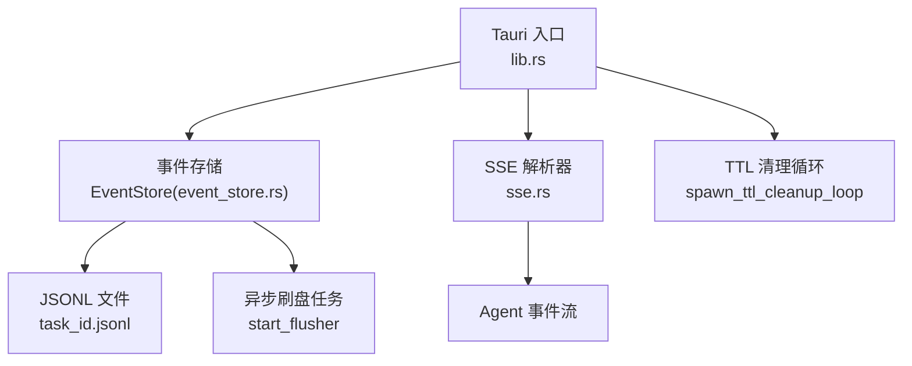
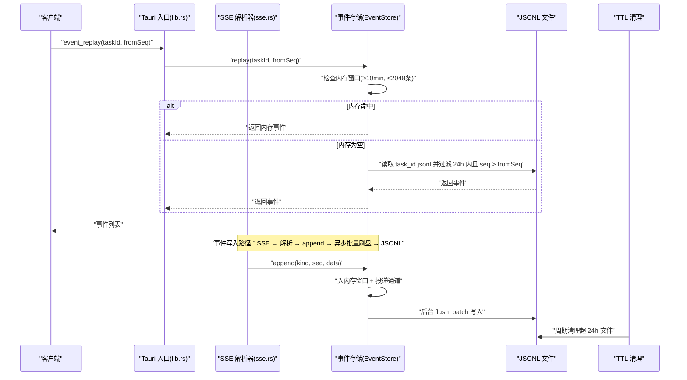
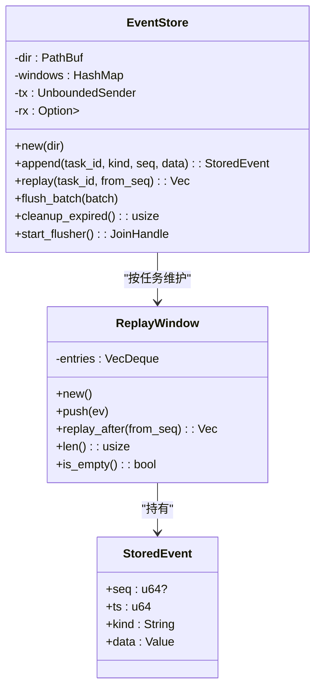
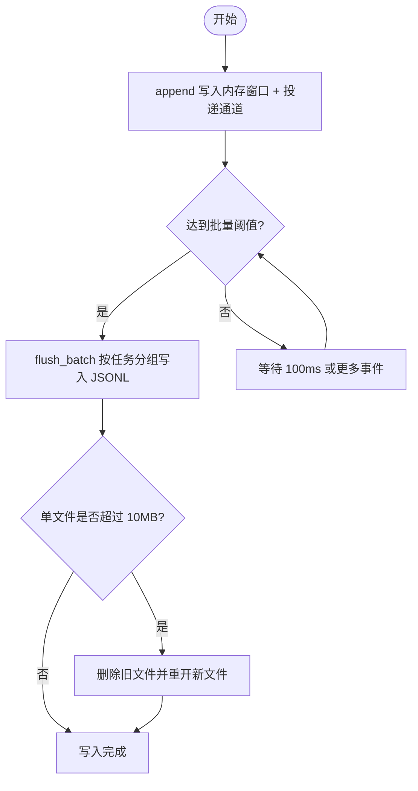
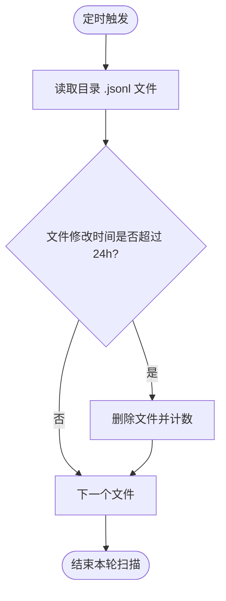
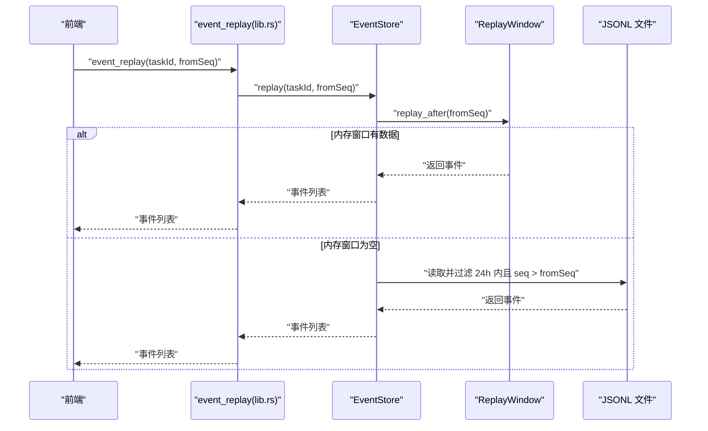
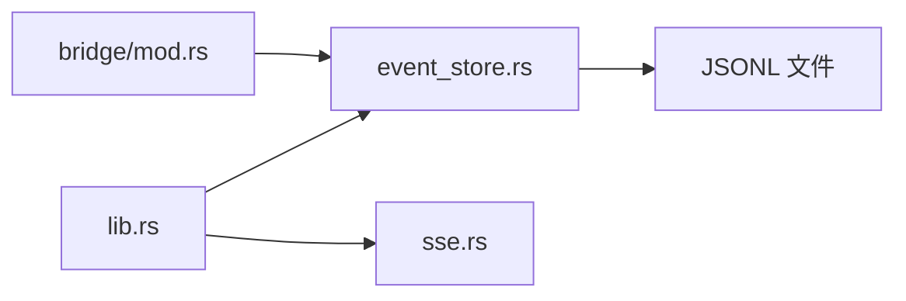

# 事件存储服务

<cite>
**本文引用的文件**
- [event_store.rs](file://tongtian-tauri/src-tauri/src/bridge/event_store.rs)
- [lib.rs](file://tongtian-tauri/src-tauri/src/lib.rs)
- [mod.rs](file://tongtian-tauri/src-tauri/src/bridge/mod.rs)
- [sse.rs](file://tongtian-tauri/src-tauri/src/bridge/sse.rs)
</cite>

## 目录
1. [简介](#简介)
2. [项目结构](#项目结构)
3. [核心组件](#核心组件)
4. [架构总览](#架构总览)
5. [详细组件分析](#详细组件分析)
6. [依赖关系分析](#依赖关系分析)
7. [性能考量与调优](#性能考量与调优)
8. [故障排查指南](#故障排查指南)
9. [结论](#结论)
10. [附录](#附录)

## 简介
本文件为通天办公项目的“事件存储服务”提供完整技术文档。重点说明 EventStore 的事件持久化机制，包括：
- 事件序列号管理与重放（内存窗口 + 磁盘兜底）
- 24小时 TTL 清理策略
- 异步批量刷盘、内存缓冲优化与磁盘 I/O 性能调优
- 事件格式规范、压缩存储建议与索引设计
- 事件流订阅、断线重连支持、数据一致性保证
- 事件存储扩容方案与备份恢复策略

该服务支撑 Agent 执行过程中的计划、步骤、交付、完成、错误、状态变更、配额告警等事件在应用重启或客户端断线后仍可被可靠重放，保障前端展示与审计可追溯。

## 项目结构
事件存储相关代码位于 Tauri 后端桥接模块中，核心实现集中在 event_store.rs；应用启动时初始化并启动后台任务（刷盘与 TTL 清理），并通过 SSE 解析器将上游事件适配为统一格式，供上层命令与前端消费。

图表来源
- [lib.rs:747-832](file://tongtian-tauri/src-tauri/src/lib.rs#L747-L832)
- [event_store.rs:97-288](file://tongtian-tauri/src-tauri/src/bridge/event_store.rs#L97-L288)
- [sse.rs:1-170](file://tongtian-tauri/src-tauri/src/bridge/sse.rs#L1-L170)

章节来源
- [lib.rs:747-832](file://tongtian-tauri/src-tauri/src/lib.rs#L747-L832)
- [mod.rs:1-7](file://tongtian-tauri/src-tauri/src/bridge/mod.rs#L1-L7)

## 核心组件
- StoredEvent：事件条目模型，包含可选序列号、写入时间戳、事件类型与数据体。
- ReplayWindow：内存重放窗口，维护 VecDeque 双上限（条数上限与时间上限），过期或超限则丢弃最旧事件。
- EventStore：事件存储核心，负责追加事件、内存重放、磁盘读取兜底、异步批量刷盘、TTL 清理。
- SSE 解析器：将 Agent 的 SSE 流解析为统一事件结构，提取 seq 并注入 taskId，便于去重与排序。

章节来源
- [event_store.rs:37-103](file://tongtian-tauri/src-tauri/src/bridge/event_store.rs#L37-L103)
- [sse.rs:23-170](file://tongtian-tauri/src-tauri/src/bridge/sse.rs#L23-L170)

## 架构总览
事件从上游 Agent 经 SSE 流入，被解析为 AgentEvent，随后通过桥接层写入 EventStore。EventStore 将事件同时写入内存重放窗口与异步通道，由后台刷盘任务按批次写入 JSONL 文件。客户端可通过 event_replay 接口获取 from_seq 之后的事件，优先从内存窗口返回，若为空则从磁盘读取 24h 内的事件进行兜底。TTL 清理任务定期扫描并删除超过保留期的文件。

图表来源
- [lib.rs:590-599](file://tongtian-tauri/src-tauri/src/lib.rs#L590-L599)
- [event_store.rs:116-160](file://tongtian-tauri/src-tauri/src/bridge/event_store.rs#L116-L160)
- [event_store.rs:162-235](file://tongtian-tauri/src-tauri/src/bridge/event_store.rs#L162-L235)
- [event_store.rs:237-288](file://tongtian-tauri/src-tauri/src/bridge/event_store.rs#L237-L288)
- [sse.rs:88-170](file://tongtian-tauri/src-tauri/src/bridge/sse.rs#L88-L170)

## 详细组件分析

### 事件模型与重放窗口
- 事件模型 StoredEvent：字段包括可选 seq、ts（epoch ms）、kind（plan/step_*/deliver/done/error/status_change/quota_warning）、data（任意 JSON）。
- 重放窗口 ReplayWindow：
  - 条数上限：REPLAY_WINDOW_MAX_EVENTS = 2048，超出则 drop-oldest。
  - 时间上限：REPLAY_WINDOW_MS = 10 * 60 * 1000（≥10min），查询时惰性清理头部过期项。
  - replay_after(from_seq)：返回 seq > from_seq 且未过期的事件集合。

图表来源
- [event_store.rs:37-103](file://tongtian-tauri/src-tauri/src/bridge/event_store.rs#L37-L103)
- [event_store.rs:48-93](file://tongtian-tauri/src-tauri/src/bridge/event_store.rs#L48-L93)

章节来源
- [event_store.rs:37-93](file://tongtian-tauri/src-tauri/src/bridge/event_store.rs#L37-L93)

### 事件持久化与异步批量刷盘
- 追加路径：append 将事件写入内存窗口，并通过无界通道投递到后台刷盘任务。通道满或关闭不阻塞事件流，确保高吞吐低延迟。
- 批量策略：首条阻塞等待，后续在 FLUSH_INTERVAL_MS（100ms）窗口内尽量攒批至 FLUSH_BATCH（64 条）再 flush。
- 写盘逻辑：按任务分组追加写入 JSONL 文件；单文件容量超过 MAX_TASK_FILE_BYTES（10MB）时滚动重开（删除旧文件），新文件继续追加。
- 失败处理：持久化失败仅记录日志，不阻塞事件转发路径，保障事件流可用性。

图表来源
- [event_store.rs:116-131](file://tongtian-tauri/src-tauri/src/bridge/event_store.rs#L116-L131)
- [event_store.rs:162-235](file://tongtian-tauri/src-tauri/src/bridge/event_store.rs#L162-L235)

章节来源
- [event_store.rs:116-235](file://tongtian-tauri/src-tauri/src/bridge/event_store.rs#L116-L235)

### 24小时 TTL 清理
- 清理范围：扫描事件存储目录下的 .jsonl 文件，基于文件修改时间判断是否超过 EVENT_TTL_MS（24h）。
- 清理频率：每 600s（10分钟）扫描一次，首次 tick 立即返回以跳过初始等待。
- 清理结果：删除过期文件并统计数量，便于监控与日志。

图表来源
- [event_store.rs:237-288](file://tongtian-tauri/src-tauri/src/bridge/event_store.rs#L237-L288)

章节来源
- [event_store.rs:237-288](file://tongtian-tauri/src-tauri/src/bridge/event_store.rs#L237-L288)

### 事件重放与断线补发
- 重放优先级：优先从内存窗口返回（适用于应用运行期间断线重连）；若内存窗口为空（如应用重启），则从磁盘读取 24h 内的事件进行兜底。
- 序列号过滤：仅返回 seq > from_seq 的事件，避免重复推送。
- 断线重连：结合 SSE id 行中的 seq（支持 {taskId}:{seq} 与纯数字），客户端可用 seq 做去重与排序，配合 event_replay 实现断线补发。

图表来源
- [lib.rs:590-599](file://tongtian-tauri/src-tauri/src/lib.rs#L590-L599)
- [event_store.rs:133-160](file://tongtian-tauri/src-tauri/src/bridge/event_store.rs#L133-L160)
- [sse.rs:123-170](file://tongtian-tauri/src-tauri/src/bridge/sse.rs#L123-L170)

章节来源
- [lib.rs:590-599](file://tongtian-tauri/src-tauri/src/lib.rs#L590-L599)
- [event_store.rs:133-160](file://tongtian-tauri/src-tauri/src/bridge/event_store.rs#L133-L160)
- [sse.rs:123-170](file://tongtian-tauri/src-tauri/src/bridge/sse.rs#L123-L170)

### SSE 事件流与适配
- 解析规则：支持多行 data 累积、id 行提取 seq、未知事件类型忽略、JSON 解析失败回退 raw。
- 事件类型白名单：plan、step_start、step_progress、step_done、step_failed、deliver、done、error、status_change、quota_warning。
- 适配输出：将 AgentEvent 转换为 ChatEvent，统一注入 seq 与 taskId，便于前端去重与排序。

章节来源
- [sse.rs:1-170](file://tongtian-tauri/src-tauri/src/bridge/sse.rs#L1-L170)
- [sse.rs:171-292](file://tongtian-tauri/src-tauri/src/bridge/sse.rs#L171-L292)

## 依赖关系分析
- lib.rs：初始化 P0Services，创建 EventStore，启动异步刷盘与 TTL 清理；注册 event_replay 命令。
- event_store.rs：实现事件持久化、重放、刷盘、清理等核心逻辑。
- sse.rs：解析 SSE 流，适配事件结构，提取 seq 并注入 taskId。
- mod.rs：桥接模块声明，暴露 event_store 子模块。

图表来源
- [lib.rs:747-832](file://tongtian-tauri/src-tauri/src/lib.rs#L747-L832)
- [mod.rs:1-7](file://tongtian-tauri/src-tauri/src/bridge/mod.rs#L1-L7)
- [event_store.rs:97-288](file://tongtian-tauri/src-tauri/src/bridge/event_store.rs#L97-L288)
- [sse.rs:1-170](file://tongtian-tauri/src-tauri/src/bridge/sse.rs#L1-L170)

章节来源
- [lib.rs:747-832](file://tongtian-tauri/src-tauri/src/lib.rs#L747-L832)
- [mod.rs:1-7](file://tongtian-tauri/src-tauri/src/bridge/mod.rs#L1-L7)

## 性能考量与调优
- 异步批量刷盘：
  - 批量阈值：FLUSH_BATCH = 64 条，减少系统调用次数。
  - 时间窗口：FLUSH_INTERVAL_MS = 100ms，平衡延迟与吞吐。
  - 失败非阻塞：刷盘失败仅记录日志，不阻塞事件流。
- 内存缓冲优化：
  - 重放窗口条数上限：2048 条，防止内存膨胀。
  - 时间上限：10 分钟，自动清理头部过期项。
  - 惰性清理：replay_after 时清理头部，降低额外开销。
- 磁盘 I/O 调优：
  - 单文件容量上限：10MB，超限滚动重开，避免大文件读写瓶颈。
  - 文件名消毒：仅允许字母数字与“-”、“_”，防止路径穿越。
  - 追加写模式：使用 append(true) 写入，减少随机写开销。
- 扩展建议：
  - 压缩存储：可在 flush_batch 前对 payload 进行压缩（如 gzip），权衡 CPU 与 I/O。
  - 分片策略：按任务维度分文件已实现；可按时间维度进一步分目录（如按日）提升检索效率。
  - 索引设计：当前为顺序扫描；如需快速定位，可增加轻量级索引（如 seq 到偏移量的映射），但需考虑写入放大与一致性。

[本节为通用性能讨论，无需特定文件引用]

## 故障排查指南
- 事件未持久化：
  - 检查异步刷盘任务是否启动（start_flusher）。
  - 查看日志中是否有 flush failed 提示。
  - 确认事件存储目录权限与空间。
- 重放缺失：
  - 确认 from_seq 是否正确传递。
  - 检查内存窗口是否为空（应用重启后会从磁盘兜底）。
  - 验证 JSONL 文件是否在 24h TTL 内。
- TTL 清理异常：
  - 检查清理任务是否启动（spawn_ttl_cleanup_loop）。
  - 确认文件修改时间与系统时钟同步。
- SSE 解析问题：
  - 确认 id 行格式为 {taskId}:{seq} 或纯数字。
  - 检查 data 是否为合法 JSON，非法时会回退 raw。
  - 验证事件类型是否在白名单内。

章节来源
- [event_store.rs:162-235](file://tongtian-tauri/src-tauri/src/bridge/event_store.rs#L162-L235)
- [event_store.rs:237-288](file://tongtian-tauri/src-tauri/src/bridge/event_store.rs#L237-L288)
- [sse.rs:88-170](file://tongtian-tauri/src-tauri/src/bridge/sse.rs#L88-L170)

## 结论
EventStore 通过内存重放窗口与异步批量刷盘实现了高性能、低延迟的事件持久化与重放能力。24小时 TTL 清理保障了存储空间的可持续增长。结合 SSE 解析器的 seq 提取与注入，系统支持断线重连与事件去重。未来可通过压缩存储、分片策略与轻量索引进一步优化性能与可扩展性。

[本节为总结性内容，无需特定文件引用]

## 附录

### 事件格式规范
- StoredEvent 字段：
  - seq：可选，单调递增序号，用于去重与排序。
  - ts：写入时间（epoch ms）。
  - kind：事件类型（plan/step_start/step_progress/step_done/step_failed/deliver/done/error/status_change/quota_warning）。
  - data：事件数据体（任意 JSON）。
- SSE 事件：
  - id 行：{taskId}:{seq} 或纯数字，用于提取 seq。
  - event 行：事件类型（需在白名单内）。
  - data 行：JSON 数据，支持多行累积。

章节来源
- [event_store.rs:37-46](file://tongtian-tauri/src-tauri/src/bridge/event_store.rs#L37-L46)
- [sse.rs:88-170](file://tongtian-tauri/src-tauri/src/bridge/sse.rs#L88-L170)

### 数据一致性保证
- 追加写语义：JSONL 文件采用追加写，避免覆盖导致的数据不一致。
- 序列号控制：客户端使用 seq 进行去重与排序，确保事件顺序一致。
- 失败非阻塞：刷盘失败不影响事件流，但可能丢失部分事件；可通过 event_replay 从磁盘兜底。
- TTL 清理：仅删除超过 24h 的文件，确保短期内的可重放性。

章节来源
- [event_store.rs:162-235](file://tongtian-tauri/src-tauri/src/bridge/event_store.rs#L162-L235)
- [event_store.rs:237-288](file://tongtian-tauri/src-tauri/src/bridge/event_store.rs#L237-L288)

### 扩容方案与备份恢复
- 扩容方案：
  - 横向扩容：按任务维度分文件已实现；可按时间维度进一步分目录（如按日）提升检索效率。
  - 纵向扩容：增加磁盘 I/O 能力（如 SSD），调整批量阈值与时间窗口。
- 备份恢复：
  - 备份：定期复制事件存储目录（含所有 .jsonl 文件）。
  - 恢复：将备份文件放回事件存储目录，重启应用即可重放。
  - 注意：备份时需确保文件未被占用（停止应用或确保无写入）。

[本节为通用指导，无需特定文件引用]