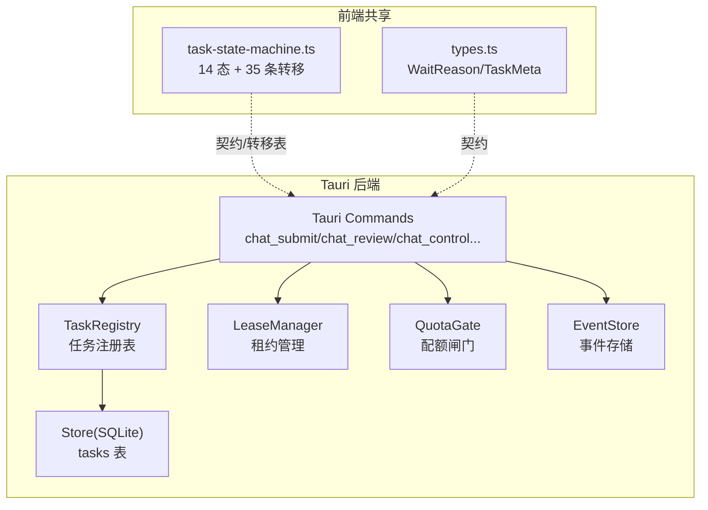
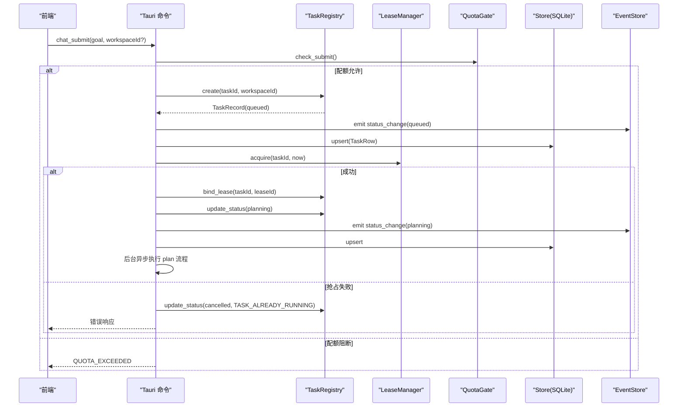
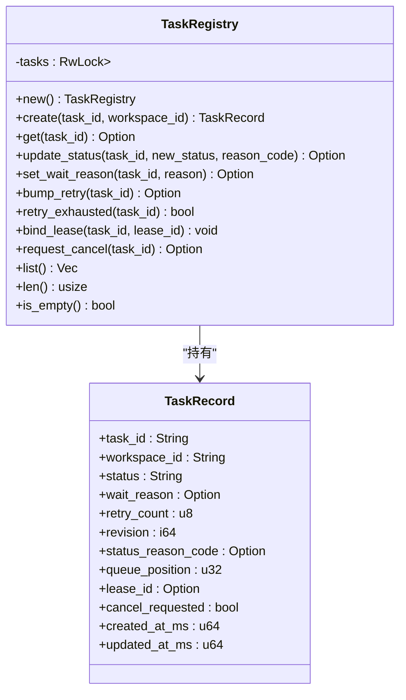
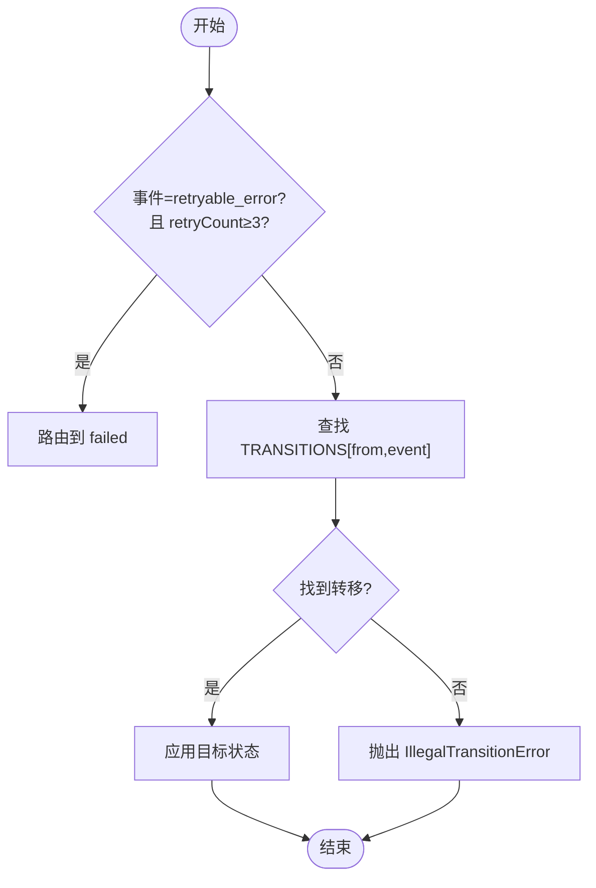
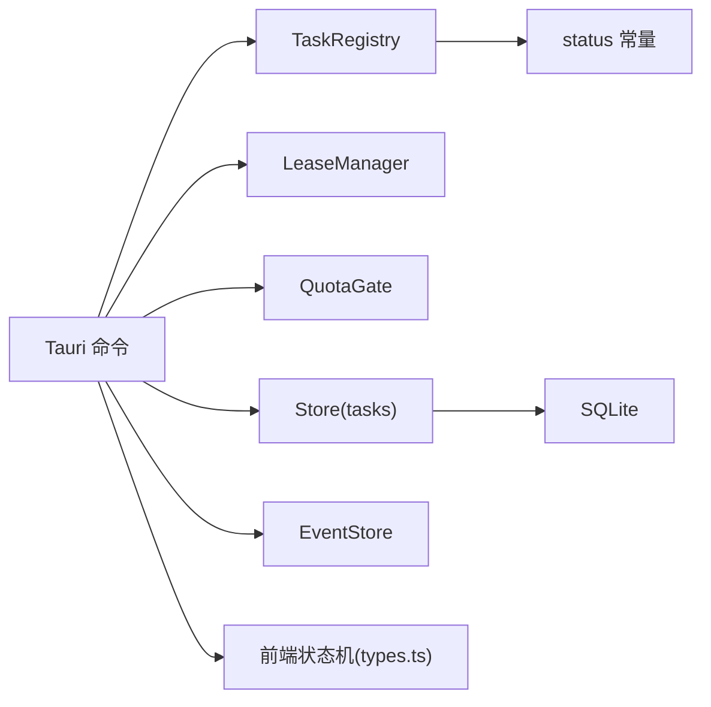

# 任务注册表服务

<cite>
**本文引用的文件**
- [registry.rs](file://tongtian-tauri/src-tauri/src/task/registry.rs)
- [mod.rs](file://tongtian-tauri/src-tauri/src/task/mod.rs)
- [tasks.rs](file://tongtian-tauri/src-tauri/src/store/tasks.rs)
- [quota.rs](file://tongtian-tauri/src-tauri/src/task/quota.rs)
- [lib.rs](file://tongtian-tauri/src-tauri/src/lib.rs)
- [task-state-machine.ts](file://tongtian-tauri/src/shared/task-state-machine.ts)
- [types.ts](file://tongtian-tauri/src/shared/types.ts)
</cite>

## 目录
1. [简介](#简介)
2. [项目结构](#项目结构)
3. [核心组件](#核心组件)
4. [架构总览](#架构总览)
5. [详细组件分析](#详细组件分析)
6. [依赖关系分析](#依赖关系分析)
7. [性能考量](#性能考量)
8. [故障排查指南](#故障排查指南)
9. [结论](#结论)
10. [附录：扩展与自定义状态](#附录：扩展与自定义状态)

## 简介
本文件面向“通天办公”项目的任务注册表服务，聚焦 TaskRegistry 的核心职责与实现细节，包括：
- 任务生命周期管理：创建、更新、查询、重试、取消、归档等
- 状态转换控制：基于 14 态状态机与转移事件，确保合法迁移
- 并发安全保证：使用 RwLock 保护内存中的任务映射，配合 Arc 在 Tauri 命令中共享服务
- 任务与租约的绑定机制：通过 LeaseManager 获取/释放执行租约，并在注册表中记录 lease_id
- 事件驱动的状态同步：状态变更通过事件流推送前端，并持久化到本地 SQLite
- 错误处理策略：非法转移拒绝、配额阻断、租约抢占保护、桥接错误兜底
- 性能优化技巧：本地 local-first 退化（入队即出队）、乐观锁 revision、批量落库与 TTL 清理

## 项目结构
围绕任务注册表的关键代码分布在以下位置：
- Rust 后端（Tauri）
  - 任务注册表：src-tauri/src/task/registry.rs
  - 状态常量与模块组织：src-tauri/src/task/mod.rs
  - 配额闸门：src-tauri/src/task/quota.rs
  - 持久化存储（SQLite）：src-tauri/src/store/tasks.rs
  - Tauri 命令与服务装配：src-tauri/src/lib.rs
- 前端共享契约与状态机（TypeScript）
  - 14 态状态机与转移规则：src/shared/task-state-machine.ts
  - 类型定义（含 WaitReason、TaskMeta 等）：src/shared/types.ts

图表来源
- [lib.rs:125-237](file://tongtian-tauri/src-tauri/src/lib.rs#L125-L237)
- [registry.rs:44-183](file://tongtian-tauri/src-tauri/src/task/registry.rs#L44-L183)
- [quota.rs:60-220](file://tongtian-tauri/src-tauri/src/task/quota.rs#L60-L220)
- [tasks.rs:27-95](file://tongtian-tauri/src-tauri/src/store/tasks.rs#L27-L95)
- [task-state-machine.ts:63-133](file://tongtian-tauri/src/shared/task-state-machine.ts#L63-L133)
- [types.ts:27-61](file://tongtian-tauri/src/shared/types.ts#L27-L61)

章节来源
- [lib.rs:17-42](file://tongtian-tauri/src-tauri/src/lib.rs#L17-L42)
- [registry.rs:1-46](file://tongtian-tauri/src-tauri/src/task/registry.rs#L1-L46)
- [mod.rs:1-24](file://tongtian-tauri/src-tauri/src/task/mod.rs#L1-L24)

## 核心组件
- TaskRegistry：内存中的任务记录集合，提供 create/get/update_status/set_wait_reason/bump_retry/bind_lease/request_cancel/list/len/is_empty 等方法；维护 revision 乐观锁与 updated_at_ms 时间戳。
- 状态常量：status::QUEUED/PLANNING/PENDING_REVIEW/EXECUTING/PAUSED/BUDGET_PAUSED/RETRY_PENDING/DELIVERING/DONE/FAILED/ROLLED_BACK/CANCELLED/ARCHIVED。
- QuotaGate：四档阈值（70/85/95/100%），支持 add_usage/snapshot/check_submit/should_queue，跨日重置台账，持久化 JSON。
- Store(tasks)：SQLite 持久化，upsert 与 list_recent，按 updated_at_ms 倒序。
- Tauri 命令：chat_submit/chat_review/chat_control/chat_cancel/task_state/quota_status/lease_info/lease_takeover/event_replay 等，串联注册表、租约、配额、事件与持久化。
- 前端状态机：14 态 + 35 条转移，guard 条件（如 retryCount<3），以及 wait_reason 子态管理。

章节来源
- [registry.rs:12-183](file://tongtian-tauri/src-tauri/src/task/registry.rs#L12-L183)
- [mod.rs:7-23](file://tongtian-tauri/src-tauri/src/task/mod.rs#L7-L23)
- [quota.rs:15-220](file://tongtian-tauri/src-tauri/src/task/quota.rs#L15-L220)
- [tasks.rs:9-95](file://tongtian-tauri/src-tauri/src/store/tasks.rs#L9-L95)
- [lib.rs:125-599](file://tongtian-tauri/src-tauri/src/lib.rs#L125-L599)
- [task-state-machine.ts:16-133](file://tongtian-tauri/src/shared/task-state-machine.ts#L16-L133)

## 架构总览
任务提交流程（简化）：
- chat_submit 先经 QuotaGate.check_submit 检查配额，再调用 TaskRegistry.create 置为 queued，并推送 status_change 事件与持久化。
- 本地 local-first 退化：queued 立即 acquire 租约，bind_lease 后转 planning，随后后台异步执行计划生成（两阶段 stage=plan）。
- 计划完成后进入 pending_review；approve 后重新签发租约转 executing，消费 step*/deliver/done 事件，最终 done/failed/cancelled。
- 所有状态变更均 emit 事件并 sync_task_to_db 持久化。

图表来源
- [lib.rs:125-237](file://tongtian-tauri/src-tauri/src/lib.rs#L125-L237)
- [registry.rs:68-154](file://tongtian-tauri/src-tauri/src/task/registry.rs#L68-L154)
- [quota.rs:191-206](file://tongtian-tauri/src-tauri/src/task/quota.rs#L191-L206)
- [tasks.rs:27-95](file://tongtian-tauri/src-tauri/src/store/tasks.rs#L27-L95)

章节来源
- [lib.rs:125-237](file://tongtian-tauri/src-tauri/src/lib.rs#L125-L237)

## 详细组件分析

### TaskRegistry：任务记录与状态管理
- 数据结构：TaskRecord 包含 task_id、workspace_id、status、wait_reason、retry_count、revision、status_reason_code、queue_position、lease_id、cancel_requested、created_at_ms、updated_at_ms。
- 并发模型：内部使用 RwLock<HashMap<String, TaskRecord>>，读多写少场景高效；所有写操作返回最新副本或 None。
- 关键方法：
  - create：初始化记录，status=queued，revision=1，时间戳设置。
  - get/list：只读访问，克隆返回。
  - update_status：更新 status、status_reason_code，非 executing 时清除 wait_reason，revision++，更新时间戳。
  - set_wait_reason：仅用于 executing 子态标注（限流等待等），更新时间戳。
  - bump_retry/retry_exhausted：累计重试次数，上限 MAX_RETRY_COUNT=3。
  - bind_lease：记录 lease_id，更新时间戳。
  - request_cancel：幂等标记 cancel_requested=true。
- 测试覆盖：创建进入 queued、revision 递增、wait_reason 清理、重试耗尽、取消幂等、缺失任务返回 None、租约绑定。

图表来源
- [registry.rs:12-183](file://tongtian-tauri/src-tauri/src/task/registry.rs#L12-L183)

章节来源
- [registry.rs:12-183](file://tongtian-tauri/src-tauri/src/task/registry.rs#L12-L183)

### 状态机与转移控制（前端契约）
- 14 态：idle、queued、planning、pending_review、executing、paused、budget_paused、retry_pending、delivering、done、failed、rolled_back、cancelled、archived。
- 35 条转移：涵盖提交、获取租约、审阅、暂停/恢复、预算暂停/恢复、重试退避、交付完成、手动重试、归档等。
- Guard 条件：retryable_error 在 retryCount≥3 时视为非法，应路由到 failed（重试耗尽）。
- wait_reason 子态：仅在 executing 允许设置，避免状态爆炸。
- 终态：cancelled、archived（done 仅保留 archive 边）。

图表来源
- [task-state-machine.ts:16-133](file://tongtian-tauri/src/shared/task-state-machine.ts#L16-L133)
- [task-state-machine.ts:147-201](file://tongtian-tauri/src/shared/task-state-machine.ts#L147-L201)

章节来源
- [task-state-machine.ts:16-133](file://tongtian-tauri/src/shared/task-state-machine.ts#L16-L133)
- [task-state-machine.ts:147-201](file://tongtian-tauri/src/shared/task-state-machine.ts#L147-L201)

### 配额闸门（QuotaGate）
- 四档阈值：70%（notify）、85%（degrade）、95%（queue）、100%（block）。
- 功能：add_usage（累计用量，跨日重置，跃迁去抖）、snapshot（快照）、check_submit（100% 阻断新提交）、should_queue（≥95% 排队）。
- 持久化：JSON 台账文件，日期键跨日重置。
- 与任务流集成：chat_submit 前检查；运行中任务达到 100% 触发 budget_paused（转移 #17）。

章节来源
- [quota.rs:15-220](file://tongtian-tauri/src-tauri/src/task/quota.rs#L15-L220)
- [lib.rs:125-149](file://tongtian-tauri/src-tauri/src/lib.rs#L125-L149)

### 持久化（tasks 表）
- TaskRow：对齐 TaskSummary.meta，包含 status、wait_reason、retry_count、status_reason_code、queue_position、时间戳。
- upsert：INSERT ... ON CONFLICT DO UPDATE，title 空则保留既有值。
- list_recent：ORDER BY updated_at_ms DESC，可选 limit。

章节来源
- [tasks.rs:9-95](file://tongtian-tauri/src-tauri/src/store/tasks.rs#L9-L95)

### Tauri 命令与服务装配
- P0Services：聚合 registry、leases、quota、events、store，通过 Arc 共享。
- chat_submit：配额检查 → 注册表 create → 事件推送 → 持久化 → 租约 acquire → 状态转 planning → 后台异步执行 plan。
- chat_review：approve→executing（重新签发租约）、reject→done(REJECTED)、modify→planning。
- chat_control：pause/resume/rollback_to，状态校验与引擎控制。
- chat_cancel：标记取消请求，通知引擎终止，非终态转 cancelled。
- task_state/quota_status/lease_info/event_replay：查询接口。
- 启动时初始化：Store、EventStore、P0Services，启动事件清理与租约扫描循环。

章节来源
- [lib.rs:35-42](file://tongtian-tauri/src-tauri/src/lib.rs#L35-L42)
- [lib.rs:125-599](file://tongtian-tauri/src-tauri/src/lib.rs#L125-L599)
- [lib.rs:747-793](file://tongtian-tauri/src-tauri/src/lib.rs#L747-L793)

## 依赖关系分析
- 耦合关系：
  - Tauri 命令依赖 TaskRegistry、LeaseManager、QuotaGate、Store、EventStore。
  - TaskRegistry 依赖 status 常量与系统时间。
  - Store(tasks) 依赖 rusqlite。
  - 前端状态机与后端状态常量保持契约镜像（types.ts 与 mod.rs/status）。
- 外部依赖：
  - Tauri 运行时（async_runtime、Emitter、Manager）。
  - SQLite（rusqlite）。
  - serde_json（序列化/反序列化）。

图表来源
- [lib.rs:17-42](file://tongtian-tauri/src-tauri/src/lib.rs#L17-L42)
- [registry.rs:1-46](file://tongtian-tauri/src-tauri/src/task/registry.rs#L1-L46)
- [tasks.rs:1-26](file://tongtian-tauri/src-tauri/src/store/tasks.rs#L1-L26)
- [types.ts:1-61](file://tongtian-tauri/src/shared/types.ts#L1-L61)

章节来源
- [lib.rs:17-42](file://tongtian-tauri/src-tauri/src/lib.rs#L17-L42)

## 性能考量
- 本地 local-first 退化：queued 入队即出队（<100ms），queue_position 恒为 0，降低队列复杂度。
- 乐观锁 revision：每次状态更新单调递增，便于冲突检测与排序。
- 并发安全：RwLock 读多写少，适合高并发查询与低频状态更新。
- 持久化批处理：事件存储后台任务批量刷盘，减少 IO 压力。
- 配额计算：阈值从高到低匹配，O(1) 判定；跨日重置避免无限增长。
- 租约扫描：单 interval 驱动心跳超时回收，避免频繁轮询。

[本节为通用性能讨论，不直接分析具体文件]

## 故障排查指南
- 非法状态转移：前端状态机会抛出 IllegalTransitionError，需检查 from/event 是否在 35 条转移内。
- 配额阻断：check_submit 返回 QUOTA_EXCEEDED，需检查 used_tokens/quota_tokens 是否达到 100%。
- 租约抢占：acquire 失败返回 TASK_ALREADY_RUNNING，需确认是否有其他端持有活跃租约。
- 桥接错误：agent 通信失败时更新为 FAILED，并推送 error 事件，需查看日志与事件重放。
- 数据库写入失败：sync_task_to_db 失败仅打印日志，不影响主流程，需检查磁盘权限与 SQLite 状态。

章节来源
- [task-state-machine.ts:147-155](file://tongtian-tauri/src/shared/task-state-machine.ts#L147-L155)
- [quota.rs:191-206](file://tongtian-tauri/src-tauri/src/task/quota.rs#L191-L206)
- [lib.rs:152-166](file://tongtian-tauri/src-tauri/src/lib.rs#L152-L166)
- [lib.rs:211-229](file://tongtian-tauri/src-tauri/src/lib.rs#L211-L229)
- [lib.rs:119-123](file://tongtian-tauri/src-tauri/src/lib.rs#L119-L123)

## 结论
TaskRegistry 作为任务注册表服务的核心，提供了线程安全的任务记录管理、状态更新、重试计数、租约绑定与取消标记等功能。结合前端 14 态状态机与 35 条转移规则，确保了状态转换的合法性与一致性。通过 QuotaGate 的配额闸门与 LeaseManager 的租约机制，实现了资源控制与并发安全。事件驱动的状态同步与持久化保证了前后端一致性与数据可恢复性。整体设计遵循 local-first 理念，兼顾性能与可扩展性。

[本节为总结性内容，不直接分析具体文件]

## 附录：扩展与自定义状态
- 添加新状态：
  - 在前端 types.ts 的 TaskStatus 枚举中添加新状态。
  - 在 Rust mod.rs 的 status 模块中添加对应常量。
  - 在前端 task-state-machine.ts 的 TRANSITIONS 中添加相关转移规则。
- 扩展状态机逻辑：
  - 在 canTransition/transition 中增加 guard 条件（如 retryCount 或其他业务条件）。
  - 在 applyWaitReason 中扩展 wait_reason 子态（如需新增执行期子态）。
- 注册表扩展：
  - 在 TaskRecord 中添加新字段，并在 update_status/set_wait_reason 等方法中处理默认值与清理逻辑。
  - 在 tasks.rs 的 TaskRow 中同步新增字段，并更新 upsert SQL。
- 配额扩展：
  - 在 quota.rs 的 TIER_THRESHOLDS 中添加新档位与动作。
  - 在 evaluate/add_usage 中适配新阈值的判定逻辑。
- 事件与持久化：
  - 在 lib.rs 的 emit_status_change 与 sync_task_to_db 中同步新字段。
  - 在 EventStore 中记录新事件类型（如需）。

章节来源
- [types.ts:3-25](file://tongtian-tauri/src/shared/types.ts#L3-L25)
- [mod.rs:7-23](file://tongtian-tauri/src-tauri/src/task/mod.rs#L7-L23)
- [task-state-machine.ts:63-133](file://tongtian-tauri/src/shared/task-state-machine.ts#L63-L133)
- [registry.rs:12-183](file://tongtian-tauri/src-tauri/src/task/registry.rs#L12-L183)
- [tasks.rs:9-95](file://tongtian-tauri/src-tauri/src/store/tasks.rs#L9-L95)
- [quota.rs:15-220](file://tongtian-tauri/src-tauri/src/task/quota.rs#L15-L220)
- [lib.rs:89-123](file://tongtian-tauri/src-tauri/src/lib.rs#L89-L123)