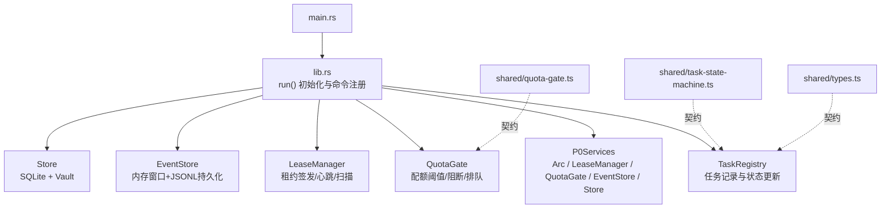
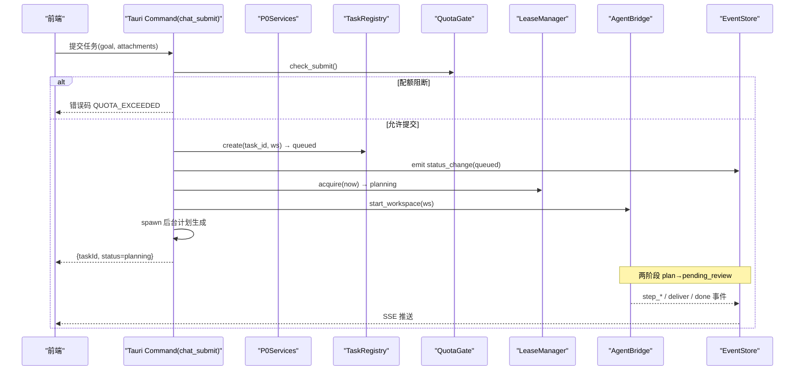
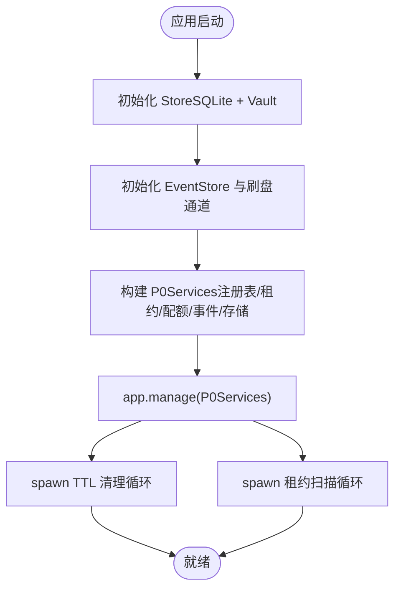
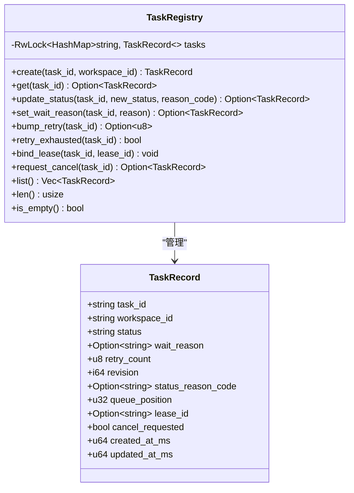
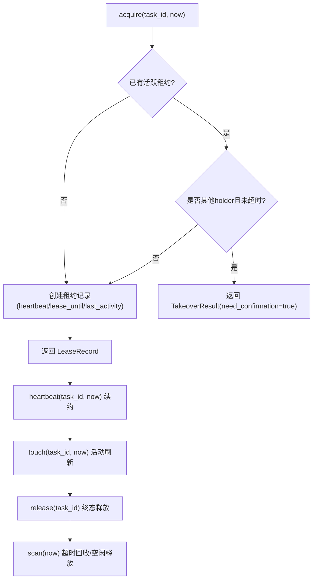
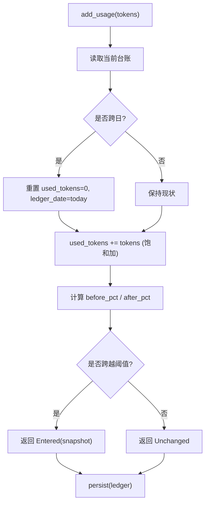
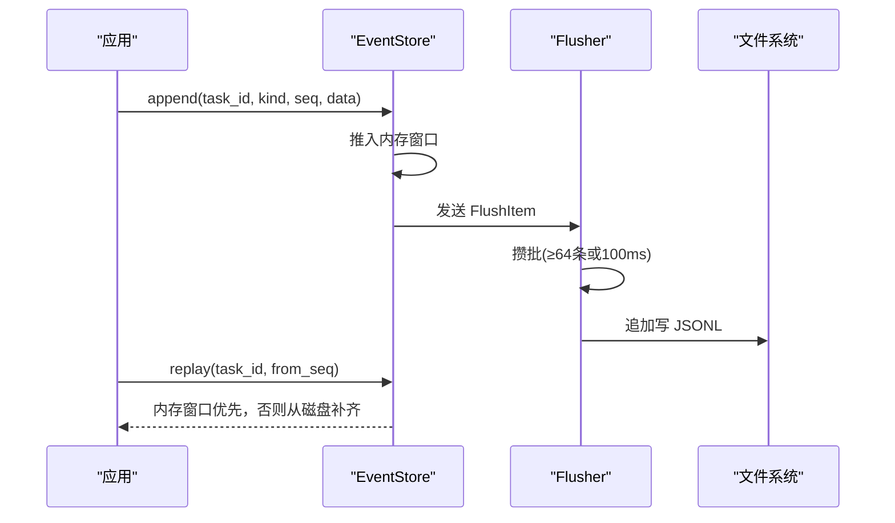
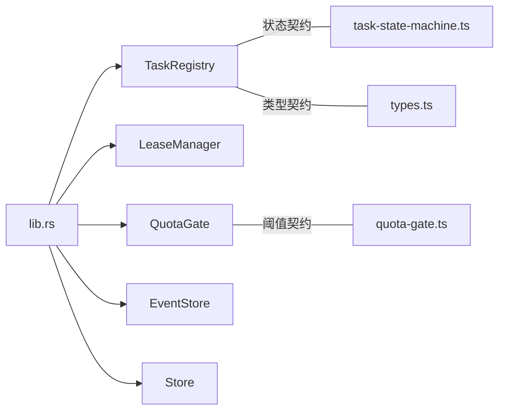

# 服务架构设计

<cite>
**本文引用的文件**   
- [lib.rs](file://tongtian-tauri/src-tauri/src/lib.rs)
- [main.rs](file://tongtian-tauri/src-tauri/src/main.rs)
- [registry.rs](file://tongtian-tauri/src-tauri/src/task/registry.rs)
- [quota.rs](file://tongtian-tauri/src-tauri/src/task/quota.rs)
- [lease.rs](file://tongtian-tauri/src-tauri/src/task/lease.rs)
- [event_store.rs](file://tongtian-tauri/src-tauri/src/bridge/event_store.rs)
- [mod.rs（store）](file://tongtian-tauri/src-tauri/src/store/mod.rs)
- [task-state-machine.ts](file://tongtian-tauri/src/shared/task-state-machine.ts)
- [quota-gate.ts](file://tongtian-tauri/src/shared/quota-gate.ts)
- [types.ts](file://tongtian-tauri/src/shared/types.ts)
- [Cargo.toml](file://tongtian-tauri/src-tauri/Cargo.toml)
</cite>

## 目录
1. [引言](#引言)
2. [项目结构](#项目结构)
3. [核心组件](#核心组件)
4. [架构总览](#架构总览)
5. [详细组件分析](#详细组件分析)
6. [依赖关系分析](#依赖关系分析)
7. [性能考量](#性能考量)
8. [故障排查指南](#故障排查指南)
9. [结论](#结论)
10. [附录：扩展与自定义服务规范](#附录扩展与自定义服务规范)

## 引言
本设计文档面向“通天办公”Tauri 后端，聚焦 P0Services 核心服务集合的职责划分、协作关系与生命周期管理。P0Services 聚合任务注册表、租约管理器、配额闸门、事件存储与持久化存储，构成任务提交、审阅、控制、历史与重放等关键闭环能力。文档同时阐述 Arc 智能指针的使用、异步服务协调、内存管理与并发安全保证，并提供服务扩展与自定义开发规范。

## 项目结构
- Tauri 应用入口在 main.rs，调用库模块 lib.rs 的 run() 完成初始化与命令注册。
- P0Services 在 lib.rs 中定义并作为全局状态注入 Tauri 容器，供各 command 使用。
- task 子模块提供 TaskRegistry、LeaseManager、QuotaGate；bridge 子模块提供 EventStore；store 子模块提供 SQLite 与密钥保管。
- shared 目录维护前后端共享契约（状态机、配额闸门纯函数、类型定义）。

**图表来源** 
- [lib.rs:747-793](file://tongtian-tauri/src-tauri/src/lib.rs#L747-L793)
- [registry.rs:44-183](file://tongtian-tauri/src-tauri/src/task/registry.rs#L44-L183)
- [lease.rs:62-207](file://tongtian-tauri/src-tauri/src/task/lease.rs#L62-L207)
- [quota.rs:60-220](file://tongtian-tauri/src-tauri/src/task/quota.rs#L60-L220)
- [event_store.rs:98-271](file://tongtian-tauri/src-tauri/src/bridge/event_store.rs#L98-L271)
- [mod.rs（store）:19-52](file://tongtian-tauri/src-tauri/src/store/mod.rs#L19-L52)

**章节来源**
- [main.rs:1-6](file://tongtian-tauri/src-tauri/src/main.rs#L1-L6)
- [lib.rs:747-793](file://tongtian-tauri/src-tauri/src/lib.rs#L747-L793)

## 核心组件
- P0Services：集中持有 Arc<TaskRegistry>、Arc<LeaseManager>、Arc<QuotaGate>、Arc<EventStore>、Arc<Store>，通过 Tauri State 注入，被所有 command 共享访问。
- TaskRegistry：维护任务记录与状态转移，支持乐观锁 revision、重试计数、取消标记、租约绑定。
- LeaseManager：单设备唯一 holder，签发/心跳/空闲释放/超时回收，禁止抢占语义。
- QuotaGate：四档阈值（70/85/95/100%），新增提交阻断、运行中预算暂停、台账持久化与跨日重置。
- EventStore：内存重放窗口（双上限）+ append-only JSONL 异步批量刷盘 + 24h TTL 清理。
- Store：SQLite 连接封装与 keyring 密钥保管，统一 with_conn 短临界区访问。

**章节来源**
- [lib.rs:35-42](file://tongtian-tauri/src-tauri/src/lib.rs#L35-L42)
- [registry.rs:12-183](file://tongtian-tauri/src-tauri/src/task/registry.rs#L12-L183)
- [lease.rs:14-207](file://tongtian-tauri/src-tauri/src/task/lease.rs#L14-L207)
- [quota.rs:15-220](file://tongtian-tauri/src-tauri/src/task/quota.rs#L15-L220)
- [event_store.rs:17-271](file://tongtian-tauri/src-tauri/src/bridge/event_store.rs#L17-L271)
- [mod.rs（store）:19-52](file://tongtian-tauri/src-tauri/src/store/mod.rs#L19-L52)

## 架构总览
P0Services 作为“附加式扩展”的核心枢纽，将前端 Tauri 命令与后端 Agent 桥接、事件流、持久化串联起来。任务生命周期由 14 态状态机约束，配额闸门决定新提交与运行中行为，租约管理器保障执行期独占与异常恢复，事件存储支撑断线补发与重放。

**图表来源** 
- [lib.rs:127-237](file://tongtian-tauri/src-tauri/src/lib.rs#L127-L237)
- [registry.rs:68-90](file://tongtian-tauri/src-tauri/src/task/registry.rs#L68-L90)
- [quota.rs:191-200](file://tongtian-tauri/src-tauri/src/task/quota.rs#L191-L200)
- [lease.rs:83-108](file://tongtian-tauri/src-tauri/src/task/lease.rs#L83-L108)
- [event_store.rs:116-131](file://tongtian-tauri/src-tauri/src/bridge/event_store.rs#L116-L131)

## 详细组件分析

### P0Services 与服务生命周期
- 生命周期：应用启动时创建 Store、EventStore、TaskRegistry、LeaseManager、QuotaGate，组装为 P0Services 并通过 app.manage 注入。
- 后台任务：事件存储 TTL 清理循环、租约扫描循环、事件刷盘后台任务均独立 spawn。
- 依赖注入：所有 command 通过 State<'_, Arc<P0Services>> 获取共享实例，避免全局可变状态。

**图表来源** 
- [lib.rs:752-793](file://tongtian-tauri/src-tauri/src/lib.rs#L752-L793)
- [event_store.rs:274-288](file://tongtian-tauri/src-tauri/src/bridge/event_store.rs#L274-L288)

**章节来源**
- [lib.rs:747-793](file://tongtian-tauri/src-tauri/src/lib.rs#L747-L793)

### 任务注册表（TaskRegistry）
- 职责：创建任务记录、状态更新、重试计数、取消请求、租约绑定、列表视图。
- 并发：RwLock<HashMap> 读写分离，update_status 单调递增 revision 实现乐观锁。
- 与状态机：与 shared/task-state-machine.ts 的 14 态保持一致，调用方负责转移合法性校验。

**图表来源** 
- [registry.rs:12-183](file://tongtian-tauri/src-tauri/src/task/registry.rs#L12-L183)

**章节来源**
- [registry.rs:44-183](file://tongtian-tauri/src-tauri/src/task/registry.rs#L44-L183)

### 租约管理器（LeaseManager）
- 职责：签发租约、心跳续约、空闲释放、超时回收、接管请求（禁止抢占）。
- 并发：Mutex<HashMap> 保护租约表，scan 单次遍历 O(n)。
- 常量：心跳 10s、租约 30s、超时回收 60s、空闲释放 5min、扫描间隔 10s。

**图表来源** 
- [lease.rs:83-184](file://tongtian-tauri/src-tauri/src/task/lease.rs#L83-L184)

**章节来源**
- [lease.rs:62-207](file://tongtian-tauri/src-tauri/src/task/lease.rs#L62-L207)

### 配额闸门（QuotaGate）
- 职责：计算快照、累计用量、档位跃迁去抖、新提交阻断、是否排队判定。
- 持久化：可选 ledger_path JSON 文件，跨日重置 used_tokens。
- 与前端契约：与 shared/quota-gate.ts 的阈值与动作链一致。

**图表来源** 
- [quota.rs:160-220](file://tongtian-tauri/src-tauri/src/task/quota.rs#L160-L220)

**章节来源**
- [quota.rs:60-220](file://tongtian-tauri/src-tauri/src/task/quota.rs#L60-L220)

### 事件存储（EventStore）
- 职责：内存重放窗口（双上限）、append-only JSONL 异步批量刷盘、24h TTL 清理、磁盘兜底重放。
- 并发：UnboundedSender 投递刷盘任务，flusher 后台批量写入。
- 容量控制：单任务文件 10MB 滚动重开，防止磁盘膨胀。

**图表来源** 
- [event_store.rs:116-198](file://tongtian-tauri/src-tauri/src/bridge/event_store.rs#L116-L198)
- [event_store.rs:200-235](file://tongtian-tauri/src-tauri/src/bridge/event_store.rs#L200-L235)

**章节来源**
- [event_store.rs:98-271](file://tongtian-tauri/src-tauri/src/bridge/event_store.rs#L98-L271)

### 存储地基（Store）
- 职责：SQLite 连接封装、迁移幂等、keyring 密钥保管、with_conn 短临界区。
- 路径策略：默认运行目录数据库，失败回退 temp；环境变量 TONGTIAN_HOME 覆盖。

**章节来源**
- [mod.rs（store）:19-52](file://tongtian-tauri/src-tauri/src/store/mod.rs#L19-L52)

### 状态机与契约（shared）
- 14 态任务状态机：35 条合法转移，retryable_error 在重试耗尽时路由到 failed。
- 配额闸门纯函数：四档阈值与动作链，错误码映射区分新提交与运行中任务。
- 类型定义：TaskStatus、WaitReason、ChatEvent 等契约对齐 Rust 侧。

**章节来源**
- [task-state-machine.ts:63-133](file://tongtian-tauri/src/shared/task-state-machine.ts#L63-L133)
- [quota-gate.ts:37-81](file://tongtian-tauri/src/shared/quota-gate.ts#L37-L81)
- [types.ts:3-41](file://tongtian-tauri/src/shared/types.ts#L3-L41)

## 依赖关系分析
- lib.rs 依赖 task/*、bridge/*、store/* 模块，并通过 Tauri State 注入 P0Services。
- TaskRegistry 依赖 status 常量（与 TS 状态机一致）。
- LeaseManager 与 TaskRegistry 通过 bind_lease/release 协作。
- QuotaGate 与 TaskRegistry 在 chat_submit/chat_control 中协同决策。
- EventStore 与 lib.rs 的命令流程耦合，用于 status_change/quota_warning/error/done 等事件。

**图表来源** 
- [lib.rs:17-31](file://tongtian-tauri/src-tauri/src/lib.rs#L17-L31)
- [task-state-machine.ts:63-133](file://tongtian-tauri/src/shared/task-state-machine.ts#L63-L133)
- [quota-gate.ts:37-81](file://tongtian-tauri/src/shared/quota-gate.ts#L37-L81)
- [types.ts:3-41](file://tongtian-tauri/src/shared/types.ts#L3-L41)

**章节来源**
- [lib.rs:17-31](file://tongtian-tauri/src-tauri/src/lib.rs#L17-L31)

## 性能考量
- 事件存储：批量刷盘（64 条或 100ms）降低 IO 抖动；内存窗口双上限防膨胀；24h TTL 周期清理。
- 租约扫描：单 interval 驱动全部租约，O(n) 开销可忽略。
- 配额台账：本地 JSON 持久化，跨日重置，避免频繁 DB 操作。
- 存储访问：with_conn 短临界区减少锁竞争。
- 编译优化：Cargo profile release 启用 LTO、strip、opt-level=s。

**章节来源**
- [event_store.rs:26-28](file://tongtian-tauri/src-tauri/src/bridge/event_store.rs#L26-L28)
- [lease.rs:22-23](file://tongtian-tauri/src-tauri/src/task/lease.rs#L22-L23)
- [mod.rs（store）:44-47](file://tongtian-tauri/src-tauri/src/store/mod.rs#L44-L47)
- [Cargo.toml:35-40](file://tongtian-tauri/src-tauri/Cargo.toml#L35-L40)

## 故障排查指南
- 配额阻断：check_submit 返回 QUOTA_EXCEEDED，检查 quota snapshot 与 add_usage 累计是否正确。
- 租约抢占：takeover/acquire 返回 need_confirmation，确认对端是否仍活跃或已超时。
- 事件丢失：replay 优先内存窗口，若为空则从磁盘 24h 内补齐；检查 flusher 是否正常运行。
- 状态非法：update_status 需遵循 14 态转移表，非法转移应抛错而非静默处理。
- 存储回退：Store::open_default 失败回退 temp，检查 TONGTIAN_HOME 与权限。

**章节来源**
- [quota.rs:191-200](file://tongtian-tauri/src-tauri/src/task/quota.rs#L191-L200)
- [lease.rs:139-158](file://tongtian-tauri/src-tauri/src/task/lease.rs#L139-L158)
- [event_store.rs:134-160](file://tongtian-tauri/src-tauri/src/bridge/event_store.rs#L134-L160)
- [task-state-machine.ts:165-201](file://tongtian-tauri/src/shared/task-state-machine.ts#L165-L201)
- [mod.rs（store）:26-31](file://tongtian-tauri/src-tauri/src/store/mod.rs#L26-L31)

## 结论
P0Services 以 Arc 智能指针为核心，结合 Tauri State 注入与异步后台任务，实现了任务注册、租约管理、配额闸门、事件存储与持久化的完整闭环。通过严格的 14 态状态机与配额阈值契约，系统在保证并发安全的同时提供了可扩展的服务边界。建议后续按扩展规范逐步接入云端能力与更多业务域服务。

## 附录：扩展与自定义服务规范
- 服务注册：在 lib.rs 中扩展 P0Services 字段，并在 setup 中初始化与 manage。
- 依赖注入：command 通过 State<'_, Arc<P0Services>> 获取服务，避免全局可变。
- 并发模型：使用 Arc<Mutex/RwLock> 保护共享状态；后台任务用 tokio::spawn。
- 错误处理：明确错误码（如 QUOTA_EXCEEDED、TASK_ALREADY_RUNNING），统一 emit error/done 事件。
- 契约对齐：新增字段需同步 shared/types.ts 与状态机/配额闸门纯函数。
- 测试要求：为新增服务编写单元测试，覆盖边界条件与并发场景。

**章节来源**
- [lib.rs:752-793](file://tongtian-tauri/src-tauri/src/lib.rs#L752-L793)
- [types.ts:256-346](file://tongtian-tauri/src/shared/types.ts#L256-L346)
- [task-state-machine.ts:165-201](file://tongtian-tauri/src/shared/task-state-machine.ts#L165-L201)
- [quota-gate.ts:37-81](file://tongtian-tauri/src/shared/quota-gate.ts#L37-L81)