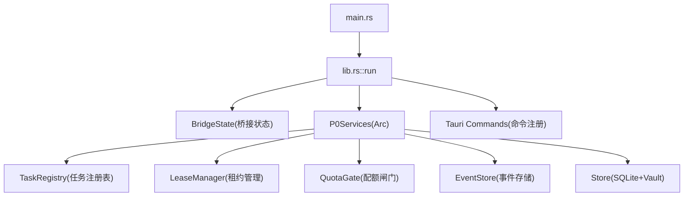
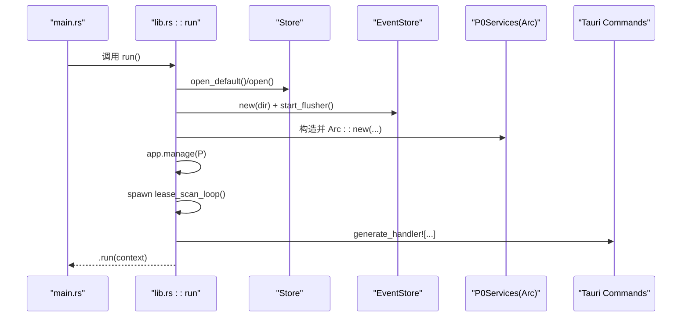
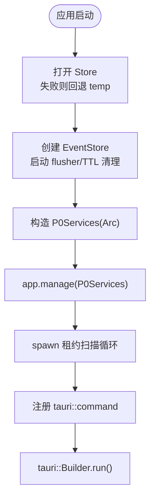
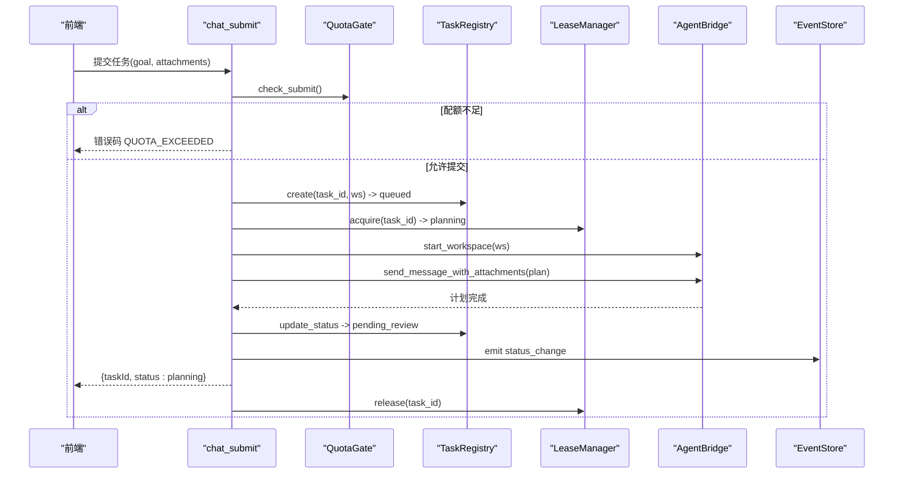
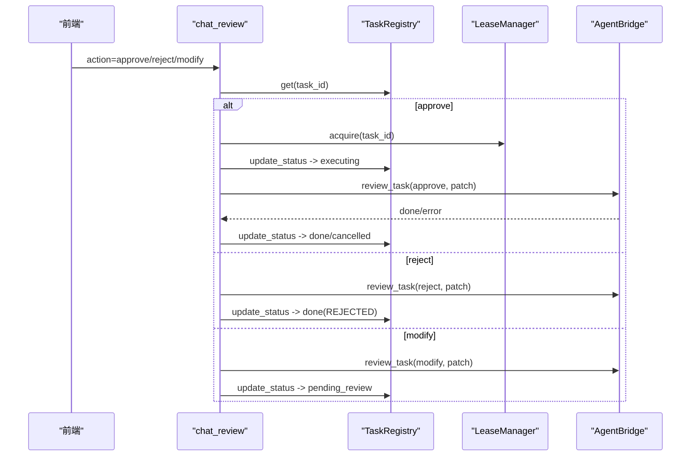
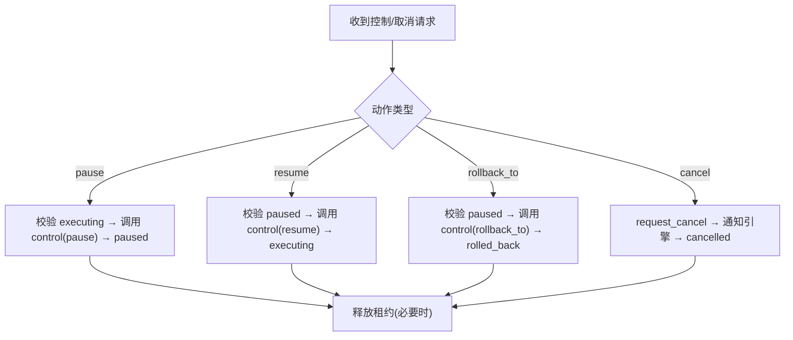
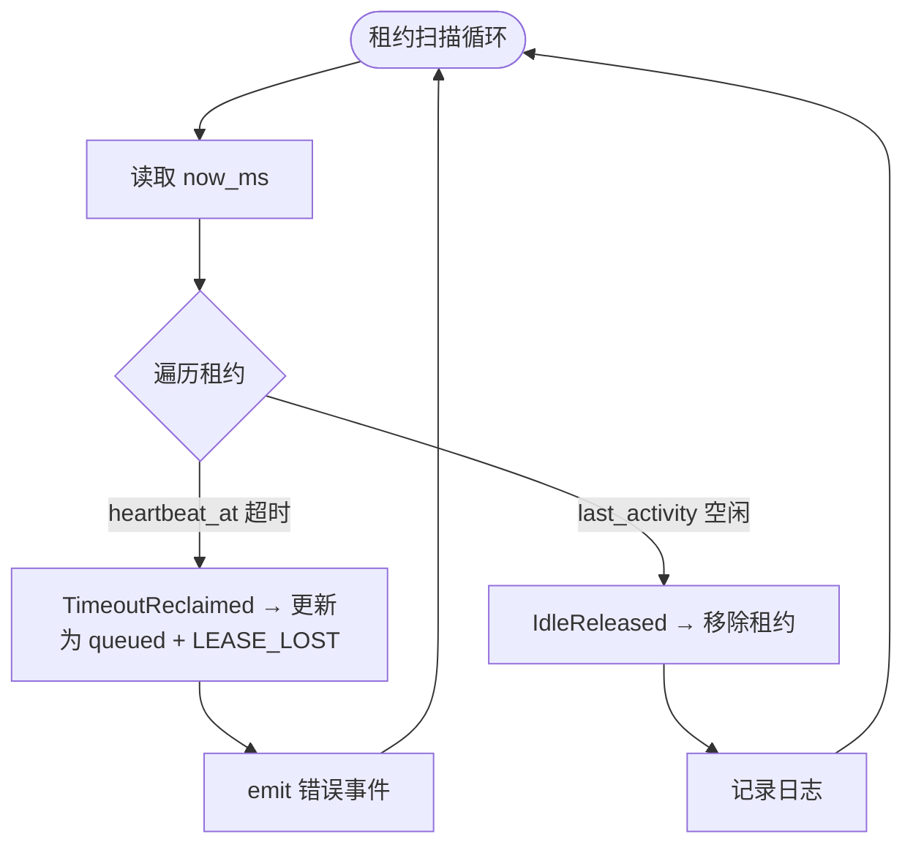
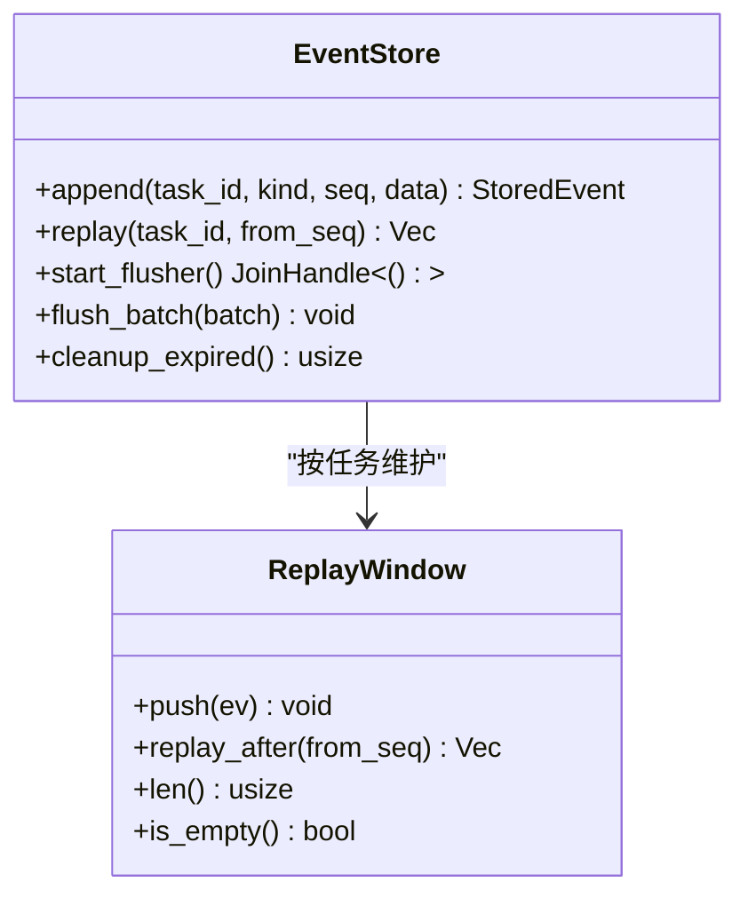
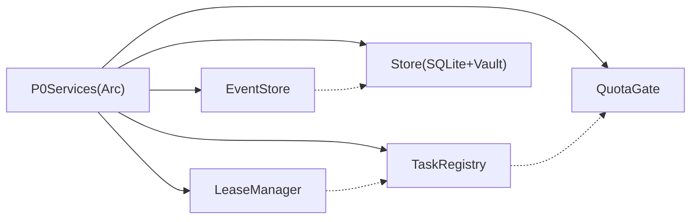

# 服务生命周期管理

<cite>
**本文引用的文件**
- [main.rs](file://tongtian-tauri/src-tauri/src/main.rs)
- [lib.rs](file://tongtian-tauri/src-tauri/src/lib.rs)
- [Cargo.toml](file://tongtian-tauri/src-tauri/Cargo.toml)
- [task/mod.rs](file://tongtian-tauri/src-tauri/src/task/mod.rs)
- [task/registry.rs](file://tongtian-tauri/src-tauri/src/task/registry.rs)
- [task/quota.rs](file://tongtian-tauri/src-tauri/src/task/quota.rs)
- [task/lease.rs](file://tongtian-tauri/src-tauri/src/task/lease.rs)
- [store/mod.rs](file://tongtian-tauri/src-tauri/src/store/mod.rs)
- [bridge/mod.rs](file://tongtian-tauri/src-tauri/src/bridge/mod.rs)
- [bridge/event_store.rs](file://tongtian-tauri/src-tauri/src/bridge/event_store.rs)
</cite>

## 目录
1. [简介](#简介)
2. [项目结构](#项目结构)
3. [核心组件](#核心组件)
4. [架构总览](#架构总览)
5. [详细组件分析](#详细组件分析)
6. [依赖关系分析](#依赖关系分析)
7. [性能考量](#性能考量)
8. [故障排查指南](#故障排查指南)
9. [结论](#结论)
10. [附录：扩展与自定义集成](#附录：扩展与自定义集成)

## 简介
本文件面向通天办公 Tauri 后端，系统性阐述 P0Services 的服务生命周期管理，包括初始化流程、依赖注入机制、服务间通信模式；深入说明 Arc 智能指针的使用、内存管理与资源清理策略；覆盖 Tauri 应用启动流程、服务注册机制、错误处理框架；并提供健康检查、监控指标收集、日志记录规范，以及服务扩展开发与自定义集成的实践指南。

## 项目结构
Tauri 后端采用 Rust 模块分层组织：
- 入口与装配：main.rs 调用库入口 lib.rs::run，完成 Tauri 构建、插件加载、状态管理、命令注册与运行。
- 业务域：task（任务注册表、租约、配额）、store（SQLite 持久化与密钥保管）、bridge（Python Agent 子进程与事件存储）。
- 配置与特性：Cargo.toml 声明依赖与编译特性（如 SSE seq 开关）。

图表来源
- [lib.rs:747-823](file://tongtian-tauri/src-tauri/src/lib.rs#L747-L823)
- [Cargo.toml:21-33](file://tongtian-tauri/src-tauri/Cargo.toml#L21-L33)

章节来源
- [main.rs:1-6](file://tongtian-tauri/src-tauri/src/main.rs#L1-L6)
- [lib.rs:747-823](file://tongtian-tauri/src-tauri/src/lib.rs#L747-L823)
- [Cargo.toml:21-33](file://tongtian-tauri/src-tauri/Cargo.toml#L21-L33)

## 核心组件
- P0Services：聚合 TaskRegistry、LeaseManager、QuotaGate、EventStore、Store，作为 Tauri 全局状态通过 Arc 共享。
- TaskRegistry：维护任务 14 态状态机、重试计数、乐观锁 revision、取消标记、排队位次等。
- LeaseManager：租约签发、心跳续约、空闲释放、超时回收、禁止抢占接管。
- QuotaGate：四档阈值（70/85/95/100%）的配额评估、提交阻断、用量累计与台账持久化。
- EventStore：内存重放窗口 + JSONL 异步批量刷盘 + 24h TTL 清理。
- Store：SQLite 连接封装、迁移执行、密钥保管 Vault。

章节来源
- [lib.rs:35-42](file://tongtian-tauri/src-tauri/src/lib.rs#L35-L42)
- [task/registry.rs:12-46](file://tongtian-tauri/src-tauri/src/task/registry.rs#L12-L46)
- [task/lease.rs:14-23](file://tongtian-tauri/src-tauri/src/task/lease.rs#L14-L23)
- [task/quota.rs:15-24](file://tongtian-tauri/src-tauri/src/task/quota.rs#L15-L24)
- [bridge/event_store.rs:17-28](file://tongtian-tauri/src-tauri/src/bridge/event_store.rs#L17-L28)
- [store/mod.rs:18-52](file://tongtian-tauri/src-tauri/src/store/mod.rs#L18-L52)

## 架构总览
Tauri 启动后，lib.rs::run 完成：
- 创建并 manage BridgeState（Agent 桥接状态）。
- 打开 Store（SQLite），失败回退到临时目录保证可用性。
- 创建 EventStore 并启动后台 flusher 与 TTL 清理循环。
- 组装 P0Services（Arc 共享），并通过 app.manage 注入。
- 启动租约扫描循环（单 interval 驱动）。
- 注册所有 tauri::command 暴露给前端。

图表来源
- [lib.rs:747-823](file://tongtian-tauri/src-tauri/src/lib.rs#L747-L823)
- [store/mod.rs:24-52](file://tongtian-tauri/src-tauri/src/store/mod.rs#L24-L52)
- [bridge/event_store.rs:163-198](file://tongtian-tauri/src-tauri/src/bridge/event_store.rs#L163-L198)

章节来源
- [lib.rs:747-823](file://tongtian-tauri/src-tauri/src/lib.rs#L747-L823)

## 详细组件分析

### P0Services 初始化与依赖注入
- 在 setup 阶段创建 Store（优先运行目录，失败回退 temp），创建 EventStore（app data/events 或当前目录），再构造 P0Services 并 Arc 包装。
- 通过 app.manage(P0Services) 将服务注入 Tauri 状态容器，命令函数通过 State<'_, Arc<P0Services>> 获取。
- 同时启动事件存储 flusher 与 TTL 清理循环，以及租约扫描循环。

图表来源
- [lib.rs:747-793](file://tongtian-tauri/src-tauri/src/lib.rs#L747-L793)
- [lib.rs:794-823](file://tongtian-tauri/src-tauri/src/lib.rs#L794-L823)

章节来源
- [lib.rs:747-793](file://tongtian-tauri/src-tauri/src/lib.rs#L747-L793)

### 任务提交流程（chat_submit）
- 配额闸门：check_submit 在 100% 档阻断新提交。
- 注册表受理：create → queued，推送 status_change 并同步 tasks 表。
- 租约签发：acquire → planning；若被拒绝（存在活跃租约）则置 cancelled。
- 确保 Agent 实例已启动（首次自动拉起）。
- 后台执行计划生成（两阶段 stage=plan），完成后进入 pending_review；错误或取消时更新终态。
- 释放租约（计划阶段结束）。

图表来源
- [lib.rs:127-237](file://tongtian-tauri/src-tauri/src/lib.rs#L127-L237)
- [task/quota.rs:191-206](file://tongtian-tauri/src-tauri/src/task/quota.rs#L191-L206)
- [task/registry.rs:68-119](file://tongtian-tauri/src-tauri/src/task/registry.rs#L68-L119)
- [task/lease.rs:83-108](file://tongtian-tauri/src-tauri/src/task/lease.rs#L83-L108)

章节来源
- [lib.rs:127-237](file://tongtian-tauri/src-tauri/src/lib.rs#L127-L237)

### 审阅与执行流程（chat_review）
- approve：校验 pending_review → 重新签发执行租约 → executing → 后台消费 step_*/deliver/done 事件 → DONE 或 CANCELLED。
- reject：短流消费 → DONE(REJECTED)。
- modify：携带 patch 重新生成 plan，保持 pending_review。

图表来源
- [lib.rs:239-390](file://tongtian-tauri/src-tauri/src/lib.rs#L239-L390)
- [task/lease.rs:83-108](file://tongtian-tauri/src-tauri/src/task/lease.rs#L83-L108)

章节来源
- [lib.rs:239-390](file://tongtian-tauri/src-tauri/src/lib.rs#L239-L390)

### 控制与取消（chat_control / chat_cancel）
- pause/resume/rollback_to：校验当前状态，调用 Agent 控制接口，更新状态并释放租约（必要时）。
- cancel：标记取消请求，通知引擎终止，非终态转 cancelled，释放租约。

图表来源
- [lib.rs:392-526](file://tongtian-tauri/src-tauri/src/lib.rs#L392-L526)

章节来源
- [lib.rs:392-526](file://tongtian-tauri/src-tauri/src/lib.rs#L392-L526)

### 租约扫描与异常恢复
- 单 tokio interval 扫描全部租约：超时回收触发 executing→queued + LEASE_LOST；空闲 5min 自动释放。
- 通过 emit 推送 error 事件，便于前端感知。

图表来源
- [lib.rs:834-873](file://tongtian-tauri/src-tauri/src/lib.rs#L834-L873)
- [task/lease.rs:160-184](file://tongtian-tauri/src-tauri/src/task/lease.rs#L160-L184)

章节来源
- [lib.rs:834-873](file://tongtian-tauri/src-tauri/src/lib.rs#L834-L873)

### 事件存储与重放（EventStore）
- append-only JSONL 异步批量刷盘（≥64 条或 100ms）。
- 内存重放窗口双上限（2048 条 + 10min），drop-oldest。
- 24h TTL 清理（周期任务）。
- 单任务文件容量上限 10MB，超限滚动重开。

图表来源
- [bridge/event_store.rs:97-145](file://tongtian-tauri/src-tauri/src/bridge/event_store.rs#L97-L145)
- [bridge/event_store.rs:163-198](file://tongtian-tauri/src-tauri/src/bridge/event_store.rs#L163-L198)
- [bridge/event_store.rs:237-288](file://tongtian-tauri/src-tauri/src/bridge/event_store.rs#L237-L288)

章节来源
- [bridge/event_store.rs:97-145](file://tongtian-tauri/src-tauri/src/bridge/event_store.rs#L97-L145)
- [bridge/event_store.rs:163-198](file://tongtian-tauri/src-tauri/src/bridge/event_store.rs#L163-L198)
- [bridge/event_store.rs:237-288](file://tongtian-tauri/src-tauri/src/bridge/event_store.rs#L237-L288)

### 存储与密钥保管（Store）
- 运行目录 SQLite 持久化，支持环境变量 TONGTIAN_HOME 覆盖。
- 版本化迁移（schema_version），幂等执行。
- keyring 密钥保管（API Key 不落库，DB 仅存引用标记）。

章节来源
- [store/mod.rs:1-52](file://tongtian-tauri/src-tauri/src/store/mod.rs#L1-L52)

## 依赖关系分析
- P0Services 聚合多个子系统，通过 Arc 实现跨线程安全共享。
- 各子系统职责清晰：任务状态（registry）、并发控制（lease）、资源限制（quota）、事件持久化（event_store）、数据持久化（store）。
- 外部依赖：Tauri、Tokio、Reqwest、rusqlite、keyring、serde_json。

图表来源
- [lib.rs:35-42](file://tongtian-tauri/src-tauri/src/lib.rs#L35-L42)
- [Cargo.toml:21-33](file://tongtian-tauri/src-tauri/Cargo.toml#L21-L33)

章节来源
- [lib.rs:35-42](file://tongtian-tauri/src-tauri/src/lib.rs#L35-L42)
- [Cargo.toml:21-33](file://tongtian-tauri/src-tauri/Cargo.toml#L21-L33)

## 性能考量
- 事件存储：异步批量刷盘（≥64 条或 100ms），避免阻塞事件流；内存窗口限流防膨胀；JSONL 滚动防止单文件过大。
- 租约扫描：单 interval 驱动 O(n) 扫描，桌面级任务数开销可忽略。
- 配额计算：纯内存 Mutex + 可选 JSON 台账，跨日重置，避免频繁 IO。
- 数据库：rusqlite bundled，短临界区 with_conn，迁移幂等。

[本节提供通用指导，不直接分析具体文件]

## 故障排查指南
- 配额阻断：check_submit 返回 QUOTA_EXCEEDED，需检查 used_tokens 与 quota_tokens 是否达到 100%。
- 任务不可取消：仅在非终态可取消；确认当前状态与转移合法性。
- 租约丢失：scan 触发 TimeoutReclaimed，任务回到 queued，前端应监听 LEASE_LOST 错误并重试。
- 事件丢失：若内存窗口过期，从磁盘 JSONL 重放；检查 24h TTL 清理是否误删。
- 存储回退：若运行目录 DB 初始化失败，会回退到 temp 目录，关注日志提示。

章节来源
- [task/quota.rs:191-206](file://tongtian-tauri/src-tauri/src/task/quota.rs#L191-L206)
- [lib.rs:834-873](file://tongtian-tauri/src-tauri/src/lib.rs#L834-L873)
- [bridge/event_store.rs:237-288](file://tongtian-tauri/src-tauri/src/bridge/event_store.rs#L237-L288)
- [store/mod.rs:24-52](file://tongtian-tauri/src-tauri/src/store/mod.rs#L24-L52)

## 结论
P0Services 以 Arc 为中心，将任务状态、并发控制、配额限制、事件持久化与数据存储解耦组合，配合 Tauri 的状态注入与命令分发，形成稳定可靠的服务生命周期管理体系。通过租约扫描、配额闸门与事件重放，实现了高可用与可观测性；通过异步批量与内存窗口优化，保障了高性能与低延迟。

[本节总结性内容，不直接分析具体文件]

## 附录：扩展与自定义集成

### 服务扩展开发指南
- 新增服务：在 task 或 store 下新增模块，定义数据结构与 API；通过 P0Services 聚合并在 setup 中初始化。
- 依赖注入：使用 Arc 包装服务，app.manage 注入；命令函数通过 State<'_, Arc<P0Services>> 获取。
- 生命周期：遵循“启动→就绪→运行→关闭”的阶段，确保后台任务（如 flusher、扫描循环）正确启停。

章节来源
- [lib.rs:747-793](file://tongtian-tauri/src-tauri/src/lib.rs#L747-L793)

### 自定义服务集成方法
- 与现有服务协作：通过 P0Services 访问 TaskRegistry、LeaseManager、QuotaGate、EventStore、Store。
- 事件发布：使用 EventStore.append 写入事件，便于重放与审计。
- 配额与租约：在关键路径调用 QuotaGate.check_submit/add_usage 与 LeaseManager.acquire/release，确保一致性。

章节来源
- [lib.rs:35-42](file://tongtian-tauri/src-tauri/src/lib.rs#L35-L42)
- [bridge/event_store.rs:116-145](file://tongtian-tauri/src-tauri/src/bridge/event_store.rs#L116-L145)
- [task/quota.rs:158-206](file://tongtian-tauri/src-tauri/src/task/quota.rs#L158-L206)
- [task/lease.rs:83-135](file://tongtian-tauri/src-tauri/src/task/lease.rs#L83-L135)

### 健康检查与监控指标
- 健康检查：
  - agent_status：查询桥接状态（Python 探测结果与 workspace 实例）。
  - quota_status：配额快照（used_tokens、quota_tokens、tier、action）。
  - lease_info：活跃租约视图（holder、leases）。
  - task_state：任务 14 态状态（含 wait_reason、retry_count、lease_id、status_reason_code）。
- 监控指标：
  - 配额档位跃迁：add_usage 返回 TierTransition，用于产出 quota_warning 事件。
  - 事件重放：event_replay 支持断线补发（seq > from_seq）。
  - 历史任务：chat_history 返回 tasks 表最近记录（含 meta）。

章节来源
- [lib.rs:61-65](file://tongtian-tauri/src-tauri/src/lib.rs#L61-L65)
- [lib.rs:557-599](file://tongtian-tauri/src-tauri/src/lib.rs#L557-L599)
- [task/quota.rs:158-189](file://tongtian-tauri/src-tauri/src/task/quota.rs#L158-L189)

### 日志记录规范
- 统一使用 eprintln! 输出关键路径错误（如 store 初始化失败、事件刷盘失败、租约空闲释放等）。
- 对外事件通过 app.emit 推送（如 status_change、error、done），前端订阅处理。
- 建议在生产环境接入结构化日志（如 tracing），但当前实现以控制台日志为主。

章节来源
- [lib.rs:119-121](file://tongtian-tauri/src-tauri/src/lib.rs#L119-L121)
- [lib.rs:211-224](file://tongtian-tauri/src-tauri/src/lib.rs#L211-L224)
- [bridge/event_store.rs:230-233](file://tongtian-tauri/src-tauri/src/bridge/event_store.rs#L230-L233)
- [lib.rs:856-864](file://tongtian-tauri/src-tauri/src/lib.rs#L856-L864)