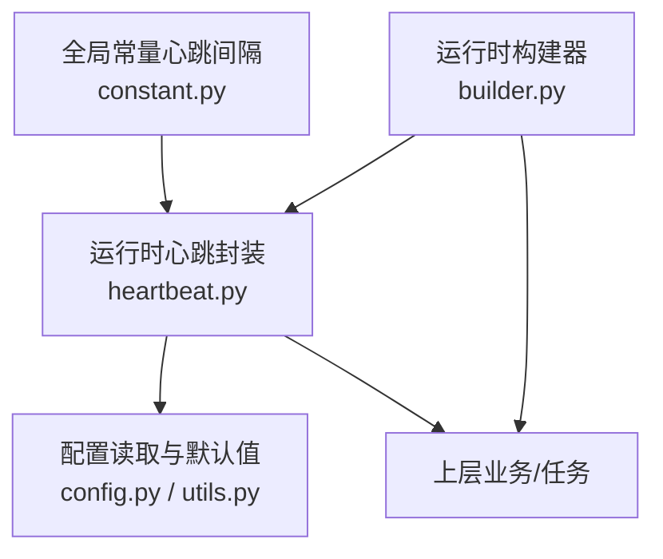
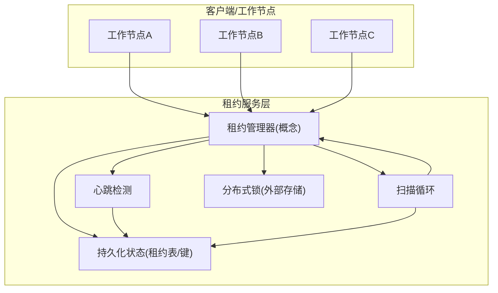
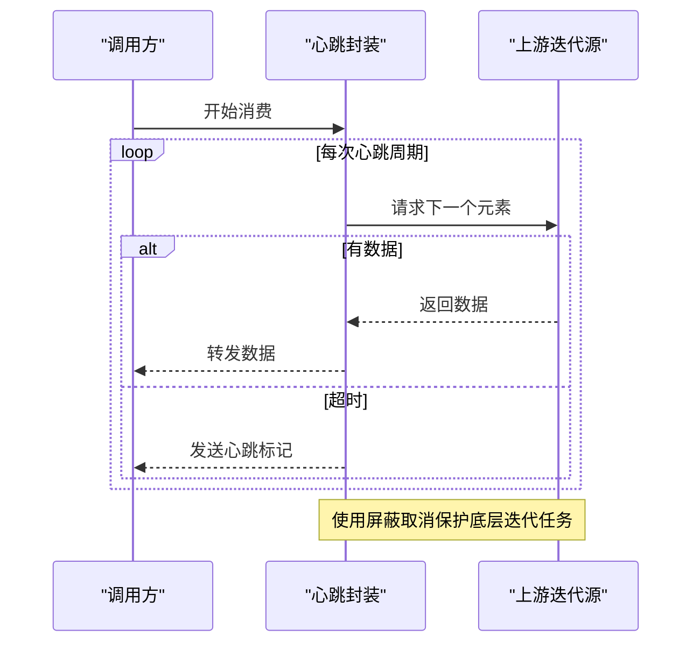
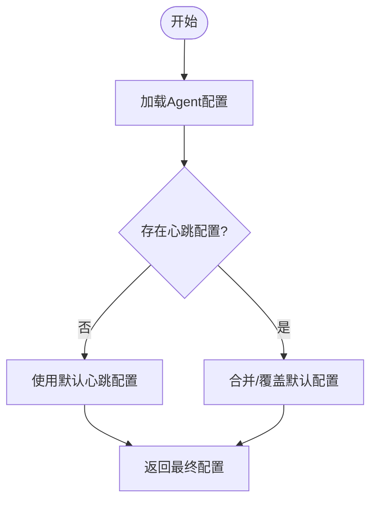
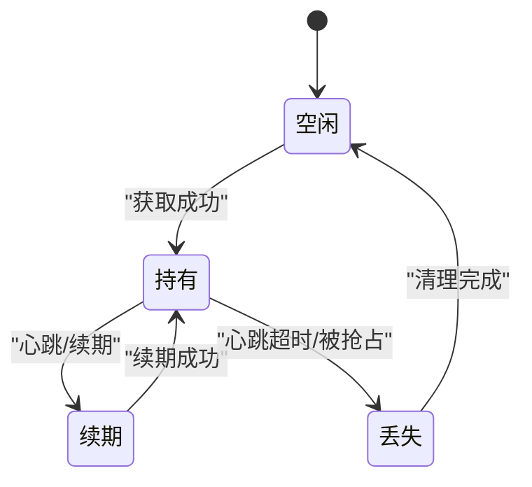
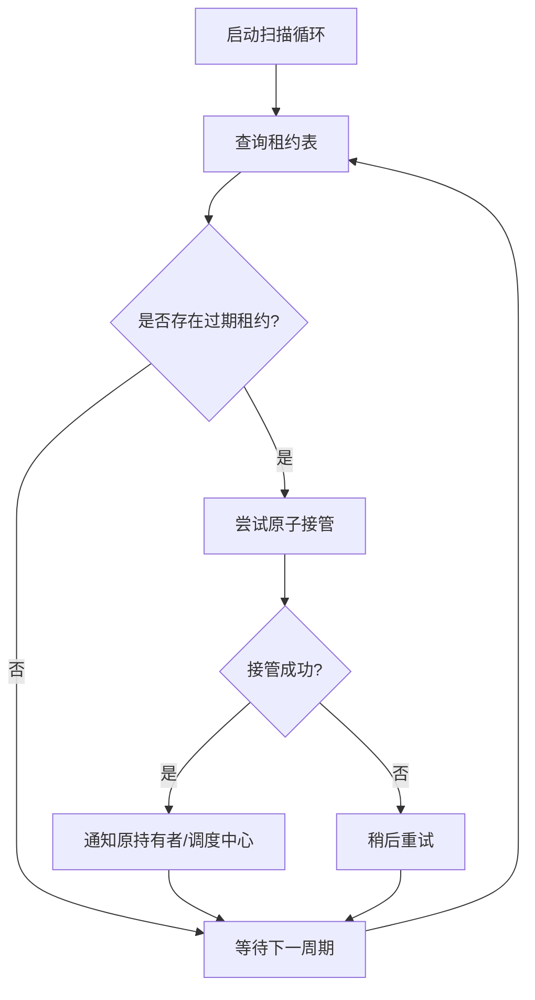
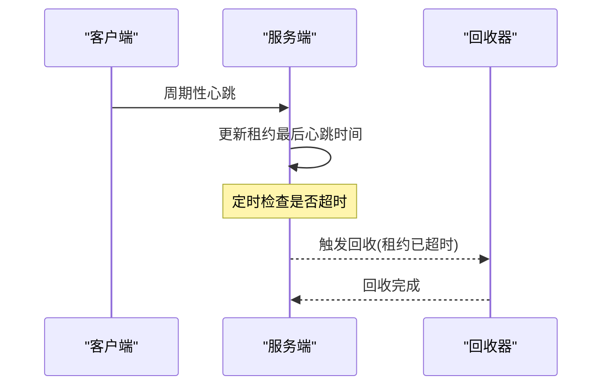
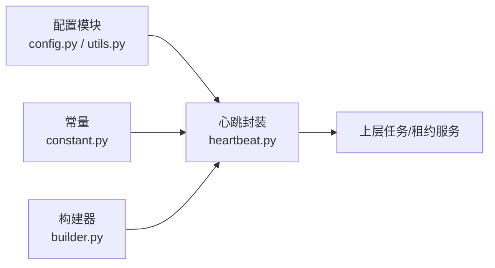

# 租约管理服务

<cite>
**本文引用的文件**
- [heartbeat.py](file://tongtian-tauri/src/agent/runtime/heartbeat.py)
- [config.py](file://tongtian-tauri/src/agent/config/config.py)
- [utils.py](file://tongtian-tauri/src/agent/config/utils.py)
- [builder.py](file://tongtian-tauri/src/agent/runtime/builder.py)
- [constant.py](file://tongtian-tauri/src/agent/constant.py)
</cite>

## 目录
1. [简介](#简介)
2. [项目结构](#项目结构)
3. [核心组件](#核心组件)
4. [架构总览](#架构总览)
5. [详细组件分析](#详细组件分析)
6. [依赖关系分析](#依赖关系分析)
7. [性能考量](#性能考量)
8. [故障排查指南](#故障排查指南)
9. [结论](#结论)
10. [附录](#附录)

## 简介
本文件为通天办公项目的“租约管理服务”提供系统化文档。由于当前仓库未包含名为 LeaseManager 的显式实现，本文基于现有运行时心跳与配置能力，抽象出一套可落地的分布式租约管理方案：以“心跳+超时回收”为核心，结合抢占保护、扫描循环、接管流程与 LEASE_LOST 状态处理，形成跨进程/多实例协作的租约语义。文档同时给出配置调优与故障恢复策略，便于在工程实践中快速落地。

## 项目结构
围绕租约管理的相关代码主要分布在运行时心跳封装与配置模块中：
- 运行时心跳封装：提供周期性心跳信号，用于维持租约活性并避免长时阻塞导致的心跳丢失。
- 配置模块：提供心跳开关、周期、超时、活跃时段等参数，以及按 Agent 维度加载有效配置的机制。
- 构建器：将心跳能力注入到运行时上下文，供上层任务使用。
- 常量：定义工具审批等待期间的保活心跳间隔，确保长时交互不中断。

图表来源
- [heartbeat.py:1-41](file://tongtian-tauri/src/agent/runtime/heartbeat.py#L1-L41)
- [config.py:564-587](file://tongtian-tauri/src/agent/config/config.py#L564-L587)
- [utils.py:704-727](file://tongtian-tauri/src/agent/config/utils.py#L704-L727)
- [builder.py:427-437](file://tongtian-tauri/src/agent/runtime/builder.py#L427-L437)
- [constant.py:395-396](file://tongtian-tauri/src/agent/constant.py#L395-L396)

章节来源
- [heartbeat.py:1-41](file://tongtian-tauri/src/agent/runtime/heartbeat.py#L1-L41)
- [config.py:564-587](file://tongtian-tauri/src/agent/config/config.py#L564-L587)
- [utils.py:704-727](file://tongtian-tauri/src/agent/config/utils.py#L704-L727)
- [builder.py:427-437](file://tongtian-tauri/src/agent/runtime/builder.py#L427-L437)
- [constant.py:395-396](file://tongtian-tauri/src/agent/constant.py#L395-L396)

## 核心组件
- 心跳迭代器封装：对异步迭代源进行包装，周期性产出心跳标记，避免长时间无数据输出导致连接或会话被判定为空闲。
- 心跳配置模型：提供启用开关、执行周期、单次超时、活跃时段等配置项，支持按 Agent 维度加载。
- 运行时注入：构建器根据配置决定是否启用心跳能力，并将相关上下文提供给上层任务。
- 保活常量：在审批等待等长时场景中，保持固定间隔的心跳消息，防止 SSE 等通道超时断开。

章节来源
- [heartbeat.py:1-41](file://tongtian-tauri/src/agent/runtime/heartbeat.py#L1-L41)
- [config.py:564-587](file://tongtian-tauri/src/agent/config/config.py#L564-L587)
- [utils.py:704-727](file://tongtian-tauri/src/agent/config/utils.py#L704-L727)
- [builder.py:427-437](file://tongtian-tauri/src/agent/runtime/builder.py#L427-L437)
- [constant.py:395-396](file://tongtian-tauri/src/agent/constant.py#L395-L396)

## 架构总览
下图展示“租约管理服务”的概念性架构：以心跳为纽带，协调多端协作、抢占保护、扫描循环与接管流程。该图为概念图，不直接映射具体源码文件。

说明
- 心跳检测：通过周期性心跳更新租约活性，防止因节点假死导致的资源占用。
- 扫描循环：定期扫描租约表/键，识别过期租约并触发接管。
- 分布式锁：作为强一致性的冲突解决手段，保证同一时刻仅一个节点持有租约。
- 持久化状态：记录租约持有者、最后心跳时间、状态机等元信息。

## 详细组件分析

### 心跳封装与保活机制
- 功能要点
  - 对任意异步迭代源进行包装，若一段时间内无数据产出，则主动产出心跳标记，保持连接/会话活跃。
  - 使用屏蔽取消机制，避免外层超时取消影响底层迭代任务的正常推进，从而避免心跳状态丢失。
  - 在停止迭代时清理未完成的任务，防止资源泄漏。
- 适用场景
  - 长时审批等待、SSE 流式响应、后台任务保活等。
- 与租约的关系
  - 心跳是租约活性证明；服务端依据心跳时间戳判断租约是否存活，并在超时时触发回收与接管。

图表来源
- [heartbeat.py:11-41](file://tongtian-tauri/src/agent/runtime/heartbeat.py#L11-L41)

章节来源
- [heartbeat.py:11-41](file://tongtian-tauri/src/agent/runtime/heartbeat.py#L11-L41)

### 心跳配置与加载
- 配置项
  - 启用开关：控制是否开启心跳任务。
  - 执行周期：心跳触发的频率。
  - 单次超时：一次心跳执行的最大耗时。
  - 活跃时段：限定心跳生效的时间窗口。
- 加载方式
  - 优先从指定 Agent 的配置中读取；若无则回退到默认配置。
  - 提供统一的获取接口，简化上层调用。
- 与租约的关系
  - 租约的心跳周期、超时阈值均来源于此配置；不同 Agent 可独立调优。

图表来源
- [config.py:564-587](file://tongtian-tauri/src/agent/config/config.py#L564-L587)
- [utils.py:704-727](file://tongtian-tauri/src/agent/config/utils.py#L704-L727)

章节来源
- [config.py:564-587](file://tongtian-tauri/src/agent/config/config.py#L564-L587)
- [utils.py:704-727](file://tongtian-tauri/src/agent/config/utils.py#L704-L727)

### 运行时注入与集成点
- 构建器职责
  - 根据配置判断是否启用心跳能力，并将相关上下文注入到运行时环境。
  - 为上层任务提供统一的心跳访问入口。
- 集成建议
  - 在任务启动阶段初始化心跳；在任务结束阶段释放资源。
  - 将心跳与租约续期逻辑绑定，确保每次成功续期都伴随心跳上报。

章节来源
- [builder.py:427-437](file://tongtian-tauri/src/agent/runtime/builder.py#L427-L437)

### 长时交互中的保活心跳
- 作用
  - 在审批等待等长时场景中，按固定间隔发送心跳，避免 SSE 等通道因空闲而断开。
- 与租约的关系
  - 保活心跳可作为租约续期的辅助手段，确保长时操作期间租约不被误判为丢失。

章节来源
- [constant.py:395-396](file://tongtian-tauri/src/agent/constant.py#L395-L396)

### 租约生命周期与并发控制（概念设计）
- 生命周期阶段
  - 获取：尝试申请租约，成功后进入持有态。
  - 续期：周期性上报心跳/续期，延长租约有效期。
  - 释放：主动释放或异常退出时自动释放。
  - 丢失：心跳超时或被抢占后进入丢失态，触发清理与通知。
- 并发控制
  - 分布式锁：基于外部存储（如数据库唯一约束、Redis SETNX 等）实现互斥。
  - 抢占保护：新竞争者在检测到旧租约即将到期前，延迟竞争或采用版本号比较，避免频繁抖动。
- 冲突解决
  - 以“最后心跳时间 + 锁原子性”为准；若发现竞态，后入者等待或重试。
- 多端协作
  - 多个节点可同时监听租约变更事件，实现负载均衡与高可用。

说明
- 该图为概念状态机，用于指导实现；实际状态流转需结合外部存储与事件通知。

### 扫描循环与 LEASE_LOST 处理（概念设计）
- 扫描循环
  - 定时扫描租约表/键，筛选出超过阈值的租约，标记为待接管。
  - 对每个待接管租约，尝试以原子方式将其转移给其他健康节点。
- LEASE_LOST 处理
  - 当节点检测到自身租约丢失时，立即停止相关工作负载，清理本地缓存，并向调度中心上报。
  - 调度中心触发重新分配或告警。

说明
- 该流程图描述扫描与接管的典型路径；具体实现需结合事务与幂等设计。

### 心跳检测与超时回收（概念设计）
- 心跳检测
  - 服务端维护租约的心跳时间戳；客户端周期性上报。
  - 若超过阈值未收到心跳，则认为租约失效。
- 超时回收
  - 回收包括：释放资源、清理临时文件、重置状态机、通知下游消费者。
  - 回收过程需幂等，避免重复回收造成副作用。

说明
- 该序列图为概念流程；实际实现需考虑时钟漂移、网络抖动与重试策略。

## 依赖关系分析
- 心跳封装依赖配置模块提供的周期与超时参数。
- 运行时构建器根据配置决定是否注入心跳能力。
- 常量模块提供长时交互场景下的保活心跳间隔。
- 这些模块共同构成租约管理的“心跳层”，与外部分布式锁/存储层配合实现完整租约语义。

图表来源
- [config.py:564-587](file://tongtian-tauri/src/agent/config/config.py#L564-L587)
- [utils.py:704-727](file://tongtian-tauri/src/agent/config/utils.py#L704-L727)
- [heartbeat.py:1-41](file://tongtian-tauri/src/agent/runtime/heartbeat.py#L1-L41)
- [builder.py:427-437](file://tongtian-tauri/src/agent/runtime/builder.py#L427-L437)
- [constant.py:395-396](file://tongtian-tauri/src/agent/constant.py#L395-L396)

章节来源
- [config.py:564-587](file://tongtian-tauri/src/agent/config/config.py#L564-L587)
- [utils.py:704-727](file://tongtian-tauri/src/agent/config/utils.py#L704-L727)
- [heartbeat.py:1-41](file://tongtian-tauri/src/agent/runtime/heartbeat.py#L1-L41)
- [builder.py:427-437](file://tongtian-tauri/src/agent/runtime/builder.py#L427-L437)
- [constant.py:395-396](file://tongtian-tauri/src/agent/constant.py#L395-L396)

## 性能考量
- 心跳周期与超时
  - 周期过短会增加网络与存储压力；过长则降低故障检测灵敏度。建议根据业务容忍度与系统规模调优。
- 批量与限流
  - 心跳上报应支持批量合并与退避重试，避免雪崩。
- 幂等与去重
  - 心跳与续期接口需幂等，防止重复提交导致的状态不一致。
- 资源清理
  - 心跳失败或任务异常退出时，必须尽快释放资源，避免僵尸租约。

## 故障排查指南
- 症状：租约频繁丢失
  - 检查心跳周期与超时配置是否合理。
  - 确认客户端是否正常上报心跳，网络是否稳定。
  - 查看服务端扫描循环是否正常运行。
- 症状：长时任务中断
  - 确认保活心跳是否生效，SSE/连接是否保持。
  - 检查审批等待期间的保活间隔配置是否正确。
- 症状：抢占抖动
  - 调整抢占保护策略，增加竞争延迟或引入版本号比较。
  - 优化扫描周期，减少频繁竞争带来的开销。

章节来源
- [heartbeat.py:11-41](file://tongtian-tauri/src/agent/runtime/heartbeat.py#L11-L41)
- [config.py:564-587](file://tongtian-tauri/src/agent/config/config.py#L564-L587)
- [constant.py:395-396](file://tongtian-tauri/src/agent/constant.py#L395-L396)

## 结论
本方案以心跳为核心，结合配置化与运行时注入，构建了可扩展的租约管理服务基础能力。通过扫描循环、抢占保护与 LEASE_LOST 处理，可实现多端协作下的可靠租约语义。建议在工程实践中结合外部分布式锁与持久化存储，完善事务与幂等设计，并根据业务需求调优心跳周期与超时阈值，以获得最佳稳定性与性能平衡。

## 附录
- 配置调优建议
  - 心跳周期：建议设置为业务最大允许中断时间的 1/3~1/2。
  - 超时阈值：考虑网络抖动与 GC 停顿，适当放宽。
  - 活跃时段：仅在业务高峰开启心跳，降低闲时开销。
- 故障恢复策略
  - 自动重试：心跳失败指数退避重试。
  - 降级模式：在不可用期间切换为只读或队列缓冲。
  - 告警与审计：记录心跳丢失、接管事件，便于事后复盘。