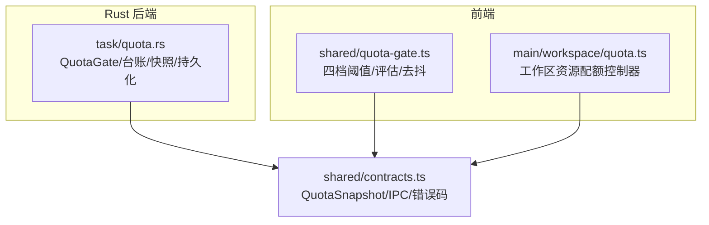
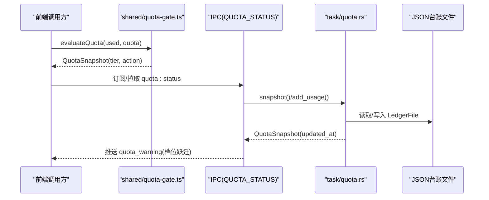
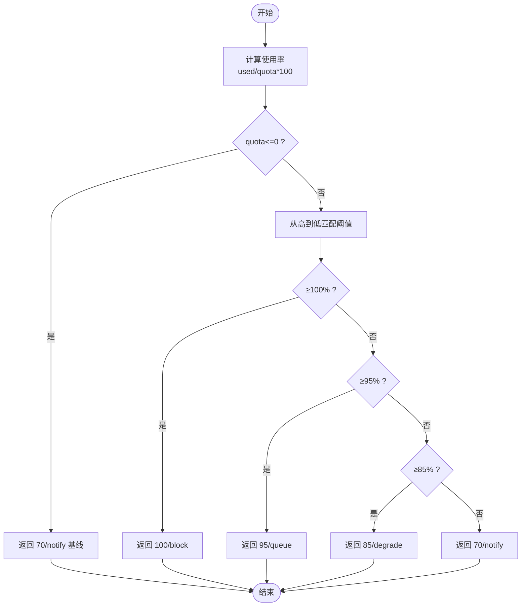
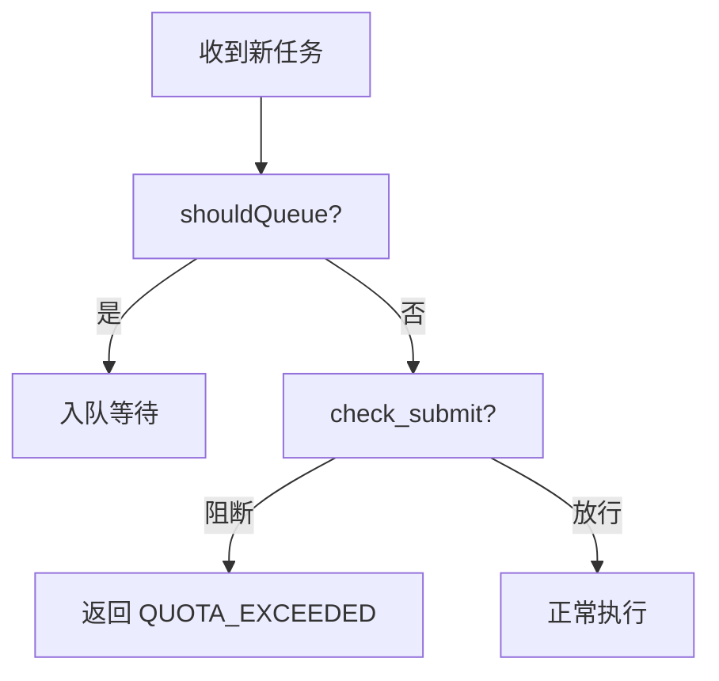
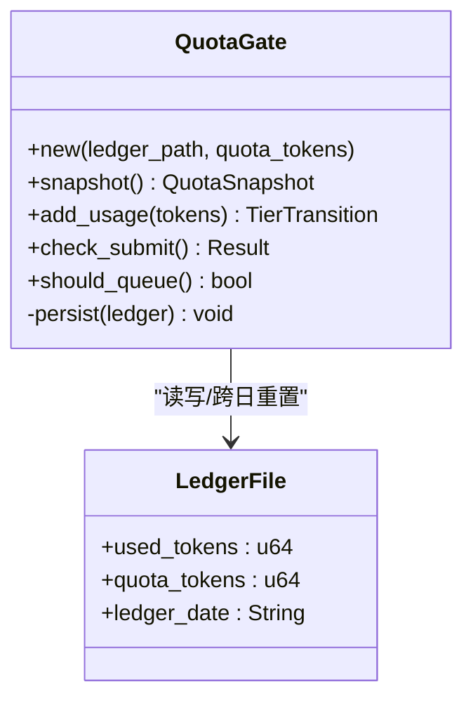
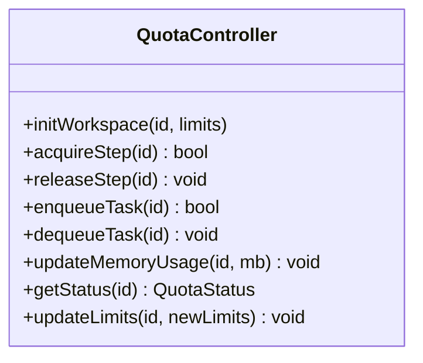
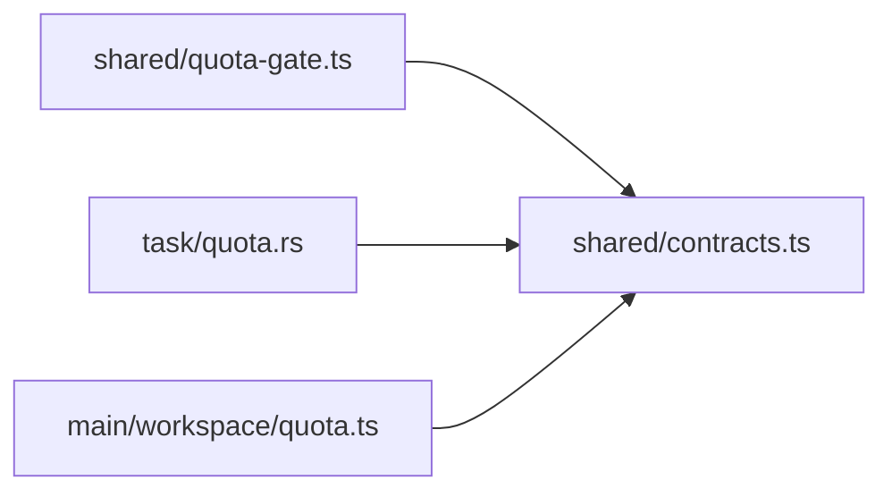

# 配额闸门服务

<cite>
**本文引用的文件**
- [quota-gate.ts](file://tongtian-tauri/src/shared/quota-gate.ts)
- [quota.rs](file://tongtian-tauri/src-tauri/src/task/quota.rs)
- [contracts.ts](file://tongtian-tauri/src/shared/contracts.ts)
- [quota.ts](file://tongtian-tauri/src/main/workspace/quota.ts)
- [quota-gate.test.ts](file://tongtian-tauri/tests/unit/model/quota-gate.test.ts)
</cite>

## 目录
1. [简介](#简介)
2. [项目结构](#项目结构)
3. [核心组件](#核心组件)
4. [架构总览](#架构总览)
5. [详细组件分析](#详细组件分析)
6. [依赖关系分析](#依赖关系分析)
7. [性能与容量规划](#性能与容量规划)
8. [故障排查指南](#故障排查指南)
9. [结论](#结论)
10. [附录](#附录)

## 简介
本文件面向通天办公项目的“配额闸门服务”，围绕 QuotaGate 的四档预警机制（70%/85%/95%/100%）展开，系统阐述配额检查、阻断策略、降级处理、配额统计、快照生成、实时监控、动态配置、预算预警通知、熔断降级逻辑、持久化存储、跨进程共享以及性能监控指标。文档同时提供配额策略定制指南与容量规划建议，帮助读者在本地桌面端与未来云端 BFF 集成中正确落地配额治理。

## 项目结构
配额闸门由前端共享纯函数与 Rust 实现共同构成，并通过 IPC 契约暴露状态查询能力：
- 前端共享层：定义四档阈值、计算使用率、判定档位与动作、错误码映射、事件去抖等纯函数。
- Rust 后端：实现配额台账的持久化、增量累计、快照生成、提交拦截、排队判断、跨日重置等。
- 工作区配额控制器：管理并发步骤、队列深度、内存使用等运行时资源配额。
- 契约层：统一 QuotaSnapshot、IPC 通道、错误码等类型定义。
- 单元测试：覆盖四档边界、异常输入、动作链、错误码联动等场景。



图表来源
- [quota-gate.ts:1-81](file://tongtian-tauri/src/shared/quota-gate.ts#L1-L81)
- [quota.rs:1-300](file://tongtian-tauri/src-tauri/src/task/quota.rs#L1-L300)
- [contracts.ts:311-321](file://tongtian-tauri/src/shared/contracts.ts#L311-L321)
- [quota.ts:1-265](file://tongtian-tauri/src/main/workspace/quota.ts#L1-L265)

章节来源
- [quota-gate.ts:1-81](file://tongtian-tauri/src/shared/quota-gate.ts#L1-L81)
- [quota.rs:1-300](file://tongtian-tauri/src-tauri/src/task/quota.rs#L1-L300)
- [contracts.ts:311-321](file://tongtian-tauri/src/shared/contracts.ts#L311-L321)
- [quota.ts:1-265](file://tongtian-tauri/src/main/workspace/quota.ts#L1-L265)

## 核心组件
- 四档预警与动作链
  - 70%：仅提示（notify），不触发任何限制。
  - 85%：降级（degrade），切换到备用模型或降低质量以保活。
  - 95%：排队（queue），新任务进入队列等待，不直接启动执行。
  - 100%：阻断（block），拒绝新提交；运行中任务转入预算暂停态。
- 配额统计与快照
  - 使用率 = usedTokens / quotaTokens（quota<=0 视为无限制）。
  - 快照包含 usedTokens、quotaTokens、tier、action、更新时间。
- 实时监测与事件
  - 通过 quota_warning 事件上报当前档位与动作，仅在档位跃迁时触发，避免事件风暴。
- 阻断与排队策略
  - 100% 档：新提交返回 QUOTA_EXCEEDED；运行中任务按 BUDGET_EXHAUSTED 语义处理。
  - ≥95% 档：shouldQueue 为真，新任务排队。
- 持久化与跨进程
  - Rust 侧将台账以 JSON 文件持久化，支持跨日重置；通过 Mutex 保证线程安全。
  - 前端通过 IPC 通道 QUOTA_STATUS 获取快照。
- 动态调整
  - 工作区配额控制器支持动态更新 limits（并发步骤、队列深度、内存上限等）。
  - 未来可接入 RemoteQuotaSource 切换至云端组织级权威台账。

章节来源
- [quota-gate.ts:9-80](file://tongtian-tauri/src/shared/quota-gate.ts#L9-L80)
- [quota.rs:15-219](file://tongtian-tauri/src-tauri/src/task/quota.rs#L15-L219)
- [contracts.ts:156-158](file://tongtian-tauri/src/shared/contracts.ts#L156-L158)
- [contracts.ts:311-321](file://tongtian-tauri/src/shared/contracts.ts#L311-L321)
- [quota.ts:34-249](file://tongtian-tauri/src/main/workspace/quota.ts#L34-L249)

## 架构总览
配额闸门采用“前端纯函数 + Rust 持久化”的双端镜像设计，确保前后端对阈值与动作的一致性，便于单测复用与回归验证。



图表来源
- [quota-gate.ts:24-80](file://tongtian-tauri/src/shared/quota-gate.ts#L24-L80)
- [quota.rs:119-219](file://tongtian-tauri/src-tauri/src/task/quota.rs#L119-L219)
- [contracts.ts:577-581](file://tongtian-tauri/src/shared/contracts.ts#L577-L581)

## 详细组件分析

### 四档预警与动作链（70/85/95/100%）
- 阈值与动作
  - 70%：notify（提示）
  - 85%：degrade（降级）
  - 95%：queue（排队）
  - 100%：block（阻断）
- 评估逻辑
  - 使用率计算：quota<=0 视为无限制，返回 0%。
  - 从高到低匹配阈值，命中即返回对应 tier/action。
  - 低于 70% 时以 70 档 notify 作为基线快照。
- 辅助判定
  - shouldBlock：仅 100% 档阻断。
  - shouldQueue：≥95% 档排队（含 100% 兜底）。
  - blockErrorCodeFor：新提交返回 QUOTA_EXCEEDED；运行中任务返回 BUDGET_EXHAUSTED。



图表来源
- [quota-gate.ts:24-54](file://tongtian-tauri/src/shared/quota-gate.ts#L24-L54)
- [quota.rs:87-117](file://tongtian-tauri/src-tauri/src/task/quota.rs#L87-L117)

章节来源
- [quota-gate.ts:9-80](file://tongtian-tauri/src/shared/quota-gate.ts#L9-L80)
- [quota.rs:15-117](file://tongtian-tauri/src-tauri/src/task/quota.rs#L15-L117)
- [quota-gate.test.ts:15-116](file://tongtian-tauri/tests/unit/model/quota-gate.test.ts#L15-L116)

### 配额统计、快照与实时监控
- 统计口径
  - usedTokens：累计用量（step_done/deliver 的 usage 字段累加）。
  - quotaTokens：配额总量（可为 0 表示无限制）。
- 快照生成
  - 每次快照包含 usedTokens、quotaTokens、tier、action、updated_at。
  - Rust 侧 snapshot_of 基于当前 LedgerFile 生成快照。
- 实时监控
  - 通过 quota_warning 事件上报档位与动作，仅在档位跃迁时触发（去抖）。
  - 首次快照仅在达到 70% 时触发预警，避免冷启动噪音。

```mermaid
sequenceDiagram
participant App as "应用"
participant Gate as "QuotaGate(RS)"
participant Store as "Ledger(JSON)"
participant Bus as "事件总线"
App->>Gate : add_usage(tokens)
Gate->>Store : 读取并校验日期
Gate->>Store : used += tokens; 写回
Gate->>Gate : 计算 before_pct/after_pct
Gate->>Bus : 若跨越阈值 → 推送 quota_warning
App->>Gate : snapshot()
Gate-->>App : QuotaSnapshot
```

图表来源
- [quota.rs:158-189](file://tongtian-tauri/src-tauri/src/task/quota.rs#L158-L189)
- [contracts.ts:156-158](file://tongtian-tauri/src/shared/contracts.ts#L156-L158)

章节来源
- [quota.rs:146-189](file://tongtian-tauri/src-tauri/src/task/quota.rs#L146-L189)
- [contracts.ts:156-158](file://tongtian-tauri/src/shared/contracts.ts#L156-L158)

### 阻断策略与降级处理
- 阻断策略
  - check_submit：当处于 100% 档时，拒绝新提交并返回 QUOTA_EXCEEDED。
  - 运行中任务在 100% 档按 BUDGET_EXHAUSTED 语义处理（转移 #17）。
- 降级处理
  - 85% 档触发 degrade：建议切换备用模型或降低输出质量，保障可用性。
  - 降级模型需满足成功率基线要求方可启用（业务侧策略）。
- 排队策略
  - ≥95% 档触发 queue：新任务入队等待，避免瞬时拥塞。



图表来源
- [quota.rs:191-206](file://tongtian-tauri/src-tauri/src/task/quota.rs#L191-L206)
- [quota-gate.ts:56-64](file://tongtian-tauri/src/shared/quota-gate.ts#L56-L64)

章节来源
- [quota.rs:191-206](file://tongtian-tauri/src-tauri/src/task/quota.rs#L191-L206)
- [quota-gate.ts:56-64](file://tongtian-tauri/src/shared/quota-gate.ts#L56-L64)

### 配额持久化与跨进程共享
- 持久化
  - LedgerFile 包含 used_tokens、quota_tokens、ledger_date（yyyy-mm-dd）。
  - 每日自动重置 used_tokens；失败写入记录日志但不中断流程。
- 跨进程共享
  - Rust 侧通过 Mutex 保护状态；前端通过 IPC 通道 QUOTA_STATUS 拉取快照。
  - 未来可扩展 RemoteQuotaSource 对接云端 BFF 获取组织级权威台账。



图表来源
- [quota.rs:38-64](file://tongtian-tauri/src-tauri/src/task/quota.rs#L38-L64)
- [quota.rs:119-219](file://tongtian-tauri/src-tauri/src/task/quota.rs#L119-L219)

章节来源
- [quota.rs:38-219](file://tongtian-tauri/src-tauri/src/task/quota.rs#L38-L219)

### 工作区资源配额控制器（并发/队列/内存）
- 职责
  - 维护每个工作区的资源限额与实时用量（并发步骤、队列深度、内存、模型调用并发）。
  - 提供 canStartStep/canAcceptTask/canStartModelCall 等准入判断。
  - 支持动态更新限额与清理工作区。
- 告警
  - 内存使用超过 80% 产生警告；接近队列上限时发出告警。



图表来源
- [quota.ts:45-262](file://tongtian-tauri/src/main/workspace/quota.ts#L45-L262)

章节来源
- [quota.ts:1-265](file://tongtian-tauri/src/main/workspace/quota.ts#L1-L265)

### 预算预警通知与熔断降级
- 预算预警
  - 通过 quota_warning 事件上报，仅在档位跃迁时触发，避免风暴。
  - 首次快照仅在达到 70% 时触发预警。
- 熔断降级
  - 85% 档触发 degrade：建议切换备用模型或降低质量。
  - 95% 档触发 queue：新任务排队，削峰填谷。
  - 100% 档触发 block：拒绝新提交；运行中任务转入预算暂停态。

章节来源
- [quota-gate.ts:66-80](file://tongtian-tauri/src/shared/quota-gate.ts#L66-L80)
- [quota.rs:158-206](file://tongtian-tauri/src-tauri/src/task/quota.rs#L158-L206)
- [contracts.ts:156-158](file://tongtian-tauri/src/shared/contracts.ts#L156-L158)

## 依赖关系分析
- 前端与后端一致性
  - shared/quota-gate.ts 与 task/quota.rs 保持阈值与动作一致，便于单测复用。
- 契约与事件
  - contracts.ts 定义 QuotaSnapshot、IPC 通道与错误码，贯穿前后端。
- 工作区配额与令牌配额
  - main/workspace/quota.ts 管理运行时资源配额；task/quota.rs 管理令牌配额。两者互补。



图表来源
- [quota-gate.ts:1-81](file://tongtian-tauri/src/shared/quota-gate.ts#L1-L81)
- [quota.rs:1-300](file://tongtian-tauri/src-tauri/src/task/quota.rs#L1-L300)
- [contracts.ts:311-321](file://tongtian-tauri/src/shared/contracts.ts#L311-L321)
- [quota.ts:1-265](file://tongtian-tauri/src/main/workspace/quota.ts#L1-L265)

章节来源
- [quota-gate.ts:1-81](file://tongtian-tauri/src/shared/quota-gate.ts#L1-L81)
- [quota.rs:1-300](file://tongtian-tauri/src-tauri/src/task/quota.rs#L1-L300)
- [contracts.ts:311-321](file://tongtian-tauri/src/shared/contracts.ts#L311-L321)
- [quota.ts:1-265](file://tongtian-tauri/src/main/workspace/quota.ts#L1-L265)

## 性能与容量规划
- 性能特性
  - 评估函数为 O(1) 常数时间（固定 4 档比较）。
  - 持久化写入为异步友好（失败不影响主流程），减少 I/O 阻塞。
  - 事件去抖避免高频告警风暴。
- 容量规划建议
  - 根据历史峰值设置 quotaTokens，预留 10%-20% 缓冲。
  - 结合工作区资源配额（并发步骤、队列深度、内存）进行整体容量规划。
  - 针对高负载时段，提前调低阈值或启用降级策略，平滑流量。
- 监控指标
  - 使用率百分比、各档位持续时间、阻断次数、排队长度、降级切换次数。
  - 通过 quota_warning 事件聚合统计，形成仪表盘。

[本节为通用指导，无需特定文件引用]

## 故障排查指南
- 常见问题
  - 频繁触发 95%/100%：检查上游任务量是否突增，考虑扩容或限流。
  - 无法持久化：检查磁盘权限与路径有效性，关注日志中的写入失败信息。
  - 事件风暴：确认是否重复上报，检查档位跃迁逻辑是否正确。
- 定位方法
  - 查看快照 with updated_at，确认数据是否跨日重置。
  - 对比前端 evaluateQuota 与 Rust evaluate 结果，确保一致性。
  - 检查工作区资源配额是否耗尽（并发/队列/内存）。

章节来源
- [quota.rs:208-219](file://tongtian-tauri/src-tauri/src/task/quota.rs#L208-L219)
- [quota-gate.test.ts:62-116](file://tongtian-tauri/tests/unit/model/quota-gate.test.ts#L62-L116)

## 结论
配额闸门服务通过四档预警机制实现了从提示到阻断的渐进式治理，配合快照与事件机制实现可观测性，并以持久化与跨进程共享保障可靠性。结合工作区资源配额控制器，可在本地桌面端有效管控资源使用，并为未来云端 BFF 集成预留扩展点。建议在生产环境结合容量规划与监控指标，持续优化阈值与策略。

[本节为总结，无需特定文件引用]

## 附录
- 策略定制指南
  - 调整阈值：修改 QUOTA_TIERS/TIER_THRESHOLDS，注意前后端同步。
  - 自定义动作：在 85% 档实现降级策略（如切换模型、降低质量）。
  - 动态限额：通过 updateLimits 调整工作区资源限额。
- 容量规划模板
  - 设定 quotaTokens 基于历史峰值 × (1+缓冲)。
  - 预估队列深度与并发上限，结合 shouldQueue 与 maxQueueDepth。
  - 定期复盘 quota_warning 事件，优化阈值与策略。

[本节为通用指导，无需特定文件引用]