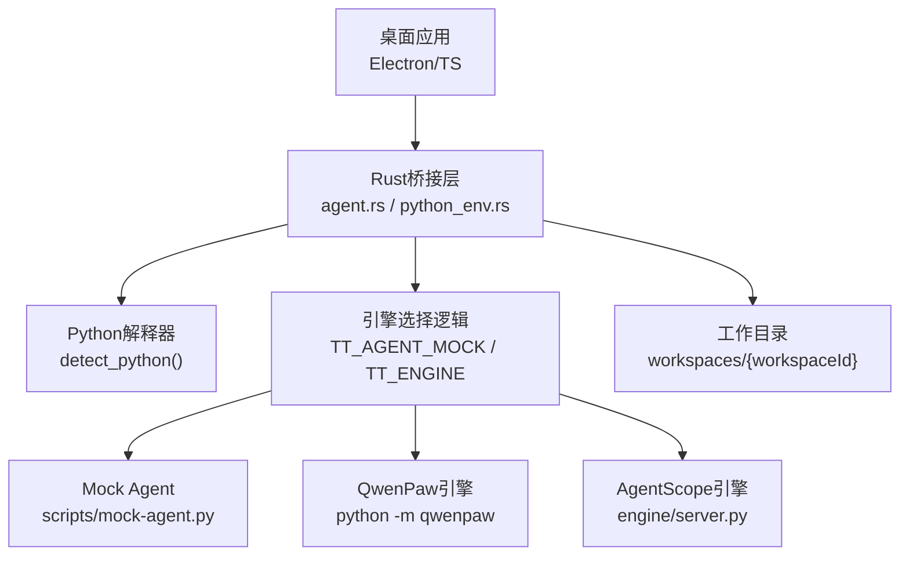
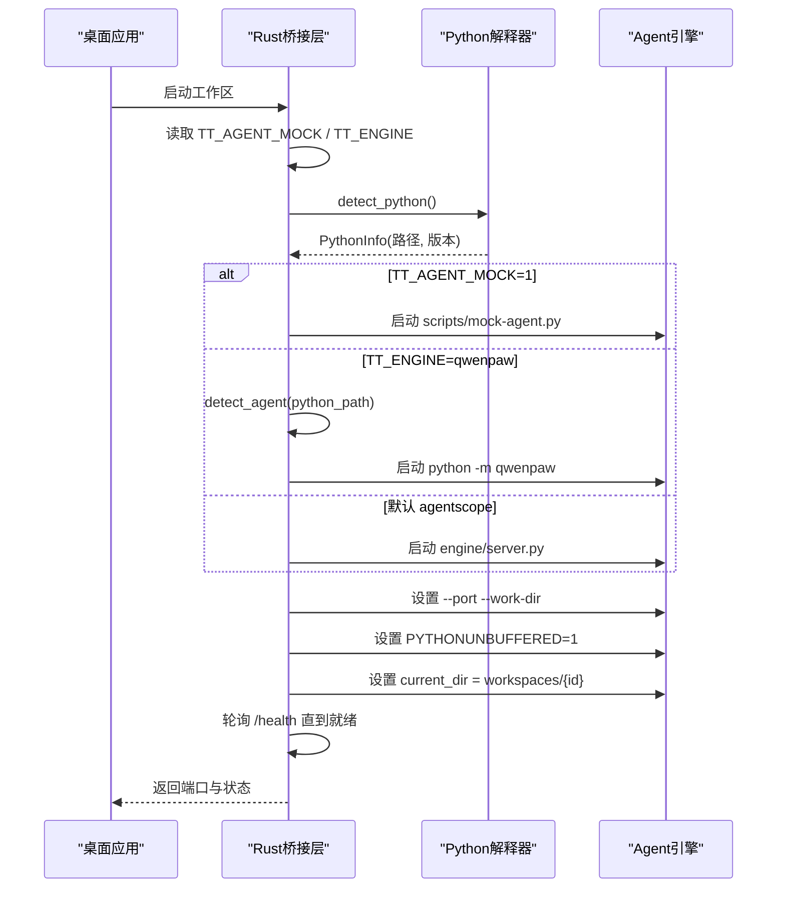
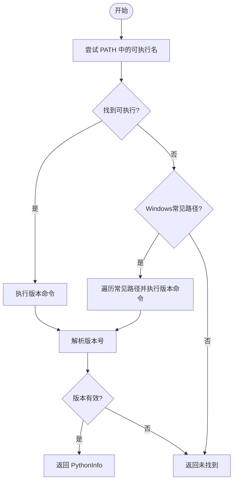
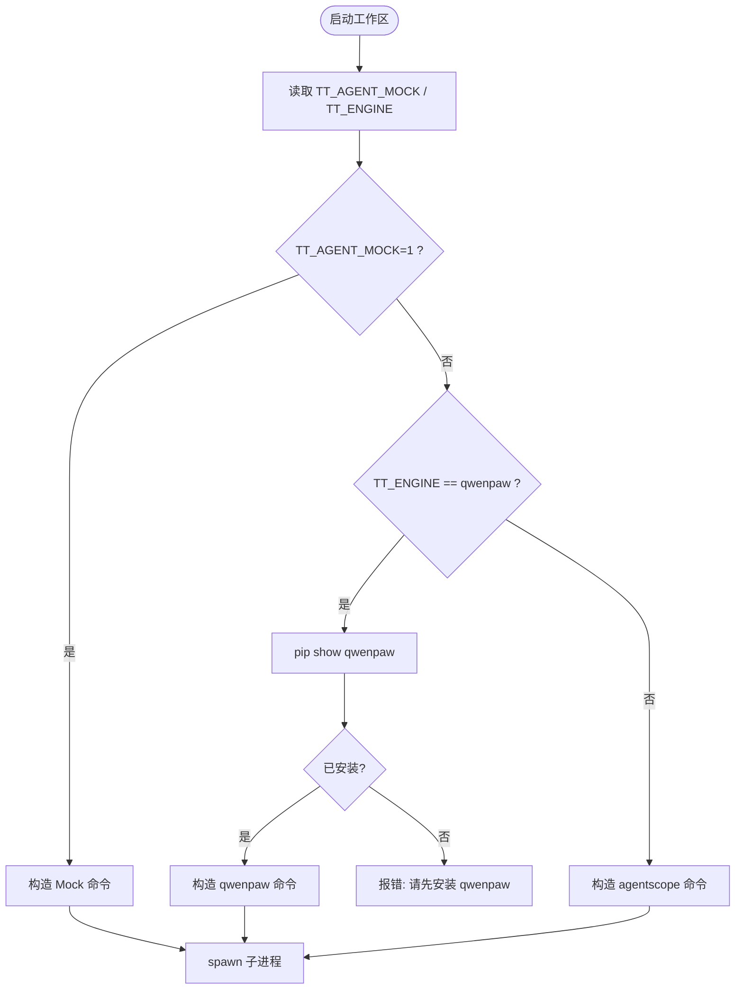
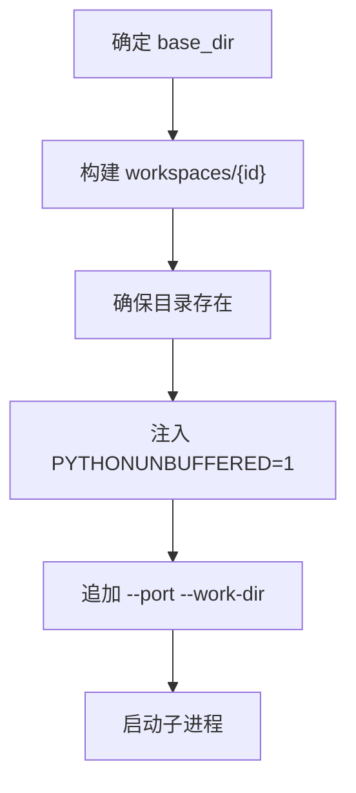
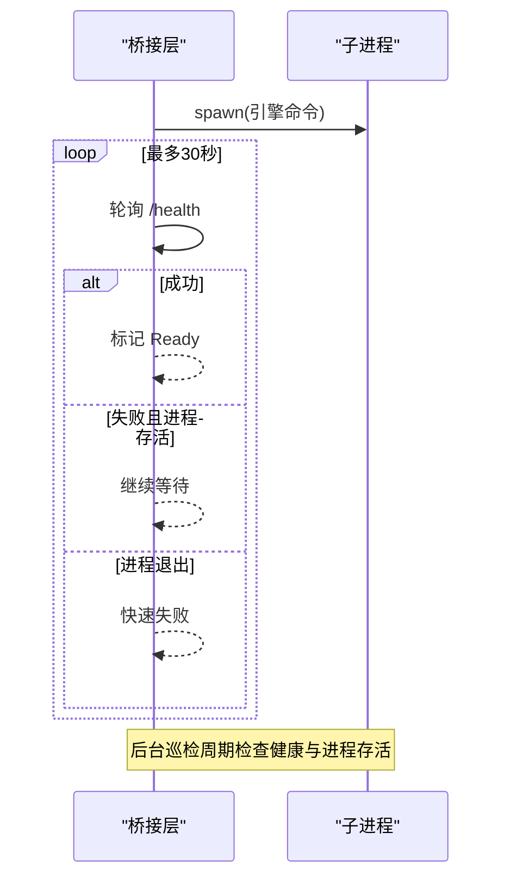
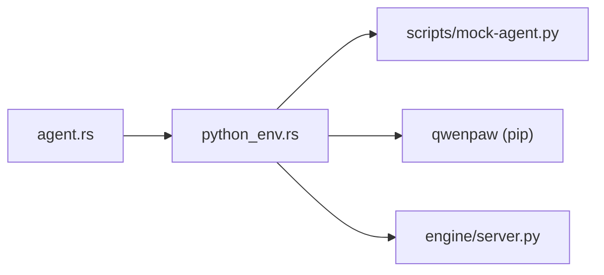

# Python环境配置

<cite>
**本文引用的文件**
- [agent.rs](file://tongtian-tauri/src-tauri/src/bridge/agent.rs)
- [python_env.rs](file://tongtian-tauri/src-tauri/src/bridge/python_env.rs)
- [python-env.ts](file://tongtian-tauri/src/main/bridge/python-env.ts)
- [mock-agent.py](file://tongtian-tauri/scripts/mock-agent.py)
- [run-dev.ps1](file://tongtian-tauri/run-dev.ps1)
</cite>

## 目录
1. [简介](#简介)
2. [项目结构](#项目结构)
3. [核心组件](#核心组件)
4. [架构总览](#架构总览)
5. [详细组件分析](#详细组件分析)
6. [依赖关系分析](#依赖关系分析)
7. [性能考虑](#性能考虑)
8. [故障排查指南](#故障排查指南)
9. [结论](#结论)
10. [附录](#附录)

## 简介
本文件面向通天办公项目的Python环境配置与运行模式选择，覆盖以下要点：
- Python环境检测与版本验证（要求3.10+）
- Agent引擎选择机制：Mock Agent、QwenPaw引擎、默认AgentScope引擎
- 工作目录管理与环境变量注入
- 依赖安装检查与启动命令构造
- 环境诊断工具与常见问题解决方案
- 部署最佳实践

## 项目结构
本项目通过Rust桥接层在桌面端启动并管理Python Agent子进程。关键路径与职责如下：
- Rust桥接层负责：探测Python、选择引擎、分配端口与工作目录、启动子进程、健康检查、SSE事件转发
- Python侧提供：Mock Agent（纯模拟）、QwenPaw（外部包）、AgentScope（项目内engine/server.py）
- Electron/TS侧提供：Python环境探测与基础工作区管理辅助

图表来源
- [agent.rs:118-180](file://tongtian-tauri/src-tauri/src/bridge/agent.rs#L118-L180)
- [python_env.rs:122-164](file://tongtian-tauri/src-tauri/src/bridge/python_env.rs#L122-L164)
- [python-env.ts:24-153](file://tongtian-tauri/src/main/bridge/python-env.ts#L24-L153)

章节来源
- [agent.rs:118-180](file://tongtian-tauri/src-tauri/src/bridge/agent.rs#L118-L180)
- [python_env.rs:122-164](file://tongtian-tauri/src-tauri/src/bridge/python_env.rs#L122-L164)
- [python-env.ts:24-153](file://tongtian-tauri/src/main/bridge/python-env.ts#L24-L153)

## 核心组件
- Python环境探测与版本解析：从系统PATH或常见路径定位Python，执行版本命令并解析主/次/补丁版本
- 引擎选择与启动命令构造：根据环境变量决定启动Mock Agent、QwenPaw或AgentScope
- 工作目录管理：基于TONGTIAN_HOME或平台默认位置创建workspaces/{workspaceId}
- 健康检查与生命周期管理：启动后轮询健康接口，后台巡检进程存活与健康状态
- SSE事件管道：提交任务、流式消费事件、断线补齐与去重

章节来源
- [python_env.rs:24-51](file://tongtian-tauri/src-tauri/src/bridge/python_env.rs#L24-L51)
- [python_env.rs:53-91](file://tongtian-tauri/src-tauri/src/bridge/python_env.rs#L53-L91)
- [python_env.rs:122-164](file://tongtian-tauri/src-tauri/src/bridge/python_env.rs#L122-L164)
- [agent.rs:92-107](file://tongtian-tauri/src-tauri/src/bridge/agent.rs#L92-L107)
- [agent.rs:220-251](file://tongtian-tauri/src-tauri/src/bridge/agent.rs#L220-L251)

## 架构总览
下图展示从桌面应用到Python Agent的完整调用链与环境变量注入过程。

图表来源
- [agent.rs:144-180](file://tongtian-tauri/src-tauri/src/bridge/agent.rs#L144-L180)
- [agent.rs:182-251](file://tongtian-tauri/src-tauri/src/bridge/agent.rs#L182-L251)
- [python_env.rs:153-202](file://tongtian-tauri/src-tauri/src/bridge/python_env.rs#L153-L202)

## 详细组件分析

### Python环境检测与版本验证
- 探测策略：优先尝试系统PATH中的python/python3/py（Windows）或python3/python（非Windows），失败则回退到常见安装路径
- 版本解析：执行版本命令并从输出中解析出“主.次.补丁”格式的版本号
- 最低版本要求：文档建议3.10+；当前实现未内置强制校验，建议在启动前由上层进行版本比较并提示升级

图表来源
- [python_env.rs:24-51](file://tongtian-tauri/src-tauri/src/bridge/python_env.rs#L24-L51)
- [python_env.rs:53-91](file://tongtian-tauri/src-tauri/src/bridge/python_env.rs#L53-L91)
- [python-env.ts:39-100](file://tongtian-tauri/src/main/bridge/python-env.ts#L39-L100)

章节来源
- [python_env.rs:24-91](file://tongtian-tauri/src-tauri/src/bridge/python_env.rs#L24-L91)
- [python-env.ts:39-100](file://tongtian-tauri/src/main/bridge/python-env.ts#L39-L100)

### 引擎选择机制与三种运行模式
- 环境变量优先级与默认值：
  - TT_AGENT_MOCK=1：启用Mock Agent（无需模型配置，零依赖）
  - TT_ENGINE=qwenpaw：使用真实qwenpaw（需已安装）
  - 默认TT_ENGINE=agentscope：使用项目内AgentScope引擎（需项目根.env配置API Key）
- 启动命令构造：
  - Mock：python scripts/mock-agent.py --port <port> --work-dir <dir>
  - QwenPaw：python -m qwenpaw --port <port> --work-dir <dir>
  - AgentScope：python engine/server.py --port <port> --work-dir <dir>
- 依赖检查：当选择qwenpaw时，会先通过pip show检测是否已安装，未安装则报错提示

图表来源
- [agent.rs:144-180](file://tongtian-tauri/src-tauri/src/bridge/agent.rs#L144-L180)
- [python_env.rs:93-120](file://tongtian-tauri/src-tauri/src/bridge/python_env.rs#L93-L120)
- [python_env.rs:153-202](file://tongtian-tauri/src-tauri/src/bridge/python_env.rs#L153-L202)

章节来源
- [agent.rs:144-180](file://tongtian-tauri/src-tauri/src/bridge/agent.rs#L144-L180)
- [python_env.rs:93-120](file://tongtian-tauri/src-tauri/src/bridge/python_env.rs#L93-L120)
- [python_env.rs:153-202](file://tongtian-tauri/src-tauri/src/bridge/python_env.rs#L153-L202)
- [run-dev.ps1:3-9](file://tongtian-tauri/run-dev.ps1#L3-L9)

### 工作目录管理与环境变量注入
- 数据根目录：优先使用TONGTIAN_HOME环境变量；否则使用平台默认目录（Windows为%APPDATA%\tongtian-office，其他为~/.tongtian）
- 工作区目录：base_dir/workspaces/{workspaceId}，确保存在
- 环境变量注入：
  - PYTHONUNBUFFERED=1：保证Python输出即时刷新
  - 子进程工作目录设置为对应工作区目录
  - 通过命令行参数传递--port和--work-dir

图表来源
- [python_env.rs:122-151](file://tongtian-tauri/src-tauri/src/bridge/python_env.rs#L122-L151)
- [agent.rs:182-192](file://tongtian-tauri/src-tauri/src/bridge/agent.rs#L182-L192)

章节来源
- [python_env.rs:122-151](file://tongtian-tauri/src-tauri/src/bridge/python_env.rs#L122-L151)
- [agent.rs:182-192](file://tongtian-tauri/src-tauri/src/bridge/agent.rs#L182-L192)

### 健康检查与生命周期管理
- 启动后轮询健康接口（/health），最长等待30秒，每500毫秒一次
- 后台巡检：周期性检查进程存活与健康状态，连续失败标记错误并停止
- 端口管理：在18000-19000范围内分配未被占用的端口

图表来源
- [agent.rs:220-251](file://tongtian-tauri/src-tauri/src/bridge/agent.rs#L220-L251)
- [agent.rs:306-355](file://tongtian-tauri/src-tauri/src/bridge/agent.rs#L306-L355)

章节来源
- [agent.rs:220-251](file://tongtian-tauri/src-tauri/src/bridge/agent.rs#L220-L251)
- [agent.rs:306-355](file://tongtian-tauri/src-tauri/src/bridge/agent.rs#L306-L355)

### Mock Agent（TT_AGENT_MOCK=1）
- 作用：开发阶段模拟qwenpaw的HTTP/SSE接口，零依赖，开箱即用
- 能力：/health、/api/chat、/api/events/replay、/api/chat/cancel等
- 测试触发器：支持[test:burst]、[test:broken]、[test:quota]等场景用于验证管道吞吐、断线补齐与配额预警

章节来源
- [mock-agent.py:1-33](file://tongtian-tauri/scripts/mock-agent.py#L1-L33)
- [mock-agent.py:80-109](file://tongtian-tauri/scripts/mock-agent.py#L80-L109)
- [mock-agent.py:306-319](file://tongtian-tauri/scripts/mock-agent.py#L306-L319)

### QwenPaw引擎（TT_ENGINE=qwenpaw）
- 条件：需已在目标Python环境中安装qwenpaw
- 启动方式：python -m qwenpaw --port <port> --work-dir <dir>
- 依赖检查：通过pip show检测是否安装，未安装将返回错误提示

章节来源
- [python_env.rs:93-120](file://tongtian-tauri/src-tauri/src/bridge/python_env.rs#L93-L120)
- [python_env.rs:153-164](file://tongtian-tauri/src-tauri/src/bridge/python_env.rs#L153-L164)
- [agent.rs:167-176](file://tongtian-tauri/src-tauri/src/bridge/agent.rs#L167-L176)

### 默认AgentScope引擎（TT_ENGINE=agentscope）
- 启动方式：python engine/server.py --port <port> --work-dir <dir>
- 配置：需项目根.env配置API Key（由引擎自身读取）
- 适用：本地自研引擎，无需额外第三方包

章节来源
- [python_env.rs:190-202](file://tongtian-tauri/src-tauri/src/bridge/python_env.rs#L190-L202)
- [agent.rs:177-180](file://tongtian-tauri/src-tauri/src/bridge/agent.rs#L177-L180)

## 依赖关系分析
- 组件耦合：
  - agent.rs依赖python_env.rs提供的Python探测、引擎命令与工作目录管理
  - 各引擎脚本/模块通过标准命令行参数与桥接层解耦
- 外部依赖：
  - qwenpaw：可选，需提前安装
  - AgentScope：项目内engine/server.py，依赖项目根.env
- 潜在循环依赖：无直接代码级循环；通过命令行参数与HTTP/SSE通信解耦

图表来源
- [agent.rs:118-180](file://tongtian-tauri/src-tauri/src/bridge/agent.rs#L118-L180)
- [python_env.rs:93-202](file://tongtian-tauri/src-tauri/src/bridge/python_env.rs#L93-L202)

章节来源
- [agent.rs:118-180](file://tongtian-tauri/src-tauri/src/bridge/agent.rs#L118-L180)
- [python_env.rs:93-202](file://tongtian-tauri/src-tauri/src/bridge/python_env.rs#L93-L202)

## 性能考虑
- 背压与批量emit：SSE事件解析与前端emit分离，使用有界通道降低阻塞
- 健康检查间隔与超时：合理设置轮询间隔与最大等待时间，避免长时间阻塞
- 端口分配范围：限制在18000-19000，减少冲突概率
- 日志泵：stdout/stderr异步泵出，避免I/O阻塞热路径

章节来源
- [agent.rs:32-38](file://tongtian-tauri/src-tauri/src/bridge/agent.rs#L32-L38)
- [agent.rs:500-515](file://tongtian-tauri/src-tauri/src/bridge/agent.rs#L500-L515)
- [agent.rs:264-279](file://tongtian-tauri/src-tauri/src/bridge/agent.rs#L264-L279)

## 故障排查指南
- Python未找到或版本过低：
  - 现象：启动时报错需要Python 3.10+
  - 处理：安装并配置Python到PATH，或在系统常见路径下安装
  - 参考：探测与版本解析逻辑
- qwenpaw未安装：
  - 现象：选择qwenpaw时报错提示先安装
  - 处理：在目标Python环境中执行pip install qwenpaw
- 端口占用：
  - 现象：无法绑定端口
  - 处理：释放18000-19000范围内的端口或调整范围
- 健康检查超时：
  - 现象：启动后长时间处于Starting状态
  - 处理：检查引擎日志、网络与端口，确认/health可达
- 工作目录权限：
  - 现象：无法创建工作区目录
  - 处理：检查TONGTIAN_HOME或默认目录的写入权限

章节来源
- [agent.rs:142-143](file://tongtian-tauri/src-tauri/src/bridge/agent.rs#L142-L143)
- [agent.rs:167-171](file://tongtian-tauri/src-tauri/src/bridge/agent.rs#L167-L171)
- [agent.rs:220-241](file://tongtian-tauri/src-tauri/src/bridge/agent.rs#L220-L241)
- [python_env.rs:122-151](file://tongtian-tauri/src-tauri/src/bridge/python_env.rs#L122-L151)

## 结论
通天办公通过Rust桥接层统一管理Python环境与Agent生命周期，支持三种运行模式以满足开发与生产需求。结合环境变量控制、工作目录隔离与健康检查机制，提供了稳定可靠的Agent运行框架。建议在生产环境明确选择引擎并完善依赖与配置，同时利用Mock模式进行功能验证与集成测试。

## 附录
- 环境变量说明：
  - TT_AGENT_MOCK：设为1启用Mock Agent
  - TT_ENGINE：取值qwenpaw或agentscope（默认agentscope）
  - TONGTIAN_HOME：自定义数据根目录
  - PYTHONUNBUFFERED：由桥接层注入，确保输出即时刷新
- 启动脚本：
  - run-dev.ps1：设置默认引擎与开发环境入口

章节来源
- [run-dev.ps1:3-9](file://tongtian-tauri/run-dev.ps1#L3-L9)
- [python_env.rs:122-139](file://tongtian-tauri/src-tauri/src/bridge/python_env.rs#L122-L139)
- [agent.rs:182-192](file://tongtian-tauri/src-tauri/src/bridge/agent.rs#L182-L192)