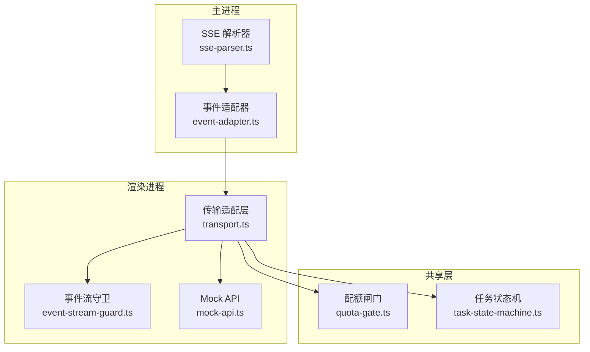
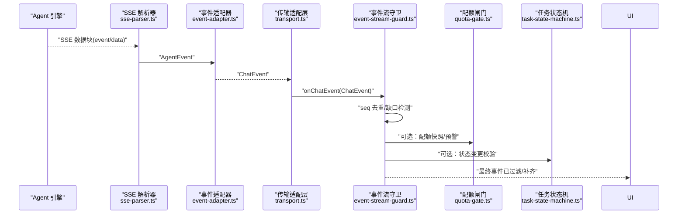
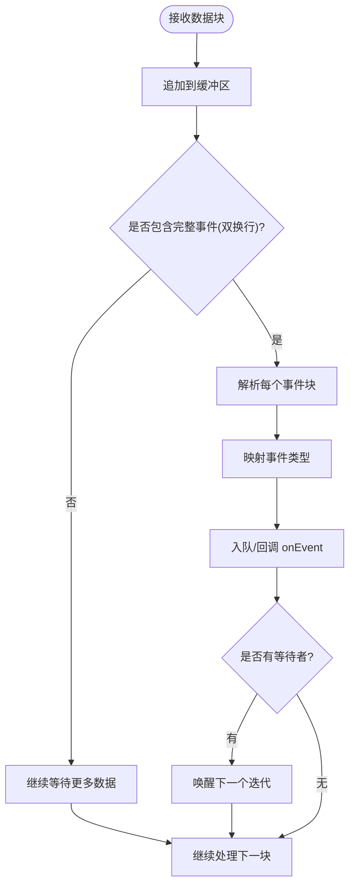
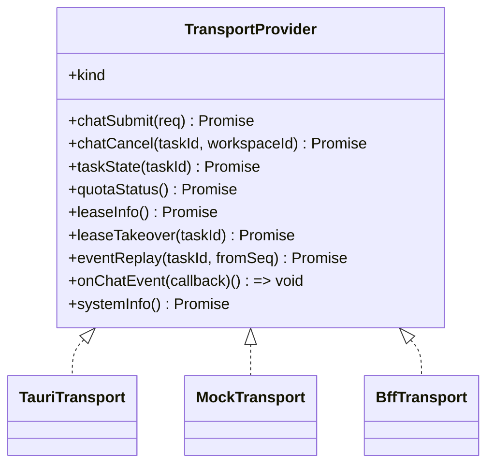
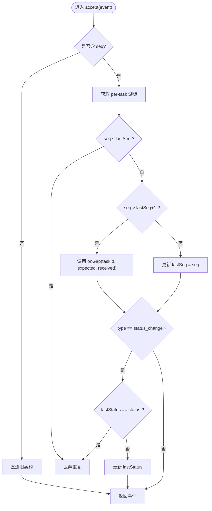
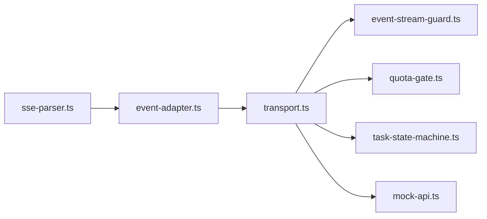

# 事件流处理

<cite>
**本文引用的文件**
- [sse-parser.ts](file://tongtian-tauri/src/main/bridge/sse-parser.ts)
- [event-adapter.ts](file://tongtian-tauri/src/main/agent/event-adapter.ts)
- [transport.ts](file://tongtian-tauri/src/renderer/lib/transport.ts)
- [event-stream-guard.ts](file://tongtian-tauri/src/renderer/lib/event-stream-guard.ts)
- [quota-gate.ts](file://tongtian-tauri/src/shared/quota-gate.ts)
- [task-state-machine.ts](file://tongtian-tauri/src/shared/task-state-machine.ts)
- [mock-api.ts](file://tongtian-tauri/src/renderer/lib/mock-api.ts)
</cite>

## 目录
1. [简介](#简介)
2. [项目结构](#项目结构)
3. [核心组件](#核心组件)
4. [架构总览](#架构总览)
5. [详细组件分析](#详细组件分析)
6. [依赖关系分析](#依赖关系分析)
7. [性能与背压](#性能与背压)
8. [监控与可观测性](#监控与可观测性)
9. [故障排查指南](#故障排查指南)
10. [结论](#结论)

## 简介
本文件面向通天办公项目的“事件流处理”能力，围绕 SSE（Server-Sent Events）通信协议、事件解析与转发、序列号去重（SeqGuard）、断线检测与补齐（gap 修复）、背压控制（容量通道）、事件持久化策略、配额计量集成、任务取消处理、以及事件流监控与性能优化进行系统化说明。文档以代码级事实为依据，提供可视化图示与排障建议，帮助读者快速理解并正确使用该子系统。

## 项目结构
事件流相关代码主要分布在以下位置：
- 主进程侧（main）：SSE 解析器与事件适配层，负责从 Agent 引擎的 SSE 流中解析事件，并转换为前端统一契约的 ChatEvent。
- 渲染进程侧（renderer）：传输适配层（TransportProvider），封装 Tauri/Mock/BFF 三种实现；事件流守卫（EventStreamGuard）负责 seq 去重与缺口检测；Mock API 提供开发期全真模拟。
- 共享层（shared）：配额闸门（Quota Gate）与任务状态机（14 态），为事件流提供配额决策与任务生命周期约束。

图表来源
- [sse-parser.ts:1-240](file://tongtian-tauri/src/main/bridge/sse-parser.ts#L1-L240)
- [event-adapter.ts:1-167](file://tongtian-tauri/src/main/agent/event-adapter.ts#L1-L167)
- [transport.ts:1-234](file://tongtian-tauri/src/renderer/lib/transport.ts#L1-L234)
- [event-stream-guard.ts:1-97](file://tongtian-tauri/src/renderer/lib/event-stream-guard.ts#L1-L97)
- [quota-gate.ts:1-81](file://tongtian-tauri/src/shared/quota-gate.ts#L1-L81)
- [task-state-machine.ts:1-223](file://tongtian-tauri/src/shared/task-state-machine.ts#L1-L223)
- [mock-api.ts:1-484](file://tongtian-tauri/src/renderer/lib/mock-api.ts#L1-L484)

章节来源
- [sse-parser.ts:1-240](file://tongtian-tauri/src/main/bridge/sse-parser.ts#L1-L240)
- [transport.ts:1-234](file://tongtian-tauri/src/renderer/lib/transport.ts#L1-L234)
- [event-stream-guard.ts:1-97](file://tongtian-tauri/src/renderer/lib/event-stream-guard.ts#L1-L97)

## 核心组件
- SSE 解析器（SSEParser）：消费 Node IncomingMessage 的 SSE 流，按行解析 event/data 字段，产出结构化 AgentEvent，并通过回调或异步迭代器对外暴露。
- 事件适配器（adaptAgentEvent）：将 AgentEvent 映射为统一的 ChatEvent，包含 plan/step_* /deliver/done/error/status_change 等语义。
- 传输适配层（TransportProvider）：统一 onChatEvent/chatSubmit/chatCancel/taskState/quotaStatus/leaseInfo/leaseTakeover/eventReplay/systemInfo 等接口，当前默认 TauriTransport，支持 MockTransport 与 BffTransport。
- 事件流守卫（EventStreamGuard）：基于 seq 单调递增的去重与缺口检测，status_change 同状态幂等，支持 onGap 回调触发 replay。
- 配额闸门（evaluateQuota）：四档阈值（70/85/95/100%）决定 notify/degrade/queue/block，并提供错误码联动。
- 任务状态机（14 态）：定义合法转移表、重试上限、终态判定、wait_reason 子态管理，支撑 cancel/pause/resume/rollback/replan 等流程。
- Mock API：在开发阶段注入 window.tongtianAPI，生成带 seq 的事件流，模拟配额与任务生命周期。

章节来源
- [sse-parser.ts:1-240](file://tongtian-tauri/src/main/bridge/sse-parser.ts#L1-L240)
- [event-adapter.ts:1-167](file://tongtian-tauri/src/main/agent/event-adapter.ts#L1-L167)
- [transport.ts:1-234](file://tongtian-tauri/src/renderer/lib/transport.ts#L1-L234)
- [event-stream-guard.ts:1-97](file://tongtian-tauri/src/renderer/lib/event-stream-guard.ts#L1-L97)
- [quota-gate.ts:1-81](file://tongtian-tauri/src/shared/quota-gate.ts#L1-L81)
- [task-state-machine.ts:1-223](file://tongtian-tauri/src/shared/task-state-machine.ts#L1-L223)
- [mock-api.ts:1-484](file://tongtian-tauri/src/renderer/lib/mock-api.ts#L1-L484)

## 架构总览
下图展示从后端 Agent SSE 到前端 UI 的端到端事件流路径，包括解析、适配、传输、守卫、配额与状态机协同。

图表来源
- [sse-parser.ts:1-240](file://tongtian-tauri/src/main/bridge/sse-parser.ts#L1-L240)
- [event-adapter.ts:1-167](file://tongtian-tauri/src/main/agent/event-adapter.ts#L1-L167)
- [transport.ts:1-234](file://tongtian-tauri/src/renderer/lib/transport.ts#L1-L234)
- [event-stream-guard.ts:1-97](file://tongtian-tauri/src/renderer/lib/event-stream-guard.ts#L1-L97)
- [quota-gate.ts:1-81](file://tongtian-tauri/src/shared/quota-gate.ts#L1-L81)
- [task-state-machine.ts:1-223](file://tongtian-tauri/src/shared/task-state-machine.ts#L1-L223)

## 详细组件分析

### SSE 解析器（SSEParser）
- 功能要点
  - 使用缓冲累积并按“空行”切分事件块，逐条解析 event/data 字段，忽略 id/retry/注释行。
  - 通过回调 onEvent/onEnd/onError 或 AsyncIterable 暴露事件。
  - 对 data 做 JSON 解析失败降级为 raw 字符串，避免中断流。
  - 维护内部队列与等待者，保证 for-await 语义稳定。
- 关键行为
  - 数据到达时追加缓冲并处理完整事件块。
  - 流结束/关闭/错误时清理等待者并通知上层。
  - 事件类型映射至统一 AgentEvent.type。

图表来源
- [sse-parser.ts:1-240](file://tongtian-tauri/src/main/bridge/sse-parser.ts#L1-L240)

章节来源
- [sse-parser.ts:1-240](file://tongtian-tauri/src/main/bridge/sse-parser.ts#L1-L240)

### 事件适配器（adaptAgentEvent）
- 功能要点
  - 将 AgentEvent 转为 ChatEvent，覆盖 plan/step_start/step_progress/step_done/step_failed/deliver/done/error 等。
  - step 类型映射到统一 StepType，缺失时回退默认值。
  - error 事件映射到 ErrorCode，确保错误码一致性。
- 设计原则
  - 单一职责：仅做格式转换与字段归一化。
  - 容错：未知类型记录警告并丢弃，不中断流。

章节来源
- [event-adapter.ts:1-167](file://tongtian-tauri/src/main/agent/event-adapter.ts#L1-L167)

### 传输适配层（TransportProvider）
- 功能要点
  - 统一接口：chatSubmit/chatCancel/taskState/quotaStatus/leaseInfo/leaseTakeover/eventReplay/onChatEvent/systemInfo。
  - 三种实现：TauriTransport（默认）、MockTransport（开发期）、BffTransport（云端占位）。
  - 事件订阅返回取消函数，便于资源释放。
- 运行环境探测
  - detectTransportKind 根据窗口特征与环境变量选择实现。
  - getTransport 单例缓存，setTransport 用于测试注入。

图表来源
- [transport.ts:1-234](file://tongtian-tauri/src/renderer/lib/transport.ts#L1-L234)

章节来源
- [transport.ts:1-234](file://tongtian-tauri/src/renderer/lib/transport.ts#L1-L234)

### 事件流守卫（EventStreamGuard）—— SeqGuard
- 功能要点
  - per-task 游标 lastSeq，严格单调递增；重复事件丢弃。
  - 缺口检测：当 seq > lastSeq+1 时触发 onGap，供上层发起 replay。
  - status_change 幂等：同状态重复推送仅保留首次。
  - 兼容旧契约：无 seq 的事件直接放行。
- 使用方式
  - wrap(callback) 包装原始 onChatEvent，仅放行通过守卫的事件。
  - dispose/clear 清理游标，防止内存泄漏。

图表来源
- [event-stream-guard.ts:1-97](file://tongtian-tauri/src/renderer/lib/event-stream-guard.ts#L1-L97)

章节来源
- [event-stream-guard.ts:1-97](file://tongtian-tauri/src/renderer/lib/event-stream-guard.ts#L1-L97)

### 配额计量集成（Quota Gate）
- 功能要点
  - evaluateQuota 计算使用率百分比，匹配四档阈值（70/85/95/100%），返回 tier/action。
  - shouldBlock/shouldQueue 提供高层决策。
  - blockErrorCodeFor 区分新提交与运行中任务的错误码。
- 与事件流集成
  - 在事件流中可结合 quota_warning 事件（由 Mock 演示）驱动 UI 提示与降级策略。
  - 100% 档阻断新提交，运行中转 budget_paused（由状态机承载）。

章节来源
- [quota-gate.ts:1-81](file://tongtian-tauri/src/shared/quota-gate.ts#L1-L81)
- [mock-api.ts:1-484](file://tongtian-tauri/src/renderer/lib/mock-api.ts#L1-L484)

### 任务取消与状态机（14 态）
- 功能要点
  - 明确 35 条合法转移，覆盖 submit/acquire_lease/plan_ready/approve/reject/modify/all_steps_done/pause/budget_exhausted/lease_lost/resume/rollback_to/continue_from_rollback/replan/budget_restored/backoff_done/deliver_done/manual_retry/archive 等。
  - retryable_error 受 MAX_RETRY_COUNT=3 限制，超限路由到 failed。
  - wait_reason 作为 executing 的子态标注，避免状态爆炸。
- 与事件流集成
  - status_change 事件携带状态与原因码，配合守卫的幂等逻辑，保障 UI 一致。
  - cancel 事件触发 cancelled 终态，停止后续事件。

章节来源
- [task-state-machine.ts:1-223](file://tongtian-tauri/src/shared/task-state-machine.ts#L1-L223)
- [event-stream-guard.ts:1-97](file://tongtian-tauri/src/renderer/lib/event-stream-guard.ts#L1-L97)

### 事件持久化与回放（eventReplay）
- 契约
  - TransportProvider.eventReplay(taskId, fromSeq) 返回 seq > fromSeq 的历史事件，用于 gap 补齐。
- 现状
  - 当前 TauriTransport 委托给 window.tongtianAPI.eventReplay；MockTransport 返回空数组（无持久化）。
  - 未来云端 BFF 将实现 Last-Event-ID 与 seq 去重的 SSE 回放。

章节来源
- [transport.ts:1-234](file://tongtian-tauri/src/renderer/lib/transport.ts#L1-L234)
- [mock-api.ts:1-484](file://tongtian-tauri/src/renderer/lib/mock-api.ts#L1-L484)

## 依赖关系分析
- 主进程依赖
  - sse-parser.ts 被 event-adapter.ts 使用，产出 AgentEvent。
  - event-adapter.ts 输出 ChatEvent 供上层 IPC/Transport 转发。
- 渲染进程依赖
  - transport.ts 聚合 Tauri/Mock/BFF 实现，屏蔽底层差异。
  - event-stream-guard.ts 位于事件消费入口，保证 seq 一致性与幂等。
  - mock-api.ts 在开发期注入 window.tongtianAPI，提供全真事件流与配额模拟。
- 共享层依赖
  - quota-gate.ts 提供配额决策纯函数，供前后端镜像实现。
  - task-state-machine.ts 提供状态转移合法性校验与可用操作集。

图表来源
- [sse-parser.ts:1-240](file://tongtian-tauri/src/main/bridge/sse-parser.ts#L1-L240)
- [event-adapter.ts:1-167](file://tongtian-tauri/src/main/agent/event-adapter.ts#L1-L167)
- [transport.ts:1-234](file://tongtian-tauri/src/renderer/lib/transport.ts#L1-L234)
- [event-stream-guard.ts:1-97](file://tongtian-tauri/src/renderer/lib/event-stream-guard.ts#L1-L97)
- [quota-gate.ts:1-81](file://tongtian-tauri/src/shared/quota-gate.ts#L1-L81)
- [task-state-machine.ts:1-223](file://tongtian-tauri/src/shared/task-state-machine.ts#L1-L223)
- [mock-api.ts:1-484](file://tongtian-tauri/src/renderer/lib/mock-api.ts#L1-L484)

章节来源
- [transport.ts:1-234](file://tongtian-tauri/src/renderer/lib/transport.ts#L1-L234)

## 性能与背压
- 背压控制（容量通道）
  - 需求目标：使用容量为 1024 的通道进行事件缓冲，避免 UI 阻塞与内存暴涨。
  - 现状评估：当前 SSEParser 使用内部队列与等待者机制，未显式实现固定容量通道；建议在消费侧（如 Transport.onChatEvent 下游）引入有界队列（例如 1024 容量），满队时暂停上游写入或丢弃低优先级事件，确保整体稳定性。
- 解析与适配开销
  - SSEParser 按块解析并批量入队，减少回调次数；JSON 解析失败降级为 raw，避免异常风暴。
  - EventAdapter 只做轻量映射，复杂逻辑下沉至状态机与配额模块。
- 事件节流建议
  - 对高频 step_progress 可在消费侧合并或降频（例如每 N 毫秒或每 M 条合并一次）。
  - 对 status_change 已由守卫幂等，无需额外节流。

[本节为通用性能建议，不直接引用具体代码片段]

## 监控与可观测性
- 日志埋点
  - SSEParser 在 end/close/error 时记录调试/错误日志，便于定位连接问题。
  - EventAdapter 对未知事件类型记录警告，便于协议演进追踪。
- 指标采集建议
  - 事件吞吐：每秒事件数、平均延迟、P95/P99。
  - 背压指标：队列长度、丢弃计数、replay 次数。
  - 配额指标：各档位切换频率、block/queue 触发次数。
  - 状态机指标：非法转移尝试次数、重试耗尽次数。
- 可视化
  - 在 UI 中展示任务状态、队列位次、配额档位、最近回放窗口大小等。

[本节为通用监控建议，不直接引用具体代码片段]

## 故障排查指南
- 常见问题与定位
  - 事件乱序或缺失：检查 EventStreamGuard 的 onGap 回调是否触发，确认 eventReplay 是否正确回填。
  - 重复渲染：确认 seq 去重逻辑生效，检查 lastSeq 更新时机。
  - 状态不一致：核对 status_change 事件与状态机转移表，确认 wait_reason 设置正确。
  - 配额阻断：查看 evaluateQuota 返回的 tier/action，确认是否达到 100% 档。
  - 任务无法取消：检查 cancel 事件是否被状态机允许，确认终态判定。
- 诊断步骤
  - 启用详细日志，观察 SSEParser 的 end/close/error 日志。
  - 在 Transport.onChatEvent 入口处打印事件摘要（type/seq/taskId）。
  - 使用 Mock 模式复现问题，逐步切换到真实后端定位差异。
  - 对高负载场景增加队列长度与丢弃计数统计，验证背压效果。

章节来源
- [sse-parser.ts:1-240](file://tongtian-tauri/src/main/bridge/sse-parser.ts#L1-L240)
- [event-stream-guard.ts:1-97](file://tongtian-tauri/src/renderer/lib/event-stream-guard.ts#L1-L97)
- [transport.ts:1-234](file://tongtian-tauri/src/renderer/lib/transport.ts#L1-L234)
- [quota-gate.ts:1-81](file://tongtian-tauri/src/shared/quota-gate.ts#L1-L81)
- [task-state-machine.ts:1-223](file://tongtian-tauri/src/shared/task-state-machine.ts#L1-L223)

## 结论
本事件流子系统以 SSE 为基础，通过解析器与适配器将引擎事件标准化，借助传输适配层屏蔽多端差异，并以 EventStreamGuard 保障事件单调性与幂等性。配额闸门与任务状态机共同构成业务约束层，确保在资源受限与复杂生命周期下的稳健运行。建议在生产环境中补充容量为 1024 的背压通道、完善事件持久化与回放、增强监控指标与可视化，以提升系统可观测性与鲁棒性。