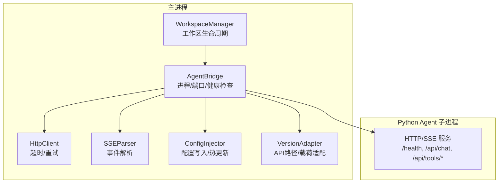
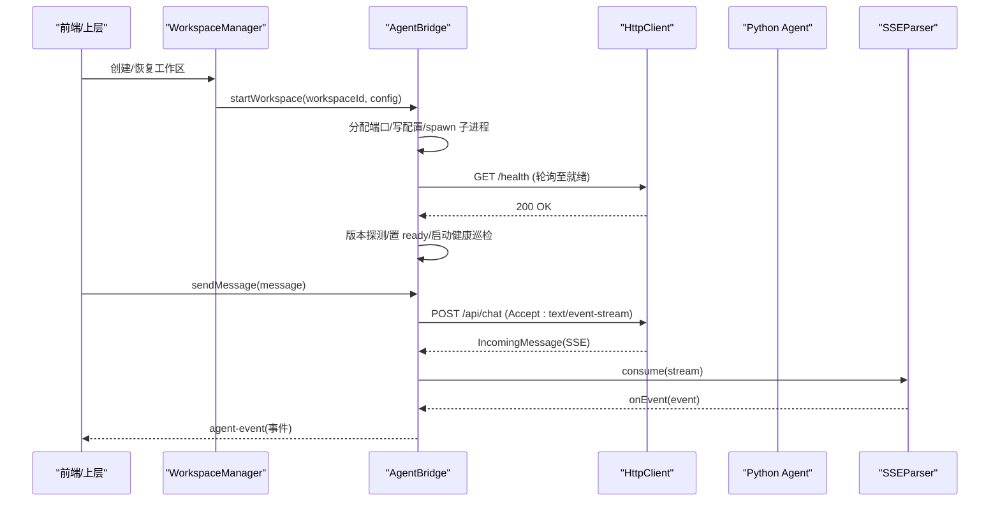
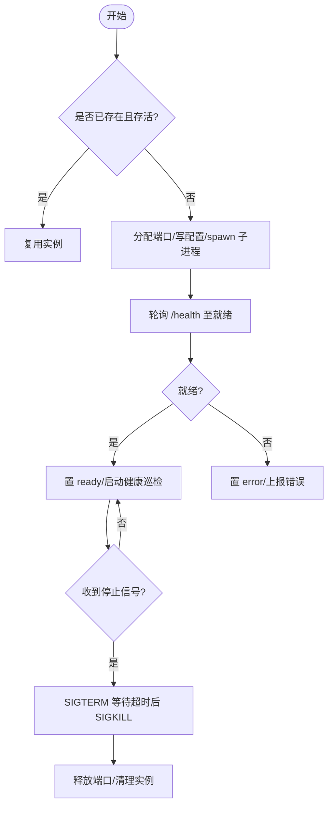
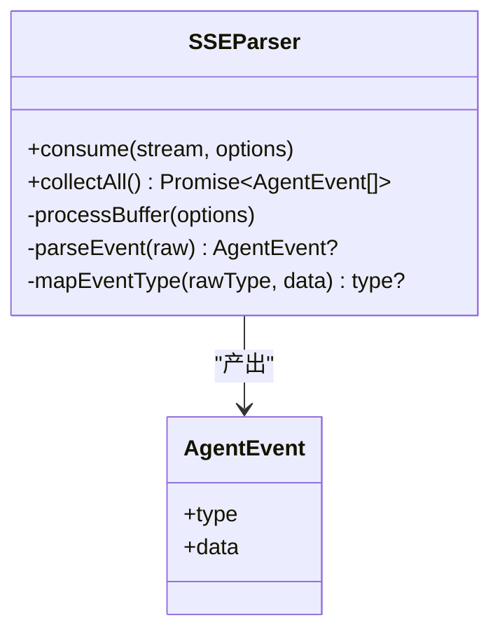
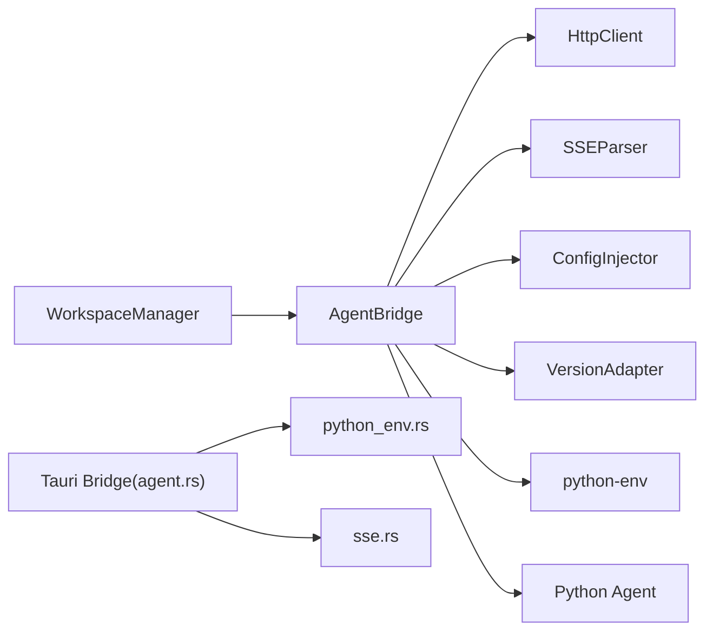

# 桥接集成

<cite>
**本文引用的文件**
- [agent-bridge.ts](file://tongtian-tauri/src/main/bridge/agent-bridge.ts)
- [python-env.ts](file://tongtian-tauri/src/main/bridge/python-env.ts)
- [sse-parser.ts](file://tongtian-tauri/src/main/bridge/sse-parser.ts)
- [http-client.ts](file://tongtian-tauri/src/main/bridge/http-client.ts)
- [config-injector.ts](file://tongtian-tauri/src/main/bridge/config-injector.ts)
- [version-adapter.ts](file://tongtian-tauri/src/main/bridge/version-adapter.ts)
- [manager.ts](file://tongtian-tauri/src/main/workspace/manager.ts)
- [workspace.ipc.ts](file://tongtian-tauri/src/main/ipc/workspace.ipc.ts)
- [mod.rs](file://tongtian-tauri/src-tauri/src/bridge/mod.rs)
- [agent.rs](file://tongtian-tauri/src-tauri/src/bridge/agent.rs)
- [python_env.rs](file://tongtian-tauri/src-tauri/src/bridge/python_env.rs)
- [sse.rs](file://tongtian-tauri/src-tauri/src/bridge/sse.rs)
</cite>

## 目录
1. [简介](#简介)
2. [项目结构](#项目结构)
3. [核心组件](#核心组件)
4. [架构总览](#架构总览)
5. [详细组件分析](#详细组件分析)
6. [依赖关系分析](#依赖关系分析)
7. [性能与可靠性](#性能与可靠性)
8. [故障排查指南](#故障排查指南)
9. [结论](#结论)
10. [附录](#附录)

## 简介
本文件面向“通天办公”项目的桥接集成，聚焦 Python Agent 引擎的进程管理、通信协议、状态同步机制。文档覆盖 workspace 生命周期管理、SSE 事件流处理、错误恢复策略；并说明 Python 环境检测、动态进程启动、资源清理、消息序列化、超时控制、重试逻辑，以及桥接服务监控与故障排查方法。

## 项目结构
桥接层由 Electron/Tauri 主进程侧的桥接模块与 Python Agent 子进程组成：
- Electron 侧（Node.js）：负责进程生命周期、端口分配、健康检查、SSE 解析、配置注入、版本适配、HTTP 客户端封装。
- Tauri 侧（Rust）：提供与 Electron 一致的桥接能力，支持多引擎模式（qwenpaw / agentscope / mock），实现 SSE 解析、事件持久化、配额计量、断线补齐等。
- Python Agent：以独立子进程运行，暴露 HTTP/SSE API，按工作区隔离端口与工作目录。

图表来源
- [agent-bridge.ts:87-126](file://tongtian-tauri/src/main/bridge/agent-bridge.ts#L87-L126)
- [agent-bridge.ts:131-247](file://tongtian-tauri/src/main/bridge/agent-bridge.ts#L131-L247)
- [http-client.ts:36-98](file://tongtian-tauri/src/main/bridge/http-client.ts#L36-L98)
- [sse-parser.ts:30-85](file://tongtian-tauri/src/main/bridge/sse-parser.ts#L30-L85)
- [config-injector.ts:95-159](file://tongtian-tauri/src/main/bridge/config-injector.ts#L95-L159)
- [version-adapter.ts:58-113](file://tongtian-tauri/src/main/bridge/version-adapter.ts#L58-L113)

章节来源
- [agent-bridge.ts:87-247](file://tongtian-tauri/src/main/bridge/agent-bridge.ts#L87-L247)
- [manager.ts:56-127](file://tongtian-tauri/src/main/workspace/manager.ts#L56-L127)
- [workspace.ipc.ts:55-133](file://tongtian-tauri/src/main/ipc/workspace.ipc.ts#L55-L133)

## 核心组件
- 工作区管理器（WorkspaceManager）：负责创建、暂停、恢复、归档、销毁工作区，维护运行时元数据，并与桥接交互。
- 桥接器（AgentBridge）：单例，管理每个工作区的 Agent 子进程实例，负责端口分配、健康检查、SSE 流转发、工具调用、配置热更新。
- Python 环境探测（python-env）：检测系统 Python、Agent 安装、生成启动命令、创建工作区目录。
- HTTP 客户端（HttpClient）：带超时与指数退避重试的轻量 HTTP 客户端，支持流式请求。
- SSE 解析器（SSEParser）：解析 QwenPaw SSE 格式，支持多行 data、未知类型忽略、事件队列与异步迭代。
- 配置注入器（ConfigInjector）：将工作区配置序列化为 JSON 写入磁盘，或经 HTTP 热更新到运行中 Agent。
- 版本适配器（VersionAdapter）：通过 /health 探测 Agent 版本，屏蔽上游 API 差异，统一 chat/tool/config 等路径与载荷。
- Tauri 侧桥接（agent.rs + sse.rs + python_env.rs）：与 Electron 侧对齐，支持多引擎模式、事件持久化、配额计量、断线补齐。

章节来源
- [manager.ts:33-127](file://tongtian-tauri/src/main/workspace/manager.ts#L33-L127)
- [agent-bridge.ts:94-126](file://tongtian-tauri/src/main/bridge/agent-bridge.ts#L94-L126)
- [python-env.ts:39-153](file://tongtian-tauri/src/main/bridge/python-env.ts#L39-L153)
- [http-client.ts:36-186](file://tongtian-tauri/src/main/bridge/http-client.ts#L36-L186)
- [sse-parser.ts:30-239](file://tongtian-tauri/src/main/bridge/sse-parser.ts#L30-L239)
- [config-injector.ts:95-222](file://tongtian-tauri/src/main/bridge/config-injector.ts#L95-L222)
- [version-adapter.ts:58-209](file://tongtian-tauri/src/main/bridge/version-adapter.ts#L58-L209)
- [agent.rs:118-262](file://tongtian-tauri/src-tauri/src/bridge/agent.rs#L118-L262)
- [sse.rs:48-169](file://tongtian-tauri/src-tauri/src/bridge/sse.rs#L48-L169)
- [python_env.rs:53-202](file://tongtian-tauri/src-tauri/src/bridge/python_env.rs#L53-L202)

## 架构总览
桥接层采用“进程隔离 + HTTP/SSE 通信 + 健康巡检”的架构：
- 每个工作区一个独立 Python 子进程，绑定 18000-19000 范围内唯一端口。
- 启动后轮询 /health 直至就绪（最长 30s）。
- 后台定时健康检查，连续失败标记异常并停止巡检。
- 消息发送走 POST /api/chat（SSE），事件经解析后向上游事件总线广播。
- 工具调用走 /api/tools/{name}，短响应，带超时与无重试策略。
- 配置可静态写入文件或运行时热更新。

图表来源
- [agent-bridge.ts:131-247](file://tongtian-tauri/src/main/bridge/agent-bridge.ts#L131-L247)
- [agent-bridge.ts:304-346](file://tongtian-tauri/src/main/bridge/agent-bridge.ts#L304-L346)
- [http-client.ts:138-186](file://tongtian-tauri/src/main/bridge/http-client.ts#L138-L186)
- [sse-parser.ts:50-85](file://tongtian-tauri/src/main/bridge/sse-parser.ts#L50-L85)

## 详细组件分析

### 工作区生命周期管理
- 创建：校验输入、持久化元数据、构建配置、调用桥接启动子进程、记录运行时信息。
- 暂停：优雅停止子进程（SIGTERM→超时→SIGKILL）、清理运行时、更新状态。
- 恢复：若已运行则复用，否则重新构建配置并启动。
- 归档/销毁：停止子进程、打包/删除归档、清理数据库条目。

图表来源
- [agent-bridge.ts:131-247](file://tongtian-tauri/src/main/bridge/agent-bridge.ts#L131-L247)
- [agent-bridge.ts:253-299](file://tongtian-tauri/src/main/bridge/agent-bridge.ts#L253-L299)
- [manager.ts:56-127](file://tongtian-tauri/src/main/workspace/manager.ts#L56-L127)

章节来源
- [manager.ts:56-339](file://tongtian-tauri/src/main/workspace/manager.ts#L56-L339)
- [workspace.ipc.ts:55-133](file://tongtian-tauri/src/main/ipc/workspace.ipc.ts#L55-L133)

### Python 环境检测与动态进程启动
- 检测 Python：尝试常见命令与 Windows 常见路径，解析版本号。
- 检测 Agent：通过 pip show qwenpaw 判断是否安装及版本。
- 启动命令：python -m qwenpaw --port <port> --work-dir <dir>；Tauri 侧还支持 agentscope 与 mock 模式。
- 工作区目录：基于用户数据目录或环境变量，确保存在。

章节来源
- [python-env.ts:39-153](file://tongtian-tauri/src/main/bridge/python-env.ts#L39-L153)
- [python_env.rs:53-202](file://tongtian-tauri/src-tauri/src/bridge/python_env.rs#L53-L202)
- [agent.rs:144-180](file://tongtian-tauri/src-tauri/src/bridge/agent.rs#L144-L180)

### 通信协议与 SSE 事件流处理
- 协议：HTTP + SSE（text/event-stream）。
- 事件格式：event: <type> + data: <JSON>，空行分隔；支持多行 data。
- 解析：SSEParser 累积 buffer，按 \n\n 切分事件块，解析 event/data/id 行，映射已知类型，JSON 解析失败回退 raw。
- 事件类型：plan、step_start、step_progress、step_done、step_failed、deliver、done、error，以及 status_change、quota_warning。
- 去重与补齐：Tauri 侧使用 seq 守卫与 /api/events/replay 进行断线补齐与重复丢弃。

图表来源
- [sse-parser.ts:40-239](file://tongtian-tauri/src/main/bridge/sse-parser.ts#L40-L239)
- [sse.rs:23-169](file://tongtian-tauri/src-tauri/src/bridge/sse.rs#L23-L169)

章节来源
- [sse-parser.ts:30-239](file://tongtian-tauri/src/main/bridge/sse-parser.ts#L30-L239)
- [sse.rs:48-169](file://tongtian-tauri/src-tauri/src/bridge/sse.rs#L48-L169)
- [agent.rs:517-604](file://tongtian-tauri/src-tauri/src/bridge/agent.rs#L517-L604)

### 消息序列化、超时控制与重试逻辑
- 序列化：请求体 JSON 字符串化，设置 Content-Type；SSE 流不重试，由调用方负责重连。
- 超时：默认 30s；健康检查 5s；流式请求可配置超时。
- 重试：非流式请求指数退避重试（默认 3 次）；工具调用禁用重试；健康检查在启动阶段有最大等待时间。
- 背压与批量：Tauri 侧 emit 通道容量限制，批量 drain 降低调度开销。

章节来源
- [http-client.ts:59-98](file://tongtian-tauri/src/main/bridge/http-client.ts#L59-L98)
- [http-client.ts:138-186](file://tongtian-tauri/src/main/bridge/http-client.ts#L138-L186)
- [agent-bridge.ts:351-394](file://tongtian-tauri/src/main/bridge/agent-bridge.ts#L351-L394)
- [agent.rs:500-515](file://tongtian-tauri/src-tauri/src/bridge/agent.rs#L500-L515)

### 配置注入与热更新
- 启动时：将 WorkspaceConfig 转换为 AgentConfig 写入工作区目录的 agent_config.json。
- 运行时：POST /api/config 热更新，支持模型绑定、技能集、MCP 服务器、沙箱策略等。
- 读取/删除：便于调试与清理。

章节来源
- [config-injector.ts:95-222](file://tongtian-tauri/src/main/bridge/config-injector.ts#L95-L222)

### 版本适配
- 通过 /health 获取 version 与 api_version，校验兼容范围。
- 统一 chat/tool/config/cron/skill/mcp 等路径与载荷，屏蔽上游变化。

章节来源
- [version-adapter.ts:58-209](file://tongtian-tauri/src/main/bridge/version-adapter.ts#L58-L209)

### Tauri 侧桥接要点
- 多引擎模式：TT_ENGINE=qwenpaw/agentscope，或 TT_AGENT_MOCK=1。
- 事件持久化与配额计量：事件落盘 24h，累计 usage 触发档位跃迁与阻断。
- 断线补齐：seq 守卫 + /api/events/replay 拉取缺失事件。
- 任务控制：cancel/pause/resume/rollback_to 等。

章节来源
- [agent.rs:144-180](file://tongtian-tauri/src-tauri/src/bridge/agent.rs#L144-L180)
- [agent.rs:410-461](file://tongtian-tauri/src-tauri/src/bridge/agent.rs#L410-L461)
- [agent.rs:517-604](file://tongtian-tauri/src-tauri/src/bridge/agent.rs#L517-L604)
- [agent.rs:684-754](file://tongtian-tauri/src-tauri/src/bridge/agent.rs#L684-L754)
- [sse.rs:171-292](file://tongtian-tauri/src-tauri/src/bridge/sse.rs#L171-L292)

## 依赖关系分析
- WorkspaceManager 依赖 AgentBridge 与存储层。
- AgentBridge 依赖 HttpClient、SSEParser、ConfigInjector、VersionAdapter、python-env。
- Tauri 侧 agent.rs 依赖 python_env.rs、sse.rs，并通过 reqwest/tokio 进行网络与并发。
- 所有组件通过明确的事件与接口解耦，避免循环依赖。

图表来源
- [agent-bridge.ts:94-126](file://tongtian-tauri/src/main/bridge/agent-bridge.ts#L94-L126)
- [agent.rs:1-45](file://tongtian-tauri/src-tauri/src/bridge/agent.rs#L1-L45)

章节来源
- [agent-bridge.ts:94-126](file://tongtian-tauri/src/main/bridge/agent-bridge.ts#L94-L126)
- [agent.rs:1-45](file://tongtian-tauri/src-tauri/src/bridge/agent.rs#L1-L45)

## 性能与可靠性
- 端口分配：18000-19000 范围内快速查找可用端口，避免冲突。
- 健康检查：启动阶段轮询至就绪（最长 30s），后台每 10s 巡检，连续 3 次失败标记异常。
- 超时与重试：非流式请求指数退避重试，流式请求不重试但支持断线补齐。
- 背压与批量：emit 通道容量限制，批量 drain 减少事件投递开销。
- 资源清理：优雅停止（SIGTERM→超时→SIGKILL），释放端口，清理实例与定时器。

[本节为通用指导，无需特定文件引用]

## 故障排查指南
- Python/Agent 未找到：
  - 现象：初始化失败，提示需要 Python 3.10+ 或安装 Agent。
  - 排查：确认 PATH 中存在 python/python3/py，Windows 下检查常见安装路径；执行 pip show qwenpaw 验证安装。
  - 参考：[python-env.ts:39-120](file://tongtian-tauri/src/main/bridge/python-env.ts#L39-L120)、[python_env.rs:53-120](file://tongtian-tauri/src-tauri/src/bridge/python_env.rs#L53-L120)

- 端口占用/无可用端口：
  - 现象：启动时报错无可用端口。
  - 排查：检查 18000-19000 端口占用情况，必要时重启应用或调整范围。
  - 参考：[agent-bridge.ts:57-83](file://tongtian-tauri/src/main/bridge/agent-bridge.ts#L57-L83)、[agent.rs:92-103](file://tongtian-tauri/src-tauri/src/bridge/agent.rs#L92-L103)

- 健康检查超时：
  - 现象：启动后长时间无法就绪。
  - 排查：查看子进程 stdout/stderr 日志，确认 /health 可达；检查防火墙/安全软件拦截。
  - 参考：[agent-bridge.ts:218-247](file://tongtian-tauri/src/main/bridge/agent-bridge.ts#L218-L247)、[agent.rs:220-262](file://tongtian-tauri/src-tauri/src/bridge/agent.rs#L220-L262)

- SSE 流中断/事件丢失：
  - 现象：前端事件卡顿或缺失。
  - 排查：观察断线补齐是否触发；检查 /api/events/replay 返回；确认 seq 单调递增。
  - 参考：[agent.rs:517-604](file://tongtian-tauri/src-tauri/src/bridge/agent.rs#L517-L604)、[sse.rs:125-169](file://tongtian-tauri/src-tauri/src/bridge/sse.rs#L125-L169)

- 工具调用失败：
  - 现象：返回 success=false 或错误信息。
  - 排查：检查工具路径与参数；确认 Agent 版本兼容；查看 HTTP 状态码与响应体。
  - 参考：[agent-bridge.ts:351-394](file://tongtian-tauri/src/main/bridge/agent-bridge.ts#L351-L394)、[version-adapter.ts:140-146](file://tongtian-tauri/src/main/bridge/version-adapter.ts#L140-L146)

- 配置热更新失败：
  - 现象：POST /api/config 非 2xx。
  - 排查：检查代理/权限；确认 payload 结构；查看日志中的非 2xx 响应。
  - 参考：[config-injector.ts:165-192](file://tongtian-tauri/src/main/bridge/config-injector.ts#L165-L192)

章节来源
- [python-env.ts:39-120](file://tongtian-tauri/src/main/bridge/python-env.ts#L39-L120)
- [python_env.rs:53-120](file://tongtian-tauri/src-tauri/src/bridge/python_env.rs#L53-L120)
- [agent-bridge.ts:57-83](file://tongtian-tauri/src/main/bridge/agent-bridge.ts#L57-L83)
- [agent.rs:92-103](file://tongtian-tauri/src-tauri/src/bridge/agent.rs#L92-L103)
- [agent-bridge.ts:218-247](file://tongtian-tauri/src/main/bridge/agent-bridge.ts#L218-L247)
- [agent.rs:220-262](file://tongtian-tauri/src-tauri/src/bridge/agent.rs#L220-L262)
- [agent.rs:517-604](file://tongtian-tauri/src-tauri/src/bridge/agent.rs#L517-L604)
- [sse.rs:125-169](file://tongtian-tauri/src-tauri/src/bridge/sse.rs#L125-L169)
- [agent-bridge.ts:351-394](file://tongtian-tauri/src/main/bridge/agent-bridge.ts#L351-L394)
- [version-adapter.ts:140-146](file://tongtian-tauri/src/main/bridge/version-adapter.ts#L140-L146)
- [config-injector.ts:165-192](file://tongtian-tauri/src/main/bridge/config-injector.ts#L165-L192)

## 结论
本桥接方案通过进程隔离、HTTP/SSE 通信、健康巡检与断线补齐，实现了稳定可靠的 Python Agent 集成。Electron 与 Tauri 双端实现保持一致的能力边界，支持多引擎模式、配置热更新、配额计量与事件持久化。结合完善的超时、重试与错误恢复策略，可在复杂环境下保障工作区生命周期管理与事件流的正确性。

[本节为总结性内容，无需特定文件引用]

## 附录
- 关键常量与阈值：
  - 端口范围：18000-19000
  - 健康检查间隔：10s
  - 健康检查最大失败次数：3
  - 启动健康检查最大等待：30s
  - 优雅停止超时：5s
  - emit 通道容量：1024
  - 断线补齐轮询间隔：500ms
  - 断线补齐总超时：30s

- 事件类型白名单：
  - plan、step_start、step_progress、step_done、step_failed、deliver、done、error、status_change、quota_warning

- 推荐实践：
  - 始终通过 VersionAdapter 访问 API 路径与载荷，避免直接耦合上游变更。
  - 对长耗时操作启用超时与重试；对 SSE 流关注断线补齐与 seq 一致性。
  - 定期巡检工作区健康状态，及时处理异常实例。

[本节为补充信息，无需特定文件引用]