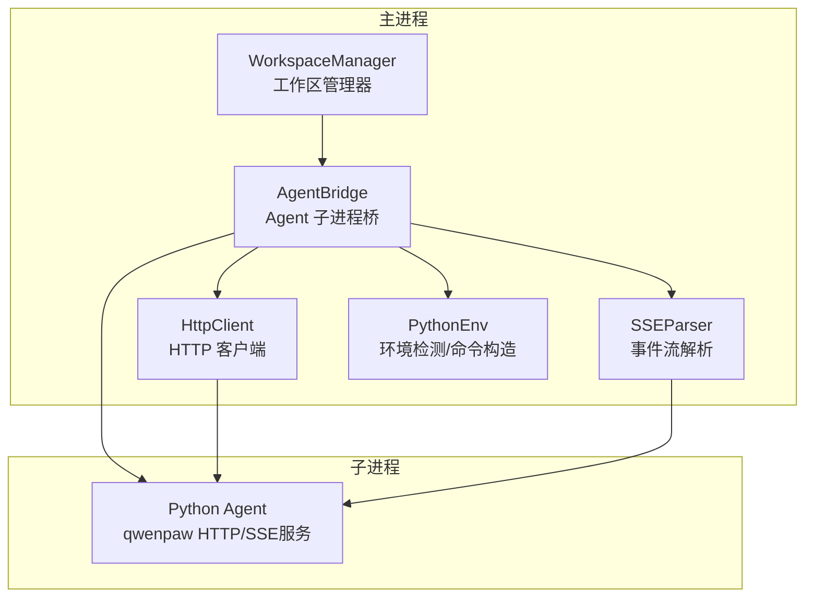
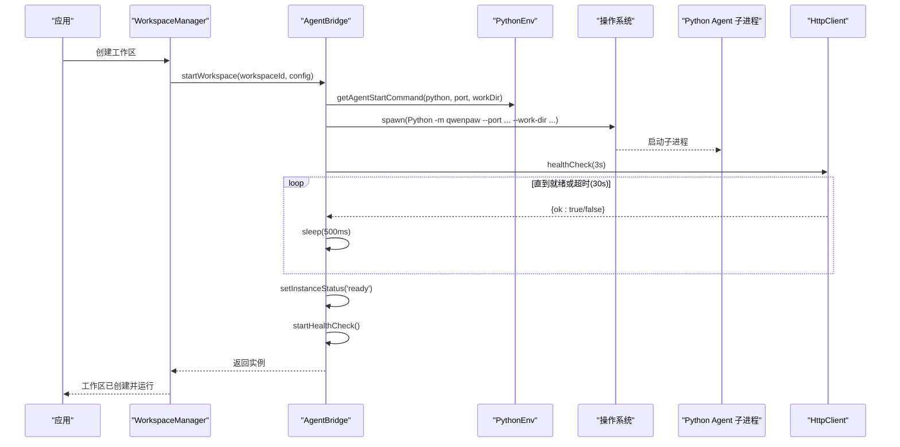
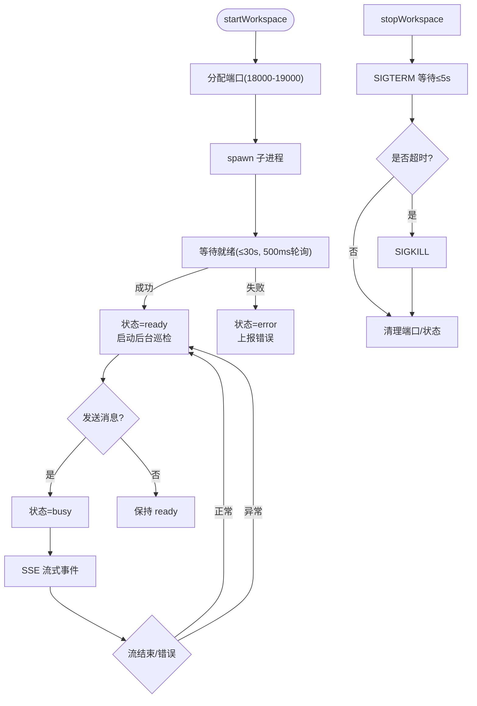
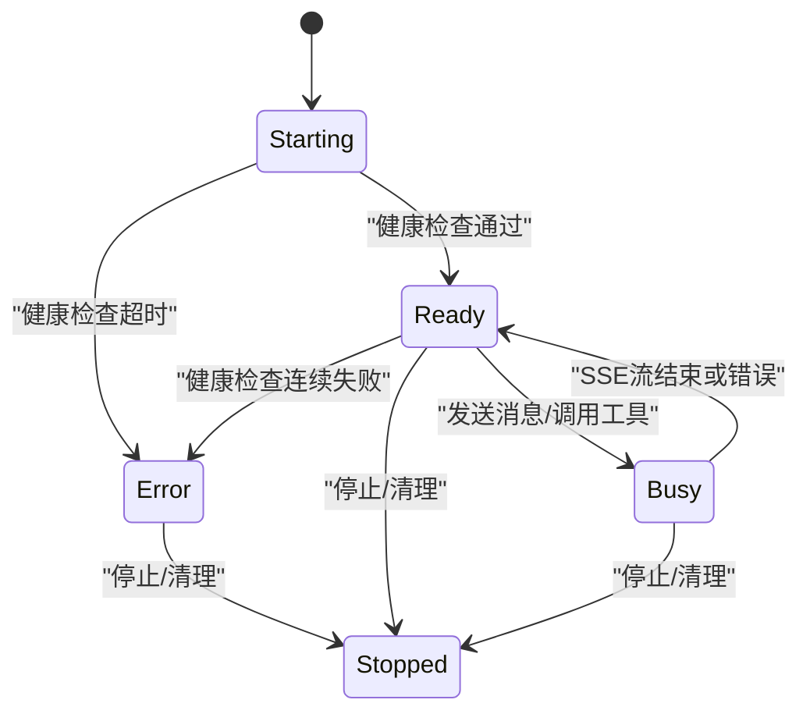
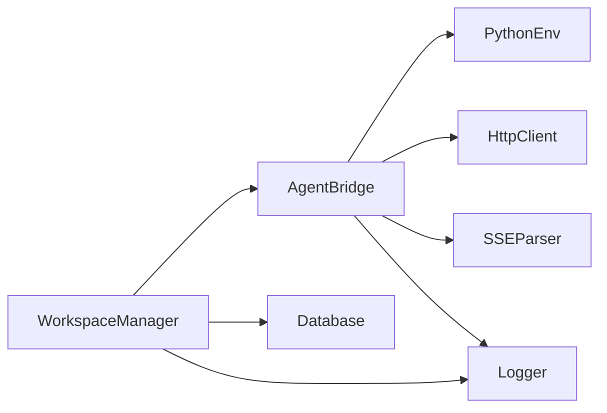

# 进程管理

<cite>
**本文引用的文件**
- [agent-bridge.ts](file://tongtian-tauri/src/main/bridge/agent-bridge.ts)
- [http-client.ts](file://tongtian-tauri/src/main/bridge/http-client.ts)
- [sse-parser.ts](file://tongtian-tauri/src/main/bridge/sse-parser.ts)
- [python-env.ts](file://tongtian-tauri/src/main/bridge/python-env.ts)
- [manager.ts](file://tongtian-tauri/src/main/workspace/manager.ts)
- [task-state-machine.ts](file://tongtian-tauri/src/shared/task-state-machine.ts)
- [state-machine.ts](file://tongtian-tauri/src/main/agent/state-machine.ts)
- [types.ts](file://tongtian-tauri/src/shared/types.ts)
</cite>

## 目录
1. [简介](#简介)
2. [项目结构](#项目结构)
3. [核心组件](#核心组件)
4. [架构总览](#架构总览)
5. [详细组件分析](#详细组件分析)
6. [依赖关系分析](#依赖关系分析)
7. [性能考量](#性能考量)
8. [故障排查指南](#故障排查指南)
9. [结论](#结论)

## 简介
本文件面向通天办公项目的进程管理，聚焦 Python Agent 子进程的启动、监控与生命周期管理。重点说明：
- workspace 实例的独立进程隔离机制（每个工作区一个独立 Python 进程）
- 端口分配策略（18000–19000 范围）
- 健康检查流程（30 秒超时，500ms 轮询）
- 进程状态机设计（Starting→Ready→Busy→Stopped/Error）
- 后台巡检逻辑与资源清理机制
- 异常处理、错误恢复策略与调试要点

## 项目结构
与进程管理直接相关的代码主要位于 Tauri 主进程侧的 bridge 层与工作区管理器：
- 桥接层负责 Python Agent 子进程的启动、通信、健康检查与生命周期管理
- 工作区管理器负责工作区的创建、暂停、恢复、归档与销毁等上层生命周期
- 共享类型与任务状态机用于跨端契约与任务流转

图表来源
- [agent-bridge.ts:94-188](file://tongtian-tauri/src/main/bridge/agent-bridge.ts#L94-L188)
- [http-client.ts:40-132](file://tongtian-tauri/src/main/bridge/http-client.ts#L40-L132)
- [sse-parser.ts:40-85](file://tongtian-tauri/src/main/bridge/sse-parser.ts#L40-L85)
- [python-env.ts:141-152](file://tongtian-tauri/src/main/bridge/python-env.ts#L141-L152)
- [manager.ts:56-127](file://tongtian-tauri/src/main/workspace/manager.ts#L56-L127)

章节来源
- [agent-bridge.ts:1-573](file://tongtian-tauri/src/main/bridge/agent-bridge.ts#L1-L573)
- [manager.ts:1-401](file://tongtian-tauri/src/main/workspace/manager.ts#L1-L401)

## 核心组件
- AgentBridge：子进程生命周期管理、端口分配、健康检查、SSE 事件转发、工具调用、优雅关闭
- HttpClient：对 Agent 子进程 HTTP API 的请求封装，含超时与重试
- SSEParser：解析 Agent 子进程返回的 Server-Sent Events 流
- PythonEnv：检测 Python 与 Agent 安装、生成工作区目录、构造启动命令
- WorkspaceManager：工作区 CRUD、启动/停止子进程、归档/销毁、运行时跟踪
- TaskStateMachine（共享）：任务级 14 态状态机（供 UI/后端契约使用）
- AgentStateMachine（主进程遗留）：Agent 任务状态机（Electron 遗留，Tauri 未引用）

章节来源
- [agent-bridge.ts:17-42](file://tongtian-tauri/src/main/bridge/agent-bridge.ts#L17-L42)
- [http-client.ts:10-30](file://tongtian-tauri/src/main/bridge/http-client.ts#L10-L30)
- [sse-parser.ts:10-22](file://tongtian-tauri/src/main/bridge/sse-parser.ts#L10-L22)
- [python-env.ts:12-20](file://tongtian-tauri/src/main/bridge/python-env.ts#L12-L20)
- [manager.ts:18-25](file://tongtian-tauri/src/main/workspace/manager.ts#L18-L25)
- [task-state-machine.ts:1-43](file://tongtian-tauri/src/shared/task-state-machine.ts#L1-L43)
- [state-machine.ts:10-63](file://tongtian-tauri/src/main/agent/state-machine.ts#L10-L63)

## 架构总览
下图展示了从工作区创建到子进程就绪的完整流程，包括端口分配、健康检查与状态迁移。

图表来源
- [manager.ts:97-127](file://tongtian-tauri/src/main/workspace/manager.ts#L97-L127)
- [agent-bridge.ts:131-247](file://tongtian-tauri/src/main/bridge/agent-bridge.ts#L131-L247)
- [python-env.ts:141-152](file://tongtian-tauri/src/main/bridge/python-env.ts#L141-L152)
- [http-client.ts:123-132](file://tongtian-tauri/src/main/bridge/http-client.ts#L123-L132)

## 详细组件分析

### AgentBridge：子进程生命周期与健康检查
- 子进程隔离：每个 workspace 对应一个独立的 Python 子进程，拥有独立工作目录与端口
- 端口分配：在 18000–19000 范围内寻找空闲端口，避免冲突；进程退出时释放端口
- 健康检查：启动后以 500ms 间隔轮询 /health，最多等待 30 秒；成功后进入 Ready 并开启后台巡检（默认 10s 周期，失败累计 3 次标记 Error）
- 消息与工具：发送聊天消息时置 Busy，SSE 结束后回 Ready；工具调用带超时与错误封装
- 优雅关闭：先 SIGTERM，等待 5s 后 SIGKILL；清理定时器与端口

图表来源
- [agent-bridge.ts:59-83](file://tongtian-tauri/src/main/bridge/agent-bridge.ts#L59-L83)
- [agent-bridge.ts:131-247](file://tongtian-tauri/src/main/bridge/agent-bridge.ts#L131-L247)
- [agent-bridge.ts:253-299](file://tongtian-tauri/src/main/bridge/agent-bridge.ts#L253-L299)
- [agent-bridge.ts:304-346](file://tongtian-tauri/src/main/bridge/agent-bridge.ts#L304-L346)
- [agent-bridge.ts:469-522](file://tongtian-tauri/src/main/bridge/agent-bridge.ts#L469-L522)

章节来源
- [agent-bridge.ts:44-54](file://tongtian-tauri/src/main/bridge/agent-bridge.ts#L44-L54)
- [agent-bridge.ts:59-83](file://tongtian-tauri/src/main/bridge/agent-bridge.ts#L59-L83)
- [agent-bridge.ts:131-247](file://tongtian-tauri/src/main/bridge/agent-bridge.ts#L131-L247)
- [agent-bridge.ts:253-299](file://tongtian-tauri/src/main/bridge/agent-bridge.ts#L253-L299)
- [agent-bridge.ts:304-346](file://tongtian-tauri/src/main/bridge/agent-bridge.ts#L304-L346)
- [agent-bridge.ts:469-522](file://tongtian-tauri/src/main/bridge/agent-bridge.ts#L469-L522)

### 端口分配策略（18000–19000）
- 使用内存集合记录已占用端口，按顺序尝试绑定本地回环地址
- 若范围内无可用端口则抛出错误
- 进程退出或清理时释放端口，避免泄漏

章节来源
- [agent-bridge.ts:59-83](file://tongtian-tauri/src/main/bridge/agent-bridge.ts#L59-L83)

### 健康检查与后台巡检
- 启动阶段：每 500ms 请求 /health，最长等待 30 秒
- 运行阶段：每 10 秒进行一次健康检查，连续失败 3 次将实例标记为 error 并停止巡检
- 成功时重置失败计数

章节来源
- [agent-bridge.ts:46-50](file://tongtian-tauri/src/main/bridge/agent-bridge.ts#L46-L50)
- [agent-bridge.ts:218-244](file://tongtian-tauri/src/main/bridge/agent-bridge.ts#L218-L244)
- [agent-bridge.ts:481-522](file://tongtian-tauri/src/main/bridge/agent-bridge.ts#L481-L522)
- [http-client.ts:123-132](file://tongtian-tauri/src/main/bridge/http-client.ts#L123-L132)

### 工作区管理器（WorkspaceManager）
- 创建：写入数据库、构建配置、调用 Bridge 启动子进程；失败时将工作区标记为 Suspended
- 暂停：优雅停止子进程，删除运行时记录，更新状态
- 恢复：重新构建配置并启动子进程
- 归档：停止子进程、打包元数据、更新状态
- 销毁：停止子进程、删除数据库记录、清理归档目录

章节来源
- [manager.ts:56-127](file://tongtian-tauri/src/main/workspace/manager.ts#L56-L127)
- [manager.ts:170-200](file://tongtian-tauri/src/main/workspace/manager.ts#L170-L200)
- [manager.ts:204-245](file://tongtian-tauri/src/main/workspace/manager.ts#L204-L245)
- [manager.ts:249-298](file://tongtian-tauri/src/main/workspace/manager.ts#L249-L298)
- [manager.ts:302-339](file://tongtian-tauri/src/main/workspace/manager.ts#L302-L339)

### 子进程启动与环境探测
- 自动检测系统 Python 与 Agent 包（qwenpaw）
- 生成工作区目录并确保存在
- 构造启动命令：python -m qwenpaw --port <端口> --work-dir <工作区路径>

章节来源
- [python-env.ts:39-82](file://tongtian-tauri/src/main/bridge/python-env.ts#L39-L82)
- [python-env.ts:105-120](file://tongtian-tauri/src/main/bridge/python-env.ts#L105-L120)
- [python-env.ts:125-136](file://tongtian-tauri/src/main/bridge/python-env.ts#L125-L136)
- [python-env.ts:141-152](file://tongtian-tauri/src/main/bridge/python-env.ts#L141-L152)

### 事件流与工具调用
- 聊天消息：设置 Busy → 发起 POST 获取 SSE 流 → 解析事件 → 流结束/错误时回 Ready
- 工具调用：POST 工具接口，带超时与错误封装，返回统一结果对象

章节来源
- [agent-bridge.ts:304-346](file://tongtian-tauri/src/main/bridge/agent-bridge.ts#L304-L346)
- [agent-bridge.ts:351-394](file://tongtian-tauri/src/main/bridge/agent-bridge.ts#L351-L394)
- [sse-parser.ts:40-85](file://tongtian-tauri/src/main/bridge/sse-parser.ts#L40-L85)
- [sse-parser.ts:128-188](file://tongtian-tauri/src/main/bridge/sse-parser.ts#L128-L188)

### 进程状态机设计（Starting→Ready→Busy→Stopped/Error）
- Starting：子进程已启动，等待健康检查通过
- Ready：健康检查通过，可接收新请求
- Busy：正在处理消息或工具调用
- Stopped：正常停止或清理完成
- Error：健康检查多次失败或进程异常退出

图表来源
- [agent-bridge.ts:17-29](file://tongtian-tauri/src/main/bridge/agent-bridge.ts#L17-L29)
- [agent-bridge.ts:175-188](file://tongtian-tauri/src/main/bridge/agent-bridge.ts#L175-L188)
- [agent-bridge.ts:232-244](file://tongtian-tauri/src/main/bridge/agent-bridge.ts#L232-L244)
- [agent-bridge.ts:308-346](file://tongtian-tauri/src/main/bridge/agent-bridge.ts#L308-L346)
- [agent-bridge.ts:499-503](file://tongtian-tauri/src/main/bridge/agent-bridge.ts#L499-L503)
- [agent-bridge.ts:524-554](file://tongtian-tauri/src/main/bridge/agent-bridge.ts#L524-L554)

### 任务状态机（共享契约）
- 提供 14 态任务状态机与合法转移表，供渲染器与 Rust 侧契约共用
- 支持重试、预算暂停、排队、归档等场景
- 与进程状态机解耦，关注任务执行生命周期

章节来源
- [task-state-machine.ts:1-43](file://tongtian-tauri/src/shared/task-state-machine.ts#L1-L43)
- [task-state-machine.ts:63-133](file://tongtian-tauri/src/shared/task-state-machine.ts#L63-L133)
- [task-state-machine.ts:165-201](file://tongtian-tauri/src/shared/task-state-machine.ts#L165-L201)
- [types.ts:3-25](file://tongtian-tauri/src/shared/types.ts#L3-L25)

## 依赖关系分析
- AgentBridge 依赖：
  - python-env：环境检测与启动命令
  - http-client：HTTP 请求与 /health
  - sse-parser：事件流解析
  - version-adaptor/config-injector：版本适配与配置注入（由 agent-bridge 引用）
- WorkspaceManager 依赖：
  - AgentBridge：子进程生命周期
  - Database：持久化工作区元数据
  - Logger：日志输出

图表来源
- [manager.ts:8-14](file://tongtian-tauri/src/main/workspace/manager.ts#L8-L14)
- [agent-bridge.ts:5-13](file://tongtian-tauri/src/main/bridge/agent-bridge.ts#L5-L13)

章节来源
- [manager.ts:1-401](file://tongtian-tauri/src/main/workspace/manager.ts#L1-L401)
- [agent-bridge.ts:1-573](file://tongtian-tauri/src/main/bridge/agent-bridge.ts#L1-L573)

## 性能考量
- 健康检查轮询间隔 500ms，避免频繁请求造成负载
- 健康检查最大等待 30 秒，防止长时间阻塞启动流程
- 后台巡检 10 秒一次，失败 3 次即降级为 error，减少无效请求
- HTTP 客户端默认超时 30 秒，支持指数退避重试（非流式请求）
- 工具调用禁用重试，避免幂等性问题
- 端口分配采用本地回环与内存集合，快速且无外部依赖

[本节为通用指导，不直接分析具体文件]

## 故障排查指南
- 启动失败
  - 检查 Python 与 Agent 是否安装正确（detectPython/detectAgent）
  - 查看子进程 stdout/stderr 日志定位启动错误
  - 确认端口未被占用（18000–19000）
- 健康检查超时
  - 检查子进程 /health 接口是否正常响应
  - 观察后台巡检失败次数与日志
- 进程异常退出
  - 根据 exit code 判断是否为异常退出，状态将转为 error
  - 检查是否有 SIGKILL 强制终止的情况
- 资源泄漏
  - 确保 stopWorkspace/shutdownAll 被调用，释放端口与定时器
  - 归档/销毁时清理工作区与归档目录

章节来源
- [python-env.ts:39-82](file://tongtian-tauri/src/main/bridge/python-env.ts#L39-L82)
- [python-env.ts:105-120](file://tongtian-tauri/src/main/bridge/python-env.ts#L105-L120)
- [agent-bridge.ts:201-216](file://tongtian-tauri/src/main/bridge/agent-bridge.ts#L201-L216)
- [agent-bridge.ts:253-299](file://tongtian-tauri/src/main/bridge/agent-bridge.ts#L253-L299)
- [agent-bridge.ts:524-554](file://tongtian-tauri/src/main/bridge/agent-bridge.ts#L524-L554)

## 结论
本项目通过 AgentBridge 实现了 Python Agent 子进程的独立隔离、端口分配、健康检查与生命周期管理；WorkspaceManager 提供了工作区层面的启动/暂停/恢复/归档/销毁能力。结合 14 态任务状态机，系统在可靠性、可观测性与可维护性方面具备良好基础。建议在生产环境中持续监控健康检查失败率与进程异常退出率，并根据业务负载调整巡检间隔与超时参数。