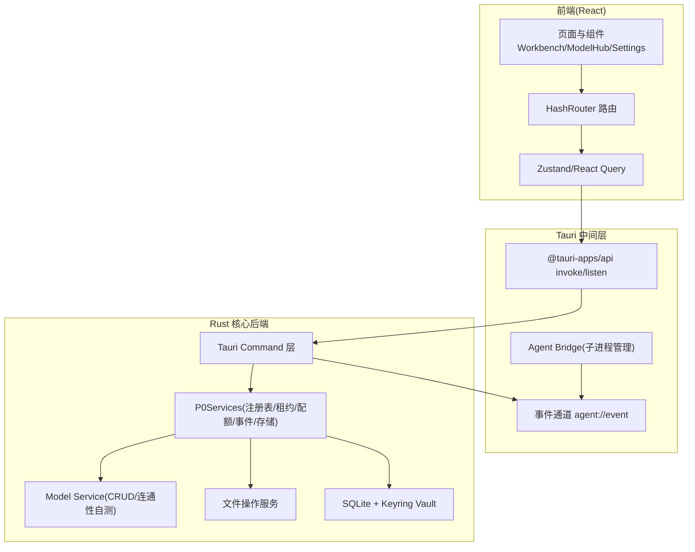
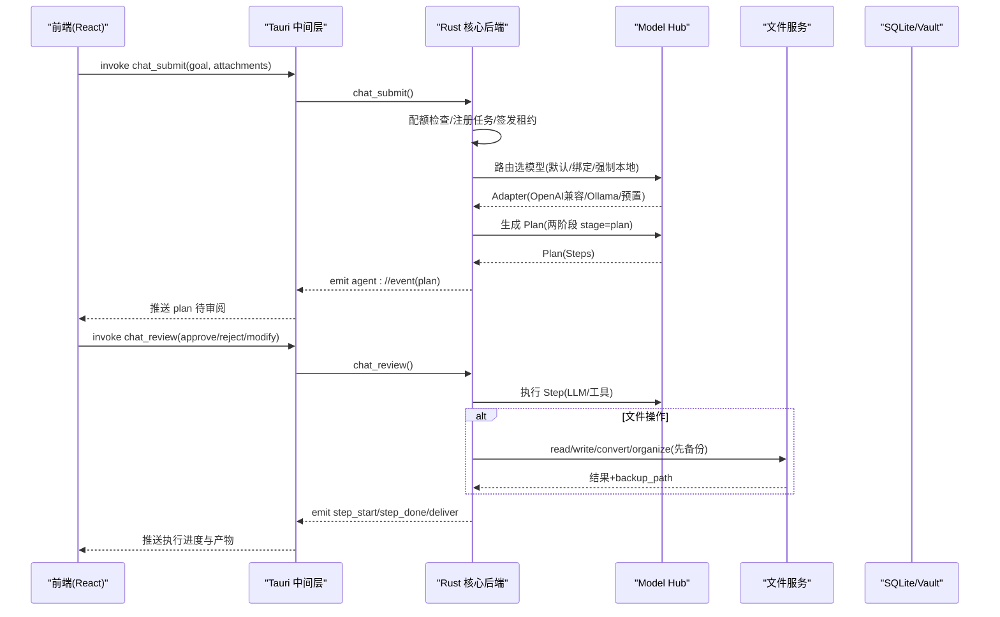
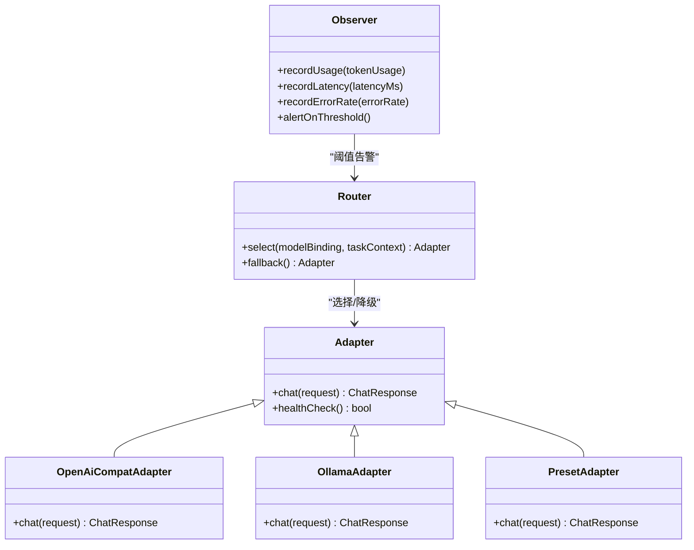
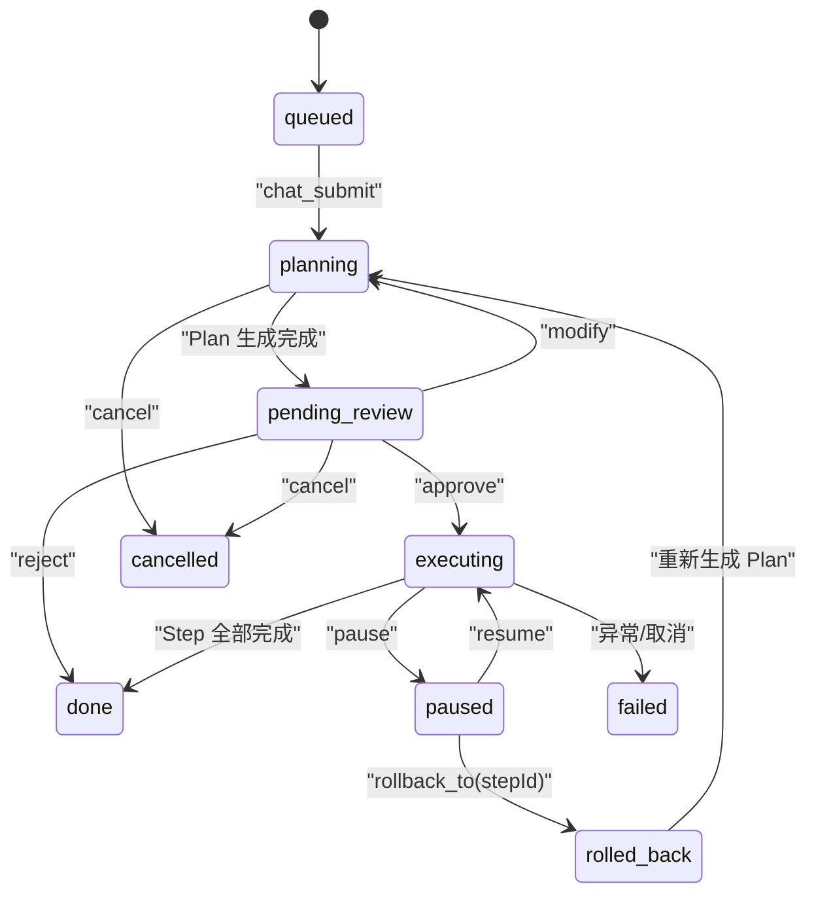
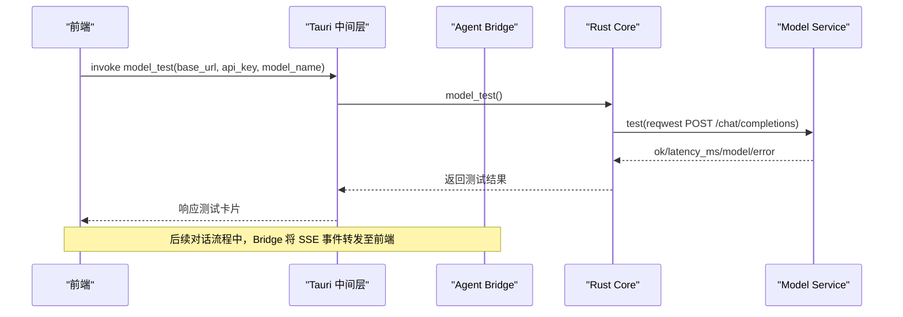
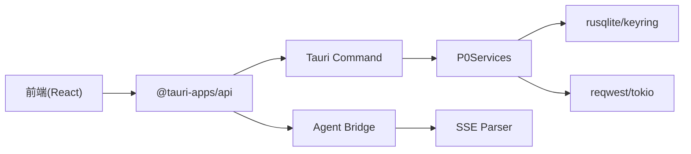

# 架构设计

<cite>
**本文引用的文件**   
- [通天办公 MVP 设计文档](file://tongtian-office-mvp-design.md)
- [Electron → Tauri 改造方案](file://docs/spec/spec-通天办公-qwenpaw-改造方案.md)
- [Tauri 后端入口 lib.rs](file://tongtian-tauri\src-tauri\src\lib.rs)
- [Rust Cargo 配置](file://tongtian-tauri\src-tauri\Cargo.toml)
- [前端应用根组件 App.tsx](file://tongtian-tauri\src\renderer\App.tsx)
- [Model Hub 管理器（TS）](file://tongtian-tauri\src\main\model\hub.ts)
- [Agent Bridge（TS）](file://tongtian-tauri\src\main\bridge\agent-bridge.ts)
- [Bridge 模块声明 mod.rs](file://tongtian-tauri\src-tauri\src\bridge\mod.rs)
- [Model 服务（Rust）](file://tongtian-tauri\src-tauri\src\model\service.rs)
</cite>

## 目录
1. [引言](#引言)
2. [项目结构](#项目结构)
3. [核心组件](#核心组件)
4. [架构总览](#架构总览)
5. [详细组件分析](#详细组件分析)
6. [依赖关系分析](#依赖关系分析)
7. [性能考量](#性能考量)
8. [故障排查指南](#故障排查指南)
9. [结论](#结论)
10. [附录](#附录)

## 引言
本架构设计文档面向通天办公项目的三层架构：前端 React 展示层、Tauri 中间层、Rust 核心后端。文档明确系统边界、组件交互与数据流向，重点阐述 Model Hub 的三层设计（接入层/路由层/观测层）以及 Agent 引擎的核心架构。同时给出技术决策背景与权衡，解释为何选择 Tauri 而非 Electron、为何采用 Rust 作为核心后端。

## 项目结构
- 前端：React + Vite + TypeScript + MUI + Tailwind，页面通过 HashRouter 组织，使用 Zustand 管理全局状态，React Query 管理异步请求。
- 中间层：Tauri 2.x 壳，暴露 command 给前端调用，负责事件推送、进程管理、存储与安全能力。
- 核心后端：Rust crate 化模块（任务注册表、租约、配额、事件存储、持久化、模型服务、文件服务等）。

**图表来源** 
- [Tauri 后端入口 lib.rs](file://tongtian-tauri\src-tauri\src\lib.rs)
- [前端应用根组件 App.tsx](file://tongtian-tauri\src\renderer\App.tsx)

**章节来源**
- [通天办公 MVP 设计文档](file://tongtian-office-mvp-design.md)
- [Electron → Tauri 改造方案](file://docs/spec/spec-通天办公-qwenpaw-改造方案.md)

## 核心组件
- 前端展示层：提供工作台、模型管理、设置等页面，统一通过 @tauri-apps/api 调用后端命令与监听事件。
- Tauri 中间层：封装 command/event 契约，维护 Agent 子进程生命周期，转发 SSE 事件到前端。
- Rust 核心后端：实现任务编排、模型接入、文件处理、持久化与密钥管理；以 P0Services 聚合关键服务。

**章节来源**
- [Tauri 后端入口 lib.rs](file://tongtian-tauri\src-tauri\src\lib.rs)
- [Model 服务（Rust）](file://tongtian-tauri\src-tauri\src\model\service.rs)
- [Agent Bridge（TS）](file://tongtian-tauri\src\main\bridge\agent-bridge.ts)

## 架构总览
整体遵循“前端—Tauri—Rust”三层架构，前后端通过 Tauri command 与 event 通信。Model Hub 采用三层抽象：接入层（Adapter）、路由层（Router）、观测层（Observer）。Agent 引擎基于两阶段协议（计划生成→审阅执行），结合任务注册表、租约与配额闸门保障稳定性。

**图表来源** 
- [Tauri 后端入口 lib.rs](file://tongtian-tauri\src-tauri\src\lib.rs)
- [Model 服务（Rust）](file://tongtian-tauri\src-tauri\src\model\service.rs)

## 详细组件分析

### Model Hub 三层设计（接入层/路由层/观测层）
- 接入层（Adapter）：统一 chat(req) 接口，支持 OpenAI 兼容、Ollama、预置云端；负责超时、重试与基础错误处理。
- 路由层（Router）：按全局默认、智能体绑定、敏感任务强制本地策略选择 Adapter；实现降级熔断与 429 退避。
- 观测层（Observer）：统计 token 用量、延迟、错误率，触发告警与降级；MVP 先实现连通性自测、成本统计、错误率统计与降级告警。

**图表来源** 
- [通天办公 MVP 设计文档](file://tongtian-office-mvp-design.md)

**章节来源**
- [通天办公 MVP 设计文档](file://tongtian-office-mvp-design.md)

### Agent 引擎核心架构（两阶段协议与状态机）
- 两阶段协议：chat_submit 首先生成 Plan（stage=plan），进入 pending_review 待审阅；用户 approve 后进入 executing，逐步执行 Steps，完成后交付产物。
- 状态机：queued→planning→pending_review→executing→done/failed/cancelled/rolled_back；支持 pause/resume/rollback_to。
- 资源治理：配额闸门（四档预警）、租约（防抢占）、事件重放（24h TTL）。

**图表来源** 
- [Tauri 后端入口 lib.rs](file://tongtian-tauri\src-tauri\src\lib.rs)

**章节来源**
- [Tauri 后端入口 lib.rs](file://tongtian-tauri\src-tauri\src\lib.rs)

### 前后端通信与事件流（IPC/SSE）
- 前端通过 @tauri-apps/api 的 invoke 调用 Rust command，listen 订阅 agent://event 事件。
- Tauri 中间层维护 Agent 子进程（Python sidecar 可选），将 SSE 事件转换为前端可消费的事件流。
- Model Hub 连通性自测通过 HTTP 最小探测（/chat/completions）返回延迟与可用模型列表。

**图表来源** 
- [Model 服务（Rust）](file://tongtian-tauri\src-tauri\src\model\service.rs)
- [Agent Bridge（TS）](file://tongtian-tauri\src\main\bridge\agent-bridge.ts)

**章节来源**
- [Model Hub 管理器（TS）](file://tongtian-tauri\src\main\model\hub.ts)
- [Agent Bridge（TS）](file://tongtian-tauri\src\main\bridge\agent-bridge.ts)
- [Model 服务（Rust）](file://tongtian-tauri\src-tauri\src\model\service.rs)

### 安全与存储（Vault + SQLite）
- API Key 不入库明文，仅存 keyring/vault 引用标记；DB 字段 api_key_encrypted 恒为空串。
- 运行目录双目录契约：安装目录只读，用户数据位于运行目录（默认 %USERPROFILE%\.tongtian-office），由 Rust 路径解析统一管理。
- 权限控制：Tauri capability 默认拒绝制，仅注册必要 command；文件与子进程操作经 Rust 受控 command 执行。

**章节来源**
- [通天办公 MVP 设计文档](file://tongtian-office-mvp-design.md)
- [Model 服务（Rust）](file://tongtian-tauri\src-tauri\src\model\service.rs)

## 依赖关系分析
- 前端依赖 @tauri-apps/api 进行 IPC 调用，类型定义来自 ts-rs 生成的 shared/ 类型。
- Tauri 中间层依赖 Rust 暴露的 command 与 event 通道，管理 Agent 子进程与 SSE 解析。
- Rust 核心后端依赖 rusqlite、keyring、reqwest、tokio 等库，实现持久化、加密、HTTP 与异步运行时。

**图表来源** 
- [Rust Cargo 配置](file://tongtian-tauri\src-tauri\Cargo.toml)
- [Tauri 后端入口 lib.rs](file://tongtian-tauri\src-tauri\src\lib.rs)

**章节来源**
- [Rust Cargo 配置](file://tongtian-tauri\src-tauri\Cargo.toml)
- [Tauri 后端入口 lib.rs](file://tongtian-tauri\src-tauri\src\lib.rs)

## 性能考量
- 安装包体积：Tauri 单二进制分发，压缩后约 12MB，较 Electron 显著降低。
- 冷启动与内存：系统 WebView 复用，空闲内存 ~120-150MB，冷启动 < 1s。
- 并发与 I/O：tokio 异步运行时 + reqwest stream 处理 SSE，避免阻塞。
- 存储优化：SQLite 本地持久化，keyring 加密密钥，减少磁盘 IO 与安全风险。

[本节为通用指导，无需特定文件引用]

## 故障排查指南
- 模型连通性失败：检查 baseUrl、api_key、网络可达性；查看 model_test 返回 error 与 latency_ms。
- Agent 子进程异常：查看 Bridge 日志 instance-error 与 process exit code；确认端口占用与健康检查失败计数。
- 任务状态异常：通过 task_state 查询 14 态 meta（wait_reason/status_reason_code/queue_position）；检查配额闸门与租约状态。
- 文件操作失败：确认工作区路径与权限；查看 file_list/file_read/file_preview 返回值与 backup_path。

**章节来源**
- [Agent Bridge（TS）](file://tongtian-tauri\src\main\bridge\agent-bridge.ts)
- [Tauri 后端入口 lib.rs](file://tongtian-tauri\src-tauri\src\lib.rs)

## 结论
通天办公采用 Tauri + Rust 的三层架构，实现了轻量、安全、高性能的本地 AI 工作助手。Model Hub 三层设计与 Agent 引擎两阶段协议保障了模型调用的灵活性与任务执行的可靠性。技术选型在体积、内存、安全与维护成本上取得平衡，为后续扩展（多工作区、Skills、MCP、沙箱）奠定基础。

[本节为总结性内容，无需特定文件引用]

## 附录
- 技术决策背景：从 Electron + Python 迁移至 Tauri + Rust，解决分发体积大、双运行时维护成本高、资源占用大等问题。
- 契约先行：冻结 command/event 契约与 ts-rs 类型生成流程，确保前后端解耦与渐进替换。
- 能力等价迁移：v1.x 每个模块在目标架构都有明确归属，不允许能力丢失。

**章节来源**
- [Electron → Tauri 改造方案](file://docs/spec/spec-通天办公-qwenpaw-改造方案.md)