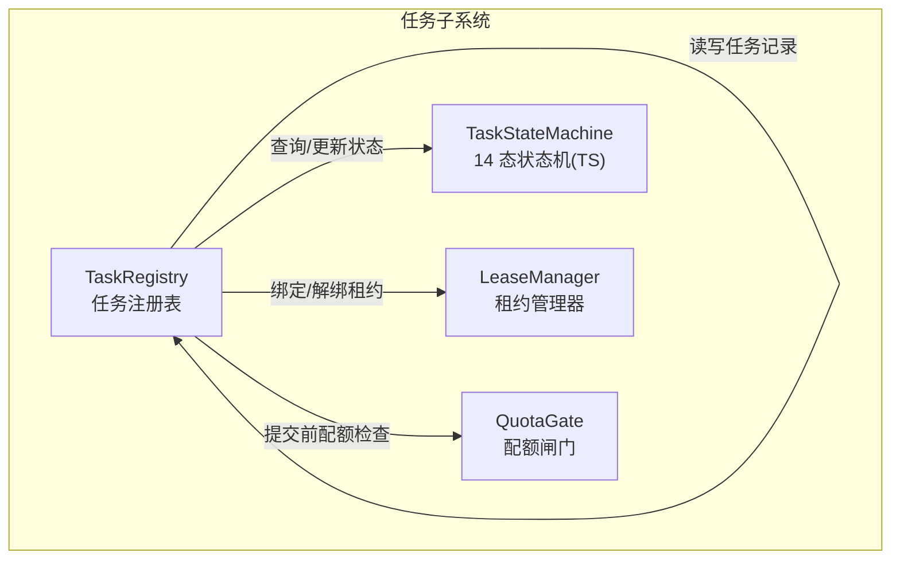
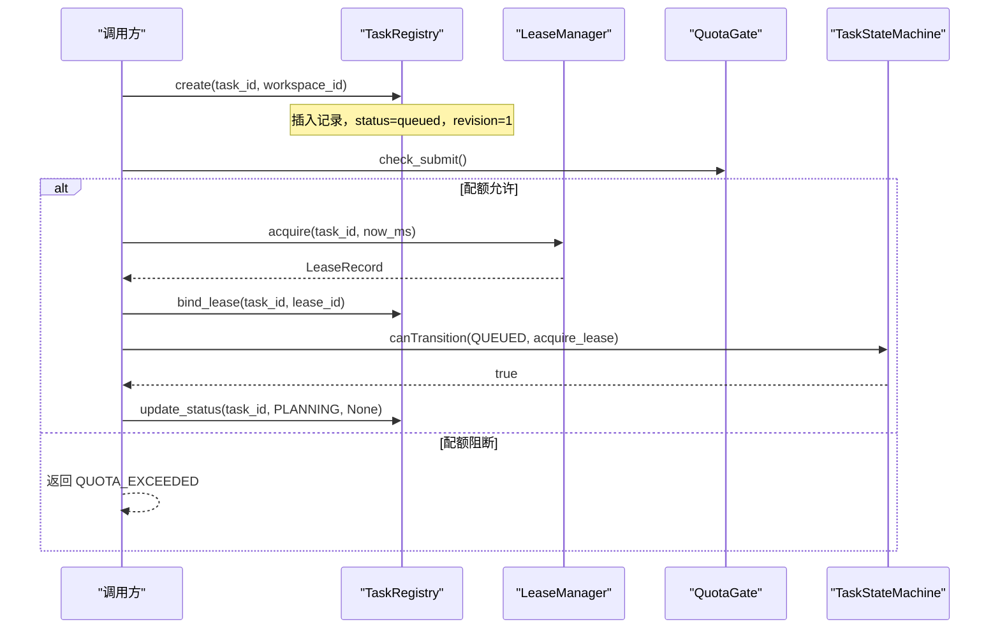
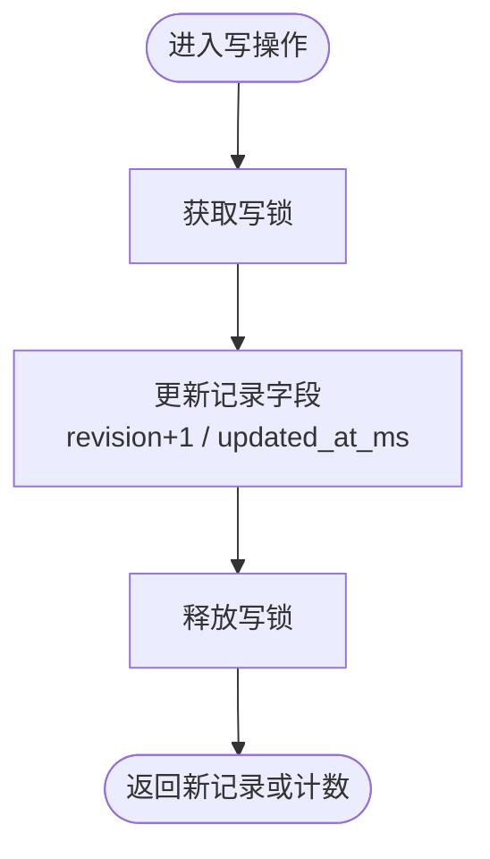
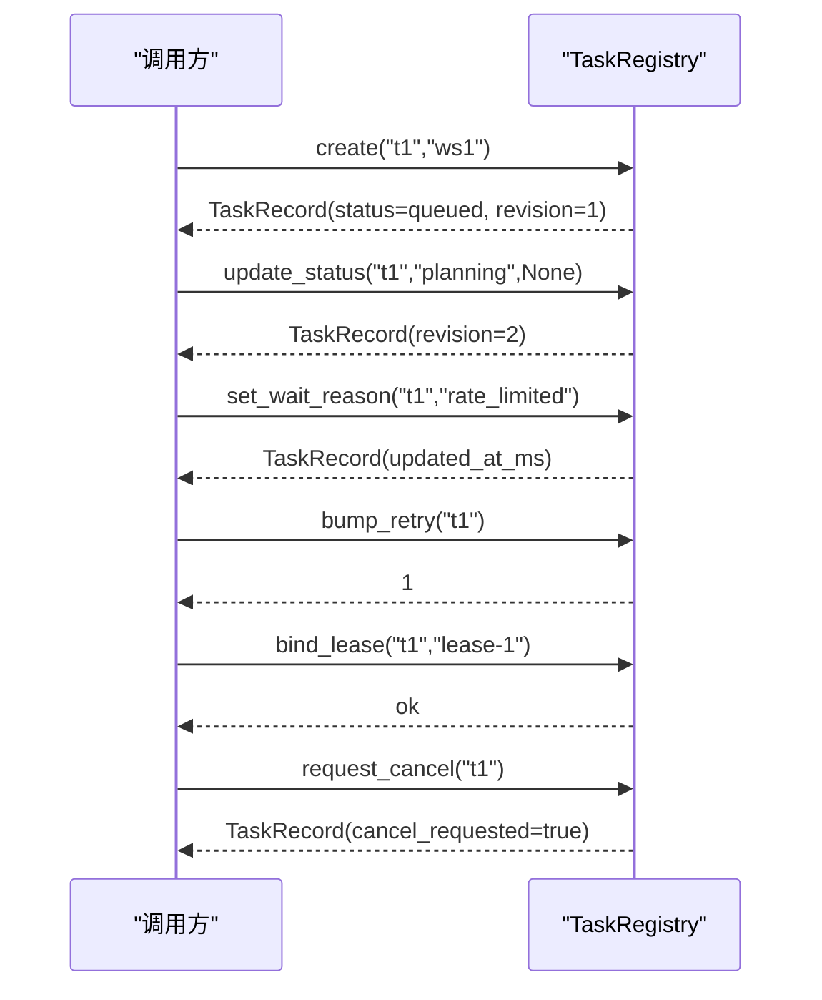
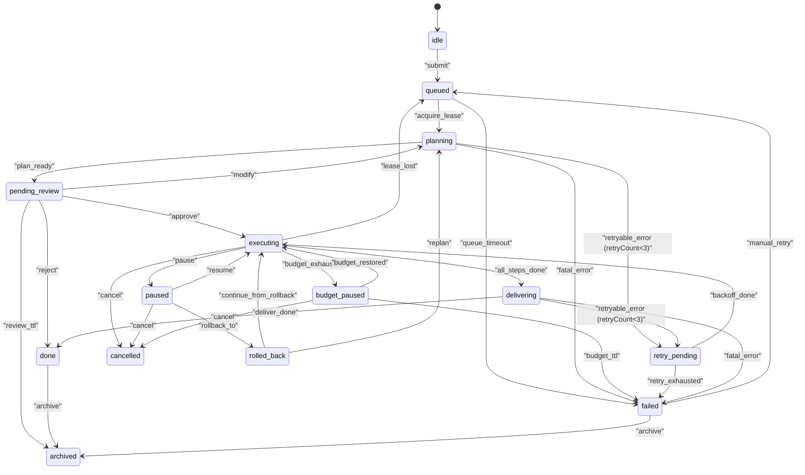
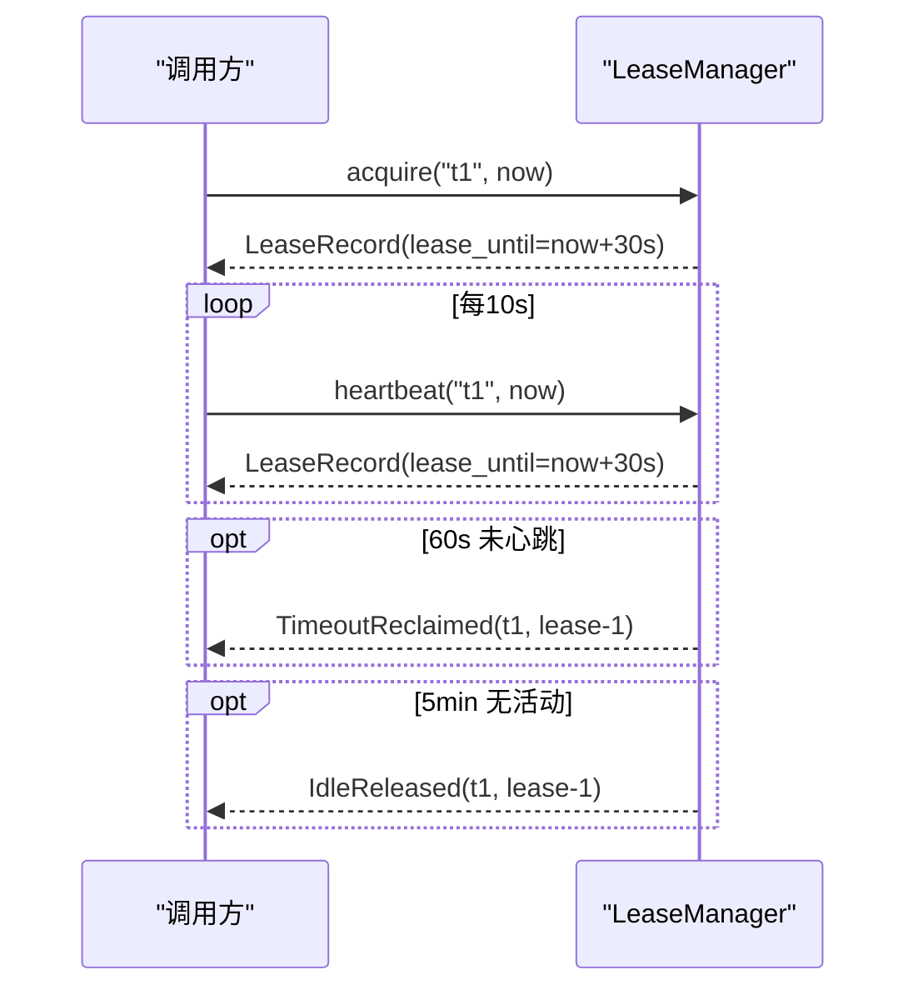
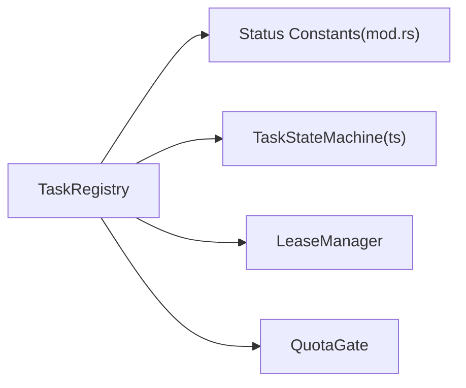

# 任务注册表

<cite>
**本文引用的文件**
- [registry.rs](file://tongtian-tauri/src-tauri/src/task/registry.rs)
- [mod.rs](file://tongtian-tauri/src-tauri/src/task/mod.rs)
- [lease.rs](file://tongtian-tauri/src-tauri/src/task/lease.rs)
- [quota.rs](file://tongtian-tauri/src-tauri/src/task/quota.rs)
- [task-state-machine.ts](file://tongtian-tauri/src/shared/task-state-machine.ts)
</cite>

## 目录
1. [简介](#简介)
2. [项目结构](#项目结构)
3. [核心组件](#核心组件)
4. [架构总览](#架构总览)
5. [详细组件分析](#详细组件分析)
6. [依赖关系分析](#依赖关系分析)
7. [性能考量](#性能考量)
8. [故障排查指南](#故障排查指南)
9. [结论](#结论)
10. [附录：API 参考](#附录api-参考)

## 简介
本文件为“通天办公”项目的任务注册表（TaskRegistry）提供完整技术文档，聚焦以下目标：
- 全面说明 TaskRecord 数据结构的字段含义与使用场景
- 阐述 TaskRegistry 的线程安全机制（RwLock）与并发访问控制策略
- 详解任务生命周期管理的关键方法：create、get、update_status、set_wait_reason、bump_retry、bind_lease、request_cancel 等
- 给出任务状态码、重试机制、租约绑定等功能的 API 参考与调用示例路径
- 结合状态机与配额闸门，解释任务从创建到归档的全链路流转

## 项目结构
任务注册表位于 Rust Tauri 后端模块 task 下，包含：
- registry.rs：任务记录与注册表实现
- mod.rs：模块入口与 14 态状态字面量定义
- lease.rs：租约管理器（心跳、超时回收、空闲释放）
- quota.rs：配额与预算闸门（四档阈值、持久化台账）
- shared/task-state-machine.ts：14 态状态机（转移表、事件、守卫条件），与 Rust 侧契约镜像

图表来源
- [registry.rs:44-183](file://tongtian-tauri/src-tauri/src/task/registry.rs#L44-L183)
- [lease.rs:62-207](file://tongtian-tauri/src-tauri/src/task/lease.rs#L62-L207)
- [quota.rs:60-220](file://tongtian-tauri/src-tauri/src/task/quota.rs#L60-L220)
- [task-state-machine.ts:63-133](file://tongtian-tauri/src/shared/task-state-machine.ts#L63-L133)

章节来源
- [registry.rs:1-259](file://tongtian-tauri/src-tauri/src/task/registry.rs#L1-L259)
- [mod.rs:1-24](file://tongtian-tauri/src-tauri/src/task/mod.rs#L1-L24)

## 核心组件
- TaskRecord：任务记录的不可变快照（序列化 camelCase），承载任务 ID、工作区、状态、等待原因、重试次数、乐观锁版本、状态原因码、排队位次、执行租约、取消标记、时间戳等。
- TaskRegistry：基于 RwLock<HashMap<String, TaskRecord>> 的任务注册表，提供 create/get/update_status/set_wait_reason/bump_retry/retry_exhausted/bind_lease/request_cancel/list/len/is_empty 等方法。
- LeaseManager：租约管理，支持 acquire/heartbeat/touch/release/takeover/scan，维护心跳、租约有效期、超时回收与空闲释放。
- QuotaGate：配额闸门，依据四档阈值（70/85/95/100%）决定降级、排队、阻断动作，并提供 check_submit/should_queue/add_usage/snapshot 等能力。
- TaskStateMachine（TS）：14 态状态机，定义 35 条合法转移、终态集合、可转移判定、wait_reason 子态应用等。

章节来源
- [registry.rs:12-46](file://tongtian-tauri/src-tauri/src/task/registry.rs#L12-L46)
- [registry.rs:61-183](file://tongtian-tauri/src-tauri/src/task/registry.rs#L61-L183)
- [lease.rs:25-66](file://tongtian-tauri/src-tauri/src/task/lease.rs#L25-L66)
- [lease.rs:68-207](file://tongtian-tauri/src-tauri/src/task/lease.rs#L68-L207)
- [quota.rs:15-64](file://tongtian-tauri/src-tauri/src/task/quota.rs#L15-L64)
- [quota.rs:87-220](file://tongtian-tauri/src-tauri/src/task/quota.rs#L87-L220)
- [task-state-machine.ts:16-55](file://tongtian-tauri/src/shared/task-state-machine.ts#L16-L55)
- [task-state-machine.ts:63-133](file://tongtian-tauri/src/shared/task-state-machine.ts#L63-L133)

## 架构总览
任务注册表作为本地 first 的核心，承担任务元数据的创建、查询与更新；与租约管理器协作完成执行期资源绑定与回收；与配额闸门协作在提交阶段进行预算控制；与前端状态机保持契约一致，确保状态迁移的合法性。

图表来源
- [registry.rs:69-119](file://tongtian-tauri/src-tauri/src/task/registry.rs#L69-L119)
- [lease.rs:83-108](file://tongtian-tauri/src-tauri/src/task/lease.rs#L83-L108)
- [quota.rs:191-206](file://tongtian-tauri/src-tauri/src/task/quota.rs#L191-L206)
- [task-state-machine.ts:63-68](file://tongtian-tauri/src/shared/task-state-machine.ts#L63-L68)

## 详细组件分析

### TaskRecord 数据结构
- task_id：任务唯一标识
- workspace_id：所属工作区
- status：当前状态（14 态之一，见 status 常量）
- wait_reason：executing 子态/等待成因（如 rate_limited/circuit_break/quota_wait 等）
- retry_count：已重试次数（上限 3，手动重试累计不重置）
- revision：乐观锁版本号（单调递增）
- status_reason_code：状态成因码（BUDGET_EXHAUSTED / QUEUE_TIMEOUT / LEASE_LOST / REJECTED / USER_CANCELLED）
- queue_position：排队位次（本地恒 0）
- lease_id：执行租约 ID（None 表示未绑定）
- cancel_requested：是否已请求取消（握手标记）
- created_at_ms / updated_at_ms：创建与更新时间（毫秒级 epoch）

章节来源
- [registry.rs:12-39](file://tongtian-tauri/src-tauri/src/task/registry.rs#L12-L39)
- [mod.rs:7-23](file://tongtian-tauri/src-tauri/src/task/mod.rs#L7-L23)

### 线程安全与并发访问控制
- 使用 std::sync::RwLock<HashMap<String, TaskRecord>> 保护任务映射
- 读多写少场景优化：get/list/len 使用 read()；create/update_status/set_wait_reason/bump_retry/bind_lease/request_cancel 使用 write()
- 所有写操作均更新 updated_at_ms，便于外部观察变更
- 对 RwLock 的获取失败采用 unwrap_or_else(|e| e.into_inner()) 降级策略，避免阻塞崩溃

图表来源
- [registry.rs:69-183](file://tongtian-tauri/src-tauri/src/task/registry.rs#L69-L183)

章节来源
- [registry.rs:44-183](file://tongtian-tauri/src-tauri/src/task/registry.rs#L44-L183)

### 任务生命周期管理
- create：新建任务记录，初始状态 queued，revision=1，queue_position=0，无租约，无取消标记
- get：按 task_id 读取任务记录
- update_status：更新状态与原因码，非 executing 时清空 wait_reason，revision 自增，更新时间戳
- set_wait_reason：仅用于 executing 子态标注，更新时间戳
- bump_retry：重试计数 +1（饱和加），更新时间戳
- retry_exhausted：判断是否达到最大重试次数
- bind_lease：绑定执行租约 ID，更新时间戳
- request_cancel：幂等标记取消请求，更新时间戳
- list/len/is_empty：统计与遍历

图表来源
- [registry.rs:69-164](file://tongtian-tauri/src-tauri/src/task/registry.rs#L69-L164)

章节来源
- [registry.rs:69-183](file://tongtian-tauri/src-tauri/src/task/registry.rs#L69-L183)

### 状态码与状态机
- 14 态状态常量：idle、queued、planning、pending_review、executing、paused、budget_paused、retry_pending、delivering、done、failed、rolled_back、cancelled、archived
- 合法转移：35 条（含 retryable_error 的重试守卫、budget_exhausted、lease_lost 等）
- 终态：cancelled、archived（done 仅保留 archive 边）
- wait_reason 子态：仅在 executing 状态下设置，离开 executing 自动清除

图表来源
- [task-state-machine.ts:63-133](file://tongtian-tauri/src/shared/task-state-machine.ts#L63-L133)
- [mod.rs:7-23](file://tongtian-tauri/src-tauri/src/task/mod.rs#L7-L23)

章节来源
- [task-state-machine.ts:16-55](file://tongtian-tauri/src/shared/task-state-machine.ts#L16-L55)
- [task-state-machine.ts:63-133](file://tongtian-tauri/src/shared/task-state-machine.ts#L63-L133)
- [mod.rs:7-23](file://tongtian-tauri/src-tauri/src/task/mod.rs#L7-L23)

### 重试机制
- MAX_RETRY_COUNT = 3（与 TS 端一致）
- bump_retry 使用饱和加，避免溢出
- retry_exhausted 判断是否达到上限
- 非法 retryable_error（当 retryCount≥3）由状态机路由至 failed（#6/#15/#32 守卫）

章节来源
- [registry.rs:41-43](file://tongtian-tauri/src-tauri/src/task/registry.rs#L41-L43)
- [registry.rs:131-145](file://tongtian-tauri/src-tauri/src/task/registry.rs#L131-L145)
- [task-state-machine.ts:51-52](file://tongtian-tauri/src/shared/task-state-machine.ts#L51-L52)
- [task-state-machine.ts:165-174](file://tongtian-tauri/src/shared/task-state-machine.ts#L165-L174)

### 租约绑定与管理
- LeaseManager 负责租约签发、心跳续约、空闲释放、超时回收与接管
- 本地 local-first：本设备恒为唯一 holder；云端语义下禁止抢占需确认
- 关键参数：HEARTBEAT_INTERVAL_MS=10s，LEASE_DURATION_MS=30s，TIMEOUT_RECLAIM_MS=60s，IDLE_RELEASE_MS=5min
- 扫描循环单 interval 驱动全部租约，O(n) 开销可忽略

图表来源
- [lease.rs:14-23](file://tongtian-tauri/src-tauri/src/task/lease.rs#L14-L23)
- [lease.rs:83-108](file://tongtian-tauri/src-tauri/src/task/lease.rs#L83-L108)
- [lease.rs:110-184](file://tongtian-tauri/src-tauri/src/task/lease.rs#L110-L184)

章节来源
- [lease.rs:14-23](file://tongtian-tauri/src-tauri/src/task/lease.rs#L14-L23)
- [lease.rs:68-207](file://tongtian-tauri/src-tauri/src/task/lease.rs#L68-L207)

### 配额闸门
- 四档阈值：70%（notify）、85%（degrade）、95%（queue）、100%（block）
- check_submit：100% 档阻断新提交，返回 QUOTA_EXCEEDED
- should_queue：≥95% 档建议排队
- add_usage：累计用量并触发档位跃迁去抖
- 持久化：JSON 台账跨日重置

章节来源
- [quota.rs:15-24](file://tongtian-tauri/src-tauri/src/task/quota.rs#L15-L24)
- [quota.rs:87-117](file://tongtian-tauri/src-tauri/src/task/quota.rs#L87-L117)
- [quota.rs:191-206](file://tongtian-tauri/src-tauri/src/task/quota.rs#L191-L206)
- [quota.rs:158-189](file://tongtian-tauri/src-tauri/src/task/quota.rs#L158-L189)

## 依赖关系分析
- TaskRegistry 依赖 status 常量（mod.rs）与 TaskStateMachine（TS）进行状态合法性校验
- TaskRegistry 与 LeaseManager 通过 lease_id 关联执行期资源
- TaskRegistry 与 QuotaGate 在提交前进行配额检查
- 所有状态与行为与 TS 端保持一致，保证前后端契约统一

图表来源
- [registry.rs:61-183](file://tongtian-tauri/src-tauri/src/task/registry.rs#L61-L183)
- [mod.rs:7-23](file://tongtian-tauri/src-tauri/src/task/mod.rs#L7-L23)
- [task-state-machine.ts:63-133](file://tongtian-tauri/src/shared/task-state-machine.ts#L63-L133)
- [lease.rs:68-207](file://tongtian-tauri/src-tauri/src/task/lease.rs#L68-L207)
- [quota.rs:191-206](file://tongtian-tauri/src-tauri/src/task/quota.rs#L191-L206)

章节来源
- [registry.rs:61-183](file://tongtian-tauri/src-tauri/src/task/registry.rs#L61-L183)
- [mod.rs:7-23](file://tongtian-tauri/src-tauri/src/task/mod.rs#L7-L23)
- [task-state-machine.ts:63-133](file://tongtian-tauri/src/shared/task-state-machine.ts#L63-L133)
- [lease.rs:68-207](file://tongtian-tauri/src-tauri/src/task/lease.rs#L68-L207)
- [quota.rs:191-206](file://tongtian-tauri/src-tauri/src/task/quota.rs#L191-L206)

## 性能考量
- RwLock 读多写少：get/list/len 走读锁，update_* 走写锁，适合高并发查询、低频更新的场景
- 本地退化：queue_position 恒 0，queued→planning 快速推进，减少队列延迟
- 租约扫描 O(n)，桌面端任务规模小，开销可忽略
- 配额台账 JSON 持久化，写入失败仅日志记录，不影响主流程

[本节为通用性能讨论，不直接分析具体文件]

## 故障排查指南
- 状态非法转移：若调用 update_status 传入的状态不在合法转移表中，应结合 TS 的 canTransition/transition 进行校验，避免静默错误
- 重试耗尽：当 retry_count≥MAX_RETRY_COUNT 时，retryable_error 将路由到 failed，需检查业务逻辑与退避策略
- 租约丢失：若 scan 产出 TimeoutReclaimed，应将任务状态回退到 queued 并附带 LEASE_LOST 原因码
- 配额阻断：check_submit 返回 QUOTA_EXCEEDED 时，应提示用户或降级处理；运行中任务可能转入 budget_paused

章节来源
- [task-state-machine.ts:165-201](file://tongtian-tauri/src/shared/task-state-machine.ts#L165-L201)
- [registry.rs:100-119](file://tongtian-tauri/src-tauri/src/task/registry.rs#L100-L119)
- [lease.rs:160-184](file://tongtian-tauri/src-tauri/src/task/lease.rs#L160-L184)
- [quota.rs:191-206](file://tongtian-tauri/src-tauri/src/task/quota.rs#L191-L206)

## 结论
任务注册表以 RwLock 为核心，提供高效、安全的任务元数据管理能力；通过与租约管理器、配额闸门及状态机的协同，实现了完整的任务生命周期管理。其设计遵循 local-first 原则，兼顾桌面端的低延迟与可扩展性，同时与前端状态机保持契约一致，确保端到端行为可预测、可验证。

[本节为总结性内容，不直接分析具体文件]

## 附录：API 参考

### TaskRecord 字段
- task_id：String，任务唯一标识
- workspace_id：String，工作区标识
- status：String，14 态之一
- wait_reason：Option<String>，executing 子态/等待成因
- retry_count：u8，重试次数（上限 3）
- revision：i64，乐观锁版本（单调递增）
- status_reason_code：Option<String>，状态原因码
- queue_position：u32，本地恒 0
- lease_id：Option<String>，执行租约 ID
- cancel_requested：bool，取消请求标记
- created_at_ms：u64，创建时间
- updated_at_ms：u64，更新时间

章节来源
- [registry.rs:12-39](file://tongtian-tauri/src-tauri/src/task/registry.rs#L12-L39)

### TaskRegistry 方法
- new() -> Self：构造空注册表
- create(task_id, workspace_id) -> TaskRecord：创建任务，初始 queued
- get(task_id) -> Option<TaskRecord>：读取任务
- update_status(task_id, new_status, reason_code) -> Option<TaskRecord>：更新状态与原因码
- set_wait_reason(task_id, reason) -> Option<TaskRecord>：设置 waiting 原因（executing 子态）
- bump_retry(task_id) -> Option<u8>：重试计数 +1
- retry_exhausted(task_id) -> bool：是否达到最大重试
- bind_lease(task_id, lease_id)：绑定租约
- request_cancel(task_id) -> Option<TaskRecord>：标记取消请求
- list() -> Vec<TaskRecord>：列出所有任务
- len() -> usize：任务数量
- is_empty() -> bool：是否为空

章节来源
- [registry.rs:61-183](file://tongtian-tauri/src-tauri/src/task/registry.rs#L61-L183)

### 状态码常量
- IDLE、QUEUED、PLANNING、PENDING_REVIEW、EXECUTING、PAUSED、BUDGET_PAUSED、RETRY_PENDING、DELIVERING、DONE、FAILED、ROLLED_BACK、CANCELLED、ARCHIVED

章节来源
- [mod.rs:7-23](file://tongtian-tauri/src-tauri/src/task/mod.rs#L7-L23)

### 租约相关
- acquire(task_id, now_ms) -> Result<LeaseRecord, TakeoverResult>：签发租约
- heartbeat(task_id, now_ms) -> Option<LeaseRecord>：心跳续约
- touch(task_id, now_ms)：记录控制活动
- release(task_id) -> Option<LeaseRecord>：显式释放
- takeover(task_id, now_ms) -> TakeoverResult：接管请求
- scan(now_ms) -> Vec<LeaseEvent>：扫描超时与空闲释放
- list() -> Vec<LeaseRecord>：列出所有租约

章节来源
- [lease.rs:68-207](file://tongtian-tauri/src-tauri/src/task/lease.rs#L68-L207)

### 配额闸门
- evaluate(used_tokens, quota_tokens) -> QuotaSnapshot：计算配额快照
- check_submit() -> Result<(), &'static str>：提交前检查（100% 阻断）
- should_queue() -> bool：是否应排队（≥95%）
- add_usage(tokens) -> TierTransition：累计用量并触发跃迁
- snapshot() -> QuotaSnapshot：当前快照

章节来源
- [quota.rs:87-117](file://tongtian-tauri/src-tauri/src/task/quota.rs#L87-L117)
- [quota.rs:191-206](file://tongtian-tauri/src-tauri/src/task/quota.rs#L191-L206)
- [quota.rs:158-189](file://tongtian-tauri/src-tauri/src/task/quota.rs#L158-L189)

### 状态机（TS）
- TRANSITIONS：35 条合法转移
- TERMINAL_STATUSES：终态集合
- canTransition(from, event, ctx) -> bool：判定转移合法性
- transition(from, event, ctx) -> TaskStatus：执行转移
- applyWaitReason(status, reason) -> {status, waitReason}：设置 executing 子态
- availableEvents(from) -> TransitionEvent[]：某状态的可用事件

章节来源
- [task-state-machine.ts:63-133](file://tongtian-tauri/src/shared/task-state-machine.ts#L63-L133)
- [task-state-machine.ts:165-223](file://tongtian-tauri/src/shared/task-state-machine.ts#L165-L223)