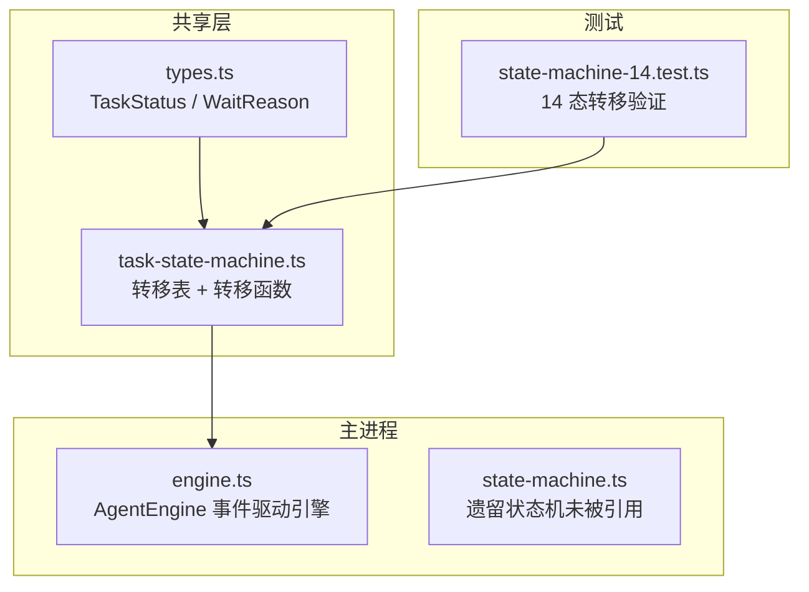
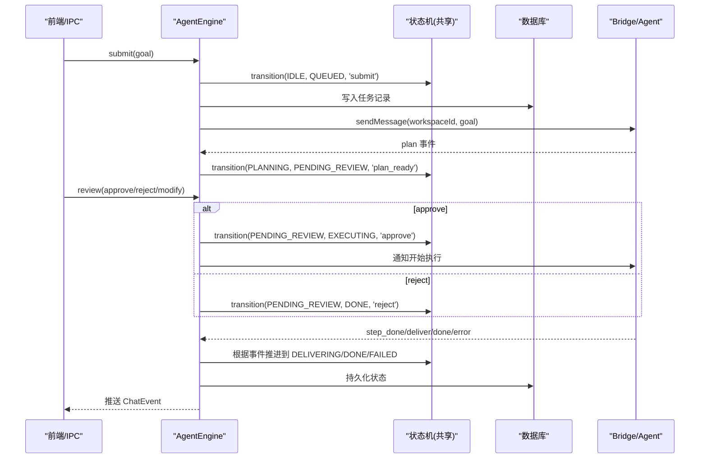
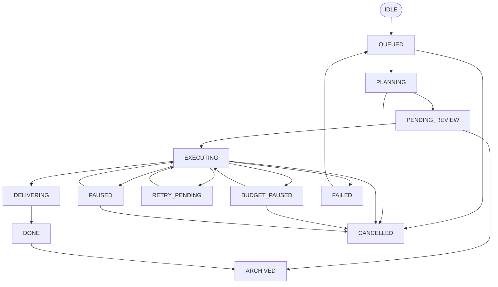
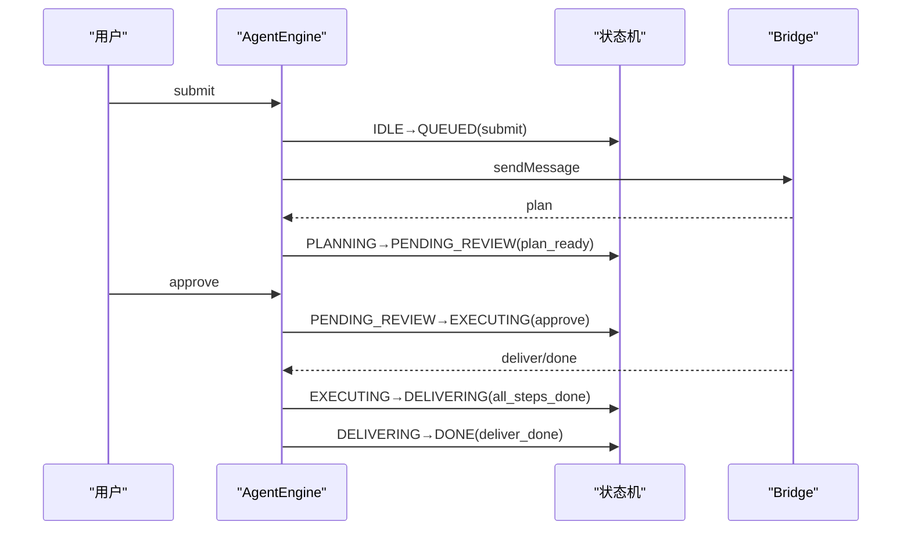
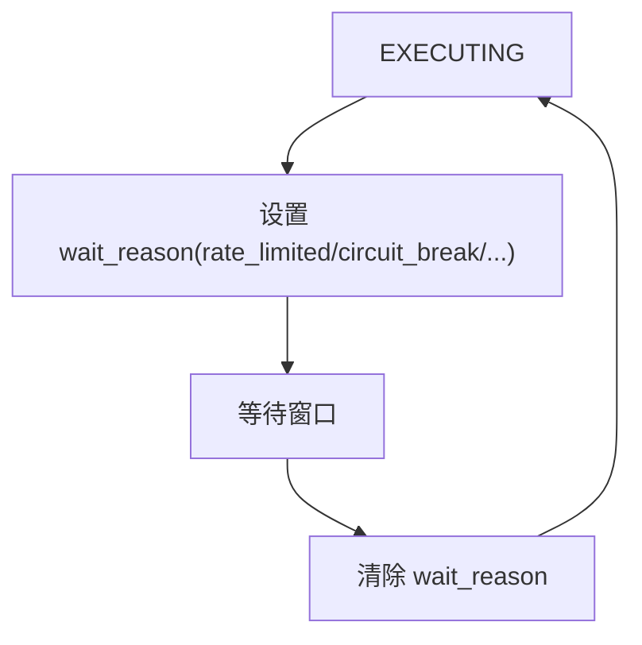
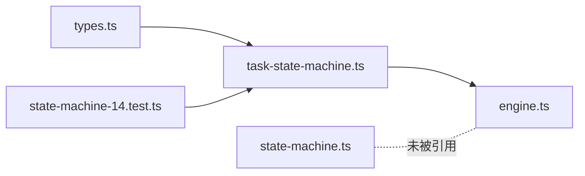

# 任务状态机

<cite>
**本文引用的文件**
- [task-state-machine.ts](file://tongtian-tauri/src/shared/task-state-machine.ts)
- [types.ts](file://tongtian-tauri/src/shared/types.ts)
- [state-machine-14.test.ts](file://tongtian-tauri/tests/unit/agent/state-machine-14.test.ts)
- [engine.ts](file://tongtian-tauri/src/main/agent/engine.ts)
- [state-machine.ts](file://tongtian-tauri/src/main/agent/state-machine.ts)
</cite>

## 目录
1. [简介](#简介)
2. [项目结构](#项目结构)
3. [核心组件](#核心组件)
4. [架构总览](#架构总览)
5. [详细组件分析](#详细组件分析)
6. [依赖关系分析](#依赖关系分析)
7. [性能考量](#性能考量)
8. [故障排查指南](#故障排查指南)
9. [结论](#结论)
10. [附录](#附录)

## 简介
本文件为通天办公项目的“14 态任务状态机”提供完整、深入的技术文档。内容覆盖：
- 14 个任务状态定义与 35 条合法转移规则
- wait_reason 子态系统的设计目的与使用场景（rate_limited、circuit_break、quota_wait 等）
- 事件驱动的状态更新流程、异步任务处理模式
- 合法性校验机制、错误处理、重试与超时处理
- 状态监控、调试与排障最佳实践

该状态机以纯函数、零依赖为核心设计原则，确保 renderer、测试与 Rust 侧契约可共用同一份转移表；同时支持本地 local-first 退化路径，便于未来接入云端时零改动切换。

## 项目结构
围绕任务状态机的关键代码分布在以下位置：
- shared 层：定义 14 态枚举、wait_reason、转移表与转移函数（纯函数实现）
- main 层：AgentEngine 负责事件驱动的状态推进、持久化与桥接通信
- tests 层：对 14 态状态机进行完备的单元测试覆盖
- 遗留 state-machine.ts：Electron 时代的状态机实现，当前 Tauri 构建未引用

图表来源
- [types.ts:4-25](file://tongtian-tauri/src/shared/types.ts#L4-L25)
- [task-state-machine.ts:63-133](file://tongtian-tauri/src/shared/task-state-machine.ts#L63-L133)
- [engine.ts:56-102](file://tongtian-tauri/src/main/agent/engine.ts#L56-L102)
- [state-machine.ts:31-63](file://tongtian-tauri/src/main/agent/state-machine.ts#L31-L63)

章节来源
- [types.ts:4-25](file://tongtian-tauri/src/shared/types.ts#L4-L25)
- [task-state-machine.ts:1-223](file://tongtian-tauri/src/shared/task-state-machine.ts#L1-L223)
- [engine.ts:56-102](file://tongtian-tauri/src/main/agent/engine.ts#L56-L102)
- [state-machine.ts:31-63](file://tongtian-tauri/src/main/agent/state-machine.ts#L31-L63)

## 核心组件
- 状态与等待原因类型
  - TaskStatus：包含 IDLE、PLANNING、PENDING_REVIEW、EXECUTING、PAUSED、DELIVERING、DONE、FAILED、ROLLED_BACK、QUEUED、BUDGET_PAUSED、RETRY_PENDING、CANCELLED、ARCHIVED 共 14 个状态
  - WaitReason：限流、熔断、配额等待、预算等待、租约等待、用户暂停、审阅超期等子态标记
- 转移表与转移函数
  - TRANSITIONS：35 条合法转移，编号对齐业务规范
  - canTransition/transition：合法性校验与执行转移，含 retryable_error 的重试上限守卫
  - applyWaitReason：仅允许在 EXECUTING 上设置 wait_reason，避免状态爆炸
  - isTerminal/availableEvents：终态判定与 UI 可用操作推导
- 引擎集成
  - AgentEngine：事件驱动，接收 SSE 事件并驱动状态机，持久化状态变更，广播事件
  - transitionTask：统一封装状态迁移与落库

章节来源
- [types.ts:4-41](file://tongtian-tauri/src/shared/types.ts#L4-L41)
- [task-state-machine.ts:16-223](file://tongtian-tauri/src/shared/task-state-machine.ts#L16-L223)
- [engine.ts:459-478](file://tongtian-tauri/src/main/agent/engine.ts#L459-L478)

## 架构总览
整体采用“事件驱动 + 状态机”的架构：
- 提交任务后进入 PLANNING，生成 Plan 后进入 PENDING_REVIEW
- 用户审批通过进入 EXECUTING，步骤完成后进入 DELIVERING，最终 DONE
- 异常或资源限制触发 RETRY_PENDING、BUDGET_PAUSED、QUEUED 等中间态
- 取消与归档分别进入 CANCELLED、ARCHIVED 终态

图表来源
- [engine.ts:56-102](file://tongtian-tauri/src/main/agent/engine.ts#L56-L102)
- [engine.ts:351-454](file://tongtian-tauri/src/main/agent/engine.ts#L351-L454)
- [task-state-machine.ts:63-133](file://tongtian-tauri/src/shared/task-state-machine.ts#L63-L133)

## 详细组件分析

### 14 态与 35 条转移规则
- 状态集合
  - 基础态：IDLE、PLANNING、PENDING_REVIEW、EXECUTING、PAUSED、DELIVERING、DONE、FAILED、ROLLED_BACK
  - 演进增量：QUEUED、BUDGET_PAUSED、RETRY_PENDING、CANCELLED、ARCHIVED
- 转移规则要点
  - 创建：IDLE → QUEUED（submit）
  - 排队：QUEUED → PLANNING（acquire_lease），或失败（queue_timeout）、取消（cancel）
  - 规划：PLANNING → PENDING_REVIEW（plan_ready），或失败（fatal_error）、重试（retryable_error，受 MAX_RETRY_COUNT 保护）、取消
  - 评审：PENDING_REVIEW → EXECUTING（approve）、DONE（reject）、返回 PLANNING（modify）、归档（review_ttl）
  - 执行：EXECUTING → DELIVERING（all_steps_done）、PAUSED（pause）、重试（retryable_error）、失败（fatal_error）、预算暂停（budget_exhausted）、租约丢失回退（lease_lost→QUEUED）、取消
  - 暂停：PAUSED → EXECUTING（resume）、回滚（rollback_to→ROLLED_BACK）、取消
  - 回滚：ROLLED_BACK → EXECUTING（continue_from_rollback）、重新规划（replan→PLANNING）
  - 预算暂停：BUDGET_PAUSED → EXECUTING（budget_restored）、失败（budget_ttl）、取消
  - 重试等待：RETRY_PENDING → EXECUTING（backoff_done）、失败（retry_exhausted）
  - 交付：DELIVERING → DONE（deliver_done）、重试（retryable_error）、失败（fatal_error）
  - 失败：FAILED → QUEUED（manual_retry，累计不重置）、归档（archive）
  - 完成：DONE → ARCHIVED（archive）
  - 终态：CANCELLED、ARCHIVED 无出边

图表来源
- [task-state-machine.ts:63-133](file://tongtian-tauri/src/shared/task-state-machine.ts#L63-L133)

章节来源
- [task-state-machine.ts:63-133](file://tongtian-tauri/src/shared/task-state-machine.ts#L63-L133)
- [state-machine-14.test.ts:18-121](file://tongtian-tauri/tests/unit/agent/state-machine-14.test.ts#L18-L121)

### 合法性校验与错误处理
- canTransition：检查 (from, event) 是否在 TRANSITIONS 中；当 event=retryable_error 且 retryCount≥MAX_RETRY_COUNT 时直接拒绝
- transition：若命中 retryable_error 且处于可耗尽源态（PLANNING/EXECUTING/DELIVERING），则路由到 FAILED；否则查找匹配转移，不存在则抛出 IllegalTransitionError
- 非法转移示例：从 DONE 调用 approve、从 QUEUED 调用 pause、从 IDLE 调用 archive 等均会抛错或被拒绝

章节来源
- [task-state-machine.ts:147-201](file://tongtian-tauri/src/shared/task-state-machine.ts#L147-L201)
- [state-machine-14.test.ts:123-166](file://tongtian-tauri/tests/unit/agent/state-machine-14.test.ts#L123-L166)

### 事件驱动的状态更新流程
- 提交流程：submit → 入队（IDLE→QUEUED）→ 获取租约（QUEUED→PLANNING）→ 发送消息给 Agent
- 计划评审：收到 plan 事件 → PENDING_REVIEW → 用户 approve/reject/modify
- 执行阶段：approve 后 → EXECUTING → 步骤完成 → DELIVERING → 产物入库 → DONE
- 异常与恢复：step_failed/fatal_error → FAILED；retryable_error → RETRY_PENDING（受重试上限控制）；budget_exhausted → BUDGET_PAUSED；lease_lost → QUEUED
- 控制命令：pause/resume/rollback_to 由 Engine 解析并转发至 Bridge

图表来源
- [engine.ts:56-102](file://tongtian-tauri/src/main/agent/engine.ts#L56-L102)
- [engine.ts:351-454](file://tongtian-tauri/src/main/agent/engine.ts#L351-L454)
- [task-state-machine.ts:63-133](file://tongtian-tauri/src/shared/task-state-machine.ts#L63-L133)

章节来源
- [engine.ts:56-102](file://tongtian-tauri/src/main/agent/engine.ts#L56-L102)
- [engine.ts:351-454](file://tongtian-tauri/src/main/agent/engine.ts#L351-L454)

### wait_reason 子态系统
- 设计目的：在执行过程中因外部限制（如限流、熔断、配额不足）需要短暂等待，但不希望引入过多独立状态导致状态爆炸
- 适用场景：
  - rate_limited：模型调用速率受限，等待窗口内不继续调用
  - circuit_break：下游服务熔断，等待恢复
  - quota_wait/budget_wait/lease_wait：配额/预算/租约相关等待
  - user_pause/pending_review_ttl：用户暂停或审阅超期导致的等待
- 约束：仅在 EXECUTING 状态下允许设置/清除 wait_reason；非 EXECUTING 调用将抛错
- 清理：等待窗口结束后，clear wait_reason 即回到正常执行

图表来源
- [task-state-machine.ts:203-212](file://tongtian-tauri/src/shared/task-state-machine.ts#L203-L212)
- [types.ts:27-41](file://tongtian-tauri/src/shared/types.ts#L27-L41)

章节来源
- [task-state-machine.ts:203-212](file://tongtian-tauri/src/shared/task-state-machine.ts#L203-L212)
- [types.ts:27-41](file://tongtian-tauri/src/shared/types.ts#L27-L41)
- [state-machine-14.test.ts:168-183](file://tongtian-tauri/tests/unit/agent/state-machine-14.test.ts#L168-L183)

### 重试机制、超时与错误处理
- 重试上限：MAX_RETRY_COUNT=3；当 retryable_error 且 retryCount≥3 时，从 PLANNING/EXECUTING/DELIVERING 路由到 FAILED
- 超时：
  - queue_timeout：QUEUED 超过阈值转为 FAILED
  - budget_ttl：BUDGET_PAUSED 超过阈值转为 FAILED
  - review_ttl：PENDING_REVIEW 超过阈值归档
- 错误分类：
  - fatal_error：不可重试错误，直接进入 FAILED
  - step_failed/agent_error/bridge_error：具体阶段错误，进入 FAILED
- 手动重试：FAILED → QUEUED（manual_retry），累计不重置

章节来源
- [task-state-machine.ts:51-55](file://tongtian-tauri/src/shared/task-state-machine.ts#L51-L55)
- [task-state-machine.ts:165-201](file://tongtian-tauri/src/shared/task-state-machine.ts#L165-L201)
- [task-state-machine.ts:63-133](file://tongtian-tauri/src/shared/task-state-machine.ts#L63-L133)
- [state-machine-14.test.ts:143-166](file://tongtian-tauri/tests/unit/agent/state-machine-14.test.ts#L143-L166)

### 异步任务处理模式
- 提交后非阻塞发送消息给 Agent，后台处理 SSE 事件流
- 事件回调中根据事件类型驱动状态机，并持久化结果
- 支持修改计划后重新监听事件流（沿用现有流程）

章节来源
- [engine.ts:295-331](file://tongtian-tauri/src/main/agent/engine.ts#L295-L331)
- [engine.ts:336-346](file://tongtian-tauri/src/main/agent/engine.ts#L336-L346)
- [engine.ts:351-454](file://tongtian-tauri/src/main/agent/engine.ts#L351-L454)

## 依赖关系分析
- shared 层被 main 层与测试复用，保证一致性
- engine.ts 依赖 types 与 task-state-machine 提供的状态与转移能力
- 遗留 state-machine.ts 仍保留历史规则，但当前 Tauri 构建未引用

图表来源
- [types.ts:4-25](file://tongtian-tauri/src/shared/types.ts#L4-L25)
- [task-state-machine.ts:13-15](file://tongtian-tauri/src/shared/task-state-machine.ts#L13-L15)
- [engine.ts:7-17](file://tongtian-tauri/src/main/agent/engine.ts#L7-L17)
- [state-machine.ts:5-6](file://tongtian-tauri/src/main/agent/state-machine.ts#L5-L6)

章节来源
- [engine.ts:7-17](file://tongtian-tauri/src/main/agent/engine.ts#L7-L17)
- [task-state-machine.ts:13-15](file://tongtian-tauri/src/shared/task-state-machine.ts#L13-L15)

## 性能考量
- local-first 退化：QUEUED 停留目标 <100ms，快速闭环，减少队列压力
- 状态机纯函数：无副作用，计算开销低，适合高频调用
- 重试退避：RETRY_PENDING 配合 backoff 降低瞬时风暴
- 预算暂停：BUDGET_PAUSED 避免超额消耗，按 FIFO 恢复执行

[本节为通用指导，不直接分析具体文件]

## 故障排查指南
- 常见非法转移
  - 从终态（CANCELLED/ARCHIVED）发起任何转移均会被拒绝
  - 从 DONE 调用 approve 等动作会抛错
- 重试耗尽
  - 当 retryCount≥3 时，retryable_error 将路由到 FAILED，需人工介入或调整上游策略
- 等待原因定位
  - 在 EXECUTING 下检查 wait_reason，确认是 rate_limited、circuit_break 还是配额/预算问题
- 日志与事件
  - Engine 在 transitionTask 中记录状态变更，并通过事件通道上报，便于追踪链路
- 回归测试
  - 使用 state-machine-14.test.ts 中的用例验证转移表完整性与边界条件

章节来源
- [state-machine-14.test.ts:123-166](file://tongtian-tauri/tests/unit/agent/state-machine-14.test.ts#L123-L166)
- [engine.ts:459-478](file://tongtian-tauri/src/main/agent/engine.ts#L459-L478)

## 结论
本状态机以清晰的 14 态与 35 条转移规则为基础，结合 wait_reason 子态系统与严格的重试上限控制，实现了高可靠的任务生命周期管理。通过事件驱动的引擎集成与本地优先的退化策略，既保证了用户体验，也为未来云端扩展预留了平滑路径。建议在新增状态或转移时，同步更新转移表、测试与文档，确保一致性与可维护性。

[本节为总结性内容，不直接分析具体文件]

## 附录
- 关键常量
  - MAX_RETRY_COUNT：3
  - LOCAL_QUEUE_TARGET_MS：100
- 终态集合
  - CANCELLED、ARCHIVED
- 可用事件查询
  - availableEvents(from) 可用于 UI 动态渲染当前状态下的可选操作

章节来源
- [task-state-machine.ts:51-55](file://tongtian-tauri/src/shared/task-state-machine.ts#L51-L55)
- [task-state-machine.ts:135-139](file://tongtian-tauri/src/shared/task-state-machine.ts#L135-L139)
- [task-state-machine.ts:219-222](file://tongtian-tauri/src/shared/task-state-machine.ts#L219-L222)