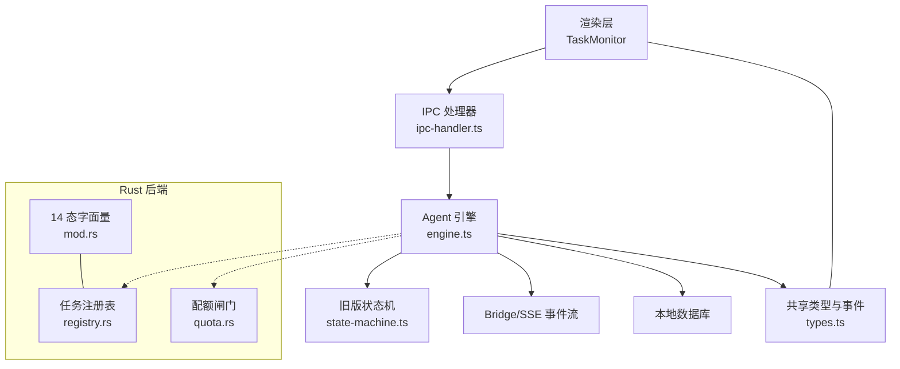
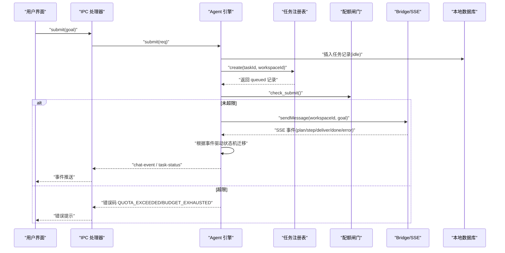
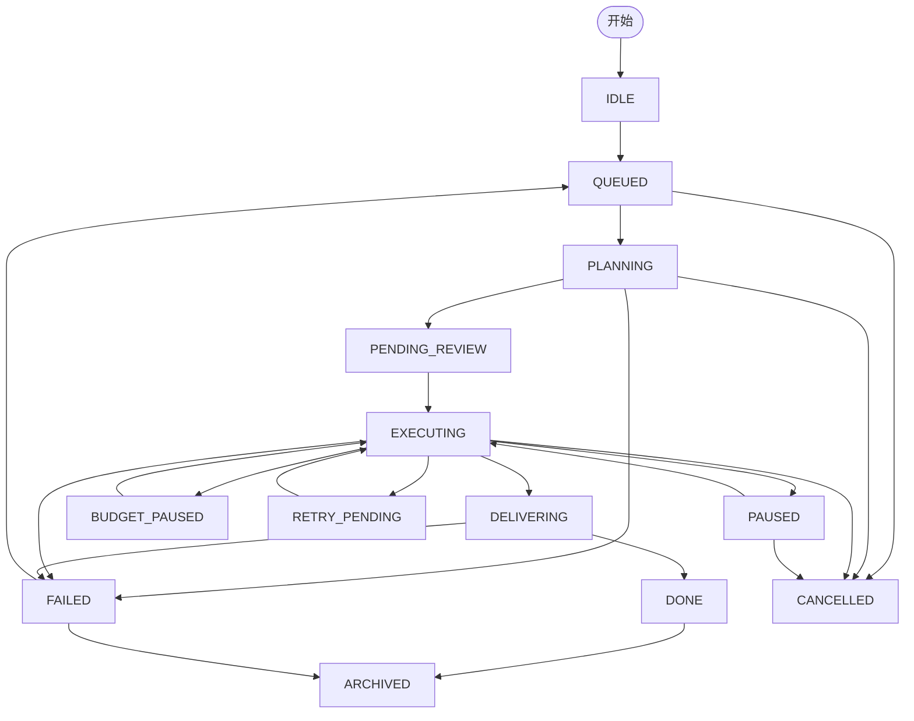
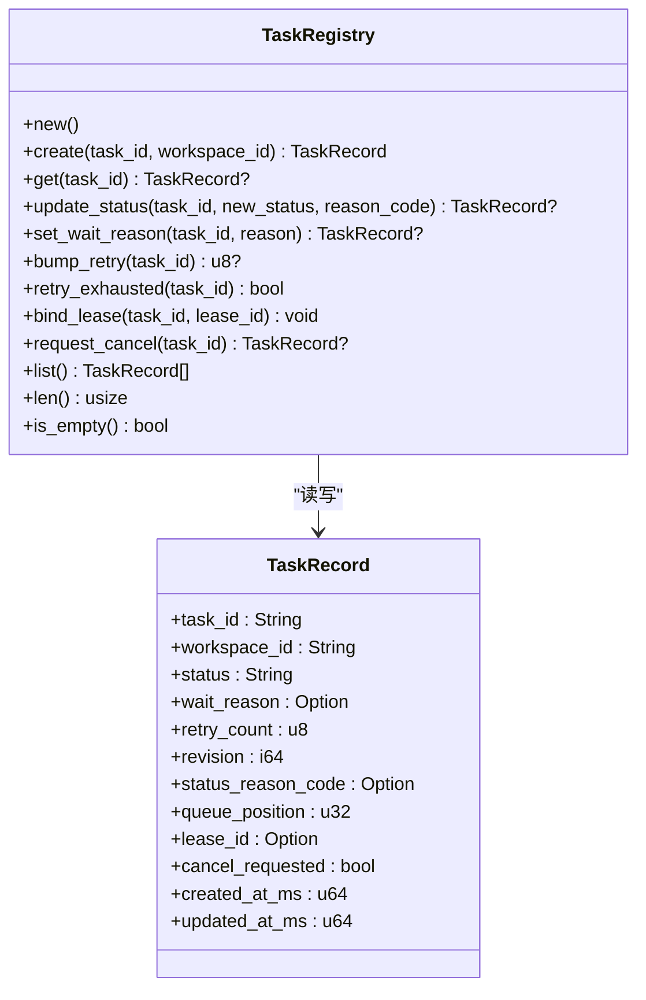
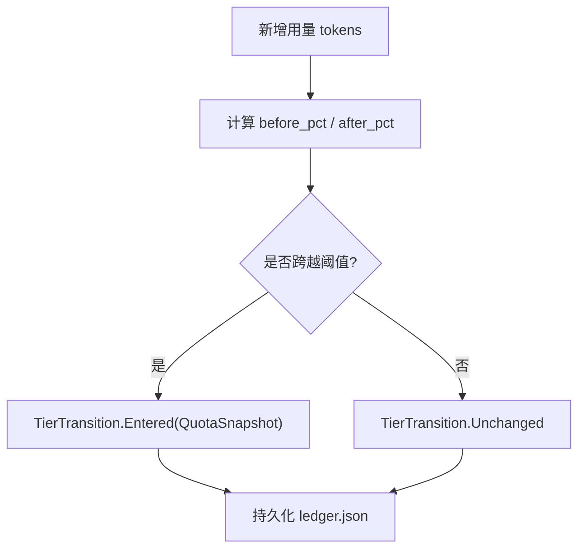
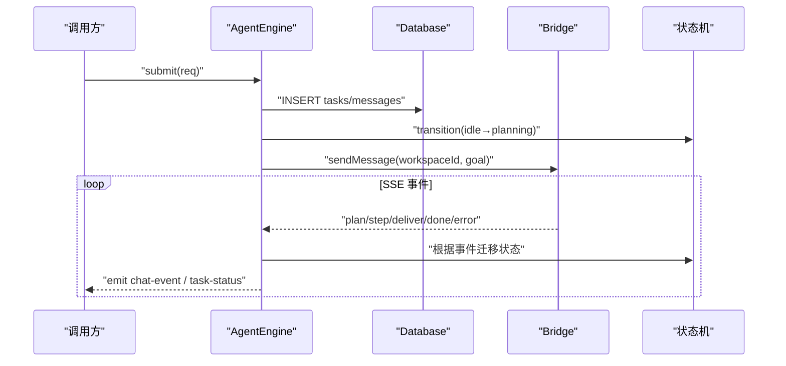
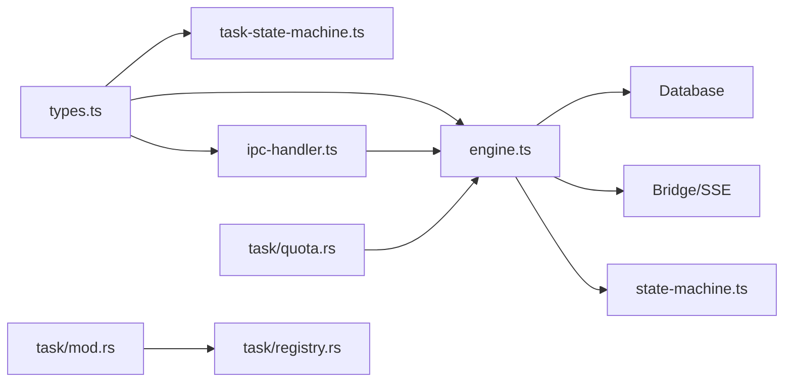

# 任务管理系统

<cite>
**本文引用的文件**   
- [task-state-machine.ts](file://tongtian-tauri/src/shared/task-state-machine.ts)
- [types.ts](file://tongtian-tauri/src/shared/types.ts)
- [registry.rs](file://tongtian-tauri/src-tauri/src/task/registry.rs)
- [mod.rs](file://tongtian-tauri/src-tauri/src/task/mod.rs)
- [quota.rs](file://tongtian-tauri/src-tauri/src/task/quota.rs)
- [engine.ts](file://tongtian-tauri/src/main/agent/engine.ts)
- [state-machine.ts](file://tongtian-tauri/src/main/agent/state-machine.ts)
- [ipc-handler.ts](file://tongtian-tauri/src/main/agent/ipc-handler.ts)
- [index.tsx](file://tongtian-tauri/src/renderer/components/TaskMonitor/index.tsx)
</cite>

## 目录
1. [简介](#简介)
2. [项目结构](#项目结构)
3. [核心组件](#核心组件)
4. [架构总览](#架构总览)
5. [详细组件分析](#详细组件分析)
6. [依赖关系分析](#依赖关系分析)
7. [性能与并发](#性能与并发)
8. [故障排查指南](#故障排查指南)
9. [结论](#结论)
10. [附录：API 参考与扩展指南](#附录api-参考与扩展指南)

## 简介
本文件为通天办公项目的“任务管理系统”提供系统化、可落地的技术文档。围绕任务注册表设计、任务生命周期管理、14 态状态机实现、调度算法、并发控制、优先级处理、状态转换规则、事件驱动架构、异步任务处理、监控与日志、错误处理策略，以及完整的 API 参考与扩展实践进行说明。目标是帮助开发者快速理解并正确扩展新的任务类型与自定义处理器。

## 项目结构
本项目采用前后端分离的 Tauri 架构：
- 前端（renderer）：React + MUI，提供任务监控面板与交互入口
- 主进程（main）：Node.js/TypeScript，负责引擎编排、IPC 桥接、状态机驱动
- Rust 后端（src-tauri）：任务注册表、配额闸门、状态字面量等核心能力
- 共享契约（shared）：类型定义、14 态状态机转移表、事件契约

图表来源
- [engine.ts:1-120](file://tongtian-tauri/src/main/agent/engine.ts#L1-L120)
- [ipc-handler.ts:1-63](file://tongtian-tauri/src/main/agent/ipc-handler.ts#L1-L63)
- [state-machine.ts:1-161](file://tongtian-tauri/src/main/agent/state-machine.ts#L1-L161)
- [types.ts:1-120](file://tongtian-tauri/src/shared/types.ts#L1-L120)
- [registry.rs:1-120](file://tongtian-tauri/src-tauri/src/task/registry.rs#L1-L120)
- [quota.rs:1-120](file://tongtian-tauri/src-tauri/src/task/quota.rs#L1-L120)
- [mod.rs:1-24](file://tongtian-tauri/src-tauri/src/task/mod.rs#L1-L24)

章节来源
- [engine.ts:1-120](file://tongtian-tauri/src/main/agent/engine.ts#L1-L120)
- [ipc-handler.ts:1-63](file://tongtian-tauri/src/main/agent/ipc-handler.ts#L1-L63)
- [types.ts:1-120](file://tongtian-tauri/src/shared/types.ts#L1-L120)
- [registry.rs:1-120](file://tongtian-tauri/src-tauri/src/task/registry.rs#L1-L120)
- [quota.rs:1-120](file://tongtian-tauri/src-tauri/src/task/quota.rs#L1-L120)
- [mod.rs:1-24](file://tongtian-tauri/src-tauri/src/task/mod.rs#L1-L24)

## 核心组件
- 14 态状态机（TS）：纯函数、零依赖，集中定义 35 条合法转移与守卫条件，供 renderer、测试、Rust 侧契约共用
- 任务注册表（Rust）：维护 TaskRecord，支持创建、状态更新、wait_reason 子态、重试计数、租约绑定、取消请求标记、列表与统计
- 配额闸门（Rust）：四档阈值（70/85/95/100%），动作链「降级→排队→阻断」，本地台账持久化，预留云端来源接口
- Agent 引擎（TS）：提交、审阅、控制、事件监听、状态迁移、历史查询、任务清理
- 旧版状态机（TS）：面向 Electron 遗留流程，当前未被 Tauri 构建引用，保留兼容
- IPC 处理器（TS）：暴露 submit/review/control/history/status 等通道，转发事件到渲染层
- 任务监控（React）：展示计划步骤、产物、工作目录、技能与连接器占位，支持审阅操作

章节来源
- [task-state-machine.ts:1-223](file://tongtian-tauri/src/shared/task-state-machine.ts#L1-L223)
- [registry.rs:1-259](file://tongtian-tauri/src-tauri/src/task/registry.rs#L1-L259)
- [quota.rs:1-300](file://tongtian-tauri/src-tauri/src/task/quota.rs#L1-L300)
- [engine.ts:1-569](file://tongtian-tauri/src/main/agent/engine.ts#L1-L569)
- [state-machine.ts:1-161](file://tongtian-tauri/src/main/agent/state-machine.ts#L1-L161)
- [ipc-handler.ts:1-63](file://tongtian-tauri/src/main/agent/ipc-handler.ts#L1-L63)
- [index.tsx:1-268](file://tongtian-tauri/src/renderer/components/TaskMonitor/index.tsx#L1-L268)

## 架构总览
系统以“事件驱动 + 状态机”为核心，通过 SSE 事件流驱动状态迁移，注册表与配额闸门保障可靠性与资源安全。

图表来源
- [ipc-handler.ts:1-63](file://tongtian-tauri/src/main/agent/ipc-handler.ts#L1-L63)
- [engine.ts:56-120](file://tongtian-tauri/src/main/agent/engine.ts#L56-L120)
- [registry.rs:68-90](file://tongtian-tauri/src-tauri/src/task/registry.rs#L68-L90)
- [quota.rs:191-206](file://tongtian-tauri/src-tauri/src/task/quota.rs#L191-L206)

## 详细组件分析

### 14 态状态机与状态转换规则
- 状态集合：idle、queued、planning、pending_review、executing、paused、budget_paused、retry_pending、delivering、done、failed、rolled_back、cancelled、archived
- 转移事件：submit、acquire_lease、cancel、queue_timeout、plan_ready、retryable_error、fatal_error、approve、reject、modify、review_ttl、all_steps_done、pause、budget_exhausted、lease_lost、resume、rollback_to、continue_from_rollback、replan、budget_restored、budget_ttl、backoff_done、retry_exhausted、deliver_done、manual_retry、archive
- 守卫条件：retryable_error 在 retryCount≥3 时路由到 failed；executing.wait_reason 子态不引入新状态
- 终态：cancelled、archived（done 仅保留 archive 边）

图表来源
- [task-state-machine.ts:63-133](file://tongtian-tauri/src/shared/task-state-machine.ts#L63-L133)
- [types.ts:3-25](file://tongtian-tauri/src/shared/types.ts#L3-L25)

章节来源
- [task-state-machine.ts:1-223](file://tongtian-tauri/src/shared/task-state-machine.ts#L1-L223)
- [types.ts:1-120](file://tongtian-tauri/src/shared/types.ts#L1-L120)

### 任务注册表设计与数据模型
- TaskRecord 字段：task_id、workspace_id、status、wait_reason、retry_count、revision、status_reason_code、queue_position、lease_id、cancel_requested、created_at_ms、updated_at_ms
- 关键方法：
  - create：入队即出队（本地退化 queue_position=0）
  - update_status：单调 revision，非 executing 自动清除 wait_reason
  - set_wait_reason：仅 executing 允许设置子态
  - bump_retry：手动重试累计不重置
  - bind_lease：绑定执行租约
  - request_cancel：幂等标记取消请求
  - list/len/is_empty：统计与视图

图表来源
- [registry.rs:12-40](file://tongtian-tauri/src-tauri/src/task/registry.rs#L12-L40)
- [registry.rs:68-183](file://tongtian-tauri/src-tauri/src/task/registry.rs#L68-L183)

章节来源
- [registry.rs:1-259](file://tongtian-tauri/src-tauri/src/task/registry.rs#L1-L259)

### 配额闸门与预算控制
- 四档阈值：70%（通知）、85%（降级）、95%（排队）、100%（阻断）
- 行为：
  - check_submit：100% 阻断新提交，返回 QUOTA_EXCEEDED
  - should_queue：≥95% 触发排队
  - add_usage：累计用量，跨日重置，跃迁去抖，产出 TierTransition
  - snapshot：当前快照（含 updated_at）
- 运行中任务达到 100%：转 budget_paused（转移 #17），错误码 BUDGET_EXHAUSTED

图表来源
- [quota.rs:158-189](file://tongtian-tauri/src-tauri/src/task/quota.rs#L158-L189)
- [quota.rs:191-206](file://tongtian-tauri/src-tauri/src/task/quota.rs#L191-L206)

章节来源
- [quota.rs:1-300](file://tongtian-tauri/src-tauri/src/task/quota.rs#L1-L300)

### Agent 引擎与事件驱动流程
- 提交流程：创建任务（idle）→ 写入消息 → 迁移 planning → 选择 workspace → 发送 SSE → 监听事件 → 驱动状态机
- 审阅流程：approve → executing；reject → done；modify → planning（携带 patch）
- 控制流程：pause/resume/rollback_to，映射目标状态并通过 Bridge 下发
- 事件处理：plan/step_start/step_progress/step_done/step_failed/deliver/done/error，分别持久化与迁移状态
- 清理与异常：失败路径统一记录日志、抛出错误事件、清理活跃任务

图表来源
- [engine.ts:56-120](file://tongtian-tauri/src/main/agent/engine.ts#L56-L120)
- [engine.ts:295-331](file://tongtian-tauri/src/main/agent/engine.ts#L295-L331)
- [engine.ts:351-454](file://tongtian-tauri/src/main/agent/engine.ts#L351-L454)

章节来源
- [engine.ts:1-569](file://tongtian-tauri/src/main/agent/engine.ts#L1-L569)

### 旧版状态机（Electron 遗留）
- 职责：定义简单转移规则、历史记录、控制动作解析
- 现状：未被 Tauri 构建引用，保留兼容性

章节来源
- [state-machine.ts:1-161](file://tongtian-tauri/src/main/agent/state-machine.ts#L1-L161)

### IPC 处理器与事件转发
- 通道：submit、review、control、get-history、get-task-status、event-reply
- 事件转发：将 engine 的 chat-event、task-status、error 转发至渲染层

章节来源
- [ipc-handler.ts:1-63](file://tongtian-tauri/src/main/agent/ipc-handler.ts#L1-L63)

### 任务监控 UI
- 功能：展示计划步骤、产物、默认工作目录、技能与 MCP 连接器（占位）
- 交互：在 pending_review 时显示批准/拒绝按钮，调用 review

章节来源
- [index.tsx:1-268](file://tongtian-tauri/src/renderer/components/TaskMonitor/index.tsx#L1-L268)

## 依赖关系分析
- shared/types.ts 定义 14 态枚举与事件契约，被 TS/Rust 两侧共同使用
- shared/task-state-machine.ts 提供纯函数转移表，供 UI、测试、Rust 契约校验
- Rust registry.rs 与 mod.rs 对齐 14 态字面量与 TaskRecord 字段
- engine.ts 依赖 Database、Logger、Bridge、AgentStateMachine、types/contracts
- ipc-handler.ts 依赖 engine.ts 与 shared contracts
- quota.rs 独立于注册表，提供配额决策

图表来源
- [types.ts:1-120](file://tongtian-tauri/src/shared/types.ts#L1-L120)
- [task-state-machine.ts:1-60](file://tongtian-tauri/src/shared/task-state-machine.ts#L1-L60)
- [mod.rs:1-24](file://tongtian-tauri/src-tauri/src/task/mod.rs#L1-L24)
- [registry.rs:1-40](file://tongtian-tauri/src-tauri/src/task/registry.rs#L1-L40)
- [quota.rs:1-60](file://tongtian-tauri/src-tauri/src/task/quota.rs#L1-L60)
- [engine.ts:1-50](file://tongtian-tauri/src/main/agent/engine.ts#L1-L50)
- [ipc-handler.ts:1-30](file://tongtian-tauri/src/main/agent/ipc-handler.ts#L1-L30)

## 性能与并发
- 并发控制
  - 引擎维护 activeTasks Map，每个任务持有 AbortController，支持取消与清理
  - 注册表使用 RwLock 保护 HashMap，读多写少场景高效
  - 配额闸门使用 Mutex 保护 LedgerFile，避免竞态
- 优先级处理
  - 本地 local-first 退化：queued 停留 <100ms，queue_position 恒为 0
  - 预算暂停恢复按 FIFO 语义回 executing
- 事件流
  - SSE 事件驱动，避免阻塞主循环
- 优化建议
  - 批量更新状态与持久化合并
  - 对高频事件（step_progress）做节流或采样
  - 注册表与配额闸门可考虑无锁队列与原子计数器

[本节为通用指导，无需代码来源]

## 故障排查指南
- 常见错误码
  - QUOTA_EXCEEDED：新提交被配额阻断
  - BUDGET_EXHAUSTED：运行中任务预算耗尽，进入 budget_paused
  - QUEUE_TIMEOUT：排队超时导致 failed
  - LEASE_LOST：心跳超时丢失租约，回到 queued
  - REJECTED：审阅拒绝直接 done
  - USER_CANCELLED：用户取消
- 排查步骤
  - 查看任务状态与 status_reason_code
  - 检查 wait_reason（rate_limited/circuit_break/quota_wait/budget_wait/lease_wait/user_pause/pending_review_ttl）
  - 确认 retry_count 是否达到上限（MAX_RETRY_COUNT=3）
  - 核对配额台账 used_tokens/quota_tokens 与档位
  - 审查 SSE 事件流与 Bridge 通信日志

章节来源
- [task-state-machine.ts:147-201](file://tongtian-tauri/src/shared/task-state-machine.ts#L147-L201)
- [registry.rs:100-164](file://tongtian-tauri/src-tauri/src/task/registry.rs#L100-L164)
- [quota.rs:191-206](file://tongtian-tauri/src-tauri/src/task/quota.rs#L191-L206)

## 结论
本任务管理系统以 14 态状态机为核心，结合注册表与配额闸门，实现了可靠的任务生命周期管理与资源控制。事件驱动的 SSE 机制保证了高吞吐与低延迟，local-first 退化确保单机体验流畅。通过清晰的 API 与扩展点，开发者可便捷地新增任务类型与处理器，满足复杂业务需求。

[本节为总结性内容，无需代码来源]

## 附录：API 参考与扩展指南

### API 参考（IPC）
- 提交任务
  - 通道：agent:submit
  - 请求：ChatSubmitReq（goal、modelBinding、attachments）
  - 响应：{ taskId }
- 审阅计划
  - 通道：agent:review
  - 请求：ChatReviewReq（planId、action: approve|reject|modify、patch）
  - 响应：{ ok }
- 控制任务
  - 通道：agent:control
  - 请求：ChatControlReq（taskId、action: pause|resume|rollback_to、stepId）
  - 响应：{ ok }
- 获取历史
  - 通道：agent:get-history
  - 参数：limit
  - 响应：TaskSummary[]
- 获取状态
  - 通道：agent:get-task-status
  - 参数：taskId
  - 响应：TaskStatus | null

章节来源
- [ipc-handler.ts:18-63](file://tongtian-tauri/src/main/agent/ipc-handler.ts#L18-L63)
- [types.ts:270-315](file://tongtian-tauri/src/shared/types.ts#L270-L315)

### 使用示例（概念流程）
- 创建任务：调用 agent:submit，等待 status_change 事件，观察 queued→planning→pending_review
- 审阅执行：在 pending_review 时调用 agent:review action=approve，进入 executing
- 暂停/恢复：在 executing 时调用 agent:control action=pause，再 resume
- 取消任务：调用 agent:control action=rollback_to 或通过引擎 cancelTask
- 归档任务：在 done/failed 后调用 archive（由上层逻辑或定时任务触发）

[本节为概念流程，无需代码来源]

### 扩展新任务类型与自定义处理器
- 新增状态与事件
  - 在 types.ts 的 TaskStatus 追加新状态（保持向后兼容）
  - 在 task-state-machine.ts 的 TRANSITIONS 增加对应转移与守卫条件
- 注册表适配
  - 在 registry.rs 的 TaskRecord 与 update_status/set_wait_reason 中处理新字段或子态
- 引擎集成
  - 在 engine.ts 的事件处理分支中添加对新事件的识别与状态迁移
  - 如需新控制动作，扩展 resolveControlAction 与 control 分支
- 配额闸门
  - 若新任务类型影响配额，调整 evaluate/add_usage 的阈值与动作链
- 监控 UI
  - 在 TaskMonitor 中为新状态/步骤类型添加展示与交互

章节来源
- [types.ts:3-25](file://tongtian-tauri/src/shared/types.ts#L3-L25)
- [task-state-machine.ts:63-133](file://tongtian-tauri/src/shared/task-state-machine.ts#L63-L133)
- [registry.rs:100-164](file://tongtian-tauri/src-tauri/src/task/registry.rs#L100-L164)
- [engine.ts:351-454](file://tongtian-tauri/src/main/agent/engine.ts#L351-L454)
- [quota.rs:87-117](file://tongtian-tauri/src-tauri/src/task/quota.rs#L87-L117)
- [index.tsx:183-206](file://tongtian-tauri/src/renderer/components/TaskMonitor/index.tsx#L183-L206)