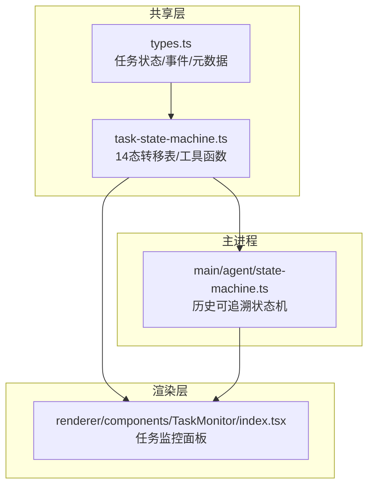
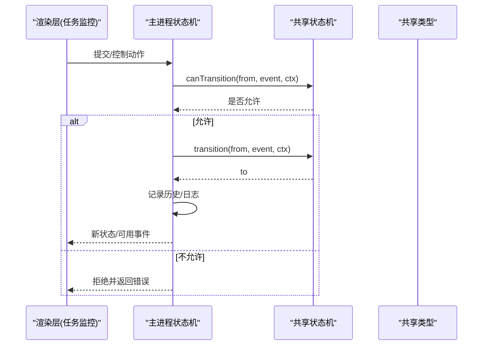
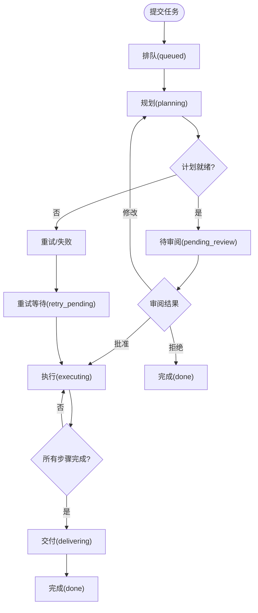
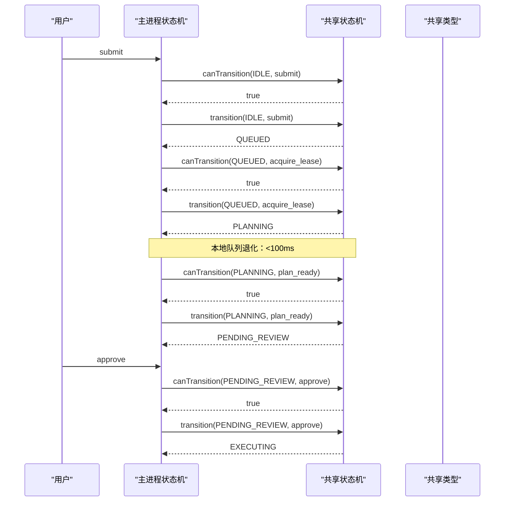
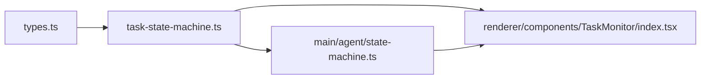

# 任务调度

<cite>
**本文引用的文件**
- [task-state-machine.ts](file://tongtian-tauri/src/shared/task-state-machine.ts)
- [types.ts](file://tongtian-tauri/src/shared/types.ts)
- [state-machine.ts](file://tongtian-tauri/src/main/agent/state-machine.ts)
- [index.tsx](file://tongtian-tauri/src/renderer/components/TaskMonitor/index.tsx)
</cite>

## 目录
1. [简介](#简介)
2. [项目结构](#项目结构)
3. [核心组件](#核心组件)
4. [架构总览](#架构总览)
5. [详细组件分析](#详细组件分析)
6. [依赖关系分析](#依赖关系分析)
7. [性能考量](#性能考量)
8. [故障排查指南](#故障排查指南)
9. [结论](#结论)
10. [附录](#附录)

## 简介
本文件面向通天办公项目的“任务调度”能力，聚焦于本地队列退化模式、任务优先级与并发控制、任务从创建到执行的完整状态流转（queued→planning→plan_review→executing 等）、抢占保护与租约机制、取消请求的幂等性处理、监控与日志记录、配置与优化建议、故障恢复策略以及扩展接口与自定义调度器开发指南。文档以代码仓库中的共享类型与状态机实现为依据，确保描述与现有实现一致。

## 项目结构
与任务调度直接相关的代码主要分布在以下位置：
- 共享层：定义任务状态、事件、转移表与工具函数，供前端渲染、测试与后端契约共用。
- 主进程层：提供历史可追溯的状态机封装与日志记录。
- 渲染层：提供任务监控面板，展示计划步骤、产物与审阅操作入口。

图表来源
- [types.ts:4-25](file://tongtian-tauri/src/shared/types.ts#L4-L25)
- [task-state-machine.ts:63-133](file://tongtian-tauri/src/shared/task-state-machine.ts#L63-L133)
- [state-machine.ts:31-63](file://tongtian-tauri/src/main/agent/state-machine.ts#L31-L63)
- [index.tsx:107-268](file://tongtian-tauri/src/renderer/components/TaskMonitor/index.tsx#L107-L268)

章节来源
- [types.ts:4-25](file://tongtian-tauri/src/shared/types.ts#L4-L25)
- [task-state-machine.ts:63-133](file://tongtian-tauri/src/shared/task-state-machine.ts#L63-L133)
- [state-machine.ts:31-63](file://tongtian-tauri/src/main/agent/state-machine.ts#L31-L63)
- [index.tsx:107-268](file://tongtian-tauri/src/renderer/components/TaskMonitor/index.tsx#L107-L268)

## 核心组件
- 任务状态与事件模型：定义 14 种任务状态、等待原因子态、任务元数据增量字段、计划与步骤状态、消息与文件操作、审计日志、SSE 事件流等。
- 14 态任务状态机：集中维护 35 条合法转移规则，支持条件守卫（如重试次数上限），并提供 canTransition/transition/availableEvents 等工具方法。
- 主进程状态机封装：在历史可追踪的前提下进行状态校验与转换，并输出结构化日志。
- 任务监控面板：可视化计划步骤、产物、审阅操作入口，并与工作区/技能/MCP 连接器占位信息集成。

章节来源
- [types.ts:4-25](file://tongtian-tauri/src/shared/types.ts#L4-L25)
- [types.ts:47-61](file://tongtian-tauri/src/shared/types.ts#L47-L61)
- [types.ts:64-81](file://tongtian-tauri/src/shared/types.ts#L64-L81)
- [types.ts:147-199](file://tongtian-tauri/src/shared/types.ts#L147-L199)
- [types.ts:234-303](file://tongtian-tauri/src/shared/types.ts#L234-L303)
- [task-state-machine.ts:16-55](file://tongtian-tauri/src/shared/task-state-machine.ts#L16-L55)
- [task-state-machine.ts:63-133](file://tongtian-tauri/src/shared/task-state-machine.ts#L63-L133)
- [task-state-machine.ts:141-222](file://tongtian-tauri/src/shared/task-state-machine.ts#L141-L222)
- [state-machine.ts:79-160](file://tongtian-tauri/src/main/agent/state-machine.ts#L79-L160)
- [index.tsx:107-268](file://tongtian-tauri/src/renderer/components/TaskMonitor/index.tsx#L107-L268)

## 架构总览
任务调度由“共享状态机 + 主进程状态机 + 渲染监控”构成。共享层提供统一的转移表与工具函数；主进程负责带历史的转换执行与日志；渲染层通过监控面板呈现任务进度与审阅交互。

图表来源
- [task-state-machine.ts:165-201](file://tongtian-tauri/src/shared/task-state-machine.ts#L165-L201)
- [state-machine.ts:86-117](file://tongtian-tauri/src/main/agent/state-machine.ts#L86-L117)
- [types.ts:291-303](file://tongtian-tauri/src/shared/types.ts#L291-L303)

## 详细组件分析

### 任务状态机与关键状态转换
- 14 态覆盖：idle/planning/pending_review/executing/paused/delivering/done/failed/rolled_back/queued/budget_paused/retry_pending/cancelled/archived。
- 关键路径：
  - 创建→排队：submit → queued
  - 获取租约：acquire_lease → planning（本地 local-first 退化为入队即出队）
  - 计划就绪：plan_ready → pending_review
  - 批准执行：approve → executing
  - 全部步骤完成：all_steps_done → delivering
  - 交付完成：deliver_done → done
  - 失败/归档：manual_retry/archive 等

图表来源
- [task-state-machine.ts:63-133](file://tongtian-tauri/src/shared/task-state-machine.ts#L63-L133)
- [types.ts:4-25](file://tongtian-tauri/src/shared/types.ts#L4-L25)

章节来源
- [task-state-machine.ts:63-133](file://tongtian-tauri/src/shared/task-state-machine.ts#L63-L133)
- [types.ts:4-25](file://tongtian-tauri/src/shared/types.ts#L4-L25)

### 本地队列退化模式与优先级
- 本地队列退化：queued 停留目标 <100ms，体现为“入队即出队”，降低排队延迟。
- 优先级：当前转移表未显式定义优先级字段；如需按优先级调度，可在上层结合 TaskMeta 的 queuePosition 与 FIFO 策略实现。
- 并发控制：通过租约（lease）与心跳超时（lease_lost）保障同一时刻仅一个执行者持有任务；预算耗尽（budget_exhausted）进入 budget_paused，恢复后按 FIFO 回 executing。

章节来源
- [task-state-machine.ts:54-55](file://tongtian-tauri/src/shared/task-state-machine.ts#L54-L55)
- [types.ts:47-61](file://tongtian-tauri/src/shared/types.ts#L47-L61)
- [task-state-machine.ts:97-99](file://tongtian-tauri/src/shared/task-state-machine.ts#L97-L99)
- [task-state-machine.ts:113-117](file://tongtian-tauri/src/shared/task-state-machine.ts#L113-L117)

### 任务抢占保护与租约管理
- 抢占保护：通过 acquire_lease 进入 planning，若执行中发生 lease_lost 则回到 queued，从最后成功步骤恢复。
- 租约持有方：TaskMeta.leaseHolder 标识当前持有者（本地 local-first 恒为本设备）。
- 心跳超时：执行阶段心跳超时触发 lease_lost，避免僵尸任务。

章节来源
- [types.ts:47-61](file://tongtian-tauri/src/shared/types.ts#L47-L61)
- [task-state-machine.ts:67-67](file://tongtian-tauri/src/shared/task-state-machine.ts#L67-L67)
- [task-state-machine.ts:97-99](file://tongtian-tauri/src/shared/task-state-machine.ts#L97-L99)

### 取消请求的幂等性处理
- 取消事件 cancel 可从多个状态转入 cancelled（queued/planning/paused/executing/budget_paused），保证用户取消在任何阶段均可生效。
- 终态：cancelled/archived 为终态，不再接受后续转移，天然具备幂等性。

章节来源
- [task-state-machine.ts:69-69](file://tongtian-tauri/src/shared/task-state-machine.ts#L69-L69)
- [task-state-machine.ts:79-79](file://tongtian-tauri/src/shared/task-state-machine.ts#L79-L79)
- [task-state-machine.ts:101-101](file://tongtian-tauri/src/shared/task-state-machine.ts#L101-L101)
- [task-state-machine.ts:115-117](file://tongtian-tauri/src/shared/task-state-machine.ts#L115-L117)
- [task-state-machine.ts:136-139](file://tongtian-tauri/src/shared/task-state-machine.ts#L136-L139)

### 重试与预算暂停恢复
- 重试：retryable_error 在 retryCount < 3 时进入 retry_pending，backoff_done 后恢复执行；超过上限则走 fatal_error 路径至 failed。
- 预算暂停：budget_exhausted → budget_paused，budget_restored 恢复执行；若 24h 未恢复则 budget_ttl → failed。

章节来源
- [task-state-machine.ts:74-77](file://tongtian-tauri/src/shared/task-state-machine.ts#L74-L77)
- [task-state-machine.ts:92-95](file://tongtian-tauri/src/shared/task-state-machine.ts#L92-L95)
- [task-state-machine.ts:113-117](file://tongtian-tauri/src/shared/task-state-machine.ts#L113-L117)
- [task-state-machine.ts:119-121](file://tongtian-tauri/src/shared/task-state-machine.ts#L119-L121)
- [task-state-machine.ts:185-195](file://tongtian-tauri/src/shared/task-state-machine.ts#L185-L195)

### 任务监控与日志记录
- 监控面板：展示计划步骤、产物、审阅按钮（批准/拒绝/修改），并在 pending_review 时显示审阅操作。
- 日志记录：主进程状态机在每次转换时记录历史与调试日志，便于问题定位与审计。

章节来源
- [index.tsx:183-205](file://tongtian-tauri/src/renderer/components/TaskMonitor/index.tsx#L183-L205)
- [state-machine.ts:103-117](file://tongtian-tauri/src/main/agent/state-machine.ts#L103-L117)

### 执行流程时序图（从创建到执行）

图表来源
- [task-state-machine.ts:63-81](file://tongtian-tauri/src/shared/task-state-machine.ts#L63-L81)
- [state-machine.ts:86-117](file://tongtian-tauri/src/main/agent/state-machine.ts#L86-L117)
- [types.ts:4-25](file://tongtian-tauri/src/shared/types.ts#L4-L25)

## 依赖关系分析
- 共享类型 types.ts 被共享状态机与主进程状态机引用，统一了状态枚举与数据结构。
- 共享状态机 task-state-machine.ts 提供转移表与工具函数，被主进程状态机与渲染层间接使用。
- 主进程状态机 state-machine.ts 封装历史与日志，对外暴露转换能力。
- 渲染层 TaskMonitor 依赖 types 中的 Plan/Step/FileOp 等类型，用于展示与交互。

图表来源
- [types.ts:4-25](file://tongtian-tauri/src/shared/types.ts#L4-L25)
- [task-state-machine.ts:63-133](file://tongtian-tauri/src/shared/task-state-machine.ts#L63-L133)
- [state-machine.ts:31-63](file://tongtian-tauri/src/main/agent/state-machine.ts#L31-L63)
- [index.tsx:107-268](file://tongtian-tauri/src/renderer/components/TaskMonitor/index.tsx#L107-L268)

章节来源
- [types.ts:4-25](file://tongtian-tauri/src/shared/types.ts#L4-L25)
- [task-state-machine.ts:63-133](file://tongtian-tauri/src/shared/task-state-machine.ts#L63-L133)
- [state-machine.ts:31-63](file://tongtian-tauri/src/main/agent/state-machine.ts#L31-L63)
- [index.tsx:107-268](file://tongtian-tauri/src/renderer/components/TaskMonitor/index.tsx#L107-L268)

## 性能考量
- 本地队列退化：queued 停留目标 <100ms，减少排队开销，提升首响应速度。
- 重试退避：retry_pending 配合 backoff_done，避免频繁重试造成资源抖动。
- 预算暂停：budget_paused 将超配额任务挂起，恢复后按 FIFO 继续，避免雪崩。
- 并发控制：租约与心跳超时防止多实例重复执行，降低冲突与资源竞争。
- 日志与历史：主进程状态机记录转换历史，便于问题回溯但不影响热路径性能。

[本节为通用指导，不直接分析具体文件]

## 故障排查指南
- 非法转移：当尝试不在 35 条合法转移内的状态变更时，会抛出非法转移异常；检查 from/event 组合是否符合 TRANSITIONS 定义。
- 重试耗尽：当 retryCount ≥ 3 且仍收到 retryable_error 时，将路由到 failed；需检查上游错误是否可修复或调整重试策略。
- 预算耗尽：若长时间处于 budget_paused，需检查预算恢复逻辑与 TTL 设置。
- 租约丢失：执行中发生 lease_lost 会回到 queued；检查心跳机制与执行器健康度。
- 取消幂等：多次取消应无副作用；确认最终状态为 cancelled 或已归档。

章节来源
- [task-state-machine.ts:147-155](file://tongtian-tauri/src/shared/task-state-machine.ts#L147-L155)
- [task-state-machine.ts:185-195](file://tongtian-tauri/src/shared/task-state-machine.ts#L185-L195)
- [task-state-machine.ts:113-117](file://tongtian-tauri/src/shared/task-state-machine.ts#L113-L117)
- [task-state-machine.ts:97-99](file://tongtian-tauri/src/shared/task-state-machine.ts#L97-L99)
- [task-state-machine.ts:136-139](file://tongtian-tauri/src/shared/task-state-machine.ts#L136-L139)

## 结论
本项目的任务调度以共享 14 态状态机为核心，结合本地队列退化、租约与心跳、预算暂停与重试退避等机制，实现了高可靠、低延迟的任务执行流程。主进程状态机提供历史可追溯与日志记录，渲染层提供直观的监控与审阅交互。整体设计兼顾可扩展性与稳定性，适合在本地优先与云端演进之间平滑过渡。

[本节为总结性内容，不直接分析具体文件]

## 附录

### 配置选项与参数
- 本地队列目标时长：LOCAL_QUEUE_TARGET_MS（毫秒），控制 queued 停留时间。
- 最大重试次数：MAX_RETRY_COUNT（次），限制可重试次数。
- 任务元数据：waitReason、queuePosition、retryCount、leaseHolder、statusReasonCode、archivedAt、revision 等可选字段，用于增强调度与审计。

章节来源
- [task-state-machine.ts:51-55](file://tongtian-tauri/src/shared/task-state-machine.ts#L51-L55)
- [types.ts:47-61](file://tongtian-tauri/src/shared/types.ts#L47-L61)

### 扩展接口与自定义调度器
- 扩展点：
  - 转移表：TRANSITIONS 定义了 35 条合法转移，新增调度策略可通过扩展事件与转移边实现。
  - 上下文守卫：TransitionContext 支持在 canTransition/transition 中注入额外判定（如优先级、配额）。
  - 等待原因：WaitReason 可用于表达执行中的限流、熔断、配额等待等子态。
- 自定义调度器建议：
  - 基于 availableEvents 动态生成可操作集合，结合 UI 展示。
  - 在主进程状态机中接入业务钩子，记录审计日志与指标。
  - 保持与共享类型契约一致，确保前后端一致性。

章节来源
- [task-state-machine.ts:63-133](file://tongtian-tauri/src/shared/task-state-machine.ts#L63-L133)
- [task-state-machine.ts:141-145](file://tongtian-tauri/src/shared/task-state-machine.ts#L141-L145)
- [task-state-machine.ts:219-222](file://tongtian-tauri/src/shared/task-state-machine.ts#L219-L222)
- [types.ts:27-41](file://tongtian-tauri/src/shared/types.ts#L27-L41)