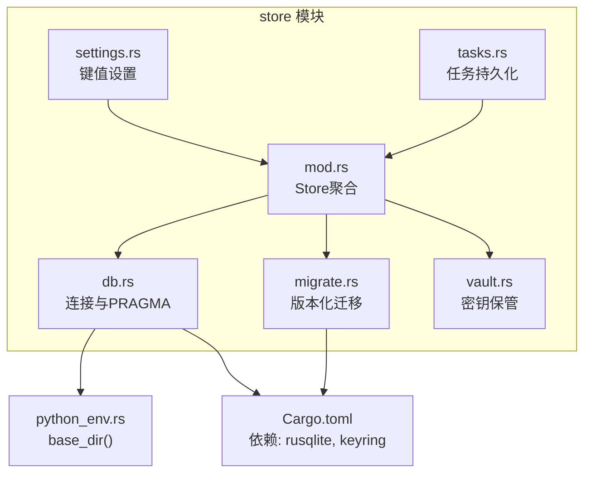
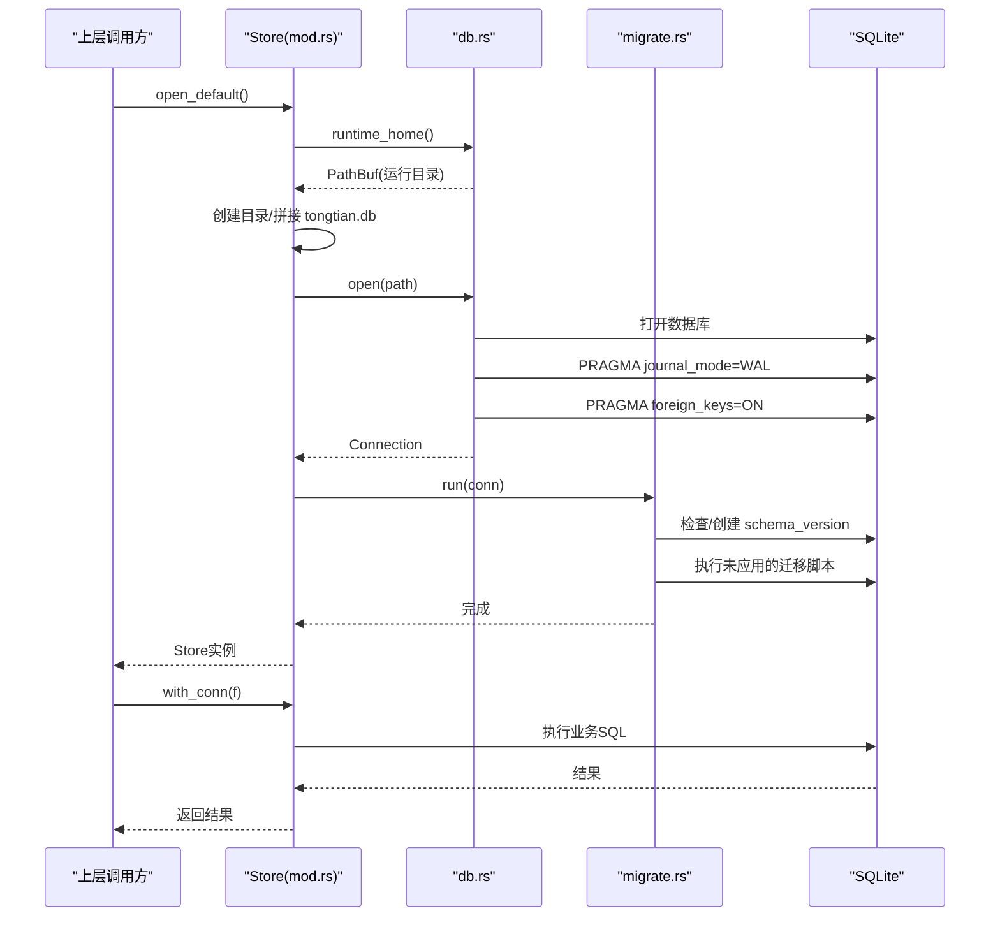
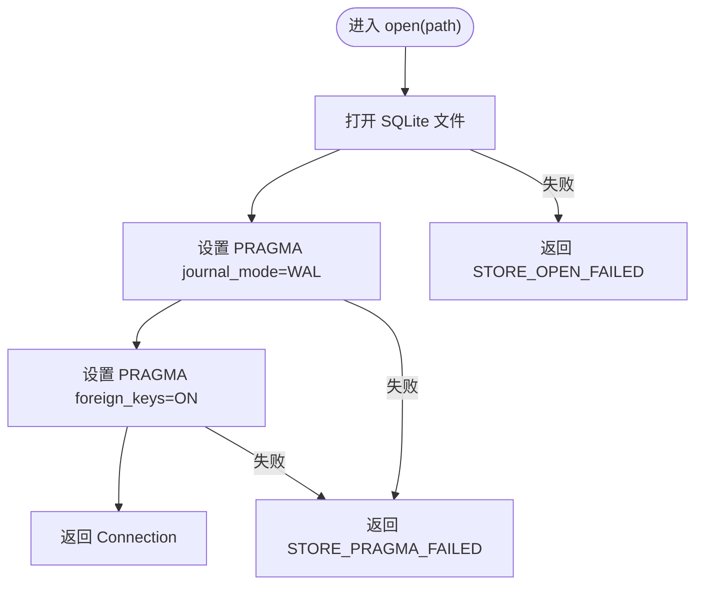
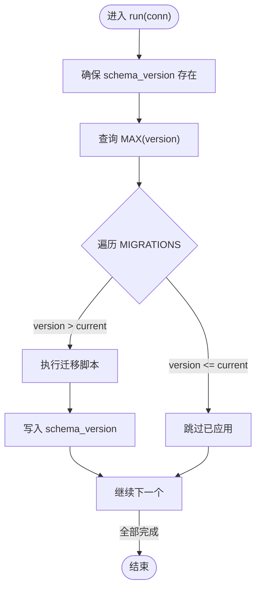
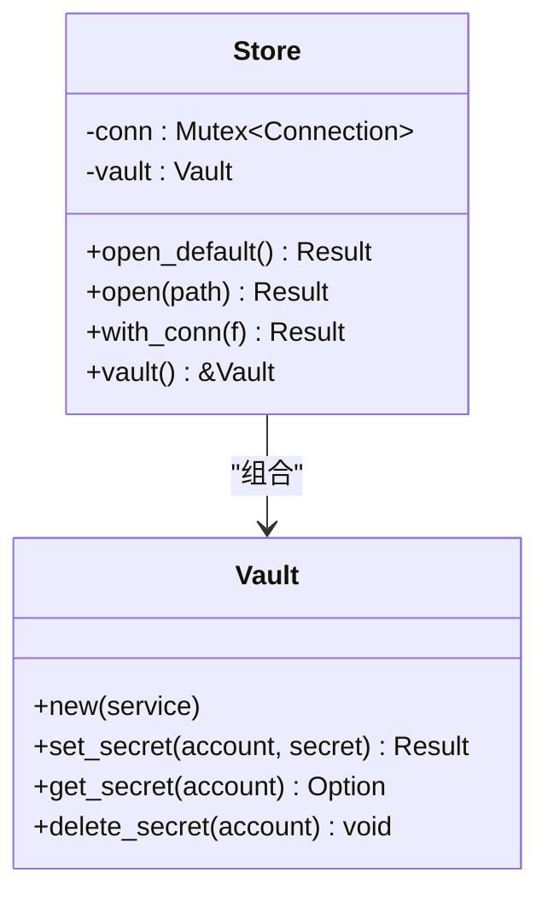
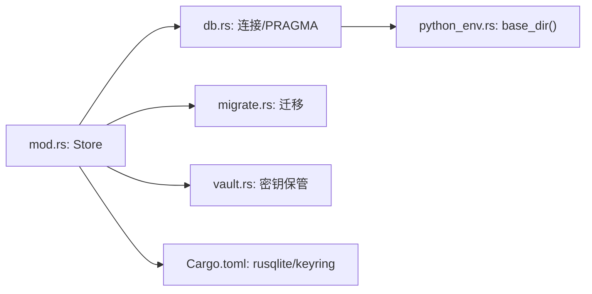

# 数据存储层

<cite>
**本文引用的文件**   
- [db.rs](file://tongtian-tauri/src-tauri/src/store/db.rs)
- [migrate.rs](file://tongtian-tauri/src-tauri/src/store/migrate.rs)
- [mod.rs](file://tongtian-tauri/src-tauri/src/store/mod.rs)
- [settings.rs](file://tongtian-tauri/src-tauri/src/store/settings.rs)
- [tasks.rs](file://tongtian-tauri/src-tauri/src/store/tasks.rs)
- [vault.rs](file://tongtian-tauri/src-tauri/src/store/vault.rs)
- [Cargo.toml](file://tongtian-tauri/src-tauri/Cargo.toml)
- [python_env.rs](file://tongtian-tauri/src-tauri/src/bridge/python_env.rs)
</cite>

## 目录
1. [简介](#简介)
2. [项目结构](#项目结构)
3. [核心组件](#核心组件)
4. [架构总览](#架构总览)
5. [详细组件分析](#详细组件分析)
6. [依赖关系分析](#依赖关系分析)
7. [性能考量](#性能考量)
8. [故障排查指南](#故障排查指南)
9. [结论](#结论)
10. [附录：最佳实践与示例路径](#附录最佳实践与示例路径)

## 简介
本章节面向通天办公项目的数据存储层，聚焦 SQLite 数据库连接管理、WAL 模式配置、外键约束启用、运行时目录解析（TONGTIAN_HOME 环境变量优先）、数据库初始化流程、连接访问策略、数据持久化设计、事务处理机制、错误恢复策略，以及迁移方案与备份恢复建议。文档同时给出使用存储接口的最佳实践路径，帮助读者快速上手并安全扩展。

## 项目结构
数据存储层位于 Rust Tauri 后端模块 store 中，采用“单库多表 + 版本化迁移 + 密钥保管箱”的轻量设计：
- db.rs：运行目录解析、SQLite 连接打开与 PRAGMA 设置（WAL、外键）
- migrate.rs：基于 schema_version 的版本化迁移，幂等执行
- mod.rs：Store 聚合（连接 + Vault），默认路径打开、with_conn 短临界区访问
- settings.rs：settings_kv 键值对读写
- tasks.rs：任务摘要 upsert 与按更新时间倒序查询
- vault.rs：系统 keyring 优先、内存降级的密钥保管
- Cargo.toml：rusqlite、keyring 等依赖声明
- python_env.rs：base_dir() 提供默认运行目录（%APPDATA%\tongtian-office 或 ~/.tongtian）

图表来源
- [db.rs:1-49](file://tongtian-tauri/src-tauri/src/store/db.rs#L1-L49)
- [migrate.rs:1-118](file://tongtian-tauri/src-tauri/src/store/migrate.rs#L1-L118)
- [mod.rs:1-105](file://tongtian-tauri/src-tauri/src/store/mod.rs#L1-L105)
- [settings.rs:1-100](file://tongtian-tauri/src-tauri/src/store/settings.rs#L1-L100)
- [tasks.rs:1-168](file://tongtian-tauri/src-tauri/src/store/tasks.rs#L1-L168)
- [vault.rs:1-119](file://tongtian-tauri/src-tauri/src/store/vault.rs#L1-L119)
- [Cargo.toml:21-34](file://tongtian-tauri/src-tauri/Cargo.toml#L21-L34)
- [python_env.rs:122-139](file://tongtian-tauri/src-tauri/src/bridge/python_env.rs#L122-L139)

章节来源
- [mod.rs:1-105](file://tongtian-tauri/src-tauri/src/store/mod.rs#L1-L105)
- [Cargo.toml:21-34](file://tongtian-tauri/src-tauri/Cargo.toml#L21-L34)

## 核心组件
- Store：聚合 rusqlite::Connection 与 Vault，提供 open_default/open/with_conn 等入口；内部以 Mutex 保护连接，确保线程安全访问
- db：runtime_home() 解析运行目录；open() 打开数据库并设置 WAL、外键开启
- migrate：run() 基于 schema_version 表驱动迁移，保证幂等与增量升级
- settings：get/set/all 操作 settings_kv
- tasks：upsert/list_recent 实现任务摘要持久化与最近列表查询
- vault：set_secret/get_secret/delete_secret，keyring 不可用时降级到进程内存

章节来源
- [mod.rs:18-52](file://tongtian-tauri/src-tauri/src/store/mod.rs#L18-L52)
- [db.rs:7-25](file://tongtian-tauri/src-tauri/src/store/db.rs#L7-L25)
- [migrate.rs:44-73](file://tongtian-tauri/src-tauri/src/store/migrate.rs#L44-L73)
- [settings.rs:6-48](file://tongtian-tauri/src-tauri/src/store/settings.rs#L6-L48)
- [tasks.rs:28-95](file://tongtian-tauri/src-tauri/src/store/tasks.rs#L28-L95)
- [vault.rs:17-85](file://tongtian-tauri/src-tauri/src/store/vault.rs#L17-L85)

## 架构总览
下图展示从应用调用到 SQLite 的完整链路，包括目录解析、连接获取、迁移执行与业务表访问。

图表来源
- [mod.rs:26-41](file://tongtian-tauri/src-tauri/src/store/mod.rs#L26-L41)
- [db.rs:17-25](file://tongtian-tauri/src-tauri/src/store/db.rs#L17-L25)
- [migrate.rs:44-73](file://tongtian-tauri/src-tauri/src/store/migrate.rs#L44-L73)

## 详细组件分析

### 连接管理与 WAL/外键配置（db.rs）
- 运行目录解析：优先读取 TONGTIAN_HOME 环境变量，否则回退到 bridge::python_env::base_dir()
- 连接打开：使用 rusqlite 打开文件数据库，随后设置 PRAGMA journal_mode=WAL 与 foreign_keys=ON
- 错误封装：所有失败统一包装为 STORE_* 前缀的错误信息，便于上层定位

图表来源
- [db.rs:17-25](file://tongtian-tauri/src-tauri/src/store/db.rs#L17-L25)

章节来源
- [db.rs:1-49](file://tongtian-tauri/src-tauri/src/store/db.rs#L1-L49)
- [python_env.rs:122-139](file://tongtian-tauri/src-tauri/src/bridge/python_env.rs#L122-L139)

### 版本化迁移（migrate.rs）
- 迁移脚本集中定义，顺序即版本号
- 首次运行创建 schema_version 表，记录已应用的最大 version
- 遍历脚本，跳过已应用版本，执行新脚本后写入版本记录
- 幂等性：重复执行不报错、不重复插入

图表来源
- [migrate.rs:44-73](file://tongtian-tauri/src-tauri/src/store/migrate.rs#L44-L73)

章节来源
- [migrate.rs:1-118](file://tongtian-tauri/src-tauri/src/store/migrate.rs#L1-L118)

### 存储聚合与连接访问策略（mod.rs）
- Store::open_default：根据运行目录创建/打开 tongtian.db，并执行迁移
- Store::open：指定路径打开，适合测试注入临时路径
- with_conn：通过 Mutex 持有连接，确保并发安全；要求调用方保持短临界区，避免长时间持锁

图表来源
- [mod.rs:18-52](file://tongtian-tauri/src-tauri/src/store/mod.rs#L18-L52)

章节来源
- [mod.rs:1-105](file://tongtian-tauri/src-tauri/src/store/mod.rs#L1-L105)

### 键值设置（settings.rs）
- get：按 key 读取 value，不存在返回 None
- set：INSERT OR REPLACE 语义，覆盖写入
- all：一次性读取全部键值对为 HashMap

章节来源
- [settings.rs:1-100](file://tongtian-tauri/src-tauri/src/store/settings.rs#L1-L100)

### 任务持久化（tasks.rs）
- TaskRow：对齐前端 TaskSummary + meta 字段
- upsert：按 task_id 主键更新，部分字段空值时保留原值
- list_recent：按 updated_at_ms 倒序，支持 limit 限制返回数量

章节来源
- [tasks.rs:1-168](file://tongtian-tauri/src-tauri/src/store/tasks.rs#L1-L168)

### 密钥保管（vault.rs）
- 优先使用系统 keyring 存取 API Key，不可用时降级到进程内存 HashMap
- 标记 keyring 不可用状态，避免重复告警
- 删除操作同时清理 keyring 与内存中的条目

章节来源
- [vault.rs:1-119](file://tongtian-tauri/src-tauri/src/store/vault.rs#L1-L119)

## 依赖关系分析
- 运行时目录解析依赖 bridge::python_env::base_dir()
- 数据库访问依赖 rusqlite（bundled 特性）
- 密钥保管依赖 keyring，具备内存降级能力
- Store 作为聚合根，协调 db、migrate、vault 与业务表操作

图表来源
- [mod.rs:1-105](file://tongtian-tauri/src-tauri/src/store/mod.rs#L1-L105)
- [db.rs:1-49](file://tongtian-tauri/src-tauri/src/store/db.rs#L1-L49)
- [migrate.rs:1-118](file://tongtian-tauri/src-tauri/src/store/migrate.rs#L1-L118)
- [vault.rs:1-119](file://tongtian-tauri/src-tauri/src/store/vault.rs#L1-L119)
- [Cargo.toml:21-34](file://tongtian-tauri/src-tauri/Cargo.toml#L21-L34)
- [python_env.rs:122-139](file://tongtian-tauri/src-tauri/src/bridge/python_env.rs#L122-L139)

章节来源
- [Cargo.toml:21-34](file://tongtian-tauri/src-tauri/Cargo.toml#L21-L34)

## 性能考量
- WAL 模式：提升并发读性能与写稳定性，减少锁竞争
- 外键约束：在写入阶段校验一致性，避免脏数据累积
- 连接访问：with_conn 短临界区，避免长事务持锁导致阻塞
- 索引优化：tasks.updated_at_ms 建立降序索引，加速最近列表查询
- 批量写入：可结合 rusqlite 的事务接口进行批处理（见附录最佳实践）
- 迁移幂等：避免重复执行带来的额外开销

[本节为通用指导，无需特定文件引用]

## 故障排查指南
- 连接失败：STORE_OPEN_FAILED 表示无法打开数据库文件，检查路径权限与磁盘空间
- PRAGMA 失败：STORE_PRAGMA_FAILED 表示 WAL 或外键设置失败，确认 SQLite 版本与兼容性
- 迁移失败：STORE_MIGRATE_FAILED/STORE_MIGRATE_V*_FAILED/STORE_MIGRATE_RECORD_FAILED 表示脚本执行或版本记录失败，检查 SQL 语法与表结构
- 目录问题：STORE_MKDIR_FAILED 表示运行目录创建失败，检查 TONGTIAN_HOME 指向与文件系统权限
- 密钥不可用：vault 会打印降级日志，确认 keyring 服务可用性或接受内存降级

章节来源
- [db.rs:17-25](file://tongtian-tauri/src-tauri/src/store/db.rs#L17-L25)
- [migrate.rs:44-73](file://tongtian-tauri/src-tauri/src/store/migrate.rs#L44-L73)
- [mod.rs:26-41](file://tongtian-tauri/src-tauri/src/store/mod.rs#L26-L41)
- [vault.rs:30-36](file://tongtian-tauri/src-tauri/src/store/vault.rs#L30-L36)

## 结论
该数据存储层以 SQLite 为核心，结合 WAL 模式与外键约束，提供了稳定、一致且易维护的本地持久化能力。通过 TONGTIAN_HOME 环境变量与默认目录回退机制，实现了灵活的运行目录管理；基于 schema_version 的迁移方案保证了版本演进的幂等性与可追溯性；Vault 的 keyring 优先与内存降级策略确保了敏感数据的安全存储。整体设计简洁清晰，易于扩展与维护。

[本节为总结性内容，无需特定文件引用]

## 附录：最佳实践与示例路径
- 获取连接与执行查询
  - 参考路径：[with_conn 使用示例:44-47](file://tongtian-tauri/src-tauri/src/store/mod.rs#L44-L47)
  - 参考路径：[settings_get 查询示例:6-17](file://tongtian-tauri/src-tauri/src/store/settings.rs#L6-L17)
- 事务管理
  - 建议在 with_conn 内使用 rusqlite 的事务接口包裹多条写入，确保原子性
  - 参考路径：[upsert 写入示例:28-59](file://tongtian-tauri/src-tauri/src/store/tasks.rs#L28-L59)
- 迁移与初始化
  - 参考路径：[open_default 初始化流程:26-41](file://tongtian-tauri/src-tauri/src/store/mod.rs#L26-L41)
  - 参考路径：[迁移执行逻辑:44-73](file://tongtian-tauri/src-tauri/src/store/migrate.rs#L44-L73)
- 备份与恢复
  - 由于使用 WAL 模式，建议关闭写操作后进行文件级备份（包含 .db 与 .db-wal/.db-shm）
  - 恢复时确保 WAL 文件与主库一致，必要时先切换到 DELETE 模式再复制
- 性能调优
  - 合理设置 PRAGMA cache_size、temp_store、mmap_size（按需）
  - 使用预编译语句与参数绑定，避免 SQL 注入与重复解析
  - 针对高频查询添加合适索引（如 tasks.updated_at_ms 已优化）

[本节为实践指导，无需特定文件引用]