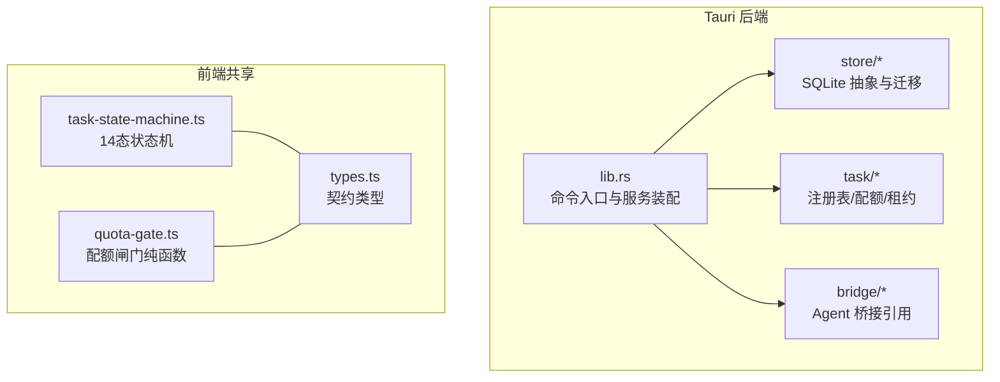
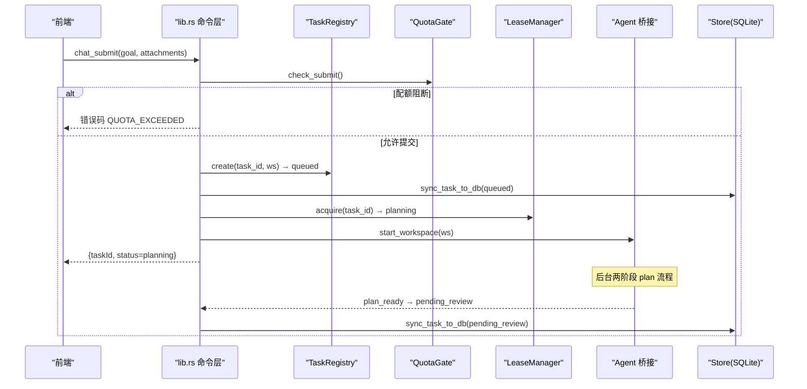
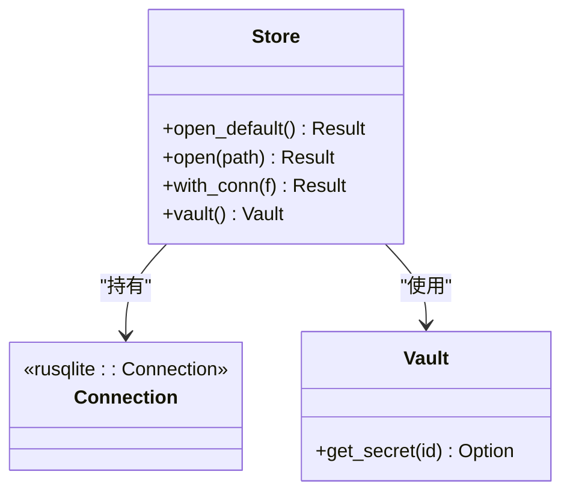
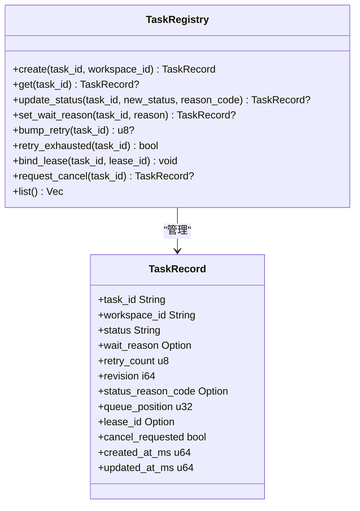
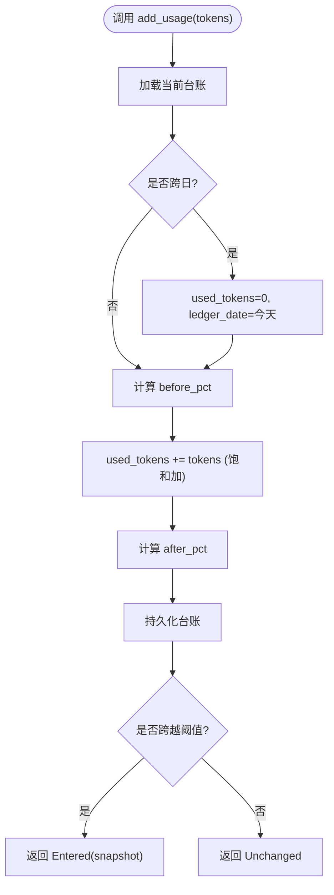
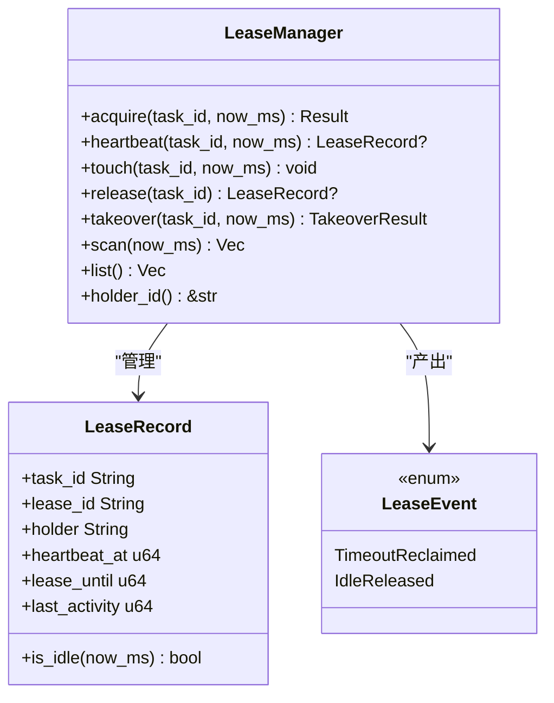
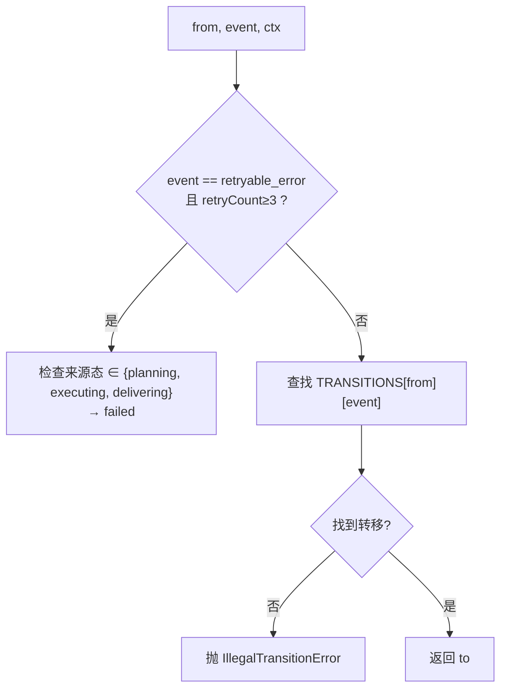
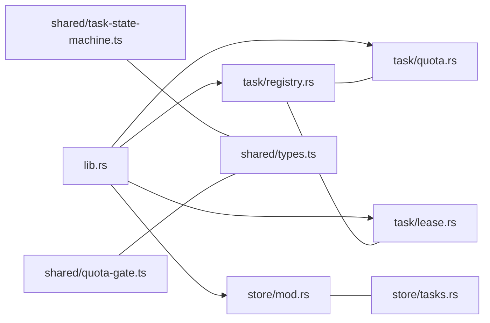

# 核心模块设计

<cite>
**本文引用的文件**   
- [lib.rs](file://tongtian-tauri/src-tauri/src/lib.rs)
- [store/mod.rs](file://tongtian-tauri/src-tauri/src/store/mod.rs)
- [store/db.rs](file://tongtian-tauri/src-tauri/src/store/db.rs)
- [store/tasks.rs](file://tongtian-tauri/src-tauri/src/store/tasks.rs)
- [task/mod.rs](file://tongtian-tauri/src-tauri/src/task/mod.rs)
- [task/registry.rs](file://tongtian-tauri/src-tauri/src/task/registry.rs)
- [task/quota.rs](file://tongtian-tauri/src-tauri/src/task/quota.rs)
- [task/lease.rs](file://tongtian-tauri/src-tauri/src/task/lease.rs)
- [shared/task-state-machine.ts](file://tongtian-tauri/src/shared/task-state-machine.ts)
- [shared/quota-gate.ts](file://tongtian-tauri/src/shared/quota-gate.ts)
- [shared/types.ts](file://tongtian-tauri/src/shared/types.ts)
</cite>

## 目录
1. [引言](#引言)
2. [项目结构](#项目结构)
3. [核心组件](#核心组件)
4. [架构总览](#架构总览)
5. [详细组件分析](#详细组件分析)
6. [依赖关系分析](#依赖关系分析)
7. [性能考量](#性能考量)
8. [故障排查指南](#故障排查指南)
9. [结论](#结论)

## 引言
本设计文档聚焦通天办公项目的核心业务模块，围绕数据存储层（SQLite 抽象）、任务注册表、配额管理系统、租约协调器等关键组件展开。文档阐明各模块职责边界、接口设计、数据一致性保证机制，并解释状态机设计、并发安全、事务处理等核心技术实现。同时提供架构图与数据流图，展示组件如何协同完成复杂业务流程。

## 项目结构
本项目采用 Tauri 后端（Rust）+ 前端共享类型（TS）的分层组织方式：
- Rust 后端负责命令入口、服务编排、持久化、事件与资源管理
- TS 共享层定义状态机、配额闸门与契约类型，前后端镜像保持一致

图表来源 
- [lib.rs:1-800](file://tongtian-tauri/src-tauri/src/lib.rs#L1-L800)
- [store/mod.rs:1-105](file://tongtian-tauri/src-tauri/src/store/mod.rs#L1-L105)
- [task/mod.rs:1-24](file://tongtian-tauri/src-tauri/src/task/mod.rs#L1-L24)
- [shared/task-state-machine.ts:1-223](file://tongtian-tauri/src/shared/task-state-machine.ts#L1-L223)
- [shared/quota-gate.ts:1-81](file://tongtian-tauri/src/shared/quota-gate.ts#L1-L81)
- [shared/types.ts:1-346](file://tongtian-tauri/src/shared/types.ts#L1-L346)

章节来源
- [lib.rs:1-800](file://tongtian-tauri/src-tauri/src/lib.rs#L1-L800)
- [store/mod.rs:1-105](file://tongtian-tauri/src-tauri/src/store/mod.rs#L1-L105)

## 核心组件
- 数据存储层（Store + SQLite）
  - 通过 Store 聚合 rusqlite 连接与密钥保管箱，统一 with_conn 短临界区访问；WAL 模式与外键开启保障并发与一致性；支持运行目录与环境变量覆盖。
- 任务注册表（TaskRegistry）
  - 内存中维护 TaskRecord，提供创建、状态更新、重试计数、租约绑定、取消请求标记等方法；revision 单调递增用于乐观锁语义。
- 配额管理系统（QuotaGate）
  - 四档阈值（70/85/95/100%），动作链「降级→排队→阻断」；本地 JSON 台账跨日重置；check_submit 阻断新提交，add_usage 累计用量并产出档位跃迁事件。
- 租约协调器（LeaseManager）
  - 心跳 10s / 租约 30s / 超时回收 60s / 空闲释放 5min；禁止抢占，单 interval 扫描全部租约；scan 产出 TimeoutReclaimed/IdleReleased 事件驱动状态回退。
- 14 态任务状态机（TS）
  - 纯函数转移表与 guard 条件（如 retryCount<3），非法转移抛错；executing 子态以 wait_reason 表达，避免状态爆炸。
- 配额闸门（TS）
  - 与 Rust 镜像一致，提供 evaluateQuota、shouldBlock、shouldQueue、tierChanged、blockErrorCodeFor 等纯函数。

章节来源
- [store/mod.rs:1-105](file://tongtian-tauri/src-tauri/src/store/mod.rs#L1-L105)
- [store/db.rs:1-49](file://tongtian-tauri/src-tauri/src/store/db.rs#L1-L49)
- [task/registry.rs:1-259](file://tongtian-tauri/src-tauri/src/task/registry.rs#L1-L259)
- [task/quota.rs:1-300](file://tongtian-tauri/src-tauri/src/task/quota.rs#L1-L300)
- [task/lease.rs:1-339](file://tongtian-tauri/src-tauri/src/task/lease.rs#L1-L339)
- [shared/task-state-machine.ts:1-223](file://tongtian-tauri/src/shared/task-state-machine.ts#L1-L223)
- [shared/quota-gate.ts:1-81](file://tongtian-tauri/src/shared/quota-gate.ts#L1-L81)

## 架构总览
系统以 lib.rs 为命令入口，装配 P0Services（注册表/租约/配额/事件存储/持久化），并通过 tauri::command 暴露 chat_submit/chat_review/chat_control/chat_cancel/history/state/quota/lease/event 等能力。任务执行经 Agent 桥接异步推进，状态变更通过事件推送前端。

图表来源 
- [lib.rs:125-237](file://tongtian-tauri/src-tauri/src/lib.rs#L125-L237)
- [task/registry.rs:68-90](file://tongtian-tauri/src-tauri/src/task/registry.rs#L68-L90)
- [task/quota.rs:191-200](file://tongtian-tauri/src-tauri/src/task/quota.rs#L191-L200)
- [task/lease.rs:83-108](file://tongtian-tauri/src-tauri/src/task/lease.rs#L83-L108)
- [store/tasks.rs:27-59](file://tongtian-tauri/src-tauri/src/store/tasks.rs#L27-L59)

## 详细组件分析

### 数据存储层（SQLite 抽象）
- 职责边界
  - 打开/迁移数据库、提供 with_conn 短临界区访问、封装 vault 密钥保管。
- 并发与一致性
  - Mutex<Connection> 串行访问；WAL 模式提升并发读；外键约束保障引用完整性。
- 初始化顺序
  - run() 中优先尝试运行目录打开，失败回退 temp；随后启动事件清理与租约扫描循环。
- 错误恢复
  - 打开失败时打印日志并回退到临时路径，确保应用可用。

图表来源 
- [store/mod.rs:18-52](file://tongtian-tauri/src-tauri/src/store/mod.rs#L18-L52)
- [store/db.rs:16-25](file://tongtian-tauri/src-tauri/src/store/db.rs#L16-L25)

章节来源
- [store/mod.rs:1-105](file://tongtian-tauri/src-tauri/src/store/mod.rs#L1-L105)
- [store/db.rs:1-49](file://tongtian-tauri/src-tauri/src/store/db.rs#L1-L49)
- [lib.rs:747-793](file://tongtian-tauri/src-tauri/src/lib.rs#L747-L793)

### 任务注册表（TaskRegistry）
- 职责边界
  - 维护任务记录与状态流转元信息（wait_reason、retry_count、lease_id、cancel_requested、revision）。
- 接口设计
  - create/get/update_status/set_wait_reason/bump_retry/retry_exhausted/bind_lease/request_cancel/list/len/is_empty。
- 数据一致性
  - revision 单调递增；离开 executing 自动清除 wait_reason；bump_retry 饱和加法防止溢出。
- 并发安全
  - RwLock<HashMap> 读写分离，读多写少场景高效。

图表来源 
- [task/registry.rs:12-46](file://tongtian-tauri/src-tauri/src/task/registry.rs#L12-L46)
- [task/registry.rs:61-183](file://tongtian-tauri/src-tauri/src/task/registry.rs#L61-L183)

章节来源
- [task/registry.rs:1-259](file://tongtian-tauri/src-tauri/src/task/registry.rs#L1-L259)

### 配额管理系统（QuotaGate）
- 职责边界
  - 计算使用率与档位，阻断新提交或让新任务排队；累计用量并输出档位跃迁事件；跨日重置台账。
- 接口设计
  - new/snapshot/add_usage/check_submit/should_queue/persist。
- 数据一致性
  - 使用 saturating_add 防溢出；按日期字段判断跨日重置；persist 落盘失败仅打印日志不中断流程。
- 错误恢复
  - 无配额限制视为基线档；跨日重置保证统计正确性。

图表来源 
- [task/quota.rs:158-189](file://tongtian-tauri/src-tauri/src/task/quota.rs#L158-L189)

章节来源
- [task/quota.rs:1-300](file://tongtian-tauri/src-tauri/src/task/quota.rs#L1-L300)
- [shared/quota-gate.ts:1-81](file://tongtian-tauri/src/shared/quota-gate.ts#L1-L81)

### 租约协调器（LeaseManager）
- 职责边界
  - 签发/心跳/接管/释放租约；单 interval 扫描超时回收与空闲释放；禁止抢占。
- 接口设计
  - acquire/heartbeat/touch/release/takeover/scan/list/holder_id。
- 并发安全
  - Mutex<HashMap> 保护租约表；scan 一次性收集待删除列表后批量移除。
- 错误恢复
  - 对端活跃持有时拒绝抢占，需确认或等待空闲释放；超时后可接管。

图表来源 
- [task/lease.rs:25-66](file://tongtian-tauri/src-tauri/src/task/lease.rs#L25-L66)
- [task/lease.rs:68-207](file://tongtian-tauri/src-tauri/src/task/lease.rs#L68-L207)

章节来源
- [task/lease.rs:1-339](file://tongtian-tauri/src-tauri/src/task/lease.rs#L1-L339)

### 14 态任务状态机（TS）
- 职责边界
  - 定义 35 条合法转移与终态集合；guard 条件（如 retryCount<3）；executing 子态用 wait_reason 表达。
- 接口设计
  - canTransition/transition/applyWaitReason/isTerminal/availableEvents。
- 错误处理
  - 非法转移抛出 IllegalTransitionError；retryable_error 且重试耗尽路由到 failed。

图表来源 
- [shared/task-state-machine.ts:160-201](file://tongtian-tauri/src/shared/task-state-machine.ts#L160-L201)

章节来源
- [shared/task-state-machine.ts:1-223](file://tongtian-tauri/src/shared/task-state-machine.ts#L1-L223)
- [shared/types.ts:1-346](file://tongtian-tauri/src/shared/types.ts#L1-L346)

### 配额闸门（TS）
- 职责边界
  - 计算使用率与档位，判定阻断/排队/降级/通知；档位变化检测去抖；错误码映射。
- 接口设计
  - usagePercent/evaluateQuota/shouldBlock/shouldQueue/tierChanged/blockErrorCodeFor。
- 一致性
  - 与 Rust 镜像一致，便于单元测试复用同一组边界用例。

章节来源
- [shared/quota-gate.ts:1-81](file://tongtian-tauri/src/shared/quota-gate.ts#L1-L81)

## 依赖关系分析
- lib.rs 依赖 P0Services（注册表/租约/配额/事件存储/Store），并编排 chat_* 命令流程。
- store/* 被 lib.rs 与 task/* 的持久化逻辑间接使用（tasks.rs 直接依赖 Store）。
- task/* 之间松耦合：registry 与 lease/quota 通过方法交互，无循环依赖。
- shared/* 为契约与纯函数，供前后端共同使用，不参与运行时依赖。

图表来源 
- [lib.rs:1-800](file://tongtian-tauri/src-tauri/src/lib.rs#L1-L800)
- [task/registry.rs:1-259](file://tongtian-tauri/src-tauri/src/task/registry.rs#L1-L259)
- [task/quota.rs:1-300](file://tongtian-tauri/src-tauri/src/task/quota.rs#L1-L300)
- [task/lease.rs:1-339](file://tongtian-tauri/src-tauri/src/task/lease.rs#L1-L339)
- [store/mod.rs:1-105](file://tongtian-tauri/src-tauri/src/store/mod.rs#L1-L105)
- [store/tasks.rs:1-168](file://tongtian-tauri/src-tauri/src/store/tasks.rs#L1-L168)
- [shared/task-state-machine.ts:1-223](file://tongtian-tauri/src/shared/task-state-machine.ts#L1-L223)
- [shared/quota-gate.ts:1-81](file://tongtian-tauri/src/shared/quota-gate.ts#L1-L81)
- [shared/types.ts:1-346](file://tongtian-tauri/src/shared/types.ts#L1-L346)

章节来源
- [lib.rs:1-800](file://tongtian-tauri/src-tauri/src/lib.rs#L1-L800)

## 性能考量
- 注册表与租约均为内存结构，O(1) 查询与更新；scan 为 O(n)，桌面级任务规模可忽略。
- SQLite 使用 WAL 模式与短临界区 with_conn，减少锁竞争；upsert 使用 ON CONFLICT 原子更新。
- 配额台账 JSON 落盘仅在 add_usage 时触发，跨日重置保证统计准确性。
- 事件重放与 TTL 清理后台任务异步执行，避免阻塞主流程。

[本节为通用指导，无需特定文件来源]

## 故障排查指南
- 配额阻断
  - 现象：chat_submit 返回 QUOTA_EXCEEDED。
  - 排查：查看 quota_status 快照与 add_usage 累计；确认是否达到 100% 档。
- 租约丢失
  - 现象：执行中任务回退至 queued 并产生 LEASE_LOST。
  - 排查：检查 heartbeat 调用频率与 scan 结果；确认 last_activity 是否长时间未更新。
- 状态非法转移
  - 现象：前端状态机抛 IllegalTransitionError。
  - 排查：核对 TRANSITIONS 表与当前状态/事件；确认 retryCount 是否超限。
- 持久化失败
  - 现象：sync_task_to_db 打印错误但不影响流程。
  - 排查：检查 with_conn 异常与磁盘空间；必要时回退路径生效。

章节来源
- [task/quota.rs:191-200](file://tongtian-tauri/src-tauri/src/task/quota.rs#L191-L200)
- [task/lease.rs:160-184](file://tongtian-tauri/src-tauri/src/task/lease.rs#L160-L184)
- [shared/task-state-machine.ts:147-155](file://tongtian-tauri/src/shared/task-state-machine.ts#L147-L155)
- [store/tasks.rs:27-59](file://tongtian-tauri/src-tauri/src/store/tasks.rs#L27-L59)

## 结论
本设计通过清晰的职责划分与强一致的接口契约，实现了任务生命周期管理、配额控制与租约协调的核心闭环。状态机与配额闸门在前后端镜像实现，确保行为一致性与可测试性。SQLite 抽象与 WAL 模式保障了高并发下的数据可靠性，租约扫描与事件重放提供了健壮的错误恢复机制。整体架构具备良好的扩展性，便于后续云端接入与能力增强。