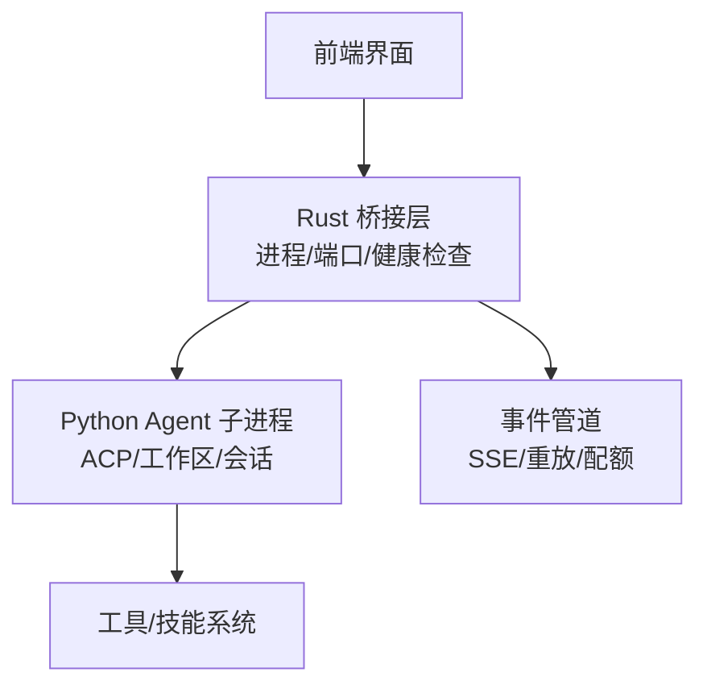
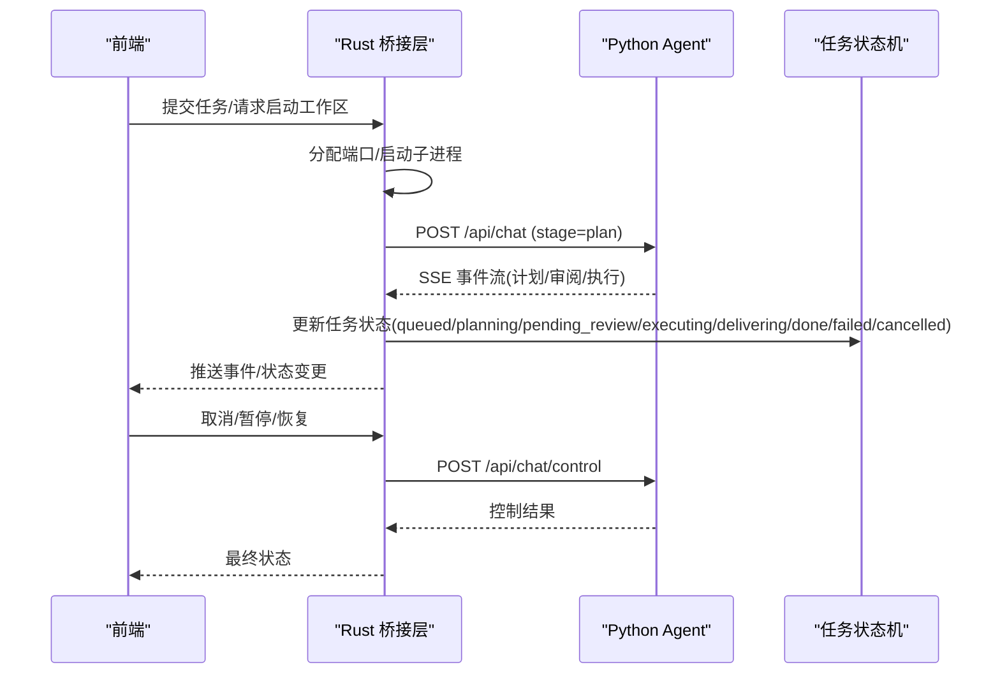
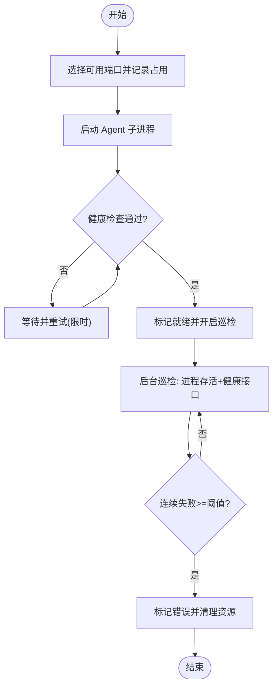
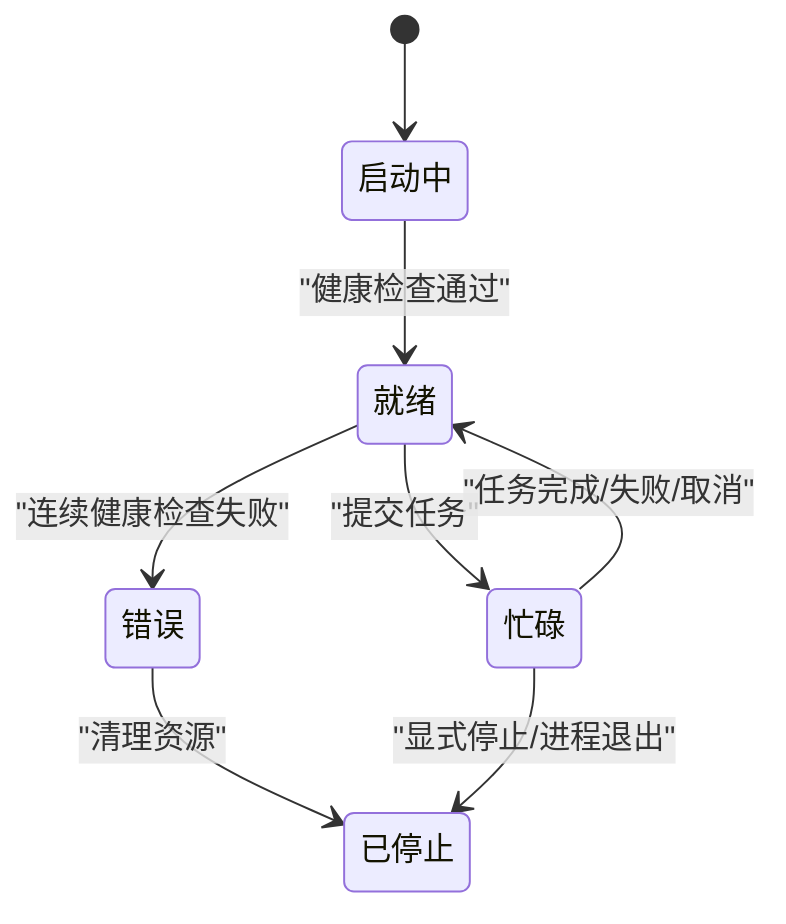
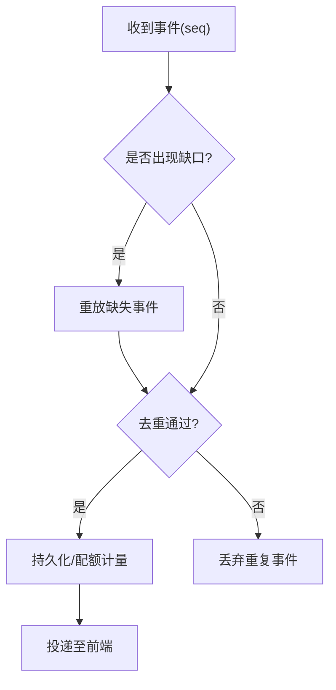
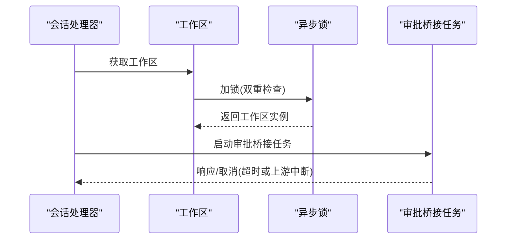
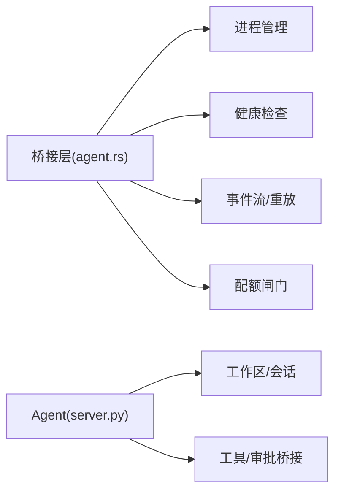

# 租约协调器

<cite>
**本文引用的文件**
- [agent.rs](file://tongtian-tauri/src-tauri/src/bridge/agent.rs)
- [server.py](file://tongtian-tauri/src/agent/agents/acp/server.py)
- [mod.rs](file://tongtian-tauri/src-tauri/src/task/mod.rs)
</cite>

## 目录
1. [简介](#简介)
2. [项目结构](#项目结构)
3. [核心组件](#核心组件)
4. [架构总览](#架构总览)
5. [详细组件分析](#详细组件分析)
6. [依赖关系分析](#依赖关系分析)
7. [性能考虑](#性能考虑)
8. [故障排查指南](#故障排查指南)
9. [结论](#结论)
10. [附录](#附录)

## 简介
本文件面向通天办公项目的“租约协调器”能力，聚焦分布式锁、租约生命周期管理、冲突解决策略与一致性保障。结合代码库中的进程级实例管理、健康检查、SSE 事件流与任务状态机，形成一套可在多进程环境中安全共享资源、协调任务执行的方案。文档覆盖：
- 分布式锁实现思路（基于端口绑定与健康检查的轻量互斥）
- 租约获取、续期、释放流程（启动—就绪—巡检—停止）
- 并发安全保证、死锁预防、超时处理机制
- 租约状态同步、网络分区处理、数据一致性保证
- 最佳实践、性能优化建议与常见问题解决方案

## 项目结构
本项目在桌面端通过 Rust 桥接层管理 Python Agent 子进程的生命周期，并以 HTTP/SSE 进行通信；Agent 侧提供会话与工作区管理能力。关键路径如下：
- 桌面端（Rust）：负责进程启动、端口分配、健康检查、后台巡检、事件转发与配额计量
- 代理端（Python）：提供 ACP 协议接口、工作区生命周期、会话管理与工具调用协调

图表来源
- [agent.rs:118-262](file://tongtian-tauri/src-tauri/src/bridge/agent.rs#L118-L262)
- [server.py:227-394](file://tongtian-tauri/src/agent/agents/acp/server.py#L227-L394)

章节来源
- [agent.rs:118-262](file://tongtian-tauri/src-tauri/src/bridge/agent.rs#L118-L262)
- [server.py:227-394](file://tongtian-tauri/src/agent/agents/acp/server.py#L227-L394)

## 核心组件
- 进程与端口管理器：为每个工作区分配独立端口并启动 Agent 子进程，维护实例状态与端口占用集合
- 健康检查与巡检：启动时轮询健康接口直至就绪；运行中定期巡检，连续失败标记错误并清理资源
- 事件流与重放：通过 SSE 消费引擎事件，支持断线补齐与序列号去重，确保事件顺序与完整性
- 任务状态机：定义 14 种任务状态，贯穿计划、审阅、执行、交付等阶段，配合配额闸门控制执行
- 会话与工作区：Agent 侧维护会话上下文与工作区生命周期，提供工具调用与权限审批桥接

章节来源
- [agent.rs:53-86](file://tongtian-tauri/src-tauri/src/bridge/agent.rs#L53-L86)
- [agent.rs:281-356](file://tongtian-tauri/src-tauri/src/bridge/agent.rs#L281-L356)
- [agent.rs:410-461](file://tongtian-tauri/src-tauri/src/bridge/agent.rs#L410-L461)
- [agent.rs:567-682](file://tongtian-tauri/src-tauri/src/bridge/agent.rs#L567-L682)
- [mod.rs:1-24](file://tongtian-tauri/src-tauri/src/task/mod.rs#L1-L24)
- [server.py:227-394](file://tongtian-tauri/src/agent/agents/acp/server.py#L227-L394)

## 架构总览
下图展示从前端到后端的事件与控制流，以及租约（进程/端口）的获取与释放过程。

图表来源
- [agent.rs:410-461](file://tongtian-tauri/src-tauri/src/bridge/agent.rs#L410-L461)
- [agent.rs:684-703](file://tongtian-tauri/src-tauri/src/bridge/agent.rs#L684-L703)
- [agent.rs:705-754](file://tongtian-tauri/src-tauri/src/bridge/agent.rs#L705-L754)
- [mod.rs:7-23](file://tongtian-tauri/src-tauri/src/task/mod.rs#L7-L23)

## 详细组件分析

### 分布式锁与租约模型
- 租约载体：每个工作区的独立进程与其绑定的本地端口构成“租约”。同一时刻仅一个进程持有该工作区的执行权
- 获取租约：
  - 选择未占用且可绑定的端口，记录到已用端口集合
  - 启动 Agent 子进程，进入健康检查循环直至就绪
- 续期租约：
  - 后台巡检周期性检测进程存活与健康接口
  - 连续失败达到阈值则标记错误并清理资源，防止僵尸进程长期占用
- 释放租约：
  - 显式停止工作区时移除实例与端口，必要时终止进程
  - 进程异常退出时自动回收端口与实例

图表来源
- [agent.rs:92-103](file://tongtian-tauri/src-tauri/src/bridge/agent.rs#L92-L103)
- [agent.rs:118-262](file://tongtian-tauri/src-tauri/src/bridge/agent.rs#L118-L262)
- [agent.rs:306-356](file://tongtian-tauri/src-tauri/src/bridge/agent.rs#L306-L356)

章节来源
- [agent.rs:92-103](file://tongtian-tauri/src-tauri/src/bridge/agent.rs#L92-L103)
- [agent.rs:118-262](file://tongtian-tauri/src-tauri/src/bridge/agent.rs#L118-L262)
- [agent.rs:306-356](file://tongtian-tauri/src-tauri/src/bridge/agent.rs#L306-L356)

### 租约生命周期管理
- 启动阶段：分配端口、启动进程、健康检查、置位 Busy/Ready
- 运行阶段：SSE 事件流驱动任务推进，配额闸门在 token 使用超限时阻断或暂停任务
- 停止阶段：显式停止或进程异常退出时回收端口与实例，清理状态

图表来源
- [agent.rs:53-86](file://tongtian-tauri/src-tauri/src/bridge/agent.rs#L53-L86)
- [agent.rs:410-461](file://tongtian-tauri/src-tauri/src/bridge/agent.rs#L410-L461)
- [agent.rs:306-356](file://tongtian-tauri/src-tauri/src/bridge/agent.rs#L306-L356)

章节来源
- [agent.rs:53-86](file://tongtian-tauri/src-tauri/src/bridge/agent.rs#L53-L86)
- [agent.rs:410-461](file://tongtian-tauri/src-tauri/src/bridge/agent.rs#L410-L461)
- [agent.rs:306-356](file://tongtian-tauri/src-tauri/src/bridge/agent.rs#L306-L356)

### 冲突解决策略
- 端口互斥：通过已用端口集合避免重复绑定，确保同一工作区仅一个进程持有执行权
- 健康检查失败回退：连续失败标记错误并清理，避免资源泄漏与假活
- 事件去重与补齐：序列号守卫检测 gap 后触发重拉取，保证事件不丢失且不重复渲染
- 配额闸门：当 token 用量达到阻断档位时，将活跃任务转入预算暂停态，待恢复后再入队继续执行

图表来源
- [agent.rs:463-498](file://tongtian-tauri/src-tauri/src/bridge/agent.rs#L463-L498)
- [agent.rs:517-541](file://tongtian-tauri/src-tauri/src/bridge/agent.rs#L517-L541)
- [agent.rs:567-682](file://tongtian-tauri/src-tauri/src/bridge/agent.rs#L567-L682)

章节来源
- [agent.rs:463-498](file://tongtian-tauri/src-tauri/src/bridge/agent.rs#L463-L498)
- [agent.rs:517-541](file://tongtian-tauri/src-tauri/src/bridge/agent.rs#L517-L541)
- [agent.rs:567-682](file://tongtian-tauri/src-tauri/src/bridge/agent.rs#L567-L682)

### 并发安全保证与死锁预防
- 异步锁保护工作区初始化：使用异步锁避免并发创建重复工作区
- 有界通道背压：事件解析与前端投递解耦，限制积压上限，避免阻塞热路径
- 无锁共享客户端：HTTP 客户端使用一次性初始化与内部引用计数，移出全局 Mutex 热路径
- 任务取消与审批桥接：通过事件与 Future 组合，及时取消长时间等待的审批请求，避免悬挂任务

图表来源
- [server.py:354-394](file://tongtian-tauri/src/agent/agents/acp/server.py#L354-L394)
- [server.py:724-800](file://tongtian-tauri/src/agent/agents/acp/server.py#L724-L800)

章节来源
- [server.py:354-394](file://tongtian-tauri/src/agent/agents/acp/server.py#L354-L394)
- [server.py:724-800](file://tongtian-tauri/src/agent/agents/acp/server.py#L724-L800)

### 超时处理机制
- 健康检查超时：启动阶段设置最大等待时间，超过则标记错误并返回
- 健康巡检失败阈值：连续失败次数达到阈值即标记错误并清理
- SSE 断线补齐：检测到断线后转入补齐循环，按窗口重拉事件，保证最终一致
- 审批请求超时：与上游 Future 竞争完成，若上游先完成则取消审批任务，避免资源泄露

章节来源
- [agent.rs:220-242](file://tongtian-tauri/src-tauri/src/bridge/agent.rs#L220-L242)
- [agent.rs:306-356](file://tongtian-tauri/src-tauri/src/bridge/agent.rs#L306-L356)
- [agent.rs:756-800](file://tongtian-tauri/src-tauri/src/bridge/agent.rs#L756-L800)
- [server.py:724-800](file://tongtian-tauri/src/agent/agents/acp/server.py#L724-L800)

### 租约状态同步与数据一致性
- 状态同步：通过 Tauri 事件将实例状态变化（Starting/Ready/Busy/Error/Stopped）推送到前端
- 事件一致性：序列号守卫 + 重放补齐，确保事件顺序与完整性；配额闸门在 token 用量超限时暂停任务，恢复后继续
- 任务状态机：14 种状态覆盖全生命周期，配合控制接口（pause/resume/rollback_to）实现细粒度调度

章节来源
- [agent.rs:109-114](file://tongtian-tauri/src-tauri/src/bridge/agent.rs#L109-L114)
- [agent.rs:463-498](file://tongtian-tauri/src-tauri/src/bridge/agent.rs#L463-L498)
- [agent.rs:567-682](file://tongtian-tauri/src-tauri/src/bridge/agent.rs#L567-L682)
- [mod.rs:7-23](file://tongtian-tauri/src-tauri/src/task/mod.rs#L7-L23)

### 网络分区处理
- 健康检查失败：视为节点不可达，累积失败次数并降级为错误状态
- SSE 断线：转入补齐循环，按窗口重拉事件，目标为“零丢失”
- 进程异常退出：自动回收端口与实例，避免僵尸进程导致的状态不一致

章节来源
- [agent.rs:306-356](file://tongtian-tauri/src-tauri/src/bridge/agent.rs#L306-L356)
- [agent.rs:756-800](file://tongtian-tauri/src-tauri/src/bridge/agent.rs#L756-L800)

### 多进程环境下的资源共享与任务协调
- 隔离性：每个工作区独立进程与端口，天然隔离资源与状态
- 协调点：通过端口互斥与健康检查实现轻量分布式锁；通过事件流与状态机协调跨进程任务执行
- 控制面：统一通过控制接口（pause/resume/rollback_to）对任务进行细粒度调度

章节来源
- [agent.rs:118-262](file://tongtian-tauri/src-tauri/src/bridge/agent.rs#L118-L262)
- [agent.rs:705-754](file://tongtian-tauri/src-tauri/src/bridge/agent.rs#L705-L754)

## 依赖关系分析
- 组件耦合：
  - 桥接层依赖进程管理、健康检查、事件流与配额闸门
  - Agent 侧依赖工作区生命周期、会话管理与工具调用协调
- 外部依赖：
  - HTTP/SSE 通信
  - 操作系统进程管理（Windows tasklist/taskkill，Unix /proc 与 kill）
- 潜在循环依赖：
  - 当前实现以单向调用为主（前端→桥接→Agent），未见明显循环依赖

图表来源
- [agent.rs:118-262](file://tongtian-tauri/src-tauri/src/bridge/agent.rs#L118-L262)
- [agent.rs:567-682](file://tongtian-tauri/src-tauri/src/bridge/agent.rs#L567-L682)
- [server.py:227-394](file://tongtian-tauri/src/agent/agents/acp/server.py#L227-L394)

章节来源
- [agent.rs:118-262](file://tongtian-tauri/src-tauri/src/bridge/agent.rs#L118-L262)
- [agent.rs:567-682](file://tongtian-tauri/src-tauri/src/bridge/agent.rs#L567-L682)
- [server.py:227-394](file://tongtian-tauri/src/agent/agents/acp/server.py#L227-L394)

## 性能考虑
- 背压与批量投递：事件解析与前端投递解耦，使用有界通道与批量 drain，降低调度开销
- 无锁共享客户端：HTTP 客户端一次性初始化并复用，减少锁竞争
- 健康检查间隔与阈值：合理配置轮询间隔与失败阈值，平衡响应速度与资源消耗
- 配额闸门节流：在 token 用量接近上限时提前预警并暂停任务，避免突发流量冲击

[本节为通用指导，无需特定文件来源]

## 故障排查指南
- 启动失败：
  - 检查端口是否被占用，确认健康检查是否超时
  - 查看子进程日志输出，定位启动错误
- 运行异常：
  - 关注健康检查失败次数，若连续失败则检查进程存活与健康接口
  - 检查 SSE 断线情况，确认补齐逻辑是否生效
- 任务卡住：
  - 检查配额闸门是否阻断任务，确认预算恢复后是否重新入队
  - 检查审批桥接任务是否超时或被取消

章节来源
- [agent.rs:220-242](file://tongtian-tauri/src-tauri/src/bridge/agent.rs#L220-L242)
- [agent.rs:306-356](file://tongtian-tauri/src-tauri/src/bridge/agent.rs#L306-L356)
- [agent.rs:756-800](file://tongtian-tauri/src-tauri/src/bridge/agent.rs#L756-L800)

## 结论
本方案通过进程级租约、健康检查与事件流实现了轻量而可靠的分布式协调机制。借助端口互斥、序列号去重与重放补齐、配额闸门与任务状态机，能够在多进程环境下安全共享资源并协调任务执行。建议在部署时合理配置健康检查参数与配额阈值，并结合监控与日志快速定位问题。

[本节为总结，无需特定文件来源]

## 附录
- 最佳实践
  - 为每个工作区分配独立进程与端口，避免资源争用
  - 启用事件持久化与重放，确保断线后可恢复
  - 在配额接近上限时提前预警并暂停任务，避免服务抖动
- 常见问题
  - 端口冲突：检查端口占用集合与绑定逻辑
  - 健康检查误判：调整轮询间隔与失败阈值
  - 事件乱序：确认序列号守卫与补齐逻辑正常工作

[本节为补充信息，无需特定文件来源]