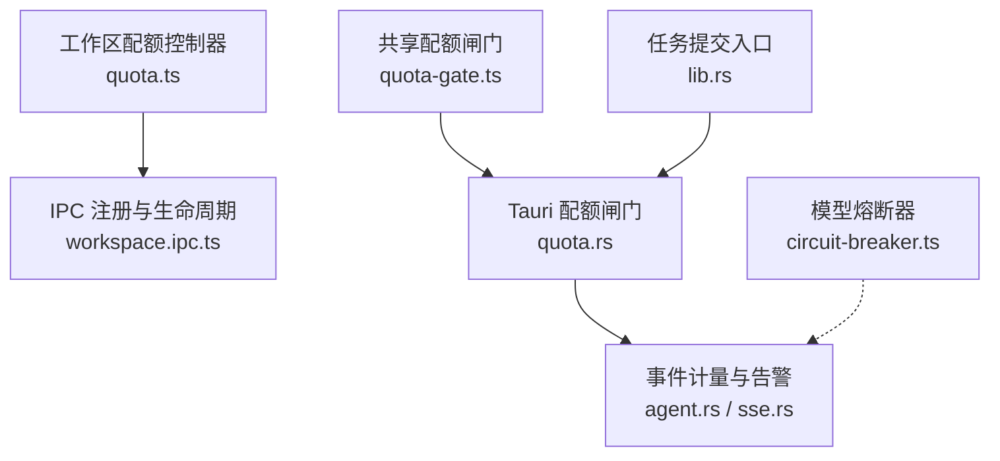
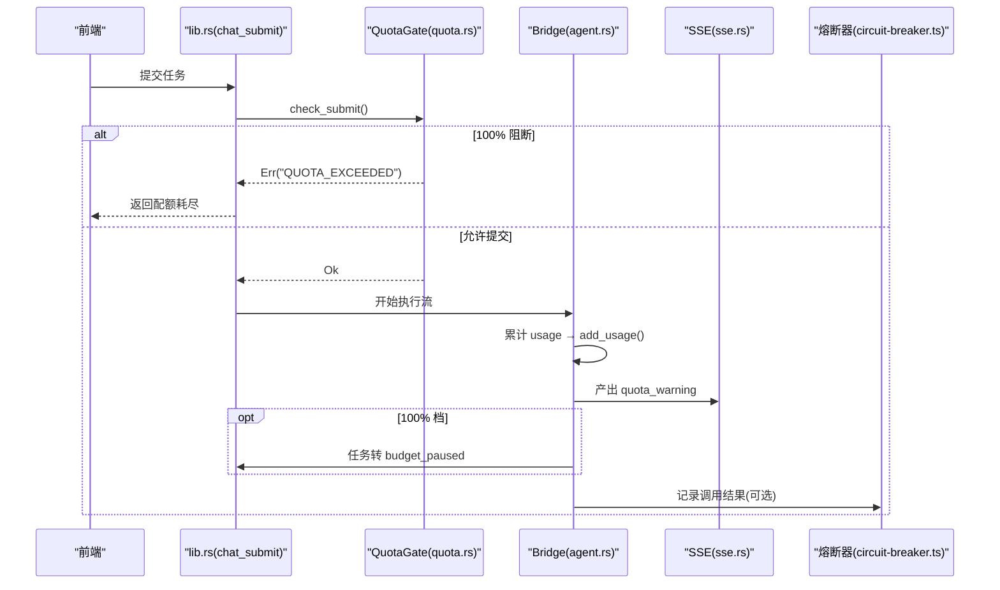
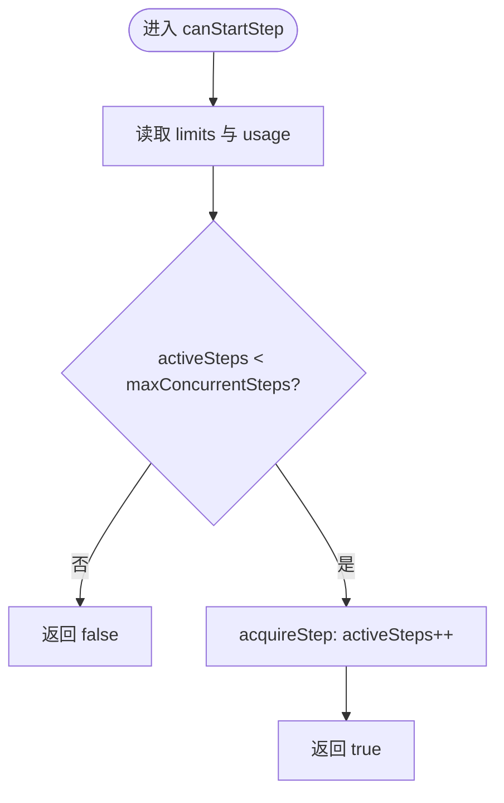
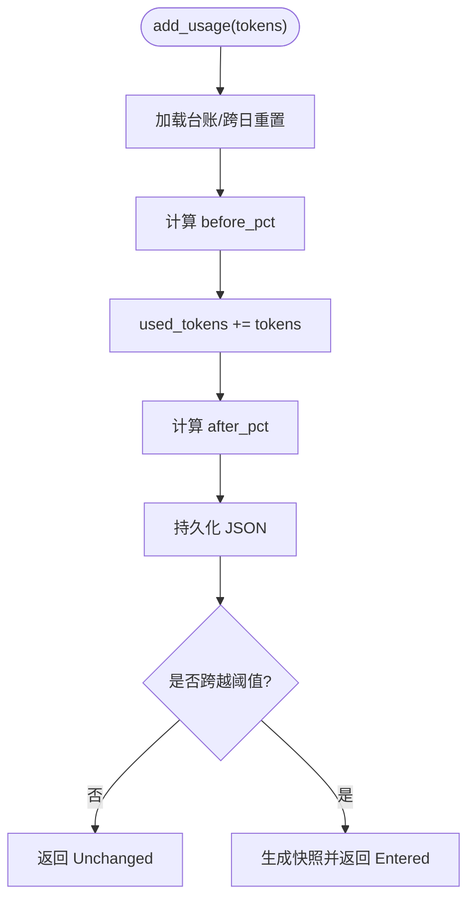
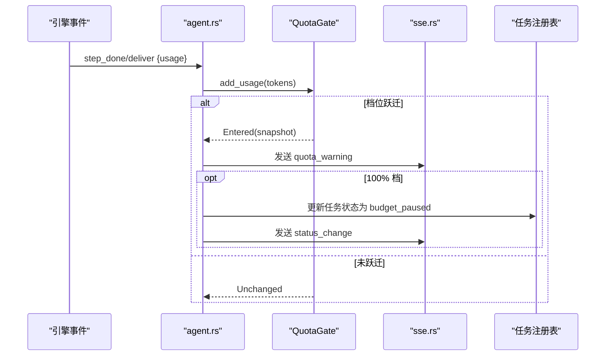
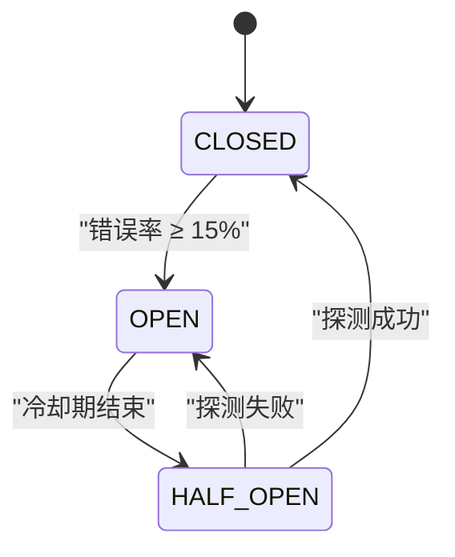
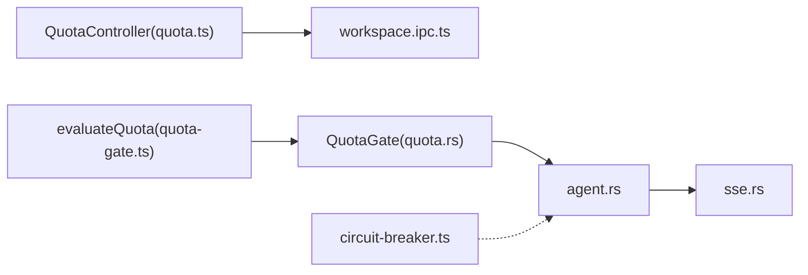

# 配额控制系统

<cite>
**本文引用的文件**
- [quota.ts](file://tongtian-tauri/src/main/workspace/quota.ts)
- [workspace.ipc.ts](file://tongtian-tauri/src/main/ipc/workspace.ipc.ts)
- [quota-gate.ts](file://tongtian-tauri/src/shared/quota-gate.ts)
- [quota.rs](file://tongtian-tauri/src-tauri/src/task/quota.rs)
- [agent.rs](file://tongtian-tauri/src-tauri/src/bridge/agent.rs)
- [sse.rs](file://tongtian-tauri/src-tauri/src/bridge/sse.rs)
- [lib.rs](file://tongtian-tauri/src-tauri/src/lib.rs)
- [circuit-breaker.ts](file://tongtian-tauri/src/main/model/circuit-breaker.ts)
</cite>

## 目录
1. [简介](#简介)
2. [项目结构](#项目结构)
3. [核心组件](#核心组件)
4. [架构总览](#架构总览)
5. [详细组件分析](#详细组件分析)
6. [依赖关系分析](#依赖关系分析)
7. [性能考量](#性能考量)
8. [故障排查指南](#故障排查指南)
9. [结论](#结论)
10. [附录](#附录)

## 简介
本文件为通天办公项目的“配额控制系统”技术文档，聚焦预算管理机制、配额分配策略、熔断降级逻辑与审计记录。系统通过四层协作实现：
- 工作区级资源配额控制器（内存级限流）
- 任务级配额闸门（四档阈值：70%/85%/95%/100%）
- 事件计量与告警（SSE 推送 quota_warning）
- 模型侧熔断器（按错误率自动开合）

目标是保障多租户隔离下的稳定运行，提供可观测的配额使用视图与可配置的动态调整能力。

## 项目结构
配额相关代码分布在主进程、共享层与 Tauri 后端：
- 主进程工作区配额：src/main/workspace/quota.ts
- 主进程 IPC 集成：src/main/ipc/workspace.ipc.ts
- 共享配额闸门纯函数：src/shared/quota-gate.ts
- Tauri 后端配额闸门与持久化：src-tauri/src/task/quota.rs
- 事件计量与 SSE 适配：src-tauri/src/bridge/agent.rs, src-tauri/src/bridge/sse.rs
- 启动链路中的配额检查：src-tauri/src/lib.rs
- 模型熔断器（辅助保护）：src/main/model/circuit-breaker.ts

图表来源
- [quota.ts:45-262](file://tongtian-tauri/src/main/workspace/quota.ts#L45-L262)
- [workspace.ipc.ts:55-148](file://tongtian-tauri/src/main/ipc/workspace.ipc.ts#L55-L148)
- [quota-gate.ts:1-81](file://tongtian-tauri/src/shared/quota-gate.ts#L1-L81)
- [quota.rs:1-300](file://tongtian-tauri/src-tauri/src/task/quota.rs#L1-L300)
- [agent.rs:606-682](file://tongtian-tauri/src-tauri/src/bridge/agent.rs#L606-L682)
- [sse.rs:280-292](file://tongtian-tauri/src-tauri/src/bridge/sse.rs#L280-L292)
- [lib.rs:125-145](file://tongtian-tauri/src-tauri/src/lib.rs#L125-L145)
- [circuit-breaker.ts:82-239](file://tongtian-tauri/src/main/model/circuit-breaker.ts#L82-L239)

章节来源
- [quota.ts:45-262](file://tongtian-tauri/src/main/workspace/quota.ts#L45-L262)
- [workspace.ipc.ts:55-148](file://tongtian-tauri/src/main/ipc/workspace.ipc.ts#L55-L148)
- [quota-gate.ts:1-81](file://tongtian-tauri/src/shared/quota-gate.ts#L1-L81)
- [quota.rs:1-300](file://tongtian-tauri/src-tauri/src/task/quota.rs#L1-L300)
- [agent.rs:606-682](file://tongtian-tauri/src-tauri/src/bridge/agent.rs#L606-L682)
- [sse.rs:280-292](file://tongtian-tauri/src-tauri/src/bridge/sse.rs#L280-L292)
- [lib.rs:125-145](file://tongtian-tauri/src-tauri/src/lib.rs#L125-L145)
- [circuit-breaker.ts:82-239](file://tongtian-tauri/src/main/model/circuit-breaker.ts#L82-L239)

## 核心组件
- 工作区配额控制器（QuotaController）
  - 职责：维护每个工作区的并发步骤、队列深度、模型调用并发、内存使用等配额；提供获取状态、更新限额、销毁工作区等能力。
  - 关键点：默认限额、内存告警阈值、工作区隔离。
- 配额闸门（QuotaGate + evaluateQuota）
  - 职责：基于四档阈值判定动作链（降级→排队→阻断），支持本地台账持久化与跨日重置，产出档位跃迁事件。
  - 关键点：evaluate/should_queue/check_submit、TierTransition 去抖、QUOTA_EXCEEDED/BUDGET_EXHAUSTED 错误码映射。
- 事件计量与 SSE 适配
  - 职责：从引擎事件 usage 字段累计 token，触发配额闸门并产出 quota_warning；在 100% 档将运行中任务置为 budget_paused。
- 模型熔断器（CircuitBreaker）
  - 职责：按滑动窗口错误率控制模型调用，避免雪崩；配合配额闸门形成双重保护。

章节来源
- [quota.ts:45-262](file://tongtian-tauri/src/main/workspace/quota.ts#L45-L262)
- [quota-gate.ts:1-81](file://tongtian-tauri/src/shared/quota-gate.ts#L1-L81)
- [quota.rs:1-300](file://tongtian-tauri/src-tauri/src/task/quota.rs#L1-L300)
- [agent.rs:606-682](file://tongtian-tauri/src-tauri/src/bridge/agent.rs#L606-L682)
- [circuit-breaker.ts:82-239](file://tongtian-tauri/src/main/model/circuit-breaker.ts#L82-L239)

## 架构总览
配额控制贯穿“提交—执行—计量—告警—熔断”的全链路：
- 提交阶段：lib.rs 调用 QuotaGate.check_submit()，100% 档拒绝新任务。
- 执行阶段：agent.rs 在 persist_and_meter 中累计 usage，调用 add_usage() 并产出 quota_warning。
- 告警与降级：根据档位决定降级、排队或阻断；100% 档将运行中任务转为 budget_paused。
- 熔断：circuit-breaker.ts 对模型调用进行错误率监控，必要时短路请求。

图表来源
- [lib.rs:125-145](file://tongtian-tauri/src-tauri/src/lib.rs#L125-L145)
- [quota.rs:191-206](file://tongtian-tauri/src-tauri/src/task/quota.rs#L191-L206)
- [agent.rs:606-682](file://tongtian-tauri/src-tauri/src/bridge/agent.rs#L606-L682)
- [sse.rs:280-292](file://tongtian-tauri/src-tauri/src/bridge/sse.rs#L280-L292)
- [circuit-breaker.ts:104-163](file://tongtian-tauri/src/main/model/circuit-breaker.ts#L104-L163)

## 详细组件分析

### 工作区配额控制器（QuotaController）
- 数据结构
  - 限额 Map：按 workspaceId 存储 QuotaLimits（并发步骤、内存上限、模型调用并发、队列深度）。
  - 用量 Map：按 workspaceId 存储 QuotaUsage（活跃步骤、内存占用、活跃模型调用、队列深度）。
- 关键流程
  - 初始化：initWorkspace 设置默认限额与用量。
  - 检查：canStartStep/canAcceptTask/canStartModelCall 判断是否允许新增。
  - 获取/释放：acquire/release 系列方法原子更新用量。
  - 内存告警：updateMemoryUsage 超过阈值记录 warn/error。
  - 状态查询：getStatus 汇总 limits、usage、warnings 与可接受性。
  - 动态调整：updateLimits 合并新限额。
  - 清理：destroyWorkspace 删除配额数据。

图表来源
- [quota.ts:86-124](file://tongtian-tauri/src/main/workspace/quota.ts#L86-L124)

章节来源
- [quota.ts:45-262](file://tongtian-tauri/src/main/workspace/quota.ts#L45-L262)

### 配额闸门（QuotaGate + evaluateQuota）
- 四档阈值与动作
  - 70%：notify（仅提示）
  - 85%：degrade（降级到备用模型）
  - 95%：queue（新任务排队）
  - 100%：block（拒绝新提交；运行中转 budget_paused）
- 核心能力
  - evaluate/evaluateQuota：计算使用率并判定档位与动作。
  - add_usage：累计 token，跨日重置，输出 TierTransition（去抖）。
  - should_queue：≥95% 时建议排队。
  - check_submit：100% 档返回 QUOTA_EXCEEDED。
  - 持久化：JSON 台账文件，支持重启恢复。
- 错误码映射
  - 新提交：QUOTA_EXCEEDED
  - 运行中任务：BUDGET_EXHAUSTED（由上层在 100% 档切换状态）

图表来源
- [quota.rs:158-189](file://tongtian-tauri/src-tauri/src/task/quota.rs#L158-L189)
- [quota-gate.ts:24-54](file://tongtian-tauri/src/shared/quota-gate.ts#L24-L54)

章节来源
- [quota.rs:1-300](file://tongtian-tauri/src-tauri/src/task/quota.rs#L1-L300)
- [quota-gate.ts:1-81](file://tongtian-tauri/src/shared/quota-gate.ts#L1-L81)

### 事件计量与 SSE 适配
- 计量点：persist_and_meter 从事件 data.usage 提取 promptTokens/completionTokens 并累计。
- 告警：当 add_usage 返回 Entered 时，发送 quota_warning 事件（包含 level/action/usedTokens/quotaTokens）。
- 阻断：100% 档将运行中任务状态改为 budget_paused，并推送 status_change。
- SSE 适配：统一解析 quota_warning 字段兼容 snake_case/camelCase。

图表来源
- [agent.rs:606-682](file://tongtian-tauri/src-tauri/src/bridge/agent.rs#L606-L682)
- [sse.rs:280-292](file://tongtian-tauri/src-tauri/src/bridge/sse.rs#L280-L292)

章节来源
- [agent.rs:606-682](file://tongtian-tauri/src-tauri/src/bridge/agent.rs#L606-L682)
- [sse.rs:280-292](file://tongtian-tauri/src-tauri/src/bridge/sse.rs#L280-L292)

### 模型熔断器（CircuitBreaker）
- 状态机：CLOSED → OPEN → HALF_OPEN → CLOSED
- 参数：滑动窗口 5 分钟、错误率阈值 15%、冷却期 3 分钟、指数退避重试
- 作用：在配额紧张或外部服务异常时快速短路，降低放大效应

图表来源
- [circuit-breaker.ts:82-239](file://tongtian-tauri/src/main/model/circuit-breaker.ts#L82-L239)

章节来源
- [circuit-breaker.ts:82-239](file://tongtian-tauri/src/main/model/circuit-breaker.ts#L82-L239)

## 依赖关系分析
- 工作区配额控制器依赖日志模块，被 IPC 在工作区创建/销毁时调用。
- 配额闸门（Rust）与共享纯函数（TS）保持阈值语义一致，便于单测复用。
- 事件计量依赖任务注册表与 SSE 通道，用于状态变更与告警。
- 熔断器独立于配额闸门，但共同影响模型调用的可用性。

图表来源
- [quota.ts:45-262](file://tongtian-tauri/src/main/workspace/quota.ts#L45-L262)
- [workspace.ipc.ts:55-148](file://tongtian-tauri/src/main/ipc/workspace.ipc.ts#L55-L148)
- [quota-gate.ts:1-81](file://tongtian-tauri/src/shared/quota-gate.ts#L1-L81)
- [quota.rs:1-300](file://tongtian-tauri/src-tauri/src/task/quota.rs#L1-L300)
- [agent.rs:606-682](file://tongtian-tauri/src-tauri/src/bridge/agent.rs#L606-L682)
- [sse.rs:280-292](file://tongtian-tauri/src-tauri/src/bridge/sse.rs#L280-L292)
- [circuit-breaker.ts:82-239](file://tongtian-tauri/src/main/model/circuit-breaker.ts#L82-L239)

章节来源
- [quota.ts:45-262](file://tongtian-tauri/src/main/workspace/quota.ts#L45-L262)
- [workspace.ipc.ts:55-148](file://tongtian-tauri/src/main/ipc/workspace.ipc.ts#L55-L148)
- [quota-gate.ts:1-81](file://tongtian-tauri/src/shared/quota-gate.ts#L1-L81)
- [quota.rs:1-300](file://tongtian-tauri/src-tauri/src/task/quota.rs#L1-L300)
- [agent.rs:606-682](file://tongtian-tauri/src-tauri/src/bridge/agent.rs#L606-L682)
- [sse.rs:280-292](file://tongtian-tauri/src-tauri/src/bridge/sse.rs#L280-L292)
- [circuit-breaker.ts:82-239](file://tongtian-tauri/src/main/model/circuit-breaker.ts#L82-L239)

## 性能考量
- 配额闸门使用 Mutex 保护台账，写入频率受事件驱动，通常低开销。
- 台账持久化为 JSON 文件，落盘失败仅打印错误，不影响主流程。
- 工作区配额控制器为内存 Map，O(1) 访问，适合高频检查。
- 熔断器滑动窗口定期修剪旧记录，避免无限增长。
- 建议在高峰期关注日志中的内存高水位与队列深度告警，必要时动态下调限额。

[本节为通用指导，不直接分析具体文件]

## 故障排查指南
- 新任务被阻断
  - 现象：提交返回 QUOTA_EXCEEDED
  - 定位：检查 QuotaGate.check_submit 返回值与当前 used/quota 比例
  - 处理：等待跨日重置或提高配额；查看 quota_warning 事件确认档位
  - 参考路径
    - [lib.rs:125-145](file://tongtian-tauri/src-tauri/src/lib.rs#L125-L145)
    - [quota.rs:191-206](file://tongtian-tauri/src-tauri/src/task/quota.rs#L191-L206)
- 运行中任务被暂停
  - 现象：status_change 为 budget_paused，reason 为 BUDGET_EXHAUSTED
  - 定位：agent.rs 在 100% 档切换状态
  - 处理：等待配额恢复或跨日重置后自动回滚
  - 参考路径
    - [agent.rs:648-678](file://tongtian-tauri/src-tauri/src/bridge/agent.rs#L648-L678)
- 配额告警风暴
  - 现象：频繁收到 quota_warning
  - 定位：TierTransition 去抖机制应抑制同档重复；检查是否多次跨越阈值
  - 处理：优化任务批大小或模型选择；考虑启用降级策略
  - 参考路径
    - [quota.rs:158-189](file://tongtian-tauri/src-tauri/src/task/quota.rs#L158-L189)
    - [sse.rs:280-292](file://tongtian-tauri/src-tauri/src/bridge/sse.rs#L280-L292)
- 内存超限
  - 现象：updateMemoryUsage 记录 error/warn
  - 定位：检查工作区内存限额与当前使用
  - 处理：动态 updateLimits 降低内存上限或优化任务
  - 参考路径
    - [quota.ts:177-202](file://tongtian-tauri/src/main/workspace/quota.ts#L177-L202)
- 模型调用雪崩
  - 现象：错误率飙升导致熔断
  - 定位：查看 CircuitBreaker 状态与统计
  - 处理：等待冷却或手动 reset；结合配额闸门减少压力
  - 参考路径
    - [circuit-breaker.ts:183-239](file://tongtian-tauri/src/main/model/circuit-breaker.ts#L183-L239)

章节来源
- [lib.rs:125-145](file://tongtian-tauri/src-tauri/src/lib.rs#L125-L145)
- [quota.rs:191-206](file://tongtian-tauri/src-tauri/src/task/quota.rs#L191-L206)
- [agent.rs:648-678](file://tongtian-tauri/src-tauri/src/bridge/agent.rs#L648-L678)
- [quota.rs:158-189](file://tongtian-tauri/src-tauri/src/task/quota.rs#L158-L189)
- [sse.rs:280-292](file://tongtian-tauri/src-tauri/src/bridge/sse.rs#L280-L292)
- [quota.ts:177-202](file://tongtian-tauri/src/main/workspace/quota.ts#L177-L202)
- [circuit-breaker.ts:183-239](file://tongtian-tauri/src/main/model/circuit-breaker.ts#L183-L239)

## 结论
配额控制系统以“工作区级限流 + 任务级配额闸门 + 事件计量告警 + 模型熔断”的组合，实现了多租户隔离、动态调整与高可用保障。通过四档阈值与动作链，系统在接近配额上限时逐步降级、排队并最终阻断，确保整体稳定性。建议在生产环境持续观察 quota_warning 与熔断器指标，结合业务负载动态调优限额与降级策略。

[本节为总结，不直接分析具体文件]

## 附录

### 配额配置与管理
- 工作区限额
  - 初始化：create 工作区时调用 initWorkspace，可传入自定义限额
  - 动态调整：updateLimits 合并新限额，立即生效
  - 清理：destroyWorkspace 删除配额数据
  - 参考路径
    - [workspace.ipc.ts:60-71](file://tongtian-tauri/src/main/ipc/workspace.ipc.ts#L60-L71)
    - [workspace.ipc.ts:99-108](file://tongtian-tauri/src/main/ipc/workspace.ipc.ts#L99-L108)
    - [quota.ts:64-82](file://tongtian-tauri/src/main/workspace/quota.ts#L64-L82)
    - [quota.ts:240-249](file://tongtian-tauri/src/main/workspace/quota.ts#L240-L249)
    - [quota.ts:253-261](file://tongtian-tauri/src/main/workspace/quota.ts#L253-L261)

### 实时统计与阈值告警
- 实时统计
  - 工作区维度：getStatus 汇总 limits、usage、warnings
  - 任务维度：QuotaGate.snapshot 返回 used/quota/tier/action
- 阈值告警
  - 70%：notify（基线）
  - 85%：degrade（降级）
  - 95%：queue（排队）
  - 100%：block（阻断）
- 参考路径
  - [quota.ts:206-236](file://tongtian-tauri/src/main/workspace/quota.ts#L206-L236)
  - [quota.rs:87-117](file://tongtian-tauri/src-tauri/src/task/quota.rs#L87-L117)
  - [quota-gate.ts:37-54](file://tongtian-tauri/src/shared/quota-gate.ts#L37-L54)

### 多租户隔离
- 工作区隔离：limitsMap/usageMap 以 workspaceId 为键
- 任务隔离：QuotaGate 为全局令牌账本（可按需扩展为 per-workspace）
- 参考路径
  - [quota.ts:48-49](file://tongtian-tauri/src/main/workspace/quota.ts#L48-L49)
  - [quota.rs:60-64](file://tongtian-tauri/src-tauri/src/task/quota.rs#L60-L64)

### 在业务逻辑中集成配额检查与异常处理
- 提交前检查
  - 调用 QuotaGate.check_submit，若阻断则返回错误码并提示用户
  - 参考路径
    - [lib.rs:125-145](file://tongtian-tauri/src-tauri/src/lib.rs#L125-L145)
- 执行中计量
  - 在 step_done/deliver 处累计 usage，监听 quota_warning 事件做 UI 提示
  - 参考路径
    - [agent.rs:606-682](file://tongtian-tauri/src-tauri/src/bridge/agent.rs#L606-L682)
    - [sse.rs:280-292](file://tongtian-tauri/src-tauri/src/bridge/sse.rs#L280-L292)
- 熔断集成
  - 对模型调用包裹 CircuitBreaker，记录 success/failure 与延迟
  - 参考路径
    - [circuit-breaker.ts:104-163](file://tongtian-tauri/src/main/model/circuit-breaker.ts#L104-L163)

章节来源
- [workspace.ipc.ts:60-108](file://tongtian-tauri/src/main/ipc/workspace.ipc.ts#L60-L108)
- [quota.ts:206-249](file://tongtian-tauri/src/main/workspace/quota.ts#L206-L249)
- [quota.rs:87-117](file://tongtian-tauri/src-tauri/src/task/quota.rs#L87-L117)
- [quota-gate.ts:37-54](file://tongtian-tauri/src/shared/quota-gate.ts#L37-L54)
- [lib.rs:125-145](file://tongtian-tauri/src-tauri/src/lib.rs#L125-L145)
- [agent.rs:606-682](file://tongtian-tauri/src-tauri/src/bridge/agent.rs#L606-L682)
- [sse.rs:280-292](file://tongtian-tauri/src-tauri/src/bridge/sse.rs#L280-L292)
- [circuit-breaker.ts:104-163](file://tongtian-tauri/src/main/model/circuit-breaker.ts#L104-L163)