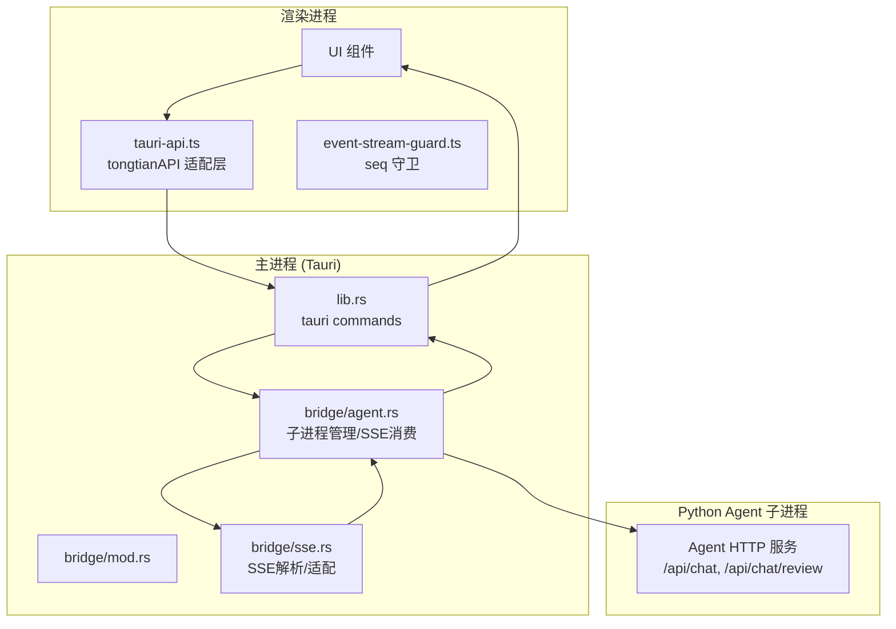
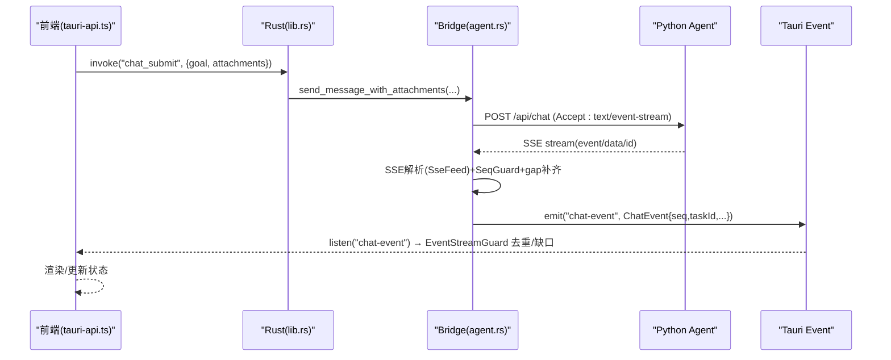
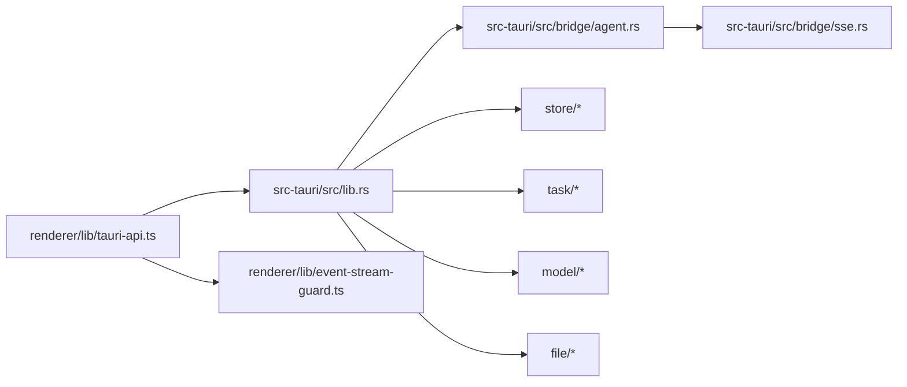
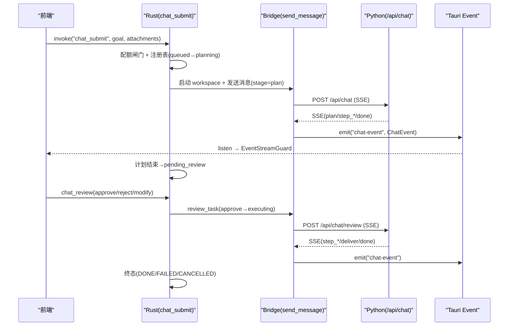

# 通信机制

<cite>
**本文引用的文件**   
- [src/preload/index.ts](file://tongtian-tauri/src/preload/index.ts)
- [src/preload/index.d.ts](file://tongtian-tauri/src/preload/index.d.ts)
- [src/main/ipc/chat.ipc.ts](file://tongtian-tauri/src/main/ipc/chat.ipc.ts)
- [src/renderer/lib/tauri-api.ts](file://tongtian-tauri/src/renderer/lib/tauri-api.ts)
- [src/renderer/lib/event-stream-guard.ts](file://tongtian-tauri/src/renderer/lib/event-stream-guard.ts)
- [src/shared/contracts.ts](file://tongtian-tauri/src/shared/contracts.ts)
- [src/shared/types.ts](file://tongtian-tauri/src/shared/types.ts)
- [src/main/bridge/sse-parser.ts](file://tongtian-tauri/src/main/bridge/sse-parser.ts)
- [src/main/bridge/agent-bridge.ts](file://tongtian-tauri/src/main/bridge/agent-bridge.ts)
- [src-tauri/src/lib.rs](file://tongtian-tauri/src-tauri/src/lib.rs)
- [src-tauri/src/bridge/mod.rs](file://tongtian-tauri/src-tauri/src/bridge/mod.rs)
- [src-tauri/src/bridge/sse.rs](file://tongtian-tauri/src-tauri/src/bridge/sse.rs)
- [src-tauri/src/bridge/agent.rs](file://tongtian-tauri/src-tauri/src/bridge/agent.rs)
- [src/main/index.ts](file://tongtian-tauri/src/main/index.ts)
</cite>

## 目录
1. [简介](#简介)
2. [项目结构](#项目结构)
3. [核心组件](#核心组件)
4. [架构总览](#架构总览)
5. [详细组件分析](#详细组件分析)
6. [依赖关系分析](#依赖关系分析)
7. [性能考虑](#性能考虑)
8. [故障排查指南](#故障排查指南)
9. [结论](#结论)
10. [附录：协议规范与时序图](#附录协议规范与时序图)

## 简介
本文件面向通天办公项目的跨进程通信机制，重点覆盖 Tauri 的 command/event 机制、消息序列化格式、错误传播策略；说明预加载脚本的作用、类型安全的接口定义、事件流的实时推送机制；并深入讲解 SSE（Server-Sent Events）在长连接场景下的应用、断线重连处理、消息队列管理等高级特性。文档提供通信时序图和协议规范，解释数据在不同进程间的流转过程，并给出性能优化建议与调试技巧。

## 项目结构
- 渲染进程（前端）通过统一的 tongtianAPI 调用后端能力。Tauri 模式下由 tauri-api.ts 将 TypeScript 调用映射为 Rust command 与 event 订阅。
- 主进程（Electron/Tauri）负责 IPC 路由、命令分发、事件转发与资源管理。
- Rust 后端暴露 tauri::command，并通过桥接模块与 Python Agent 子进程通信（HTTP + SSE）。
- 共享契约 types/contracts 统一前后端数据结构与错误码。

图表来源 
- [src/renderer/lib/tauri-api.ts:1-186](file://tongtian-tauri/src/renderer/lib/tauri-api.ts#L1-L186)
- [src-tauri/src/lib.rs:1-800](file://tongtian-tauri/src-tauri/src/lib.rs#L1-L800)
- [src-tauri/src/bridge/mod.rs:1-7](file://tongtian-tauri/src-tauri/src/bridge/mod.rs#L1-L7)
- [src-tauri/src/bridge/agent.rs:1-800](file://tongtian-tauri/src-tauri/src/bridge/agent.rs#L1-L800)
- [src-tauri/src/bridge/sse.rs:1-517](file://tongtian-tauri/src-tauri/src/bridge/sse.rs#L1-L517)

章节来源
- [src/main/index.ts:1-217](file://tongtian-tauri/src/main/index.ts#L1-L217)
- [src/renderer/lib/tauri-api.ts:1-186](file://tongtian-tauri/src/renderer/lib/tauri-api.ts#L1-L186)
- [src-tauri/src/lib.rs:1-800](file://tongtian-tauri/src-tauri/src/lib.rs#L1-L800)

## 核心组件
- 预加载脚本与类型安全接口
  - preload/index.ts：白名单校验通道，封装 invoke/send/on/removeListener，暴露 tongtianAPI 给渲染进程。
  - preload/index.d.ts：Window.tongtianAPI 的类型声明，确保前端强类型调用。
- Tauri 适配层
  - renderer/lib/tauri-api.ts：将 tongtianAPI 方法映射到 @tauri-apps/api/core.invoke 和 @tauri-apps/api/event.listen，实现 chat 提交、审阅、控制、历史、事件订阅等。
  - renderer/lib/event-stream-guard.ts：基于 seq 的事件去重与缺口检测，保障流式事件幂等与顺序性。
- 主进程 IPC（Electron 参考实现）
  - main/ipc/chat.ipc.ts：使用 Zod 校验请求，注册 chat:submit/review/control/history 处理器，并将引擎事件转发至渲染进程。
- Rust 后端与桥接
  - src-tauri/src/lib.rs：定义 tauri::command（chat_submit/review/control/cancel/history/quota_status/lease_info/lease_takeover/event_replay 等），编排任务状态机、配额闸门、租约管理与事件持久化。
  - src-tauri/src/bridge/agent.rs：启动/停止 Python Agent 子进程，健康检查，SSE 流消费，gap 补齐与重放，emit 背压。
  - src-tauri/src/bridge/sse.rs：SSE 增量解析器，支持 id 行 seq 提取、data.seq 兜底、未知事件忽略、多行 data 累积。
- 共享契约与类型
  - shared/contracts.ts：错误码枚举、IPC_CHANNELS、ChatEvent 联合类型、各类请求响应结构。
  - shared/types.ts：TaskStatus、StepType、AttachmentMeta、ChatEvent 等扩展类型。

章节来源
- [src/preload/index.ts:1-183](file://tongtian-tauri/src/preload/index.ts#L1-L183)
- [src/preload/index.d.ts:1-152](file://tongtian-tauri/src/preload/index.d.ts#L1-L152)
- [src/renderer/lib/tauri-api.ts:1-186](file://tongtian-tauri/src/renderer/lib/tauri-api.ts#L1-L186)
- [src/renderer/lib/event-stream-guard.ts:1-97](file://tongtian-tauri/src/renderer/lib/event-stream-guard.ts#L1-L97)
- [src/main/ipc/chat.ipc.ts:1-190](file://tongtian-tauri/src/main/ipc/chat.ipc.ts#L1-L190)
- [src-tauri/src/lib.rs:1-800](file://tongtian-tauri/src-tauri/src/lib.rs#L1-L800)
- [src-tauri/src/bridge/agent.rs:1-800](file://tongtian-tauri/src-tauri/src/bridge/agent.rs#L1-L800)
- [src-tauri/src/bridge/sse.rs:1-517](file://tongtian-tauri/src-tauri/src/bridge/sse.rs#L1-L517)
- [src/shared/contracts.ts:1-587](file://tongtian-tauri/src/shared/contracts.ts#L1-L587)
- [src/shared/types.ts:1-346](file://tongtian-tauri/src/shared/types.ts#L1-L346)

## 架构总览
- 调用路径
  - 渲染进程 → tauri-api.ts → tauri::command（Rust）→ bridge/agent.rs → Python Agent（HTTP/SSE）→ SSE 事件回传 → Rust emit → 前端 listen 接收。
- 事件流
  - SSE 事件经 sse.rs 解析为 AgentEvent，再由 adapt_to_chat_event 转换为 ChatEvent 结构，注入 seq/taskId，最后通过 tauri event 推送前端。
- 可靠性
  - 前端 EventStreamGuard 按 seq 去重与缺口检测；Rust 侧 SeqGuard 检测 gap 后拉取 /api/events/replay 补齐，保证最终一致。
- 错误传播
  - 结构化 AppError（code/message/details）贯穿 IPC 与 command，前端可据此展示用户友好提示。

图表来源 
- [src/renderer/lib/tauri-api.ts:1-186](file://tongtian-tauri/src/renderer/lib/tauri-api.ts#L1-L186)
- [src-tauri/src/lib.rs:120-240](file://tongtian-tauri/src-tauri/src/lib.rs#L120-L240)
- [src-tauri/src/bridge/agent.rs:684-800](file://tongtian-tauri/src-tauri/src/bridge/agent.rs#L684-L800)
- [src-tauri/src/bridge/sse.rs:1-170](file://tongtian-tauri/src-tauri/src/bridge/sse.rs#L1-L170)
- [src/renderer/lib/event-stream-guard.ts:1-97](file://tongtian-tauri/src/renderer/lib/event-stream-guard.ts#L1-L97)

## 详细组件分析

### 预加载脚本与类型安全接口
- 作用
  - 通过 contextBridge.exposeInMainWorld 暴露 tongtianAPI，限制可用通道白名单，避免任意 IPC 调用。
  - 提供 invoke/send/on/removeListener 等通用方法与便捷方法（如 chatSubmit/chatReview/chatControl/onChatEvent）。
- 类型安全
  - index.d.ts 声明 Window.tongtianAPI 的方法签名，使前端获得完整类型推导与编译期保护。
- 安全边界
  - validateChannel 对 channel 进行白名单校验，非法通道直接抛错。

章节来源
- [src/preload/index.ts:1-183](file://tongtian-tauri/src/preload/index.ts#L1-L183)
- [src/preload/index.d.ts:1-152](file://tongtian-tauri/src/preload/index.d.ts#L1-L152)

### Tauri 适配层与事件守卫
- tauri-api.ts
  - isTauri() 判断运行环境，invoke 将 tongtianAPI 方法映射到具体 Rust command（如 chat_submit、chat_review、chat_control、chat_history、system_info、agent_status 等）。
  - onChatEvent 使用 @tauri-apps/api/event.listen 订阅 "chat-event"，并用 EventStreamGuard.wrap 包装回调，实现 seq 去重与缺口检测。
- event-stream-guard.ts
  - per-task lastSeq 游标，丢弃重复事件；检测 seq 缺口时触发 onGap 回调（可用于 eventReplay 补齐）。
  - status_change 同状态幂等去重，避免重复渲染。

章节来源
- [src/renderer/lib/tauri-api.ts:1-186](file://tongtian-tauri/src/renderer/lib/tauri-api.ts#L1-L186)
- [src/renderer/lib/event-stream-guard.ts:1-97](file://tongtian-tauri/src/renderer/lib/event-stream-guard.ts#L1-L97)

### 主进程 IPC（Electron 参考实现）
- chat.ipc.ts
  - 使用 Zod 校验 chat:submit/review/control/history 请求参数，返回结构化错误（VALIDATION_ERROR/INTERNAL_ERROR）。
  - startEventForwarding 监听引擎事件，通过 mainWindow.webContents.send 转发到渲染进程。
  - 窗口关闭时清理监听与 handler，防止内存泄漏。

章节来源
- [src/main/ipc/chat.ipc.ts:1-190](file://tongtian-tauri/src/main/ipc/chat.ipc.ts#L1-L190)

### Rust 后端与桥接（Tauri）
- lib.rs
  - 定义 tauri::command：chat_submit、chat_review、chat_control、chat_cancel、chat_history、task_state、quota_status、lease_info、lease_takeover、event_replay 等。
  - 编排 P0Services（TaskRegistry、LeaseManager、QuotaGate、EventStore、Store），驱动状态机、配额闸门、租约与事件持久化。
  - 两阶段协议：chat_submit 生成计划（stage=plan）→ pending_review；chat_review approve 进入执行流。
- bridge/agent.rs
  - 子进程生命周期管理：端口分配、健康检查、后台巡检、优雅退出。
  - SSE 消费管道：独立 emit 任务（mpsc 有界通道）实现背压；SeqGuard 去重与 gap 检测；fetch_replay 拉取缺失事件；persist_and_meter 持久化与配额计量。
  - 控制与取消：control_task、cancel_task 转发到引擎。
- bridge/sse.rs
  - SseFeed 增量解析，支持多行 data、id 行 seq 提取（tt-enable-seq feature）、data.seq 兜底、未知事件忽略。
  - adapt_to_chat_event 将 AgentEvent 转为 ChatEvent，注入 seq/taskId，兼容 snake_case 字段。

章节来源
- [src-tauri/src/lib.rs:1-800](file://tongtian-tauri/src-tauri/src/lib.rs#L1-L800)
- [src-tauri/src/bridge/agent.rs:1-800](file://tongtian-tauri/src-tauri/src/bridge/agent.rs#L1-L800)
- [src-tauri/src/bridge/sse.rs:1-517](file://tongtian-tauri/src-tauri/src/bridge/sse.rs#L1-L517)

### Electron 版桥接与 SSE 解析（参考）
- agent-bridge.ts
  - 管理 Python Agent 子进程，HTTP/SSE 通信，健康检查，版本适配，工具调用。
- sse-parser.ts
  - Node IncomingMessage 上的 SSE 解析，AsyncIterable 接口，collectAll 收集全部事件。

章节来源
- [src/main/bridge/agent-bridge.ts:1-573](file://tongtian-tauri/src/main/bridge/agent-bridge.ts#L1-L573)
- [src/main/bridge/sse-parser.ts:1-240](file://tongtian-tauri/src/main/bridge/sse-parser.ts#L1-L240)

### 共享契约与类型
- contracts.ts
  - ErrorCode 枚举、AppError 结构、IPC_CHANNELS 常量、ChatEvent 联合类型、各业务请求响应结构。
- types.ts
  - TaskStatus（14 态）、WaitReason、TaskMeta、StepType、AttachmentMeta、ChatEvent 扩展等。

章节来源
- [src/shared/contracts.ts:1-587](file://tongtian-tauri/src/shared/contracts.ts#L1-L587)
- [src/shared/types.ts:1-346](file://tongtian-tauri/src/shared/types.ts#L1-L346)

## 依赖关系分析
- 组件耦合
  - tauri-api.ts 依赖 @tauri-apps/api 与 shared/types；EventStreamGuard 依赖 ChatEvent 类型。
  - lib.rs 依赖 bridge/agent.rs、store、task、model、file；P0Services 贯穿状态机、配额、租约、事件存储。
  - agent.rs 依赖 sse.rs、python_env、reqwest、tokio；emit 通道容量控制背压。
- 外部依赖
  - Python Agent 子进程（HTTP + SSE）；SQLite（Store）；系统进程管理。
- 潜在循环依赖
  - 通过模块划分（lib.rs 作为入口，bridge 子模块）避免循环；事件通过 tauri event 解耦。

图表来源 
- [src/renderer/lib/tauri-api.ts:1-186](file://tongtian-tauri/src/renderer/lib/tauri-api.ts#L1-L186)
- [src-tauri/src/lib.rs:1-800](file://tongtian-tauri/src-tauri/src/lib.rs#L1-L800)
- [src-tauri/src/bridge/agent.rs:1-800](file://tongtian-tauri/src-tauri/src/bridge/agent.rs#L1-L800)
- [src-tauri/src/bridge/sse.rs:1-517](file://tongtian-tauri/src-tauri/src/bridge/sse.rs#L1-L517)

章节来源
- [src-tauri/src/lib.rs:1-800](file://tongtian-tauri/src-tauri/src/lib.rs#L1-L800)
- [src-tauri/src/bridge/agent.rs:1-800](file://tongtian-tauri/src-tauri/src/bridge/agent.rs#L1-L800)

## 性能考虑
- 背压与缓冲
  - Rust 侧 emit 通道容量 EMIT_CHANNEL_CAPACITY=1024，避免无界积压阻塞 SSE 解析热路径。
- 批量处理
  - spawn_emitter 批量 drain 已积压事件，降低调度开销。
- 健康检查与超时
  - 健康检查轮询间隔与最大等待时间合理配置，失败次数阈值标记实例不可用。
- 事件持久化
  - EventStore 异步批量刷盘 + 24h TTL 清理，减少 I/O 压力。
- 前端去重与幂等
  - EventStreamGuard 按 seq 去重，status_change 同状态幂等，避免重复渲染。

[本节为通用指导，不直接分析具体文件]

## 故障排查指南
- 常见问题定位
  - 通道未授权：preload 白名单校验失败，检查 IPC_CHANNELS 是否包含目标通道。
  - 参数校验失败：Zod 校验抛出 VALIDATION_ERROR，检查请求体结构与约束。
  - SSE 断线：Rust 侧自动触发 fetch_replay 补齐，若持续失败检查引擎 /api/events/replay 可用性。
  - 配额耗尽：QUOTA_EXCEEDED 阻断新提交，查看 quota_status 快照与 tier 动作。
  - 租约冲突：TASK_ALREADY_RUNNING 禁止抢占，确认 lease_info 持有方。
- 调试技巧
  - 启用日志：bridge/agent.rs 与 sse.rs 输出关键节点日志；Electron 主进程 Logger 记录 IPC 调用。
  - 前端 DevTools：观察 tauri-api.ts 的 invoke 与 listen 调用；EventStreamGuard 的 onGap 回调。
  - Rust 测试：sse.rs 单元测试验证 id 行 seq 提取与事件适配逻辑。

章节来源
- [src/main/ipc/chat.ipc.ts:1-190](file://tongtian-tauri/src/main/ipc/chat.ipc.ts#L1-L190)
- [src-tauri/src/bridge/agent.rs:500-800](file://tongtian-tauri/src-tauri/src/bridge/agent.rs#L500-L800)
- [src-tauri/src/bridge/sse.rs:294-517](file://tongtian-tauri/src-tauri/src/bridge/sse.rs#L294-L517)
- [src/renderer/lib/event-stream-guard.ts:1-97](file://tongtian-tauri/src/renderer/lib/event-stream-guard.ts#L1-L97)

## 结论
本项目通过 Tauri command/event 机制实现了前后端高内聚、低耦合的通信架构。SSE 长连接配合 seq 去重与 gap 补齐，保障了事件流的可靠与有序。共享契约与类型定义确保了跨进程数据一致性。Rust 后端在子进程管理、健康检查、配额闸门、租约与事件持久化方面提供了稳健支撑。整体设计兼顾性能与可维护性，便于后续演进与扩展。

[本节为总结性内容，不直接分析具体文件]

## 附录：协议规范与时序图

### SSE 协议规范
- 格式
  - event: <type>
  - data: <JSON>
  - id: {task_id}:{seq}（可选，三层架构演进 P0）
  - 空行分隔事件
- 事件类型
  - plan、step_start、step_progress、step_done、step_failed、deliver、done、error、status_change、quota_warning、heartbeat
- 字段约定
  - seq：单调序号（优先 id 行，其次 data.seq）
  - taskId：任务标识（adapt_to_chat_event 注入）
  - usage：step_done/deliver 中 token 用量（promptTokens/completionTokens）

章节来源
- [src-tauri/src/bridge/sse.rs:1-170](file://tongtian-tauri/src-tauri/src/bridge/sse.rs#L1-L170)
- [src/shared/contracts.ts:146-158](file://tongtian-tauri/src/shared/contracts.ts#L146-L158)

### 通信时序图（chat_submit 两阶段协议）

图表来源 
- [src-tauri/src/lib.rs:120-390](file://tongtian-tauri/src-tauri/src/lib.rs#L120-L390)
- [src-tauri/src/bridge/agent.rs:684-800](file://tongtian-tauri/src-tauri/src/bridge/agent.rs#L684-L800)
- [src-tauri/src/bridge/sse.rs:170-292](file://tongtian-tauri/src-tauri/src/bridge/sse.rs#L170-L292)

### 错误传播策略
- 结构化错误
  - AppError{code,message,details} 贯穿 IPC/command，前端统一处理。
- 常见错误码
  - VALIDATION_ERROR、INTERNAL_ERROR、BUDGET_EXHAUSTED、QUEUE_TIMEOUT、LEASE_LOST、FILE_REJECTED、SYNC_CONFLICT、PAYMENT_GRACE、DATA_TIER_BLOCKED、INJECTION_BLOCKED、QUOTA_EXCEEDED。
- 前端处理
  - tauri-api.ts 捕获异常并展示；EventStreamGuard 记录缺口与重试。

章节来源
- [src/shared/contracts.ts:15-109](file://tongtian-tauri/src/shared/contracts.ts#L15-L109)
- [src/main/ipc/chat.ipc.ts:47-83](file://tongtian-tauri/src/main/ipc/chat.ipc.ts#L47-L83)

### 断线重连与消息队列管理
- 断线重连
  - Rust 侧 SeqGuard.has_gap 检测缺口，fetch_replay 拉取缺失事件（CATCHUP_POLL_MS=500ms，CATCHUP_TIMEOUT_MS=30s）。
- 消息队列
  - emit 通道容量 1024，spawn_emitter 批量 drain，避免阻塞 SSE 解析。
- 前端保障
  - EventStreamGuard 按 seq 去重，onGap 回调触发 eventReplay。

章节来源
- [src-tauri/src/bridge/agent.rs:32-40](file://tongtian-tauri/src-tauri/src/bridge/agent.rs#L32-L40)
- [src-tauri/src/bridge/agent.rs:500-604](file://tongtian-tauri/src-tauri/src/bridge/agent.rs#L500-L604)
- [src/renderer/lib/event-stream-guard.ts:1-97](file://tongtian-tauri/src/renderer/lib/event-stream-guard.ts#L1-L97)