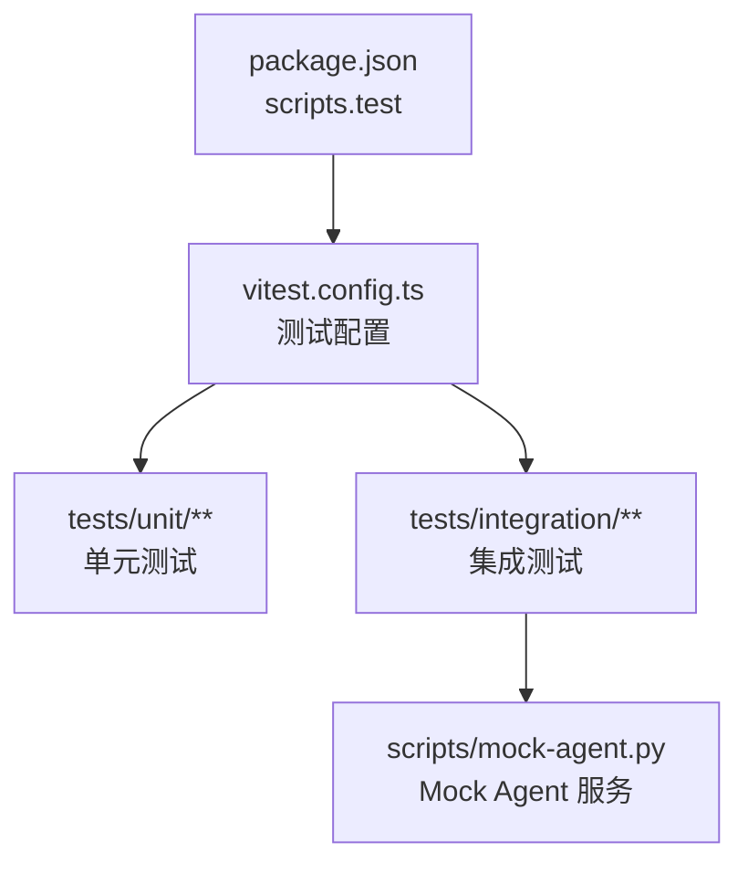
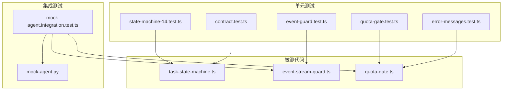
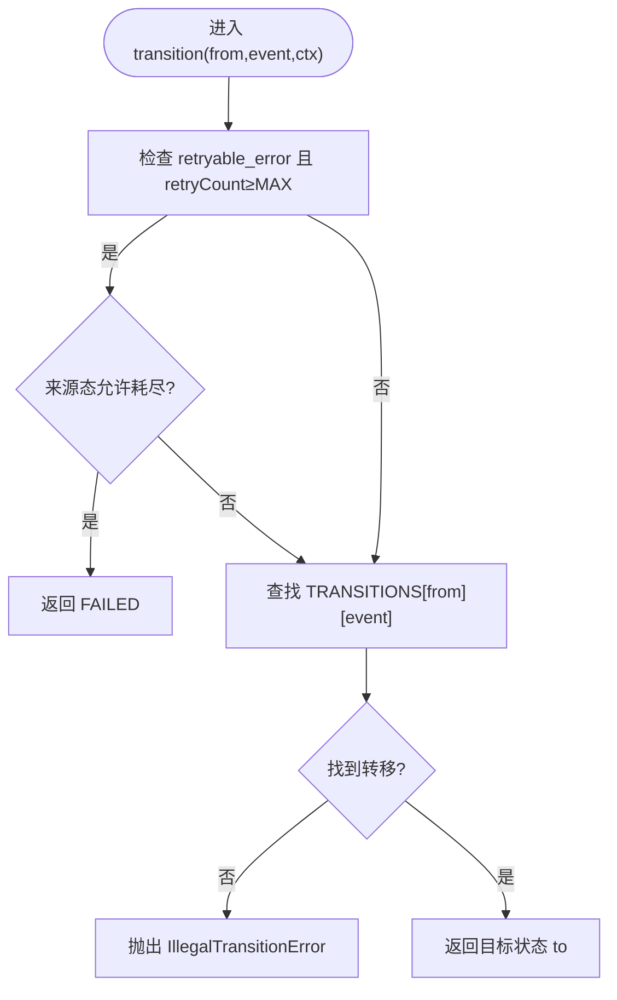
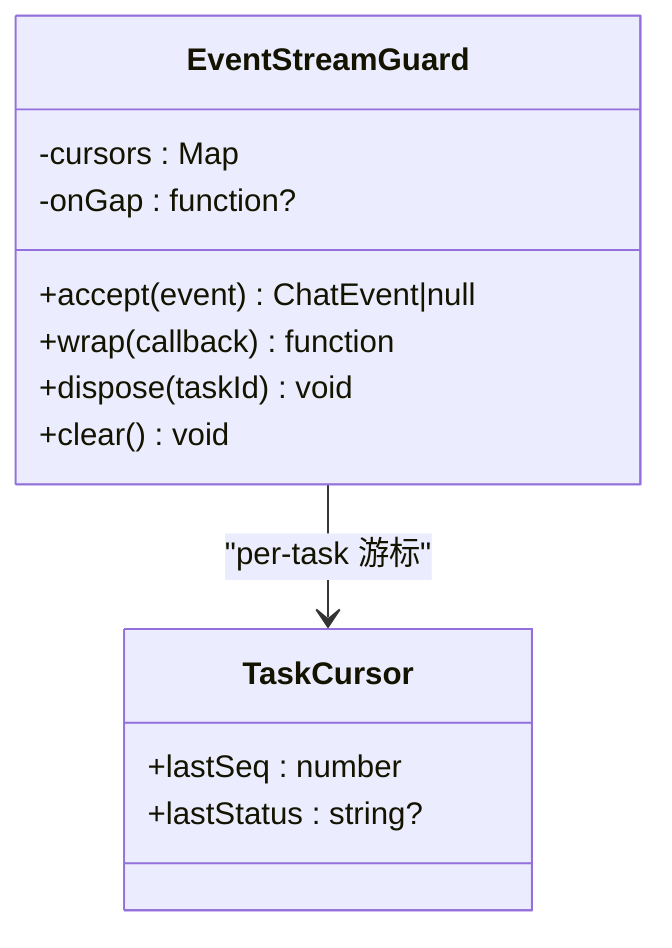
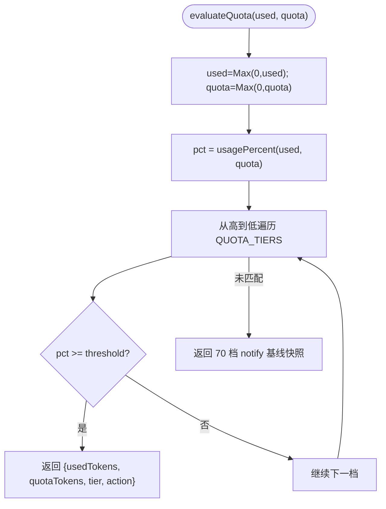
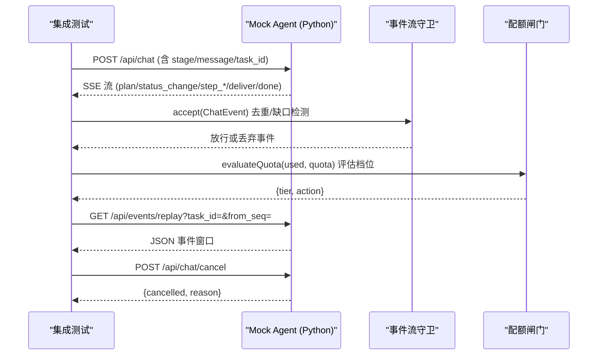
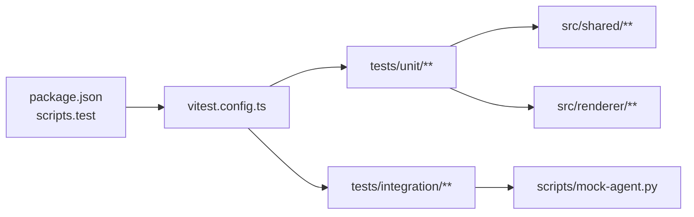

# 测试指南

<cite>
**本文引用的文件**   
- [package.json](file://tongtian-tauri/package.json)
- [vitest.config.ts](file://tongtian-tauri/vitest.config.ts)
- [vite.config.ts](file://tongtian-tauri/vite.config.ts)
- [task-state-machine.ts](file://tongtian-tauri/src/shared/task-state-machine.ts)
- [event-stream-guard.ts](file://tongtian-tauri/src/renderer/lib/event-stream-guard.ts)
- [quota-gate.ts](file://tongtian-tauri/src/shared/quota-gate.ts)
- [contract.test.ts](file://tongtian-tauri/tests/unit/shared/contract.test.ts)
- [error-messages.test.ts](file://tongtian-tauri/tests/unit/shared/error-messages.test.ts)
- [state-machine-14.test.ts](file://tongtian-tauri/tests/unit/agent/state-machine-14.test.ts)
- [event-guard.test.ts](file://tongtian-tauri/tests/unit/bridge/event-guard.test.ts)
- [quota-gate.test.ts](file://tongtian-tauri/tests/unit/model/quota-gate.test.ts)
- [mock-agent.integration.test.ts](file://tongtian-tauri/tests/integration/mock-agent.integration.test.ts)
- [mock-agent.py](file://tongtian-tauri/scripts/mock-agent.py)
</cite>

## 目录
1. [简介](#简介)
2. [项目结构](#项目结构)
3. [核心组件](#核心组件)
4. [架构总览](#架构总览)
5. [详细组件分析](#详细组件分析)
6. [依赖关系分析](#依赖关系分析)
7. [性能与稳定性考量](#性能与稳定性考量)
8. [故障排查指南](#故障排查指南)
9. [结论](#结论)
10. [附录](#附录)

## 简介
本测试指南面向通天办公（Tauri）项目的单元测试、集成测试与端到端测试的编写与执行，覆盖以下主题：
- 测试框架选择与配置（Vitest）
- Mock 策略与外部依赖隔离
- 测试数据管理与契约快照门禁
- 覆盖率要求与持续集成建议
- 自动化测试流程与调试技巧
- 最佳实践与质量保证建议

本项目采用 TypeScript + Vite + Vitest 的前端/共享逻辑测试栈，并通过 Python 编写的 Mock Agent 进行 SSE 集成测试。测试范围涵盖状态机、事件流守卫、配额闸门以及契约一致性校验。

## 项目结构
- 测试入口与脚本
  - package.json 提供 test 脚本，统一通过 Vitest 运行测试。
- 测试配置
  - vitest.config.ts 定义测试环境、包含路径、超时与覆盖率采集范围。
  - vite.config.ts 仅用于构建与开发服务，不直接参与测试执行。
- 测试用例组织
  - tests/unit：针对共享层与渲染层纯函数/类的单元测试。
  - tests/integration：基于本地 Python Mock Agent 的 SSE 集成测试。

**图表来源** 
- [package.json:1-45](file://tongtian-tauri/package.json#L1-L45)
- [vitest.config.ts:1-29](file://tongtian-tauri/vitest.config.ts#L1-L29)

**章节来源**
- [package.json:1-45](file://tongtian-tauri/package.json#L1-L45)
- [vitest.config.ts:1-29](file://tongtian-tauri/vitest.config.ts#L1-L29)
- [vite.config.ts:1-25](file://tongtian-tauri/vite.config.ts#L1-L25)

## 核心组件
- 任务状态机（14 态）
  - 职责：定义 35 条合法转移、重试上限、wait_reason 子态、终态判定等。
  - 关键实现：src/shared/task-state-machine.ts
  - 对应单测：tests/unit/agent/state-machine-14.test.ts
- 事件流守卫（SSE seq 去重与缺口检测）
  - 职责：按 taskId 维护游标，丢弃重复事件，检测 seq 缺口并触发回调；status_change 幂等。
  - 关键实现：src/renderer/lib/event-stream-guard.ts
  - 对应单测：tests/unit/bridge/event-guard.test.ts
- 配额四档闸门
  - 职责：根据使用率计算档位与动作（notify/degrade/queue/block），支持错误码联动。
  - 关键实现：src/shared/quota-gate.ts
  - 对应单测：tests/unit/model/quota-gate.test.ts
- 契约快照门禁
  - 职责：冻结 TaskStatus、ErrorCode、IPC_CHANNELS、ChatEvent 等类型，防止契约漂移。
  - 关键实现：tests/unit/shared/contract.test.ts
- 错误消息映射
  - 职责：为 9 个云端必需错误码提供用户可读文案，未知码降级展示。
  - 关键实现：tests/unit/shared/error-messages.test.ts
- Mock Agent（Python）
  - 职责：模拟 SSE 接口、事件重放、取消、两阶段协议与专项测试触发器。
  - 关键实现：scripts/mock-agent.py
  - 对应集成测试：tests/integration/mock-agent.integration.test.ts

**章节来源**
- [task-state-machine.ts:1-223](file://tongtian-tauri/src/shared/task-state-machine.ts#L1-L223)
- [event-stream-guard.ts:1-97](file://tongtian-tauri/src/renderer/lib/event-stream-guard.ts#L1-L97)
- [quota-gate.ts:1-81](file://tongtian-tauri/src/shared/quota-gate.ts#L1-L81)
- [contract.test.ts:1-169](file://tongtian-tauri/tests/unit/shared/contract.test.ts#L1-L169)
- [error-messages.test.ts:1-47](file://tongtian-tauri/tests/unit/shared/error-messages.test.ts#L1-L47)
- [state-machine-14.test.ts:1-213](file://tongtian-tauri/tests/unit/agent/state-machine-14.test.ts#L1-L213)
- [event-guard.test.ts:1-85](file://tongtian-tauri/tests/unit/bridge/event-guard.test.ts#L1-L85)
- [quota-gate.test.ts:1-117](file://tongtian-tauri/tests/unit/model/quota-gate.test.ts#L1-L117)
- [mock-agent.integration.test.ts:1-289](file://tongtian-tauri/tests/integration/mock-agent.integration.test.ts#L1-L289)
- [mock-agent.py:1-399](file://tongtian-tauri/scripts/mock-agent.py#L1-L399)

## 架构总览
下图展示了测试驱动的核心模块与交互关系：单元测试验证共享层与渲染层逻辑；集成测试通过本地 Python Mock Agent 验证 SSE 契约与端到端流程。

**图表来源** 
- [state-machine-14.test.ts:1-213](file://tongtian-tauri/tests/unit/agent/state-machine-14.test.ts#L1-L213)
- [event-guard.test.ts:1-85](file://tongtian-tauri/tests/unit/bridge/event-guard.test.ts#L1-L85)
- [quota-gate.test.ts:1-117](file://tongtian-tauri/tests/unit/model/quota-gate.test.ts#L1-L117)
- [contract.test.ts:1-169](file://tongtian-tauri/tests/unit/shared/contract.test.ts#L1-L169)
- [error-messages.test.ts:1-47](file://tongtian-tauri/tests/unit/shared/error-messages.test.ts#L1-L47)
- [task-state-machine.ts:1-223](file://tongtian-tauri/src/shared/task-state-machine.ts#L1-L223)
- [event-stream-guard.ts:1-97](file://tongtian-tauri/src/renderer/lib/event-stream-guard.ts#L1-L97)
- [quota-gate.ts:1-81](file://tongtian-tauri/src/shared/quota-gate.ts#L1-L81)
- [mock-agent.integration.test.ts:1-289](file://tongtian-tauri/tests/integration/mock-agent.integration.test.ts#L1-L289)
- [mock-agent.py:1-399](file://tongtian-tauri/scripts/mock-agent.py#L1-L399)

## 详细组件分析

### 任务状态机（14 态）测试
- 目标
  - 验证 35 条合法转移、非法转移拒绝、retry guard（重试上限）、wait_reason 子态、终态判定与可用事件集合。
- 断言模式
  - 枚举长度与可达性断言
  - 逐条转移表验证（from, event, to）
  - 非法转移抛出特定错误类型
  - 上下文参数（如 retryCount）影响路由
- 复杂度与边界
  - 转移表 O(n) 查找；重试上限条件分支需覆盖边界值（等于/大于 MAX_RETRY_COUNT）。
- 调试技巧
  - 打印非法转移 from/event 以定位调用方传入的事件是否合法。
  - 对 wait_reason 子态单独构造输入，确保非 executing 态抛错。

**图表来源** 
- [task-state-machine.ts:160-201](file://tongtian-tauri/src/shared/task-state-machine.ts#L160-L201)

**章节来源**
- [state-machine-14.test.ts:1-213](file://tongtian-tauri/tests/unit/agent/state-machine-14.test.ts#L1-L213)
- [task-state-machine.ts:1-223](file://tongtian-tauri/src/shared/task-state-machine.ts#L1-L223)

### 事件流守卫（SSE seq 去重与缺口检测）测试
- 目标
  - 验证 per-task 游标去重、seq 缺口检测、status_change 幂等、无 seq 直通兼容、wrap 包装与 dispose 清理。
- 断言模式
  - accept 返回值 null 表示丢弃；非 null 表示放行。
  - onGap 回调被正确触发且参数符合期望。
  - wrap 仅放行通过守卫的事件。
- 复杂度与内存
  - Map 维护 per-task 游标；dispose 后释放内存，避免泄漏。
- 调试技巧
  - 构造乱序与重复事件序列，观察 lastSeq 更新与 onGap 触发时机。
  - 对 status_change 同状态多次推送，确认幂等行为。

**图表来源** 
- [event-stream-guard.ts:1-97](file://tongtian-tauri/src/renderer/lib/event-stream-guard.ts#L1-L97)

**章节来源**
- [event-guard.test.ts:1-85](file://tongtian-tauri/tests/unit/bridge/event-guard.test.ts#L1-L85)
- [event-stream-guard.ts:1-97](file://tongtian-tauri/src/renderer/lib/event-stream-guard.ts#L1-L97)

### 配额四档闸门测试
- 目标
  - 验证四档阈值（70/85/95/100%）与动作链（notify→degrade→queue→block），异常输入处理，错误码联动。
- 断言模式
  - evaluateQuota 返回 tier/action 与预期一致。
  - shouldBlock/shouldQueue 在相应档位为真。
  - tierChanged 仅在档位跃迁或首次达到阈值时触发预警。
  - blockErrorCodeFor 区分新提交与运行中任务的错误码。
- 复杂度与边界
  - usagePercent 对 quota<=0 的特殊处理；负值归零。
  - 边界下沿（如 84.9%、94.9%、99.9%）停留在较低档。

**图表来源** 
- [quota-gate.ts:37-54](file://tongtian-tauri/src/shared/quota-gate.ts#L37-L54)

**章节来源**
- [quota-gate.test.ts:1-117](file://tongtian-tauri/tests/unit/model/quota-gate.test.ts#L1-L117)
- [quota-gate.ts:1-81](file://tongtian-tauri/src/shared/quota-gate.ts#L1-L81)

### 契约快照门禁测试
- 目标
  - 冻结 TaskStatus（14 态）、ErrorCode（9 个云端必需码）、IPC_CHANNELS（新增通道名）、ChatEvent（新增事件与 seq 可选字段）、Lease/Quota/TaskMeta 类型。
- 断言模式
  - 枚举值存在性与数量断言。
  - 通道名唯一性。
  - 类型兼容性（contracts 版可整体赋值给 types 版）。
  - WaitReason 联合类型覆盖执行期子态与等待成因。
- 价值
  - 作为 CI 门禁，防止契约漂移导致前后端/多语言实现不一致。

**章节来源**
- [contract.test.ts:1-169](file://tongtian-tauri/tests/unit/shared/contract.test.ts#L1-L169)

### 错误消息映射测试
- 目标
  - 确保 9 个云端必需错误码均有用户可读文案；未知码降级展示不白屏。
- 断言模式
  - errorMessageOf(code) 返回非空且不等于原始码。
  - 配额/预算阻断文案区分明确。
  - 空/undefined/null 返回兜底文案。

**章节来源**
- [error-messages.test.ts:1-47](file://tongtian-tauri/tests/unit/shared/error-messages.test.ts#L1-L47)

### 集成测试（Mock Agent SSE）
- 目标
  - 端到端验证 SSE 契约：单调 seq、id 行、重放端点、取消端点、突发吞吐、两阶段协议（plan→pending_review→approve→step_*→deliver→done）。
- 依赖与环境
  - 需要本机 Python；不可用时自动跳过（describe.skipIf），不阻塞 CI。
- 关键流程
  - 启动 mock-agent.py，健康检查就绪后执行用例。
  - 解析 SSE 文本为事件列表，断言事件类型、seq 单调递增、id 行格式。
  - 重放端点过滤 from_seq，窗口未过期时返回缺失事件。
  - 取消端点对未知任务返回 cancelled=false，活跃任务可取消。
  - 两阶段协议：approve/reject/modify 的行为与状态变化。

**图表来源** 
- [mock-agent.integration.test.ts:1-289](file://tongtian-tauri/tests/integration/mock-agent.integration.test.ts#L1-L289)
- [mock-agent.py:1-399](file://tongtian-tauri/scripts/mock-agent.py#L1-L399)
- [event-stream-guard.ts:1-97](file://tongtian-tauri/src/renderer/lib/event-stream-guard.ts#L1-L97)
- [quota-gate.ts:1-81](file://tongtian-tauri/src/shared/quota-gate.ts#L1-L81)

**章节来源**
- [mock-agent.integration.test.ts:1-289](file://tongtian-tauri/tests/integration/mock-agent.integration.test.ts#L1-L289)
- [mock-agent.py:1-399](file://tongtian-tauri/scripts/mock-agent.py#L1-L399)

## 依赖关系分析
- 测试与源码依赖
  - 单元测试直接导入 src/shared 与 src/renderer 中的纯函数/类。
  - 集成测试依赖 scripts/mock-agent.py 提供的 HTTP/SSE 服务。
- 配置文件依赖
  - vitest.config.ts 指定 include 路径、环境、超时与覆盖率采集范围。
  - package.json 提供 test 脚本入口。

**图表来源** 
- [package.json:1-45](file://tongtian-tauri/package.json#L1-L45)
- [vitest.config.ts:1-29](file://tongtian-tauri/vitest.config.ts#L1-L29)

**章节来源**
- [package.json:1-45](file://tongtian-tauri/package.json#L1-L45)
- [vitest.config.ts:1-29](file://tongtian-tauri/vitest.config.ts#L1-L29)

## 性能与稳定性考量
- 覆盖率配置
  - 使用 v8 provider，仅采集 src/shared/**/*.ts 的覆盖率，聚焦共享层纯逻辑。
- 超时设置
  - 全局测试超时 30s，适合集成测试中网络与进程启动场景。
- 并发与资源
  - 集成测试启动 Python 子进程，注意端口占用与健康检查；测试结束后清理进程。
- 内存管理
  - 事件流守卫在任务终态后调用 dispose 清理游标，避免内存泄漏。

[本节为通用指导，无需具体文件引用]

## 故障排查指南
- 常见失败原因
  - Python 环境缺失：集成测试自动跳过，但本地手动运行需安装 Python。
  - 端口冲突：Mock Agent 默认端口 18910，若被占用需调整。
  - 契约漂移：contract.test.ts 失败表明类型/枚举变更未同步，需修复。
- 调试技巧
  - 在状态机非法转移处打印 from/event 定位调用方事件合法性。
  - 在事件流守卫中打印 lastSeq 与 onGap 参数，确认缺口检测逻辑。
  - 在配额闸门中打印 used/quota/pct，确认档位计算是否符合预期。
- 日志与输出
  - Mock Agent 会输出请求与事件发送日志，便于定位 SSE 流问题。

**章节来源**
- [mock-agent.integration.test.ts:1-289](file://tongtian-tauri/tests/integration/mock-agent.integration.test.ts#L1-L289)
- [mock-agent.py:1-399](file://tongtian-tauri/scripts/mock-agent.py#L1-L399)
- [task-state-machine.ts:147-155](file://tongtian-tauri/src/shared/task-state-machine.ts#L147-L155)
- [event-stream-guard.ts:62-75](file://tongtian-tauri/src/renderer/lib/event-stream-guard.ts#L62-L75)
- [quota-gate.ts:37-54](file://tongtian-tauri/src/shared/quota-gate.ts#L37-L54)

## 结论
本项目测试体系围绕共享层纯函数与渲染层守卫展开，辅以 Python Mock Agent 完成 SSE 契约的端到端验证。通过契约快照门禁保障类型一致性，结合覆盖率与超时配置提升质量与稳定性。建议在 CI 中固定运行单元测试与集成测试，并在变更契约时优先修复 contract.test.ts 失败。

[本节为总结，无需具体文件引用]

## 附录
- 运行命令
  - 执行测试：npm test（等价于 vitest run）
  - 类型检查：npm run typecheck（tsc --noEmit）
- 覆盖率查看
  - 在 vitest.config.ts 中已启用 v8 provider，可通过 Vitest CLI 生成报告（例如添加 --coverage 参数）。
- 最佳实践
  - 单元测试聚焦纯函数与类方法，避免 IO 与网络依赖。
  - 集成测试尽量使用 Mock 服务，保证稳定与可重复。
  - 契约变更必须同步更新 contract.test.ts，确保三方实现一致。
  - 对边界值与异常输入进行充分覆盖，尤其是阈值与重试上限。
  - 保持测试命名清晰，描述断言意图，便于维护与回归。

[本节为通用指导，无需具体文件引用]