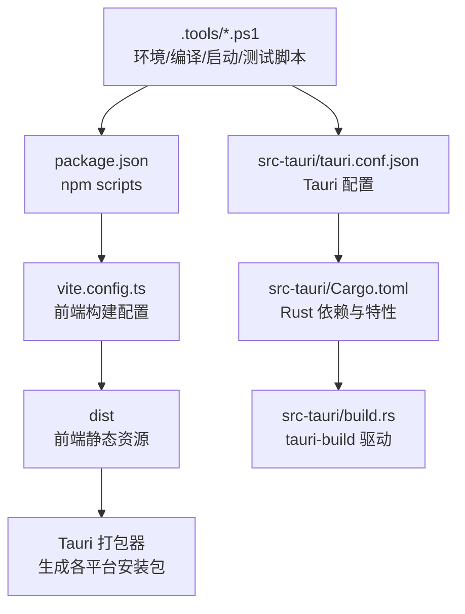
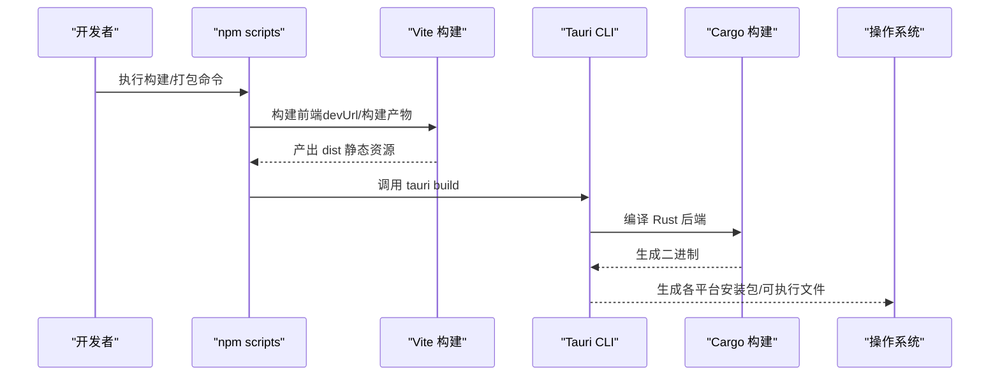
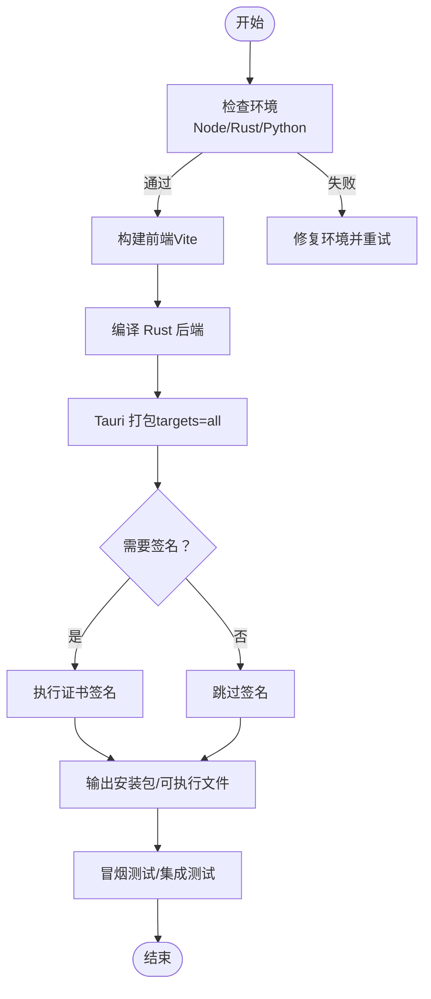
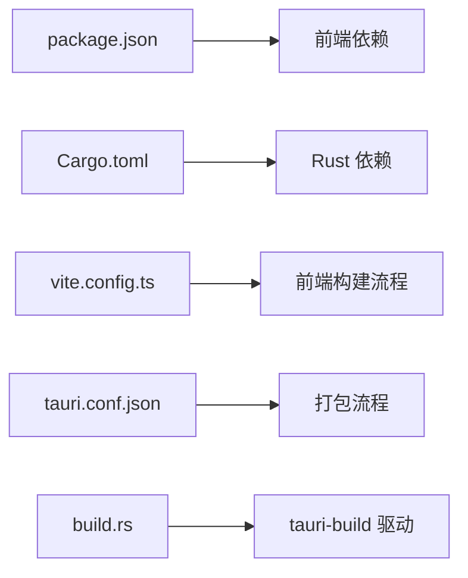

# 部署指南

<cite>
**本文引用的文件**   
- [tongtian-tauri/src-tauri/tauri.conf.json](file://tongtian-tauri/src-tauri/tauri.conf.json)
- [tongtian-tauri/package.json](file://tongtian-tauri/package.json)
- [tongtian-tauri/vite.config.ts](file://tongtian-tauri/vite.config.ts)
- [tongtian-tauri/src-tauri/Cargo.toml](file://tongtian-tauri/src-tauri/Cargo.toml)
- [tongtian-tauri/src-tauri/build.rs](file://tongtian-tauri/src-tauri/build.rs)
- [tongtian-tauri/.tools/setup-env.ps1](file://tongtian-tauri/.tools/setup-env.ps1)
- [tongtian-tauri/.tools/compile-all.ps1](file://tongtian-tauri/.tools/compile-all.ps1)
- [tongtian-tauri/.tools/start-product.ps1](file://tongtian-tauri/.tools/start-product.ps1)
- [tongtian-tauri/.tools/test-engine-smoke.ps1](file://tongtian-tauri/.tools/test-engine-smoke.ps1)
</cite>

## 目录
1. [简介](#简介)
2. [项目结构](#项目结构)
3. [核心组件](#核心组件)
4. [架构总览](#架构总览)
5. [详细组件分析](#详细组件分析)
6. [依赖关系分析](#依赖关系分析)
7. [性能考虑](#性能考虑)
8. [故障排查指南](#故障排查指南)
9. [结论](#结论)
10. [附录](#附录)

## 简介
本指南面向 Windows、macOS、Linux 三平台的 Tauri 桌面应用“通天办公”的构建与打包、环境差异配置、证书签名、自动更新、Docker 容器化、CI/CD 流水线、生产监控与日志收集，以及部署检查清单、常见问题与性能优化建议。文档基于仓库中的 Tauri 配置、Vite 前端构建、Rust 后端构建脚本与工具脚本进行说明，确保读者可按步骤完成从开发到生产的完整交付流程。

## 项目结构
本项目采用 Tauri 2.x + Vite React 前端 + Rust 后端的典型结构：
- 前端资源位于 src/renderer，通过 Vite 构建输出到 dist；
- Tauri 配置在 src-tauri/tauri.conf.json，控制产物名称、版本、窗口、安全策略与打包目标；
- Rust 后端依赖与编译选项在 src-tauri/Cargo.toml，包含 release 优化参数；
- 构建入口由 tauri-build 驱动（build.rs），并调用 npm scripts 执行前端构建；
- 工具脚本位于 .tools，提供环境准备、全量编译、启动产品版与冒烟测试等能力。

图表来源
- [tongtian-tauri/package.json:1-45](file://tongtian-tauri/package.json#L1-L45)
- [tongtian-tauri/vite.config.ts:1-25](file://tongtian-tauri/vite.config.ts#L1-L25)
- [tongtian-tauri/src-tauri/tauri.conf.json:1-40](file://tongtian-tauri/src-tauri/tauri.conf.json#L1-L40)
- [tongtian-tauri/src-tauri/Cargo.toml:1-40](file://tongtian-tauri/src-tauri/Cargo.toml#L1-L40)
- [tongtian-tauri/src-tauri/build.rs:1-4](file://tongtian-tauri/src-tauri/build.rs#L1-L4)

章节来源
- [tongtian-tauri/package.json:1-45](file://tongtian-tauri/package.json#L1-L45)
- [tongtian-tauri/vite.config.ts:1-25](file://tongtian-tauri/vite.config.ts#L1-L25)
- [tongtian-tauri/src-tauri/tauri.conf.json:1-40](file://tongtian-tauri/src-tauri/tauri.conf.json#L1-L40)
- [tongtian-tauri/src-tauri/Cargo.toml:1-40](file://tongtian-tauri/src-tauri/Cargo.toml#L1-L40)
- [tongtian-tauri/src-tauri/build.rs:1-4](file://tongtian-tauri/src-tauri/build.rs#L1-L4)

## 核心组件
- Tauri 配置（tauri.conf.json）：定义产品名称、版本号、标识符、构建前后命令、前端路径、窗口与安全策略、打包目标与图标集。
- Vite 前端构建（vite.config.ts）：指定根目录、输出目录、sourcemap、别名、开发服务器端口与严格端口模式。
- Rust 后端（Cargo.toml）：声明 Tauri 插件、网络库、数据库、密钥存储等依赖，release profile 开启 LTO、strip、单 codegen unit 以减小体积并提升性能。
- 构建脚本（build.rs）：调用 tauri_build::build() 驱动 Tauri 构建流程。
- 工具脚本（.tools）：提供环境准备、全量编译、启动产品版、冒烟测试等自动化能力。

章节来源
- [tongtian-tauri/src-tauri/tauri.conf.json:1-40](file://tongtian-tauri/src-tauri/tauri.conf.json#L1-L40)
- [tongtian-tauri/vite.config.ts:1-25](file://tongtian-tauri/vite.config.ts#L1-L25)
- [tongtian-tauri/src-tauri/Cargo.toml:1-40](file://tongtian-tauri/src-tauri/Cargo.toml#L1-L40)
- [tongtian-tauri/src-tauri/build.rs:1-4](file://tongtian-tauri/src-tauri/build.rs#L1-L4)
- [tongtian-tauri/.tools/compile-all.ps1](file://tongtian-tauri/.tools/compile-all.ps1)
- [tongtian-tauri/.tools/start-product.ps1](file://tongtian-tauri/.tools/start-product.ps1)
- [tongtian-tauri/.tools/test-engine-smoke.ps1](file://tongtian-tauri/.tools/test-engine-smoke.ps1)

## 架构总览
下图展示了从源码到可分发包的关键构建与运行链路，包括前端构建、Tauri 打包、Rust 编译与工具脚本参与点。

图表来源
- [tongtian-tauri/package.json:1-45](file://tongtian-tauri/package.json#L1-L45)
- [tongtian-tauri/vite.config.ts:1-25](file://tongtian-tauri/vite.config.ts#L1-L25)
- [tongtian-tauri/src-tauri/tauri.conf.json:1-40](file://tongtian-tauri/src-tauri/tauri.conf.json#L1-L40)
- [tongtian-tauri/src-tauri/Cargo.toml:1-40](file://tongtian-tauri/src-tauri/Cargo.toml#L1-L40)

## 详细组件分析

### Tauri 配置文件详解（tauri.conf.json）
- 基本信息：productName、version、identifier 用于应用标识与商店发布。
- 构建阶段：beforeDevCommand、devUrl、beforeBuildCommand、frontendDist 决定开发与生产的前端资源来源与构建顺序。
- 应用窗口：windows 数组定义默认窗口尺寸、最小尺寸、是否可调整大小与居中。
- 安全策略：security.csp 为空表示不启用 CSP（生产环境建议按需启用）。
- 打包：bundle.active 启用打包，targets=all 覆盖所有平台，icon 列表包含多分辨率与跨平台图标。

章节来源
- [tongtian-tauri/src-tauri/tauri.conf.json:1-40](file://tongtian-tauri/src-tauri/tauri.conf.json#L1-L40)

### Vite 前端构建（vite.config.ts）
- root 指向 src/renderer，base 为相对路径，便于本地预览与打包。
- build.outDir 输出到 ../../dist，emptyOutDir 清理旧产物，sourcemap 开启以便调试。
- resolve.alias 定义 @shared 与 @renderer 别名，简化导入。
- server.port=7173 且 strictPort=true，保证开发服务稳定占用端口。

章节来源
- [tongtian-tauri/vite.config.ts:1-25](file://tongtian-tauri/vite.config.ts#L1-L25)

### Rust 后端与编译优化（Cargo.toml）
- features 中 tt-enable-seq 默认开启，用于 SSE 序列与重放契约开关。
- dependencies 包含 tauri 及其插件、tokio、reqwest、rusqlite（bundled）、keyring、uuid 等。
- profile.release 设置 codegen-units=1、lto=true、opt-level="s"、strip=true，显著减小体积并提升运行效率。

章节来源
- [tongtian-tauri/src-tauri/Cargo.toml:1-40](file://tongtian-tauri/src-tauri/Cargo.toml#L1-L40)

### 构建脚本（build.rs）
- 调用 tauri_build::build() 驱动 Tauri 构建流程，确保与 tauri.conf.json 一致。

章节来源
- [tongtian-tauri/src-tauri/build.rs:1-4](file://tongtian-tauri/src-tauri/build.rs#L1-L4)

### 工具脚本与环境准备（.tools）
- setup-env.ps1：安装或校验必要环境（如 Node、Rust、Python 等），建议在首次使用前执行。
- compile-all.ps1：统一触发前端与 Rust 构建，适合 CI 或本地全量编译。
- start-product.ps1：启动产品版（生产模式）应用，便于验证打包结果。
- test-engine-smoke.ps1：执行冒烟测试，快速验证核心功能可用性。

章节来源
- [tongtian-tauri/.tools/setup-env.ps1](file://tongtian-tauri/.tools/setup-env.ps1)
- [tongtian-tauri/.tools/compile-all.ps1](file://tongtian-tauri/.tools/compile-all.ps1)
- [tongtian-tauri/.tools/start-product.ps1](file://tongtian-tauri/.tools/start-product.ps1)
- [tongtian-tauri/.tools/test-engine-smoke.ps1](file://tongtian-tauri/.tools/test-engine-smoke.ps1)

### 构建与打包流程图（按环境区分）

图表来源
- [tongtian-tauri/package.json:1-45](file://tongtian-tauri/package.json#L1-L45)
- [tongtian-tauri/vite.config.ts:1-25](file://tongtian-tauri/vite.config.ts#L1-L25)
- [tongtian-tauri/src-tauri/tauri.conf.json:1-40](file://tongtian-tauri/src-tauri/tauri.conf.json#L1-L40)
- [tongtian-tauri/src-tauri/Cargo.toml:1-40](file://tongtian-tauri/src-tauri/Cargo.toml#L1-L40)
- [tongtian-tauri/.tools/test-engine-smoke.ps1](file://tongtian-tauri/.tools/test-engine-smoke.ps1)

## 依赖关系分析
- 前端依赖：React、MUI、Zustand、Vitest、Tailwind 等，由 package.json 管理。
- 后端依赖：Tauri 生态、异步运行时、HTTP 客户端、SQLite、密钥存储等，由 Cargo.toml 管理。
- 构建依赖：tauri-build、Vite 插件、TypeScript 类型检查等。

图表来源
- [tongtian-tauri/package.json:1-45](file://tongtian-tauri/package.json#L1-L45)
- [tongtian-tauri/src-tauri/Cargo.toml:1-40](file://tongtian-tauri/src-tauri/Cargo.toml#L1-L40)
- [tongtian-tauri/vite.config.ts:1-25](file://tongtian-tauri/vite.config.ts#L1-L25)
- [tongtian-tauri/src-tauri/tauri.conf.json:1-40](file://tongtian-tauri/src-tauri/tauri.conf.json#L1-L40)
- [tongtian-tauri/src-tauri/build.rs:1-4](file://tongtian-tauri/src-tauri/build.rs#L1-L4)

章节来源
- [tongtian-tauri/package.json:1-45](file://tongtian-tauri/package.json#L1-L45)
- [tongtian-tauri/src-tauri/Cargo.toml:1-40](file://tongtian-tauri/src-tauri/Cargo.toml#L1-L40)

## 性能考虑
- Rust 发布优化：启用 LTO、strip、单 codegen unit，减少二进制体积并提升启动速度。
- 前端构建：开启 sourcemap 便于调试，生产构建应关闭 sourcemap 并启用代码压缩与 tree-shaking。
- 资源加载：合理拆分路由与组件，避免首屏过大；静态资源使用 CDN 或本地缓存策略。
- I/O 与并发：后端使用 tokio 异步运行时，注意避免阻塞操作；数据库查询与网络请求需设置超时与重试。
- 内存与日志：限制日志级别与轮转策略，避免磁盘占用过高；关键路径添加性能埋点。

[本节为通用指导，无需特定文件引用]

## 故障排查指南
- 开发端口冲突：Vite 严格端口模式下若 7173 被占用将报错，请释放端口或修改配置。
- 前端构建失败：检查 node_modules 是否完整、Vite 插件与 TypeScript 版本兼容性。
- Rust 编译失败：确认 Rust 工具链与目标平台已安装，依赖库（如 rusqlite bundled）是否需要系统级依赖。
- 打包失败：检查 tauri.conf.json 的 targets 与图标路径是否正确；Windows 可能需要安装 Windows SDK。
- 签名问题：Windows/macOS 需要正确配置证书与密码；Linux 通常不需要签名但需确保权限。
- 冒烟测试失败：检查后端服务与 Python 环境是否正常，必要时查看测试脚本输出。

章节来源
- [tongtian-tauri/vite.config.ts:1-25](file://tongtian-tauri/vite.config.ts#L1-L25)
- [tongtian-tauri/src-tauri/tauri.conf.json:1-40](file://tongtian-tauri/src-tauri/tauri.conf.json#L1-L40)
- [tongtian-tauri/src-tauri/Cargo.toml:1-40](file://tongtian-tauri/src-tauri/Cargo.toml#L1-L40)
- [tongtian-tauri/.tools/test-engine-smoke.ps1](file://tongtian-tauri/.tools/test-engine-smoke.ps1)

## 结论
通过合理的 Tauri 配置、Vite 前端构建与 Rust 后端优化，结合工具脚本与 CI/CD 流水线，可实现跨平台的高效构建与稳定交付。生产环境应关注安全策略、签名与更新机制，同时完善监控与日志体系，保障应用的可观测性与可维护性。

[本节为总结性内容，无需特定文件引用]

## 附录

### 多平台构建与打包流程
- Windows
  - 环境：Node.js、Rust（含 MSVC 工具链）、可选 Python。
  - 构建：执行环境准备脚本，然后运行全量编译脚本。
  - 打包：Tauri 打包生成 MSI/NSIS 安装包，支持代码签名。
  - 签名：配置证书路径与密码，确保时间戳服务器可用。
- macOS
  - 环境：Node.js、Rust、Xcode Command Line Tools。
  - 构建：执行全量编译脚本。
  - 打包：生成.app 与 DMG，支持 Apple 开发者签名与公证。
- Linux
  - 环境：Node.js、Rust、系统依赖（如 SQLite 开发库）。
  - 构建：执行全量编译脚本。
  - 打包：生成 AppImage/Deb/Rpm，通常无需签名。

章节来源
- [tongtian-tauri/.tools/setup-env.ps1](file://tongtian-tauri/.tools/setup-env.ps1)
- [tongtian-tauri/.tools/compile-all.ps1](file://tongtian-tauri/.tools/compile-all.ps1)
- [tongtian-tauri/src-tauri/tauri.conf.json:1-40](file://tongtian-tauri/src-tauri/tauri.conf.json#L1-L40)

### 开发/测试/生产环境配置差异
- 开发环境
  - Vite 开发服务器端口 7173，strictPort=true。
  - tauri.conf.json 的 devUrl 指向本地开发服务。
  - 开启 sourcemap，便于调试。
- 测试环境
  - 使用冒烟测试脚本验证核心功能。
  - 可切换后端代理或 Mock 数据。
- 生产环境
  - 关闭 sourcemap，启用代码压缩与 Tree Shaking。
  - 配置 CSP 与权限策略，限制不安全行为。
  - 启用日志轮转与远程上报。

章节来源
- [tongtian-tauri/vite.config.ts:1-25](file://tongtian-tauri/vite.config.ts#L1-L25)
- [tongtian-tauri/src-tauri/tauri.conf.json:1-40](file://tongtian-tauri/src-tauri/tauri.conf.json#L1-L40)
- [tongtian-tauri/.tools/test-engine-smoke.ps1](file://tongtian-tauri/.tools/test-engine-smoke.ps1)

### Tauri 配置文件常用选项说明
- productName/version/identifier：应用名、版本、唯一标识。
- build.beforeDevCommand/beforeBuildCommand：构建前后执行的命令。
- build.devUrl/frontendDist：开发服务地址与前端构建产物目录。
- app.windows：窗口尺寸、最小尺寸、是否可调整大小与居中。
- app.security.csp：内容安全策略（生产建议启用）。
- bundle.targets：打包目标（all 覆盖所有平台）。
- bundle.icon：多分辨率与跨平台图标集合。

章节来源
- [tongtian-tauri/src-tauri/tauri.conf.json:1-40](file://tongtian-tauri/src-tauri/tauri.conf.json#L1-L40)

### 证书签名设置
- Windows：配置 pfx 证书路径与密码，启用时间戳服务器。
- macOS：配置开发者证书与钥匙串访问，执行签名与公证流程。
- Linux：通常无需签名，如需签名可使用 gpg 或 rpm 签名工具。

[本节为通用指导，无需特定文件引用]

### 自动更新配置
- 服务端：提供版本元数据与增量补丁下载接口。
- 客户端：在 Tauri 中启用更新插件，配置更新源与校验规则。
- 策略：灰度发布、回滚机制、强制更新提示。

[本节为通用指导，无需特定文件引用]

### Docker 容器化部署
- 基础镜像：选择 Node.js 与 Rust 官方镜像，安装系统依赖。
- 构建阶段：复制源码，执行 npm install 与 cargo build --release。
- 运行阶段：仅包含产物与运行时依赖，暴露必要端口。
- 环境变量：注入 API 地址、日志级别、更新源等。

[本节为通用指导，无需特定文件引用]

### CI/CD 流水线配置
- 触发条件：push/PR 事件。
- 矩阵构建：并行构建 Windows/macOS/Linux。
- 缓存：缓存 node_modules 与 cargo registry。
- 测试：执行单元测试与冒烟测试。
- 打包与签名：生成安装包并签名。
- 发布：上传至制品库或发布渠道。

[本节为通用指导，无需特定文件引用]

### 生产环境监控与日志收集
- 应用日志：分级记录，支持轮转与远程上报。
- 错误追踪：采集异常堆栈与上下文信息。
- 性能指标：CPU、内存、I/O 与网络请求耗时。
- 告警策略：阈值告警与自愈机制。

[本节为通用指导，无需特定文件引用]

### 部署检查清单
- 环境准备：Node.js、Rust、Python（如需要）已安装。
- 依赖安装：npm install 与 cargo fetch 成功。
- 构建产物：dist 目录存在，Rust 二进制生成。
- 打包结果：各平台安装包/可执行文件生成。
- 签名验证：数字签名有效，时间戳正常。
- 冒烟测试：核心功能通过测试。
- 日志与监控：日志轮转与上报配置完成。

章节来源
- [tongtian-tauri/.tools/compile-all.ps1](file://tongtian-tauri/.tools/compile-all.ps1)
- [tongtian-tauri/.tools/test-engine-smoke.ps1](file://tongtian-tauri/.tools/test-engine-smoke.ps1)
- [tongtian-tauri/src-tauri/tauri.conf.json:1-40](file://tongtian-tauri/src-tauri/tauri.conf.json#L1-L40)

### 常见问题解决方案
- 端口占用：修改 Vite 端口或释放占用进程。
- 依赖缺失：安装系统级依赖（如 SQLite 开发库）。
- 签名失败：检查证书有效期与权限，确保时间戳服务器可达。
- 打包缓慢：启用并行构建与缓存，减少不必要的重建。
- 运行时崩溃：查看日志与崩溃转储，定位具体模块。

章节来源
- [tongtian-tauri/vite.config.ts:1-25](file://tongtian-tauri/vite.config.ts#L1-L25)
- [tongtian-tauri/src-tauri/Cargo.toml:1-40](file://tongtian-tauri/src-tauri/Cargo.toml#L1-L40)
- [tongtian-tauri/.tools/test-engine-smoke.ps1](file://tongtian-tauri/.tools/test-engine-smoke.ps1)