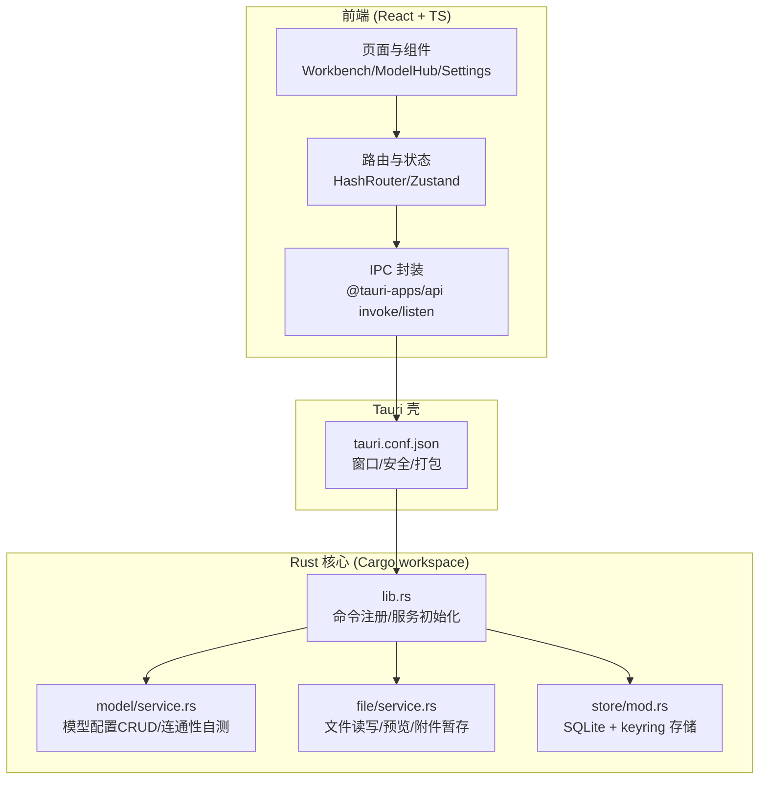
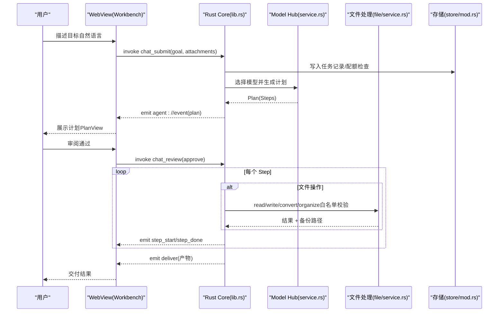
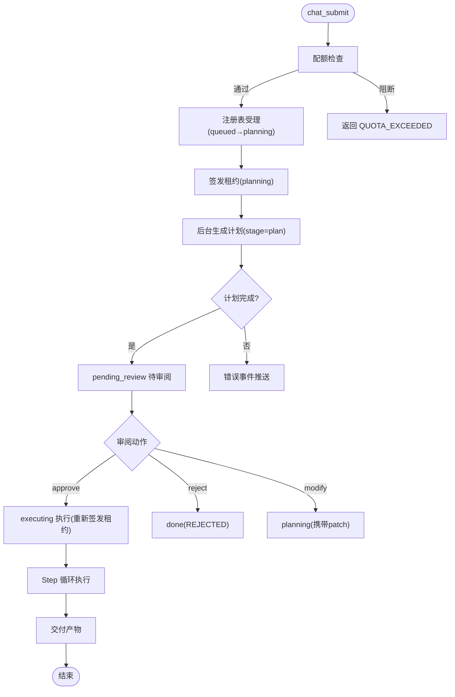
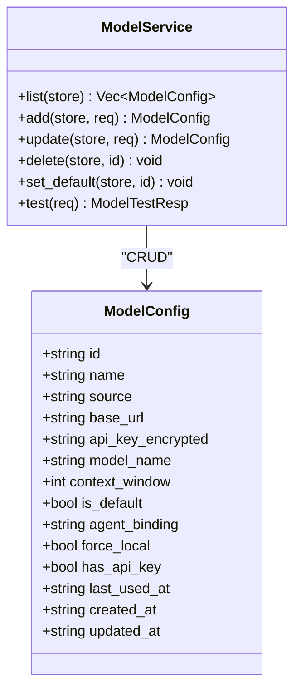
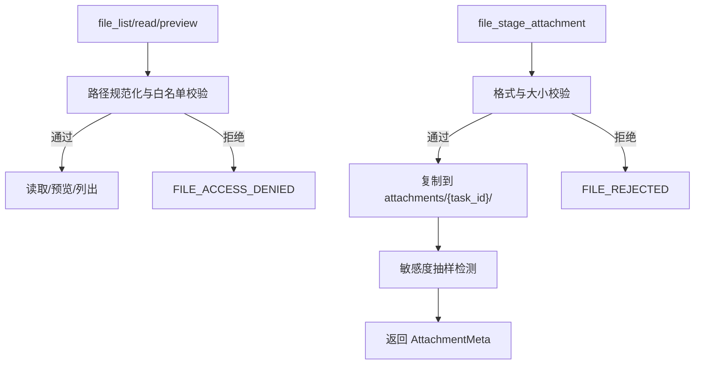
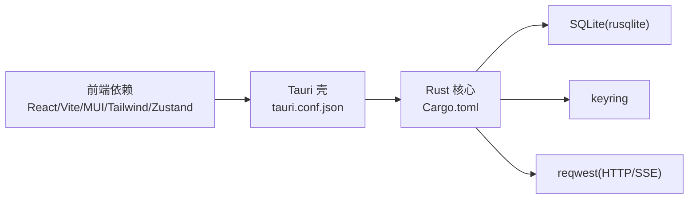

# 项目概述

<cite>
**本文引用的文件**   
- [tongtian-office-mvp-design.md](file://tongtian-office-mvp-design.md)
- [spec-通天办公-qwenpaw-改造方案.md](file://docs/spec/spec-通天办公-qwenpaw-改造方案.md)
- [package.json](file://tongtian-tauri/package.json)
- [Cargo.toml](file://tongtian-tauri/src-tauri/Cargo.toml)
- [tauri.conf.json](file://tongtian-tauri/src-tauri/tauri.conf.json)
- [vite.config.ts](file://tongtian-tauri/vite.config.ts)
- [src/main/index.ts](file://tongtian-tauri/src/main/index.ts)
- [src/renderer/App.tsx](file://tongtian-tauri/src/renderer/App.tsx)
- [src-tauri/src/main.rs](file://tongtian-tauri/src-tauri/src/main.rs)
- [src-tauri/src/lib.rs](file://tongtian-tauri/src-tauri/src/lib.rs)
- [src-tauri/src/model/service.rs](file://tongtian-tauri/src-tauri/src/model/service.rs)
- [src-tauri/src/file/service.rs](file://tongtian-tauri/src-tauri/src/file/service.rs)
- [src-tauri/src/store/mod.rs](file://tongtian-tauri/src-tauri/src/store/mod.rs)
</cite>

## 目录
1. [引言](#引言)
2. [项目结构](#项目结构)
3. [核心组件](#核心组件)
4. [架构总览](#架构总览)
5. [详细组件分析](#详细组件分析)
6. [依赖分析](#依赖分析)
7. [性能考量](#性能考量)
8. [故障排查指南](#故障排查指南)
9. [结论](#结论)

## 引言
通天办公是一款「本地优先」的 AI 工作助手桌面应用，核心价值在于以安全、可控、低资源占用的方式，将多模型能力与文件处理、任务编排、企业级安全策略融合到统一的对话工作台。项目采用 Tauri 2.x + Rust 作为后端核心，前端为 React + TypeScript，通过 IPC 与 Rust 后端交互，实现“数据不出域、能力可审计、体积与启动体验达标”的企业级交付目标。

设计理念要点：
- 本地优先：运行目录即数据根，SQLite + 系统密钥库存储，敏感信息不落明文；文件操作受白名单与配额控制。
- 模型编排而非推理引擎：Rust 侧直连 OpenAI 兼容 / Ollama / 预置云端，统一 Adapter/Router/Observer 三层抽象，支持降级与观测。
- 计划审阅（Plan-and-Execute）：先出计划供用户审阅，再执行步骤，支持暂停/继续/回滚，增强可控性。
- 安全基线：Tauri capability 默认拒绝制，WebView 无系统 API 直达；文件访问白名单、沙箱策略、审计日志贯穿全链路。

技术栈概览：
- 桌面壳：Tauri 2.x（单二进制分发、极小安装包、秒开体验）
- 后端：Rust（tokio、reqwest、rusqlite、keyring、tracing）
- 前端：React 18 + TypeScript + MUI + Tailwind + Zustand
- 可选 sidecar：Python 仅辅助工具（如高保真转换），默认不随包分发

与传统 Electron 方案的对比优势：
- 体积与内存：安装包约 25MB（压缩后约 12MB），空闲内存约 120-150MB，显著优于 Electron 的 ~120MB+ 与 ~300MB+ 内存占用。
- 运行时依赖：无 Node/Python 运行时依赖，单二进制分发简化部署与自动更新。
- 安全模型：capability 白名单 + 内存安全，WebView 无系统 API 直达，攻击面收敛。
- 开发体验：前端仍全 TS，IPC 封装层最小改动即可迁移。

**章节来源**
- [tongtian-office-mvp-design.md:10-40](file://tongtian-office-mvp-design.md#L10-L40)
- [spec-通天办公-qwenpaw-改造方案.md:24-55](file://docs/spec/spec-通天办公-qwenpaw-改造方案.md#L24-L55)

## 项目结构
项目采用前后端分离、Rust crate 化模块边界清晰的组织方式：
- 前端（src/renderer）：页面与组件按功能划分，路由集中管理，状态使用 Zustand，异步请求由 React Query 管理（可选）。
- 后端（src-tauri）：Rust 核心承载 Agent 引擎、Model Hub、文件处理、存储等能力；通过 tauri::command 暴露给前端。
- 共享类型（shared）：ts-rs 自动生成 TS 类型，契约先行，避免双端类型漂移。
- 配置与构建：Vite 负责前端构建，Tauri 配置打包与安全策略。

**图表来源**
- [tauri.conf.json:1-40](file://tongtian-tauri/src-tauri/tauri.conf.json#L1-L40)
- [src-tauri/src/lib.rs:747-800](file://tongtian-tauri/src-tauri/src/lib.rs#L747-L800)
- [src-tauri/src/model/service.rs:1-120](file://tongtian-tauri/src-tauri/src/model/service.rs#L1-L120)
- [src-tauri/src/file/service.rs:1-120](file://tongtian-tauri/src-tauri/src/file/service.rs#L1-L120)
- [src-tauri/src/store/mod.rs:1-52](file://tongtian-tauri/src-tauri/src/store/mod.rs#L1-L52)

**章节来源**
- [package.json:1-45](file://tongtian-tauri/package.json#L1-L45)
- [vite.config.ts:1-25](file://tongtian-tauri/vite.config.ts#L1-L25)
- [src/renderer/App.tsx:1-80](file://tongtian-tauri/src/renderer/App.tsx#L1-L80)

## 核心组件
- 任务与工作流：chat_submit/chat_review/chat_control/chat_history 等命令构成两阶段协议（计划生成→审阅→执行），支持暂停/继续/回滚与事件重放。
- 模型接入：Model Hub 提供 CRUD 与连通性自测，API Key 经 keyring 保管，DB 仅存引用标记。
- 文件处理：白名单校验、大小限制、预览与附件暂存，支持文本类直接预览，复杂格式提示转换能力下批落地。
- 存储与密钥：SQLite 持久化（tasks/model_configs/settings_kv/schema_version），keyring 系统密钥库，运行目录可被环境变量覆盖。
- 前端路由与页面：集中式路由管理 Workbench/ModelHub/Settings 等页面，懒加载提升首屏性能。

**章节来源**
- [src-tauri/src/lib.rs:125-237](file://tongtian-tauri/src-tauri/src/lib.rs#L125-L237)
- [src-tauri/src/model/service.rs:125-215](file://tongtian-tauri/src-tauri/src/model/service.rs#L125-L215)
- [src-tauri/src/file/service.rs:136-197](file://tongtian-tauri/src-tauri/src/file/service.rs#L136-L197)
- [src-tauri/src/store/mod.rs:24-52](file://tongtian-tauri/src-tauri/src/store/mod.rs#L24-L52)
- [src/renderer/App.tsx:50-77](file://tongtian-tauri/src/renderer/App.tsx#L50-L77)

## 架构总览
整体架构遵循“前端轻量 + Rust 核心 + 模型编排”的分层模式：
- 前端通过 @tauri-apps/api 调用 Rust command，监听 agent://event 事件流。
- Rust 核心维护任务注册表、租约、配额、事件存储与持久化，协调 Agent 引擎与文件/模型能力。
- 模型层通过 reqwest 直连 OpenAI 兼容/Ollama/预置云端，支持超时、重试与降级。
- 文件层严格白名单与大小限制，附件暂存至工作区目录并做敏感度抽样检测。

**图表来源**
- [src-tauri/src/lib.rs:125-237](file://tongtian-tauri/src-tauri/src/lib.rs#L125-L237)
- [src-tauri/src/model/service.rs:347-421](file://tongtian-tauri/src-tauri/src/model/service.rs#L347-L421)
- [src-tauri/src/file/service.rs:270-345](file://tongtian-tauri/src-tauri/src/file/service.rs#L270-L345)
- [src-tauri/src/store/mod.rs:24-52](file://tongtian-tauri/src-tauri/src/store/mod.rs#L24-L52)

## 详细组件分析

### 任务与工作流（chat_submit/chat_review/chat_control）
- 提交任务：配额闸门 → 任务注册表受理 → 租约签发 → 后台执行计划生成（stage=plan）→ 进入 pending_review。
- 审阅计划：approve→executing（重新签发租约）/ reject→done(REJECTED) / modify→planning（携带 patch 重新生成 plan）。
- 控制任务：pause/resume/rollback_to，状态机严格校验，失败返回 VALIDATION_ERROR。
- 历史查询：按更新时间倒序返回 tasks 表摘要，含 meta（wait_reason/queue_position/retry_count/status_reason_code）。

**图表来源**
- [src-tauri/src/lib.rs:125-237](file://tongtian-tauri/src-tauri/src/lib.rs#L125-L237)
- [src-tauri/src/lib.rs:239-390](file://tongtian-tauri/src-tauri/src/lib.rs#L239-L390)

**章节来源**
- [src-tauri/src/lib.rs:125-237](file://tongtian-tauri/src-tauri/src/lib.rs#L125-L237)
- [src-tauri/src/lib.rs:239-390](file://tongtian-tauri/src-tauri/src/lib.rs#L239-L390)
- [src-tauri/src/lib.rs:392-483](file://tongtian-tauri/src-tauri/src/lib.rs#L392-L483)
- [src-tauri/src/lib.rs:528-555](file://tongtian-tauri/src-tauri/src/lib.rs#L528-L555)

### 模型接入（Model Hub）
- CRUD：list/add/update/delete/set_default，API Key 经 vault(keyring) 存取，DB 仅存 has_api_key 标记。
- 连通性自测：OpenAI 兼容 /chat/completions 最小探测（超时 10s），顺带拉取可用模型列表（/models）。
- 错误分类：AUTH_FAILED/CONNECTION_FAILED/超时，返回 latency_ms 与 model 名称。

**图表来源**
- [src-tauri/src/model/service.rs:10-33](file://tongtian-tauri/src-tauri/src/model/service.rs#L10-L33)
- [src-tauri/src/model/service.rs:125-215](file://tongtian-tauri/src-tauri/src/model/service.rs#L125-L215)
- [src-tauri/src/model/service.rs:347-421](file://tongtian-tauri/src-tauri/src/model/service.rs#L347-L421)

**章节来源**
- [src-tauri/src/model/service.rs:125-215](file://tongtian-tauri/src-tauri/src/model/service.rs#L125-L215)
- [src-tauri/src/model/service.rs:347-421](file://tongtian-tauri/src-tauri/src/model/service.rs#L347-L421)

### 文件处理（白名单与附件暂存）
- 白名单校验：workspaces/{id}/files/ ∪ SandboxPolicy.file_allowlist（settings_kv 暂存），越界返回 FILE_ACCESS_DENIED。
- 读取限制：单文件 2MB 上限，二进制文件提示转换能力下批落地。
- 附件暂存：复制到 workspaces/{id}/files/attachments/{task_id}/，返回 AttachmentMeta（含敏感度抽样检测结果）。

**图表来源**
- [src-tauri/src/file/service.rs:136-197](file://tongtian-tauri/src-tauri/src/file/service.rs#L136-L197)
- [src-tauri/src/file/service.rs:270-345](file://tongtian-tauri/src-tauri/src/file/service.rs#L270-L345)

**章节来源**
- [src-tauri/src/file/service.rs:136-197](file://tongtian-tauri/src-tauri/src/file/service.rs#L136-L197)
- [src-tauri/src/file/service.rs:270-345](file://tongtian-tauri/src-tauri/src/file/service.rs#L270-L345)

### 存储与密钥（Store + Vault）
- SQLite 持久化：model_configs/tasks/settings_kv/schema_version，首次打开执行迁移，二次打开幂等。
- 密钥保管：keyring 系统密钥库，DB 仅存 has_api_key 标记，绝不落明文。
- 运行目录：TONGTIAN_HOME 环境变量覆盖，缺省 %APPDATA%\tongtian-office。

**章节来源**
- [src-tauri/src/store/mod.rs:24-52](file://tongtian-tauri/src-tauri/src/store/mod.rs#L24-L52)
- [src-tauri/src/store/mod.rs:54-104](file://tongtian-tauri/src-tauri/src/store/mod.rs#L54-L104)

### 前端路由与页面
- 路由：HashRouter 统一管理 Workbench/ModelHub/Security/Extensions/SkillMarket/WorkspacePanel/FilePanel/Schedule/Settings/Hooks/Awareness/ComputerUse/IM/Archive 等页面。
- 懒加载：Suspense + lazy 提升首屏性能。
- 主题与样式：MUI + Tailwind，清新视觉风格。

**章节来源**
- [src/renderer/App.tsx:50-77](file://tongtian-tauri/src/renderer/App.tsx#L50-L77)

## 依赖分析
- 前端依赖：React 18、TypeScript、Vite、@tauri-apps/api、MUI、Tailwind、Zustand。
- 后端依赖：tauri 2.x、tokio、reqwest、rusqlite、keyring、serde_json、uuid。
- 构建配置：Vite 端口 7173，Tauri 配置窗口尺寸与打包图标。

**图表来源**
- [package.json:15-28](file://tongtian-tauri/package.json#L15-L28)
- [Cargo.toml:21-34](file://tongtian-tauri/src-tauri/Cargo.toml#L21-L34)
- [tauri.conf.json:12-23](file://tongtian-tauri/src-tauri/tauri.conf.json#L12-L23)

**章节来源**
- [package.json:15-28](file://tongtian-tauri/package.json#L15-L28)
- [Cargo.toml:21-34](file://tongtian-tauri/src-tauri/Cargo.toml#L21-L34)
- [tauri.conf.json:12-23](file://tongtian-tauri/src-tauri/tauri.conf.json#L12-L23)

## 性能考量
- 安装包体积：Tauri 单二进制分发，压缩后约 12MB，远优于 Electron 的 ~90MB+。
- 冷启动时间：< 1s（无 Python/Node 预热），用户体验显著提升。
- 内存占用：~120-150MB（系统 WebView 复用），适合低配办公机器。
- 并发与异步：tokio 多核运行时，reqwest 流式 SSE，文件操作白名单与大小限制避免大对象阻塞。

[本节为通用指导，无需具体文件分析]

## 故障排查指南
- 模型连接失败：检查 baseUrl、api_key、网络可达性与超时（10s），查看 ModelTestResp.error 字段。
- 文件访问被拒：确认路径在白名单内（workspaces/{id}/files/ 或 settings_kv 扩展），检查文件大小限制（2MB/50MB）。
- 任务状态异常：查看 task_state 返回的 wait_reason/status_reason_code，确认租约是否被抢占（TASK_ALREADY_RUNNING）。
- 存储问题：检查运行目录权限与 TONGTIAN_HOME 环境变量，确认数据库迁移是否成功（schema_version 表）。

**章节来源**
- [src-tauri/src/model/service.rs:347-421](file://tongtian-tauri/src-tauri/src/model/service.rs#L347-L421)
- [src-tauri/src/file/service.rs:136-197](file://tongtian-tauri/src-tauri/src/file/service.rs#L136-L197)
- [src-tauri/src/lib.rs:485-526](file://tongtian-tauri/src-tauri/src/lib.rs#L485-L526)
- [src-tauri/src/store/mod.rs:54-104](file://tongtian-tauri/src-tauri/src/store/mod.rs#L54-L104)

## 结论
通天办公以「本地优先」为核心，通过 Tauri 2.x + Rust 的技术选型，实现了体积小、启动快、内存占用低、安全基线高的企业级 AI 工作助手。其「计划审阅 + 多模型接入 + 文件处理 + 任务管理」的核心闭环，既满足初学者易用性，也为有经验开发者提供了足够的架构深度与扩展空间。未来可在向量记忆、浏览器自动化、定时任务等方向持续演进，保持生态兼容与能力等价迁移原则。

[本节为总结性内容，无需具体文件分析]