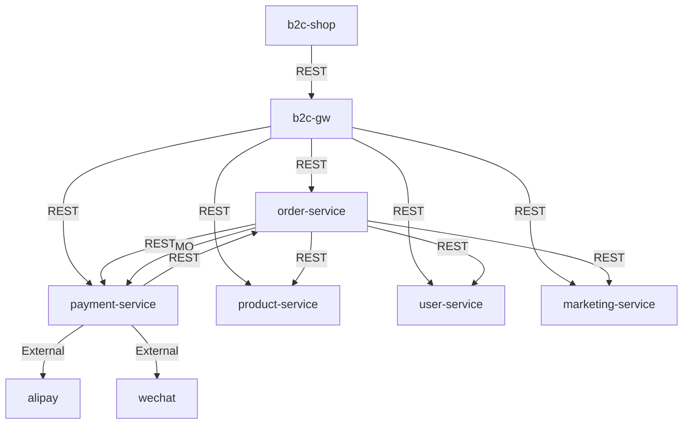

契约治理（Contract Governance）skill，用于管理模块间 API 依赖关系和版本一致性。

**触发时机**：
- `/spec` 完成后 → 自动触发 `mode=register`
- `/build` 启动前 → 自动触发 `mode=check`
- 用户手动调用 → 可选 `mode=generate-topology`

---

## Mode: register

**触发**: /spec 完成后，为刚生成 API 契约的模块注册/更新 deps.yaml。

**Input**: 模块名（如 `payment-service`）或 `--all`（遍历所有模块）

**Steps**

1. **读取 API 契约 YAML**
   - 定位 `docs/spec/spec-*-API契约.yaml` 中对应模块的文件
   - 提取 `info.version` 作为 provides.api_version
   - 提取 `paths` 下所有 operationId 作为 provides.operations 列表

2. **读取设计文档「外部依赖」章节**
   - 定位 `docs/spec/spec-*-后端模块设计文档.md` 或 `docs/spec/spec-*-前端模块设计文档.md`
   - 提取依赖的 Provider 名称、operations、dependency_type（rest_api/event_consumer/external）
   - 识别 mock_strategy 配置

3. **生成/更新 deps.yaml**
   - 如果 deps.yaml 已存在 → 合并更新（保留手工添加的注释和 notes）
   - 如果不存在 → 从 `deps-template.yaml` 复制模板并填充数据
   - 写入到 `server/<module>/deps.yaml` 或 `web/<module>/deps.yaml`

4. **回填 pinned_version（二遍模式）**
   - 当参数为 `--all` 且所有模块 spec 已完成时触发
   - 遍历所有 deps.yaml 的 consumes 条目
   - 对每个 consumes，读取对应 Provider 的 API 契约 YAML 的 `info.version`
   - 将读取到的版本号写入 `pinned_version` 字段

**Output**: 更新后的 deps.yaml 文件路径列表

**Exit Criteria**: deps.yaml 生成/更新完成，所有 provides.operations 与 API 契约一致

---

## Mode: check

**触发**: /build 启动前，作为依赖检查门禁。

**Input**: 模块名（如 `payment-service`）或 `--all`

**Steps**

1. **调用 drift-detection 脚本**
   ```bash
   python3 .qoder/skills/apex-sdd/contract-governance/scripts/drift-detection.py \
     --module <module-name> \
     --format json
   ```
   或全量扫描：
   ```bash
   python3 .qoder/skills/apex-sdd/contract-governance/scripts/drift-detection.py \
     --all \
     --format json
   ```

2. **解析检测结果**
   - 脚本输出 JSON 格式的 drift report
   - 每个条目包含：consumer_module, provider, pinned_version, actual_version, status(aligned/minor_drift/breaking_drift)

3. **根据结果决策**
   - **全部 aligned**: 输出 "✅ All contracts aligned"，继续构建流程
   - **存在 minor_drift** (non-breaking，actual > pinned 且 major 版本相同):
     - 输出警告信息
     - 在对应模块的 `tasks.md` 追加「契约对齐」任务章节
     - 不阻断构建，继续执行
   - **存在 breaking_drift** (major 版本变化):
     - 输出错误信息
     - 阻断构建，要求先完成契约对齐
     - 列出具体哪些操作可能受影响

4. **输出格式**
   ```
   ## Contract Governance Check
   
   Module: <module-name>
   Status: PASS / WARN / BLOCK
   
   | Provider | Pinned | Actual | Status |
   |----------|--------|--------|--------|
   | order-service | 1.0.0 | 1.0.0 | ✅ aligned |
   | payment-service | 1.0.0 | 1.1.0 | ⚠️ minor drift |
   ```

**Exit Criteria**: drift 检测完成，构建决策已做出（继续/阻断）

---

## Mode: generate-topology

**触发**: 用户手动调用，用于生成全局依赖视图。

**Input**: 无参数或 `--output <path>`

**Steps**

1. **扫描所有 deps.yaml**
   - 遍历 `server/*/deps.yaml` 和 `web/*/deps.yaml`
   - 解析每个文件的 provides 和 consumes

2. **生成 Mermaid 依赖拓扑图**
   ```bash
   python3 .qoder/skills/apex-sdd/contract-governance/scripts/drift-detection.py \
     --topology \
     --format mermaid
   ```

3. **输出**
   - 默认输出到 stdout（Mermaid 格式）
   - 如指定 `--output` 则写入文件

**Output Example**:


**Exit Criteria**: Mermaid 图生成完成

---

## Guardrails

- 不修改 API 契约 YAML 文件本身（只读取）
- 不修改设计文档（只读取）
- deps.yaml 的 provides.operations 必须与 API 契约 YAML 中的 operationId 一致
- pinned_version 只能通过 register --all 模式自动回填，不允许手工猜测
- breaking drift 必须阻断构建，不允许跳过
- drift-detection.py 脚本必须可独立运行（无需 skill 上下文）
